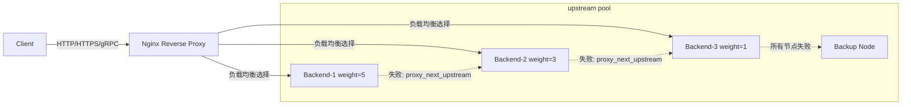
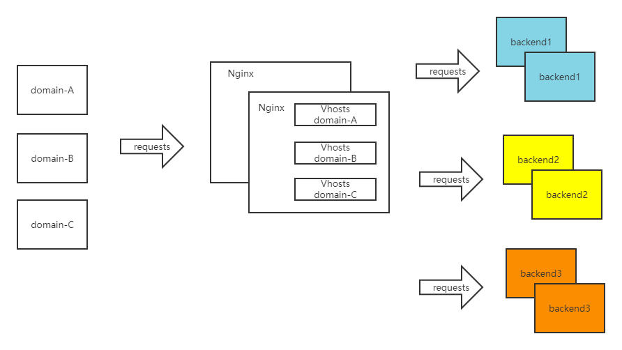
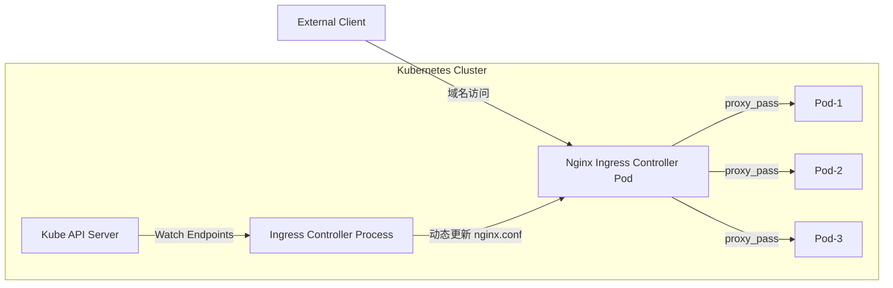
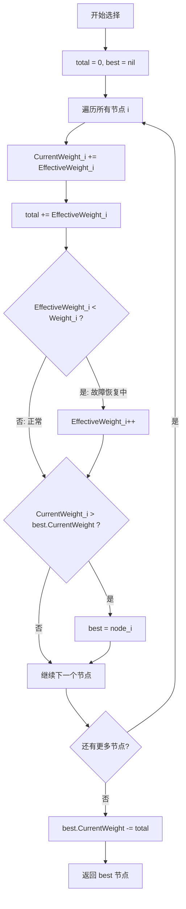
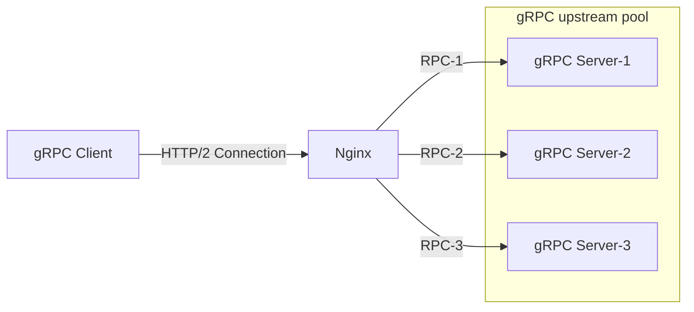

##  0x00    前言
本文总结下笔者在使用 Nginx 的一些经验总结（主要用于反向代理），内容涵盖以下几个方面：

-   Nginx upstream 负载均衡的配置与多种算法模式
-   Nginx 反向代理的后端容错机制（`proxy_next_upstream`）
-   平滑加权轮询算法（SWRR）的原理与实现
-   Nginx 对 gRPC 反向代理的支持（HTTP/2 场景）
-   Nginx 在 Kubernetes 中的部署与 DNS resolver 问题

Nginx 作为反向代理的核心请求流转架构如下：



##	0x01	Nginx 中的负载均衡介绍

2019 下半年，笔者在私有化 SaaS 项目，使用 [Nginx C Module](https://github.com/nginx-modules/nginx-c-function) 与[企业微信 OpenAPI](https://work.weixin.qq.com/api/doc/90001/90142/90594)实现了一个 OAuth 认证网关（提供 WebApi 调用鉴权），过程中对 Nginx 的模块开发、负载均衡 upstream、proxy-pass 等一些机制，有了一些深入的了解。这篇博客就来聊聊 Nginx 中的负载均衡机制。项目中的部署架构如下：



#### 介绍
Nginx 提供了 [upstream](http://tengine.taobao.org/book/chapter_05.html) 机制，来实现访问后端时的负载均衡。模块的具体使用说明（翻译版本）在此: [`ngx_http_upstream_module`](https://tengine.taobao.org/nginx_docs/cn/docs/http/ngx_http_upstream_module.html)
#### 负载均衡指令及含义
`upstream`用于定义一组用于实现  Nginx 负载均衡的服务器，后端可以监听在不同的端口。配合`proxy_pass`指令就实现了常用的反向代理机制。常用的配置方式如下：

```text
#在 http 节点下，加入 upstream 节点
upstream backend {
    server 1.2.3.4:7080;
    server 1.2.3.5:7080;
    server 1.2.3.6:7080;
}
#将 server 节点下的 location 节点中的 proxy_pass 配置为：http:// + upstream 名称，即 http://xxxx
location / {
    root  html;
    index  index.html index.htm;
    proxy_pass http://backend;
}
```

或者如下配置：
``` text
upstream backend {
    server backend1.example.com       weight=5;
    server backend2.example.com:8080;
    server unix:/tmp/backend3;
	server	1.2.3.4:8081;

    server backup1.example.com:8080   backup;
    server backup2.example.com:8080   backup;
}

server {
    location / {
        proxy_pass http://backend;		#We USE proxy_pass
    }
}
```

支持的配置项详细说明如下：

1、参数：server 地址<br>
可定义如下参数：
* `weight`=number：权重
* `max_fails`=number：设置在 `fail_timeout` 参数设置的时间内最大失败次数，如果在这个时间内，所有针对该服务器的请求都失败了，那么认为该服务器会被认为是停机了，停机时间是 `fail_timeout` 设置的时间。默认情况下，不成功连接数被设置为 `1`，被设置为`0`则表示不进行链接数统计
* `fail_timeout`=time：如上
* `backup`：标记该服务器为备用服务器。当主服务器停止时，请求会被发送到此
* `down`：标记服务器永久停机了；与指令 ip_hash 一起使用


#### 负载均衡模式
1、weight roundrobin（内置）- 带权重的轮询<br>
默认方式，每个请求按时间顺序逐一分配到不同的后端服务器，如果超过了最大失败次数后（`max_fails`, 默认 1），在失效时间内 (`fail_timeout`，默认 `10` 秒)，该节点失效权重变为 `0`，超过失效时间后，则恢复正常，或者全部节点都为 down 后，那么将所有节点都恢复为有效继续探测。Nginx 实现了一个非常优秀的 [带权重的负载均衡算法](https://github.com/phusion/nginx/commit/27e94984486058d73157038f7950a0a36ecc6e35)，此算法具备极好的平滑性

包含了Round Robin 或者 Weighted Round Robin
-   普通轮询方式：每个请求按时间顺序（全局 Index）逐一分配到不同的后端服务器，如果后端服务器 down 掉，Nginx 会通过 `max_fails` 和 `fail_timeout` 机制被动检测并临时剔除故障后端，当超过 `fail_timeout` 时间后自动恢复探测
-   加权轮询方式：机器按照权重权限，首先将请求都分配给权重最高的机器，如果该机器成功建立连接将会把权重值减去`1`重排。如果后端某台服务器宕机，故障系统被自动剔除。当所有后端机器都 down 掉时，Nginx 会立即将所有机器的标志位清成初始状态，以避免造成所有的机器都处在 timeout 的状态

```text
upstream backendpoint1 {
  server 1.1.1.1:8080;
  server 2.2.2.2:8080;
}

upstream backendpoint2 {
  server 1.1.1.1:8080 weight=10;
  server 2.2.2.2:8080 weight=10;
}
```

2、ip_hash（内置）<br>
每个请求按访问 ip 的 hash 结果分配，这样每个Client固定访问一个后端服务器，可以解决 session 的问题，但是 ip_hash 会造成负载不均，有的服务请求接受多，有的服务请求接受少，所以不建议采用 ip_hash 模式，session 共享问题可用后端服务的 session 共享代替 nginx 的 ip_hash（比如，后端集群再实现consistent-hash算法的负载均衡）

PS：基于客户端 ip 的负载均衡算法, IPV4 的前 `3` 个八位组（octet）和所有的 IPV6 地址被用作一个 hashkey

```text
upstream backendpoint3 {
  ip_hash;
  server 1.1.1.1:8080;
  server 2.2.2.2:8081;
}
```

3、fair（扩展）<br>
其原理是根据后端服务器的响应时间判断负载情况，从中选出负载最轻的机器进行分流

```text
upstream backserver {
  server server1;
  server server2;
  fair;
}
```

4、url_hash（扩展）<br>
和 ip_hash 算法类似，是对每个请求按 `url` 的 hash 结果分配，使每个 `url` 定向到一个同一个后端 Server

```text
upstream backserver {
  server squid1:3128;
  server squid2:3128;
  hash $request_uri;
  hash_method crc32;
}
```

5、session_sticky<br>
依赖第三方模块 `nginx-sticky-module`，通过 cookie 黏贴的方式将来自同一个客户端（浏览器）的请求发送到同一个后端服务器上处理；这个模块并不合适不支持 Cookie 或手动禁用了 cookie 的浏览器，此时默认 sticky 就会切换成 RR。它不能与 ip_hash 同时使用

```text
sticky [name=route] [domain=.foo.bar] [path=/] [expires=1h] [hash=index|md5|sha1] [no_fallback];
```

####    Nginx 与 Kubernetes 的结合

在 Kubernetes 集群中，Nginx 通常以两种方式承担反向代理角色：

**方式一：Nginx Ingress Controller（推荐）**

[Nginx Ingress Controller](https://kubernetes.github.io/ingress-nginx/) 是 Kubernetes 官方维护的 Ingress 实现，它通过 Watch Kubernetes API 中的 Ingress / Service / Endpoints 资源变化，**自动生成并热加载** Nginx 配置，无需手动维护 upstream 列表。其核心工作流程如下：



工作原理：
1. 用户创建 Ingress 资源，声明域名到 Service 的路由规则
2. Ingress Controller 通过 Watch 机制监听 Ingress、Service、Endpoints 的变化
3. 当后端 Pod 发生扩缩容或重启时，Endpoints 列表自动更新，Ingress Controller 据此动态刷新 Nginx 的 upstream 配置（通过 Lua 动态更新，无需 reload）
4. Nginx Ingress 默认使用 Round-Robin 算法，也支持通过注解配置其他算法（如 `nginx.ingress.kubernetes.io/load-balance: "ewma"`）

**方式二：原生 Nginx + resolver（适用于 Sidecar / 独立部署场景）**

当 Nginx 不是以 Ingress Controller 方式部署，而是作为业务 Pod 中的 Sidecar 或独立 Pod 时，upstream 中引用 Kubernetes ServiceName 会面临 DNS 缓存问题——Nginx 仅在启动时解析域名，后端 Pod 重启后 IP 变化不会被感知。解决方案是通过 `resolver` + `set` 变量强制每次请求重新解析 DNS，详见本文 `0x06` 章节

**两种方式对比**

| 特性 | Nginx Ingress Controller | 原生 Nginx + resolver |
|------|--------------------------|----------------------|
| 服务发现 | 自动 Watch Endpoints | 依赖 DNS 解析 |
| 后端变化感知 | 实时（毫秒级） | 取决于 `valid` 参数 |
| 负载均衡粒度 | Pod IP 级别 | ClusterIP 级别（单 IP） |
| 配置方式 | Ingress 资源声明式 | 手动维护 nginx.conf |
| 适用场景 | 集群统一入口 | Sidecar / 特殊定制需求 |

## 0x02 Nginx 后端服务器的容错
先给一个结论，**Nginx 的 upstream 容错（健康检查）机制是有限的**。Nginx 自带是没有针对负载均衡后端节点的健康检查的，但是可以通过默认自带的 `ngx_http_proxy_module` 模块和 `ngx_http_upstream_module` 模块中的相关指令来完成当后端节点出现故障时，自动切换到下一个节点来提供访问

####    proxy_next_upstream
[`nginx_upstream_check_module`](https://github.com/yaoweibin/nginx_upstream_check_module) 是专门提供负载均衡器内节点的健康检查的第三方模块，通过它可以用来检测后端 Server 的健康状态。如果后端 Server 不可用，则后面的请求就不会转发到该节点上

####	upstream 容错机制介绍
1、Nginx 判断节点失效状态<br>
Nginx 默认判断失败节点状态以 Connect Refuse 和 timeout 状态为准，不以 HTTP 错误状态进行判断失败，因为 HTTP 只要能返回状态说明该节点还可以正常连接，所以 Nginx 判断其还是存活状态；除非添加了`proxy_next_upstream` 指令设置对 `404`、`502`、`503`、`504`、`500` 和 timeout 等错误进行切换到备机处理，在 next_upstream 过程中，会对 `fails` 进行累加，如果备机依然返回错误则直接返回错误信息（但 `404` 不进行记录到错误数，如果不配置错误状态也不对其进行错误状态记录）

总之，Nginx 记录错误数量只记录 timeout 、connect refuse、`502`、`500`、`503`、`504` 这几类状态，timeout 和 connect refuse 是永远被记录错误状态，而 `502`、`500`、`503`、`504` 只有在配置 `proxy_next_upstream`后 Nginx 才会记录这 `4` 种 HTTP 错误到 `fails` 中，当 `fails>=max_fails` 时，则Nginx判断该节点失效

2、Nginx 处理节点失效和恢复的触发条件<br>
Nginx 可以通过设置 `max_fails`（即最大尝试失败次数）和 `fail_timeout`（失效时间，在到达最大尝试失败次数后，在 `fail_timeout` 的时间范围内节点被置为失效，除非所有节点都失效，否则该时间内，节点不进行恢复）对节点失败的尝试次数和失效时间进行设置，当超过最大尝试次数或失效时间未超过配置失效时间，则 Nginx 会对节点状会置为失效状态，Nginx 不对该后端进行连接，直到超过失效时间或者所有节点都失效后，该节点重新置为有效，重新探测

3、所有节点失效后 Nginx 将重新恢复所有节点进行探测<br>
如果探测所有节点均失效，备机也为失效时，那么 Nginx 会对所有节点恢复为有效，重新尝试探测有效节点，如果探测到有效节点则返回正确节点内容，如果还是全部错误，那么继续探测下去，当没有正确信息时，节点失效时默认返回状态为 `502`，但是下次访问节点时会继续探测正确节点，直到找到正确的为止

####    介绍：proxy_next_upstream 机制
Nginx 通过 [`proxy_next_upstream`](http://nginx.org/en/docs/http/ngx_http_proxy_module.html#proxy_next_upstream) 指令实现容灾处理，ngx_http_proxy_module 模块中包括 `proxy_next_upstream` 指令

```text
语法：proxy_next_upstream error | timeout | invalid_header | http_500 | http_502 | http_503 | http_504 |http_404 | off ...;
默认值：proxy_next_upstream error timeout;
上下文：http, server, location
```

参数详细说明如下：

-   `error`：表示和后端服务器建立连接时，或者向后端服务器发送请求时，或者从后端服务器接收响应头时，出现错误
-   `timeout`：表示和后端服务器建立连接时，或者向后端服务器发送请求时，或者从后端服务器接收响应头时，出现超时。
-   `invalid_header`：表示后端服务器返回空响应或者非法响应头
-   `http_500`：表示后端服务器返回的响应状态码为 `500`
-   `http_502`：表示后端服务器返回的响应状态码为 `502`
-   `http_503`：表示后端服务器返回的响应状态码为 `503`
-   `http_504`：表示后端服务器返回的响应状态码为 `504`
-   `http_404`：表示后端服务器返回的响应状态码为 `404`
-   `off`：表示停止将请求发送给下一台后端服务器

配置示例：

```text
upstream backend {
    server 192.168.1.1:8080 max_fails=3 fail_timeout=30s;
    server 192.168.1.2:8080 max_fails=3 fail_timeout=30s;
    server 192.168.1.3:8080 backup;
}

server {
    location / {
        proxy_pass http://backend;
        proxy_connect_timeout 3s;
        proxy_read_timeout 10s;
        proxy_next_upstream error timeout http_502 http_503 http_504;
        proxy_next_upstream_timeout 10s;
        proxy_next_upstream_tries 3;
    }
}
```

上面配置的含义：当请求后端出现 `error`（连接错误）、`timeout`（超时）、`502`/`503`/`504` 状态码时，Nginx 会自动将请求转发到下一个可用的后端节点，最多重试 `3` 次，总重试时间不超过 `10s`。`192.168.1.3` 配置为 `backup`，仅在前两台主节点均不可用时才会被选中

####  proxy_next_upstream 的坑
回溯上文的描述，采用在`proxy_next_upstream`用于指定在什么情况下Nginx会将请求转移到其他服务器上。其默认值是`proxy_next_upstream error timeout`，**即发生网络错误以及超时，才会重试其他服务器**。默认情况下服务返回`500`状态码是不会重试的，如果想在响应`500`状态码时也进行重试。例如现网针对这个服务的访问，出现了500或者超时的情况，会自动重试到下一个服务器去，有如下配置：

设想若`192.168.0.1`服务器返回了超时或者`500`，那么访问 `/example/` 时应该会自动重试到下一台服务器`192.168.0.2`，但是事与愿违：

```text
upstream example_upstream{
  server 192.168.0.1 max_fails=1 fail_timeout=30s;
  server 192.168.0.2 max_fails=1 fail_timeout=30s backup;   
}
location /example/ {
   proxy_pass http://example_upstream/;
   proxy_set_header Host test.example.com;
   proxy_set_header X-Real-IP $remote_addr;
   proxy_next_upstream error timeout http_500;
}
```

[文档](http://nginx.org/en/docs/http/ngx_http_proxy_module.html#proxy_next_upstream)有如下选项`non_idempotent`的描述，意思为：如果请求使用非幂等方法（`POST`、`LOCK`、`PATCH`），请求失败后不会再到其他服务器进行重试。加上`non_idempotent`选项后，即使是非幂等请求类型（例如`POST`请求），发生错误后也会重试

```text
non_idempotent
normally, requests with a non-idempotent method (POST, LOCK, PATCH) are not passed to the next server if a request has been sent to an upstream server (1.9.13); enabling this option explicitly allows retrying such requests;
```

如果让`POST`请求也会失败重试，需要配置`non_idempotent`，如下：

```text
upstream example_upstream{
  server 192.168.0.1 max_fails=1 fail_timeout=30s;
  server 192.168.0.2 max_fails=1 fail_timeout=30s backup;
}
location /example/ {
   proxy_pass http://example_upstream/;
   proxy_set_header Host test.example.com;
   proxy_set_header X-Real-IP $remote_addr;
   proxy_next_upstream error timeout http_500 non_idempotent;
}
```
不过生产环境建议谨慎考虑添加`non_idempotent`选项，由于`POST`类操作非幂等操作，发生`500`错误可能服务器上的业务已经执行了，而重试会导致非幂等方法重复执行，从而导致业务问题

##  0x03    Nginx 对 Round-Robin 算法的优化
Smooth Weighted Round-Robin（SWRR）是 nginx 默认的加权负载均衡算法，它的重要特点是平滑，避免低权重的节点长时间处于空闲状态，因此被称为平滑加权轮询。
该算法来自 Nginx 的一次 commit：Upstream: smooth weighted round-robin balancing

Nginx 使用的平滑权重轮询算法介绍以及原理分析。

####    轮询调度的基础概念
轮询调度非常简单，就是每次选择下一个节点进行调度。比如 `{a, b, c}` 三个节点，第一次选择 a，
第二次选择 b，第三次选择 c，接下来又从头开始。

这样的算法有一个问题，在负载均衡中，每台机器的性能是不一样的，对于 `16` 核的机器跟 `4` 核的机器，
使用一样的调度次数，这样对于 `16` 核的机器的负载就会很低。这时，就引出了基于权重的轮询算法。

基于权重的轮询调度是在基本的轮询调度上，给每个节点加上权重，这样对于权重大的节点，
其被调度的次数会更多。比如 a, b, c 三台机器的负载能力分别是 `4:2:1`，则可以给它们分配的权限为 `4`, `2`, `1`。
这样轮询完一次后，a 被调用 `4` 次，b 被调用 `2` 次，c 被调用 `1` 次。

对于普通的基于权重的轮询算法，可能会产生以下的调度顺序 `{a, a, a, a, b, b, c}`。

这样的调度顺序其实并不友好，它会一下子把大压力压到同一台机器上，这样会产生一个机器一下子很忙的情况。
于是乎，就有了平滑的基于权重的轮询算法。

所谓平滑就是调度不会集中压在同一台权重比较高的机器上。这样对所有机器都更加公平。
比如，对于 `{a:5, b:1, c:1}`，产生 `{a, a, b, a, c, a, a}` 的调度序列就比 `{c, b, a, a, a, a, a}`
更加平滑。

##	0x04 Nginx 平滑的基于权重轮询算法
本节，介绍下 Nginx 平滑的基于权重轮询算法。[算法原文在此](https://github.com/phusion/nginx/commit/27e94984486058d73157038f7950a0a36ecc6e35)
描述为：
> Algorithm is as follows: on each peer selection we increase current_weight
> of each eligible peer by its weight, select peer with greatest current_weight
> and reduce its current_weight by total number of weight points distributed
> among peers.

每次（轮）算法执行 2 步，结果选择出 1 个当前节点。
1. 开始本轮选择前（第 1 轮不在此逻辑），每个节点，用它们的当前值加上它们自己的权重。
2. 选择当前值最大的节点为选中节点，并把它的当前值减去所有节点的权重总和。

从算法的描述来看，每轮需要保存节点当前（变化）的权重值。下面举个例子：

例如 `{a:5, b:1, c:1}` 三个节点。一开始我们初始化三个节点的当前值为 `{0, 0, 0}`。
选择过程如下表：

| 轮数 | 选择前的当前权重 | 选择节点 | 选择后的当前权重 |
|------|------------------|----------|------------------|
| 1    | {5, 1, 1}        | a        | {-2, 1, 1}       |
| 2    | {3, 2, 2}        | a        | {-4, 2, 2}       |
| 3    | {1, 3, 3}        | b        | {1, -4, 3}       |
| 4    | {6, -3, 4}       | a        | {-1, -3, 4}      |
| 5    | {4, -2, 5}       | c        | {4, -2, -2}      |
| 6    | {9, -1, -1}      | a        | {2, -1, -1}      |
| 7    | {7, 0, 0}        | a        | {0, 0, 0}        |

我们可以发现，a, b, c 选择的次数符合 `5:1:1` 这个权重比例，而且权重大的不会被连接选择。7 轮选择后，当前值又回到 `{0, 0, 0}`，以上操作可以一直循环，一样符合平滑和基于权重。不但实现了基于权重的轮询算法，而且还实现了平滑的算法。所谓平滑，就是在一段时间内，不仅服务器被选择的次数的分布和它们的权重一致，而且调度算法还比较均匀的选择服务器，而不会集中一段时间之内只选择某一个权重比较高的服务器。如果使用随机算法选择或者普通的基于权重的轮询算法，就比较容易造成某个服务集中被调用压力过大。

举个例子，比如权重为 `{a:5, b:1, c:1}` 的一组服务器，Nginx 的平滑的轮询算法选择的序列为 `{ a, a, b, a, c, a, a }`，这显然要比 `{ c, b, a, a, a, a, a }` 序列更平滑，更合理，不会造成对 a 服务器的集中访问

####    SWRR 算法流程

每次调用选择函数时，算法按照如下流程执行：



####    实现示例

```golang
type smoothWeighted struct {
	Item            interface{}
	Weight          int
	CurrentWeight   int
	EffectiveWeight int
}

func nextSmoothWeighted(items []*smoothWeighted) (best *smoothWeighted) {
	total := 0

	for i := 0; i < len(items); i++ {
		w := items[i]

		if w == nil {
			continue
		}

		w.CurrentWeight += w.EffectiveWeight
		total += w.EffectiveWeight
		if w.EffectiveWeight < w.Weight {
			w.EffectiveWeight++
		}

		if best == nil || w.CurrentWeight > best.CurrentWeight {
			best = w
		}

	}

	if best == nil {
		return nil
	}

	best.CurrentWeight -= total
	return best
}
```

####    EffectiveWeight 的作用

上述代码中 `smoothWeighted` 结构体有三个权重相关字段，各自的含义如下：

| 字段 | 含义 | 变化规则 |
|------|------|----------|
| `Weight` | 配置的原始权重，初始化后不变 | 固定值 |
| `EffectiveWeight` | 有效权重，初始值等于 `Weight` | 后端通信失败时降低，每轮选择时逐步恢复（+1），直至等于 `Weight` |
| `CurrentWeight` | 当前动态权重，每轮参与计算 | 每轮加 `EffectiveWeight`，被选中后减去 `total` |

`EffectiveWeight` 的设计目的是实现**故障降权与渐进恢复**：当某个后端节点出现通信失败时，Nginx 会降低该节点的 `EffectiveWeight`（在 C 实现中通过 `peer->effective_weight--` 完成），使得该节点在后续轮次中被选中的概率降低。每次执行选择算法时，如果 `EffectiveWeight < Weight`，则将 `EffectiveWeight` 自增 `1`，逐步恢复到原始权重。这种渐进恢复机制避免了故障恢复后瞬间涌入大量流量

####    平滑性的正确性分析

SWRR 算法的平滑性可以从以下几个性质来理解：

1. **权重守恒**：每轮选择中，所有节点的 `CurrentWeight` 之和保持不变。每轮加上的总量为 `sum(EffectiveWeight)`，减去的总量也是 `sum(EffectiveWeight)`（仅对选中节点执行减操作），因此总和恒定为初始值（`0`）

2. **周期性**：经过 `sum(Weight)` 轮选择后，每个节点恰好被选中 `Weight_i` 次，且所有节点的 `CurrentWeight` 回到初始状态 `{0, 0, ..., 0}`，算法进入下一个完整周期

3. **均匀分布**：在一个完整周期内，权重较高的节点不会被连续集中选择。这是因为每次选中后，该节点的 `CurrentWeight` 会被大幅减去 `total`，使其在紧接着的几轮中不太可能再次成为最大值，从而将选择机会让给其他节点

##  0x05  Nginx 对 gRPC 负载均衡的支持

Nginx 从 `1.13.10` 版本开始 [正式支持 gRPC 代理](https://www.nginx.com/blog/nginx-1-13-10-grpc/)，通过新增的 `grpc_pass` 指令实现对 gRPC 服务的反向代理和负载均衡

####    grpc_pass 与 proxy_pass 的区别

| 特性 | `proxy_pass` | `grpc_pass` |
|------|-------------|-------------|
| 协议 | HTTP/1.0, HTTP/1.1 | HTTP/2（gRPC 底层协议） |
| 连接方式 | 默认短连接，可配 keepalive | 默认 HTTP/2 长连接 |
| 数据格式 | 任意 HTTP body | Protocol Buffers（二进制帧） |
| 流式支持 | 不支持 | 支持 Unary / Server-Streaming / Client-Streaming / Bidirectional |
| 指令前缀 | `proxy_*` | `grpc_*`（如 `grpc_read_timeout`、`grpc_send_timeout`） |

####    HTTP/2 长连接对负载均衡的影响

gRPC 基于 HTTP/2，一个 TCP 连接可以承载多个并发 Stream（请求）。这带来一个关键问题：**如果 Nginx 与后端之间只建立了一条 HTTP/2 连接，那么所有请求都会发往同一个后端，负载均衡将失效**

Nginx 的 `grpc_pass` 在这方面的处理方式是：**对每个客户端请求，Nginx 都会从 upstream pool 中独立选择一个后端**，即便底层复用了同一条 HTTP/2 连接。因此 Nginx 的 gRPC 反向代理能够实现**请求级别（per-RPC）的负载均衡**，而非连接级别



####    基本配置示例（明文 gRPC）

```text
upstream grpc_servers {
    server 127.0.0.1:10006;
    server 127.0.0.1:10007;
    server 127.0.0.1:10008;
}

server {
    listen       8080 http2;
    server_name  localhost;

    location / {
        grpc_pass grpc://grpc_servers;
        error_page 502 = /error502grpc;
    }

    location = /error502grpc {
        internal;
        default_type application/grpc;
        add_header grpc-status 14;
        add_header grpc-message "unavailable";
        return 204;
    }
}
```

####    TLS 终结配置（gRPCS）

生产环境通常需要 TLS 加密。Nginx 可以作为 TLS 终结点，客户端通过 TLS 连接 Nginx，Nginx 以明文方式转发到后端 gRPC 服务：

```text
upstream grpc_servers {
    server 127.0.0.1:10006;
    server 127.0.0.1:10007;
}

server {
    listen       443 ssl http2;
    server_name  grpc.example.com;

    ssl_certificate     /etc/nginx/ssl/server.crt;
    ssl_certificate_key /etc/nginx/ssl/server.key;
    ssl_protocols       TLSv1.2 TLSv1.3;

    location / {
        grpc_pass grpc://grpc_servers;
    }
}
```

如果后端 gRPC 服务本身也启用了 TLS，则使用 `grpcs://` 协议：

```text
location / {
    grpc_pass grpcs://grpc_servers;
}
```

####    gRPC 健康检查

Nginx 开源版本不支持主动健康检查，但可通过 `proxy_next_upstream` 的等价机制 `grpc_next_upstream` 实现被动容错：

```text
location / {
    grpc_pass grpc://grpc_servers;
    grpc_next_upstream error timeout;
    grpc_next_upstream_timeout 5s;
    grpc_next_upstream_tries 2;
}
```

如需主动健康检查，可以考虑 Nginx Plus（商业版）或使用 [gRPC Health Checking Protocol](https://github.com/grpc/grpc/blob/master/doc/health-checking.md) 配合外部脚本实现

##  0x06  Nginx 配置中的resolver

####  背景&&问题引入
在笔者的工作项目中，有一个基于openresty的Nginx网关（基于kubernetes部署），Nginx配置如下：

```text
worker_processes  1;

#error_log  logs/error.log;
#error_log  logs/error.log  notice;
#error_log  logs/error.log  info;

#pid        logs/nginx.pid;

events {
    worker_connections  1024;
}

http {
    include       mime.types;
    default_type  application/octet-stream;
    resolver 8.8.8.8 ipv6=off;

    #log_format  main  '$remote_addr - $remote_user [$time_local] "$request" '
    #                  '$status $body_bytes_sent "$http_referer" '
    #                  '"$http_user_agent" "$http_x_forwarded_for"';

    #access_log  logs/access.log  main;

    sendfile        on;
    #tcp_nopush     on;

    #keepalive_timeout  0;
    keepalive_timeout  65;

    #gzip  on;

    lua_package_path '/usr/local/openresty/nginx/lua/?.lua;$prefix/lua/?.lua;/blah/?.lua;;';
    lua_code_cache   off;
    #下面为业务配置
    include /usr/local/openresty/nginx/conf.d/*.conf;
}
```

业务配置如下：
```text
upstream backend_service {
    server xx-serv-cgi:9081;  #xx-serv-cgi 是kubernetes的ServiceName
}

server {
    listen       443 ssl;
    ssl_certificate     ../conf/server.crt;
    ssl_certificate_key  ../conf/server.key;

    ssl_session_timeout  5m;
    ssl_protocols TLSv1.2;
    ssl_prefer_server_ciphers   on;

    server_name  localhost;
    root   /usr/local/openresty/nginx/html/bf.ied.com/;
    index  index.html;

    #使用lua认证
    access_by_lua_file  lua/access.lua;

    location ^~ /somepath/ {
      proxy_set_header X-Real-IP $remote_addr;
      proxy_set_header Cookie $http_cookie;
      proxy_set_header X-Forwarded-For $proxy_add_x_forwarded_for;
      proxy_set_header Host $host;
      proxy_pass http://backend_service/;
      proxy_pass_request_headers      on;
    }

    location / {  
        add_header Access-Control-Allow-Origin *;
        add_header Access-Control-Allow-Methods 'GET, POST, OPTIONS';
        add_header Access-Control-Allow-Headers 'DNT,X-Mx-ReqToken,Keep-Alive,User-Agent,X-Requested-With,If-Modified-Since,Cache-Control,Content-Type,Authorization';

        if ($request_method = 'OPTIONS') {
            return 204;
        }
    }
}
```

其中，反向代理的地址，即`xx-serv-cgi`是API后端的服务名字（以`ClusterIP`方式部署的服务），在此通过DNS解析拿到实际的IP
```text
upstream backend_service {
    server xx-serv-cgi:9081;  #xx-serv-cgi 是kubernetes的ServiceName
}
```

容器内的`/etc/resolv.conf`配置如下，其中nameserver为kubernetes集群的CoreDNS服务地址：
```bash
nameserver 192.168.35.98
search xxx-xxxx.svc.cluster.local svc.cluster.local cluster.local
options ndots:5
```


注意`resolver 8.8.8.8 ipv6=off;`配置为公网的DNS，上述配置部署到现网环境遇到几个问题（kubernetes集群版本`1.20.6`）：
1.  解析外网域名，错误日志出现一个`nslookup`指令完全不存在的地址导致访问超时，原因未知
2.  更换resolver配置为集群的CoreDNS地址，如`resolver 192.168.35.98 ipv6=off;`后，问题`1`解决，但是出现当重启了`xx-serv-cgi`对应的服务后，此时Nginx拿不到重启之后新的`xx-serv-cgi`的Pod地址，还是使用之前的IP连接导致出现问题，必须重启一次该openresty的Pod才能解决

那么如何解决`2`的问题？

####  问题原因&&解决
根本原因是`proxy_pass`指令后面跟域名的话并不是每次请求都会解析出此域名的IP（必须重启Nginx才能解决），所以会导致后端变化时造成服务无法访问。解决此问题，可以通过 `set` 指令设置一个变量，通过 `resolver` 实现每次访问都重新解析出IP的方式（**同时必须搭配`valid`参数使用**），如下：

```text
upstream backend_service {
    server xx-serv-cgi:9081;  #xx-serv-cgi 是kubernetes的ServiceName
}

server {
    listen 80;
    server_name xxxx;
    #resolver 是 DNS 服务器地址, valid 设定 DNS 刷新频率
    resolver 192.168.35.98 valid=5s;
    set $service_lb backend_service;

    location / {
        proxy_pass http://$service_lb;
    }
}
```

需要特别注意：
1.  `set` 指令不能写到 `location` 里面，否则不会生效
2.  `valid`为DNS请求刷新频率，即每隔`5s`后访问虚拟主机的时候就会产生一次DNS解析


##  0x07    回顾 && 总结
问题1：Nginx 的 upstream 机制支持自动剔除故障的后端吗？答案是作用有限；Nginx 的收费版本 [`Nginx-Plus`](https://www.nginx.com/products/nginx/) 提供了自动探测的能力<br>

####    项目中的配置参考
关于Nginx的域名解析配置，可以参考[Nginx resolver address from /etc/resolv.conf](https://serverfault.com/questions/638822/nginx-resolver-address-from-etc-resolv-conf)，其中提供了不少可以参考的方案

##	0x08	参考
-	[nginx 平滑的基于权重轮询算法分析](https://tenfy.cn/2018/11/12/smooth-weighted-round-robin/)
-   [Upstream: smooth weighted round-robin balancing（Nginx commit）](https://github.com/phusion/nginx/commit/27e94984486058d73157038f7950a0a36ecc6e35)
-   [加权轮询策略剖析](http://blog.csdn.net/xiajun07061225/article/details/9318871)
-   [解析 Nginx 负载均衡策略](http://www.cnblogs.com/wpjamer/articles/6443332.html)
-   [Nginx 做负载均衡器以及 Proxy 缓存配置](https://mp.weixin.qq.com/s?__biz=MzA3MzYwNjQ3NA==&mid=401736802&idx=1&sn=9508d9a05b725c66a05e05d8dad6dec1#rd)
-   [nginx的proxy_next_upstream使用中的一个坑](https://zhuanlan.zhihu.com/p/35803906)
-   [proxy_next_upstream 官方文档](http://nginx.org/en/docs/http/ngx_http_proxy_module.html#proxy_next_upstream)
-   [How To Set Up Nginx Load Balancing with SSL Termination](https://www.digitalocean.com/community/tutorials/how-to-set-up-nginx-load-balancing-with-ssl-termination)
-   [Introducing gRPC Support with NGINX 1.13.10](https://www.nginx.com/blog/nginx-1-13-10-grpc/)
-   [gRPC Health Checking Protocol](https://github.com/grpc/grpc/blob/master/doc/health-checking.md)
-   [Kubernetes Nginx Ingress Controller](https://kubernetes.github.io/ingress-nginx/)
-   [nginx中resolver参数配置解释](https://www.rootop.org/pages/4307.html)
-   [Nginx resolver address from /etc/resolv.conf](https://serverfault.com/questions/638822/nginx-resolver-address-from-etc-resolv-conf)

转载请注明出处，本文采用 [CC4.0](http://creativecommons.org/licenses/by-nc-nd/4.0/) 协议授权
