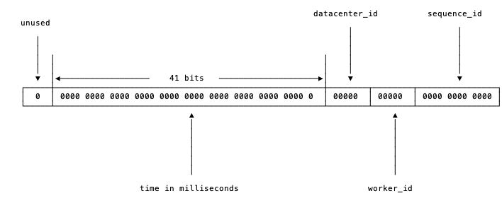
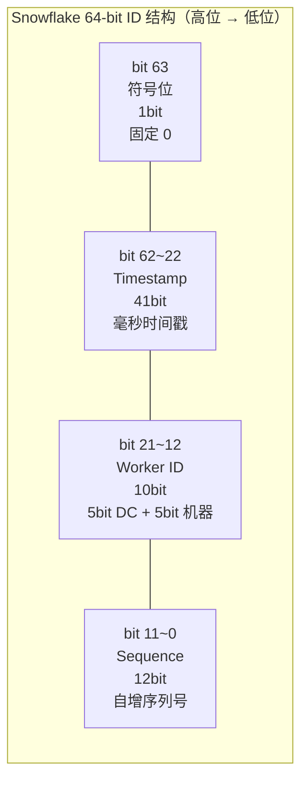
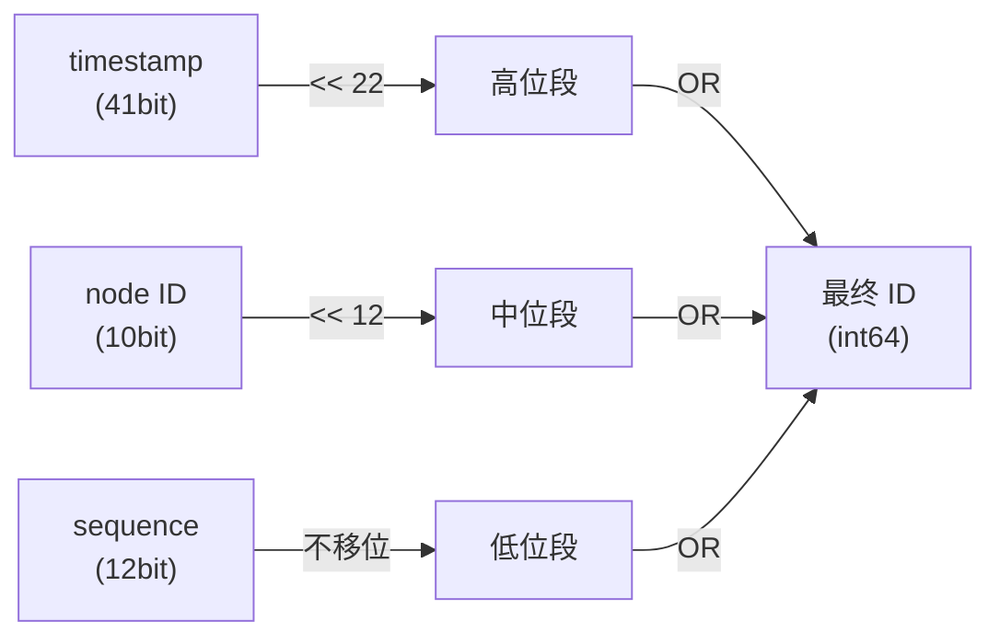
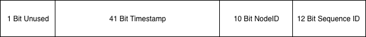
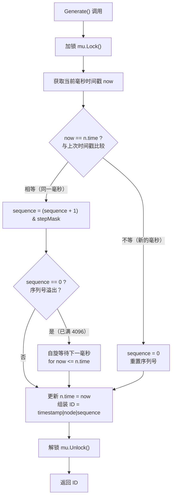
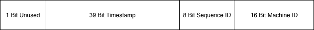
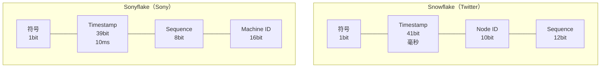
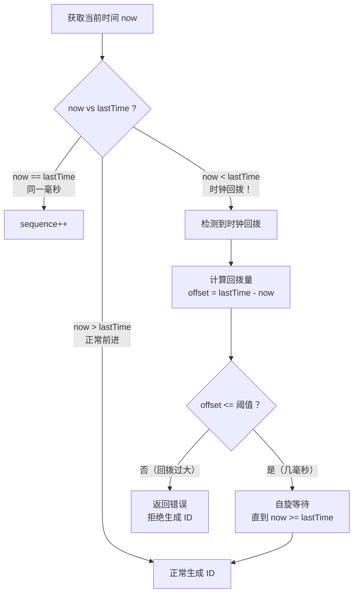

##  0x00    简介

生成器（Generator）是一种惰性计算的编程模式，核心思想是按需生成数据而非一次性计算全部结果。本文介绍如何使用 Go 的 channel 实现生成器模式，以及该模式在实际项目中的两个典型应用：OpenSSH 密钥预生成和 Snowflake 分布式 ID 生成算法

Python 中提供了 `yield` 关键字，用以实现生成器（generator）的功能。如下，计算 fibonacci 数的生成器：
```python
def fib(max):
    n,a,b =0,0,1
    while n < max:
        yield b
        a,b =b,a+b
        n = n+1
    return 'done'

a = fib(10)
print(fib(10))
```

基于 golang 的 channel 也很容易实现上述代码（注意需要加入一个控制结束的参数 `limit`）：

```go
type fibonacciChan chan int

func (f fibonacciChan) Next() *int {
	c, ok := <-f
	if !ok {
		return nil
	}
	return &c
}

func fibonacci(limit int) fibonacciChan {
	c := make(chan int)
	a := 0
	b := 1
	go func() {
		for {
			if limit == 0 {
				close(c)
				return
			}
			c <- a
			a, b = b, a+b
			limit--
		}
	}()
	return c
}
```

调用方式也很简单：

```go
// 输出 0 1 1 2 3 5 8 13 21 34 55 89 144 233 377 610 987 1597 2584 4181
f := fibonacci(20)
fmt.Printf("%v", *f.Next())
fmt.Printf("%v", *f.Next())
for r := range f {
	fmt.Printf("%v", r)
}
```


在笔者的项目中，遇到这样的场景，用来生成 `RSA-2048bit` OpenSSH 秘钥的方法，在 4 核（core），CPU 为 `Intel(R) Xeon(R) CPU E5-2680 v4 @ 2.40GHz`，平均需要 200-300ms 左右，这对于每次 SSH 登录都需要调用的方法来说，耗时还是比较久的（不必要的耗时）。如何来优化这种场景呢？

##  0x01    解决的方法

对于解决这种需要临时产生并拿来用的数据的应用场景，一个（预先 Prepared）生产者 + 消费者的模型就很适合这种场景的优化。程序启动时，生产者就开始生产 OpenSSH 秘钥，放入缓冲区 Buffer 中，待消费者来取，这样每次的耗时可以大大降低了（当然，这里不排除有消费者速度超过生产者速度的情况，需要增加缓冲区或者增多生产者来优化）。

先设计下 generator 需要实现的特性：
1.  多 Producer + 多 Consumer
2.  线程安全
3.  无阻塞，缓冲区无数据可取时，返回错误（降级，让消费者自己去生产）

配合 Golang 的 Channel 机制的线程安全特性，可以很方便的实现上述特性。

##  0x02    OpenSSH 秘钥生成器
基于 Channel 实现的 generator 的核心代码如下：

```go
type SshKey struct {
	Publickey string
	Seckey    string
}

type SshKeyGenerator struct {
	//start, step int
	Size    int
	Queue   chan SshKey
	Running bool
}

func NewGenerator(size int) *SshKeyGenerator {
	gtr := &SshKeyGenerator{
		Size:    size,
		Running: true,
		Queue:   make(chan SshKey, size),
	}
	//start producer
	go gtr.process()
	return gtr
}

func (g *SshKeyGenerator) process() {
	defer func() { recover() }()
	var i = 0
	for {
		// 先判断
		sk, pk, err := g.NewRsaKeyPair()
		if err != nil {
			fmt.Println("Generator key pairs error", err.Error())
			time.Sleep(1 * time.Second)
			continue
		}
		skeyitem := SshKey{
			Publickey: pk,
			Seckey:    sk,
		}
		select {
		case g.Queue <- skeyitem:
			i++
			//if full,block
		}
	}
}

func (g *SshKeyGenerator) Next() *SshKey {
	select {
	case it := <-g.Queue:
		return &it
	default:
		return nil
	}
}

func (g *SshKeyGenerator) Close() {
	g.Running = false
	close(g.Queue)
}
```

##	0x03    其他的应用场景：SnowFlake 分布式 ID 生成

除了密钥预生成之外，生成器模式的另一个经典应用场景是**分布式唯一 ID 生成**。Snowflake 算法是 Twitter 开源的唯一 ID 生成算法，也是生成器模式的最佳应用场景之一。主要解决了高并发时 ID 生成不重复的问题，它满足了 Twitter 每秒上万条消息的请求，使每条消息有唯一、有一定顺序的 ID ，且支持分布式生成。比如在项目中需要生成这样的一类 id：
-	要求 id 能带有 **时间信息**：这样即使后端的系统对消息进行分库分表，也能以时间顺序对这些消息进行排序
-	id 是分布式唯一的，且可以高效生成
-	id 是 `int64` 或者 `uint64` 类型
-	基于时间戳构建（同上），可以保证基本有序递增

而 snowflake 正好满足这类场景：
-	毫秒数在高位、自增序列在低位, id 都是趋势递增的
-	不依赖数据库等第三方系统、以服务方式部署
-	可以根据自身业务特性灵活分配 bit 位



如上图，`int64` 类型的 id，以 `64`bit 来存储 id，分为四个部分：
1.	开头的第一个 bit（符号位），值固定为 `0`, 以保证生成的 id 为正数（`uint64` 无此问题）
2.	`41` 位来表示收到请求时的时间戳，单位为毫秒
3.	`5` 位来表示数据中心的 id，即 `Data Center ID`
4.	`5` 位来表示机器的实例 id，即 `Worker ID`
5.	最后 `12` 位的循环自增 id（如到达 `1111,1111,1111` 后会归 `0`），值上限为 `2^12 = 4096`

直观表示 64bit ID 的各字段布局和组装过程，如下图：



ID 组装的位运算过程如下：




####	各个字段的意义

| 位段 | 位数 | 代号 | 用途 | 备注 |
| :-----:| :----: | :----: | :----: | :----: |
| 63bit | 1bit | sign（符号位） | 固定为 `0`，保证 id 为正数 | - |
| 22-62bit | 41bits | timestamp（时间戳，毫秒） | 记录生成 id 时的毫秒时间戳（相对于 epoch 的增量） | 超过 `2^41` 毫秒（约 69 年）后溢出 |
| 12-21bit | 10bits | workerid（工作节点） | 5bit 数据中心 id + 5bit 机器 id，总量为 `2^10 = 1024` | **不同机器的 workerid 不可重复** |
| 0-11bit | 12bits | sequence（序列号） | 同一毫秒内的自增序列号，总量为 `2^12 = 4096` | 归零后需等待下一毫秒 |

-	snowflake 机制在同一台机器上，同一毫秒内可以产生 `2^12 = 4096` 条消息，那么一秒共 `4096000` 条消息
-	数据中心加上实例 id 共有 `10` 位，可以支持单个数据中心部署 `2^10 = 1024` 台机器
-	timestamp 占用 `41` 位（毫秒单位），可以支持使用 `69` 年，` 2^41/86400/365/1000 = 69`，注意，这个年数是个 **跨度** 的概念。由于（目前现网中）时间毫秒计数不会真的从 `1970` 年开始记，如此这样系统跑到 `2039` 年就不能用了。所以这里的 timestamp 只是相对于某个时间的增量，一般采用系统部署正式上线的时间即可（注意如下代码实现中的 `epoch` 就是 timestamp 的初始值）

这里给出一个普通的定义：

```go
const (
 	epoch             = int64(1577808000000)                           // 起始时间戳（毫秒）
	timestampBits     = uint(41)                                       // 时间戳占用位数
	datacenteridBits  = uint(2)                                        // 数据中心 id 所占位数
	workeridBits      = uint(7)                                        // 机器 id 所占位数
	sequenceBits      = uint(12)                                       // 序列所占的位数
	timestampMax      = int64(-1 ^ (-1 << timestampBits))              // 时间戳最大值
	datacenteridMax   = int64(-1 ^ (-1 << datacenteridBits))           // 支持的最大数据中心 id 数量
	workeridMax       = int64(-1 ^ (-1 << workeridBits))               // 支持的最大机器 id 数量
	sequenceMask      = int64(-1 ^ (-1 << sequenceBits))               // 支持的最大序列 id 数量
	workeridShift     = sequenceBits                                   // 机器 id 左移位数
	datacenteridShift = sequenceBits + workeridBits                    // 数据中心 id 左移位数
	timestampShift    = sequenceBits + workeridBits + datacenteridBits // 时间戳左移位数
)
```


####	标准 snowflake 库的分析（1）
本小节简单分析下标准 snowflake 的 [实现](https://github.com/bwmarrin/snowflake)：
```text
+--------------------------------------------------------------------------+
| 1 Bit Unused | 41 Bit Timestamp |  10 Bit NodeID  |   12 Bit Sequence ID |
+--------------------------------------------------------------------------+
```



1、常量设置 <br>
-	`Epoch`：起始时间，为 `1288834974657`，即用毫秒表示的 epoch 开始时间
-	`NodeBits`：指的是机器编号的位长，为 `10`
-	`StepBits`：指的是自增序列的位长，为 `12`
-	`nodeMax`：`1023`，也即 workerid 的最大值，不可以超过此值
-	`nodeMask`：`4190208`
-	`stepMask`：`4095`
-	`timeShift`：`12`
-	`nodeShift`：`12`

```go
var (
	// Epoch is set to the twitter snowflake epoch of Nov 04 2010 01:42:54 UTC in milliseconds
	// You may customize this to set a different epoch for your application.
	Epoch int64 = 1288834974657

	// NodeBits holds the number of bits to use for Node
	// Remember, you have a total 22 bits to share between Node/Step
	NodeBits uint8 = 10

	// StepBits holds the number of bits to use for Step
	// Remember, you have a total 22 bits to share between Node/Step
	StepBits uint8 = 12

	// DEPRECATED: the below four variables will be removed in a future release.
	mu        sync.Mutex
	nodeMax   int64 = -1 ^ (-1 << NodeBits)
	nodeMask        = nodeMax << StepBits
	stepMask  int64 = -1 ^ (-1 << StepBits)
	timeShift       = NodeBits + StepBits
	nodeShift       = StepBits
)
```

这里简单列举下 `nodeMax`、`stepMask` 的计算方法如下：`-1 ^ (-1 << NodeBits)`

-	`-1` 二进制为 `11111111 11111111 11111111 11111111 11111111 11111111 11111111 11111111`
-	计算 `41`bits 的 timestamp 最大值，将 `-1` 向左位移 `41` 位即可获得，`11111111 11111111 11111110 00000000 00000000 00000000 00000000 00000000`
-	再和 `-1` 进行异或运算即可知道 `41`bits 的 timestamp 的最大值：`00000000 00000000 00000001 11111111 11111111 11111111 11111111 11111111`


1、结构 <br>
`Node` 结构中的成员初始化，见 `NewNode`[方法](https://github.com/bwmarrin/snowflake/blob/master/snowflake.go#L100)：

```go
// A Node struct holds the basic information needed for a snowflake generator
// node
type Node struct {
	mu    sync.Mutex
	epoch time.Time		// 设置起始时间 (时间戳 / 毫秒)：2020-01-01 00:00:00，有效期 69 年
	time  int64			// 用于保存上一次的毫秒时间戳
	node  int64
	step  int64

	nodeMax   int64
	nodeMask  int64
	stepMask  int64
	timeShift uint8
	nodeShift uint8
}
```

2、核心方法 <br>

生成 id 的算法比较容易理解，步骤如下（注意加锁）：
0.	加锁
1.	获取当前的毫秒时间戳
2.	用当前的毫秒时间戳和上次保存的时间戳进行比较
	-	如果和上次保存的时间戳相等，那么对序列号 `sequence+1`（取 mod）
	-	如果不相等，那么直接设置 sequence 为 `0` 即可（重置 sequence）
3.	然后通过 `|` 运算拼接 snowflake 需要返回的 `int64` id 返回值
4. 	解锁

注意下面代码中最后 `r` 生成的位运算，本质就是按照从低位到高位，通过 `|` 运算拼接各字段组成最终的 id 值：
-	`(now)<<n.timeShift`：将 `41` 位的 timestamp 左移 `22` 位（`NodeBits + StepBits`）到最高有效位段
-	`(n.node << n.nodeShift)`：将 `10` 位的 node ID 左移 `12` 位（`StepBits`）到中间位段
-	`(n.step)`：`12` 位的 sequence 位于最低位段，无需移位

```go
// Generate creates and returns a unique snowflake ID
// To help guarantee uniqueness
// - Make sure your system is keeping accurate system time
// - Make sure you never have multiple nodes running with the same node ID
func (n *Node) Generate() ID {

	n.mu.Lock()

	now := time.Since(n.epoch).Nanoseconds() / 1000000		// 纳秒转毫秒时间戳

	if now == n.time {
		// 当同一时间戳下多次生成 id 会增加序列号 (+1)
		n.step = (n.step + 1) & n.stepMask

		if n.step == 0 {
			// 如果当前序列超出 12bit 长度，则需要等待下一毫秒
			// 下一毫秒将使用 sequence 为 0（因为 now!=n.time 了）
			for now <= n.time {
				now = time.Since(n.epoch).Nanoseconds() / 1000000
			}
		}
	} else {
		// 不同时间戳（毫秒）下直接使用初始化 sequence 号：0
		n.step = 0
	}

	n.time = now

	r := int64((now)<<n.timeShift |
		(n.node << n.nodeShift) |
		(n.step),
	)

	n.mu.Unlock()
	return r
}
```

`Generate` 方法的核心流程如下：



####	一种 snowflake 的变种分析（2）
[sonyflake 项目](https://github.com/sony/sonyflake)，不过位分配上稍有不同，如下图：


两者的位分配对比：



| 对比项 | Snowflake | Sonyflake |
|--------|-----------|-----------|
| 时间精度 | 1ms | 10ms |
| 时间有效期 | ~69 年 | ~174 年 |
| 每时间单位最大 ID 数 | 4096 | 256 |
| 机器 ID 位数 | 10bit（1024 台） | 16bit（65536 台） |
| 每秒最大 ID 数 | ~409.6 万 | ~2.56 万 |

sonyflake 的 timestamp 只用了 `39`bit，但时间单位为 `10ms`，所以理论上比 `41` 位表示的时间还要久（`549755813888/86400/365/100 = 174` 年）。Sequence ID 和之前的定义一致，Machine ID 即是节点 id

sonyflake比较灵活，提供了用户的外部设置，比较重要的是：`CheckMachineID`方法，它是由用户提供的检查`MachineID`是否冲突的函数。
```go
type Settings struct {
    StartTime      time.Time		//可以设置epoch
    MachineID      func() (uint16, error)	//MachineID可以由用户自定义的函数，如果用户不定义的话，会默认将本机IP的低16位作为machine id
    CheckMachineID func(uint16) bool		//提供了检查节点id是否合法的接口
}
```

核心生成id的代码基本上逻辑都差不多：
```go
// NewSonyflake returns a new Sonyflake configured with the given Settings.
// NewSonyflake returns nil in the following cases:
// - Settings.StartTime is ahead of the current time.
// - Settings.MachineID returns an error.
// - Settings.CheckMachineID returns false.
func NewSonyflake(st Settings) *Sonyflake {
	sf := new(Sonyflake)
	sf.mutex = new(sync.Mutex)
	sf.sequence = uint16(1<<BitLenSequence - 1)

	if st.StartTime.After(time.Now()) {
		return nil
	}
	if st.StartTime.IsZero() {
		sf.startTime = toSonyflakeTime(time.Date(2014, 9, 1, 0, 0, 0, 0, time.UTC))
	} else {
		sf.startTime = toSonyflakeTime(st.StartTime)
	}

	var err error
	if st.MachineID == nil {
		sf.machineID, err = lower16BitPrivateIP()
	} else {
		sf.machineID, err = st.MachineID()
	}
	if err != nil || (st.CheckMachineID != nil && !st.CheckMachineID(sf.machineID)) {
		return nil
	}

	return sf
}

// NextID generates a next unique ID.
// After the Sonyflake time overflows, NextID returns an error.
func (sf *Sonyflake) NextID() (uint64, error) {
	const maskSequence = uint16(1<<BitLenSequence - 1)

	sf.mutex.Lock()
	defer sf.mutex.Unlock()

	current := currentElapsedTime(sf.startTime)
	if sf.elapsedTime < current {
		sf.elapsedTime = current
		sf.sequence = 0
	} else { // sf.elapsedTime >= current
		sf.sequence = (sf.sequence + 1) & maskSequence
		if sf.sequence == 0 {
			sf.elapsedTime++
			overtime := sf.elapsedTime - current
			time.Sleep(sleepTime((overtime)))
		}
	}

	return sf.toID()
}

func (sf *Sonyflake) toID() (uint64, error) {
	if sf.elapsedTime >= 1<<BitLenTime {
		return 0, errors.New("over the time limit")
	}

	return uint64(sf.elapsedTime)<<(BitLenSequence+BitLenMachineID) |
		uint64(sf.sequence)<<BitLenMachineID |
		uint64(sf.machineID), nil
}
```


####	Snowflake 的常见问题与解答

**1、Worker ID 如何分配？**

Worker ID（含 Data Center ID + Machine ID）是 snowflake 算法正确运行的核心前提，即**全局唯一性完全依赖 Worker ID 不重复**。常见的分配策略：

- **静态配置**：在部署时通过配置文件或环境变量手动指定，适合机器规模固定的场景。缺点是运维成本高，容易因人为错误导致重复
- **基于 ZooKeeper / etcd 分配**：利用分布式协调服务的顺序节点（如 ZooKeeper 的 `EPHEMERAL_SEQUENTIAL`）自动分配全局唯一的 Worker ID。节点启动时创建临时顺序节点，节点编号即为 Worker ID。优势是自动化且支持动态扩缩容
- **基于数据库自增 ID**：在 MySQL/PostgreSQL 中维护一张 Worker ID 分配表，启动时通过 `INSERT ... ON DUPLICATE KEY UPDATE` 获取唯一 ID
- **基于本机 IP 地址**：sonyflake 的默认策略，取本机私有 IP 的低 16 位作为 Machine ID。在同一子网内 IP 不重复的前提下可以保证唯一性，但需注意容器环境中 IP 可能复用的问题
- **基于 Redis 原子递增**：通过 `INCR` 命令获取全局唯一的 Worker ID，简单高效

```go
// 基于 etcd 的 Worker ID 分配示例
func allocateWorkerID(client *clientv3.Client, prefix string) (int64, error) {
    resp, err := client.Grant(context.Background(), 60) // 60s 租约
    if err != nil {
        return 0, err
    }
    key := fmt.Sprintf("%s/%d", prefix, resp.ID)
    _, err = client.Put(context.Background(), key, "", clientv3.WithLease(resp.ID))
    if err != nil {
        return 0, err
    }
    // 通过 key 的序号分配 Worker ID
    gresp, _ := client.Get(context.Background(), prefix, clientv3.WithPrefix())
    for i, kv := range gresp.Kvs {
        if string(kv.Key) == key {
            return int64(i) % 1024, nil // 取模确保在 10bit 范围内
        }
    }
    return 0, errors.New("worker id allocation failed")
}
```

**2、Worker ID 如何进行合法性校验？**

Worker ID 的合法性校验需要解决两个层面的问题：

- **范围校验**：确保 Worker ID 在有效范围内（`0 <= workerID < 2^NodeBits`）。标准 snowflake 在 `NewNode` 中通过 `nodeMax` 进行边界检查：

```go
func NewNode(node int64) (*Node, error) {
    // ...
    n.nodeMax = -1 ^ (-1 << NodeBits) // 1023
    if node < 0 || node > n.nodeMax {
        return nil, errors.New("Node number must be between 0 and " + strconv.FormatInt(n.nodeMax, 10))
    }
    // ...
}
```

- **全局唯一性校验**：确保当前分配的 Worker ID 没有被其他节点占用。sonyflake 提供了 `CheckMachineID` 回调函数，允许用户自定义校验逻辑：

```go
settings := sonyflake.Settings{
    CheckMachineID: func(machineID uint16) bool {
        // 向 Redis/etcd 查询该 machineID 是否已被占用
        exists, _ := redis.Exists(ctx, fmt.Sprintf("worker:%d", machineID)).Result()
        if exists == 0 {
            redis.Set(ctx, fmt.Sprintf("worker:%d", machineID), "1", 0)
            return true
        }
        return false
    },
}
```

**3、NTP 导致的时钟回拨问题**

时钟回拨（Clock Backward）是 snowflake 算法面临的最严重的威胁。当 NTP 同步导致系统时间倒退时，`now < n.time` 会成立，此时如果继续按原逻辑生成 ID，**会产生和之前相同时间戳的 ID，导致重复**。

时钟回拨场景的判断逻辑如下：



常见的处理策略：

| 策略 | 实现方式 | 适用场景 |
|------|----------|----------|
| 直接报错 | 检测到 `now < lastTime` 时返回错误，由上层重试 | 回拨时间极短（几毫秒）的场景 |
| 等待追上 | 自旋等待直到系统时间追上 `lastTime` | 回拨时间较短（< 几秒）的场景 |
| 扩展位预留 | 从 sequence 或 workerid 中借若干 bit 作为回拨计数器 | 需要容忍一定程度回拨的场景 |
| 关闭 NTP 步进 | 配置 NTP 只做 slew（渐变），不做 step（跳变） | 运维可控的场景 |

以下是一种包含回拨容忍的增强实现思路：

```go
func (n *Node) Generate() (ID, error) {
    n.mu.Lock()
    defer n.mu.Unlock()

    now := time.Since(n.epoch).Milliseconds()

    if now < n.time {
        offset := n.time - now
        if offset <= 5 {
            // 回拨 <= 5ms，自旋等待
            time.Sleep(time.Duration(offset<<1) * time.Millisecond)
            now = time.Since(n.epoch).Milliseconds()
        } else {
            // 回拨过大，直接报错
            return 0, fmt.Errorf("clock moved backwards by %dms", offset)
        }
    }

    if now == n.time {
        n.step = (n.step + 1) & n.stepMask
        if n.step == 0 {
            for now <= n.time {
                now = time.Since(n.epoch).Milliseconds()
            }
        }
    } else {
        n.step = 0
    }

    n.time = now
    return ID((now)<<n.timeShift | (n.node << n.nodeShift) | (n.step)), nil
}
```

sonyflake 的处理方式更为巧妙：当 `sf.elapsedTime >= current`（即时间没有前进或回退了）时，它不依赖系统时间，而是**主动递增 `elapsedTime` 并 sleep 对应的时间差**，从而规避了时钟回拨的影响：

```go
// sonyflake NextID 中的关键逻辑
if sf.elapsedTime < current {
    sf.elapsedTime = current
    sf.sequence = 0
} else {
    // 时间未前进（或回退），仍使用旧的 elapsedTime
    sf.sequence = (sf.sequence + 1) & maskSequence
    if sf.sequence == 0 {
        sf.elapsedTime++                              // 主动推进逻辑时间
        overtime := sf.elapsedTime - current
        time.Sleep(sleepTime(overtime))                // 等待真实时间追上
    }
}
```

**4、snowflake 的其他注意事项**

- **ID 不连续**：snowflake 生成的 ID 是趋势递增的，但不是连续的。不同毫秒之间的 ID 差距较大（sequence 归零），同一毫秒内的 ID 也仅在低 12 位连续，因此不适合用作数据库的聚簇索引主键（会导致频繁的 B+Tree 页分裂）
- **信息泄漏**：从 snowflake ID 中可以反推出生成时间和机器编号，在某些安全敏感场景需要对 ID 做混淆处理
- **嵌入式时间依赖**：ID 的有序性完全依赖于时间的单调性，除了 NTP 回拨之外，闰秒（Leap Second）也可能造成影响

##	0x04    参考
-	[go-snowflake](https://gitee.com/GuaikOrg/go-snowflake)
-	[snowflake](https://github.com/bwmarrin/snowflake)
-	[sonyflake](https://github.com/sony/sonyflake)
-   [python 生成器和迭代器有这篇就够了](https://www.cnblogs.com/wj-1314/p/8490822.html)
-	[Twitter snowflake ID 算法之 golang 实现](https://segmentfault.com/a/1190000013831352)
-	[6.1 分布式 id 生成器](https://chai2010.cn/advanced-go-programming-book/ch6-cloud/ch6-01-dist-id.html)
-	[The idiomatic way to implement generators (yield) in Golang for recursive functions](https://stackoverflow.com/questions/34464146/the-idiomatic-way-to-implement-generators-yield-in-golang-for-recursive-functi)
-	[冷饭新炒：理解 Snowflake 算法的实现原理](https://developer.aliyun.com/article/770244)

转载请注明出处，本文采用 [CC4.0](http://creativecommons.org/licenses/by-nc-nd/4.0/) 协议授权