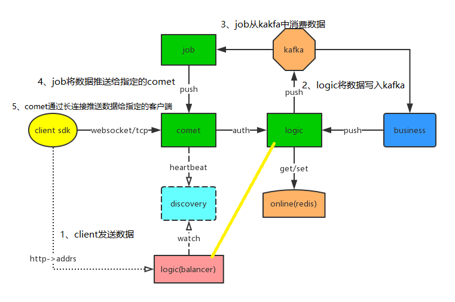
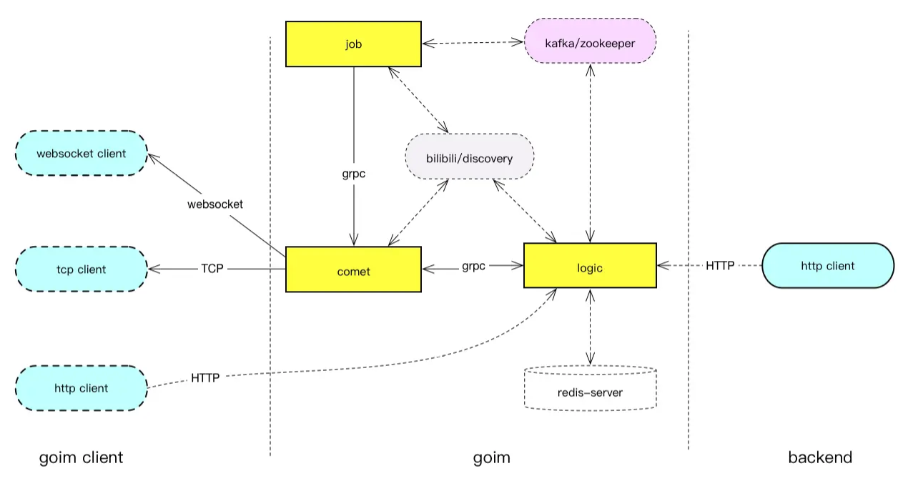
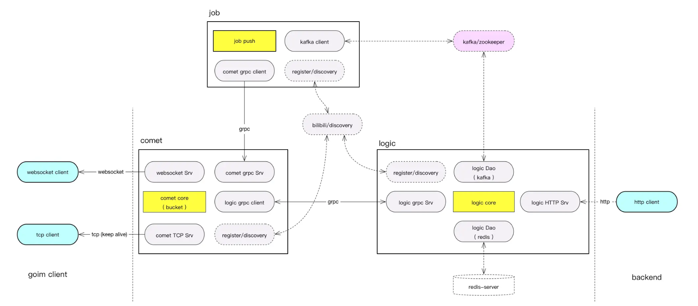
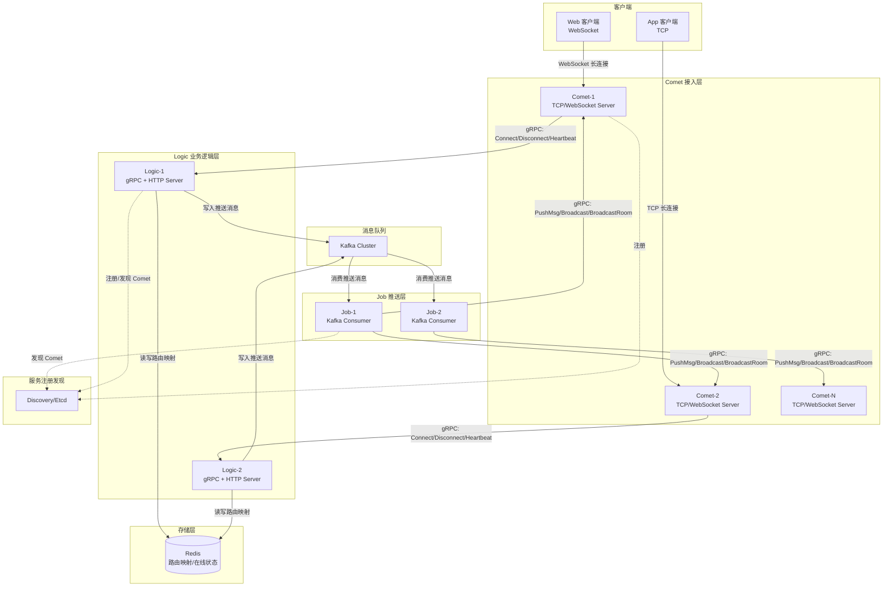
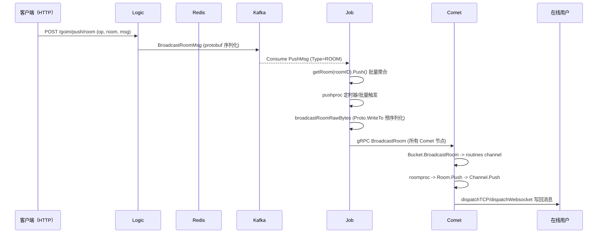
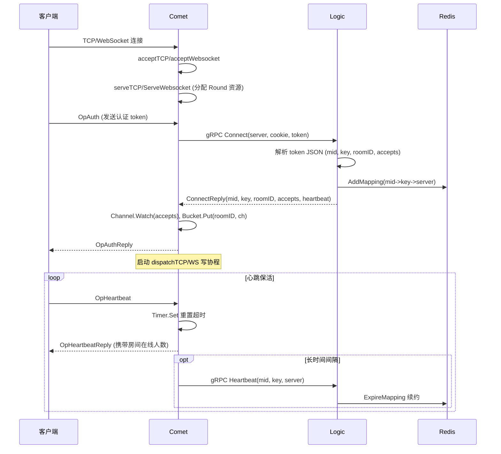

## 0x00 前言

[GoIM](https://github.com/Terry-Mao/goim) 是一款基于长连接的 IM 服务。准备业余时间分析下其实现基础框架及优化思路（先前有部分阅读过，但未总结成文，网上的分析文章也非常多）
首先，在分析项目源码前，我们思考下 B 站的弹幕场景（本质上是一个 IM，弹幕是实时消息中能被用户看到的内容，还有一部分是系统消息，用来主动触发业务逻辑或行为等）：

1.  打开一个 B 站 [视频](https://www.bilibili.com/video/BV1YK4y1s7UA?spm_id_from=333.851.b_7265706f7274466972737431.8)
2.  发送弹幕，弹幕在视频中显示
3.  服务端收到弹幕，向所有当前在此视频（房间）内的在线的用户广播这条弹幕
4.  其他用户也看到了这条弹幕
5.  弹幕需要落地存储
6.  当另外的新用户打开这个视频时，系统需要把所有该视频的弹幕推送给这个用户

GoIM 就实现了这样的功能（重点关注**实时的消息如何到达在线的用户端**）。带着场景，再结合分析源码，会更容易理解。此外，关于直播系统更多的特性，可以参考[此文](https://ruby-china.org/topics/39574)

#### 特性

- 轻量级
- 高性能
- 纯 Golang 实现
- 支持单个、多个、单房间以及广播消息推送
- 支持单个 Key 多个订阅者（可限制订阅者最大人数）
- 心跳支持（应用心跳和 tcp、keepalive）
- 支持安全验证（未授权用户不能订阅）
- 多协议支持（websocket，tcp）
- 可拓扑的架构（job、logic 模块可动态无限扩展）
- 基于 Kafka 做异步消息推送

## 0x01 GoIM 架构图

总结下 GoIM：

- 清晰的模块划分：Comet、Logic、Job 等
- gRPC、WebSocket、TcpServer 等
- 消息队列采用 Kafka
- 服务发现采用 B 站开源的 discovery，不过可以修改为 [支持 Etcd 的实现](https://github.com/Terry-Mao/goim/issues/251)
- 分层设计 / 定时器优化 / 对象（内存）分配优化

goim 官方的架构图如下，按照模块及数据流一层层分析是极佳的思路，图中标注了开文部分的数据流向示意：


[这里](https://juejin.im/post/5cbb9e68e51d456e51614aab) 提供了更加详细的数据流：


子模块的数据流向：


## 0x02 架构与数据流

#### 整体架构



#### 消息推送数据流（以房间广播为例）



#### 用户连接建立流程



## 0x03 通信协议详解

goim 使用自定义的二进制帧协议，TCP 和 WebSocket 共用同一套帧格式，头部固定 `16` 字节：

```text
+-------------------------------------------------------------------+
|  PacketLen (4 bytes)  |  HeaderLen (2 bytes)  |  Ver (2 bytes)    |
+-------------------------------------------------------------------+
|  Op (4 bytes)         |  Seq (4 bytes)                            |
+-------------------------------------------------------------------+
|  Body (PacketLen - HeaderLen bytes, 可选)                          |
+-------------------------------------------------------------------+
```

各字段说明：

| 字段 | 大小 | 偏移量 | 说明 |
|------|------|--------|------|
| PacketLen | 4 bytes | 0 | 整包长度（含 Header + Body），大端序 |
| HeaderLen | 2 bytes | 4 | 固定为 `16`（`_rawHeaderSize`），大端序 |
| Ver | 2 bytes | 6 | 协议版本号，大端序 |
| Op | 4 bytes | 8 | 操作码，标识消息类型，大端序 |
| Seq | 4 bytes | 12 | 序列号，客户端自增，大端序 |
| Body | 变长 | 16 | 消息体（JSON 或 Protobuf），长度 = PacketLen - HeaderLen |

#### 操作码（Op）定义

```golang
const (
    OpHandshake      = int32(0)   // 握手请求
    OpHandshakeReply = int32(1)   // 握手响应
    OpHeartbeat      = int32(2)   // 心跳请求
    OpHeartbeatReply = int32(3)   // 心跳响应（Body 携带 4 字节房间在线人数）
    OpSendMsg        = int32(4)   // 发送消息
    OpSendMsgReply   = int32(5)   // 发送消息响应
    OpDisconnectReply= int32(6)   // 断开连接响应
    OpAuth           = int32(7)   // 认证请求（Body 为 JSON token）
    OpAuthReply      = int32(8)   // 认证响应
    OpRaw            = int32(9)   // 原始消息（服务端批量下发，Body 为多个完整 Proto 拼接）
    OpProtoReady     = int32(10)  // 内部信号：Proto 就绪
    OpProtoFinish    = int32(11)  // 内部信号：Proto 结束（关闭 Channel）
    OpChangeRoom     = int32(12)  // 切换房间
    OpChangeRoomReply= int32(13)  // 切换房间响应
    OpSub            = int32(14)  // 订阅操作码
    OpSubReply       = int32(15)  // 订阅响应
    OpUnsub          = int32(16)  // 取消订阅
    OpUnsubReply     = int32(17)  // 取消订阅响应
)
```

特别说明 `OpRaw`：这是一个优化操作码。Job 模块在推送房间消息时，会将多条消息预先通过 `Proto.WriteTo()` 序列化为连续的二进制帧拼接到一起，然后以 `OpRaw` 标记发送给 Comet。Comet 的 `WriteTCP` 检测到 `OpRaw` 时，直接调用 `wr.WriteRaw(p.Body)` 将整段二进制数据写入连接，避免逐条序列化的开销

#### 认证 Token 格式

客户端在 `OpAuth` 消息的 Body 中发送 JSON 格式的 token：
```json
{
    "mid": 123,
    "key": "unique-key",
    "room_id": "live://1000",
    "platform": "web",
    "accepts": [1000, 1001, 1002]
}
```

- `mid`：用户 ID
- `key`：连接唯一标识（为空时服务端自动生成 UUID）
- `room_id`：房间 ID（格式为 `type://room`）
- `platform`：平台标识
- `accepts`：订阅的操作码列表（只接收这些 Op 的推送消息）

## 0x04 微服务机制

#### 服务发现

goim 使用 B 站开源的 [discovery](https://github.com/bilibili/discovery) 作为服务注册与发现组件（也可替换为 [Etcd 实现](https://github.com/Terry-Mao/goim/issues/251)）：

- **Comet** 启动时通过 `register()` 向 Discovery 注册自身实例信息（gRPC 地址、权重、连接数等元数据）
- **Logic** 启动时同时注册自身，并通过 `dis.Build("goim.comet")` 订阅 Comet 节点列表，实时感知 Comet 节点上下线
- **Job** 启动时通过 `watchComet()` 订阅 Comet 节点列表，动态维护与每个 Comet 的 gRPC 长连接

```golang
// Comet 注册示例
ins := &naming.Instance{
    Region:   env.Region,
    Zone:     env.Zone,
    Env:      env.DeployEnv,
    Hostname: env.Host,
    AppID:    "goim.comet",
    Addrs:    []string{"grpc://" + addr + ":" + port},
    Metadata: map[string]string{
        model.MetaWeight:    strconv.FormatInt(env.Weight, 10),
        model.MetaOffline:   strconv.FormatBool(false),
        model.MetaConnCount: "0",
        model.MetaIPCount:   "0",
    },
}
cancel, _ := dis.Register(ins)
```

#### 负载均衡

goim 实现了两层负载均衡：

1. **客户端接入层**（Logic `LoadBalancer`）：Logic 的 `NodesWeighted` 接口根据客户端 IP 做区域感知的加权轮询，返回最优 Comet 节点列表给客户端。算法考虑节点固定权重、当前连接数比例、区域加权因子
2. **内部 gRPC 通信**：Comet 调用 Logic 时使用 gRPC 内置的 `roundrobin` 负载均衡策略

```golang
// Comet -> Logic gRPC 连接使用 roundrobin
conn, _ := grpc.DialContext(ctx, "discovery://default/goim.logic",
    grpc.WithBalancerName(roundrobin.Name),
    // ...
)
```

#### 平滑扩容

| 模块 | 扩容方式 |
|------|---------|
| Comet | 无状态，直接新增实例注册到 Discovery，客户端重连时自动负载均衡到新节点 |
| Logic | 无状态，新增实例注册到 Discovery，gRPC roundrobin 自动分流 |
| Job | 按 Kafka Consumer Group 扩展，新增 Job 实例自动触发 Partition 重平衡 |
| Kafka | 增加 Partition 数量即可提升并行消费能力 |
| Redis | 使用 Redis Cluster 或增加从节点 |

#### 限流与熔断

goim 本身未内置完整的限流熔断框架，但有以下保护机制：

- **IP 连接数统计**：Bucket 维护 `ipCnts map[string]int32`，可在业务层做 IP 级别限流
- **Channel signal 满丢弃**：`Channel.Push()` 使用 `select-default` 非阻塞写入，signal channel 满时直接丢弃消息，防止推送阻塞
- **Broadcast 限速**：广播接口支持 `Speed` 参数，按 `ChannelCount/Speed` 计算每个 Bucket 的休眠时间，防止广播风暴

## 0x05 部署与测试

#### 依赖组件

goim 依赖以下组件：
- **Kafka**：消息队列（Logic 生产，Job 消费）
- **Redis**：路由映射存储
- **Discovery/Etcd**：服务注册发现

#### 启动命令

```bash
# 编译
make build

# 启动（使用 nohup 方式）
export REGION=sh
export ZONE=sh001
export DEPLOY_ENV=dev

nohup target/logic -conf=target/logic.toml -region=sh -zone=sh001 -deploy.env=dev -weight=10 2>&1 > target/logic.log &
nohup target/comet -conf=target/comet.toml -region=sh -zone=sh001 -deploy.env=dev -weight=10 -addrs=127.0.0.1 2>&1 > target/comet.log &
nohup target/job -conf=target/job.toml -region=sh -zone=sh001 -deploy.env=dev 2>&1 > target/job.log &
```

#### HTTP API 测试

```bash
# 单播：按 key 推送
curl -X POST "http://127.0.0.1:3111/goim/push/keys" \
  -d "keys=key1&operation=1000" \
  --data-urlencode "msg=hello single push"

# 多播：按 mid 推送
curl -X POST "http://127.0.0.1:3111/goim/push/mids" \
  -d "mids=123,456&operation=1000" \
  --data-urlencode "msg=hello multi push"

# 房间广播
curl -X POST "http://127.0.0.1:3111/goim/push/room" \
  -d "type=live&room=1000&operation=1000" \
  --data-urlencode "msg=hello room broadcast"

# 全局广播
curl -X POST "http://127.0.0.1:3111/goim/push/all" \
  -d "operation=1000&speed=0" \
  --data-urlencode "msg=hello broadcast all"

# 在线 Top 房间
curl "http://127.0.0.1:3111/goim/online/top?type=live&limit=10"

# 获取接入节点（客户端调用，获取最优 Comet 地址）
curl "http://127.0.0.1:3111/goim/nodes/weighted?platform=web&clientIP=1.2.3.4"
```

#### WebSocket 客户端测试（JavaScript）

goim 在 `examples/javascript/` 下提供了 WebSocket 客户端示例，核心逻辑：

```javascript
// 建立 WebSocket 连接
var ws = new WebSocket('ws://127.0.0.1:3102/sub');
ws.binaryType = 'arraybuffer';

// 认证
ws.onopen = function() {
    var token = JSON.stringify({
        mid: 123,
        room_id: "live://1000",
        platform: "web",
        accepts: [1000, 1001, 1002]
    });
    // 构造二进制帧：16 字节 header + body
    var headerBuf = new ArrayBuffer(16 + token.length);
    var headerView = new DataView(headerBuf);
    headerView.setInt32(0, 16 + token.length); // PacketLen
    headerView.setInt16(4, 16);                // HeaderLen
    headerView.setInt16(6, 1);                 // Ver
    headerView.setInt32(8, 7);                 // Op = OpAuth
    headerView.setInt32(12, 1);                // Seq
    // 写入 body
    var bodyBytes = new TextEncoder().encode(token);
    new Uint8Array(headerBuf, 16).set(bodyBytes);
    ws.send(headerBuf);
};

// 接收消息
ws.onmessage = function(evt) {
    var data = evt.data;
    var view = new DataView(data);
    var op = view.getInt32(8);
    switch(op) {
        case 8:  // OpAuthReply
            // 认证成功，开始定时心跳
            setInterval(heartbeat, 30000);
            break;
        case 3:  // OpHeartbeatReply
            var online = view.getInt32(16); // 房间在线人数
            break;
        case 9:  // OpRaw：批量消息，需循环解析多个 Proto 帧
            for (var offset = 16; offset < data.byteLength; ) {
                var packLen = view.getInt32(offset);
                var body = new TextDecoder().decode(
                    new DataView(data, offset + 16, packLen - 16)
                );
                console.log("msg:", body);
                offset += packLen;
            }
            break;
    }
};
```

## 0x06 GoIM 的扩展性及 HA

[goim via nats](https://github.com/tsingson/ex-goim)，这个项目使用 golang 的 [`NATS`](https://github.com/nats-io/nats-server) 高性能队列替换了 `Kafka` 的接口。另外，[goim 的业务集成 (分享会小结与 QA)](https://juejin.im/post/5cf27f8ee51d45775e33f50c) 这篇文章也对 goim 的系统集成与拓展提出了一些不错的思路，可以用作参考。

#### 各子模块的扩展

1、Comet 模块 <br>
Comet 模块属于接入层，需要扩容时直接开启多个 Comet。修改配置文件中的 `base` 节点下的 `server.id` 修改成不同值（注意一定要保证不同的 comet 进程值唯一），前端接入可以使用 LVS 或 DNS 来转发

2、Logic 模块 <br>
Logic 模块也是无状态的逻辑层，亦可按需扩容。使用 Nginx Upstream 来扩展 HTTP 接口，内部 RPC 部分，可以使用 LVS 四层转发

3、Kafka 中间件 <br>
Kafka 可以使用多 broker，或者多 partition 来扩展队列

4、路由映射（v2.0 已移除独立 Router 模块）<br>
在 goim v1.0 中存在独立的 Router 模块用于存储用户路由信息，v2.0 已将其移除。路由功能由 Logic 模块通过 Redis 实现：使用 `mid_%d`（HASH 类型，存储 mid 到 key:server 的映射）和 `key_%s`（STRING 类型，存储 key 到 server 的映射）来管理用户连接路由。Redis 天然支持集群扩展和持久化，相比独立 Router 模块更易维护

5、Job 模块 <br>
Job 根据 Kafka 的 Partition 来扩展多 Job 工作方式，可以按照 Kafka 的消费者组来实现高可用

## 0x07 参考

- [GOIM 项目主页](https://goim.io/)
- [GOIM 手册](https://goim.io/tutorials/)
- [goim 源码剖析](https://laohanlinux.github.io/2016/12/22/goim%E6%BA%90%E7%A0%81%E5%89%96%E6%9E%90/)
- [一套简洁的即时通信 (IM) 系统](https://alexstocks.github.io/html/im.html)
- [golang 从简单的即时聊天来看架构演变 (simple-chatroom)](https://github.com/LinkinStars/simple-chatroom)
- [goim 的业务集成 (分享会小结与 QA)](https://juejin.im/post/5cf27f8ee51d45775e33f50c)
- [GoIM 文档](https://raw.githubusercontent.com/Terry-Mao/goim/master/README_cn.md)
