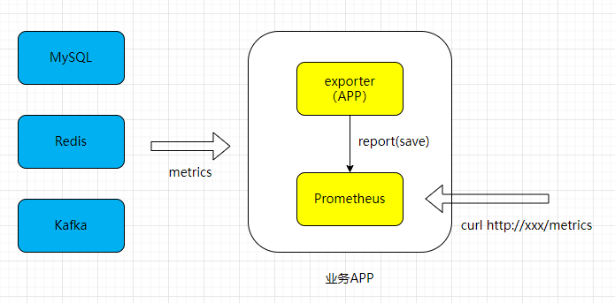
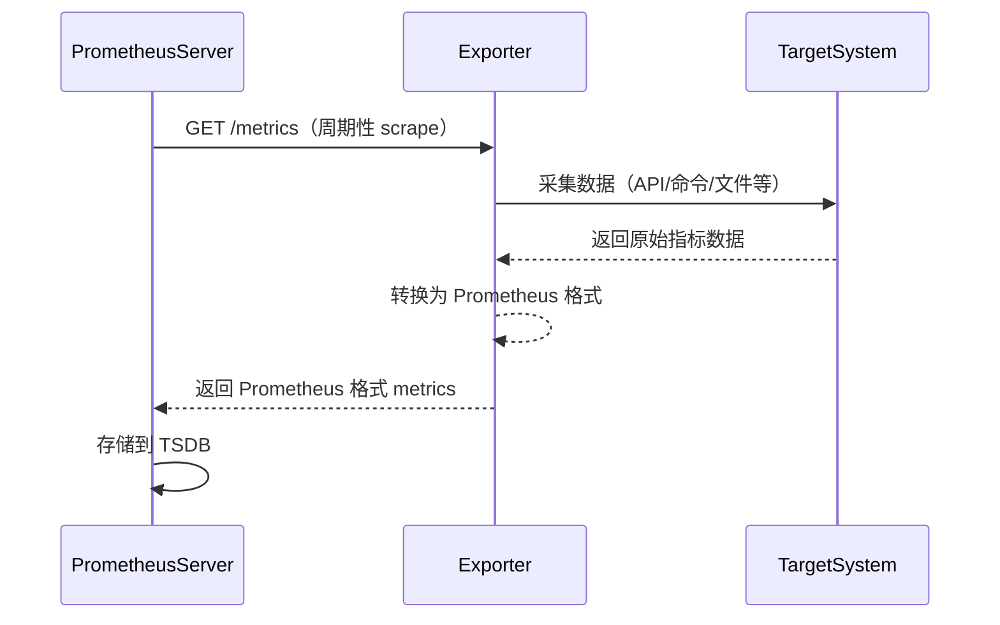
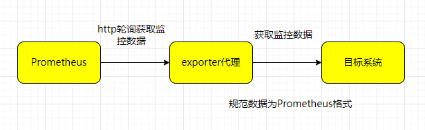
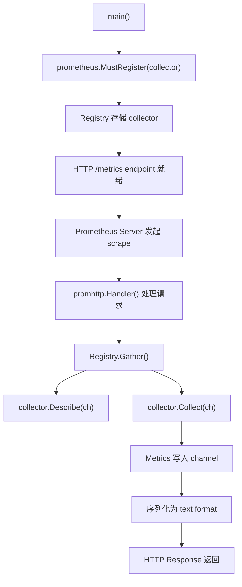
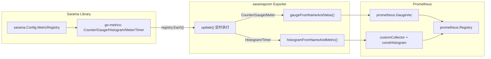

##  0x00    前言
Prometheus 主要用于应用服务的监控，尤其是基于 Docker/Kubernetes 部署的应用服务，这里的监控是服务层面的（细粒度），以 Golang 开发的服务为例，如 `runtime` 信息，接口延迟，某个操作的延迟及接口调用成功率等等，只要是能够收集的信息，都可以作为 Prometheus 的监控指标。

本文是 Prometheus 系列文章之一，侧重于 Exporter 的开发实践，相关文章如下：
-   [理解 Prometheus 的基本数据类型及应用（基础篇）](https://pandaychen.github.io/2020/04/11/PROMETHEUS-METRICS-INTRO/)
-   [理解 Prometheus 的基本数据类型及应用（实践篇）](https://pandaychen.github.io/2020/04/13/PROMETHEUS-METRICS-PRACTICE/)
-   [gRPC 应用之 Prometheus 监控接入](https://pandaychen.github.io/2020/05/01/GRPC-PROMETHEUS-APP1/)
-   [prometheus 查询 && 应用实践（进阶篇）](https://pandaychen.github.io/2022/05/01/A-PROMETHEUS-QUERY-EXPLAIN/)

##  0x01	应用接入
Prometheus 的应用接入其实并不复杂，通常按照如下几个步骤来完成：
1.	事先定好需要采集哪些指标，如成功率，延迟，分布数据等
2.	将指标转换为 Prometheus 的 Metrics 类型
3.	在代码逻辑中加入 Metrics 的 "打点" 调用
4.	启动 PrometheusHttp 服务，暴露自己的采集的指标

以上几步即可完成在项目应用中将指标暴露给 Prometheus

##	0x02	Exporter 简介
Exporter 是一个采集监控数据并通过 Prometheus 监控规范对外提供数据的组件，它负责从目标处（Your 服务）搜集数据，并将其转化为 Prometheus 支持的格式。Prometheus 会周期性地调用 Exporter 提供的 metrics 数据接口来获取数据。那么使用 Exporter 的好处是什么？

举例来说，如果要监控 Mysql/Redis 等数据库，我们必须要调用它们的接口来获取信息（前提要有），这样每家都有一套接口，这样非常不通用。所以 Prometheus 做法是每个软件做一个 Exporter，Prometheus 的 Http 读取 Exporter 的信息（将监控指标进行统一的格式化并暴露出来）。简单类比，Exporter 就是个翻译，把各种语言翻译成一种统一的语言。



Prometheus Server 与 Exporter 及目标系统之间的交互流程如下：



Prometheus Exporter 就是用来收集和暴露指标的工具，通常情况下是 Prometheus Exporter 收集并暴露指标，然后 Prometheus 收集并存储指标，使用 Grafana 或者 Promethues UI 可以查询并展示指标。它包含两个重要的组件：

-	Collector：收集应用或者其他系统的指标，然后将其转化为 Prometheus 可识别收集的指标
-	Exporter：从 Collector 获取指标数据，并将其转成为 Prometheus 可读格式

Exporter 的功能是将数据周期性地从监控对象中取出来进行加工，然后将数据规范化后通过端点暴露给 Prometheus，主要流程如下：
1.	封装功能模块获取监控系统内部的统计信息
2.	将返回数据进行规范化映射，使其成为符合 Prometheus 要求的格式化数据
3.	Collect 模块负责存储规范化后的数据，最后当 Prometheus 定时从 Exporter 提取数据时，Exporter 就将 Collector 收集的数据通过 HTTP 的形式在 `/metrics` 端点进行暴露



##  0x03	Build Your Own Exportor：自定义 Collector 开发
官方文档 [WRITING EXPORTERS](https://prometheus.io/docs/instrumenting/writing_exporters/) 介绍了编写 Exporter 的一些注意点。本文主要描述自定义 Collector 的实现。Prometheus 的 client 库提供了实现自定义 Exporter 的 [接口](https://github.com/prometheus/client_golang/blob/master/prometheus/collector.go#L27)，Collector 接口定义了两个方法 `Describe` 和 `Collect`，实现这两个方法就可以暴露自定义的数据

自定义 Collector 的完整注册与调用流程如下：



一般开发步骤如下：

1.	定义一个 Exporter 结构体，用于存放描述信息（`*prometheus.Desc`）
2.	实现 `Collector` 接口（`Describe` 和 `Collect` 两个方法）
3.	实例化 Exporter
4.	注册指标（`prometheus.MustRegister`）
5.	暴露指标（启动 promhttp 服务）
6.	每次被动采集时会调用 `Collector.Collect` 方法，获取到响应的指标数据

Collector 开发例子 [参考](https://github.com/pandaychen/golang_in_action/tree/master/prometheus/exporter)

####	Collector 接口定义

`Collector` 是一个 `interface`，所有收集 metrics 数据的对象都需要实现该接口。它内部提供了两个方法：
-   `Describe`：向 Prometheus 注册表声明该 Collector 会提供哪些 `prometheus.Desc`（指标描述符），通过 channel 传递给上层。该方法必须是幂等且并发安全的
-   `Collect`：真正实现数据采集的功能，在 Prometheus 每次 scrape 时被调用，将采集的 Metric 数据通过 channel 传递给上层。该方法必须并发安全，且执行时间不宜过长

```go
type Collector interface {
	Describe(chan<- *Desc)
	Collect(chan<- Metric)
}
```

####	Describe 接口示例
实现 `Describe` 接口，传递指标描述符到 channel。以下示例定义了一个 `ClusterManager` 结构体：

```go
type ClusterManager struct {
    Zone         string
    OOMCountDesc *prometheus.Desc
    RAMUsageDesc *prometheus.Desc
}

func NewClusterManager(zone string) *ClusterManager {
    return &ClusterManager{
        Zone: zone,
        OOMCountDesc: prometheus.NewDesc(
            "clustermanager_oom_crashes_total",
            "Number of OOM crashes.",
            nil, prometheus.Labels{"zone": zone}),
        RAMUsageDesc: prometheus.NewDesc(
            "clustermanager_ram_usage_bytes",
            "RAM usage as reported to the cluster manager.",
            []string{"managed_cluster"}, prometheus.Labels{"zone": zone}),
    }
}

func (c *ClusterManager) Describe(ch chan<- *prometheus.Desc) {
    ch <- c.OOMCountDesc
    ch <- c.RAMUsageDesc
}
```

####	Collect 接口示例
Collect 函数将执行抓取函数并返回数据，返回的数据传递到 channel 中，并且传递的同时绑定原先的指标描述符。实现指标采集的工作需要在这里完成（针对开发者）

接口定义如下：

```go
type Collector interface {
	// Describe sends the super-set of all possible descriptors of metrics
	// collected by this Collector to the provided channel and returns once
	// the last descriptor has been sent. The sent descriptors fulfill the
	// consistency and uniqueness requirements described in the Desc
	// documentation.
	//
	// It is valid if one and the same Collector sends duplicate
	// descriptors. Those duplicates are simply ignored. However, two
	// different Collectors must not send duplicate descriptors.
	//
	// Sending no descriptor at all marks the Collector as unchecked,
	// i.e. no checks will be performed at registration time, and the
	// Collector may yield any Metric it sees fit in its Collect method.
	//
	// This method idempotently sends the same descriptors throughout the
	// lifetime of the Collector. It may be called concurrently and
	// therefore must be implemented in a concurrency safe way.
	//
	// If a Collector encounters an error while executing this method, it
	// must send an invalid descriptor (created with NewInvalidDesc) to
	// signal the error to the registry.
	Describe(chan<- *Desc)
	// Collect is called by the Prometheus registry when collecting
	// metrics. The implementation sends each collected metric via the
	// provided channel and returns once the last metric has been sent. The
	// descriptor of each sent metric is one of those returned by Describe
	// (unless the Collector is unchecked, see above). Returned metrics that
	// share the same descriptor must differ in their variable label
	// values.
	//
	// This method may be called concurrently and must therefore be
	// implemented in a concurrency safe way. Blocking occurs at the expense
	// of total performance of rendering all registered metrics. Ideally,
	// Collector implementations support concurrent readers.
	Collect(chan<- Metric)
}
```


```go
func (c *ClusterManager) Collect(ch chan<- prometheus.Metric) {
    // 在此处完成实际的数据采集逻辑
    oomCount := 42.0
    ramUsage := 1024.0 * 1024 * 512

    ch <- prometheus.MustNewConstMetric(c.OOMCountDesc, prometheus.CounterValue, oomCount)
    ch <- prometheus.MustNewConstMetric(c.RAMUsageDesc, prometheus.GaugeValue, ramUsage, "cluster-a")
}
```

####  关于 `MustNewConstMetric` 与 `NewConstMetric`

在 `Collect` 方法中创建指标时，有两种方式：
-   `prometheus.MustNewConstMetric`：创建失败时直接 panic，适合参数确定不会出错的场景（如标签数量与 Desc 定义一致）
-   `prometheus.NewConstMetric`：返回 `(prometheus.Metric, error)`，适合需要错误处理的生产场景，出错时可通过 `prometheus.NewInvalidMetric(desc, err)` 传递错误信息

####  关于 Registry 机制

Prometheus Go client 提供两种注册器：
-   `prometheus.DefaultRegisterer`（全局默认注册器）：自动包含 Go runtime 指标（`go_*`）和 process 指标（`process_*`），大多数场景下直接使用 `prometheus.MustRegister()` 即可
-   `prometheus.NewRegistry()`（自定义注册器）：适用于测试、需要隔离指标的场景，或不希望暴露默认 runtime/process 指标的场景

```go
// 使用自定义 Registry
reg := prometheus.NewRegistry()
reg.MustRegister(myCollector)
http.Handle("/metrics", promhttp.HandlerFor(reg, promhttp.HandlerOpts{}))
```

####  暴露 Exporter 及 Promhttp 启动
使用下面的代码将自定义的 Metrics 暴露出去，这也是 promhttp 的通用做法了：
```go
import (
    "log"
    "net/http"
    "github.com/prometheus/client_golang/prometheus"
    "github.com/prometheus/client_golang/prometheus/promhttp"
)

func main() {
    collector := NewClusterManager("us-east-1")
    prometheus.MustRegister(collector)

    http.Handle("/metrics", promhttp.Handler())
    log.Fatal(http.ListenAndServe(":8080", nil))
}
```

####  Collect 方法的注意事项

1.  **并发安全**：`Collect` 可能被并发调用，如果内部访问共享状态（如缓存、连接池），需要加锁或使用并发安全的数据结构
2.  **执行时间**：`Collect` 在 Prometheus scrape 请求期间同步执行，如果耗时过长（如调用外部 API），可能导致 scrape 超时。建议将耗时的数据采集放在异步 goroutine 中，`Collect` 只读取缓存的最新结果
3.  **错误处理**：当采集过程出错时，不要返回空数据，应使用 `prometheus.NewInvalidMetric(desc, err)` 将错误传递给 Prometheus

##	0x04	Collector 使用场景对比
回顾下，有两种指标的接入方式：
1.	创建指标的时候声明了指标描述（直接使用 Counter/Gauge/Histogram 等）
2.	先声明描述，再创建指标（自定义 Collector）

```go
// 方式一：直接使用指标对象
// 1. 创建指标
HTTPReqTotal = prometheus.NewCounterVec(prometheus.CounterOpts{
        Name: "http_requests_total",
        Help: "Total number of HTTP requests",
    }, []string{"method", "path", "status"})

// 2. 指标注册到 DefaultRegisterer
prometheus.MustRegister(
        HTTPReqTotal,
)
// 3. 通过 HTTP API 暴露指标，当 promhttp.Handler() 被执行时，所有 metric 被序列化输出
http.Handle("/metrics", promhttp.Handler())
```

####	指标采集的触发时机
一般而言，对于 Counter/Histogram 这两种指标，触发时机比较明确，通常在某个方法结束前后运行即可，典型的场景如下：

```go
// QPS：请求完成以后，请求数量直接累加
HTTPReqTotal.With(prometheus.Labels{
	PromLabelMethod: "GET",
	PromLabelPath:   "/api/query",
	PromLabelStatus: "200",
}).Inc()

// 监控请求耗时分布，请求完成后直接 observe
HTTPReqDuration.With(prometheus.Labels{
            PromLabelMethod: "GET",
            PromLabelPath:   "/api/query",
}).Observe(3.15)
```

那么什么情况下，使用第 2 种方式来进行指标处理呢？设想需要使用 Gauge 指标来监控某个 channel 的长度，有哪些可行的方式？

1.	启动定时器，定时器触发时调用 `gaugeMetric.Set`
2.	使用 `NewGaugeFunc` 实现
3.	自定义 `Collector` 实现

简单描述下这三种方式的实现代码：

```go
// 方式 1：定时任务
var jobChannel chan int
jobChanLength := prometheus.NewGauge(prometheus.GaugeOpts{
        Name: "job_channel_length",
        Help: "length of job channel",
})
go func() {
	jobChanLength.Set(float64(len(jobChannel)))
	c := time.Tick(30 * time.Second)
	for range c {
		jobChanLength.Set(float64(len(jobChannel)))
	}
}()

// 方式 2：只需要定义函数 func() float64{} 即可，当 promhttp.Handler() 被调用时，func() float64{} 被触发
jobChanLength := prometheus.NewGaugeFunc(prometheus.GaugeOpts{
        Name: "job_channel_length",
        Help: "length of job channel",
}, func() float64 {
	return float64(len(jobChannel))
})
prometheus.MustRegister(jobChanLength)

// 方式 3：自定义 Collector
type ChanCollector struct {
    JobChannel chan int
    desc       *prometheus.Desc
}

func NewChanCollector(jobChannel chan int, name string) *ChanCollector {
    return &ChanCollector{
        JobChannel: jobChannel,
        desc:       prometheus.NewDesc(name, "length of channel", nil, nil),
    }
}

func (c *ChanCollector) Describe(ch chan<- *prometheus.Desc) {
    ch <- c.desc
}

func (c *ChanCollector) Collect(ch chan<- prometheus.Metric) {
    ch <- prometheus.MustNewConstMetric(
        c.desc,
        prometheus.GaugeValue,
        float64(len(c.JobChannel)),
    )
}

collector := NewChanCollector(jobChannel, "job_channel_length")
prometheus.MustRegister(collector)
```

注意，当使用自定义 `Collector` 实现指标收集，当 `promhttp.Handler()` 被调用时，已经注册 `MustRegister` 指标的 `Collect` 方法被执行，所以此函数不能运行时间过长，否则可能导致 `promhttp.Handler()` 超时

直接使用 Collector 收集指标时，Go client 的 Collector 只会在每次响应 Prometheus 请求的时候才收集数据。需要每次显式传递变量的值，否则就不会再维持该变量，在 Prometheus 也将看不到这个变量。当收集系统收集的数据太多时，就可以自定义 Collector 收集的方式来优化流程，并且在某些情况下如果已经有了一个可用的 metrics，就不需要使用 Counter/Gauge 等这些数据结构，直接在 Collector 内部实现一个代理的功能即可（相当于 metrics 转发功能）

##  0x05	完整 Exporter 开发实战

本小节给出一个结构化的完整 Exporter 开发教程，结构和接口的使用方法可以参考 [GODOC](https://pkg.go.dev/github.com/prometheus/client_golang/prometheus)

####  第一步：定义指标及初始化方法

定义指标就是创建指标的描述符，通常把要采集的指标描述符放在一个结构体里，如下我们定义了一个指标 `fooCollector`，其中包含了两种类型的数据 `fooMetric` 和 `barMetric`：

```go
//Define a struct for you collector that contains pointers
//to prometheus descriptors for each metric you wish to expose.
//Note you can also include fields of other types if they provide utility
//but we just won't be exposing them as metrics.
type fooCollector struct {
	fooMetric *prometheus.Desc
	barMetric *prometheus.Desc
}
```

初始化方法 `newFooCollector` 用于初始化 `fooCollector`，包含对每个成员 `prometheus.Desc` 类型的初始化，`prometheus.NewDesc` 方法创建一个 `prometheus.Desc` 对象。注意 `prometheus.NewDesc` 的参数，推荐传入有意义的 `help` 及 `label` 信息：

```go
//You must create a constructor for you collector that
//initializes every descriptor and returns a pointer to the collector
// 调用工厂方法即可创建一个结构体的实例
func newFooCollector() *fooCollector {
	return &fooCollector{
		fooMetric: prometheus.NewDesc("foo_metric",
			"Shows whether a foo has occurred in our cluster",
			nil, nil,
		),
		barMetric: prometheus.NewDesc("bar_metric",
			"Shows whether a bar has occurred in our cluster",
			[]string{"hostname"}, prometheus.Labels{"env": "prod"},
		),
	}
}
```

####  第二步：实现数据采集（核心）

数据采集需要实现 Collector 的两个接口：
-   `Describe`：告诉 `prometheus` 我们定义了哪些 `prometheus.Desc` 结构，通过 `channel` 传递给上层
-   `Collect`：真正实现数据采集的功能，将采集数据结果通过 channel 传递给上层

注意：`Collect` 中完成的就是每个指标的采集，必须保证这里的数据是动态更新的，每一次调用 `curl http://127.0.0.1:8080/metrics` 都会触发对 `Collect` 方法的调用

```go
func (collector *fooCollector) Describe(ch chan<- *prometheus.Desc) {
	ch <- collector.fooMetric
	ch <- collector.barMetric
}

func (collector *fooCollector) Collect(ch chan<- prometheus.Metric) {
	// 在这里实现实际的数据采集逻辑
	// 示例中使用硬编码值，实际场景应替换为真实的采集逻辑
	var metricValue float64
	metricValue = 1

	ch <- prometheus.MustNewConstMetric(collector.fooMetric, prometheus.GaugeValue, metricValue)
	ch <- prometheus.MustNewConstMetric(collector.barMetric, prometheus.GaugeValue, metricValue, "host-01")
}
```

注意：每次调用 `curl http://127.0.0.1:8080/metrics` 时，都会触发一次已注册 `MustRegister` 到 Prometheus 指标的 `Collect` 方法的调用，注册了多少个指标，都会调用其 `Collect` 方法

####  第三步：注册指标及启动 promHTTP 服务

这里在主函数中注册上面自定义的指标，注册成功之后，启动 HTTP 服务器，这样就完成了自定义的 Exporter 服务。

```go
package main

import (
	"log"
	"net/http"

	"github.com/prometheus/client_golang/prometheus"
	"github.com/prometheus/client_golang/prometheus/promhttp"
)

func main() {
	foo := newFooCollector()
	prometheus.MustRegister(foo)

	http.Handle("/metrics", promhttp.Handler())
	log.Println("Beginning to serve on port :8080")
	log.Fatal(http.ListenAndServe(":8080", nil))
}
```

####  第四步：验证

通过 `curl http://127.0.0.1:8080/metrics` 即可查看暴露的指标：

```bash
# HELP bar_metric Shows whether a bar has occurred in our cluster
# TYPE bar_metric gauge
bar_metric{env="prod",hostname="host-01"} 1
# HELP foo_metric Shows whether a foo has occurred in our cluster
# TYPE foo_metric gauge
foo_metric 1
```

注意：每次调用 `curl http://127.0.0.1:8080/metrics` 时，都会触发一次已注册 `MustRegister` 到 Prometheus 指标的 `Collect` 方法的调用，注册了多少个 Collector，都会调用其 `Collect` 方法

##  0x06    进阶：GaugeVec 动态标签模式

在自定义 Collector 的实现中，对于 `prometheus.Desc`（静态描述符）与 `prometheus.GaugeVec`（动态标签指标）混合使用的场景，需要特别注意两者在 `Describe` 和 `Collect` 中的不同处理方式。以下是一个典型的实现模式：

```go
type Exporter struct {
	host      string
	version   *prometheus.Desc
	total     *prometheus.GaugeVec
	available *prometheus.GaugeVec
	logger    *log.Logger
}

func NewExporter(logger *log.Logger, config *Config) *Exporter {
	return &Exporter{
		host:   config.host,
		logger: logger,
		version: prometheus.NewDesc(
			prometheus.BuildFQName(namespace, "", "version"),
			"demo exporter version",
			nil,
			nil),
		total: prometheus.NewGaugeVec(
			prometheus.GaugeOpts{
				Namespace: namespace,
				Name:      "total",
				Help:      "demo total",
			},
			[]string{"region_id", "instance_id"},
		),
	}
}
```

`Describe` 方法中，`*prometheus.Desc` 类型直接发送到 channel，而 `*prometheus.GaugeVec` 需要调用其自身的 `Describe` 方法：

```go
func (e *Exporter) Describe(ch chan<- *prometheus.Desc) {
	ch <- e.version
	e.total.Describe(ch)
}
```

`Collect` 方法中，`*prometheus.Desc` 使用 `MustNewConstMetric` 创建指标并发送，而 `*prometheus.GaugeVec` 需要先 `Reset()`（清除旧标签组合），再通过 `With().Set()` 设置值，最后调用其自身的 `Collect` 方法：

```go
func (e *Exporter) Collect(ch chan<- prometheus.Metric) {
	ch <- prometheus.MustNewConstMetric(e.version, prometheus.GaugeValue, 0.8)

	e.total.Reset()
	e.total.With(prometheus.Labels{"region_id": "region1", "instance_id": "instance1"}).Set(100)
	e.total.With(prometheus.Labels{"region_id": "region2", "instance_id": "instance2"}).Set(200)
	e.total.Collect(ch)
}
```

**关键点：对于有动态标签的 GaugeVec，需要通过 `With(labels).Set()` 方法设置指标的值，并且需要使用 `e.total.Collect(ch)` 方式将数据写入 channel，不需要再手动把值传递到 channel。同时 `Reset()` 是必要的，它确保不会残留已消失的标签组合（例如某个 instance 下线后，其指标应消失）**

##	0x07	实践案例：sarama 指标转换
使用 [sarama](https://github.com/IBM/sarama) 库，由于其内置的指标实现是基于 `github.com/rcrowley/go-metrics` 库的，现在想把其转换为 Prometheus 的格式，如何实现？

参考 [saramaprom](https://github.com/iimos/saramaprom) 的做法，这里简单分析下其实现。整体转换流程如下：



1、调用方法如下，把 sarama 的 `cfg.MetricRegistry` 作为参数传入 `saramaprom.ExportMetrics` 方法

```go
ctx := context.Background()
cfg := sarama.NewConfig()
err := saramaprom.ExportMetrics(ctx, cfg.MetricRegistry, saramaprom.Options{
	Label: "some name to distinguish between different sarama instances",
})
```

2、`customCollector` 实现

```go
type customCollector struct {
	prometheus.Collector

	metric prometheus.Metric
	mutex  *sync.Mutex
}

func newCustomCollector(mu *sync.Mutex) *customCollector {
	return &customCollector{
		mutex: mu,
	}
}

func (c *customCollector) Collect(ch chan<- prometheus.Metric) {
	c.mutex.Lock()
	if c.metric != nil {
		val := c.metric
		ch <- val
	}
	c.mutex.Unlock()
}

func (c *customCollector) Describe(_ chan<- *prometheus.Desc) {
	// empty method to fulfill prometheus.Collector interface
}
```

3、`exporter` 结构

```go
type exporter struct {
	opt              Options
	registry         MetricsRegistry
	promRegistry     prometheus.Registerer
	gauges           map[string]prometheus.Gauge
	customMetrics    map[string]*customCollector	// 可能有多个 customCollector
	histogramBuckets []float64
	timerBuckets     []float64		//time bucket
	mutex            *sync.Mutex
}
```

4、初始化 `exporter` 时，会异步启动收集 && 转换逻辑，这也是本项目的核心逻辑，主要目的是定时把 `go-metrics` 的格式转换为 Prometheus 的格式

-	通过 `c.registry.Each` 方法，定时从 sarama 库暴露的指标收集所有的数据
-	按照 metrics 的类型，将其转换为 Prometheus 的标准格式，`gaugeFromNameAndValue` 和 `histogramFromNameAndMetric`

```go
func (c *exporter) update() error {
	var err error
	c.registry.Each(func(name string, i interface{}) {
		switch metric := i.(type) {
		case metrics.Counter:
			err = c.gaugeFromNameAndValue(name, float64(metric.Count()))
		case metrics.Gauge:
			err = c.gaugeFromNameAndValue(name, float64(metric.Value()))
		case metrics.GaugeFloat64:
			err = c.gaugeFromNameAndValue(name, float64(metric.Value()))
		case metrics.Histogram:	 	// sarama
			samples := metric.Snapshot().Sample().Values()
			if len(samples) > 0 {
				lastSample := samples[len(samples)-1]
				err = c.gaugeFromNameAndValue(name, float64(lastSample))
			}
			if err == nil {
				err = c.histogramFromNameAndMetric(name, metric, c.histogramBuckets)
			}
		case metrics.Meter:	 // sarama
			lastSample := metric.Snapshot().Rate1()
			err = c.gaugeFromNameAndValue(name, float64(lastSample))
		case metrics.Timer:
			lastSample := metric.Snapshot().Rate1()
			err = c.gaugeFromNameAndValue(name, float64(lastSample))
			if err == nil {
				err = c.histogramFromNameAndMetric(name, metric, c.timerBuckets)
			}
		}
	})
	return err
}
```

5、`gaugeFromNameAndValue` 的实现，这个是直接通过 `prometheus.GaugeVec` 指标暴露

```go
func (c *exporter) gaugeFromNameAndValue(name string, val float64) error {
	shortName, labels, skip := c.metricNameAndLabels(name)
	if skip {
		if c.opt.Debug {
			fmt.Printf("[saramaprom] skip metric %q because there is no broker or topic labels\n", name)
		}
		return nil
	}

	if _, exists := c.gauges[name]; !exists {
		// 不存在则新建
		labelNames := make([]string, 0, len(labels))
		for labelName := range labels {
			labelNames = append(labelNames, labelName)
		}

		g := prometheus.NewGaugeVec(prometheus.GaugeOpts{
			Namespace: c.sanitizeName(c.opt.Namespace),
			Subsystem: c.sanitizeName(c.opt.Subsystem),
			Name:      c.sanitizeName(shortName),
			Help:      shortName,
		}, labelNames)

		if err := c.promRegistry.Register(g); err != nil {
			switch err := err.(type) {
			case prometheus.AlreadyRegisteredError:
				var ok bool
				g, ok = err.ExistingCollector.(*prometheus.GaugeVec)
				if !ok {
					return fmt.Errorf("prometheus collector already registered but it's not *prometheus.GaugeVec: %v", g)
				}
			default:
				return err
			}
		}
		c.gauges[name] = g.With(labels)
	}

	// 存在就直接 set
	c.gauges[name].Set(val)
	return nil
}
```

6、`histogramFromNameAndMetric` 的实现。与 `gaugeFromNameAndValue` 不同，该方法通过 `customCollector`（Exporter 模式）暴露数据，原因是：Histogram 需要每次通过 `prometheus.NewConstHistogram` 生成新的 Metric 实例（包含最新的 bucket 分布数据），无法像 Gauge 那样直接调用 `Set()` 更新值，因此需要通过 `customCollector` 持有最新的 `constHistogram` 对象，在 `Collect()` 时返回

```go
func (c *exporter) histogramFromNameAndMetric(name string, goMetric interface{}, buckets []float64) error {
	key := c.createKey(name)
	collector, exists := c.customMetrics[key]
	if !exists {
		collector = newCustomCollector(c.mutex)
		c.promRegistry.MustRegister(collector)
		c.customMetrics[key] = collector
	}

	var ps []float64
	var count uint64
	var sum float64
	var typeName string

	switch metric := goMetric.(type) {
	case metrics.Histogram:
		snapshot := metric.Snapshot()
		ps = snapshot.Percentiles(buckets)
		count = uint64(snapshot.Count())
		sum = float64(snapshot.Sum())
		typeName = "histogram"
	case metrics.Timer:
		snapshot := metric.Snapshot()
		ps = snapshot.Percentiles(buckets)
		count = uint64(snapshot.Count())
		sum = float64(snapshot.Sum())
		typeName = "timer"
	default:
		return fmt.Errorf("unexpected metric type %T", goMetric)
	}

	bucketVals := make(map[float64]uint64)
	for ii, bucket := range buckets {
		bucketVals[bucket] = uint64(ps[ii])
	}

	name, labels, skip := c.metricNameAndLabels(name)
	if skip {
		return nil
	}

	desc := prometheus.NewDesc(
		prometheus.BuildFQName(
			c.sanitizeName(c.opt.Namespace),
			c.sanitizeName(c.opt.Subsystem),
			c.sanitizeName(name)+"_"+typeName,
		),
		c.sanitizeName(name),
		nil,
		labels,
	)

	hist, err := prometheus.NewConstHistogram(desc, count, sum, bucketVals)
	if err != nil {
		return err
	}
	c.mutex.Lock()
	collector.metric = hist	// 存储在一个 map 中，value 为 collector 类型
	c.mutex.Unlock()
	return nil
}
```


其他 Exporter 实现参考：
-	[Exporter for MySQL server metrics](https://github.com/prometheus/mysqld_exporter)
-	[Prometheus Exporter Knowledge Hub](https://exporterhub.io/)
-	[ssh_exporter](https://github.com/treydock/ssh_exporter/tree/master)
-	[apache_exporter](https://github.com/Lusitaniae/apache_exporter/blob/master/collector/collector.go)：该项目的 Collector 实现非常典型，值得阅读

##	0x08	总结
本篇文章分析了 Prometheus 在应用中的接入方法及 Exporter 的开发实践，核心要点回顾：

1.  **两种指标接入方式**：直接使用 Counter/Gauge/Histogram 等指标对象（适合在业务代码中主动打点），或自定义 Collector 接口（适合代理转发已有指标、采集外部系统数据）
2.  **自定义 Collector 的关键**：实现 `Describe` 和 `Collect` 两个方法，`Describe` 声明指标描述符，`Collect` 在每次 scrape 时被调用执行实际采集
3.  **GaugeVec 动态标签**：对于有动态标签的 Gauge 指标，需要通过 `With(labels).Set()` 设置值，并使用 `gaugeVec.Collect(ch)` 方式写入 channel，同时注意 `Reset()` 清除已消失的标签组合
4.  **Collect 方法约束**：必须并发安全、执行时间不宜过长、错误应通过 `NewInvalidMetric` 传递
5.  **Registry 选择**：默认注册器包含 runtime/process 指标，自定义注册器适合隔离场景

##  0x09	参考
-   [WRITING EXPORTERS](https://prometheus.io/docs/instrumenting/writing_exporters/)
-   [INSTRUMENTING A GO APPLICATION FOR PROMETHEUS](https://prometheus.io/docs/guides/go-application/)
-   [EXPORTERS AND INTEGRATIONS](https://prometheus.io/docs/instrumenting/exporters/)
-   [Go 语言开发 Prometheus Exporter 示例](https://blog.csdn.net/lisong694767315/article/details/81743555)
-   [Building a custom Prometheus exporter](https://blog.skyrise.tech/custom-prometheus-exporter)
-	[玩转 PROMETHEUS(6) 实现自定义的 COLLECTOR](https://vearne.cc/archives/39380)