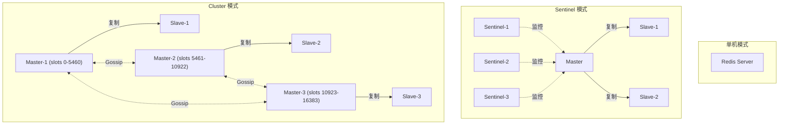
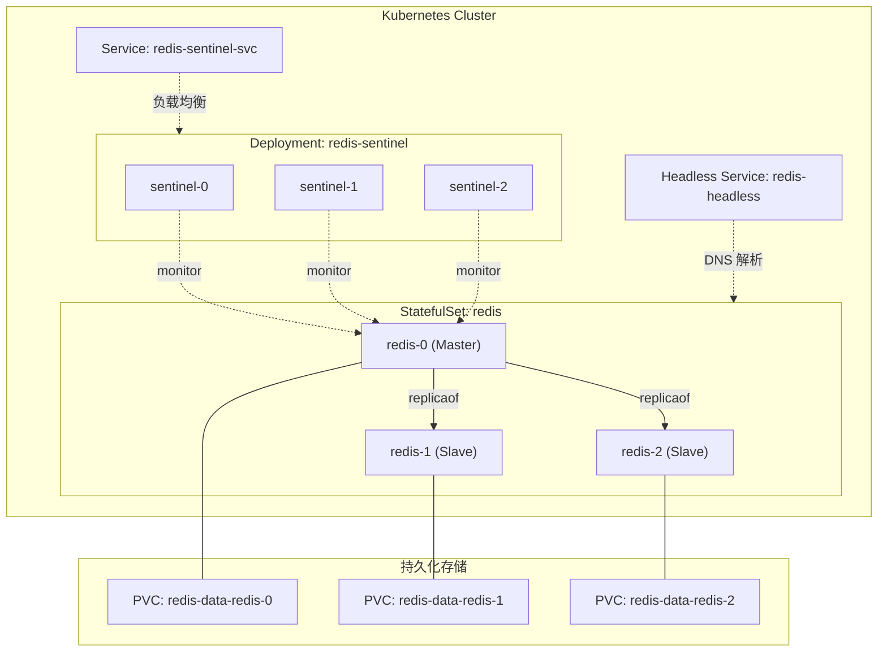
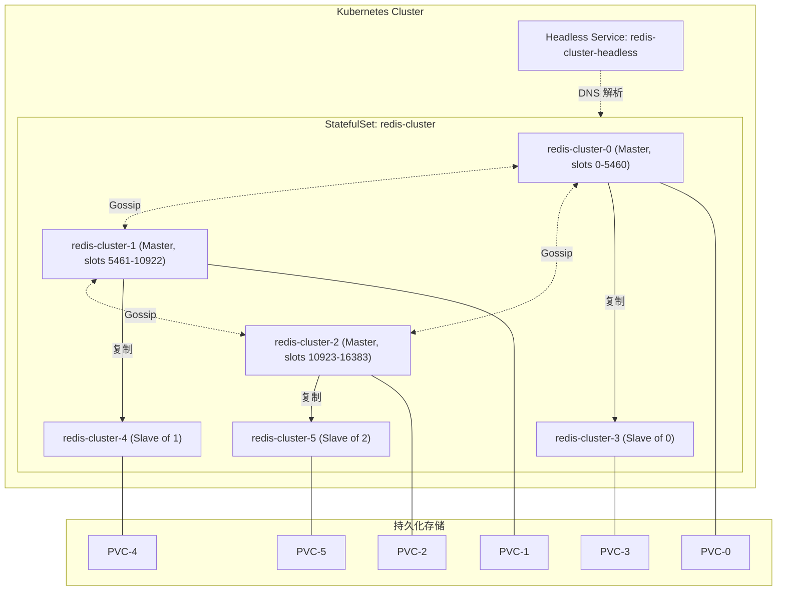

## 0x00 前言

本篇文章总结下在 Kubernetes 集群中部署 Redis 的几种方案，涵盖单机、Sentinel 主从高可用以及 Cluster 分片集群三种模式。项目中需要根据业务规模和可用性要求选择合适的部署模式，核心依赖 `StatefulSet`、`Headless Service` 和持久化存储（`PV`/`PVC`）等 Kubernetes 原语

Redis 在 Kubernetes 上的三种典型部署模式对比如下：

| 特性 | 单机模式 | Sentinel 模式 | Cluster 模式 |
| --- | --- | --- | --- |
| 节点数量 | 1 | 1 Master + N Slave + 3 Sentinel | >= 6（3 Master + 3 Slave） |
| 数据分片 | 不支持 | 不支持 | 支持（16384 slots） |
| 自动故障转移 | 不支持 | 支持（Sentinel 选主） | 支持（节点投票） |
| 读写分离 | 不支持 | 支持 | 支持 |
| 适用场景 | 开发/测试 | 中小规模生产环境 | 大数据量/高吞吐生产环境 |

三种模式的架构关系：



## 0x01 单机 Redis 搭建

#### 创建 ConfigMap

首先，把 `Redis` 的配置文件 `redis.conf` 存储在 `configmap` 中，注意其中定义的 `Redis` 运行目录：`/data/middleware-data/redis/`

```yaml
apiVersion: v1
data:
  redis.conf: |
    bind 0.0.0.0
    port 6379
    requirepass xxxxxx
    pidfile .pid
    appendonly yes
    cluster-config-file nodes-6379.conf
    pidfile /data/middleware-data/redis/log/redis-6379.pid
    cluster-config-file /data/middleware-data/redis/conf/redis.conf
    dir /data/middleware-data/redis/data/
    logfile "/data/middleware-data/redis/log/redis-6379.log"
    cluster-node-timeout 5000
    protected-mode no
kind: ConfigMap
metadata:
  creationTimestamp: "2021-06-27T10:01:29Z"
  name: redis-conf
  namespace: xxxx
```

#### 创建 StatefulSet

创建 `StatefulSet`，并把数据挂载到宿主机上。注意，这里使用 `initContainers` 来完成前置工作，如目录创建等；

```yaml
apiVersion: apps/v1beta2
kind: StatefulSet
metadata:
  creationTimestamp: "2021-06-27T10:03:08Z"
  generation: 1
  name: redis
  namespace: xxxx
spec:
  podManagementPolicy: OrderedReady
  replicas: 1
  revisionHistoryLimit: 10
  selector:
    matchLabels:
      name: redis
  serviceName: redis
  template:
    metadata:
      creationTimestamp: null
      labels:
        name: redis
    spec:
      containers:
        - command:
            - sh
            - -c
            - exec redis-server /data/middleware-data/redis/conf/redis.conf
          image: redis:5.0.6
          imagePullPolicy: IfNotPresent
          name: redis
          ports:
            - containerPort: 6379
              name: redis
              protocol: TCP
          resources: {}
          terminationMessagePath: /dev/termination-log
          terminationMessagePolicy: File
          volumeMounts:
            - mountPath: /data/middleware-data/redis/conf/
              name: redis-config
            - mountPath: /data/middleware-data/redis/
              name: data
      dnsPolicy: ClusterFirst
      initContainers:
        - command:
            - sh
            - -c
            - mkdir -p /data/middleware-data/redis/log/;mkdir -p /data/middleware-data/redis/conf/;mkdir -p /data/middleware-data/redis/data/
          image: busybox
          imagePullPolicy: Always
          name: init-redis
          resources: {}
          terminationMessagePath: /dev/termination-log
          terminationMessagePolicy: File
          volumeMounts:
            - mountPath: /data/middleware-data/redis/
              name: data
      restartPolicy: Always
      schedulerName: default-scheduler
      securityContext: {}
      terminationGracePeriodSeconds: 30
      volumes:
        - configMap:
            defaultMode: 420
            name: redis-conf
          name: redis-config
        - hostPath:
            path: /data/middleware-data/redis/
            type: ""
          name: data
  updateStrategy:
    rollingUpdate:
      partition: 0
    type: RollingUpdate
```

#### 创建 Service

```yaml
apiVersion: v1
kind: Service
metadata:
  creationTimestamp: "2021-06-27T10:03:44Z"
  labels:
    name: redis
  name: redis
  namespace: xxxx
spec:
  clusterIP: 172.16.255.66
  externalTrafficPolicy: Cluster
  ports:
    - name: redis
      nodePort: 30020
      port: 6379
      protocol: TCP
      targetPort: 6379
  selector:
    name: redis
  sessionAffinity: None
  type: NodePort
```

## 0x02 K8S 持久化存储方案对比

在 Kubernetes 上部署 Redis 这类有状态服务，持久化存储的选型至关重要。Redis 对磁盘 IO 性能有一定要求（尤其是 AOF 持久化模式下），不同的存储方案在性能、可靠性和运维复杂度上各有取舍。

#### NFS（Network File System）

NFS 是最容易搭建的共享存储方案，适合测试环境和小规模部署。所有 Pod 可以挂载同一个 NFS 卷，但由于 <font color="#dd0000">NFS 是网络文件系统，IO 延迟较高且存在单点问题</font>，不建议用于生产环境的 Redis 持久化。

```yaml
apiVersion: storage.k8s.io/v1
kind: StorageClass
metadata:
  name: nfs-storage
provisioner: nfs-subdir-external-provisioner
parameters:
  archiveOnDelete: "true"
  pathPattern: "${.PVC.namespace}/${.PVC.name}"
reclaimPolicy: Retain
volumeBindingMode: Immediate
mountOptions:
  - hard
  - nfsvers=4.1
```

使用 NFS 动态供应需要部署 [nfs-subdir-external-provisioner](https://github.com/kubernetes-sigs/nfs-subdir-external-provisioner)，它会自动根据 PVC 请求在 NFS 服务器上创建子目录并绑定 PV。

#### Local PV

Local PV 直接使用节点本地磁盘，<font color="#dd0000">IO 性能最优</font>，非常适合 Redis 这类对延迟敏感的场景。缺点是 Pod 被绑定在特定节点上，节点故障时无法自动迁移。需要配合 `nodeAffinity` 使用：

```yaml
apiVersion: storage.k8s.io/v1
kind: StorageClass
metadata:
  name: local-storage
provisioner: kubernetes.io/no-provisioner
volumeBindingMode: WaitForFirstConsumer
reclaimPolicy: Retain
---
apiVersion: v1
kind: PersistentVolume
metadata:
  name: redis-local-pv-0
spec:
  capacity:
    storage: 10Gi
  volumeMode: Filesystem
  accessModes:
    - ReadWriteOnce
  persistentVolumeReclaimPolicy: Retain
  storageClassName: local-storage
  local:
    path: /data/redis
  nodeAffinity:
    required:
      nodeSelectorTerms:
        - matchExpressions:
            - key: kubernetes.io/hostname
              operator: In
              values:
                - node-1
```

生产环境中可以使用 [local-path-provisioner](https://github.com/rancher/local-path-provisioner) 实现动态供应 Local PV。

#### Ceph RBD / CSI

Ceph 是成熟的分布式存储系统，RBD（RADOS Block Device）提供块存储能力。Ceph 具备 <font color="#dd0000">数据多副本、自动恢复、不绑定节点</font> 等优势，是生产环境的主流选择：

```yaml
apiVersion: storage.k8s.io/v1
kind: StorageClass
metadata:
  name: ceph-rbd
provisioner: rbd.csi.ceph.com
parameters:
  clusterID: <ceph-cluster-id>
  pool: kubernetes
  imageFormat: "2"
  imageFeatures: layering
  csi.storage.k8s.io/provisioner-secret-name: csi-rbd-secret
  csi.storage.k8s.io/provisioner-secret-namespace: ceph-system
  csi.storage.k8s.io/node-stage-secret-name: csi-rbd-secret
  csi.storage.k8s.io/node-stage-secret-namespace: ceph-system
reclaimPolicy: Delete
allowVolumeExpansion: true
volumeBindingMode: Immediate
```

#### 云盘（TKE CBS / AWS EBS）

云上 Kubernetes 环境通常直接使用云厂商提供的块存储 CSI 插件。以腾讯云 TKE 的 CBS（Cloud Block Storage）为例：

```yaml
apiVersion: storage.k8s.io/v1
kind: StorageClass
metadata:
  name: cbs-premium
provisioner: com.tencent.cloud.csi.cbs
parameters:
  diskType: CLOUD_PREMIUM
reclaimPolicy: Delete
volumeBindingMode: WaitForFirstConsumer
allowVolumeExpansion: true
```

AWS EKS 环境使用 EBS CSI：

```yaml
apiVersion: storage.k8s.io/v1
kind: StorageClass
metadata:
  name: ebs-gp3
provisioner: ebs.csi.aws.com
parameters:
  type: gp3
  iops: "3000"
  throughput: "125"
reclaimPolicy: Delete
volumeBindingMode: WaitForFirstConsumer
allowVolumeExpansion: true
```

#### 存储方案选型建议

| 方案 | IO 性能 | 节点绑定 | 数据安全 | 运维复杂度 | 推荐场景 |
| --- | --- | --- | --- | --- | --- |
| NFS | 低 | 否 | 依赖 NFS 服务器 | 低 | 测试 / 开发环境 |
| Local PV | 高 | 是 | 节点故障数据丢失 | 中 | 对 IO 延迟敏感的生产环境 |
| Ceph RBD | 中高 | 否 | 多副本保障 | 高 | 自建集群生产环境 |
| 云盘 CSI | 中高 | 否 | 云厂商 SLA 保障 | 低 | 云上生产环境 |

- 测试环境推荐 NFS：部署简单、成本低
- 生产环境推荐 Local PV（性能优先）或 Ceph RBD（灵活性优先）
- 云上环境直接使用云盘 CSI，省心省力

## 0x03 Redis Sentinel 模式部署

Redis Sentinel 为 Redis 提供了高可用解决方案。Sentinel 系统由若干 Sentinel 实例组成，负责监控 Master 节点健康状态，并在 Master 故障时自动完成主从切换。

#### 架构设计

在 Kubernetes 上部署 Sentinel 模式，核心思路是：
1. 使用 `StatefulSet` 部署 3 个 Redis 实例（`redis-0` 为初始 Master，`redis-1`/`redis-2` 为 Slave）
2. 使用 `Deployment` 部署 3 个 Sentinel 实例监控 Master
3. 使用 `Headless Service` 为 StatefulSet Pod 提供稳定 DNS



#### 创建 ConfigMap

Redis 主从配置和 Sentinel 配置分别存储在 ConfigMap 中。由于 Master 和 Slave 的配置在启动时有差异，通过 entrypoint 脚本动态生成：

```yaml
apiVersion: v1
kind: ConfigMap
metadata:
  name: redis-sentinel-config
  namespace: redis
data:
  redis.conf: |
    bind 0.0.0.0
    port 6379
    protected-mode no
    tcp-backlog 511
    timeout 0
    tcp-keepalive 300
    daemonize no
    supervised no
    loglevel notice
    logfile ""
    databases 16
    save 900 1
    save 300 10
    save 60 10000
    stop-writes-on-bgsave-error yes
    rdbcompression yes
    rdbchecksum yes
    dbfilename dump.rdb
    dir /data
    appendonly yes
    appendfilename "appendonly.aof"
    appendfsync everysec
    no-appendfsync-on-rewrite no
    auto-aof-rewrite-percentage 100
    auto-aof-rewrite-min-size 64mb
    maxmemory-policy noeviction

  sentinel.conf: |
    port 26379
    dir /tmp
    sentinel monitor mymaster redis-0.redis-headless.redis.svc.cluster.local 6379 2
    sentinel down-after-milliseconds mymaster 5000
    sentinel failover-timeout mymaster 60000
    sentinel parallel-syncs mymaster 1
    sentinel resolve-hostnames yes
    sentinel announce-hostnames yes

  entrypoint.sh: |
    #!/bin/bash
    set -ex

    HOSTNAME=$(hostname)
    INDEX=${HOSTNAME##*-}

    cp /etc/redis/redis.conf /data/redis.conf

    if [ "$INDEX" = "0" ]; then
      echo "Starting as MASTER"
    else
      echo "Starting as SLAVE, replicating from redis-0"
      echo "replicaof redis-0.redis-headless.redis.svc.cluster.local 6379" >> /data/redis.conf
    fi

    exec redis-server /data/redis.conf
```

#### 创建 Headless Service

Headless Service（`clusterIP: None`）为 StatefulSet 中的每个 Pod 提供稳定的 DNS 记录，格式为 `redis-{N}.redis-headless.redis.svc.cluster.local`：

```yaml
apiVersion: v1
kind: Service
metadata:
  name: redis-headless
  namespace: redis
  labels:
    app: redis-sentinel
spec:
  ports:
    - port: 6379
      targetPort: 6379
      name: redis
  clusterIP: None
  selector:
    app: redis-sentinel
```

#### 创建 Redis StatefulSet

使用 `StatefulSet` 部署 3 个 Redis 实例，通过 `volumeClaimTemplates` 为每个 Pod 自动创建独立 PVC：

```yaml
apiVersion: apps/v1
kind: StatefulSet
metadata:
  name: redis
  namespace: redis
  labels:
    app: redis-sentinel
spec:
  serviceName: redis-headless
  replicas: 3
  selector:
    matchLabels:
      app: redis-sentinel
  template:
    metadata:
      labels:
        app: redis-sentinel
    spec:
      affinity:
        podAntiAffinity:
          preferredDuringSchedulingIgnoredDuringExecution:
            - weight: 100
              podAffinityTerm:
                labelSelector:
                  matchExpressions:
                    - key: app
                      operator: In
                      values:
                        - redis-sentinel
                topologyKey: kubernetes.io/hostname
      initContainers:
        - name: init-redis
          image: redis:6.2
          command:
            - bash
            - -c
            - |
              mkdir -p /data
              chmod 777 /data
          volumeMounts:
            - name: redis-data
              mountPath: /data
      containers:
        - name: redis
          image: redis:6.2
          command:
            - bash
            - /etc/redis/entrypoint.sh
          ports:
            - containerPort: 6379
              name: redis
          resources:
            requests:
              cpu: 200m
              memory: 256Mi
            limits:
              cpu: "1"
              memory: 1Gi
          readinessProbe:
            exec:
              command:
                - redis-cli
                - ping
            initialDelaySeconds: 5
            periodSeconds: 10
          livenessProbe:
            exec:
              command:
                - redis-cli
                - ping
            initialDelaySeconds: 15
            periodSeconds: 20
          volumeMounts:
            - name: redis-data
              mountPath: /data
            - name: redis-config
              mountPath: /etc/redis
      volumes:
        - name: redis-config
          configMap:
            name: redis-sentinel-config
            defaultMode: 0755
  volumeClaimTemplates:
    - metadata:
        name: redis-data
      spec:
        accessModes:
          - ReadWriteOnce
        storageClassName: ceph-rbd  # 根据实际存储方案替换
        resources:
          requests:
            storage: 10Gi
```

#### 创建 Sentinel Deployment

Sentinel 本身是无状态的（配置可以动态更新），使用 `Deployment` 部署 3 个实例。注意 <font color="#dd0000">Sentinel 需要能写入自身配置文件</font>，因此需要将 ConfigMap 复制到可写目录：

```yaml
apiVersion: apps/v1
kind: Deployment
metadata:
  name: redis-sentinel
  namespace: redis
  labels:
    app: redis-sentinel-node
spec:
  replicas: 3
  selector:
    matchLabels:
      app: redis-sentinel-node
  template:
    metadata:
      labels:
        app: redis-sentinel-node
    spec:
      affinity:
        podAntiAffinity:
          preferredDuringSchedulingIgnoredDuringExecution:
            - weight: 100
              podAffinityTerm:
                labelSelector:
                  matchExpressions:
                    - key: app
                      operator: In
                      values:
                        - redis-sentinel-node
                topologyKey: kubernetes.io/hostname
      initContainers:
        - name: init-sentinel
          image: redis:6.2
          command:
            - bash
            - -c
            - |
              cp /etc/sentinel/sentinel.conf /data/sentinel.conf
          volumeMounts:
            - name: sentinel-config
              mountPath: /etc/sentinel
            - name: sentinel-data
              mountPath: /data
      containers:
        - name: sentinel
          image: redis:6.2
          command:
            - redis-sentinel
            - /data/sentinel.conf
          ports:
            - containerPort: 26379
              name: sentinel
          resources:
            requests:
              cpu: 100m
              memory: 128Mi
            limits:
              cpu: 500m
              memory: 256Mi
          readinessProbe:
            exec:
              command:
                - redis-cli
                - -p
                - "26379"
                - ping
            initialDelaySeconds: 5
            periodSeconds: 10
          volumeMounts:
            - name: sentinel-data
              mountPath: /data
      volumes:
        - name: sentinel-config
          configMap:
            name: redis-sentinel-config
            items:
              - key: sentinel.conf
                path: sentinel.conf
        - name: sentinel-data
          emptyDir: {}
---
apiVersion: v1
kind: Service
metadata:
  name: redis-sentinel-svc
  namespace: redis
  labels:
    app: redis-sentinel-node
spec:
  ports:
    - port: 26379
      targetPort: 26379
      name: sentinel
  selector:
    app: redis-sentinel-node
```

#### 故障转移验证

部署完成后可以通过以下步骤验证 Sentinel 故障转移能力：

1、查看 Sentinel 状态：

```bash
# 进入任意 Sentinel Pod
kubectl exec -it -n redis deploy/redis-sentinel -- redis-cli -p 26379

# 查看 Master 信息
SENTINEL master mymaster

# 查看 Slave 列表
SENTINEL slaves mymaster

# 查看 Sentinel 列表
SENTINEL sentinels mymaster
```

2、模拟 Master 故障：

```bash
# 删除 Master Pod，观察 Sentinel 是否自动完成 failover
kubectl delete pod redis-0 -n redis

# 等待约 5-10 秒后查看新的 Master
kubectl exec -it -n redis deploy/redis-sentinel -- redis-cli -p 26379 SENTINEL get-master-addr-by-name mymaster
```

3、验证数据一致性：

```bash
# 连接新 Master 检查数据
kubectl exec -it -n redis redis-1 -- redis-cli INFO replication
```

<font color="#dd0000">注意：Sentinel 完成 failover 后，原 redis-0 重新启动时会自动变为新 Master 的 Slave</font>。

## 0x04 Redis Cluster 模式部署

Redis Cluster 是 Redis 官方的分片集群方案，将 16384 个 hash slot 分布在多个 Master 节点上，每个 Master 可以有若干 Slave 作为副本。最小部署规模为 <font color="#dd0000">6 个节点（3 Master + 3 Slave）</font>。

#### 架构设计



#### 创建 ConfigMap

Redis Cluster 的核心配置是开启 `cluster-enabled yes`，并为每个节点指定 `cluster-config-file`：

```yaml
apiVersion: v1
kind: ConfigMap
metadata:
  name: redis-cluster-config
  namespace: redis
data:
  redis.conf: |
    bind 0.0.0.0
    port 6379
    protected-mode no
    cluster-enabled yes
    cluster-config-file /data/nodes.conf
    cluster-node-timeout 5000
    cluster-announce-hostname ${HOSTNAME}.redis-cluster-headless.redis.svc.cluster.local
    appendonly yes
    appendfilename "appendonly.aof"
    appendfsync everysec
    dir /data
    save 900 1
    save 300 10
    save 60 10000
    maxmemory-policy noeviction
    loglevel notice

  entrypoint.sh: |
    #!/bin/bash
    set -ex

    # 替换配置中的主机名变量
    HOSTNAME=$(hostname)
    cp /etc/redis/redis.conf /data/redis.conf
    sed -i "s/\${HOSTNAME}/${HOSTNAME}/g" /data/redis.conf

    exec redis-server /data/redis.conf
```

#### 创建 NFS 动态存储（示例）

以 NFS 为例配置动态 PV 供应。先部署 NFS Provisioner，再创建 StorageClass：

```yaml
apiVersion: storage.k8s.io/v1
kind: StorageClass
metadata:
  name: redis-nfs-storage
provisioner: nfs-subdir-external-provisioner
parameters:
  archiveOnDelete: "true"
  pathPattern: "redis-cluster/${.PVC.namespace}-${.PVC.name}"
reclaimPolicy: Retain
volumeBindingMode: Immediate
mountOptions:
  - hard
  - nfsvers=4.1
```

如果使用静态 PV，则需要手动为每个 Redis 节点创建 PV/PVC 对：

```yaml
# 为 6 个节点分别创建 PV，此处仅展示第一个
apiVersion: v1
kind: PersistentVolume
metadata:
  name: redis-cluster-pv-0
  labels:
    app: redis-cluster
spec:
  capacity:
    storage: 10Gi
  accessModes:
    - ReadWriteOnce
  persistentVolumeReclaimPolicy: Retain
  nfs:
    server: <nfs-server-ip>
    path: /data/nfs/redis-cluster/0
```

#### 创建 Headless Service

```yaml
apiVersion: v1
kind: Service
metadata:
  name: redis-cluster-headless
  namespace: redis
  labels:
    app: redis-cluster
spec:
  ports:
    - port: 6379
      targetPort: 6379
      name: redis
    - port: 16379
      targetPort: 16379
      name: gossip
  clusterIP: None
  selector:
    app: redis-cluster
```

<font color="#dd0000">注意：Redis Cluster 节点间通信使用 `端口 + 10000`（默认 16379）的 Gossip 协议端口，Headless Service 必须同时暴露这两个端口</font>。

#### 创建 Redis Cluster StatefulSet

```yaml
apiVersion: apps/v1
kind: StatefulSet
metadata:
  name: redis-cluster
  namespace: redis
  labels:
    app: redis-cluster
spec:
  serviceName: redis-cluster-headless
  replicas: 6
  selector:
    matchLabels:
      app: redis-cluster
  template:
    metadata:
      labels:
        app: redis-cluster
    spec:
      affinity:
        podAntiAffinity:
          preferredDuringSchedulingIgnoredDuringExecution:
            - weight: 100
              podAffinityTerm:
                labelSelector:
                  matchExpressions:
                    - key: app
                      operator: In
                      values:
                        - redis-cluster
                topologyKey: kubernetes.io/hostname
      initContainers:
        - name: init-redis
          image: redis:6.2
          command:
            - bash
            - -c
            - |
              mkdir -p /data
              chmod 777 /data
          volumeMounts:
            - name: redis-data
              mountPath: /data
      containers:
        - name: redis
          image: redis:6.2
          command:
            - bash
            - /etc/redis/entrypoint.sh
          ports:
            - containerPort: 6379
              name: redis
            - containerPort: 16379
              name: gossip
          resources:
            requests:
              cpu: 200m
              memory: 256Mi
            limits:
              cpu: "1"
              memory: 1Gi
          readinessProbe:
            exec:
              command:
                - redis-cli
                - ping
            initialDelaySeconds: 10
            periodSeconds: 10
          livenessProbe:
            exec:
              command:
                - redis-cli
                - ping
            initialDelaySeconds: 20
            periodSeconds: 20
          volumeMounts:
            - name: redis-data
              mountPath: /data
            - name: redis-config
              mountPath: /etc/redis
      volumes:
        - name: redis-config
          configMap:
            name: redis-cluster-config
            defaultMode: 0755
  volumeClaimTemplates:
    - metadata:
        name: redis-data
      spec:
        accessModes:
          - ReadWriteOnce
        storageClassName: redis-nfs-storage  # 根据实际存储方案替换
        resources:
          requests:
            storage: 10Gi
```

#### 集群初始化

等待所有 6 个 Pod 都处于 `Running` 状态后，通过 Job 或手动执行 `redis-cli --cluster create` 初始化集群。推荐使用 Job 实现自动化：

```yaml
apiVersion: batch/v1
kind: Job
metadata:
  name: redis-cluster-init
  namespace: redis
spec:
  template:
    spec:
      restartPolicy: OnFailure
      containers:
        - name: cluster-init
          image: redis:6.2
          command:
            - bash
            - -c
            - |
              # 等待所有节点就绪
              for i in $(seq 0 5); do
                until redis-cli -h redis-cluster-${i}.redis-cluster-headless.redis.svc.cluster.local ping | grep -q PONG; do
                  echo "Waiting for redis-cluster-${i}..."
                  sleep 2
                done
              done

              echo "All nodes ready, creating cluster..."

              redis-cli --cluster create \
                redis-cluster-0.redis-cluster-headless.redis.svc.cluster.local:6379 \
                redis-cluster-1.redis-cluster-headless.redis.svc.cluster.local:6379 \
                redis-cluster-2.redis-cluster-headless.redis.svc.cluster.local:6379 \
                redis-cluster-3.redis-cluster-headless.redis.svc.cluster.local:6379 \
                redis-cluster-4.redis-cluster-headless.redis.svc.cluster.local:6379 \
                redis-cluster-5.redis-cluster-headless.redis.svc.cluster.local:6379 \
                --cluster-replicas 1 --cluster-yes
```

手动方式则进入任意 Redis Pod 执行相同的 `redis-cli --cluster create` 命令。

#### 集群状态检查

```bash
# 进入任一 Redis Cluster Pod
kubectl exec -it -n redis redis-cluster-0 -- bash

# 查看集群信息
redis-cli CLUSTER INFO

# 查看集群节点列表及 slot 分配
redis-cli CLUSTER NODES

# 检查集群所有 slot 是否正常分配
redis-cli --cluster check redis-cluster-0.redis-cluster-headless.redis.svc.cluster.local:6379
```

#### 集群扩缩容

**扩容**：增加 StatefulSet 副本数后，将新节点加入集群并重新分配 slot：

```bash
# 1. 扩容 StatefulSet
kubectl scale statefulset redis-cluster -n redis --replicas=8

# 2. 等待新 Pod 就绪后，将新节点加入集群（作为 Master）
redis-cli --cluster add-node \
  redis-cluster-6.redis-cluster-headless.redis.svc.cluster.local:6379 \
  redis-cluster-0.redis-cluster-headless.redis.svc.cluster.local:6379

# 3. 为新节点添加 Slave
redis-cli --cluster add-node \
  redis-cluster-7.redis-cluster-headless.redis.svc.cluster.local:6379 \
  redis-cluster-6.redis-cluster-headless.redis.svc.cluster.local:6379 \
  --cluster-slave

# 4. 重新分配 slot（reshard）
redis-cli --cluster reshard \
  redis-cluster-0.redis-cluster-headless.redis.svc.cluster.local:6379
```

**缩容**：先将节点的 slot 迁移到其他节点，再将节点从集群中移除：

```bash
# 1. 将待移除节点的 slot 迁移走
redis-cli --cluster reshard \
  redis-cluster-0.redis-cluster-headless.redis.svc.cluster.local:6379

# 2. 从集群中移除节点
redis-cli --cluster del-node \
  redis-cluster-0.redis-cluster-headless.redis.svc.cluster.local:6379 \
  <node-id-to-remove>

# 3. 缩减 StatefulSet 副本数
kubectl scale statefulset redis-cluster -n redis --replicas=6
```

## 0x05 使用 Redis Operator（可选方案）

手动维护 Redis 集群的 YAML 清单和运维操作较为繁琐，社区提供了多种 Redis Operator 来自动化管理 Redis 集群的生命周期。

#### Spotahome redis-operator

[Spotahome redis-operator](https://github.com/spotahome/redis-operator) 是一个成熟的 Redis Sentinel 集群 Operator，支持通过 CRD 声明式管理 Redis Sentinel 集群：

```yaml
apiVersion: databases.spotahome.com/v1
kind: RedisFailover
metadata:
  name: my-redis
  namespace: redis
spec:
  sentinel:
    replicas: 3
    resources:
      requests:
        cpu: 100m
        memory: 128Mi
      limits:
        cpu: 500m
        memory: 256Mi
  redis:
    replicas: 3
    resources:
      requests:
        cpu: 200m
        memory: 256Mi
      limits:
        cpu: "1"
        memory: 1Gi
    storage:
      persistentVolumeClaim:
        metadata:
          name: redis-data
        spec:
          accessModes:
            - ReadWriteOnce
          resources:
            requests:
              storage: 10Gi
          storageClassName: ceph-rbd
```

安装方式：

```bash
# 部署 CRD 和 Operator
kubectl apply -f https://raw.githubusercontent.com/spotahome/redis-operator/master/example/operator/all-redis-operator-resources.yaml
```

#### OT-CONTAINER-KIT redis-operator

[OT redis-operator](https://github.com/OT-CONTAINER-KIT/redis-operator) 同时支持 Redis Standalone、Sentinel 和 Cluster 三种模式，是目前功能较全面的 Operator：

```yaml
apiVersion: redis.redis.opstreelabs.in/v1beta2
kind: RedisCluster
metadata:
  name: redis-cluster
  namespace: redis
spec:
  clusterSize: 3
  clusterVersion: v7
  persistenceEnabled: true
  kubernetesConfig:
    image: quay.io/opstree/redis:v7.0.12
    imagePullPolicy: IfNotPresent
    resources:
      requests:
        cpu: 200m
        memory: 256Mi
      limits:
        cpu: "1"
        memory: 1Gi
  storage:
    volumeClaimTemplate:
      spec:
        accessModes:
          - ReadWriteOnce
        resources:
          requests:
            storage: 10Gi
        storageClassName: ceph-rbd
```

#### Operator 方案选型建议

| Operator | 支持模式 | Star 数 | 维护活跃度 | 推荐场景 |
| --- | --- | --- | --- | --- |
| Spotahome redis-operator | Sentinel | 高 | 活跃 | 仅需 Sentinel 模式 |
| OT redis-operator | Standalone / Sentinel / Cluster | 中 | 活跃 | 需要多种模式支持 |

使用 Operator 的核心优势：
- 声明式管理，一个 CRD 即可描述完整集群
- 自动处理节点故障恢复、扩缩容
- 集成 Prometheus 监控指标导出
- 降低运维复杂度，适合缺少深度 Redis 运维经验的团队

## 0x06 生产环境最佳实践

#### 资源限制（requests / limits）

为 Redis Pod 设置合理的资源 requests 和 limits，避免 OOM 或 CPU 争抢。<font color="#dd0000">Redis 是单线程模型，通常 1 核 CPU 足够</font>，内存根据数据量设置：

```yaml
resources:
  requests:
    cpu: 200m
    memory: 256Mi
  limits:
    cpu: "1"
    memory: 2Gi
```

建议将 `maxmemory` 设置为 limits 的 80% 左右，预留空间给 RDB/AOF 重写和连接缓冲区。

#### Pod 反亲和性（Anti-Affinity）

确保 Redis 实例分散在不同节点上，避免单节点故障导致多个实例同时不可用：

```yaml
affinity:
  podAntiAffinity:
    requiredDuringSchedulingIgnoredDuringExecution:
      - labelSelector:
          matchExpressions:
            - key: app
              operator: In
              values:
                - redis-cluster
        topologyKey: kubernetes.io/hostname
```

生产环境中建议使用 `requiredDuringSchedulingIgnoredDuringExecution`（硬性约束）；如果节点数量有限，可以退化为 `preferredDuringSchedulingIgnoredDuringExecution`（软性约束）。

#### PodDisruptionBudget（PDB）

PDB 确保在节点维护或滚动更新时，始终有足够数量的 Redis 实例在线：

```yaml
apiVersion: policy/v1
kind: PodDisruptionBudget
metadata:
  name: redis-cluster-pdb
  namespace: redis
spec:
  maxUnavailable: 1
  selector:
    matchLabels:
      app: redis-cluster
```

对于 Sentinel 模式，Master 和 Sentinel 应分别配置 PDB。

#### 监控方案

使用 [redis-exporter](https://github.com/oliver006/redis_exporter) 配合 Prometheus + Grafana 实现 Redis 监控。推荐以 Sidecar 方式部署 redis-exporter：

```yaml
# 在 StatefulSet 的 containers 中添加 sidecar
- name: redis-exporter
  image: oliver006/redis_exporter:v1.45.0
  ports:
    - containerPort: 9121
      name: metrics
  resources:
    requests:
      cpu: 50m
      memory: 64Mi
    limits:
      cpu: 200m
      memory: 128Mi
  env:
    - name: REDIS_ADDR
      value: "redis://localhost:6379"
```

关键监控指标：
- `redis_connected_clients`：当前连接数
- `redis_used_memory_bytes`：内存使用量
- `redis_commands_processed_total`：命令处理总数
- `redis_keyspace_hits_total` / `redis_keyspace_misses_total`：缓存命中率
- `redis_connected_slaves`：从节点数量（Sentinel 模式）
- `redis_cluster_slots_ok`：正常 slot 数量（Cluster 模式）

#### 备份策略

1. **RDB 定时快照**：通过 `save` 配置项定期生成 RDB 文件，配合 CronJob 将 RDB 文件备份到对象存储（如 S3/COS）
2. **AOF 持久化**：开启 `appendonly yes`，确保数据不丢失
3. **CronJob 自动备份示例**：

```yaml
apiVersion: batch/v1
kind: CronJob
metadata:
  name: redis-backup
  namespace: redis
spec:
  schedule: "0 2 * * *"  # 每天凌晨 2 点
  jobTemplate:
    spec:
      template:
        spec:
          restartPolicy: OnFailure
          containers:
            - name: backup
              image: redis:6.2
              command:
                - bash
                - -c
                - |
                  # 触发 BGSAVE
                  redis-cli -h redis-0.redis-headless.redis.svc.cluster.local BGSAVE
                  sleep 10
                  # 将 RDB 文件复制到备份目录（可进一步上传到对象存储）
                  cp /data/dump.rdb /backup/dump-$(date +%Y%m%d%H%M%S).rdb
              volumeMounts:
                - name: redis-data
                  mountPath: /data
                  readOnly: true
                - name: backup-volume
                  mountPath: /backup
          volumes:
            - name: redis-data
              persistentVolumeClaim:
                claimName: redis-data-redis-0
            - name: backup-volume
              persistentVolumeClaim:
                claimName: redis-backup-pvc
```

## 0x07 参考

- [Redis Sentinel Documentation](https://redis.io/docs/management/sentinel/)
- [Redis Cluster Tutorial](https://redis.io/docs/management/scaling/)
- [Kubernetes StatefulSet](https://kubernetes.io/docs/concepts/workloads/controllers/statefulset/)
- [Kubernetes Persistent Volumes](https://kubernetes.io/docs/concepts/storage/persistent-volumes/)
- [Spotahome Redis Operator](https://github.com/spotahome/redis-operator)
- [OT-CONTAINER-KIT Redis Operator](https://github.com/OT-CONTAINER-KIT/redis-operator)
- [Redis Exporter for Prometheus](https://github.com/oliver006/redis_exporter)
- [NFS Subdir External Provisioner](https://github.com/kubernetes-sigs/nfs-subdir-external-provisioner)
- [Rancher Local Path Provisioner](https://github.com/rancher/local-path-provisioner)
