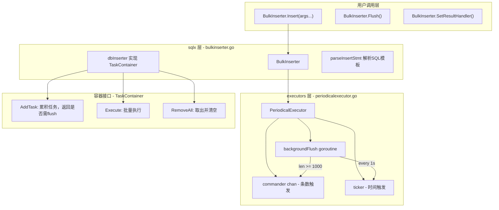

##  0x00    前言
本文是对项目中 Mysql 使用的一些经验汇总，包含如下几个方面：
-   分区表
-   索引的使用
-   插入 / 查询优化
-   业务上分库分表
-   MySQL 开发经验


##  0x01    分区表
对于操作日志、任务日志等大量日志的存储场景，方便管理，比如日志仅保留最近半年（遇到使用 innodb 引擎的 MySQL 进行 `delete` 操作后，底层文件不会变小的问题），过期的冷备等，采用分区表是个不错的选择。分库分表是指将数据分散到不同的数据库中或不同的表中，使得单个数据库或表的数据量变小，以此来缓解单一数据库的性能问题，达到提升数据库性能的目的（单表小于 `2G`，记录数小于 `1000w`，十库百表，当然这也只是个经验值）

分库分表分为 分库与分表两个部分，在生产中通常包括：垂直分表、水平分表、垂直分库、水平分库。
关于分区表的使用，需要理解下面几点：
-   **分区表设计不解决性能问题，更多的是解决数据迁移和备份的问题**
-   需要根据业务场景设计好分区的方法及字段
-   分区表对于应用是透明的
-   MySQL 中的分区表是把一张大表拆成了多张表，每张表有自己的索引，从逻辑上看是一张表，但物理上存储在不同文件中
-   大多数需求场景是为了快速清理过期数据（避免数据量过大）
-   关于分区表的 MYSQL，该建的索引还得建，该优化的查询还得优化

####    分库分表的类型
分库分表分为分库与分表两个部分，在生产中通常包括垂直分表、水平分表、垂直分库、水平分库这几种：

1、垂直分表

垂直分表是**将一个表按照字段分为多个表，每个表存储其中一部分字段**。可以按照字段的访问频率划分，访问频率较高的放在一张表中，其他访问频率低且该字段存储占用空间大一些的放在另一张表。注意，分表的时候要考虑字段之间的关联性，关联性高的放在同一张表中；通常可以按照下面的经验进行垂直拆分：

-   不常用的字段单独放一张表
-   将 `text`、`blob` 等大字段拆分出来放在附表
-   经常组合查询的字段放在一张表中

垂直分表的优点如下：

-   避免 IO 争抢并减少锁表的几率
-   充分发挥热点数据的操作效率，高频率字段数据的操作不会被其他低效率的数据拖累

2、垂直分库

通过垂直分表性能得到一定程度的提升，但是数据还是在一个服务器上，库内分表只是解决了单个表数据量过大的问题，但如果磁盘空间不足，问题还是没有得到解决。引入垂直分库解决上述问题，可以按照业务将表进行分类，分布到不用的数据库上面，每个库可以放在不同的服务器上，核心理念为专库专用，该策略的优点如下：

-   解决业务层面的耦合、业务清晰
-   高并发场景下，垂直分库一定程度的提升 IO、数据库连接数、降低单机硬件资源的瓶颈

3、水平分表

通过垂直分表/分库可以一定程度提升数据库性能，但是单表数据量过大的问题还是会存在。水平分表是在同一个数据库中，把同一个表的数据按照一定的规则拆到多个表中。例如，将原来的表水平拆分为 `n` 个表，可以用 `id%n` 的值作为该条数据需要存到的新表的标识，然后将原表的全部数据平均分到 `n` 个不同的表中。或者也可以根据时间划分，如每个月的数据分到一个表中

-   优化单一表数据量过大而产生的性能问题
-   避免 IO 争抢并减少锁表的几率

4、水平分库

随着数据量越来越大，单台服务器磁盘空间不足的问题可能再次出现，所以考虑将数据分到其他服务器。水平分库是把同一个表的数据按一定规则拆到不同的数据库中，每个库可以放在不同的服务器上。拆分思想与水平分表类似，这时可以将 `id%n` 的值作为需要存到的数据库的表示

-   解决了单库大数据，高并发的性能瓶颈
-   提高了系统的稳定性及可用性

####    分区表

> 分区是把一张表的数据分成 N 多个区块，这些区块可以在同一个磁盘上，也可以在不同的磁盘上。就访问数据库应用而言，逻辑上就只有一个表或者一个索引，但实际上这个表可能有 N 个物理分区对象组成，每个分区都是一个独立的对象，可以独立处理，可以作为表的一部分进行处理。分区对应用来说是完全透明的，不影响应用的业务逻辑。

常用的几种分区方式：
-   `RANGE` 分区：范围分区，最常用，基于属于一个给定连续区间的列值，把多行分配给分区。最常见的是基于时间字段，`RANGE` 分区的特点是多个分区的范围要连续，但是不能重叠，默认情况下使用 `VALUES LESS THAN` 属性，即每个分区不包括指定的那个值
-   `LIST` 分区：同 `RANGE` 分区类似，区别在于 `LIST` 是枚举值列表的集合，`RANGE` 是连续的区间值的集合
-   `HASH` 分区：基于用户定义的表达式的返回值来进行选择的分区，该表达式使用将要插入到表中的这些行的列值进行计算。这个函数可以包含 MySQL 中有效的、产生非负整数值的任何表达式
-   `KEY` 分区：类似于按 `HASH` 分区，区别在于 `KEY` 分区只支持计算一列或多列，且 MySQL 服务器提供其自身的哈希函数。必须有一列或多列包含整数值

####    分区表创建例子
1、`RANGE` 分区，基于属于一个给定连续区间的列值，把多行分配给分区。最常见的是基于时间字段. 基于分区的列最好是整型，如果日期型的可以使用函数转换为整型 <br>
```sql
CREATE TABLE `t_my_range_datetime`(
    id INT,
    hiredate DATETIME,
    c varchar(128),
    PRIMARY KEY (id,hiredate,c),
    KEY idx_e (c)
)  ENGINE=InnoDB DEFAULT CHARSET=utf8
PARTITION BY RANGE (TO_DAYS(hiredate) ) (
    PARTITION p1 VALUES LESS THAN (TO_DAYS('20211202') ),
    PARTITION p2 VALUES LESS THAN (TO_DAYS('20211203') ),
    PARTITION p3 VALUES LESS THAN (TO_DAYS('20211204') ),
    PARTITION p4 VALUES LESS THAN (TO_DAYS('20211205') ),
    PARTITION p5 VALUES LESS THAN (TO_DAYS('20211206') ),
    PARTITION p6 VALUES LESS THAN (TO_DAYS('20211207') ),
    PARTITION p7 VALUES LESS THAN (TO_DAYS('20211208') ),
    PARTITION p8 VALUES LESS THAN (TO_DAYS('20211209') ),
    PARTITION p9 VALUES LESS THAN (TO_DAYS('20211210') ),
    PARTITION p10 VALUES LESS THAN (TO_DAYS('20211211') ),
    PARTITION p11 VALUES LESS THAN (MAXVALUE)
);
```

注意：使用 `RANGE` 分区方式，后续需要手动创建分区（如果分区用完的话，比如时间在 `20211211` 之后的数据），现网中通常是单独启动一个创建分区的进程，预先创建需要的分区。也可以使用上面的默认分区 `p11`（`p11` 是一个可选分区，如果在定义表的没有指定的这个分区，当插入大于 `20211211` 的数据的时候，会出错）

又如：用 id 来作为分区的列字段，将 `1-1000` 分为第一个区，`1001-2000` 分为第二个区，等等：
```sql
PARTITION BY RANGE(`id`)(
PARTITION p0 VALUES LESS THAN (1000),
PARTITION p1 VALUES LESS THAN (2000),
PARTITION p_x VALUES LESS THAN value_x
```

2、`LIST` 分区 <br>
和 `RANGE` 分区类似，区别在于 `LIST` 是枚举值列表的集合，`RANGE` 是连续的区间值的集合。`LIST` 分区只支持 `INT`，非整形字段需要通过函数转换成 `INT`
```sql
CREATE TABLE `t_my_list`(
    a int(11),
    b int(11),
    c varchar(128),
) ENGINE=InnoDB DEFAULT CHARSET=utf8
PARTITION BY LIST (b)(
    PARTITION p0 values in (1,3,5,7,9),
    PARTITION p1 values in (2,4,6,8,0)
);
```

注意：`LIST` 分区列需要是非 `NULL` 列，否则插入值如果枚举列表里面不存在 `NULL` 值会插入失败。这点和其它的分区方式不一样，`RANGE` 分区会将其作为最小分区值存储，`HASH` 及 `KEY` 分为会将其转换成 `0` 存储

3、`HASH` 分区 <br>
针对单个 `INT` 型的字段（列）进行 `HASH` 分区：
```sql
CREATE TABLE `t_my_hash_id` (
    id INT NOT NULL,
    fname VARCHAR(30),
    lname VARCHAR(30),
    created DATE NOT NULL DEFAULT '1970-01-01',
    separated DATE NOT NULL DEFAULT '9999-12-31',
    job_code INT,
    store_id INT
) ENGINE=InnoDB DEFAULT CHARSET=utf8
PARTITION BY HASH(id)
PARTITIONS 4;
```
一般 `HASH` 分区常用于并没有明显可以分区的特征字段且数据非常大的表，分区个数是预先设置好的。此外，`HASH` 分区只能针对整形字段，对于非整形的字段只能通过 MySQL 表达式（MySQL 任意有效的函数或者表达式）将其转换成整数。对于非整形的 HASH 往表插入数据的过程中会多一步表达式的计算操作，不建议使用复杂的表达式，对性能有影响。同 `RANGE` 分区和 `LIST` 分区一样，`PARTITION BY HASH (expr)` 子句中的 `expr` 返回的必须是整数值。

4、`LINEAR HASH` 分区 <br>
`LINEAR HASH` 分区是 `HASH` 分区的一种特殊类型，与 `HASH` 分区是基于 `MOD` 函数不同的是，本方式基于 Linear Hash[算法](https://dev.mysql.com/doc/refman/5.6/en/partitioning-linear-hash.html)：

```sql
CREATE TABLE my_members (
    id INT NOT NULL,
    fname VARCHAR(30),
    lname VARCHAR(30),
    hired DATE NOT NULL DEFAULT '1970-01-01',
    separated DATE NOT NULL DEFAULT '9999-12-31',
    job_code INT,
    store_id INT
) ENGINE=InnoDB DEFAULT CHARSET=utf8
PARTITION BY LINEAR HASH(id)
PARTITIONS 4;
```
本分区的优点是在数据量大的场景，譬如 TB 级，增加、删除、合并和拆分分区会更快；缺点是，相对于 `HASH` 分区，它数据分布不均匀的概率更大


5、`KEY` 分区 <br>
`KEY` 分区允许多列，而 `HASH` 分区只允许一列。如果在有主键或者唯一键的情况下，`KEY` 中分区列可不指定，默认为主键或者唯一键，如果没有，则必须显性指定列（如下例子，而 KEY 分区对象必须为列，而不能是基于列的表达式），`KEY` 分区通过 `PARTITION BY KEY (column_list)` 使用 MySQL 内置哈希函数（非 MD5，MySQL 5.6 中基于改进的内部哈希算法）对列值计算哈希

```sql
CREATE TABLE k1 (
    id INT NOT NULL PRIMARY KEY,
    name VARCHAR(20)
)
PARTITION BY KEY()
PARTITIONS 2;

CREATE TABLE tm1 (
    s1 CHAR(32)
)
PARTITION BY KEY(s1)
PARTITIONS 10;
```

`KEY` 分区的原理：通过 MySQL 内置 hash 算法对分片键计算 hash 值后再对分区数取模。

####    其他要点
1.  分区表的创建需要主键（primary key）包含分区列
2.  在分区表中唯一索引（unique index）仅在当前分区文件唯一，而不是全局唯一
3.  分区表唯一索引推荐使用类似 `UUID` 的全局唯一实现
4.  分区表不解决性能问题，如果使用非分区列查询，性能反而会更差

####    分区的原理
-   Mysql 分区其实只将同一张表中的不同数据，记录到不同的 `.ibd` 文件中，有几个分区就有几个物理文件
-   局部索引：Mysql 不支持分区表的全局索引，实际上每一个索引都是局部的，归对应的分区管理。因此分区表在建索引的时候需要比较小心


####    小结
-   优点：对于数据量比较大的场景来说，Mysql 自带的分区功能是比较好用的，业务层甚至可以做到无感知
-   缺点：Mysql 自带的分区并不能真正解决高 QPS 的场景，因为承受的 QPS 本质上还是单实例的 Mysql 服务在应对。真正需要应对高流量高并发场景的时候，分实例分表，使用 Redis 缓存还是无法避免的

##  0x02    项目中如何使用分区表
在项目中如何使用分区表：
1.  根据容量评估分区表方案，并且选择合适的分区方式，考虑单表容量 `500W` 级别左右
2.  若选择 `KEY` 分区，那么分区表的总数就是固定 size 的，也不需要动态建表；若选择按 `RANGE`（时间）分区，那么要考虑如何动态新建分区策略
3.  如要使用 `varchar` 列进行分区，那么只能使用 `KEY` 分区方式，其他方式均不支持 `varchar` 列

例如：创建一个用户信息表，以 `openId` 为主键，以 `openId` 分 `100` 个区：
```sql
CREATE TABLE `t_user` (
  `openId` varchar(64) NOT NULL
  `create_time` datetime NOT NULL,
  PRIMARY KEY (`openId`),
) ENGINE=InnoDB AUTO_INCREMENT=1 DEFAULT CHARSET=utf8
PARTITION BY KEY (openId)
PARTITIONS 100;
```

But，场景变为 `t_user` 表同一个 `openId` 可以有多条数据，通过一个自增 `id` 来区分，但查询还是以 `openId` 来查询，此时要如何分区？解决方案是将 `(id,openId)` 作为联合主键，这样分区列 `openId` 就是主键或者 unique key 的组成部分了，如下：

```sql
CREATE TABLE `t_user` (
  `id` bigint(21) NOT NULL AUTO_INCREMENT,
  `openId` varchar(64) NOT NULL,
  `create_time` datetime NOT NULL,
  PRIMARY KEY (`id`,`openId`),
  KEY `openId` (`openId`)
) ENGINE=InnoDB AUTO_INCREMENT=1 DEFAULT CHARSET=utf8
PARTITION BY KEY (openId)
PARTITIONS 100;
```

##  0x03    分区表操作
1、对 `RANGE` 分区，通过异步启动 goroutine 的方式，由主服务拉起，自动建表 <br>
```golang
func ticker(){
    //.....
    now := time.Now()

	tomorrow, _ := time.ParseDuration("24h")
	pname := now.Add(tomorrow).Format("20060102")
	dayAfterTomorrow, _ := time.ParseDuration("48h")
	timestr := now.Add(dayAfterTomorrow).Format("2006-01-02")

	sql := fmt.Sprintf("alter table t_table add partition (partition p%s VALUES LESS THAN (UNIX_TIMESTAMP('%s')))", pname, timestr)
	ExecuteSQL(sql)
    //....
}
```

2、指定分区查询 <br>
```sql
SELECT col_a,create_time from t_table partition(p20220717) where username ="pandaychen";
```

##  0x04    MySQL 批量插入优化
本小节介绍下项目中针对提升MySQL大批量数据插入性能所做的优化。项目中的场景是，API接口的功能，需要同时生成几千上万个记录并入库（MySQL），入库完成返回API调用结果，使用的库是`xorm.io/xorm v1.2.5`

从经验看，通常可以从下面几种方式优化批量插入性能：
1.  增加缓冲区大小
2.  使用延迟插入
3.  批量写入多条数据

####    go-zero的实现

在项目中经常遇到大批量插入数据的场景，go-zero 提供了一个简单批量插入的封装，使用场景是**有大量的日志需要批量写入，不用关心结果的时候可以使用本方式**来提高写入性能，使用示例如下：

```go
func batchInsert() {
    var conn sqlx.SqlConn
    blk, err := sqlx.NewBulkInserter(conn, "insert into user (id, name) values (?, ?)")
    if err != nil {
        panic(err)
    }
    defer blk.Flush()
    blk.Insert(1, "test1")
    blk.Insert(2, "test2")
}
```

API接口如下：

```GO
//创建 BulkInserter，通过 sqlx.NewBulkInserter 创建 BulkInserter，他需要一个 sqlx.SqlConn 和一个插入 sql 语句。
func NewBulkInserter(sqlConn SqlConn, stmt string) (*BulkInserter, error)

//插入数据
//注意其中 args，为 insert 中的每个参数，需要和 `?`一一对应，同时因为 Insert 其实是一个异步操作，这个地方不会有插入 error 返回
func (bi *BulkInserter) Insert(args ...any) error

//flush：因为的插入其实是一个异步过程，如果有业务需要立即入库或者程序即将退出，需要手动 flush 一下。框架已经在 PeriodicalExecutor 添加了 proc.AddShutdownListener。所以无需关心退出时的操作，只需要在业务需要的时候自己调用flush
blk.Flush()

//设置结果回调：如果有业务需要关注每次批量插入的结果，因为插入是异步行为，所以需要手动设置结果回调
blk.SetResultHandler(func(result sql.Result, err error) {
    if err != nil {
        logx.Error(err)
        return
    }
    fmt.Println(result.RowsAffected())
})
```

`BulkInserter` 当前 [逻辑实现](https://github.com/zeromicro/go-zero/blob/master/core/stores/sqlx/bulkinserter.go) 默认将会在收集到 `1000` 个记录（`maxBulkRows`）或者每间隔 `1` 秒（`flushInterval`）进行一次落库操作。`BulkInserter` 是基于 `executors.PeriodicalExecutor` 实现的，核心逻辑会在收集到足够数据的记录的时候或者满足一定时长的时候写入数据，同时写入是异步操作，错误的结果只能够通过回调进行处理

####    实现原理分析

go-zero 的 `BulkInserter` 底层由三层组件构成：`BulkInserter`（MySQL 层） -> `PeriodicalExecutor`（调度引擎） -> `TaskContainer`（容器接口），整体架构如下：



**1、`TaskContainer` 接口**

`PeriodicalExecutor` 通过 `TaskContainer` 接口与上层解耦，不关心具体的任务类型和执行逻辑：

```go
type TaskContainer interface {
    // 添加任务到容器，返回 true 表示容器已满需要立即 flush
    AddTask(task any) bool
    // 执行一批任务，tasks 来自 RemoveAll 的返回值
    Execute(tasks any)
    // 取出并清空容器内所有任务
    RemoveAll() any
}
```

**2、`PeriodicalExecutor` 核心实现**

`PeriodicalExecutor` 是整个批处理机制的调度引擎，核心数据结构如下：

```go
type PeriodicalExecutor struct {
    commander   chan any            // 带缓冲（容量1）channel，用于条数满时传递一批任务给后台 goroutine
    interval    time.Duration       // flush 时间间隔
    container   TaskContainer       // 任务容器（上层实现）
    waitGroup   sync.WaitGroup      // 跟踪异步执行中的任务
    wgBarrier   syncx.Barrier       // 避免 WaitGroup 的 Add/Done/Wait 竞态
    confirmChan chan lang.PlaceholderType // 无缓冲 channel，条数触发时 Add 与后台 goroutine 的同步握手
    inflight    int32               // 原子计数：已发到 commander 但尚未被后台消费的批次数
    guarded     bool                // 标记后台 goroutine 是否已启动
    newTicker   func(duration time.Duration) timex.Ticker // 可替换的 ticker 工厂（便于测试）
    lock        sync.Mutex          // 保护 container 和 guarded 状态
}
```

核心方法 `addAndCheck`：每次 `Add` 调用时执行，在锁保护下将任务加入容器，并判断是否需要触发 flush：

```go
func (pe *PeriodicalExecutor) addAndCheck(task any) (any, bool) {
    pe.lock.Lock()
    defer func() {
        if !pe.guarded {
            pe.guarded = true
            // 首次添加任务时启动后台 goroutine
            defer pe.backgroundFlush()
        }
        pe.lock.Unlock()
    }()

    // AddTask 返回 true 表示条数已满
    if pe.container.AddTask(task) {
        atomic.AddInt32(&pe.inflight, 1)
        // 立即取出所有任务，准备交给后台执行
        return pe.container.RemoveAll(), true
    }

    return nil, false
}
```

`Add` 方法在 `addAndCheck` 返回需要 flush 时，通过 `commander` + `confirmChan` 完成与后台 goroutine 的同步握手：

```go
func (pe *PeriodicalExecutor) Add(task any) {
    if vals, ok := pe.addAndCheck(task); ok {
        // 将一批任务发送到后台 goroutine
        pe.commander <- vals
        // 阻塞等待后台确认已接收，避免数据竞争
        <-pe.confirmChan
    }
}
```

**3、`backgroundFlush` 后台调度循环**

这是整个批处理的核心调度逻辑，通过 `select` 同时监听条数触发和时间触发：

```go
func (pe *PeriodicalExecutor) backgroundFlush() {
    go func() {
        // goroutine 退出前再刷一次，避免残留任务丢失
        defer pe.Flush()

        ticker := pe.newTicker(pe.interval)
        defer ticker.Stop()

        var commanded bool
        last := timex.Now()
        for {
            select {
            case vals := <-pe.commander:
                // 路径一：条数触发（len >= maxTasks）
                commanded = true
                atomic.AddInt32(&pe.inflight, -1)
                pe.enterExecution()
                // 通知 Add 方法可以返回了
                pe.confirmChan <- lang.Placeholder
                pe.executeTasks(vals)
                last = timex.Now()

            case <-ticker.Chan():
                // 路径二：时间触发（每 interval 一次）
                if commanded {
                    // 上一轮刚处理过 commander，跳过本次 tick 防止重复 flush
                    commanded = false
                } else if pe.Flush() {
                    last = timex.Now()
                } else if pe.shallQuit(last) {
                    // 长时间空闲（interval * 10），退出后台 goroutine 节省资源
                    return
                }
            }
        }
    }()
}
```

**4、`dbInserter`：MySQL 层的 `TaskContainer` 实现**

`dbInserter` 是 `BulkInserter` 中实际实现 `TaskContainer` 接口的结构体，负责将多条 `INSERT` 值拼接为一条批量 SQL：

```go
type dbInserter struct {
    sqlConn       SqlConn
    stmt          bulkStmt        // 解析后的 SQL 模板（prefix + valueFormat + suffix）
    values        []string        // 累积的 VALUES 字符串
    resultHandler ResultHandler   // 可选的结果回调
}

// 添加一条格式化后的 VALUE，返回是否达到批量上限（1000条）
func (in *dbInserter) AddTask(task any) bool {
    in.values = append(in.values, task.(string))
    return len(in.values) >= maxBulkRows
}

// 将多条 VALUES 拼接为一条完整的 INSERT 语句并执行
// 例如: INSERT INTO user (id, name) VALUES (1, 'test1'), (2, 'test2'), (3, 'test3')
func (in *dbInserter) Execute(bulk any) {
    values := bulk.([]string)
    if len(values) == 0 {
        return
    }

    stmtWithoutValues := in.stmt.prefix
    valuesStr := strings.Join(values, ", ")
    stmt := strings.Join([]string{stmtWithoutValues, valuesStr}, " ")
    if len(in.stmt.suffix) > 0 {
        // 支持 ON DUPLICATE KEY UPDATE 等后缀
        stmt = strings.Join([]string{stmt, in.stmt.suffix}, " ")
    }
    result, err := in.sqlConn.Exec(stmt)
    if in.resultHandler != nil {
        in.resultHandler(result, err)
    } else if err != nil {
        logx.Errorf("sql: %s, error: %s", stmt, err)
    }
}

func (in *dbInserter) RemoveAll() any {
    values := in.values
    in.values = nil
    return values
}
```

**5、`parseInsertStmt`：SQL 模板解析**

`BulkInserter` 在创建时会解析用户传入的 INSERT 语句模板，将其拆分为 `prefix`（`INSERT INTO ... VALUES`）、`valueFormat`（`(?, ?)`）、`suffix`（如 `ON DUPLICATE KEY UPDATE ...`）三部分：

```go
// 输入: "INSERT INTO user (id, name) VALUES (?, ?) ON DUPLICATE KEY UPDATE name=VALUES(name)"
// 解析结果:
//   prefix:      "INSERT INTO user (id, name) VALUES"
//   valueFormat: "(?, ?)"
//   suffix:      "ON DUPLICATE KEY UPDATE name=VALUES(name)"
```

每次 `Insert` 调用时，将用户传入的参数按 `valueFormat` 格式化为具体的值字符串（如 `(1, 'test1')`），再在 `Execute` 时用 `, ` 拼接所有值。这种方式避免了 prepared statement 的多次网络往返，一次性批量提交大幅提升性能

**6、关键设计要点总结**

| 设计点 | 说明 |
|--------|------|
| 双触发机制 | 条数满（`>= 1000` 条）或时间到（每 `1s`），任一条件满足即 flush |
| `commander` + `confirmChan` | 条数触发时生产者（`Add`）与消费者（后台 goroutine）的同步握手，保证不丢批 |
| `commanded` 标志 | 条数触发后紧接着的第一个 tick 跳过 flush，防止短时间内重复刷 |
| `threading.RunSafe` | 用户 `Execute` 回调在 `RunSafe` 内执行，panic 不会崩溃 |
| `proc.AddShutdownListener` | 进程退出时自动 `Flush`，尽量保证残留数据落库 |
| `shallQuit` 空闲退出 | 连续 `10` 个 interval 无任务，后台 goroutine 退出释放资源；下次 `Add` 时重新启动 |
| `lock` 保护 | `container` 的 `AddTask`/`RemoveAll` 均在 `pe.lock` 下操作，`dbInserter` 自身无需加锁 |

####    基于 xorm 的批量插入优化

上面小节介绍了 go-zero 的 `BulkInserter`，它主要面向异步写入场景（不关心单条结果）。在项目中还有一种常见场景：**API 接口需要同步批量插入几千上万条记录并返回结果**，此时项目内也基于 xorm 实现同步的批量 INSERT 优化

**1、单条 INSERT vs 批量 INSERT 的性能差异**

单条插入 `N` 条记录需要 `N` 次网络往返和 `N` 次 SQL 解析：

```sql
-- 单条插入：N 次网络往返
INSERT INTO users (first_name, last_name) VALUES ('user1', 'value1');
INSERT INTO users (first_name, last_name) VALUES ('user2', 'value2');
...
INSERT INTO users (first_name, last_name) VALUES ('userN', 'valueN');
```

批量插入只需 `1` 次（或少数几次）网络往返：

```sql
-- 批量插入：1 次网络往返
INSERT INTO users (first_name, last_name) VALUES
('user1', 'value1'),
('user2', 'value2'),
...
('userN', 'valueN');
```

在 MySQL 5.6 中，批量 INSERT 相比单条插入通常可以获得 **5-20 倍** 的性能提升（取决于网络延迟和记录大小）

**2、`bulkInserter` 接口设计**

参考 [xorm_bulk_insert_3.go](https://gist.github.com/yutakahashi114/1e2de3019e0fb2e28dabf786dedb386e)，核心是定义一个通用的批量插入接口，使得不同的表只需实现该接口即可复用批量插入逻辑：

```go
// bulkInserter 定义了批量插入所需的表元信息接口
type bulkInserter interface {
    TableName() string          // 表名
    Args(int) []interface{}     // 第 i 行的参数值列表
    Columns() string            // 列名列表，逗号分隔，如 "first_name,last_name"
    Values() string             // 单行占位符模板，如 "(?,?)"
    Len() int                   // 总行数
}
```

**3、`BulkInsert` 核心实现**

`BulkInsert` 函数的核心思路是将所有待插入记录拼接为一条 `INSERT INTO ... VALUES (...),(...),(...)` 语句，同时考虑数据库驱动的参数上限（如 `lib/pq` 的 `65535` 参数限制），自动分批执行。支持 PostgreSQL 的 `RETURNING` 子句（也可用于 MySQL 5.6 的普通批量插入，忽略 `RETURNING` 即可）：

```go
const pqArgLimit = 65535  // PostgreSQL lib/pq 的参数上限

type config struct {
    returningColumns []string   // RETURNING 子句的列名（PostgreSQL 专用）
}

type Option func(*config)

func Returning(columns ...string) Option {
    return func(c *config) {
        c.returningColumns = columns
    }
}

// BulkInsert 批量插入核心函数
// db: xorm 的数据库连接接口
// inserter: 实现了 bulkInserter 接口的数据集合
// options: 可选配置（如 RETURNING）
func BulkInsert(db xorm.Interface, inserter bulkInserter, options ...Option) ([]map[string]string, error) {
    insertCount := inserter.Len()
    if insertCount == 0 {
        return nil, nil
    }

    c := &config{}
    for _, opt := range options {
        opt(c)
    }

    var results []map[string]string
    returning := ""
    // 如果配置了 RETURNING（PostgreSQL），构造 RETURNING 子句
    if len(c.returningColumns) > 0 {
        returning = fmt.Sprintf(" RETURNING %s", strings.Join(c.returningColumns, ", "))
        results = make([]map[string]string, 0, insertCount)
    }

    valuesString := inserter.Values() + ","   // 单行占位符模板，末尾加逗号便于拼接
    argCount := len(inserter.Args(0))         // 每行的参数个数

    // 根据参数上限计算每批最多插入多少行
    // 例如每行 5 个参数，上限 65535，则每批最多 65535/5 - 1 = 13106 行
    insertLimit := pqArgLimit/argCount - 1

    // 分批循环
    for start := 0; start < insertCount; start += insertLimit {
        end := start + insertLimit
        if end > insertCount {
            end = insertCount
        }

        // 使用 strings.Builder 高效拼接 VALUES 字符串
        var values strings.Builder
        values.Grow(len([]byte(valuesString)) * (end - start))
        args := make([]interface{}, 0, (end-start)*argCount)

        for i := start; i < end; i++ {
            args = append(args, inserter.Args(i)...)
            values.WriteString(valuesString)
        }

        // 构造最终 SQL：INSERT INTO table (cols) VALUES (?,?),(?,?),... [RETURNING ...]
        sql := fmt.Sprintf(
            "INSERT INTO %s (%s) VALUES %s%s",
            inserter.TableName(),
            inserter.Columns(),
            strings.TrimRight(values.String(), ","),  // 去掉末尾多余的逗号
            returning,
        )

        result, err := db.QueryString(append([]interface{}{sql}, args...)...)
        if err != nil {
            return nil, err
        }
        if len(c.returningColumns) > 0 {
            results = append(results, result...)
        }
    }

    return results, nil
}
```

**4、使用示例**

参考 [xorm_bulk_insert_4.go](https://gist.github.com/yutakahashi114/e8466073551c3a431f334387add55aab)，以 `users` 表为例，展示如何实现 `bulkInserter` 接口并调用 `BulkInsert`：

```go
type user struct {
    ID            int64  `xorm:"'id' pk autoincr"`
    FirstName     string `xorm:"'first_name'"`
    LastName      string `xorm:"'last_name'"`
    FirstNameKana string `xorm:"'first_name_kana'"`
    LastNameKana  string `xorm:"'last_name_kana'"`
    Version       int    `xorm:"'version'"`
}

// users 类型实现 bulkInserter 接口
type users []user

func (users) TableName() string {
    return "users"
}

func (us users) Len() int {
    return len(us)
}

func (us users) Columns() string {
    return "first_name,last_name,first_name_kana,last_name_kana,version"
}

func (us users) Values() string {
    return "(?,?,?,?,?)"
}

func (us users) Args(i int) []interface{} {
    return []interface{}{
        us[i].FirstName,
        us[i].LastName,
        us[i].FirstNameKana,
        us[i].LastNameKana,
        1, // version 默认值
    }
}

func main() {
    engine, err := xorm.NewEngine("mysql", "user:password@tcp(127.0.0.1:3306)/database?charset=utf8")
    if err != nil {
        log.Fatal(err)
    }
    defer engine.Close()

    const count = 20000
    us := make(users, 0, count)
    for i := 0; i < count; i++ {
        us = append(us, user{
            FirstName:     fmt.Sprintf("a-%v", i),
            LastName:      fmt.Sprintf("b-%v", i),
            FirstNameKana: fmt.Sprintf("c-%v", i),
            LastNameKana:  fmt.Sprintf("d-%v", i),
        })
    }

    // MySQL 场景下不使用 Returning 选项
    result, err := BulkInsert(engine, us)
    if err != nil {
        log.Fatal(err)
    }
    log.Println("inserted:", len(result))
}
```

**5、MySQL 适配说明**

上述实现源自 PostgreSQL 场景，在 MySQL 5.6 中使用时需注意：
- MySQL 不支持 `RETURNING` 子句，调用时不传 `Returning` 选项即可
- MySQL 的占位符也是 `?`，与上述代码兼容
- MySQL 单条 SQL 的最大长度受 `max_allowed_packet` 参数限制（默认 `4MB`），对于超大批量插入需要注意分批大小
- 建议在批量插入时关闭自动提交，用事务包裹以提升性能：

```go
session := engine.NewSession()
defer session.Close()
session.Begin()
result, err := BulkInsert(session, us)
if err != nil {
    session.Rollback()
    log.Fatal(err)
}
session.Commit()
```

**6、测试用例**

```go
func TestBulkInsert(t *testing.T) {
    engine, err := xorm.NewEngine("mysql", testDSN)
    require.NoError(t, err)

    // 建表
    err = engine.Sync2(new(user))
    require.NoError(t, err)

    // 准备测试数据
    const count = 100
    us := make(users, 0, count)
    for i := 0; i < count; i++ {
        us = append(us, user{
            FirstName:     fmt.Sprintf("first_%d", i),
            LastName:      fmt.Sprintf("last_%d", i),
            FirstNameKana: fmt.Sprintf("firstKana_%d", i),
            LastNameKana:  fmt.Sprintf("lastKana_%d", i),
        })
    }

    // 执行批量插入
    _, err = BulkInsert(engine, us)
    assert.NoError(t, err)

    // 验证插入结果
    var result []user
    err = engine.Find(&result)
    assert.NoError(t, err)
    assert.Equal(t, count, len(result))

    // 验证数据正确性
    assert.Equal(t, "first_0", result[0].FirstName)
    assert.Equal(t, "last_99", result[99].LastName)

    // 清理
    engine.Exec("DELETE FROM users WHERE id > 0")
}

func BenchmarkBulkInsert(b *testing.B) {
    engine, _ := xorm.NewEngine("mysql", testDSN)
    engine.Sync2(new(user))

    us := make(users, 1000)
    for i := range us {
        us[i] = user{
            FirstName:     fmt.Sprintf("first_%d", i),
            LastName:      fmt.Sprintf("last_%d", i),
            FirstNameKana: fmt.Sprintf("firstKana_%d", i),
            LastNameKana:  fmt.Sprintf("lastKana_%d", i),
        }
    }

    b.ResetTimer()
    for i := 0; i < b.N; i++ {
        BulkInsert(engine, us)
        engine.Exec("DELETE FROM users WHERE id > 0")
    }
}
```

##  0x05    Mysql 的应用经验

####    MySQL 缓存管理

TODO：补充 go-zero 的 MySQL 缓存管理实践，参考 [MYSQL - 缓存管理](https://go-zero.dev/docs/tutorials/mysql/cache)

## 0x06 参考
-   [哪些场景我不建议用分区表？](https://learn.lianglianglee.com/%E4%B8%93%E6%A0%8F/MySQL%E5%AE%9E%E6%88%98%E5%AE%9D%E5%85%B8/14%20%20%E5%88%86%E5%8C%BA%E8%A1%A8%EF%BC%9A%E5%93%AA%E4%BA%9B%E5%9C%BA%E6%99%AF%E6%88%91%E4%B8%8D%E5%BB%BA%E8%AE%AE%E7%94%A8%E5%88%86%E5%8C%BA%E8%A1%A8%EF%BC%9F.md)
-   [MYSQL - 批量插入](https://go-zero.dev/docs/tutorials/mysql/bulk/insert)
-   [MYSQL - 缓存管理](https://go-zero.dev/docs/tutorials/mysql/cache)
-   [How to Bulk Create and Update the Right Way in Golang (Part I)](https://betterprogramming.pub/how-to-bulk-create-and-update-the-right-way-in-golang-part-i-e15a8e5585d1)
-   [go-zero BulkExecutor 源码](https://github.com/zeromicro/go-zero/blob/master/core/executors/bulkexecutor.go)
-   [go-zero PeriodicalExecutor 源码](https://github.com/zeromicro/go-zero/blob/master/core/executors/periodicalexecutor.go)
-   [go-zero BulkInserter（MySQL）源码](https://github.com/zeromicro/go-zero/blob/master/core/stores/sqlx/bulkinserter.go)
-   [xorm BulkInsert 实现](https://gist.github.com/yutakahashi114/1e2de3019e0fb2e28dabf786dedb386e)
-   [xorm BulkInsert 使用示例](https://gist.github.com/yutakahashi114/e8466073551c3a431f334387add55aab)
-   [go-zero：Redis 缓存](https://go-zero.dev/zh-cn/components/cache/redis-cache/)
-   [go-zero：MySQL](https://go-zero.dev/zh-cn/guides/database/mysql/)