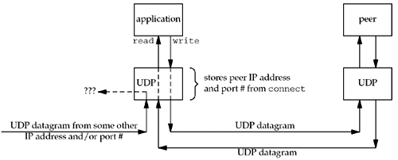
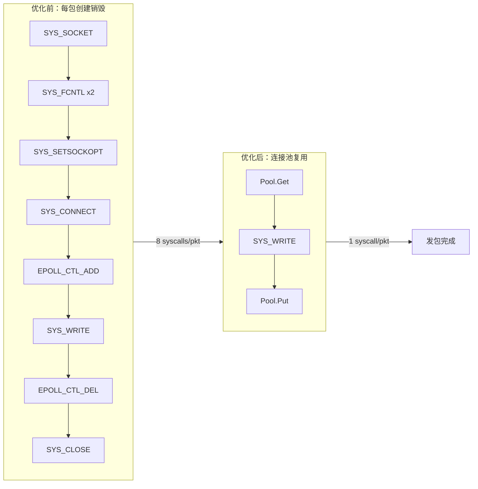
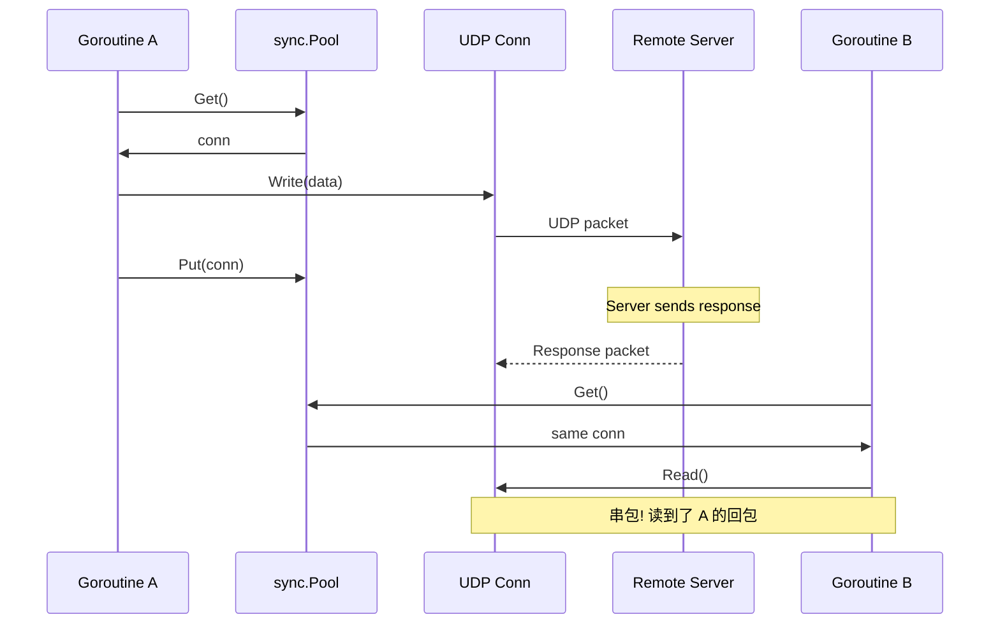
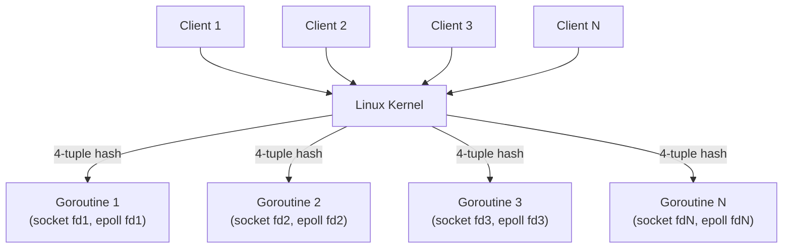
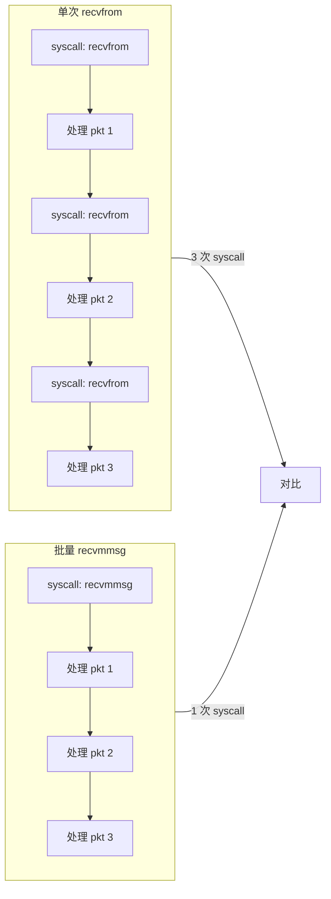
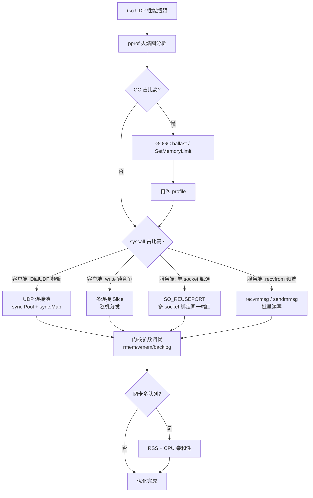

##	0x00	前言
内网 UDP 的好处：
-	内网的 UDP 丢包率极小（低于万分之三）
-	发送端和接收端约定好通信协议，为了避免分片，每个 UDP 包的最大字节数应该是 `1500-20-8=1472`
-	通常使用 UDP 服务来做日志接收服务

UDP 协议在现代后端系统中有着广泛的应用场景：

| 场景 | 说明 | 典型 QPS |
|------|------|----------|
| 日志收集 | Agent 上报日志到收集服务 | 数十万/s |
| 监控上报 | 指标、Trace 上报 | 数十万/s |
| DNS | 域名解析请求 | 百万级 |
| 实时音视频 | RTP/RTCP 媒体流传输 | 持续高带宽 |
| 游戏同步 | 帧同步、状态同步 | 数万/s per server |
| QUIC/HTTP3 | 下一代传输协议底层 | 百万级 |

本文重点讨论在 Golang 中使用 UDP 的若干细节及高性能优化手段，包括如下几点：

-	connected/unconnected UDP 的区别
-	Go 标准库实现细节与GC 调优
-	UDP 连接池、`SO_REUSEPORT`、批量读写（`recvmmsg`/`sendmmsg`）等

##	0x01	golang-UDP 的连接性？
当然，这里的连接性指的是 Lib 层面，golang 中 UDP 分为已连接（connected UDP）和未连接（unconnected UDP）两种方式，二者在发送、接收消息行为模式上有重大区别

- 已连接状态：通过 `DialUDP` 创建的 UDP 为已连接状态，其会记录远端 remote 的 ip/port 信息，相当于在两者之间建立了持续通路，发送、接收函数为 Write、Read，不需要填 remote 信息
- 未连接状态：通过 `ListenUDP` 建立的 UDP 为未连接形式，发送、接收函数为 `WriteTo`、`ReadFrom`，需要填写 remote 信息
在实际应用中，如果需要在不同的连接上完成 UDP 收发，那么使用 `DialUDP` 就会有问题，建议使用 `ListenUDP`

####	connected UDP
原理如下：


当一端的 UDP endpoint 调用 `DialUDP` 之后，OS 会在内部把 UDP socket 和另一个 UDP endpoint 的地址关联起来（OS 仅仅记录 UDP socket 的 peer udp endpoint 地址后就立即返回），在发起 connect 的 UDP endpoint 端建立起一个单向的连接四元组，发出的 datagram packet 只能发往此 endpoint（不管 sendto 的时候是否指定了地址）且只能接收这个 endpoint 发来的 datagram packet（其他 endpoint 发来的包会被 OS 丢弃）；至于对端 UDP endpoint 是否为 connected udp 则无关紧要，所以称 udp connection 是单向的连接。若 `DialUDP` 的对端不存在或对端口无进程监听，则发包后对端会返回 ICMP port unreachable 错误；此外，如果一个 POSIX 系统进程发起 UDP write 时没有指定对端 UDP address，则会收到 `ENOTCONN` 错误而非 `EDESTADDRREQ`

如果一个 connected UDP 需要更换对端 endpoint address，只需要重新 `DialUDP` 即可

####	connected UDP 的性能
相较于 unconnected UDP，connected UDP 的性能更优，二者的数据流程如下：

1、connected UDP：内核只在第一次设置虚拟连接的 peer address，后面进行连续发送即可

* Connect the socket
* Send first datagram
* Output second datagram

2、unconnected UDP：每发送一个包都需要进行 connect

* Connect the socket
* Send the first datagram
* Unconnect the socket
* Connect the socket
* Send the second datagram
* Unconnect the socket

####	golang 相关 API
golang API 对 connected UDP 和 unconnected UDP 读写方法进行了明确区分，参考 [此文](https://alexstocks.github.io/html/getty.html) 汇总的要点：读统一使用 `ReadFromUDP`，写则统一使用 `WriteMsgUDP`

-	connected UDP：读写方法是 `Read` 和 `Write`
-   unconnected UDP：读写方法是 `ReadFromUDP` 和 `WriteToUDP`（以及 ReadFrom 和 WriteTo)
-   unconnected UDP：可以调用 `Read`，只是无法获取 peer addr
-   connected UDP：可以调用 `ReadFromUDP`（填写的地址会被忽略）
-   connected UDP：不能调用 `WriteToUDP`（即使是相同的目标地址也不可以），否则会得到错误 use of WriteTo with pre-connected connection
-   unconnected UDP：不能调用 `Write`, 会报错 error: write: destination address xxxxxx
-   connected UDP：可以调用 `WriteMsgUDP`，但是地址必须为 `nil`
-   unconnected UDP：可以调用 `WriteMsgUDP`，但是必须填写 peer endpoint address

Go 标准库 `UDPConn` 各方法对应的底层系统调用：

| 方法 | 系统调用 | 适用类型 |
|------|----------|----------|
| `conn.Write()` | `write` | connected |
| `conn.WriteTo()` | `sendto` | unconnected |
| `conn.WriteToUDP()` | `sendto` | unconnected |
| `conn.WriteMsgUDP()` | `sendmsg` | both |
| `conn.Read()` | `read` | connected |
| `conn.ReadFrom()` | `recvfrom` | unconnected |
| `conn.ReadFromUDP()` | `recvmsg` | both |
| `conn.ReadMsgUDP()` | `recvmsg` | both |

##	0x02	Golang 中的实现细节

####  `DialUDP` 的实现
```golang
func DialUDP(network string, laddr, raddr *UDPAddr) (*UDPConn, error) {
	switch network {
	case "udp", "udp4", "udp6":
	default:
		return nil, &OpError{Op: "dial", Net: network, Source: laddr.opAddr(), Addr: raddr.opAddr(), Err: UnknownNetworkError(network)}
	}
	if raddr == nil {
		return nil, &OpError{Op: "dial", Net: network, Source: laddr.opAddr(), Addr: nil, Err: errMissingAddress}
	}
	sd := &sysDialer{network: network, address: raddr.String()}
	c, err := sd.dialUDP(context.Background(), laddr, raddr)
	if err != nil {
		return nil, &OpError{Op: "dial", Net: network, Source: laddr.opAddr(), Addr: raddr.opAddr(), Err: err}
	}
	return c, nil
}

//sd.dialUDP
func (sd *sysDialer) dialUDP(ctx context.Context, laddr, raddr *UDPAddr) (*UDPConn, error) {
	fd, err := internetSocket(ctx, sd.network, laddr, raddr, syscall.SOCK_DGRAM, 0, "dial", sd.Dialer.Control)
	if err != nil {
		return nil, err
	}
	return newUDPConn(fd), nil
}
```

####  `ListenUDP` 的实现
```golang
func ListenUDP(network string, laddr *UDPAddr) (*UDPConn, error) {
	switch network {
	case "udp", "udp4", "udp6":
	default:
		return nil, &OpError{Op: "listen", Net: network, Source: nil, Addr: laddr.opAddr(), Err: UnknownNetworkError(network)}
	}
	if laddr == nil {
		laddr = &UDPAddr{}
	}
	sl := &sysListener{network: network, address: laddr.String()}
	c, err := sl.listenUDP(context.Background(), laddr)
	if err != nil {
		return nil, &OpError{Op: "listen", Net: network, Source: nil, Addr: laddr.opAddr(), Err: err}
	}
	return c, nil
}

func (sl *sysListener) listenUDP(ctx context.Context, laddr *UDPAddr) (*UDPConn, error) {
	fd, err := internetSocket(ctx, sl.network, laddr, nil, syscall.SOCK_DGRAM, 0, "listen", sl.ListenConfig.Control)
	if err != nil {
		return nil, err
	}
	return newUDPConn(fd), nil
}
```

####  底层调用
`sl.listenUDP`、`sd.dialUDP` 都会调用底层的 `internetSocket`，只是调用参数有区别，`listenUDP` 调用时 `raddr` 为 `nil`，而 `dialUDP` 会传入此值；`internetSocket` 内部会调用 `socket` 函数，如下：


```golang
func socket(ctx context.Context, net string, family, sotype, proto int, ipv6only bool, laddr, raddr sockaddr, ctrlFn func(string, string, syscall.RawConn) error) (fd *netFD, err error) {
	s, err := sysSocket(family, sotype, proto)
	if err != nil {
		return nil, err
	}
	if err = setDefaultSockopts(s, family, sotype, ipv6only); err != nil {
		poll.CloseFunc(s)
		return nil, err
	}
	if fd, err = newFD(s, family, sotype, net); err != nil {
		poll.CloseFunc(s)
		return nil, err
	}

	// This function makes a network file descriptor for the
	// following applications:
	//
	// - An endpoint holder that opens a passive stream
	//   connection, known as a stream listener
	//
	// - An endpoint holder that opens a destination-unspecific
	//   datagram connection, known as a datagram listener
	//
	// - An endpoint holder that opens an active stream or a
	//   destination-specific datagram connection, known as a
	//   dialer
	//
	// - An endpoint holder that opens the other connection, such
	//   as talking to the protocol stack inside the kernel
	//
	// For stream and datagram listeners, they will only require
	// named sockets, so we can assume that it's just a request
	// from stream or datagram listeners when laddr is not nil but
	// raddr is nil. Otherwise we assume it's just for dialers or
	// the other connection holders.

  //laddr 不为 nil，而 raddr 为 nil，说明是监听 socket（listenUDP）
	if laddr != nil && raddr == nil {
		switch sotype {
		case syscall.SOCK_STREAM, syscall.SOCK_SEQPACKET:
			if err := fd.listenStream(laddr, listenerBacklog(), ctrlFn); err != nil {
				fd.Close()
				return nil, err
			}
			return fd, nil
		case syscall.SOCK_DGRAM:
			if err := fd.listenDatagram(laddr, ctrlFn); err != nil {
				fd.Close()
				return nil, err
			}
			return fd, nil
		}
	}

  //DialUDP
	if err := fd.dial(ctx, laddr, raddr, ctrlFn); err != nil {
		fd.Close()
		return nil, err
	}
	return fd, nil
}
```

####  底层调用：`dial`
`dial` 方法解答了 `ListenUDP`、`DialUDP` 的行为差异的原因：
- `laddr!=nil` 时，调用 `bind` 方法，绑定本地 ip 及 port
- `raddr!=nil` 时，调用 `fd.connect` 与 remote 建立连接（`raddr` 的区别）

根据上小节的调用参数看，`ListenUDP` 方法构造的 UDPConn 为未连接状态，而 `DialUDP` 方法构造的 UDPConn 为已连接状态，因而 `DialUDP` 方法构建的 UDPConn 只能从指定 remote 接收数据，而 `ListenUDP` 方法构建的 UDPConn 则可以从任何远端接收数据

```golang
func (fd *netFD) dial(ctx context.Context, laddr, raddr sockaddr, ctrlFn func(string, string, syscall.RawConn) error) error {
	if ctrlFn != nil {
		c, err := newRawConn(fd)
		if err != nil {
			return err
		}
		var ctrlAddr string
		if raddr != nil {
			ctrlAddr = raddr.String()
		} else if laddr != nil {
			ctrlAddr = laddr.String()
		}
		if err := ctrlFn(fd.ctrlNetwork(), ctrlAddr, c); err != nil {
			return err
		}
	}
	var err error
	var lsa syscall.Sockaddr
	if laddr != nil {
    //laddr not nil
		if lsa, err = laddr.sockaddr(fd.family); err != nil {
			return err
		} else if lsa != nil {
			if err = syscall.Bind(fd.pfd.Sysfd, lsa); err != nil {
				return os.NewSyscallError("bind", err)
			}
		}
	}
	var rsa syscall.Sockaddr  // remote address from the user
	var crsa syscall.Sockaddr // remote address we actually connected to
	if raddr != nil {
    //raddr not nil
		if rsa, err = raddr.sockaddr(fd.family); err != nil {
			return err
		}
		if crsa, err = fd.connect(ctx, lsa, rsa); err != nil {
			return err
		}
		fd.isConnected = true
	} else {
		if err := fd.init(); err != nil {
			return err
		}
	}
	// Record the local and remote addresses from the actual socket.
	// Get the local address by calling Getsockname.
	// For the remote address, use
	// 1) the one returned by the connect method, if any; or
	// 2) the one from Getpeername, if it succeeds; or
	// 3) the one passed to us as the raddr parameter.
	lsa, _ = syscall.Getsockname(fd.pfd.Sysfd)
	if crsa != nil {
		fd.setAddr(fd.addrFunc()(lsa), fd.addrFunc()(crsa))
	} else if rsa, _ = syscall.Getpeername(fd.pfd.Sysfd); rsa != nil {
		fd.setAddr(fd.addrFunc()(lsa), fd.addrFunc()(rsa))
	} else {
		fd.setAddr(fd.addrFunc()(lsa), raddr)
	}
	return nil
}
```

##	0x03	UDP 优化：GC 调优
本章节以 [某高并发服务 Go GC 及 UDP Pool 优化](https://mp.weixin.qq.com/s/YAz5NyiNWJCMlGsJRTAaxw) 这篇文章为主线，结合其他实践经验，系统整理 Golang UDP 高性能编程的核心优化手段

####	问题背景
原文场景是，一个需要数百万 QPS 的 Go 重构服务，业务模型为「接收客户端 UDP 请求 -> 查 Redis -> 单向发 UDP 给其他机器」，目标对标原先的 C++ 服务（40 物理核 50 万/s）。初始情况：												

| 配置 | QPS | 问题 |
|------|-----|------|
| 8 虚拟核 | 2.3 万/s | 随核数增加不线性 Scale Up |
| 40 虚拟核 | 8 万/s | 远低于目标 15-20 万/s |

####	GC 压力分析
该服务内存占用仅 `200MB` 左右，但 QPS 极高。Go 的 GC 触发阈值由 `GOGC` 控制（默认 `100`，即堆增长 `100%` 时触发 GC）。对于高 QPS + 小堆的场景，堆很快增长到阈值，导致 GC 频繁触发，STW（Stop The World）和 GC 标记阶段消耗大量 CPU 时间

####	优化方案：Ballast + GOGC（减少gc）

核心思路是，分配一块大的不使用的内存作为「压舱石」（ballast），让 Go runtime 认为堆更大，从而降低 GC 频率

```golang
func main() {
	// 分配 1GB 的 ballast，仅虚拟内存占用，不会实际使用物理内存（mmap lazy allocation）
	ballast := make([]byte, 1024*1024*1024)

	// 设置 GOGC 为 300，堆增长到 300% 时才触发 GC
	debug.SetGCPercent(300)

	_ = ballast // 防止被编译器优化掉

	// ... 启动服务逻辑 ...
}
```

为什么 ballast 不会占用物理内存呢？Go 的 `make([]byte, N)` 底层通过 `mmap` 分配，Linux 采用 lazy allocation 策略—，即仅在实际写入时才分配物理页。这块 `[]byte` 从未被写入，所以只占虚拟地址空间，不消耗物理内存

如此优化的效果是**QPS 从 8 万提升到 14 万**，火焰图中 GC 消耗基本不可见

####	现代替代方案：`debug.SetMemoryLimit`（Go 1.19+）

Go 1.19 版本引入了 `debug.SetMemoryLimit`，可以直接告诉 runtime 内存上限，取代 ballast hack：

```golang
func main() {
	// 直接设置内存上限为 4GB，GC 会在内存接近此值时才更积极回收
	debug.SetMemoryLimit(4 * 1024 * 1024 * 1024)

	// 可以配合设置 GOGC=off 完全依赖 memory limit 来控制 GC
	// debug.SetGCPercent(-1) // 关闭 GOGC，仅靠 memory limit

	// ... 启动服务逻辑 ...
}
```

`SetMemoryLimit` 的优势在于语义更清晰，且不需要 ballast hack。推荐在 Go 1.19+ 环境使用

##	0x04	UDP 优化：UDP 连接池（核心）

这是整篇文章最关键的优化点。仅通过几行连接池代码，就将 QPS 从 14 万提升到 17 万

####	问题发现：每发一个 UDP 包需要 6+ 次系统调用

在完成 GC 优化后，通过 `pprof` 火焰图继续分析，发现一个反直觉的现象：**UDP 单发的 client 调用，CPU 占用竟然比同样数量的 Redis TCP 一来一回还要多**，占了约 30% 的 CPU 时间

原因在于原始代码的发包模式，每发一个 UDP 包都执行完整的「创建-发送-销毁」流程：

```golang
// 原始代码模式（精简）：每次发包都 new-write-close
func sendUDP(addr string, data []byte) error {
	raddr, _ := net.ResolveUDPAddr("udp", addr)
	conn, err := net.DialUDP("udp", nil, raddr) // 创建
	if err != nil {
		return err
	}
	_, err = conn.Write(data)  // 发送
	conn.Close()               // 销毁
	return err
}
```

通过 `strace` 分析单次 `sendUDP` 调用的系统调用序列：

| 步骤 | Go API | 系统调用 | 说明 |
|------|--------|----------|------|
| 1 | `DialUDP` | `SYS_SOCKET` | 创建 socket fd |
| 2 | `DialUDP` | `SYS_FCNTL` x2 | 获取 fd 属性 + 设置 nonblock |
| 3 | `DialUDP` | `SYS_SETSOCKOPT` | 设置 socket 选项 |
| 4 | `DialUDP` | `SYS_CONNECT` | 绑定远端 ip:port |
| 5 | `DialUDP` | `EPOLL_CTL_ADD` | 将 fd 加入 epoll（最大头） |
| 6 | `Write` | `SYS_WRITE` | 实际发包 |
| 7 | `Close` | `EPOLL_CTL_DEL` | 从 epoll 移除 |
| 8 | `Close` | `SYS_CLOSE` | 关闭 fd |

也就是说，发一个 UDP 包需要 **8 次系统调用**，其中真正做有用功的只有 `SYS_WRITE` 这 1 次。`DialUDP` 和 `Close` 占据了绝大部分开销，尤其是 `EPOLL_CTL_ADD` 把 UDP fd 注册到 Go runtime 的 netpoller 中

下面的流程对比图直观地展示了问题所在：



####	优化方案：sync.Map + sync.Pool 连接池

核心思路是对于同一个对端地址的 UDP 实例，使用 `sync.Pool` 缓存已创建的 connected UDP 连接。不同对端地址通过 `sync.Map` 隔离各自的 Pool。使用时从 Pool 取出，用完放回

```golang
type UDPPool struct {
	pools sync.Map // key: remote addr string, value: *sync.Pool
}

type UDPConn struct {
	conn *net.UDPConn
	addr string
}

func NewUDPPool() *UDPPool {
	return &UDPPool{}
}

func (p *UDPPool) Get(addr string) (*UDPConn, error) {
	pool, _ := p.pools.LoadOrStore(addr, &sync.Pool{
		New: func() interface{} {
			raddr, err := net.ResolveUDPAddr("udp", addr)
			if err != nil {
				return nil
			}
			conn, err := net.DialUDP("udp", nil, raddr)
			if err != nil {
				return nil
			}
			return &UDPConn{conn: conn, addr: addr}
		},
	})

	obj := pool.(*sync.Pool).Get()
	if obj == nil {
		return nil, fmt.Errorf("failed to create UDP conn to %s", addr)
	}
	return obj.(*UDPConn), nil
}

func (p *UDPPool) Put(c *UDPConn) {
	pool, ok := p.pools.Load(c.addr)
	if !ok {
		c.conn.Close()
		return
	}
	pool.(*sync.Pool).Put(c)
}
```

使用方式（对比优化前）：

```golang
var udpPool = NewUDPPool()

// 优化后：从池中取出、发送、放回
func sendUDP(addr string, data []byte) error {
	c, err := udpPool.Get(addr)
	if err != nil {
		return err
	}
	_, err = c.conn.Write(data)
	udpPool.Put(c)
	return err
}
```

`sync.Pool` 的一个有用特性：在 GC 时会自动清理池中长期未使用的对象。这意味着空闲的 UDP 连接会被自动回收（fd 被 GC finalizer 关闭），不需要手动管理生命周期

关于 `sync.Map` 中对端地址对应的 `sync.Pool` 实例本身不会释放这一点，对于服务端之间的调用场景，对端节点数量有限（几百到几万），每个 Pool 实例本身只是一个很小的结构体，总内存占用可以忽略不计

####	并发安全与串包问题

UDP 连接池的并发安全需要注意以下几点：

**1、sync.Pool 保证同一实例不会被并发使用**：`Get` 取出后直到 `Put` 放回前，其他 goroutine 不会拿到同一个实例，所以不存在并发写同一 fd 的问题

**2、串包风险分析**：假设 goroutine A 用 `local:p2` 向 `remote:p1` 发了包但不收回包，A 将连接放回 Pool。此时 remote 回了包。接着 goroutine B 从 Pool 取出同一连接（同一 `local:p2`），B 如果执行 Read，可能收到 A 那次请求的回包。这就是串包问题

**预防串包的原则**：
-	客户端行为必须与服务端一致：服务端不回包，客户端就只发不收；服务端回包，客户端就即发又收
-	在同一台机器上，对同一对端 UDP 服务，不要混用「收包」和「不收包」两种 client 模型
-	connected UDP 天然具有防串包特性：内核只把来自 connect 对端 IP:Port 的包递交给该 socket，其他来源的包会被丢弃



####	优化效果

UDP Pool 优化后：**QPS 从 14 万提升到 17 万**。火焰图中 `DialUDP` 和 `Close` 的占比大幅下降，`SYS_WRITE` 成为主要开销

结合 GC 优化的完整效果链：

| 优化阶段 | QPS | 提升 |
|----------|-----|------|
| 原始状态（40 虚拟核） | 8 万/s | - |
| + GOGC ballast | 14 万/s | +75% |
| + UDP Pool | 17 万/s | +21% |
| + 日志精简 / 上报合并 | 20 万/s | +18% |

##	0x05	UDP 优化：服务端优化

####	SO_REUSEPORT：多 Socket 绑定同一端口

`SO_REUSEPORT` 是 Linux 3.9 内核引入的 socket 选项，允许多个 socket 绑定到同一地址和端口。内核基于 4-tuple hash 将入站数据包分发到不同的 socket，每个 goroutine 持有独立的 socket，完全消除了锁竞争



Go 标准库通过 `net.ListenConfig` 的 `Control` 回调设置 `SO_REUSEPORT`：

```golang
import (
	"context"
	"net"
	"syscall"

	"golang.org/x/sys/unix"
)

func listenReusePort(network, addr string) (net.PacketConn, error) {
	lc := net.ListenConfig{
		Control: func(network, address string, c syscall.RawConn) error {
			return c.Control(func(fd uintptr) {
				// 核心：一行 setsockopt 启用端口复用
				syscall.SetsockoptInt(int(fd), unix.SOL_SOCKET, unix.SO_REUSEPORT, 1)
			})
		},
	}
	return lc.ListenPacket(context.Background(), network, addr)
}

func main() {
	numWorkers := runtime.NumCPU()
	for i := 0; i < numWorkers; i++ {
		go func() {
			conn, err := listenReusePort("udp", ":8080")
			if err != nil {
				log.Fatal(err)
			}
			defer conn.Close()

			buf := make([]byte, 1472)
			for {
				n, remoteAddr, err := conn.ReadFrom(buf)
				if err != nil {
					continue
				}
				// 处理数据...
				conn.WriteTo(buf[:n], remoteAddr)
			}
		}()
	}
	select {} // block forever
}
```

也可以使用第三方库 [go-reuseport](https://github.com/libp2p/go-reuseport) 来简化操作：

```golang
import reuse "github.com/libp2p/go-reuseport"

conn, err := reuse.ListenPacket("udp", ":8080")
```

`SO_REUSEPORT` 的注意事项：
-	内核基于 4-tuple hash 分发，如果某个 exporter 的所有流量 hash 到同一个 socket，会导致负载不均
-	可以结合 eBPF 的 `SO_ATTACH_REUSEPORT_EBPF` 特性实现自定义分发策略（参见 Cloudflare 的 [udpgrm](https://blog.cloudflare.com/quic-restarts-slow-problems-udpgrm-to-the-rescue/)）

####	recvmmsg / sendmmsg：批量系统调用

普通的 `recvfrom`/`sendto` 每次调用只处理一个 UDP 包，在高 PPS 场景下系统调用开销可观。Linux 提供了 `recvmmsg`（2.6.33+）和 `sendmmsg`（3.0+）系统调用，一次处理多个数据包：



Go 标准库未直接封装 `recvmmsg`/`sendmmsg`，但可以通过 `golang.org/x/net/ipv4` 包的 `ReadBatch`/`WriteBatch` 方法使用：

```golang
import (
	"net"
	"golang.org/x/net/ipv4"
)

func batchUDPServer(addr string) {
	udpAddr, _ := net.ResolveUDPAddr("udp", addr)
	conn, _ := net.ListenUDP("udp", udpAddr)
	defer conn.Close()

	pconn := ipv4.NewPacketConn(conn)

	batch := 64
	msgs := make([]ipv4.Message, batch)
	for i := range msgs {
		msgs[i] = ipv4.Message{
			Buffers: [][]byte{make([]byte, 1472)},
		}
	}

	for {
		n, err := pconn.ReadBatch(msgs, 0) // 底层调用 recvmmsg
		if err != nil {
			continue
		}
		// 批量处理 n 个包
		for i := 0; i < n; i++ {
			data := msgs[i].Buffers[0][:msgs[i].N]
			_ = data // process...
		}

		// 批量回包
		written := 0
		for written < n {
			nn, _ := pconn.WriteBatch(msgs[written:n], 0) // 底层调用 sendmmsg
			written += nn
		}
	}
}
```

`sendmmsg` 与 `writev` 的区别：`sendmmsg` 是批量发送多个独立的 UDP 数据报（每个有自己的目标地址），而 `writev` 是将多个 buffer 合并为一个数据报发送（scatter/gather I/O）

####	内核参数调优

高 PPS 场景下需要调整内核网络参数来优化性能指标：

```bash
# UDP 接收缓冲区（默认偏小，高 PPS 容易丢包）
sysctl -w net.core.rmem_max=26214400
sysctl -w net.core.rmem_default=26214400

# UDP 发送缓冲区
sysctl -w net.core.wmem_max=26214400
sysctl -w net.core.wmem_default=26214400

# 网络设备积压队列长度（防止 ring buffer 溢出）
sysctl -w net.core.netdev_max_backlog=65536

# 允许更多 orphan socket
sysctl -w net.ipv4.udp_mem="26214400 26214400 26214400"
```

####	网卡多队列与 CPU 亲和性

如果网卡支持多队列（RSS），可以将不同队列绑定到不同 CPU 核心，配合 `SO_INCOMING_CPU` socket 选项，让每个 goroutine 固定处理特定队列的数据包，减少 CPU cache miss 和跨核调度开销：

```bash
# 查看网卡队列数
ethtool -l eth0

# 设置网卡队列绑定到 CPU 核心
# 将队列 0 绑定到 CPU 0，队列 1 绑定到 CPU 1，以此类推
echo 1 > /sys/class/net/eth0/queues/rx-0/rps_cpus
echo 2 > /sys/class/net/eth0/queues/rx-1/rps_cpus
```

注意：Go 的 GMP 调度模型弱化了线程概念，无法直接设置 goroutine 与 CPU 核心的亲和性。但将网卡队列均匀分配到各 CPU 核心仍有助于避免单核过载

####	CPU Cache Line 对齐

在 event-loop 结构中，频繁读写的字段可能因 false sharing 导致 cache line 颠簸。可以通过 padding 使关键结构体恰好填满一个 cache line（通常 `64` 字节）：

```golang
type EventLoop struct {
	fd     int
	events []unix.EpollEvent
	_      [40]byte // padding to fill 64-byte cache line
}
```

##	0x06	UDP 优化：客户端优化

####	Go socket 写锁竞争分析

当多个 goroutine 共用一个 `UDPConn` 并发写入时，Go 内部存在写锁竞争。查看 `internal/poll/fd_unix.go` 的 `Write` 实现：

```golang
func (fd *FD) Write(p []byte) (int, error) {
	if err := fd.writeLock(); err != nil {
		return 0, err
	}
	defer fd.writeUnlock()
	if err := fd.pd.prepareWrite(fd.isFile); err != nil {
		return 0, err
	}
	// ... 实际写入 ...
}
```

`writeLock`/`writeUnlock` 使用 `sync.Mutex` 实现。当 `500` 个 goroutine 共用一个 UDP 连接时，通过 `strace` 可以看到 `futex` 和 `pselect6` 系统调用特别频繁。这就是锁竞争的直接表现

####	优化方案：多连接 Slice 随机分发

最简单的优化方式：创建多个 UDP 连接放入 slice，发包时随机选取一个，从而分散锁竞争

```golang
type UDPClientPool struct {
	conns []*net.UDPConn
	size  int
}

func NewUDPClientPool(addr string, size int) (*UDPClientPool, error) {
	raddr, err := net.ResolveUDPAddr("udp", addr)
	if err != nil {
		return nil, err
	}

	pool := &UDPClientPool{
		conns: make([]*net.UDPConn, size),
		size:  size,
	}
	for i := 0; i < size; i++ {
		conn, err := net.DialUDP("udp", nil, raddr)
		if err != nil {
			return nil, err
		}
		pool.conns[i] = conn
	}
	return pool, nil
}

func (p *UDPClientPool) Write(data []byte) (int, error) {
	idx := rand.Intn(p.size)
	return p.conns[idx].Write(data)
}

func (p *UDPClientPool) Close() {
	for _, conn := range p.conns {
		conn.Close()
	}
}
```

此方案与前面的 `sync.Pool` 连接池方案的区别：
-	**多连接 Slice**：适合单一对端、多 goroutine 并发写的场景，连接数固定，分散写锁竞争
-	**sync.Pool 连接池**：适合多对端、避免每次发包都创建/销毁连接的场景，连接动态创建和回收

两者可以组合使用：先用 `sync.Map` + `sync.Pool` 按对端地址管理连接池，每个 Pool 内维护多个 connected UDP 实例

##	0x07	总结

完整的 UDP 优化决策路线图：



核心要点总结：

1.	**先 profile，再优化**：使用 `pprof` 火焰图定位真正的瓶颈，避免盲目优化
2.	**GC 调优**：对于高 QPS + 小堆场景，ballast / `SetMemoryLimit` 可以带来显著提升
3.	**UDP 连接池**：避免每包创建/销毁连接，将 8 次 syscall 减少到 1 次，是客户端最有效的优化
4.	**SO_REUSEPORT**：服务端多 socket 绑定同一端口，消除单 socket 瓶颈，线性 scale with CPU
5.	**批量读写**：`recvmmsg`/`sendmmsg` 减少 syscall 次数，适合超高 PPS 场景
6.	**内核调优**：socket buffer、backlog 等参数需匹配业务 PPS 量级
7.	项目中如需 UDP 收发包框架，可以尝试使用 [getty](https://github.com/AlexStocks/getty/tree/master/examples/echo/udp-echo) 或 [fastudp](https://github.com/shaoyuan1943/fastudp)

##	0x08	参考
-	[如何在 Go 中实现百万级 UDP 通信](https://zhuanlan.zhihu.com/p/357902432)
-	[几行代码为老板省百万 - 某高并发服务 Go GC 及 UDP Pool 优化](https://mp.weixin.qq.com/s/YAz5NyiNWJCMlGsJRTAaxw)
-	[Go udp 的高性能优化](https://cloud.tencent.com/developer/article/1874757)
-	[golang 中 udp 的连接性](https://zhuanlan.zhihu.com/p/94680036)
-	[getty 开发日志](https://alexstocks.github.io/html/getty.html)
-	[Everything you ever wanted to know about UDP sockets but were afraid to ask, part 1](https://blog.cloudflare.com/everything-you-ever-wanted-to-know-about-udp-sockets-but-were-afraid-to-ask-part-1/)
-	[深入 Go UDP 编程](https://colobu.com/2016/10/19/Go-UDP-Programming/)
-	[高性能批量读写网络包](https://colobu.com/2023/04/22/batch-read-and-write-udp-packets-in-Go/)
-	[高性能批量读写网络包 补遗](https://colobu.com/2023/05/21/batch-read-and-write-udp-packets-in-Go-2/)
-	[告知你不为人知的 UDP：连接性和负载均衡](https://cloud.tencent.com/developer/article/1004555)
-	[Go 中的高速数据包处理：从 net.Dial 到 AF_XDP](https://colobu.com/2024/03/12/high-speed-packet-transmission-in-go-from-net-dial-to-af-xdp/)
-	[How to receive a million packets per second](https://blog.cloudflare.com/how-to-receive-a-million-packets/)
-	[fastudp - 高性能 UDP 框架](https://github.com/shaoyuan1943/fastudp)
