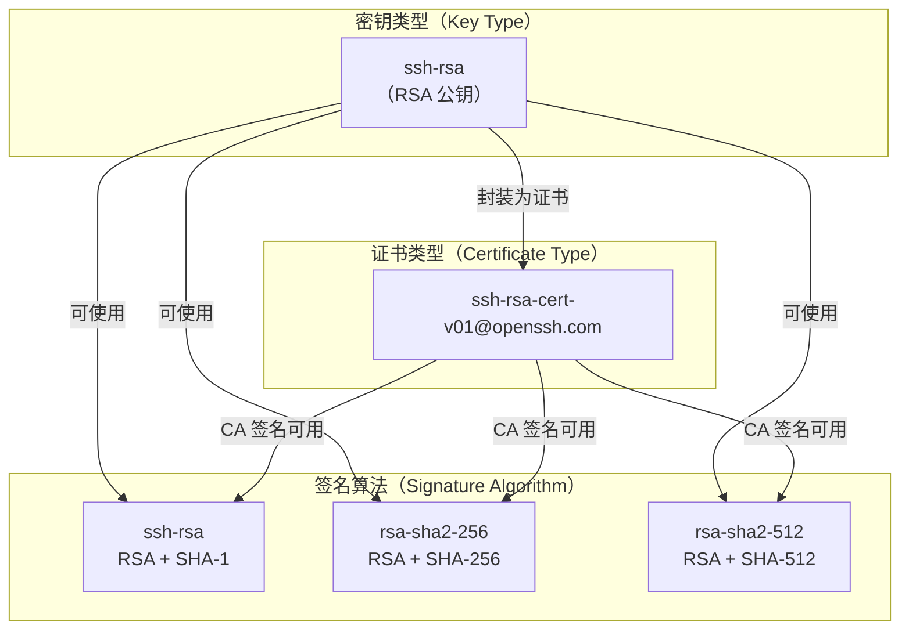
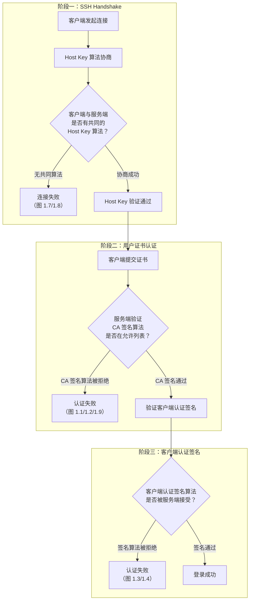
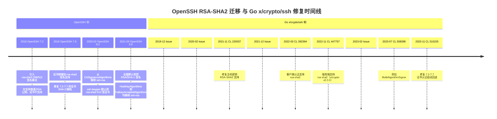
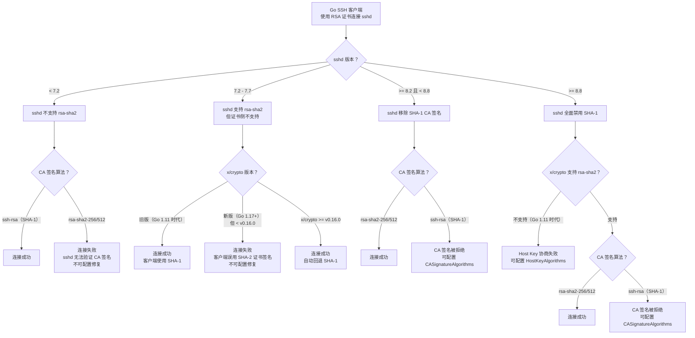

##  0x00    前言
前文 [OpenSSH Certificate 证书最佳实践](https://pandaychen.github.io/2020/04/09/OPENSSH-CERT-BEST-PRACTISE/) 介绍了证书的实践，不过近期笔者在工作中遇到了非常麻烦的兼容性问题，这里摘录几个：

-   [x/crypto/ssh: "ssh-rsa-cert-v01@openssh.com" does not work for sshd OpenSSH 7.2-7.7 #58371](https://github.com/golang/go/issues/58371)
-   [x/crypto/ssh: cannot sign certificate with different algorithm #36261](https://github.com/golang/go/issues/36261)
-   [x/crypto/ssh: rsa-sha2-256/rsa-sha2-512 tracking issue](https://github.com/golang/go/issues/49952#issuecomment-1314152075)
-   [OpenSSH server compatibility issues #17197](https://github.com/gravitational/teleport/issues/17197)
-   [x/crypto/ssh: support RSA SHA-2 host key signatures #37278](https://github.com/golang/go/issues/37278)
-   [Drop support for SHA1 #15149](https://github.com/gravitational/teleport/issues/15149)
-   [Newer OpenSSH clients are dropping support for ssh-rsa-cert-v01 #10918](https://github.com/gravitational/teleport/issues/10918)

以上的问题核心点是兼容性问题，主要涉及到三方的兼容性问题：
1.  golang（`golang.org/x/crypto/ssh`）版本（也有可能是二进制版本），主要影响两块：
    -   CA 服务端：证书签发（不同 go 版本编译的生成证书的格式可能不一样，如 `1.11` 和 `1.17` 编译出的 CA 服务生成的 `RSA-2048` 证书，`1.11` 的编译方式为 `GOPATH`，`1.17` 的编译方式为 `GOMOD`）
    -   SSH 客户端：证书解析及登录（主要是解析证书，`1.11` 版本的客户端不一定能解析出 `1.17` 版本生成的证书）
2.  OpenSSH：sshd 版本（服务器），对算法、证书类型有兼容性要求
3.  OpenSSH：ssh 版本（客户端），包括 `ssh-keygen` 工具的兼容性问题

##  0x01    核心概念：密钥类型 vs 签名算法 vs 证书类型

理解兼容性问题的前提是区分 SSH 协议中三个容易混淆的概念。在 RSA 体系下，**同一把 RSA 公钥**可以搭配不同的哈希算法生成签名，但 OpenSSH 历史上把「密钥类型」和「签名算法」用了同一个字符串 `ssh-rsa`，导致后续迁移时产生大量兼容性问题

####    密钥类型（Key Type）

标识密钥材料和编码格式，例如 `ssh-rsa`、`ssh-ed25519`、`ecdsa-sha2-nistp256`。RSA 密钥无论用哪种哈希签名，密钥类型始终是 `ssh-rsa`

####    签名算法（Signature Algorithm）

指认证过程中实际使用的「哈希 + 签名」组合。对于 RSA 密钥，存在三种签名算法：

| 签名算法 | 哈希算法 | 安全性 | 引入版本 |
|---------|---------|-------|---------|
| `ssh-rsa` | SHA-1 | 已不安全（可构造碰撞） | SSH 协议初始版本 |
| `rsa-sha2-256` | SHA-256 | 安全 | OpenSSH 7.2（[RFC 8332](https://datatracker.ietf.org/doc/html/rfc8332)） |
| `rsa-sha2-512` | SHA-512 | 安全 | OpenSSH 7.2（[RFC 8332](https://datatracker.ietf.org/doc/html/rfc8332)） |

####    证书类型（Certificate Type）

OpenSSH 证书在密钥类型基础上增加证书封装，类型名为 `ssh-rsa-cert-v01@openssh.com`。证书类型**不等于**签名算法——同一个 `ssh-rsa-cert-v01@openssh.com` 证书，其 CA 签名可以是 `ssh-rsa`（SHA-1）也可以是 `rsa-sha2-256`/`rsa-sha2-512`

####    三者关系



兼容性问题的本质：Go 的 `x/crypto/ssh` 库早期将密钥类型和签名算法绑定得太死，未能正确处理「同一密钥类型对应多种签名算法」的情况。同时 OpenSSH 各版本对 RSA-SHA2 的支持程度不同（尤其是证书侧），进一步加剧了兼容性问题

####    补充：`x/crypto/ssh` 模块版本的影响

虽然本文档中的测试用例以 Go 编译器版本（`go1.11`、`go1.17`）区分，实际上真正决定兼容性行为的是 `golang.org/x/crypto/ssh` **模块版本**而非 Go 编译器版本。不同 Go 编译器版本拉取到的 `x/crypto` 默认版本不同，导致行为差异：
-   Go 1.11 时代（`GOPATH` 模式）：拉取的 `x/crypto` 尚未支持 `rsa-sha2-256/512`，签名默认使用 `ssh-rsa`（SHA-1）
-   Go 1.17 时代（`GOMOD` 模式）：拉取的 `x/crypto` 已部分支持 RSA-SHA2，CA 签发证书默认使用 `rsa-sha2-256`

##      0x02    RSA 证书：兼容性测试
现网使用的 go 版本主要是：`go1.11` 以及 `go1.17`，主要选择两种用户证书类型：`RSA-2048`、`Ed25519`，CA 根证书的类型为 `RSA-2048`，sshd 版本选择三种：
-   `OpenSSH_6.0p1, OpenSSL 1.0.0-fips 29 Mar 2010`
-   `OpenSSH_7.4p1, OpenSSL 1.0.2k-fips  26 Jan 2017`
-   `OpenSSH_8.8p1, OpenSSL 1.0.2k-fips  26 Jan 2017`


`RSA-2048` 用户证书（1.11 版本服务端签发）：

```bash
ssh-rsa-cert-v01@openssh.com AAAAHHNzaC1yc2EtY2VydC12MDFAb3BlbnNzaC5jb20AAAAgZMQk5qch3lX21XXtjrx8aBuBPlM8qTG17S6jJmMOVogAAAADAQABAAABAQCYHr8nSSO3iJzyUYv2ZAGx3m+jB4dv6EuRWP5MMVaSGpnQxaiWq9AJC6iQ61o44BMCvtidlPfk3crgr9MHTifWkaMQyEwpa3vmkXKBIMTYEVJOp3bAWVhl9ialdfzGQZKqE21LqCMQ5WmBOZMcpk3ntctpm4tb7ua7VK5E+4oOlA4/vZkZX5u2kzLJaAKblJNR6GEAMU7npraz0whZly27XS8DQEKMwWsW2IlVREyehKT83ji5t58a/p9uHISq1aM1siUmvvW6AVJ50x35KO8/HF9Lyo5HUh0scqmXJVL8vmMl6kHTcMVze6WInyPtEmbPQOq8tM+NGYR5E4VUYiklAAAAAAAAAAAAAAABAAAALzEwMDYjMTUwLjEwOS4xMTguMTYjMzYwMDEjcGFuZGF5Y2hlbiNyb290I25vdXNlAAAACAAAAARyb290AAAAAGOrwY8AAAAAZJkPjwAAAAAAAACCAAAAFXBlcm1pdC1YMTEtZm9yd2FyZGluZwAAAAAAAAAXcGVybWl0LWFnZW50LWZvcndhcmRpbmcAAAAAAAAAFnBlcm1pdC1wb3J0LWZvcndhcmRpbmcAAAAAAAAACnBlcm1pdC1wdHkAAAAAAAAADnBlcm1pdC11c2VyLXJjAAAAAAAAAAAAAAEXAAAAB3NzaC1yc2EAAAADAQABAAABAQDBzOZVYg9fUyWGCJBLvWRMaW3BWexjNcPoQ1sOY2zHNliEnI9Ui87XpTTmxltbkToeBBZarBrNXlaFJsY1ZZ9WUh8HWo8T54iY8odNKzCS9MIuZkgT8l/LJzt54zI+XXXcwqEm0QvmRmnEsLmBC1Td7n2q0f87nFoTCFXHNd6EPdAi3G8IU2uxldbswu/xCp8yQw1OqjzSzt9jpuTyr10PQmV8uDu3H06IeUfQiFgCSI7kwumV9alIIP4rhhqz4nySF+mC83Y5r/AoKAD3rEPu/rfmVN5V6jt1wz3WMLWbIDI7FByDupCAcK8Tr901bAlh8mTBD5Y2VTB/luczebm1AAABDwAAAAdzc2gtcnNhAAABAJQbKtw8n2YJnQjezZ8Qv1ogi2GH+nUslkoYYhd0WptNxGDmaSCm/bdnmaQ3+9IczUe7Vieklw4aFYXfn2qeHFEKAEM92TKnxktivlS7tQok3WerKxMBKSCO0yLe3qHVVVGDBBtsz3RJvLnplDRQqA1CJ+IEgcWsHIIqKlVYQZDsb7fwH2Uf8EVN1E9V3BhxR6AcyfbyVCPegBKy/muQHNsOzDmmOaMQEDLLOZDp2sHLdQMSRXYeBhcAN7igbJvejVcbtznxnxl9iQwiDbuaVggSAj0TpplE8rE9G0fosowhiq4qztAPqaOnuKzhqnHQtI8RABnlJ7t8xrQmyriSakc=
```


`RSA-2048` 用户证书（1.17 版本服务端签发）：

```bash
ssh-rsa-cert-v01@openssh.com AAAAHHNzaC1yc2EtY2VydC12MDFAb3BlbnNzaC5jb20AAAAgi/KmRy5YtOjKCUSAitf10h5IdWpACFUDo9NSP6qSs5wAAAADAQABAAAAgQDfGZzMFJ2SzSEAOon6/KXjqx2SRgS2KvBNTb4DI1Yxqa4pBSyJnCcTFNib/HR2JVwN7JleBQom3l176f1mhxC5mlmK36M0Q1/wpLxaS2WKRGXB/MSiaAZZ6GMstxjFbT3VRLCRCrXnNbuITuWjaME1s1C8pXz32VhRUTSmSQJY/QAAAAAAAAAAAAAAAQAAACIwIzIwMDUwMDA2OTIjcGFuZGF5Y2hlbiMxNjc5NjUwNDAzAAAACAAAAARyb290AAAAAGQPXmMAAAAAZCt+YwAAAAAAAACCAAAAFXBlcm1pdC1YMTEtZm9yd2FyZGluZwAAAAAAAAAXcGVybWl0LWFnZW50LWZvcndhcmRpbmcAAAAAAAAAFnBlcm1pdC1wb3J0LWZvcndhcmRpbmcAAAAAAAAACnBlcm1pdC1wdHkAAAAAAAAADnBlcm1pdC11c2VyLXJjAAAAAAAAAAAAAAEXAAAAB3NzaC1yc2EAAAADAQABAAABAQDEO4S/IT4G0A3qq2Ef+8oC4SDokRKDs3hiFK2cy7IXDVXZ7QJh69jRB2jgT/uZ/is931/K0MZzxTpTrd/10HJ1vYNTq1MBADgGk5Mn0Sak3EgHRdqvz18R8dRMMk+9GmZaY1vyljxxIeJPBUEX+KL+mdOD9p+jsjvpdd51GrJ2K8bP4mypM/djzuqLZpMgWVm2ag5G7MKvBZElj4aDX2fmp5aKvBGNNzMSLT7Oa6jOeDiZMtd1dxCyXD0fpJeHJtsiFIGhVgCfAI/sJj0E61vo7hOB6z/x4LesO2ppUCjTCGGWKB/t7UIRT8Rp8QGPh4Uj285J75QjpFFr1FRPGId9AAABFAAAAAxyc2Etc2hhMi0yNTYAAAEAodWzSWaumaululv6bgUpT/3A2Sl+EefVC9JcB6+oOybi26lg+V+wj/HcK2N5TW/Ov//xJGt6+fwNyOE6VFamzkzYAjlAn8OZxredW6xfnWDVsNh8JTHkKAwzgQ24V+U2Yrrl3iQ0S/BOTpMxdRusHyc37dTo1vVeTKbB7VDUKqAf5qxEUI3PtC8gxRDER68mKFHc+vy35vzYRqs/sHLTpYclokUlBmtcwrl8DLWCT1FWGz7iFmfHsvL3VIeGI+piKPg4IhVvaNKpwu8scrrbn1oHLq/CTuiR2h6OAJR3Mg+ULlemZhYsO72gzQ3Oz4rAya7Tftp5soIKH/Oxt2eNdQ==
```

| go 客户端版本 | go 证书服务版本（证书版本） | SSHD 版本 | 登录成功 | 报错 |
|  -------- |-------- |-------- |-------- |-------- |
| 1.11 | 1.11 | sshd6.0p1|succ | 无 |
| 1.11 | 1.17 | sshd6.0p1| failed | 见图 1.1 |
| 1.17| 1.11| sshd6.0p1|  succ | 无 |
| 1.17| 1.17| sshd6.0p1| failed| 见图 1.2 |
| 1.11 | 1.11 | sshd7.4p1|succ | 无 |
| 1.11 | 1.17 | sshd7.4p1| succ | 无 |
| 1.17| 1.11| sshd7.4p1|  failed | 见图 1.3 |
| 1.17| 1.17| sshd7.4p1| failed| 见图 1.4 |
| 1.11 | 1.11 | sshd8.8p1|failed | 见图 1.7 |
| 1.11 | 1.17 | sshd8.8p1| failed | 见图 1.8 |
| 1.17| 1.11| sshd8.8p1|  failed | 见图 1.9（可解决） |
| 1.17| 1.17| sshd8.8p1| succ| 无 |

不过，图 1.9 的错误，可以通过修改 `sshd_config` 配置来解决：
```TEXT
CASignatureAlgorithms ecdsa-sha2-nistp256,ecdsa-sha2-nistp384,ecdsa-sha2-nistp521,ssh-ed25519,rsa-sha2-512,rsa-sha2-256,ssh-rsa
```


图 1.7/1.8 的客户端报错如下（Host Key 协商阶段失败），根因是 Go 1.11 的 `x/crypto/ssh` 不支持 `rsa-sha2-*`，可通过服务端配置 `HostKeyAlgorithms +ssh-rsa` 缓解或升级客户端解决：

```text
[root@VM_130_14_centos ~]# ./client -addr x.x.x.x:36000
2023/03/31 13:08:15 dial error: ssh: handshake failed: ssh: no common algorithm for host key; client offered: [ssh-rsa-cert-v01@openssh.com ssh-dss-cert-v01@openssh.com ecdsa-sha2-nistp256-cert-v01@openssh.com ecdsa-sha2-nistp384-cert-v01@openssh.com ecdsa-sha2-nistp521-cert-v01@openssh.com ssh-ed25519-cert-v01@openssh.com ecdsa-sha2-nistp256 ecdsa-sha2-nistp384 ecdsa-sha2-nistp521 ssh-rsa ssh-dss ssh-ed25519], server offered: [rsa-sha2-512 rsa-sha2-256]
```

####    错误 1.1


####    错误 1.2


####    错误 1.3


####    错误 1.4


####    错误 1.7


####    错误 1.8


####    错误 1.9


所以，结论是当用户证书使用 `RSA-2048` 时，`go1.11` 版本的兼容性是最好的

####    OpenSSH的版本更新
因为 `SHA-1` 签名算法不安全，所以 OpenSSH 在 `8.8` 版本默认移除了此算法支持，改用 `rsa-sha2-256` (RSA signatures with SHA-256) 或 `rsa-sha2-512` (RSA signatures with SHA-512)

[OpenSSH disables the ssh-rsa signature algorithm since version 8.8](https://security.stackexchange.com/questions/270349/understanding-ssh-rsa-not-in-pubkeyacceptedalgorithms)

但是 Golang 的基础库更新并未适配此库

####    不兼容的根本原因

RSA 证书不兼容问题涉及 SSH 连接建立过程中的 **三个不同的签名校验环节**，在不同的 Go 版本 + OpenSSH 版本组合下，失败点各不相同：



**环节一：Host Key 算法协商失败（图 1.7/1.8）**

Go 1.11 的 `x/crypto/ssh` 客户端在 Host Key 算法列表中只支持 `ssh-rsa`（基于 SHA-1），而 sshd 8.8 已默认禁用 `ssh-rsa`，仅提供 `rsa-sha2-512` / `rsa-sha2-256`。双方在 Host Key 算法上无交集，SSH handshake 阶段即失败，**此时根本还没进入证书认证环节**。对应 [golang/go#37278](https://github.com/golang/go/issues/37278)

可通过 `sshd_config` 配置缓解（但会降低安全性，不推荐长期使用）：
```text
HostKeyAlgorithms +ssh-rsa
PubkeyAcceptedAlgorithms +ssh-rsa
```

**环节二：CA 证书签名验证失败（图 1.1/1.2/1.9）**

这里的关键是 **CA 用什么签名算法签署证书**：

-   Go 1.17 的 `x/crypto/ssh` 签发 RSA 证书时使用了 `rsa-sha2-256` 签名；sshd 6.0 不认识此签名算法（需 OpenSSH 7.2+），导致证书签名校验失败（图 1.1/1.2）。**此场景无法通过配置修复**，只能升级 sshd 或换用 Go 1.11 CA 签发
-   Go 1.11 的 `x/crypto/ssh` 签发 RSA 证书时使用 `ssh-rsa`（SHA-1）签名；sshd 8.8 默认从 `CASignatureAlgorithms` 中移除了 `ssh-rsa`，拒绝 SHA-1 的 CA 签名（图 1.9）。理论上**可通过配置修复**

对应 [golang/go#36261](https://github.com/golang/go/issues/36261)：`Certificate.SignCert` 方法无法指定签名算法，RSA 密钥默认使用 SHA-1

图 1.9 可通过修改 `sshd_config` 恢复（允许 SHA-1 CA 签名）：
```text
CASignatureAlgorithms ecdsa-sha2-nistp256,ecdsa-sha2-nistp384,ecdsa-sha2-nistp521,ssh-ed25519,rsa-sha2-512,rsa-sha2-256,ssh-rsa
```

**环节三：客户端认证签名协商失败（图 1.3/1.4）**

sshd 7.2-7.7 版本在 `SSH_MSG_EXT_INFO` 的 `server-sig-algs` 扩展中宣告支持 `rsa-sha2-256`，但**这个宣告仅对普通 RSA 公钥有效**，RSA 证书仍只接受 SHA-1 签名（证书侧的 `rsa-sha2-*-cert-v01@openssh.com` 要 OpenSSH 7.8 才支持）。Go 1.17 的客户端看到 `server-sig-algs` 后**误判**服务端也支持 SHA-2 证书认证，发送 SHA-2 签名后被拒绝。对应 [golang/go#58371](https://github.com/golang/go/issues/58371)

**此场景无法通过服务端配置修复**（这是 sshd 7.2-7.7 自身的行为缺陷）。新版 `x/crypto`（[CL 510155](https://go-review.googlesource.com/c/crypto/+/510155)）已实现自动回退到 SHA-1 证书签名

####    各失败场景与修复方式汇总

| 失败场景 | 失败环节 | 根因 | 对应 Issue | sshd 配置可修复？ |
|---------|---------|------|-----------|----------------|
| 图 1.7/1.8（Go 1.11 客户端 + sshd 8.8） | Host Key 协商 | 客户端不支持 `rsa-sha2-*` | [#37278](https://github.com/golang/go/issues/37278) | 可配置 `HostKeyAlgorithms +ssh-rsa`（降低安全性） |
| 图 1.1/1.2（Go 1.17 CA + sshd 6.0） | CA 签名验证 | sshd 6.0 不支持 `rsa-sha2-256` | [#36261](https://github.com/golang/go/issues/36261) | 不可修复（需升级 sshd） |
| 图 1.9（Go 1.11 CA + sshd 8.8） | CA 签名验证 | sshd 8.8 拒绝 SHA-1 CA 签名 | [#36261](https://github.com/golang/go/issues/36261) | 可配置 `CASignatureAlgorithms +ssh-rsa` |
| 图 1.3/1.4（Go 1.17 客户端 + sshd 7.4） | 客户端认证签名 | sshd 7.2-7.7 宣告 rsa-sha2 但证书不支持 | [#58371](https://github.com/golang/go/issues/58371) | 不可修复（需升级 sshd 到 7.8+） |

####    sshd_config 可用配置项说明

| 配置项 | 作用 | 适用 OpenSSH 版本 |
|-------|------|------------------|
| `CASignatureAlgorithms +ssh-rsa` | 允许 CA 使用 SHA-1 签署证书 | 8.2+（8.2 起从默认列表移除） |
| `PubkeyAcceptedAlgorithms +ssh-rsa` | 允许客户端使用 SHA-1 签名做公钥/证书认证 | 8.2+（旧名 `PubkeyAcceptedKeyTypes`） |
| `HostKeyAlgorithms +ssh-rsa` | 允许主机密钥使用 SHA-1 签名 | 8.8+（8.8 起从默认列表移除） |

注意：`+ssh-rsa` 追加语法需 OpenSSH 7.0+，如果是更早版本需列出完整算法列表。以上配置均为**安全降级**操作，仅建议作为临时过渡方案

####    OpenSSH 与 Go x/crypto/ssh 版本变更时间线（主要）
这里梳理下OpenSSH 与 Go `x/crypto/ssh`包的主要变更时序：



####    关键 GitHub Issue 根因梳理

**1. [golang/go#36261](https://github.com/golang/go/issues/36261)：无法用不同算法签证书（2019-12 报告，2023-09 关闭）**

`Certificate.SignCert` 方法内部直接调用 `signer.Sign()`，无法传入期望的签名算法参数。对于 RSA CA 密钥，**默认使用 SHA-1（`ssh-rsa`）签名**。当 OpenSSH 8.2 从 `CASignatureAlgorithms` 默认列表中移除 `ssh-rsa` 后，用旧版 Go 签发的 RSA 证书在新版 sshd 上验证失败。最终通过 [CL 508398](https://go-review.googlesource.com/c/crypto/+/508398) 引入 `MultiAlgorithmSigner` 接口解决

**2. [golang/go#37278](https://github.com/golang/go/issues/37278)：主机密钥签名不支持 RSA-SHA2（2020-02 报告，2021-11 关闭）**

Go 实现的 SSH 客户端/服务端在主机密钥验证阶段仅支持 `ssh-rsa`（SHA-1）签名。当 OpenSSH 8.8 禁用 SHA-1 后，Go 客户端连接时在 Host Key 算法协商阶段即失败。通过 [CL 220037](https://go.dev/cl/220037) 修复，但后续发现仍需配合 `server-sig-algs` 扩展才完整

**3. [golang/go#49952](https://github.com/golang/go/issues/49952)：RSA-SHA2 总跟踪 issue（2021-12 创建，仍开放）**

这是一个 umbrella issue，追踪 `x/crypto/ssh` 全面支持 RSA-SHA2 的所有子任务，包括：客户端认证、客户端证书、服务端 `server-sig-algs`、可选禁用 SHA-1 等。核心修复分布在 2022-2023 年的多个 CL 中，v0.16.0 后所有已知回归均已修复

**4. [golang/go#58371](https://github.com/golang/go/issues/58371)：OpenSSH 7.2-7.7 证书认证失败（2023-02 报告，2023-11 关闭）**

这是一个**回归 bug**：新版 `x/crypto/ssh`（v0.5.0+）在加入 `server-sig-algs` 支持后，错误地将 OpenSSH 7.2-7.7 的 `rsa-sha2-256` 宣告解读为也支持 **RSA-SHA2 证书认证**。实际上 7.2-7.7 仅对普通公钥支持 SHA-2，证书认证仍只接受 SHA-1。Go 客户端发送 SHA-2 证书签名后被拒绝，且没有自动回退机制。通过 [CL 510155](https://go-review.googlesource.com/c/crypto/+/510155) 实现了自动回退

##      0x03    Ed25519 证书：兼容性测试
[Ed25519](https://ed25519.cr.yp.to/) 证书的使用版本要求 SSHD Version>=6.5（[来源](http://www.openssh.com/txt/release-6.5)）；Ed25519 的安全性在 RSA 2048 与 RSA 4096 之间，且性能在数十倍以上

PS：在 Go 1.13 之前，`crypto/ed25519` 包不是 Go 语言标准库，导入方式为：
```go
import "golang.org/x/crypto/ed25519"
```

在 Go 1.13 及以后的版本中，`crypto/ed25519` 包已经被纳入标准库中，导入方式为：
```go
import "crypto/ed25519"
```


####    兼容性测试

`Ed25519` 用户证书（1.11 版本服务端签发）：

```bash
ssh-ed25519-cert-v01@openssh.com AAAAIHNzaC1lZDI1NTE5LWNlcnQtdjAxQG9wZW5zc2guY29tAAAAIAFIKJh9OoK9DH5DZo3bQWJPIy905pqcw3mwxvCFtYHiAAAAINKD1QyP6+ocmCZE6UTGNFDnqW0QPhDZvHCFRlPpTcGlAAAAAAAAAAEAAAABAAAADm1lQGV4YW1wbGUuY29tAAAACAAAAARyb290AAAAAGRBMowAAAAAZEPVjAAAAAAAAACCAAAAFXBlcm1pdC1YMTEtZm9yd2FyZGluZwAAAAAAAAAXcGVybWl0LWFnZW50LWZvcndhcmRpbmcAAAAAAAAAFnBlcm1pdC1wb3J0LWZvcndhcmRpbmcAAAAAAAAACnBlcm1pdC1wdHkAAAAAAAAADnBlcm1pdC11c2VyLXJjAAAAAAAAAAAAAAEXAAAAB3NzaC1yc2EAAAADAQABAAABAQDBzOZVYg9fUyWGCJBLvWRMaW3BWexjNcPoQ1sOY2zHNliEnI9Ui87XpTTmxltbkToeBBZarBrNXlaFJsY1ZZ9WUh8HWo8T54iY8odNKzCS9MIuZkgT8l/LJzt54zI+XXXcwqEm0QvmRmnEsLmBC1Td7n2q0f87nFoTCFXHNd6EPdAi3G8IU2uxldbswu/xCp8yQw1OqjzSzt9jpuTyr10PQmV8uDu3H06IeUfQiFgCSI7kwumV9alIIP4rhhqz4nySF+mC83Y5r/AoKAD3rEPu/rfmVN5V6jt1wz3WMLWbIDI7FByDupCAcK8Tr901bAlh8mTBD5Y2VTB/luczebm1AAABDwAAAAdzc2gtcnNhAAABAHixVxHblCxKRxinG9w4ocQtpqrgn9BgjA3HarjPiwV6b1G/39YRFpMOlgiY9+bNpBWBxNPuUKIRzYR9g37prlmowsb7Hk2US8GQf+UJYMVS8RhCMWDt7Bh0F45kBw4ClHMTLCHILvCWx6JpcuKc8/OEetzhL48y296Z4uWIpiDJyOI28l1GhiROdbRZH8OOx10YzvM1Nj/CRnAP0HAcGXa1r050h7tY/X/C/8beQk4guYdH7xPUTq6Xnkanccx3cwlcyZy7V1wDCwRXwGec8VFbEZDSDL0kC0supU5kBPTe/zvxm1WAL2cuxNPx3wjdrdaPy1OLygTosAVN2DRsqj0=
```


`Ed25519` 用户证书（1.17 版本服务端签发）：

```bash
ssh-ed25519-cert-v01@openssh.com AAAAIHNzaC1lZDI1NTE5LWNlcnQtdjAxQG9wZW5zc2guY29tAAAAIG0DBY0vjF53ufNKHsSVSU9IV0a6KAOunlyn+YEB82RxAAAAINKD1QyP6+ocmCZE6UTGNFDnqW0QPhDZvHCFRlPpTcGlAAAAAAAAAAEAAAABAAAADm1lQGV4YW1wbGUuY29tAAAACAAAAARyb290AAAAAGRBNJAAAAAAZEPXkAAAAAAAAACCAAAAFXBlcm1pdC1YMTEtZm9yd2FyZGluZwAAAAAAAAAXcGVybWl0LWFnZW50LWZvcndhcmRpbmcAAAAAAAAAFnBlcm1pdC1wb3J0LWZvcndhcmRpbmcAAAAAAAAACnBlcm1pdC1wdHkAAAAAAAAADnBlcm1pdC11c2VyLXJjAAAAAAAAAAAAAAEXAAAAB3NzaC1yc2EAAAADAQABAAABAQDBzOZVYg9fUyWGCJBLvWRMaW3BWexjNcPoQ1sOY2zHNliEnI9Ui87XpTTmxltbkToeBBZarBrNXlaFJsY1ZZ9WUh8HWo8T54iY8odNKzCS9MIuZkgT8l/LJzt54zI+XXXcwqEm0QvmRmnEsLmBC1Td7n2q0f87nFoTCFXHNd6EPdAi3G8IU2uxldbswu/xCp8yQw1OqjzSzt9jpuTyr10PQmV8uDu3H06IeUfQiFgCSI7kwumV9alIIP4rhhqz4nySF+mC83Y5r/AoKAD3rEPu/rfmVN5V6jt1wz3WMLWbIDI7FByDupCAcK8Tr901bAlh8mTBD5Y2VTB/luczebm1AAABFAAAAAxyc2Etc2hhMi01MTIAAAEAKHWJmja0TnuD1NmdPbWSZciYj5j40sBPDXZimtMAMblFe2CVIZOQYZIzbRH9Zl9Uo2Kgp6xFCsJvo28ZnE3F/eoyNprx3T5pRFCGHNp0Keo8LGAC9jn5iqSegeLTxA8eF2nxP1g6PMzGiyz01n3Kp6ocQqPaMiAEJY5gnd6UvhPfV9MlSgZCTbqjxL1Pl/JivE4RbQRpQtly2xjParuhubH7P8kZvHbF6PLRbJf6mKdCp7yYLfNKJO5ujeOVct447TgiPXfP85zS4OMNEFhYD253wrn0LCBqiiTvNh2mlfO0GiZ+bC0BTwRh61CK05XsLedZnjlviZ6+gSbNwkmgmg==
```

| go 客户端版本 | go 证书服务版本（证书版本） | SSHD 版本 | 登录成功 | 报错 |
|  -------- |-------- |-------- |-------- |-------- |
| 1.11 | 1.11 | sshd6.0p1|failed | 不支持 |
| 1.11 | 1.17 | sshd6.0p1| failed | 不支持 |
| 1.17| 1.11| sshd6.0p1|  failed | 不支持 |
| 1.17| 1.17| sshd6.0p1| failed| 不支持 |
| 1.11 | 1.11 | sshd7.4p1|succ |  |
| 1.11 | 1.17 | sshd7.4p1| succ |  |
| 1.17| 1.11| sshd7.4p1|  succ |  |
| 1.17| 1.17| sshd7.4p1| succ|  |
| 1.11 | 1.11 | sshd8.8p1|failed | |
| 1.11 | 1.17 | sshd8.8p1| failed |  |
| 1.17| 1.11| sshd8.8p1|  failed | 见图 1.9（同 RSA） |
| 1.17| 1.17| sshd8.8p1| succ| 无 |


##  0x04    兼容性决策树

面对不同版本组合，可以通过如下决策树判断是否能成功连接以及对应的修复方式：



##  0x05    补充

####    其他一些不兼容的场景收集

1、不兼容 case1：

客户端版本为 golang `1.11`、编译方式为 `GOPATH` 的二进制，服务端版本为 `OpenSSH 9.0p1, OpenSSL 3.0.5 5 Jul 2022`，报错如下

```text
VM-65-77-tencentos sshd[3899236]: userauth_pubkey: signature algorithm ssh-rsa-cert-v01@openssh.com not in PubkeyAcceptedAlgorithms [preauth]
```

此报错属于**环节三（客户端认证签名）** 失败：sshd 9.0 已默认禁用 SHA-1，Go 1.11 客户端只能发送 `ssh-rsa-cert-v01@openssh.com`（SHA-1 签名），被 `PubkeyAcceptedAlgorithms` 策略拒绝。可通过配置 `PubkeyAcceptedAlgorithms +ssh-rsa-cert-v01@openssh.com` 缓解

####    解决方案汇总

按优先级排列：

**方案一（推荐）：升级 `golang.org/x/crypto` 模块**

升级到 `v0.16.0` 或更高版本，该版本已修复所有已知的 RSA-SHA2 兼容性问题，包括：
-   客户端/服务端全面支持 `rsa-sha2-256`/`rsa-sha2-512`
-   `MultiAlgorithmSigner` 接口，允许 CA 签发时指定签名算法
-   OpenSSH 7.2-7.7 场景下的自动 SHA-1 回退

**方案二（推荐）：使用 Ed25519 密钥类型**

Ed25519 不存在 SHA-1/SHA-2 迁移问题，从根本上规避 RSA 兼容性困境。适用于 OpenSSH >= 6.5 的环境

**方案三：服务端配置缓解（安全降级，临时过渡）**

根据具体失败环节在 `sshd_config` 中添加对应配置：
```text
# 允许 SHA-1 的 CA 证书签名（针对 CA 签名验证失败）
CASignatureAlgorithms ecdsa-sha2-nistp256,ecdsa-sha2-nistp384,ecdsa-sha2-nistp521,ssh-ed25519,rsa-sha2-512,rsa-sha2-256,ssh-rsa

# 允许 SHA-1 的客户端认证签名（针对客户端认证失败）
PubkeyAcceptedAlgorithms +ssh-rsa,ssh-rsa-cert-v01@openssh.com

# 允许 SHA-1 的主机密钥签名（针对 Host Key 协商失败）
HostKeyAlgorithms +ssh-rsa
```

**方案四：代码层 workaround**

使用 `NewSignerWithAlgorithms` 手动指定签名算法（需 `x/crypto` 支持 `MultiAlgorithmSigner`）：

```go
privkey, err := ssh.ParsePrivateKey(privkeybytes)
if err != nil {
    log.Fatal(err)
}
mas, err := ssh.NewSignerWithAlgorithms(privkey.(ssh.AlgorithmSigner), []string{ssh.KeyAlgoRSA})
if err != nil {
    log.Fatal(err)
}
signer, err := ssh.NewCertSigner(cert, mas)
if err != nil {
    log.Fatal(err)
}
```

**方案五：维护 crypto fork**

自行维护 [gravitational/crypto](https://github.com/gravitational/crypto) 库，Teleport 项目即采用此方案（[PR #19579](https://github.com/gravitational/teleport/pull/19579)）。适用于无法升级 Go 版本但需要全面兼容的场景

##  0x06    参考

####    OpenSSH Release Notes
-   [OpenSSH 8.2 Release Notes](https://www.openssh.com/txt/release-8.2) — 从 CASignatureAlgorithms 移除 ssh-rsa，宣告未来弃用
-   [OpenSSH 8.8 Release Notes](https://www.openssh.com/txt/release-8.8) — 全面默认禁用 RSA/SHA-1 签名
-   [OpenSSH 7.2 Release Notes](https://www.openssh.com/txt/release-7.2) — 引入 rsa-sha2-256/512 签名算法
-   [OpenSSH 6.5 Release Notes](http://www.openssh.com/txt/release-6.5) — 引入 Ed25519 密钥支持

####    RFC 与标准
-   [RFC 8332 - Use of RSA Keys with SHA-256 and SHA-512 in the SSH](https://datatracker.ietf.org/doc/html/rfc8332) — RSA-SHA2 签名算法规范
-   [RFC 8308 - Extension Negotiation in the Secure Shell (SSH)](https://datatracker.ietf.org/doc/html/rfc8308) — server-sig-algs 扩展规范

####    Go x/crypto/ssh 相关 Issue
-   [x/crypto/ssh: cannot sign certificate with different algorithm #36261](https://github.com/golang/go/issues/36261)
-   [x/crypto/ssh: support RSA SHA-2 host key signatures #37278](https://github.com/golang/go/issues/37278)
-   [x/crypto/ssh: rsa-sha2-256/rsa-sha2-512 tracking issue #49952](https://github.com/golang/go/issues/49952)
-   [x/crypto/ssh: add MultiAlgorithmSigner #52132](https://github.com/golang/go/issues/52132)
-   [x/crypto/ssh: "ssh-rsa-cert-v01@openssh.com" does not work for sshd OpenSSH 7.2-7.7 #58371](https://github.com/golang/go/issues/58371)

####    社区实践与参考
-   [Use RSA CA Certificates with OpenSSH 8.2](https://ibug.io/blog/2020/04/ssh-8.2-rsa-ca/)
-   [SSH Certificates: How Do OpenSSH Certificates Compare to X.509?](https://goteleport.com/blog/x509-vs-openssh-certificates/)
-   [How to secure your SSH server with public key Ed25519 Elliptic Curve Cryptography](https://cryptsus.com/blog/how-to-secure-your-ssh-server-with-public-key-elliptic-curve-ed25519-crypto.html)
-   [Hashicorp Vault SSH secret engine with OpenSSH 8.2 and later](https://sarunas-krisciukaitis.medium.com/hashicorp-vault-ssh-secret-engine-with-openssh-8-2-and-later-f7405ee55d19)
-   [Sign SSH keys using rsa-sha2-256 algorithm](https://github.com/hashicorp/vault/pull/8383)
-   [Switch golang.org/x/crypto to gravitational fork #19579](https://github.com/gravitational/teleport/pull/19579)
-   [Newer OpenSSH clients are dropping support for ssh-rsa-cert-v01 #10918](https://github.com/gravitational/teleport/issues/10918)
-   [OpenSSH server compatibility issues #17197](https://github.com/gravitational/teleport/issues/17197)
-   [RSA public keys cannot authenticate against internal SSH if the client has a recent ssh version #17798](https://github.com/go-gitea/gitea/issues/17798?ref=ikarus.sg)
-   [Understanding ssh-rsa not in PubkeyAcceptedAlgorithms](https://security.stackexchange.com/questions/270349/understanding-ssh-rsa-not-in-pubkeyacceptedalgorithms)

转载请注明出处，本文采用 [CC4.0](http://creativecommons.org/licenses/by-nc-nd/4.0/) 协议授权
