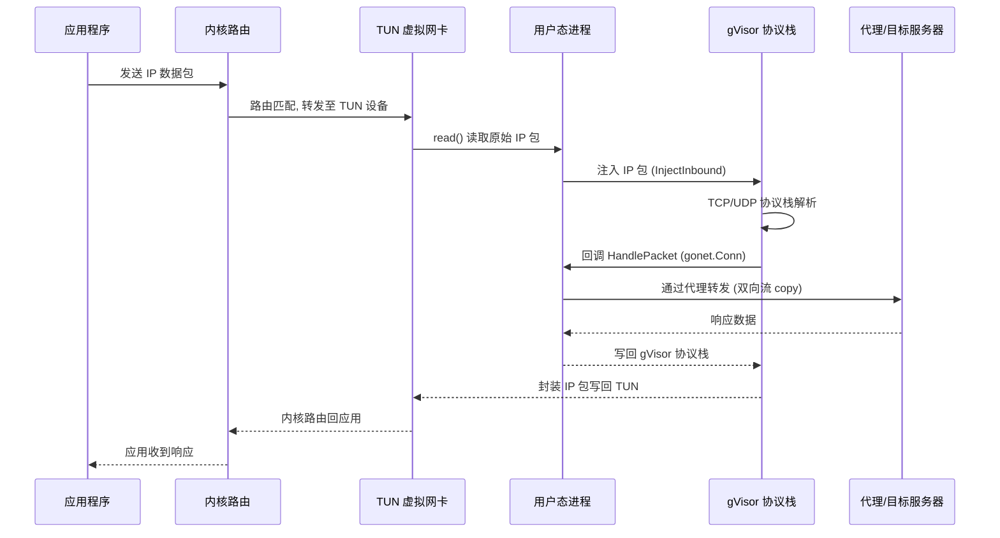
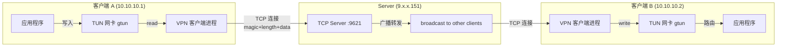
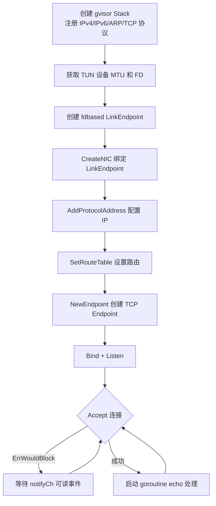
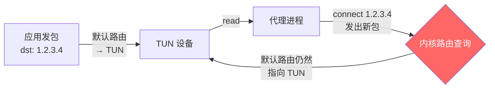
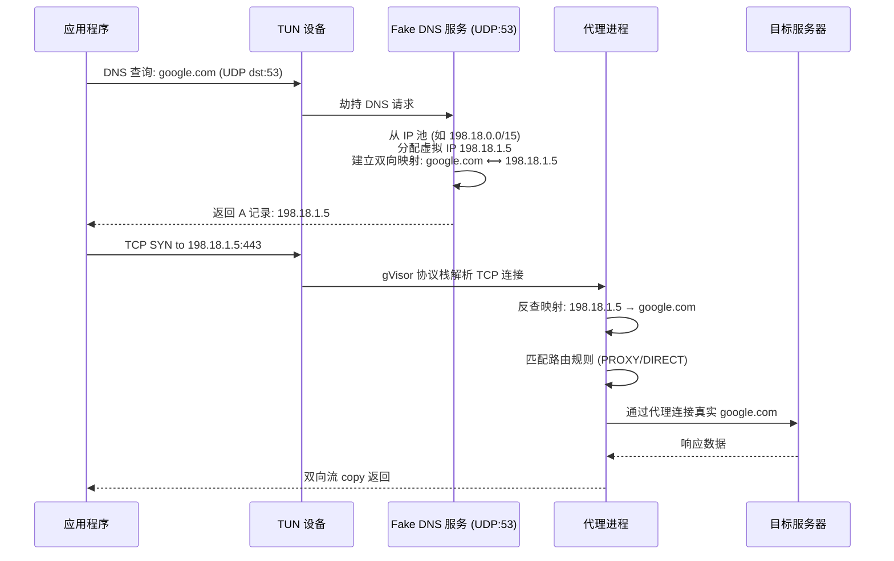
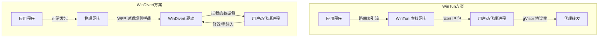

##  0x00    前言
前文介绍了 TUN 技术在透明代理中的使用，TUN 技术可应用于多种互联网场景：

- 透明代理技术
- 加速器
- 虚拟专用网络（VPN）
- 跨平台（OS）网络互联

##  0x01  基础知识

####  fdbased && iobased

在使用 gvisor 用户态协议栈构建 TUN 代理时，需要选择合适的 LinkEndpoint 实现将 TUN 设备与 gvisor 协议栈对接。常见的两种方式是 `fdbased` 和 `iobased`：

- **fdbased**：gvisor 官方内置的 [LinkEndpoint 实现](https://pkg.go.dev/gvisor.dev/gvisor/pkg/tcpip/link/fdbased)，通过文件描述符（FD）直接操作 TUN 设备进行数据包的读写。它支持多 FD 并发读取、`sendmmsg` 批量发送等优化，适用于 Linux 平台。底层直接对 TUN 设备的 FD 进行 `read`/`write` 系统调用，性能较高
- **iobased**：非 gvisor 官方的实现，而是 [tun2socks](https://github.com/xjasonlyu/tun2socks) 等项目自定义的 LinkEndpoint，它封装了 Go 的 `io.ReadWriter` 接口，将 TUN 设备的读写抽象为通用的 I/O 操作。优点是跨平台兼容性好（Windows/macOS/Linux 均可使用），缺点是相比 fdbased 多了一层抽象，在高吞吐场景下可能存在性能开销（参考 [tun2socks#353](https://github.com/xjasonlyu/tun2socks/issues/353)）

简言之，`fdbased` 适合 Linux 平台的高性能场景，`iobased` 适合需要跨平台支持的场景


#### TUN 转发代理原理

基于 TUN + gvisor 的代理核心流程如下：

1.  从 Tun（虚拟网卡接口）读取 IP 数据包，写进 `gVisor` 网络栈
2.  `gVisor` 网络栈上注册 `HandlePacket` 函数用于处理 TCP/UDP/ICMP 等，将 `gonet.Conn` 和 `gonet.PacketConn` 传给 proto 里实现的 `gonet.Handler` 处理
3.  双向流 copy



##  0x02  TUN 基础：VPN 互联
前文 [重拾 Linux 网络（二）：网卡 / 虚拟网卡、tap/tun 那些事](https://pandaychen.github.io/2023/08/02/NETWORK-REVIEW/) 详细描述了基于 tap/tun 技术构建 VPN 的基础概念，本小节基于 [songgao/water 库](https://github.com/songgao/water)，简单构建一个 VPN 程序：

- `9.x.x.245` 与 `9.x.x.254` 组成一个 VPN
- 实际的数据包流向是通过 `9.x.x.151` 转发，即由客户端 A 发送到 Server 的数据，再由 Server 端进行广播


VPN 数据转发的核心流程如下：



1、服务端部署及核心代码（参考 [网络编程学习：vpn 实现](https://www.jianshu.com/p/e74374a9c473)）

```GO
var clients = make([]net.Conn, 0)

func main() {
        listener, err := net.Listen("tcp", ":9621")
        if err != nil {
                color.Red(err.Error())
                return
        }
        for {
                conn, err := listener.Accept()
                if err != nil {
                        color.Red(err.Error())
                        break
                }
                clients = append(clients, conn)
                color.Cyan("Accept connections from clients")
                // 转发到所有客户端
                go handleClient(conn)
        }
}

func handleClient(conn net.Conn) {
        defer conn.Close()
        buff := make([]byte, 65542)
        for {
                nr, err := conn.Read(buff)
                if err != nil {
                        if err != io.EOF {
                                color.Red(err.Error())
                        }
                        break
                }

                // 广播
                for _, c := range clients {
                        if c.RemoteAddr().String() != conn.RemoteAddr().String() {
                                fmt.Printf("server execute broadcast [server->%s]", c.RemoteAddr().String())
                                c.Write(buff[:nr])
                        }
                }
        }
}
```

2、客户端核心代码（参考 [网络编程学习：vpn 实现](https://www.jianshu.com/p/e74374a9c473)）

```GO
func main() {
        //create tun
        config := water.Config{
                DeviceType: water.TUN,
        }
        config.Name = *inDev
        ifce, err := water.New(config)
        if err != nil {
                color.Red(err.Error())
                return
        }
        conn, err := connServer(*inSer + ":9621")
        if err != nil {
                color.Red(err.Error())
                return
        }

        color.Red("server address:%s", *inSer)
        color.Red("local tun device name :%s", *inDev)
        color.Red("connect server succeed.")

        // 读取 tun 网卡，将读取到的数据转发至 server 端
        go ifceRead(ifce, conn)
        // 接收 server 端的数据，并将数据写到 tun 网卡中
        go ifceWrite(ifce, conn)

        sig := make(chan os.Signal, 3)
        signal.Notify(sig, syscall.SIGINT, syscall.SIGABRT, syscall.SIGHUP)
        <-sig
}

// 连接 server
func connServer(srv string) (conn net.Conn, err error) {
        conn, err = net.Dial("tcp", srv)
        if err != nil {
                return nil, err
        }
        return conn, err
}

// 读取 tun 网卡数据转发到 server 端
func ifceRead(ifce *water.Interface, conn net.Conn) {
        packet := make([]byte, 2048)
        for {
                // 从 tun 网卡读取数据
                size, err := ifce.Read(packet)
                if err != nil {
                        color.Red(err.Error())
                        break
                }
                // 转发到 server 端
                err = forwardSer(conn, packet[:size])
                if err != nil {
                        color.Red(err.Error())
                }
        }
}

// 将 server 端的数据读取出来写到 tun 网卡
func ifceWrite(ifce *water.Interface, conn net.Conn) {
        // 定义 SplitFunc，解决 tcp 的粘贴包问题
        splitFunc := func(data []byte, atEOF bool) (advance int, token []byte, err error) {
                // 检查 atEOF 参数和数据包头部的四个字节是否为 0x123456
                if !atEOF && len(data) > 6 && binary.BigEndian.Uint32(data[:4]) == 0x123456 {
                        // 数据的实际大小
                        var size int16
                        // 读出数据包中实际数据的大小 (大小为 0 ~ 2^16)
                        binary.Read(bytes.NewReader(data[4:6]), binary.BigEndian, &size)
                        // 总大小 = 数据的实际长度 + 魔数 + 长度标识
                        allSize := int(size) + 6
                        // 如果总大小小于等于数据包的大小，则不做处理！
                        if allSize <= len(data) {
                                return allSize, data[:allSize], nil
                        }
                }
                return
        }
        // 创建 buffer
        buf := bytes.NewBuffer(nil)
        // 定义包，由于标识数据包长度的只有两个字节故数据包最大为 2^16+4(魔数)+2(长度标识)
        packet := make([]byte, 65542)
        for {
                nr, err := conn.Read(packet[0:])
                buf.Write(packet[0:nr])
                if err != nil {
                        if err == io.EOF {
                                continue
                        } else {
                                color.Red(err.Error())
                                break
                        }
                }
                scanner := bufio.NewScanner(buf)
                scanner.Split(splitFunc)
                for scanner.Scan() {
                        _, err = ifce.Write(scanner.Bytes()[6:])
                        if err != nil {
                                color.Red(err.Error())
                        }
                }
                buf.Reset()
        }
}

// 将 tun 的数据包写到 server 端
func forwardSer(srvcon net.Conn, buff []byte) (err error) {
	output := make([]byte, 0)
	magic := make([]byte, 4)
	binary.BigEndian.PutUint32(magic, 0x123456)
	length := make([]byte, 2)
	binary.BigEndian.PutUint16(length, uint16(len(buff)))

	// magic
	output = append(output, magic...)
	// length
	output = append(output, length...)
	// data
	output = append(output, buff...)

	left := len(output)
	for left > 0 {
		nw, er := srvcon.Write(output[len(output)-left:])
		if er != nil {
			return er
		}
		left -= nw
	}
	return nil
}
```

3、客户端部署（在两台机器部署）

```BASH
#A 机器
#配置虚拟网卡 gtun
ip addr add 10.10.10.1/24 dev gtun
ip link set gtun up

#B 机器：
ip addr add 10.10.10.2/24 dev gtun
ip link set gtun up

#客户端运行
./client -ser ${SERVER_IP}
```

4、测试

```text
#在 A 机器上 ping
ping 10.10.10.2
PING 10.10.10.2 (10.10.10.2) 56(84) bytes of data.
64 bytes from 10.10.10.2: icmp_seq=1 ttl=64 time=355 ms
64 bytes from 10.10.10.2: icmp_seq=2 ttl=64 time=671 ms
64 bytes from 10.10.10.2: icmp_seq=3 ttl=64 time=363 ms
64 bytes from 10.10.10.2: icmp_seq=4 ttl=64 time=356 ms
64 bytes from 10.10.10.2: icmp_seq=5 ttl=64 time=1473 ms
64 bytes from 10.10.10.2: icmp_seq=6 ttl=64 time=592 ms
```

在 B 机器上启动抓包 `tcpdump -i gtun -s0 -w ping.pcap`


## 0x03 TUN gvisor 开发基础

####  netstack 开发示例

注意：`google/netstack` 仓库已归档（archived），代码已迁移至 [google/gvisor](https://github.com/google/gvisor) 维护，以下链接仅供参考：

服务端代码参考：[tun_tcp_echo](https://github.com/google/netstack/blob/master/tcpip/sample/tun_tcp_echo/main.go)

客户端代码参考：[tun_tcp_connect](https://github.com/google/netstack/blob/master/tcpip/sample/tun_tcp_connect/main.go)


####  gvisor 库开发示例
相比于 netstack，gvisor 作为其继任者，API 有所变化。核心区别在于包路径从 `github.com/google/netstack/tcpip` 迁移到了 `gvisor.dev/gvisor/pkg/tcpip`，且部分 API（如 `tcpip.Address` 的创建方式）有所更新

服务端代码参考：[tun_tcp_echo](https://github.com/google/gvisor/blob/master/pkg/tcpip/sample/tun_tcp_echo/main.go)

```go
func main() {
	flag.Parse()
	if len(flag.Args()) != 3 {
		log.Fatal("Usage:", os.Args[0], "<tun-device> <local-address> <local-port>")
	}

	tunName := flag.Arg(0)
	addrName := flag.Arg(1)
	portName := flag.Arg(2)

	rand.Seed(time.Now().UnixNano())

	// Parse the mac address.
	maddr, err := net.ParseMAC(*mac)
	if err != nil {
		log.Fatalf("Bad MAC address: %v", *mac)
	}

	// Parse the IP address. Support both ipv4 and ipv6.
	parsedAddr := net.ParseIP(addrName)
	if parsedAddr == nil {
		log.Fatalf("Bad IP address: %v", addrName)
	}

	var addrWithPrefix tcpip.AddressWithPrefix
	var proto tcpip.NetworkProtocolNumber
	if parsedAddr.To4() != nil {
		addrWithPrefix = tcpip.AddrFromSlice(parsedAddr.To4()).WithPrefix()
		proto = ipv4.ProtocolNumber
	} else if parsedAddr.To16() != nil {
		addrWithPrefix = tcpip.AddrFromSlice(parsedAddr.To16()).WithPrefix()
		proto = ipv6.ProtocolNumber
	} else {
		log.Fatalf("Unknown IP type: %v", addrName)
	}

	localPort, err := strconv.Atoi(portName)
	if err != nil {
		log.Fatalf("Unable to convert port %v: %v", portName, err)
	}

	// Create the stack with ip and tcp protocols, then add a tun-based
	// NIC and address.
	s := stack.New(stack.Options{
		NetworkProtocols:   []stack.NetworkProtocolFactory{ipv4.NewProtocol, ipv6.NewProtocol, arp.NewProtocol},
		TransportProtocols: []stack.TransportProtocolFactory{tcp.NewProtocol},
	})

	mtu, err := rawfile.GetMTU(tunName)
	if err != nil {
		log.Fatal(err)
	}

	var fd int
	if *tap {
		fd, err = tun.OpenTAP(tunName)
	} else {
		fd, err = tun.Open(tunName)
	}
	if err != nil {
		log.Fatal(err)
	}

	linkEP, err := fdbased.New(&fdbased.Options{
		FDs:            []int{fd},
		MTU:            mtu,
		EthernetHeader: *tap,
		Address:        tcpip.LinkAddress(maddr),
	})
	if err != nil {
		log.Fatal(err)
	}
	if err := s.CreateNIC(1, linkEP); err != nil {
		log.Fatal(err)
	}

	protocolAddr := tcpip.ProtocolAddress{
		Protocol:          proto,
		AddressWithPrefix: addrWithPrefix,
	}
	if err := s.AddProtocolAddress(1, protocolAddr, stack.AddressProperties{}); err != nil {
		log.Fatalf("AddProtocolAddress(%d, %+v, {}): %s", 1, protocolAddr, err)
	}

	subnet, err := tcpip.NewSubnet(tcpip.AddrFromSlice([]byte(strings.Repeat("\x00", addrWithPrefix.Address.Len()))), tcpip.MaskFrom(strings.Repeat("\x00", addrWithPrefix.Address.Len())))
	if err != nil {
		log.Fatal(err)
	}

	// Add default route.
	s.SetRouteTable([]tcpip.Route{
		{
			Destination: subnet,
			NIC:         1,
		},
	})

	// Create TCP endpoint, bind it, then start listening.
	var wq waiter.Queue
	ep, e := s.NewEndpoint(tcp.ProtocolNumber, proto, &wq)
	if e != nil {
		log.Fatal(e)
	}

	defer ep.Close()

	if err := ep.Bind(tcpip.FullAddress{Port: uint16(localPort)}); err != nil {
		log.Fatal("Bind failed:", err)
	}

	if err := ep.Listen(10); err != nil {
		log.Fatal("Listen failed:", err)
	}

	// Wait for connections to appear.
	waitEntry, notifyCh := waiter.NewChannelEntry(waiter.ReadableEvents)
	wq.EventRegister(&waitEntry)
	defer wq.EventUnregister(&waitEntry)

	for {
		n, wq, err := ep.Accept(nil)
		if err != nil {
			if _, ok := err.(*tcpip.ErrWouldBlock); ok {
				<-notifyCh
				continue
			}

			log.Fatal("Accept() failed:", err)
		}

		go echo(wq, n) // S/R-SAFE: sample code.
	}
}
```


客户端代码参考：[tun_tcp_connect](https://github.com/google/gvisor/blob/master/pkg/tcpip/sample/tun_tcp_connect/main.go)

上述 gvisor echo server 的核心初始化和数据流如下：



##  0x04 配置基础
以 [tun2socks](https://github.com/xjasonlyu/tun2socks/wiki/Examples#linux) 项目为例

####  TUN 虚拟网卡配置
1、关闭虚拟网卡 `tun0`

```BASH
ip link set tun0 down #将 tun0 网卡设为下线状态，停止其网络连接
```

2、删除虚拟网卡 `tun0`

```BASH
ip link delete tun0 #该命令将删除 tun0 网卡，彻底关闭其网络连接。请注意，执行该命令后，tun0 网卡的配置信息将被永久删除，无法恢复
```

####  路由配置

1、删除指定的路由，下述静态路由，通过 `route del -net 192.168.10.0 netmask 255.255.255.0 dev eth0` 指令进行删除：

```BASH
192.168.10.0    0.0.0.0         255.255.255.0   U     100    0        0 eth0
```


####  内核参数配置
1、内核参数 `rp_filter` 可能引发的问题

`rp_filter` 是 Linux 的安全功能，`rp_filter` 会在计算路由决策的时候，计算包的反向路由，也就是将包的源地址和目的地址对调再查找路由表。由本机或者其他设备流向 `clash0` 的 IP Packet 一般不会有问题，但是当 `rp_filter` 检查 `clash0` 流出的包时，由于这些包不会带有 `fwmark`，检查反向路由时不会走刚才定义的策略路由，导致 `rp_filter` 检查失败，包被丢弃；通常解决方法时关闭 `clash0` NIC 的 `rp_filter` 功能，如下：
```bash
sysctl -w net.ipv4.conf.clash0.rp_filter=0
sysctl -w net.ipv4.conf.all.rp_filter=0
```

一般而言，将 `all.rp_filter` 设置为 `0` 是必须的；将 `all.rp_filter` 设置为 `0` 并不会将所有其他网卡的 `rp_filter` 一并关闭。此时其他网卡的 `rp_filter` 由它们各自的 `rp_filter` 控制


##  0x05  细节 1：避免路由回环
构建基于 TUN 的包处理项目一定要注意防止路由回环。什么是路由回环呢？简言之，一个 packet 从 TUN 读出来后再写入 TUN，下次读还会将自己刚写入的 packet 读出来，如果设置默认路由（目的 IP）是 TUN 网卡，会导致死循环。这篇文章：[记录 Tun 透明代理的多种实现方式，以及如何避免 routing loop](https://chaochaogege.com/2021/08/01/57/) 给出了防止路由回环的常用方法，可以结合自己的项目场景使用

路由回环的典型场景：



笔者项目中使用了如下几种方式：

#### bind before connect
bind 之后 connect，routing 不会起作用，这样就能解决设置默认网关后导致的 routing loop，参考 [How does a socket know which network interface controller to use?](https://stackoverflow.com/questions/4297356/how-does-a-socket-know-which-network-interface-controller-to-use/4297381#4297381)，通俗点说，listen 之前需要 bind，决定 listen 到哪个网卡。如果作为 client 去 connect，在调用 connect 时 bind 会隐式发生，也可以主动 bind before connect，绕过路由选择，强迫出流量使用某个 network interface

```text
If I bind an interface before to connect, Does that mean the connect for outgoing traffic will use that interface I bind without follow the routing decision?
@nuclear yes, if you bind() to an interface before connect()'ing, the connection will go out through that interface. That is the whole point.
```

可以参考 golang 的 `net.Dialer` 实现

####  为需直连的 ip 设置单独路由（删除掉默认路由）
这个也是很常用的方法，假设有若干个 ip/CIDR（`A/24`、`B/32`、`C/32`）需要放通，其他的系统所有流量都要转发到 TUN 设备 `wg0`，默认网关为 `192.168.1.1`，默认物理网卡为 `eth0`，那么可以这样设置：

```BASH
ip route add A/24 via 192.168.1.1 dev eth0
ip route add B/32 via 192.168.1.1 dev eth0
ip route add C/32 via 192.168.1.1 dev eth0
ip route del default
ip route add default dev wg0
```

上面的设置还有一种不删除默认路由 `default` 的做法，那就是利用 `0/1 128/1 trick`，如下

####    为直连 ip 设置单独路由（不删除默认路由，只覆盖）
默认路由的作用是没有匹配到时走 `default`，通过设置 `0.0.0.0/1`，让这条路由总是先于 `default` 命中。再对要直连的 ip（这里是 `163.172.161.0`） 设置单独的路由，不需要删除原来的默认路由

```BASH
ip route add 0.0.0.0/1 dev wg0
ip route add 128.0.0.0/1 dev wg0
ip route add 163.172.161.0/32 via 192.168.1.1 dev eth0
```

该 trick 也可以参考 [Routing & Network Namespace Integration](https://www.wireguard.com/netns/#routing-all-your-traffic)，WireGuard 在其 `wg-quick` 工具中正是使用了 `0.0.0.0/1` + `128.0.0.0/1` 的方式来覆盖默认路由而非删除它

##  0x06  TUN with DNS
在基于 TUN 的透明代理场景中，DNS 处理是核心环节。因为 TUN 工作在 L3 层，拿到的是 IP 数据包，无法直接获得域名信息。为了实现基于域名的路由规则（如 `google.com` 走代理、`baidu.com` 直连），需要在 DNS 解析阶段就介入处理。通常有两种 DNS 处理模式：**Real DNS** 和 **Fake DNS（Fake-IP）**

####  Real DNS 模式

Real DNS 模式下，DNS 请求被劫持后，代理进程会向上游 DNS 服务器发起真实查询，拿到真实 IP 后返回给客户端。代理进程同时记录域名与 IP 的映射关系，以便后续在 IP 数据包中反查域名并应用路由规则。缺点是需要等待真实 DNS 解析完成，有额外延迟

####  Fake DNS（Fake-IP）模式

Fake DNS 是目前 Clash/tun2socks 等项目广泛使用的方案（参考 [Clash DNS 文档](https://en.clash.wiki/configuration/dns.html)、[Xray Fake-IP 解析](https://xray-internals.hidandelion.com/tun/fake-ip.html)），核心思路是为每个被查询的域名分配一个保留 IP 池中的虚拟 IP，避免等待真实 DNS 解析。其工作流程如下：



Fake DNS 的关键实现细节：
- **IP 池管理**：通常使用 `198.18.0.0/15`（RFC 5737 保留地址段，约 `131072` 个 IP），通过 LRU 缓存管理域名与虚拟 IP 的双向映射
- **TTL 控制**：返回的 DNS 记录 TTL 设置较短（如 `1` 秒），避免客户端长期缓存虚拟 IP
- **冲突处理**：当 IP 池耗尽时，LRU 淘汰最久未使用的映射；分配时使用线性探测避免哈希冲突

####  DNS 劫持配置

笔者的代理场景，本地监听了 Fake DNS 服务的 UDP `53` 端口，作用是将所有流经 TUN 网卡的 DNS 查询请求包劫持，分配一个虚拟的 TUN IP（TUN 子网内的 IP），需要按如下配置：

```bash
iptables -t nat -A PREROUTING -p udp --dport 53 -j REDIRECT --to-ports 53
```

上述 iptables 规则的作用是把所有发送到本机的流量中，目标端口为 `53` 的 UDP 报文全部重定向到本地的 Fake DNS 服务上（不关心原始目标地址）。如果是在 Clash TUN 模式下，可以通过 `dns-hijack` 配置实现类似效果：

```yaml
tun:
  enable: true
  stack: gvisor
  dns-hijack:
    - any:53    # 劫持所有 DNS 请求
dns:
  enable: true
  enhanced-mode: fake-ip
  fake-ip-range: 198.18.0.1/16
  nameserver:
    - 8.8.8.8
    - 114.114.114.114
```

典型的两种处理方式：

- 透明转发（响应结果）
- 按照TUN子网的容量，为每个域名绑定一个子网的虚拟IP，主要是引流使用

####  DNS 劫持的注意事项
- 启用 Fake DNS 后，`ping` 域名拿到的是虚拟 IP，这是正常现象
- 部分应用（如某些游戏客户端）对 DNS 结果有校验，Fake DNS 可能导致异常，需要配置 `fake-ip-filter` 排除
- `rp_filter` 内核参数可能导致 Fake IP 的回包被丢弃，参考 `0x04` 章节的 `rp_filter` 配置

##  0x07  TUN with Windows
在 Windows 系统上，同样可以实现基于虚拟网卡的全流量代理，但由于 Windows 内核没有原生的 TUN/TAP 设备支持（不像 Linux 的 `/dev/net/tun`），需要借助第三方驱动。目前主流的两种方案是 **WinTun** 和 **WinDivert**，它们的工作层次和实现方式完全不同

更详细的分析可以参考笔者另一篇文章 [WinTun && WinDivert 使用与分析](https://pandaychen.github.io/2024/06/01/A-CLASH-RELATED-ANALYSIS/)

-  Tun/WinTun 的数据包获取通过修改路由表实现，通过路由方式将数据包发送到用户态协议栈，典型的实现如[clash.Meta](https://clash.wiki/premium/tun-device.html)
-  WinDivert 通过一个 `PacketFilter`按 IP/进程名/ IP 地理位置信息将指定的数据包拦截并发送到网络栈（代理）

从实现上看，WinTun和WinDivert是两种不同的工作模式，前者是一个轻量级的 TUN 驱动程序，提供了一个简单的接口来传输和接收数据包；后者是较为复杂网络驱动程序，它可以在内核和用户模式之间拦截、修改和重新注入数据包

####  WinTun

[WinTun](https://www.wintun.net/) 是 WireGuard 项目开发的轻量级 Layer 3 TUN 驱动，功能上等价于 Linux 的 `/dev/net/tun`。它在 Windows 上创建一个虚拟网络适配器，用户态程序通过 API 读写 IP 数据包

核心特点：
- 支持 Windows 7/8/8.1/10/11，支持 AMD64/X86/ARM64/ARM32 架构
- 以签名的 `wintun.dll` 形式分发，应用程序动态加载即可使用
- 提供简洁的 C API：`WintunCreateAdapter`、`WintunStartSession`、`WintunReceivePacket`、`WintunSendPacket` 等
- Go 语言可通过 [golang.zx2c4.com/wintun](https://pkg.go.dev/golang.zx2c4.com/wireguard/tun/wintun) 绑定使用
- 数据包获取依赖**路由表配置**，需要将目标流量路由到 WinTun 虚拟网卡

典型的实现如 [Clash.Meta](https://clash.wiki/premium/tun-device.html)、[tun2socks](https://github.com/xjasonlyu/tun2socks)。在 Windows 上的配置方式（参考 [tun2socks Wiki](https://github.com/xjasonlyu/tun2socks/wiki/Examples#windows)）：

```powershell
# 启动 tun2socks（会自动创建 wintun 虚拟网卡）
tun2socks -device wintun -proxy socks5://host:port -interface "WIFI"

# 配置虚拟网卡 IP
netsh interface ipv4 set address name="wintun" source=static addr=192.168.123.1 mask=255.255.255.0

# 配置 DNS
netsh interface ipv4 set dnsservers name="wintun" static address=8.8.8.8 register=none validate=no

# 设置默认路由指向虚拟网卡
netsh interface ipv4 add route 0.0.0.0/0 "wintun" 192.168.123.1 metric=1
```

####  WinDivert

[WinDivert](https://github.com/basil00/WinDivert) 是基于 Windows Filtering Platform（WFP）的网络数据包拦截库，它**不创建虚拟网卡**，而是在内核的网络栈中通过过滤规则拦截、修改和重新注入数据包

核心特点：
- 工作在 NDIS/WFP 层，可以按 IP/端口/协议/进程等条件精确匹配数据包
- 支持拦截（capture）、修改（modify）和重注入（reinject）三种操作
- 无需创建虚拟网卡，无需修改路由表
- 已知限制：在 Wi-Fi 适配器上可能无法拦截出站 TCP 包（Wi-Fi 驱动的 fast-path 在 NDIS 层之下构造数据包，绕过了 WFP 拦截点）

####  WinTun vs WinDivert 对比

| 维度 | WinTun | WinDivert |
|------|--------|-----------|
| **工作层次** | L3 虚拟网卡驱动 | WFP/NDIS 包过滤驱动 |
| **流量获取方式** | 路由表引流 | 过滤规则拦截 |
| **是否创建虚拟网卡** | 是 | 否 |
| **过滤粒度** | 依赖路由表，粒度较粗 | 支持 IP/端口/进程级精确过滤 |
| **路由表修改** | 需要 | 不需要 |
| **跨适配器兼容性** | 好 | Wi-Fi 适配器有已知限制 |
| **典型使用场景** | VPN、全局代理 | 透明代理、防火墙、流量分析 |
| **代表项目** | WireGuard, Clash.Meta | Clash for Windows（部分模式）|



##  0x08 参考
-   [网络编程学习：vpn 实现](https://www.jianshu.com/p/e74374a9c473)
-   [songgao/water - Go TUN/TAP 库](https://github.com/songgao/water)
-   [tun2socks - 透明代理工具](https://github.com/xjasonlyu/tun2socks)
-   [tun2socks Wiki: Examples](https://github.com/xjasonlyu/tun2socks/wiki/Examples)
-   [gvisor - google/gvisor](https://github.com/google/gvisor)
-   [google/netstack（已归档）](https://github.com/google/netstack)
-   [gvisor fdbased 包文档](https://pkg.go.dev/gvisor.dev/gvisor/pkg/tcpip/link/fdbased)
-   [Listener and Dialer using a TUN and netstack.](https://github.com/costinm/tungate)
-   [tungate.go](https://github.com/costinm/tungate/blob/main/gvisor/cmd/tungate.go)
-   [在 Linux 上开 clash tun 模式 clash 是怎么劫持 dns 的](https://www.v2ex.com/t/880652)
-   [Clash DNS 文档](https://en.clash.wiki/configuration/dns.html)
-   [Clash TUN Device 文档](https://clash.wiki/premium/tun-device.html)
-   [Xray Fake-IP 深入解析](https://xray-internals.hidandelion.com/tun/fake-ip.html)
-   [How does a socket know which network interface controller to use?](https://stackoverflow.com/questions/4297356/how-does-a-socket-know-which-network-interface-controller-to-use/4297381#4297381)
-   [基于 TUN/TAP 实现多个局域网设备之间的通讯](https://blog.csdn.net/qq_63445283/article/details/123779498)
-   [iOS network extension packet parsing](https://stackoverflow.com/questions/69260852/ios-network-extension-packet-parsing/69487795#69487795)
-   [网络协议之: haproxy 的 Proxy Protocol 代理协议](https://developer.aliyun.com/article/938138)
-   [记录 Tun 透明代理的多种实现方式，以及如何避免 routing loop](https://chaochaogege.com/2021/08/01/57/)
-   [Tun device: How to avoid routing dead loop when write a transparent proxy?](https://superuser.com/questions/1664065/tun-device-how-to-avoid-routing-dead-loop-when-write-a-transparent-proxy)
-   [Tag Routing with TOS and fwmark](https://flylib.com/books/en/2.783.1.50/1/)
-   [Routing & Network Namespace Integration - WireGuard](https://www.wireguard.com/netns/#routing-all-your-traffic)
-   [tailscale 实现](https://github.com/tailscale/tailscale/blob/7ef2f7213528d388c3e40bfbd1da0fa9bd32a58f/net/netstat/netstat.go)
-   [Clash for Windows 代理工具使用说明](https://docs.gtk.pw/contents/ui/profiles/rules.html)
-   [WinTun - Layer 3 TUN Driver for Windows](https://wintun.net/)
-   [WinTun GitHub](https://github.com/WireGuard/wintun)
-   [Go WinTun 绑定](https://pkg.go.dev/golang.zx2c4.com/wireguard/tun/wintun)
-   [WinDivert: Windows Packet Divert](https://github.com/basil00/WinDivert)