## 0x00 git over ssh
项目中需要实现 git 客户端的命令审计等功能，本文介绍下 git over ssh(d) 的原理及实现细节。具体的细节可以参考项目：[gogs](https://github.com/gogs/gogs)，本文依此项目为基础介绍下实现细节；此外还可以参考：[git-Reference](https://git-scm.com/docs)

本文的关键词是：git over ssh authorized_keys with forced_command

####  git 支持的传输协议
git 目前主要支持的网络协议有如下三种：

- `http(s)://`
- `ssh://`
- `git://`

无论上述哪种协议，拉取实质上都是 `git-fetch-pack`/`git-upload-pack` 的数据交换，推送都是 `git-send-pack`/`git-receive-pack` 的数据交换。更详细的介绍可以参考：[传输协议](https://iissnan.com/progit/html/zh/ch9_6.html)

下面简要介绍下各协议的核心原理：

| 命令方向 | 客户端 | 服务端 | 说明 |
|---------|--------|--------|------|
| Fetch/Clone | `git-fetch-pack` | `git-upload-pack` | 服务端将对象打包发给客户端 |
| Push | `git-send-pack` | `git-receive-pack` | 客户端将对象打包发给服务端 |

#### 1、HTTP（Dump 哑协议）
Git 哑协议仅需要一个标准的 HTTP 静态文件服务（能够提供文件的下载即可），Git 客户端会自动进行文件的遍历和拉取。无论是哑协议还是智能协议，Git 在使用 HTTP 协议进行 `Fetch` 操作的时候，总是要先获取 `info/refs` 文件（地址为 `.git/info/refs`，可通过 `git update-server-info` 生成）；可以配置 Git 服务端的 `post-receive` 钩子自动执行 `update-server-info` 更新

```BASH
[root@VM_120_245_centos /tmp/gogs/.git]# cat ./info/refs
018337ddfbd33495a08ece1bc4ab639aba730142        refs/heads/main
018337ddfbd33495a08ece1bc4ab639aba730142        refs/remotes/origin/HEAD
4154f528c3d3c0d60e1919bda9eed6a500e49e81        refs/remotes/origin/jc/db-migrate-orgs
b9266247a4701c20c0297e4a8c965bac9b888365        refs/remotes/origin/jc/exp/pack-release-archives-in-docker
f1a4b8683b2338b198114786a0f4cba14e8d07e8        refs/remotes/origin/jc/exp/srcgraph-external-service
018337ddfbd33495a08ece1bc4ab639aba730142        refs/remotes/origin/main
c9fba3cb30af0789fcf89098dfcb8f2286ee7d3b        refs/remotes/origin/release/0.12
8c21874c00b6100d46b662f65baeb40647442f42        refs/remotes/origin/release/0.13
b3757e424ffc47f7ae07d8fecd9f2ecf98f20679        refs/tags/v0.10
9d40b8a83cc3a13ec0859ad253de02c514e4403d        refs/tags/v0.10.1
f54bcba3394bf856b77b674203ea0c80b926cd61        refs/tags/v0.10.18
bb005f3f9a606a5e94da4fc274d3c21234d98090        refs/tags/v0.10.8
.......
```

文件内容主要是服务端上每个引用的版本，客户端拿到这些引用之后，就可以跟本地的引用进行对比，对于缺失的对象文件，则通过 HTTP 的方式进行下载。一次通过哑协议 `Clone` 的过程如下：

1.	用户：`git clone https://xxx.com/pandaychen/abc.git`
2.	客户端：`GET https://xxx.com/pandaychen/abc.git/info/refs`
3.	服务端：Response with `abc.git/info/refs`
4.	客户端：`GET https://xxx.com/pandaychen/abc.git/HEAD` （默认分支）
5.	服务端：Response with `abc.git/HEAD`
6.	客户端：Get `https://xxx.com/pandaychen/abc.git/objects/ef/8021acf4c29eb35e3084b7dc543c173d67ad2a` 开始遍历对象，找出那些本地没有的，去服务端获取，如果服务端无法直接获取，则从 Pack 文件中进行抓取，直到全部拿到
7.	客户端：根据 `HEAD` 中的默认分支执行 `checkout` 操作检出到本地

可以通过 `http.FileServer` 直接构建一个 dump server（也可以直接以 nginx 文件服务器提供）：

```GO
func main() {
	repo := flag.String("repo", "/root/repositories", "Specify a repositories root dir.")
	port := flag.String("port", "8888", "Specify a port to start process.")
	flag.Parse()

	http.Handle("/", http.FileServer(http.Dir(*repo)))
	fmt.Printf("Dumb http server start at port %s on dir %s \n", *port, *repo)
	_ = http.ListenAndServe(fmt.Sprintf(":%s", *port), nil)
}
```

#### 2、HTTP(S) 传输（Smart 智能协议）

HTTP 智能协议与 [哑协议](https://xie.infoq.cn/article/ae4a65148cc85dd155011bead) 最大的区别在于：哑协议在获取数据时需自行指定文件资源的网络地址，并且通过多次下载操作来完成；而智能协议的则由服务端控制，服务端提供的 `info/refs` 可以动态更新，并且可以通过客户端传来的参数，决定本次交互客户端所需要的最小对象集，并打包压缩发给客户端，客户端会进行解压来拿到自己想要的数据。以 `git clone` 为例，整个交互过程如下（两次请求）：

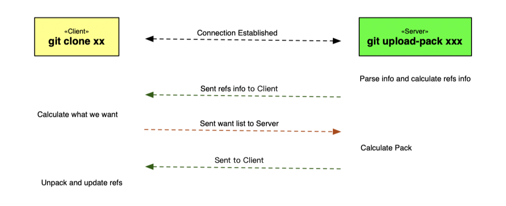

1.	引用发现：`GET https://xxx.com/account/repo/info/refs?service=git-{upload|receive}-pack`
2.	数据传输：`POST https://xxx.com/account/repo/git-{upload|receive}-pack`

Git HTTP 协议要求操作前必须先执行引用发现（即需要知道服务端的各个引用的版本信息），这样的话才能让服务端或者客户端知道两方之间的差异以及需要什么样的数据。

1、引用发现 <br>

智能协议的服务端是动态服务器，能够根据期望来提供相关的引用信息，通过抓包看到客户端请求的数据以及 git 服务端返回的引用信息格式，如下：

```TEXT
# 请求体
GET http://git.xxxx.net/pandaychen/abc.git/info/refs?service=git-upload-pack HTTP/1.1
Host: git.xxxx.net
User-Agent: git/2.24.3 (Apple Git-128)
Accept-Encoding: deflate, gzip
Proxy-Connection: Keep-Alive
Pragma: no-cache

# GIT server 响应
HTTP/1.1 200 OK
Cache-Control: no-cache, max-age=0, must-revalidate
Connection: keep-alive
Content-Type: application/x-git-upload-pack-advertisement
Expires: Fri, 01 Jan 1980 00:00:00 GMT
Pragma: no-cache
Server: nginx
X-Frame-Options: DENY
X-Git-Server: Brzox/3.2.3
X-Request-Id: 96e0af82-dffe-4352-9fa5-92f652ed39c7
Transfer-Encoding: chunked

001e# service=git-upload-pack
0000
010fca6ce400113082241c1f45daa513fabacc66a20d HEADmulti_ack thin-pack side-band side-band-64k ofs-delta shallow deepen-since deepen-not deepen-relative no-progress include-tag multi_ack_detailed no-done symref=HEAD:refs/heads/testbody object-format=sha1 agent=git/2.29.2
003c351bad7fdb498c9634442f0c3f60396e8b92f4fb refs/heads/dev
004092ad3c48e627782980f82b0a8b05a1a5221d8b74 refs/heads/dev-pro
0040ae747d0a0094af3d27ee86c33e645139728b2a9a refs/heads/develop
0000
```

上面的协议字段及响应有部分值得注意的细节：

-	`Cache-Control`：必须禁止缓存，不然可能看不到最新的提交
-	`Content-Type`：必须是 `application/x-$servicename-advertisement`，不然客户端会以哑协议的方式去处理
-	客户端需要验证返回的状态码，如果是 `401` 那么就提示输入用户名密码
-	智能协议响应 Response Body 格式跟哑协议所用的 `info/refs` 内容不一样，客户端需要根据这个来识别支持的属性和验证信息（`pkt-line` 格式）

`pkt-line` 协议格式定义如下：

1.	客户端需要验证首行的 `4` 个字符符合正则 `^[0-9a-f]{4}#`，这里的四个字符是代表后面内容的长度
2.	客户端需要验证第一行是 `# service=$servicename`
3.	服务端得保证每一行结尾需要包含一个 `LF` 换行符
4.	服务端需要以 `0000` 标识结束本次请求响应

可以通过 git 命令行 `git upload-pack --stateless-rpc --advertise-refs .` 获取某个 repo 下面的 `info/refs` 的 `pkt-line` 格式：

```txt
[root@VM_120_245_centos /tmp/gogs]# git upload-pack --stateless-rpc --advertise-refs .
00b5018337ddfbd33495a08ece1bc4ab639aba730142 HEADmulti_ack thin-pack side-band side-band-64k ofs-delta shallow no-progress include-tag multi_ack_detailed no-done agent=git/1.8.3.1
003d018337ddfbd33495a08ece1bc4ab639aba730142 refs/heads/main
0046018337ddfbd33495a08ece1bc4ab639aba730142 refs/remotes/origin/HEAD
00544154f528c3d3c0d60e1919bda9eed6a500e49e81 refs/remotes/origin/jc/db-migrate-orgs
0068b9266247a4701c20c0297e4a8c965bac9b888365 refs/remotes/origin/jc/exp/pack-release-archives-in-docker
0062f1a4b8683b2338b198114786a0f4cba14e8d07e8 refs/remotes/origin/jc/exp/srcgraph-external-service
0046018337ddfbd33495a08ece1bc4ab639aba730142 refs/remotes/origin/main
004ec9fba3cb30af0789fcf89098dfcb8f2286ee7d3b refs/remotes/origin/release/0.12
004e8c21874c00b6100d46b662f65baeb40647442f42 refs/remotes/origin/release/0.13
003db3757e424ffc47f7ae07d8fecd9f2ecf98f20679 refs/tags/v0.10
......
0000
```

`upload-pack` 是用来发送对象给客户端的一个远程调用模块，通过此指令，能够快速拿到当前的引用状态并退出，需要在服务端的裸仓库目录执行就可以直接拿到最新的引用信息，模拟实现的代码如下：

```GO
// 支持 upload-pack 和 receive-pack 两种操作引用发现的处理
func handleRefs(w http.ResponseWriter, r *http.Request) {
	vars := mux.Vars(r)
	repoName := vars["repo"]
	repoPath := fmt.Sprintf("%s%s", *repoRoot, repoName)
	service := r.FormValue("service")
	pFirst := fmt.Sprintf("# service=%s\n", service) // 本示例仅处理 protocol v1

	handleRefsHeader(&w, service) // Headers 处理

	//call git command
	cmdRefs := exec.Command("git", service[4:], "--stateless-rpc", "--advertise-refs", repoPath)
	refsBytes, _ := cmdRefs.Output() // 获取 pkt-line 数据
	responseBody := fmt.Sprintf("%04x# service=%s\n0000%s", len(pFirst)+4, service, string(refsBytes)) // 拼接 Body

	_, _ = w.Write([]byte(responseBody))
}

// 按要求设置 Headers
func handleRefsHeader(w *http.ResponseWriter, service string) {
	cType := fmt.Sprintf("application/x-%s-advertisement", service)
	(*w).Header().Add("Content-Type", cType)
	(*w).Header().Set("Expires", "Fri, 01 Jan 1980 00:00:00 GMT")
	(*w).Header().Set("Pragma", "no-cache")
	(*w).Header().Set("Cache-Control", "no-cache, max-age=0, must-revalidate")
}
```

2、数据传输 <br>

-	客户端向服务端传输（Push）：Push 操作获取到服务端的引用列表后，由客户端本地计算出客户端所缺失的数据，将这些数据打包，并 `POST` 给服务端，服务端接收到后进行解压和引用更新
-	服务端向客户端传输（Fetch）：Fetch 操作在获取引用发现之后，由服务端计算出客户端想要的数据，并把数据以 `pkt-line` 格式 `POST` 给服务端，由服务端进行 Pack 的计算和打包，将包作为 `POST` 的响应发送给客户端，客户端进行解压和引用更新；Fetch 操作用到了 `upload-pack`，该指令是一个发送对象给客户端的远程调用模块，只需要在服务端启动 `git upload-pack --stateless-rpc` ，该命令阻塞的接收一串参数，而这串参数是客户端的第二次请求发送过来的，把它传递给这个命令，Git 就会自动的计算客户端所需要的最小对象集并打包，以流的形式返回这个包数据，最后只需要把这个包作为 `POST` 请求的响应发给客户端即可


在 Fetch 操作中，客户端第二次 `POST` 请求发过来的数据格式如下：

```txt
POST http://xxx.com/pandaychen/abc/git-upload-pack HTTP/1.1
Host: xxx.com
User-Agent: git/2.24.3 (Apple Git-128)
Accept-Encoding: deflate, gzip
Proxy-Connection: Keep-Alive
Content-Type: application/x-git-upload-pack-request
Accept: application/x-git-upload-pack-result
Content-Length: 443

00b4want bee4d57e3adaddf355315edf2c046db33aa299e8 multi_ack_detailed no-done side-band-64k thin-pack include-tag ofs-delta deepen-since deepen-not agent=git/2.24.3.(Apple.Git-128)
00000032have 82a8768e7fd48f76772628d5a55475c51ea4fa2f
0032have 4f7a2ea0920751a5501debbbc1debc403b46d7a0
0032have 7c141974a30bd218d4257d4292890a9008d30111
0032have f6bb00364bd5000a45185b9b16c028f485e842db
0032have 47b7bd17fcb7de646cf49a26efb43c7b708498f3
0009done
```

整个数据传输的过程无非就是客户端与服务端的 `upload-pack` 和 `receive-pack` 对规定格式的数据交换而已，第二步的处理的参考代码如下：

```GO
func processPack(w http.ResponseWriter, r *http.Request) {
	vars := mux.Vars(r)
	repoName := vars["repo"]
	// request repo not end with .git is supported with upload-pack
	repoPath := fmt.Sprintf("%s%s", *repoRoot, repoName)
	service := vars["service"]

	handlePackHeader(&w, service)

	// 启动一个进程，通过标准输入输出进行数据交换
	cmdPack := exec.Command("git", service[4:], "--stateless-rpc", repoPath)
	cmdStdin, err := cmdPack.StdinPipe()
	cmdStdout, err := cmdPack.StdoutPipe()
	_ = cmdPack.Start()

	// 客户端和服务端数据交换
	go func() {
		_, _ = io.Copy(cmdStdin, r.Body)
		_ = cmdStdin.Close()
	}()
	_, _ = io.Copy(w, cmdStdout)
	_ = cmdPack.Wait() // wait for std complete
}
```

####  3、Git 传输协议
Git 协议以及 SSH 协议都是四层的传输协议，而 HTTP 则是七层的传输协议，受限于 HTTP 协议的特点，HTTP 在 Git 相关的操作上存在传输限制、超时等问题，这个问题在大仓库的传输中尤为明显，相较与 HTTP 协议，Git 以及 SSH 协议在传输上更稳定

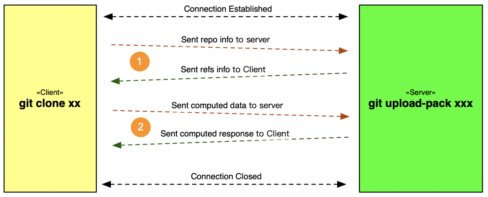

Git 协议优势就是速度快（无加解密），但受限于协议的缺点，Git 协议常用于开源项目的下载，不作为私有项目的传输协议。Git 客户端跟服务端的交互主要包含两个步骤：

1.  获取服务端的引用
2.  客户端根据服务端的引用数据与服务端进行数据交换

Git 协议也遵循上述模式，只不过相比于 HTTP 协议，Git 协议直接在 TCP 层长连接直接完成上述 `2` 个步骤，如上图。在使用 Git 协议操作的时候，首先客户端会把相关的信息发给服务端，这个信息的格式同样的采用 `pkt-line` 的格式：

```TEXT
003egit-upload-pack /project.git\0host=myserver.com\0\0version=1\0
```

其中包含了命令、仓库名称、Host 等相关信息，服务端建立连接之后，接收到上述信息（协议数据），对其中的信息进行加工，找到对应的仓库的位置也就是目录，当所有的信息都符合要求之后，只需要在服务端启动 `upload-pack` 命令即可，这里需要注意的是不需要添加 `--stateless-rpc` 参数，直接 `git upload-pack {repo_path}`，这个命令启动后会马上返回相关的引用信息并且阻塞等待下一次信息的输入：

```bash
➜  hello git:(master) ✗ git upload-pack .
010234d8ed9a9f73d2cac9f50a8c8c03e4643990a2bf HEADmulti_ack thin-pack side-band side-band-64k ofs-delta shallow deepen-since deepen-not deepen-relative no-progress include-tag multi_ack_detailed symref=HEAD:refs/heads/master agent=git/2.24.3.(Apple.Git-128)
003f34d8ed9a9f73d2cac9f50a8c8c03e4643990a2bf refs/heads/master
0000
```

上述流程最终还是数据的转发，命令的标准输出信息需要原封不动的发送给客户端，客户端则会进行跟 HTTP 协议类似的处理产生数据，接着会把数据发给服务端，程序再原封不动的发给 `git upload-pack {repo_path}` 命令的标准输入，然后服务端处理完成后会把相应的包通过标准输出返回，程序再原封不动的发给客户端，就完成了一次 Fetch 操作，而 Push 的 `receive-pack` 操作原理相同；若客户端发送的信息不符合要求，或者处理过程中出现了问题，程序需要返回错误告知客户端，该错误的格式也是 `pkt-line`，以 `ERR` 开头，如下：

```GO
// error-line     =  PKT-LINE("ERR" SP explanation-text)
func exitSession(conn net.Conn, err error) {
	errStr := fmt.Sprintf("ERR %s", err.Error())
	pktData := fmt.Sprintf("%04x%s", len(errStr)+4, errStr)
	_, _ = conn.Write([]byte(pktData))
	_ = conn.Close()
}
```

客户端接收到上述错误信息后，就会打印信息并关闭连接

#### 4、SSH 传输协议
与 Git 协议比较，SSH 协议传输的数据需要加密。除此外，SSH 协议的传输过程与 Git 协议一致，都是跟服务端的进程做数据交换：

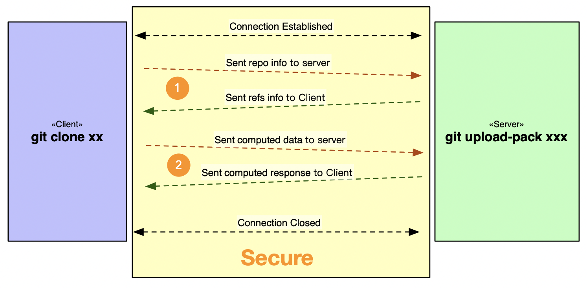

SSH 协议的下载地址一般是 `git@xxx.com:username/xxxx-repo.git` 形式，在执行 `clone` 或者 `push` 的时候，会拆解成下面指令：

```bash
ssh git@xxx.com "git-upload-pack 'username/xxxx-repo.git'"
```

需要注意的是，`git-upload-pack` 和仓库路径之间有空格，仓库路径用单引号括起来。SSH 在这里充当的角色是**安全传输通道**，实际的 git 数据交换仍然是通过 `upload-pack` 和 `receive-pack` 完成的

##	0x01  原理
Git over SSH 的原理是通过 SSH 协议来进行安全的远程访问和数据传输。git 借用了 ssh 的 Channel 中的 `exec` Request 类型，通过封装自己的核心 `git` 指令，来完成客户端与服务端的 [git 指令](https://github.com/gogs/gogs/blob/v0.14.2/internal/cmd/serv.go#L129) 交互，重点是下面 `3` 个：

- `git-upload-pack`：服务端发送对象给客户端，用于 `clone`/`fetch`/`pull` 操作，参考 [git-upload-pack](https://git-scm.com/docs/git-upload-pack)
- `git-upload-archive`：服务端发送归档（archive）给客户端，用于 `git archive --remote` 操作
- `git-receive-pack`：服务端接收客户端推送的对象，用于 `push` 操作，参考 [git-receive-pack](https://git-scm.com/docs/git-receive-pack)

上面这几个是 git 的低级命令（plumbing commands），这几个命令封装了 git 工具的权限处理，内部 api 调用，git 上传/下载等操作（**核心**）

可以回想，一般 git ssh 支持需要客户端配置 ssh-keys 来辅助身份验证，原理是**git 利用了 ssh 的 `authorized_keys` 配合 `forced_command` 实现机制**：
1.  利用 `authorized_keys` 来验证 git 客户端身份（公钥认证）
2.  建立 ssh 连接后，使用 `forced_command` 机制来限制客户端仅仅调用 git 限定的指令（而非获得一个 shell）
3.  操作完成后，ssh 连接退出

通常上面的 `forced_command`，在 git 中也称为 `git-shell`

整个 Git over SSH 的交互流程如下：

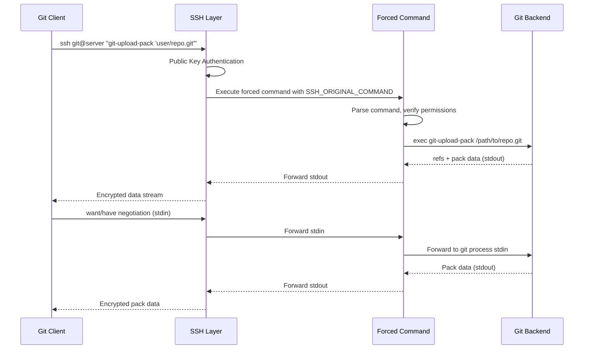

####  Git with OpenSSH
在 OpenSSH 的 `sshd_config` 中有一些关键配置项 `AuthorizedKeysFile` 和 `AuthorizedKeysCommand`。Git SSH 的鉴权/执行一般过程如下：

```text
git pull/push over ssh -> gitlab-shell -> API call to gitlab-rails (Authorization) -> accept or decline -> execute git command
```

`AuthorizedKeysCommand` 可以配置一个外部命令，在每次 SSH 认证时动态查询公钥（适用于大规模用户场景，避免单一 `authorized_keys` 文件过大），而 `forced_command` 则通过 `authorized_keys` 文件中的 `command=` 前缀来实现

##  0x02  常用实现的 git-shell
列举下几款开源 git server 实现中的 `forced_command` 格式，注意，这个 `command` 需要满足如下几点：
1.  实现对应的 git 指令功能（`upload-pack`/`receive-pack`/`upload-archive`）
2.  对接 ssh 客户端的 input/output（stdin/stdout 桥接）
3.  完成鉴权检查（用户是否有权限操作目标仓库）

####  gitlab

```bash
command="/opt/gitlab/embedded/service/gitlab-shell/bin/gitlab-shell key-<db key id>",no-port-forwarding,no-X11-forwarding,no-agent-forwarding,no-pty <ssh public key>
```

####  gogs

```BASH
command="%s serv key-%d --config='%s'",no-port-forwarding,no-X11-forwarding,no-agent-forwarding,no-pty %s
```

上述 command 本质上是 gogs 实现的 `serv` 指令（来源：[`internal/database/ssh_key.go`](https://github.com/gogs/gogs/blob/v0.14.2/internal/database/ssh_key.go#L28)）实现：

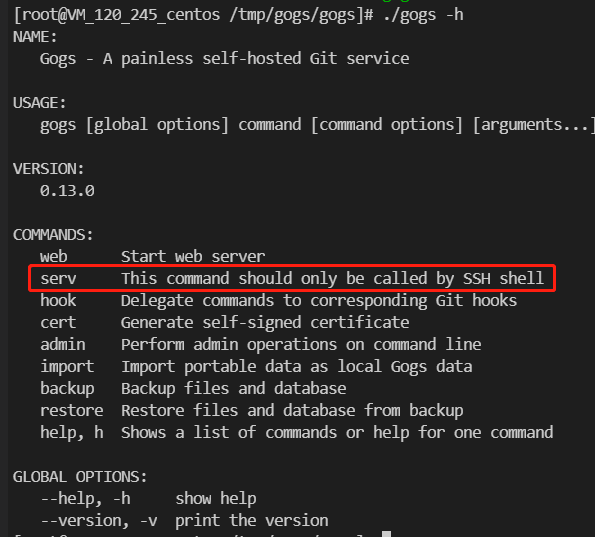

#### [codefever](https://github.com/PGYER/codefever/tree/master)

```BASH
command="PATH=$PATH:/usr/local/git/bin && /data/www/codefever-community/ssh-gateway/shell/main $SSH_ORIGINAL_COMMAND 00000000000000000000000000000000",no-port-forwarding,no-X11-forwarding,no-agent-forwarding,no-pty <ssh public key>
```

这些 `authorized_keys` 条目中的 `no-port-forwarding,no-X11-forwarding,no-agent-forwarding,no-pty` 选项是安全加固措施，确保 SSH 连接只能用于 git 操作，不能进行端口转发、X11 转发、agent 转发或申请伪终端

##  0x03  git over ssh：前置知识
本小节介绍 Git over SSH Server 技术细节。Git SSH Server 与 SSH Server 的主要区别是，Git SSH Server 只是一个严格的子集，session 阶段只需要实现 `env` 和 `exec` 两种请求即可，不需要完整实现如 `shell`、`pty-req` 等请求。

具体来说，一个 Git SSH Server 需要处理的请求类型：

| 请求类型 | 说明 | 是否必须 |
|---------|------|---------|
| `env` | 客户端设置环境变量（如 `GIT_PROTOCOL`），只需 accept 即可 | 是 |
| `exec` | 客户端发送要执行的命令（如 `git-upload-pack 'user/repo.git'`） | 是 |
| `shell` | 交互式 shell | 否 |
| `pty-req` | 请求伪终端 | 否 |

SSH Channel 的数据流桥接是实现 Git over SSH 的核心：将 SSH Channel 的 stdin/stdout 与 git 子进程的 stdin/stdout 通过 `io.Copy` 双向连接起来，使得 git 客户端和服务端的 git 进程可以直接通过 SSH 加密通道进行 `pkt-line` 数据交换

##  0x04  Gogs 深入分析：运行架构与 SSH 实现

[Gogs](https://github.com/gogs/gogs)（Go Git Service）是一款用 Go 语言编写的轻量级自托管 Git 服务。本节基于 [Gogs v0.14.2](https://github.com/gogs/gogs/tree/v0.14.2) 源码，深入分析其 SSH Git 通信的实现

####  Gogs 整体架构

Gogs 的入口文件 [`gogs.go`](https://github.com/gogs/gogs/blob/v0.14.2/gogs.go) 注册了多个 CLI 子命令：

```go
// gogs.go - 入口文件
func main() {
	app := cli.NewApp()
	app.Name = "Gogs"
	app.Usage = "A painless self-hosted Git service"
	app.Version = conf.App.Version
	app.Commands = []cli.Command{
		cmd.Web,    // Web 服务（HTTP Git + Web UI）
		cmd.Serv,   // SSH forced command（核心）
		cmd.Hook,   // Git 钩子回调
		cmd.Cert,   // 证书管理
		cmd.Admin,  // 管理命令
		cmd.Import,
		cmd.Backup,
		cmd.Restore,
	}
	if err := app.Run(os.Args); err != nil {
		log.Fatal("Failed to start application: %v", err)
	}
}
```

其中与 Git over SSH 直接相关的是 `cmd.Serv`（forced command）、`cmd.Hook`（git 钩子）以及内置 SSH 服务器模块 `internal/ssh/ssh.go`

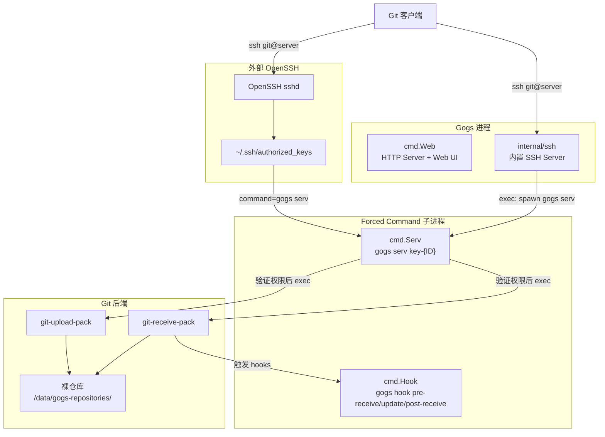

####  两种 SSH 运行模式

Gogs 支持两种 SSH 运行模式，通过配置项 `START_SSH_SERVER` 切换（定义于 [`internal/conf/static.go`](https://github.com/gogs/gogs/blob/v0.14.2/internal/conf/static.go)）：

```go
// internal/conf/static.go - SSH 配置结构体
type SSHOpts struct {
	Disabled                     bool   `ini:"DISABLE_SSH"`
	Domain                       string `ini:"SSH_DOMAIN"`
	Port                         int    `ini:"SSH_PORT"`
	RootPath                     string `ini:"SSH_ROOT_PATH"`
	KeygenPath                   string `ini:"SSH_KEYGEN_PATH"`
	KeyTestPath                  string `ini:"SSH_KEY_TEST_PATH"`
	MinimumKeySizeCheck          bool
	MinimumKeySizes              map[string]int `ini:"-"`
	RewriteAuthorizedKeysAtStart bool

	StartBuiltinServer bool     `ini:"START_SSH_SERVER"`          // 是否启用内置 SSH
	ListenHost         string   `ini:"SSH_LISTEN_HOST"`
	ListenPort         int      `ini:"SSH_LISTEN_PORT"`
	ServerCiphers      []string `ini:"SSH_SERVER_CIPHERS"`
	ServerMACs         []string `ini:"SSH_SERVER_MACS"`
	ServerAlgorithms   []string `ini:"SSH_SERVER_ALGORITHMS"`
}
```

**模式一：外部 OpenSSH 模式（默认）**

当 `START_SSH_SERVER=false` 时，Gogs 依赖系统的 OpenSSH sshd。用户通过 Gogs Web 界面添加 SSH 公钥后，Gogs 将公钥写入 `~/.ssh/authorized_keys` 文件，每条公钥前附加 `command=` 前缀。关键代码在 [`internal/database/ssh_key.go`](https://github.com/gogs/gogs/blob/v0.14.2/internal/database/ssh_key.go)：

```go
// internal/database/ssh_key.go - authorized_keys 模板
const (
	tplPublicKey = `command="%s serv key-%d --config='%s'",no-port-forwarding,no-X11-forwarding,no-agent-forwarding,no-pty %s` + "\n"
)

// AuthorizedString 生成 authorized_keys 格式的公钥行
func (k *PublicKey) AuthorizedString() string {
	return fmt.Sprintf(tplPublicKey, conf.AppPath(), k.ID, conf.CustomConf, k.Content)
}
```

生成的 `authorized_keys` 条目示例如下：

```bash
command="/usr/local/bin/gogs serv key-1 --config='/data/gogs/custom/conf/app.ini'",no-port-forwarding,no-X11-forwarding,no-agent-forwarding,no-pty ssh-rsa AAAAB3NzaC1yc2EAAAA... user@host
```

当用户添加或删除公钥时，Gogs 会追加写入或重写整个 `authorized_keys` 文件：

```go
// internal/database/ssh_key.go - 追加公钥到 authorized_keys
func appendAuthorizedKeysToFile(keys ...*PublicKey) error {
	sshOpLocker.Lock()
	defer sshOpLocker.Unlock()

	fpath := filepath.Join(conf.SSH.RootPath, "authorized_keys")
	f, err := os.OpenFile(fpath, os.O_CREATE|os.O_WRONLY|os.O_APPEND, 0o600)
	if err != nil {
		return err
	}
	defer f.Close()
	// 确保权限不超过 0600
	if !conf.IsWindowsRuntime() {
		fi, err := f.Stat()
		if err != nil {
			return err
		}
		if fi.Mode().Perm() > 0o600 {
			if err = f.Chmod(0o600); err != nil {
				return err
			}
		}
	}
	for _, key := range keys {
		if _, err = f.WriteString(key.AuthorizedString()); err != nil {
			return err
		}
	}
	return nil
}
```

**模式二：内置 SSH 服务器模式**

当 `START_SSH_SERVER=true` 时，Gogs 使用 `golang.org/x/crypto/ssh` 库启动自己的 SSH 服务器，不再依赖外部 OpenSSH。此模式下不需要维护 `authorized_keys` 文件（参见 [`internal/conf/conf.go`](https://github.com/gogs/gogs/blob/v0.14.2/internal/conf/conf.go) 中 `SSH.RewriteAuthorizedKeysAtStart = false`）

核心代码在 [`internal/ssh/ssh.go`](https://github.com/gogs/gogs/blob/v0.14.2/internal/ssh/ssh.go)，以下逐步解析：

**1）SSH 服务器初始化（`Listen` 函数）**

```go
// internal/ssh/ssh.go - SSH 服务器启动入口
func Listen(opts conf.SSHOpts, appDataPath string) {
	config := &ssh.ServerConfig{
		Config: ssh.Config{
			Ciphers: opts.ServerCiphers,
			MACs:    opts.ServerMACs,
		},
		// 公钥认证回调：在数据库中查找公钥
		PublicKeyCallback: func(conn ssh.ConnMetadata, key ssh.PublicKey) (*ssh.Permissions, error) {
			pkey, err := database.SearchPublicKeyByContent(
				strings.TrimSpace(string(ssh.MarshalAuthorizedKey(key))))
			if err != nil {
				if !database.IsErrKeyNotExist(err) {
					log.Error("SearchPublicKeyByContent: %v", err)
				}
				return nil, err
			}
			// 认证成功，将 key ID 存入 Extensions 供后续使用
			return &ssh.Permissions{
				Extensions: map[string]string{"key-id": com.ToStr(pkey.ID)},
			}, nil
		},
	}

	keys, err := setupHostKeys(appDataPath, opts.ServerAlgorithms)
	if err != nil {
		log.Fatal("SSH: Failed to setup host keys: %v", err)
	}
	for _, key := range keys {
		config.AddHostKey(key)
	}

	go listen(config, opts.ListenHost, opts.ListenPort)
}
```

`PublicKeyCallback` 是核心认证逻辑：将客户端提供的公钥序列化后在数据库中查找匹配记录，认证成功后将数据库中的 key ID 存入 `ssh.Permissions.Extensions["key-id"]`，供后续的 `handleServerConn` 使用

**2）连接处理（`listen` 函数）**

```go
// internal/ssh/ssh.go - TCP 监听与 SSH 握手
func listen(config *ssh.ServerConfig, host string, port int) {
	listener, err := net.Listen("tcp", host+":"+com.ToStr(port))
	if err != nil {
		log.Fatal("Failed to start SSH server: %v", err)
	}
	for {
		conn, err := listener.Accept()
		if err != nil {
			log.Error("SSH: Error accepting incoming connection: %v", err)
			continue
		}
		// 每个连接在独立 goroutine 中处理握手，避免阻塞
		go func() {
			log.Trace("SSH: Handshaking for %s", conn.RemoteAddr())
			sConn, chans, reqs, err := ssh.NewServerConn(conn, config)
			if err != nil {
				if err == io.EOF || errors.Is(err, syscall.ECONNRESET) {
					log.Trace("SSH: Handshaking was terminated: %v", err)
				} else {
					log.Error("SSH: Error on handshaking: %v", err)
				}
				return
			}
			log.Trace("SSH: Connection from %s (%s)", sConn.RemoteAddr(), sConn.ClientVersion())
			go ssh.DiscardRequests(reqs)
			// 从 Permissions.Extensions 中取出 key-id，传给 channel 处理函数
			go handleServerConn(sConn.Permissions.Extensions["key-id"], chans)
		}()
	}
}
```

**3）Channel 请求处理（`handleServerConn` 函数，核心）**

```go
// internal/ssh/ssh.go - 处理 SSH Channel 和 Request
func handleServerConn(keyID string, chans <-chan ssh.NewChannel) {
	for newChan := range chans {
		if newChan.ChannelType() != "session" {
			_ = newChan.Reject(ssh.UnknownChannelType, "unknown channel type")
			continue
		}
		ch, reqs, err := newChan.Accept()
		if err != nil {
			log.Error("Error accepting channel: %v", err)
			continue
		}
		go func(in <-chan *ssh.Request) {
			defer func() { _ = ch.Close() }()
			for req := range in {
				payload := cleanCommand(string(req.Payload))
				switch req.Type {
				case "env":
					// Git 客户端可能会设置 GIT_PROTOCOL 等环境变量
					// 这些不会影响后续命令，只需 accept
				case "exec":
					cmdName := strings.TrimLeft(payload, "'()")
					log.Trace("SSH: Payload: %v", cmdName)

					// 关键：启动 gogs serv 子进程
					args := []string{"serv", "key-" + keyID, "--config=" + conf.CustomConf}
					cmd := exec.Command(conf.AppPath(), args...)
					cmd.Env = append(os.Environ(), "SSH_ORIGINAL_COMMAND="+cmdName)

					stdout, err := cmd.StdoutPipe()
					if err != nil { return }
					stderr, err := cmd.StderrPipe()
					if err != nil { return }
					input, err := cmd.StdinPipe()
					if err != nil { return }

					if err = cmd.Start(); err != nil { return }
					_ = req.Reply(true, nil)

					// IO 桥接：SSH Channel <-> gogs serv 子进程
					go func() {
						_, _ = io.Copy(input, ch)  // channel stdin -> serv stdin
						input.Close()
					}()
					_, _ = io.Copy(ch, stdout)          // serv stdout -> channel stdout
					_, _ = io.Copy(ch.Stderr(), stderr)  // serv stderr -> channel stderr

					if err = cmd.Wait(); err != nil { return }
					// 发送退出状态
					_, _ = ch.SendRequest("exit-status", false, []byte{0, 0, 0, 0})
					return
				default:
				}
			}
		}(reqs)
	}
}
```

这里有几个关键设计要点：

1. **不直接执行 git 命令**：`handleServerConn` 不直接执行 `git-upload-pack` 等命令，而是启动 `gogs serv` 子进程。这样做的目的是复用 `serv` 命令中的鉴权、日志等逻辑，无论是外部 OpenSSH 还是内置 SSH，都走同一套鉴权流程
2. **通过环境变量传递命令**：将客户端实际发送的 git 命令通过 `SSH_ORIGINAL_COMMAND` 环境变量传给 `gogs serv`，与外部 OpenSSH 的 `forced_command` 机制保持一致
3. **IO 桥接**：通过三对 `io.Copy` 将 SSH Channel 的 stdin/stdout/stderr 与 `gogs serv` 子进程的 stdin/stdout/stderr 双向连接
4. **`cleanCommand` 函数**：从 SSH payload 中提取 git 命令部分（payload 前面可能有长度前缀等元数据）

```go
// internal/ssh/ssh.go
func cleanCommand(cmd string) string {
	i := strings.Index(cmd, "git")
	if i == -1 {
		return cmd
	}
	return cmd[i:]
}
```

####  serv 命令：Gogs 的 Forced Command 实现

`gogs serv` 是整个 Git over SSH 的核心鉴权与调度模块，代码在 [`internal/cmd/serv.go`](https://github.com/gogs/gogs/blob/v0.14.2/internal/cmd/serv.go)。无论使用哪种 SSH 模式，最终都会执行 `gogs serv key-{ID}` 命令

**命令定义**：

```go
// internal/cmd/serv.go
var Serv = cli.Command{
	Name:        "serv",
	Usage:       "This command should only be called by SSH shell",
	Description: `Serv provide access auth for repositories`,
	Action:      runServ,
	Flags: []cli.Flag{
		stringFlag("config, c", "", "Custom configuration file path"),
	},
}
```

**`runServ` 核心流程**：

```go
// internal/cmd/serv.go - 核心鉴权与执行逻辑（关键片段）
func runServ(c *cli.Context) error {
	ctx := context.Background()
	setup(c, "serv.log", true)

	if conf.SSH.Disabled {
		println("Gogs: SSH has been disabled")
		return nil
	}

	if len(c.Args()) < 1 {
		fail("Not enough arguments", "Not enough arguments")
	}

	// 步骤 1：从环境变量获取 git 客户端实际发送的命令
	sshCmd := os.Getenv("SSH_ORIGINAL_COMMAND")
	if sshCmd == "" {
		println("Hi there, You've successfully authenticated, but Gogs does not provide shell access.")
		println("If this is unexpected, please log in with password and setup Gogs under another user.")
		return nil
	}

	// 步骤 2：解析命令和仓库路径
	verb, args := parseSSHCmd(sshCmd)
	repoFullName := strings.ToLower(strings.Trim(args, "'"))
	repoFields := strings.SplitN(repoFullName, "/", 2)
	if len(repoFields) != 2 {
		fail("Invalid repository path", "Invalid repository path: %v", args)
	}
	ownerName := strings.ToLower(repoFields[0])
	repoName := strings.TrimSuffix(strings.ToLower(repoFields[1]), ".git")
	repoName = strings.TrimSuffix(repoName, ".wiki")

	// 步骤 3：查询仓库所有者和仓库信息
	owner, err := database.Handle.Users().GetByUsername(ctx, ownerName)
	if err != nil { /* 错误处理 */ }
	repo, err := database.GetRepositoryByName(owner.ID, repoName)
	if err != nil { /* 错误处理 */ }
	repo.Owner = owner

	// 步骤 4：根据 git 命令确定所需权限
	requestMode, ok := allowedCommands[verb]
	if !ok {
		fail("Unknown git command", "Unknown git command '%s'", verb)
	}

	// 步骤 5：权限检查
	// ...（省略详细鉴权逻辑，见下文）

	// 步骤 6：构造并执行 git 命令
	var gitCmd *exec.Cmd
	verbs := strings.Split(verb, " ")
	if len(verbs) == 2 {
		gitCmd = exec.Command(verbs[0], verbs[1], repoFullName)
	} else {
		gitCmd = exec.Command(verb, repoFullName)
	}
	// 写操作需要设置 Hook 环境变量
	if requestMode == database.AccessModeWrite {
		gitCmd.Env = append(os.Environ(), database.ComposeHookEnvs(database.ComposeHookEnvsOptions{
			AuthUser:  user,
			OwnerName: owner.Name,
			OwnerSalt: owner.Salt,
			RepoID:    repo.ID,
			RepoName:  repo.Name,
			RepoPath:  repo.RepoPath(),
		})...)
	}
	gitCmd.Dir = conf.Repository.Root
	gitCmd.Stdout = os.Stdout  // serv 的 stdout -> SSH Channel
	gitCmd.Stdin = os.Stdin    // SSH Channel -> serv 的 stdin
	gitCmd.Stderr = os.Stderr  // serv 的 stderr -> SSH Channel
	if err = gitCmd.Run(); err != nil {
		fail("Internal error", "Failed to execute git command: %v", err)
	}
	return nil
}
```

**`allowedCommands` 映射表**决定了哪些 git 命令被允许以及需要什么权限级别：

```go
// internal/cmd/serv.go
var allowedCommands = map[string]database.AccessMode{
	"git-upload-pack":    database.AccessModeRead,   // clone/fetch/pull
	"git-upload-archive": database.AccessModeRead,   // archive
	"git-receive-pack":   database.AccessModeWrite,  // push
}
```

**`parseSSHCmd` 命令解析**：

```go
// internal/cmd/serv.go
func parseSSHCmd(cmd string) (string, string) {
	ss := strings.SplitN(cmd, " ", 2)
	if len(ss) != 2 {
		return "", ""
	}
	return ss[0], strings.Replace(ss[1], "'/", "'", 1)
}
```

例如输入 `git-upload-pack 'user/repo.git'`，解析结果为 `verb="git-upload-pack"`, `args="user/repo.git"`

**鉴权流程**的核心逻辑如下（简化）：

```go
// internal/cmd/serv.go - 权限验证（简化版）
// 从命令行参数获取 key ID
key, err := database.GetPublicKeyByID(com.StrTo(strings.TrimPrefix(c.Args()[0], "key-")).MustInt64())

if requestMode == database.AccessModeWrite || repo.IsPrivate {
	if key.IsDeployKey() {
		// Deploy Key 权限检查
		if key.Mode < requestMode {
			fail("Key permission denied", "Cannot push with deployment key: %d", key.ID)
		}
		checkDeployKey(key, repo)
	} else {
		// 普通用户 Key 权限检查
		user, err = database.Handle.Users().GetByKeyID(ctx, key.ID)
		mode := database.Handle.Permissions().AccessMode(ctx, user.ID, repo.ID,
			database.AccessModeOptions{
				OwnerID: repo.OwnerID,
				Private: repo.IsPrivate,
			},
		)
		if mode < requestMode {
			fail(accessDeniedMessage, "...")
		}
	}
} else {
	// 公开仓库的读操作允许匿名访问
	if key.IsDeployKey() && conf.Auth.RequireSigninView {
		checkDeployKey(key, repo)
	}
}
```

鉴权逻辑的判断顺序：
1. 写操作或私有仓库 -> 必须验证用户身份和权限
2. Deploy Key -> 检查该 Key 是否属于目标仓库且权限足够
3. 用户 Key -> 通过 Key ID 找到用户，检查用户对仓库的访问权限
4. 公开仓库的读操作 -> 允许匿名访问（除非配置了 `RequireSigninView`）
5. 镜像仓库 -> 禁止写操作

##  0x05  Gogs 深入分析：git clone / push / pull 全链路解读

本节结合 Gogs 的实现源码，详细追踪 `git clone`、`git push`、`git pull` 命令通过 SSH 通道的完整执行链路

####  git clone 全链路

当用户执行 `git clone git@server:user/repo.git` 时，完整链路如下：

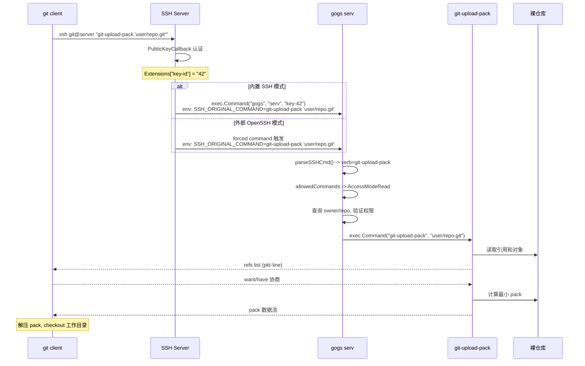

**步骤详解**：

1. **Git 客户端**：`git clone` 内部调用 `ssh git@server "git-upload-pack 'user/repo.git'"`
2. **SSH 认证**：内置模式通过 `PublicKeyCallback` 在数据库查找公钥；外部模式通过 OpenSSH 的 `authorized_keys` 匹配
3. **启动 serv**：无论哪种模式，都启动 `gogs serv key-{ID}` 子进程，git 命令通过 `SSH_ORIGINAL_COMMAND` 环境变量传入
4. **命令解析**：`parseSSHCmd` 将 `git-upload-pack 'user/repo.git'` 解析为 verb 和 repo path
5. **权限校验**：`allowedCommands` 确定 `git-upload-pack` 需要 `AccessModeRead`，对公开仓库允许匿名读取
6. **执行 git 命令**：`exec.Command("git-upload-pack", "user/repo.git")` 在仓库根目录执行，stdin/stdout 桥接回 SSH 通道
7. **数据交换**：`git-upload-pack` 先返回 refs 列表，客户端发送 want/have 协商请求，服务端计算并返回 pack 数据

在 `serv.go` 中关键的 IO 桥接代码：

```go
// internal/cmd/serv.go - git 命令执行与 IO 桥接
gitCmd.Dir = conf.Repository.Root
gitCmd.Stdout = os.Stdout  // git-upload-pack stdout -> serv stdout -> SSH Channel -> git client
gitCmd.Stdin = os.Stdin    // git client -> SSH Channel -> serv stdin -> git-upload-pack stdin
gitCmd.Stderr = os.Stderr
if err = gitCmd.Run(); err != nil {
	fail("Internal error", "Failed to execute git command: %v", err)
}
```

由于 `gogs serv` 本身的 stdin/stdout 已经被 SSH Channel 桥接（无论是内置 SSH 模式的 `io.Copy` 还是外部 OpenSSH 的天然 IO 重定向），所以这里直接将 git 命令的 IO 指向 `os.Stdin`/`os.Stdout` 即可形成完整的数据通路

####  git push 全链路

当用户执行 `git push origin master` 时：

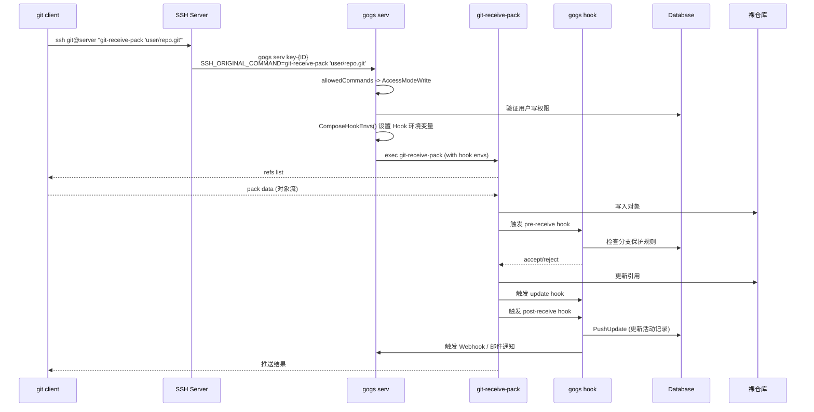

与 clone 的关键区别在于：

**1）写权限校验更严格**：

```go
// internal/cmd/serv.go - push 需要 AccessModeWrite
requestMode, ok := allowedCommands[verb]  // "git-receive-pack" -> AccessModeWrite

// 禁止向镜像仓库推送
if requestMode > database.AccessModeRead && repo.IsMirror {
	fail("Mirror repository is read-only", "")
}
```

**2）设置 Hook 环境变量**：

Push 操作时，`serv` 会通过 `ComposeHookEnvs` 设置一系列环境变量，供 git hooks 使用：

```go
// internal/database/repo_editor.go - Hook 环境变量
const (
	EnvAuthUserID          = "GOGS_AUTH_USER_ID"
	EnvAuthUserName        = "GOGS_AUTH_USER_NAME"
	EnvAuthUserEmail       = "GOGS_AUTH_USER_EMAIL"
	EnvRepoOwnerName       = "GOGS_REPO_OWNER_NAME"
	EnvRepoOwnerSaltMd5    = "GOGS_REPO_OWNER_SALT_MD5"
	EnvRepoID              = "GOGS_REPO_ID"
	EnvRepoName            = "GOGS_REPO_NAME"
	EnvRepoCustomHooksPath = "GOGS_REPO_CUSTOM_HOOKS_PATH"
)

func ComposeHookEnvs(opts ComposeHookEnvsOptions) []string {
	envs := []string{
		"SSH_ORIGINAL_COMMAND=1",
		EnvAuthUserID + "=" + com.ToStr(opts.AuthUser.ID),
		EnvAuthUserName + "=" + opts.AuthUser.Name,
		EnvAuthUserEmail + "=" + opts.AuthUser.Email,
		EnvRepoOwnerName + "=" + opts.OwnerName,
		EnvRepoOwnerSaltMd5 + "=" + cryptoutil.MD5(opts.OwnerSalt),
		EnvRepoID + "=" + com.ToStr(opts.RepoID),
		EnvRepoName + "=" + opts.RepoName,
		EnvRepoCustomHooksPath + "=" + filepath.Join(opts.RepoPath, "custom_hooks"),
	}
	return envs
}
```

这些环境变量将传递给 `git-receive-pack` 进程，进而传递给 git hooks（`pre-receive`、`update`、`post-receive`）

**3）Git Hooks 链**：

Push 过程会依次触发三个 hooks，它们都是 `gogs hook` 子命令的不同子命令，代码在 [`internal/cmd/hook.go`](https://github.com/gogs/gogs/blob/v0.14.2/internal/cmd/hook.go)：

**pre-receive hook**（推送前检查）：

```go
// internal/cmd/hook.go - pre-receive 钩子
func runHookPreReceive(c *cli.Context) error {
	if os.Getenv("SSH_ORIGINAL_COMMAND") == "" {
		return nil  // 非 SSH/Hook 调用，跳过
	}
	setup(c, "pre-receive.log", true)

	scanner := bufio.NewScanner(os.Stdin)
	for scanner.Scan() {
		fields := bytes.Fields(scanner.Bytes())
		if len(fields) != 3 { continue }
		oldCommitID := string(fields[0])
		newCommitID := string(fields[1])
		branchName := git.RefShortName(string(fields[2]))

		// 分支保护检查
		repoID := com.StrTo(os.Getenv(database.EnvRepoID)).MustInt64()
		protectBranch, err := database.GetProtectBranchOfRepoByName(repoID, branchName)
		if err != nil { /* ... */ }

		if protectBranch.Protected {
			// 检查白名单
			userID := com.StrTo(os.Getenv(database.EnvAuthUserID)).MustInt64()
			if protectBranch.EnableWhitelist {
				if !database.IsUserInProtectBranchWhitelist(repoID, userID, branchName) {
					fail(fmt.Sprintf("Branch '%s' is protected and you are not in the push whitelist", branchName), "")
				}
			}
			// 检查是否要求 Pull Request
			if protectBranch.RequirePullRequest {
				fail(fmt.Sprintf("Branch '%s' is protected and commits must be merged through pull request", branchName), "")
			}
			// 禁止删除受保护分支
			if newCommitID == git.EmptyID {
				fail(fmt.Sprintf("Branch '%s' is protected from deletion", branchName), "")
			}
			// 禁止 force push
			output, err := git.NewCommand("rev-list", "--max-count=1", oldCommitID, "^"+newCommitID).
				RunInDir(database.RepoPath(os.Getenv(database.EnvRepoOwnerName), os.Getenv(database.EnvRepoName)))
			if len(output) > 0 {
				fail(fmt.Sprintf("Branch '%s' is protected from force push", branchName), "")
			}
		}
	}
	// 执行自定义 hooks（如果存在）
	// ...
	return nil
}
```

**post-receive hook**（推送后处理）：

```go
// internal/cmd/hook.go - post-receive 钩子（简化）
func runHookPostReceive(c *cli.Context) error {
	if os.Getenv("SSH_ORIGINAL_COMMAND") == "" { return nil }
	setup(c, "post-receive.log", true)
	email.NewContext()  // 初始化邮件服务

	scanner := bufio.NewScanner(os.Stdin)
	for scanner.Scan() {
		fields := bytes.Fields(scanner.Bytes())
		if len(fields) != 3 { continue }

		options := database.PushUpdateOptions{
			OldCommitID:  string(fields[0]),
			NewCommitID:  string(fields[1]),
			FullRefspec:  string(fields[2]),
			PusherID:     com.StrTo(os.Getenv(database.EnvAuthUserID)).MustInt64(),
			PusherName:   os.Getenv(database.EnvAuthUserName),
			RepoUserName: os.Getenv(database.EnvRepoOwnerName),
			RepoName:     os.Getenv(database.EnvRepoName),
		}
		// 更新数据库中的推送记录（新 commits、活动动态等）
		if err := database.PushUpdate(options); err != nil {
			log.Error("PushUpdate: %v", err)
		}
		// 触发 Webhook 和测试 Pull Request 任务
		reqURL := fmt.Sprintf("%s%s/%s/tasks/trigger?...",
			conf.Server.LocalRootURL, options.RepoUserName, options.RepoName)
		resp, err := httplib.Get(reqURL).SetTLSClientConfig(&tls.Config{
			InsecureSkipVerify: true,
		}).Response()
		// ...
	}
	return nil
}
```

post-receive hook 的职责包括：更新推送记录（`PushUpdate`）、触发 Webhook 通知、发送邮件通知、创建/更新 Pull Request 等

####  git pull 全链路

`git pull` 本质上是 `git fetch` + `git merge` 的组合命令：

- **`git fetch`** 阶段：等同于 `git clone` 的数据传输过程，通过 `git-upload-pack` 从服务端获取新的对象和引用更新。区别在于 fetch 不是全量拉取，客户端会通过 `have` 行告知服务端已有的对象，服务端只返回差量 pack
- **`git merge`** 阶段：完全在客户端本地执行，不涉及 SSH 通信

因此从服务端的角度看，`git pull` 与 `git clone` 走的是同一条链路（`git-upload-pack`），权限要求也是 `AccessModeRead`

####  git 命令与 Gogs 实现的映射关系

| 用户命令 | SSH 实际命令 | Gogs 权限 | Gogs Hook 触发 | 说明 |
|---------|-------------|-----------|---------------|------|
| `git clone` | `git-upload-pack` | `AccessModeRead` | 无 | 完整克隆 |
| `git fetch` | `git-upload-pack` | `AccessModeRead` | 无 | 增量拉取 |
| `git pull` | `git-upload-pack` | `AccessModeRead` | 无 | fetch + 本地 merge |
| `git push` | `git-receive-pack` | `AccessModeWrite` | pre-receive/update/post-receive | 推送变更 |
| `git archive --remote` | `git-upload-archive` | `AccessModeRead` | 无 | 远程归档 |

##  0x06  Gogs 的 HTTP Git 协议实现

除了 SSH 协议，Gogs 也支持 HTTP(S) 协议进行 Git 操作。代码在 [`internal/route/repo/http.go`](https://github.com/gogs/gogs/blob/v0.14.2/internal/route/repo/http.go)。本节将其与 SSH 模式做对比分析

####  HTTP Git 路由定义

```go
// internal/route/repo/http.go - HTTP Git 路由表
var routes = []struct {
	re      *lazyregexp.Regexp
	method  string
	handler func(serviceHandler)
}{
	{lazyregexp.New("(.*?)/git-upload-pack$"), "POST", serviceUploadPack},
	{lazyregexp.New("(.*?)/git-receive-pack$"), "POST", serviceReceivePack},
	{lazyregexp.New("(.*?)/info/refs$"), "GET", getInfoRefs},
	{lazyregexp.New("(.*?)/HEAD$"), "GET", getTextFile},
	{lazyregexp.New("(.*?)/objects/info/alternates$"), "GET", getTextFile},
	{lazyregexp.New("(.*?)/objects/info/http-alternates$"), "GET", getTextFile},
	{lazyregexp.New("(.*?)/objects/info/packs$"), "GET", getInfoPacks},
	{lazyregexp.New("(.*?)/objects/info/[^/]*$"), "GET", getTextFile},
	{lazyregexp.New("(.*?)/objects/[0-9a-f]{2}/[0-9a-f]{38}$"), "GET", getLooseObject},
	{lazyregexp.New("(.*?)/objects/pack/pack-[0-9a-f]{40}\\.pack$"), "GET", getPackFile},
	{lazyregexp.New("(.*?)/objects/pack/pack-[0-9a-f]{40}\\.idx$"), "GET", getIdxFile},
}
```

可以看到 HTTP 模式同时支持智能协议（`git-upload-pack`、`git-receive-pack`）和哑协议（直接的对象文件访问）

####  HTTP 认证中间件

HTTP 模式的认证与 SSH 模式有本质区别——使用 HTTP Basic Auth 而非公钥认证：

```go
// internal/route/repo/http.go - HTTP 认证中间件（简化）
func HTTPContexter(store Store) macaron.Handler {
	return func(c *macaron.Context) {
		ownerName := c.Params(":username")
		repoName := strings.TrimSuffix(c.Params(":reponame"), ".git")

		isPull := c.Query("service") == "git-upload-pack" ||
			strings.HasSuffix(c.Req.URL.Path, "git-upload-pack") ||
			c.Req.Method == "GET"

		owner, err := store.GetUserByUsername(c.Req.Context(), ownerName)
		repo, err := store.GetRepositoryByName(c.Req.Context(), owner.ID, repoName)

		// 公开仓库的 Pull 操作不需要认证
		if isPull && !repo.IsPrivate && !conf.Auth.RequireSigninView {
			c.Map(&HTTPContext{Context: c})
			return
		}

		// 需要认证：HTTP Basic Auth
		authHead := c.Req.Header.Get("Authorization")
		if authHead == "" {
			askCredentials(c, http.StatusUnauthorized, "")
			return
		}
		// 支持用户名/密码和 Access Token 两种认证方式
		authUsername, authPassword, _ := tool.BasicAuthDecode(auths[1])
		authUser, err := store.AuthenticateUser(ctx, authUsername, authPassword, -1)
		if authUser == nil {
			// 尝试用 Access Token 认证
			authUser, err = context.AuthenticateByToken(store, ctx, authUsername)
		}
		// ...权限检查...
	}
}
```

####  HTTP Git RPC 实现

引用发现（`getInfoRefs`）和数据传输（`serviceRPC`）的处理方式：

```go
// internal/route/repo/http.go - 引用发现
func getInfoRefs(h serviceHandler) {
	h.setHeaderNoCache()
	service := getServiceType(h.r)
	if service != "upload-pack" && service != "receive-pack" {
		// 哑协议回退
		updateServerInfo(h.dir)
		h.sendFile("text/plain; charset=utf-8")
		return
	}
	// 智能协议
	refs := gitCommand(h.dir, service, "--stateless-rpc", "--advertise-refs", ".")
	h.w.Header().Set("Content-Type", fmt.Sprintf("application/x-git-%s-advertisement", service))
	h.w.WriteHeader(http.StatusOK)
	_, _ = h.w.Write(packetWrite("# service=git-" + service + "\n"))
	_, _ = h.w.Write([]byte("0000"))
	_, _ = h.w.Write(refs)
}

// internal/route/repo/http.go - 数据传输 RPC
func serviceRPC(h serviceHandler, service string) {
	defer h.r.Body.Close()

	if h.r.Header.Get("Content-Type") != fmt.Sprintf("application/x-git-%s-request", service) {
		h.w.WriteHeader(http.StatusUnauthorized)
		return
	}
	h.w.Header().Set("Content-Type", fmt.Sprintf("application/x-git-%s-result", service))

	var reqBody = h.r.Body
	if h.r.Header.Get("Content-Encoding") == "gzip" {
		reqBody, _ = gzip.NewReader(reqBody)
	}

	cmd := exec.Command("git", service, "--stateless-rpc", h.dir)
	if service == "receive-pack" {
		cmd.Env = append(os.Environ(), database.ComposeHookEnvs(database.ComposeHookEnvsOptions{
			AuthUser:  h.authUser,
			OwnerName: h.ownerName,
			OwnerSalt: h.ownerSalt,
			RepoID:    h.repoID,
			RepoName:  h.repoName,
			RepoPath:  h.dir,
		})...)
	}
	cmd.Dir = h.dir
	cmd.Stdout = h.w         // git stdout -> HTTP Response
	cmd.Stdin = reqBody       // HTTP Request Body -> git stdin
	cmd.Stderr = &stderr
	if err = cmd.Run(); err != nil {
		log.Error("HTTP.serviceRPC: fail to serve RPC '%s': %v", service, err)
	}
}
```

####  SSH vs HTTP 对比

| 维度 | SSH 模式 | HTTP 模式 |
|------|---------|----------|
| 认证方式 | 公钥认证（`authorized_keys` 或 `PublicKeyCallback`） | HTTP Basic Auth（用户名/密码或 Access Token） |
| 传输安全 | SSH 加密 | 依赖 HTTPS（HTTP 不安全） |
| 协议特点 | 有状态长连接，传输更稳定 | 无状态 HTTP，每次操作需两次请求（引用发现 + 数据传输） |
| git 命令参数 | 不需要 `--stateless-rpc` | 必须加 `--stateless-rpc` |
| 鉴权入口 | `gogs serv`（forced command 子进程） | `HTTPContexter` 中间件 |
| IO 桥接 | SSH Channel stdin/stdout <-> serv stdin/stdout <-> git stdin/stdout | HTTP Request Body -> git stdin, git stdout -> HTTP Response |
| Hook 环境变量 | `ComposeHookEnvs`（写操作） | `ComposeHookEnvs`（写操作），逻辑完全一致 |
| 2FA 支持 | 天然支持（公钥不受 2FA 影响） | 开启 2FA 后必须使用 Access Token |

两种模式最终都通过 `exec.Command` 调用相同的 git 后端命令（`git-upload-pack` / `git-receive-pack`），并使用相同的 `ComposeHookEnvs` 设置 hook 环境变量。核心差异在于认证方式和传输层

##  0x07	GitLab Shell 原理
参考 [GitLab Shell development guidelines](https://docs.gitlab.com/ee/development/gitlab_shell/)

When you access the GitLab server over SSH, GitLab Shell then:

1.	Limits you to predefined Git commands (git push, git pull, git fetch)
2.	Calls the GitLab Rails API to check if you are authorized, and what Gitaly server your repository is on
3.	Copies data back and forth between the SSH client and the Gitaly server

####	git pull over SSH

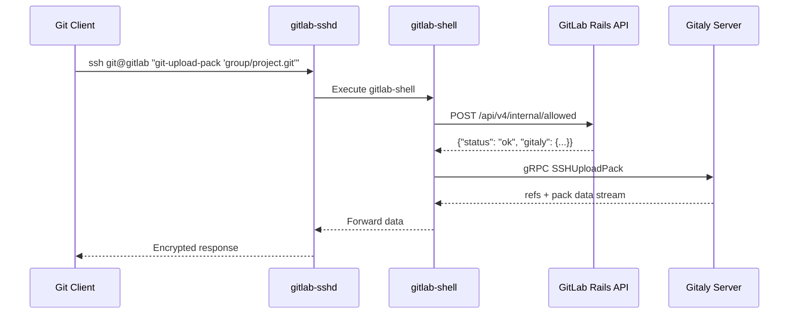

####	git push over SSH

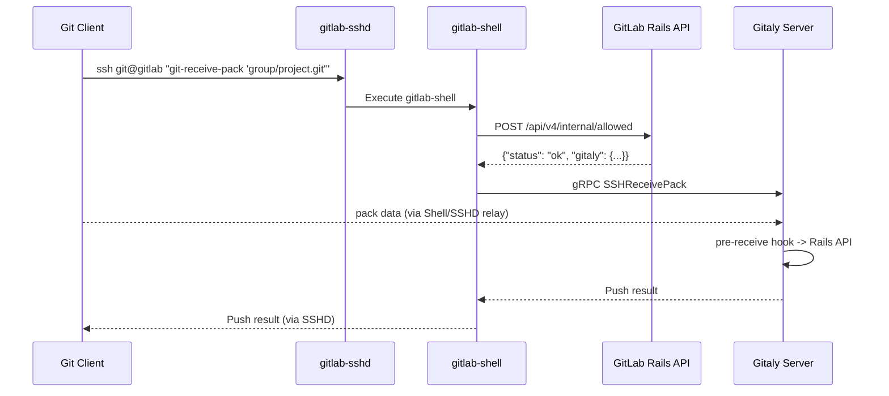

####	 flow of gitlab-shell
GitLab SSH 守护程序（gitlab-sshd）的运行流程如下：

1.	用户通过 SSH 协议连接到 gitlab-sshd
2.	gitlab-sshd 会验证用户的身份，并将用户的请求转发到 GitLab Rails 应用程序
3.	GitLab Rails 应用程序会验证用户的权限，并根据请求的类型执行相应的操作。例如，如果用户请求克隆存储库，则 GitLab Rails 应用程序会调用 Gitaly，将存储库的数据发送回 gitlab-sshd，然后将其转发给用户
4.	gitlab-sshd 将从 GitLab Rails 应用程序收到的响应发送回用户

在整个过程中，gitlab-sshd 充当了中间人的角色，负责将用户请求转发到 GitLab Rails 应用程序，并将响应发送回用户。同时，gitlab-sshd 还负责管理 SSH 连接，包括验证用户身份和维护连接状态


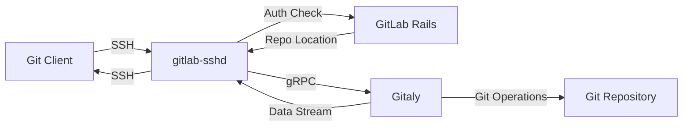

在上图中，包含了两个中间件：

-	Rails：Rails 是一种 Web 应用程序框架，它为 GitLab 提供了一个基础架构，包括用户身份验证、API、Web 界面等。Rails 还提供了一些功能，例如存储库浏览器、问题跟踪器、CI/CD 等
-	Gitaly：Gitaly 是 GitLab 的分布式版本控制系统，它负责处理 Git 存储库的所有操作。Gitaly 是在 GitLab 中实现高可用性和可扩展性的关键组件。它将 Git 操作转换为 gRPC 调用，并将它们路由到 Git 存储库的正确实例。Gitaly 还提供了许多其他功能，例如存储库克隆、提交、拉取请求等

####	GitLab Shell architecture


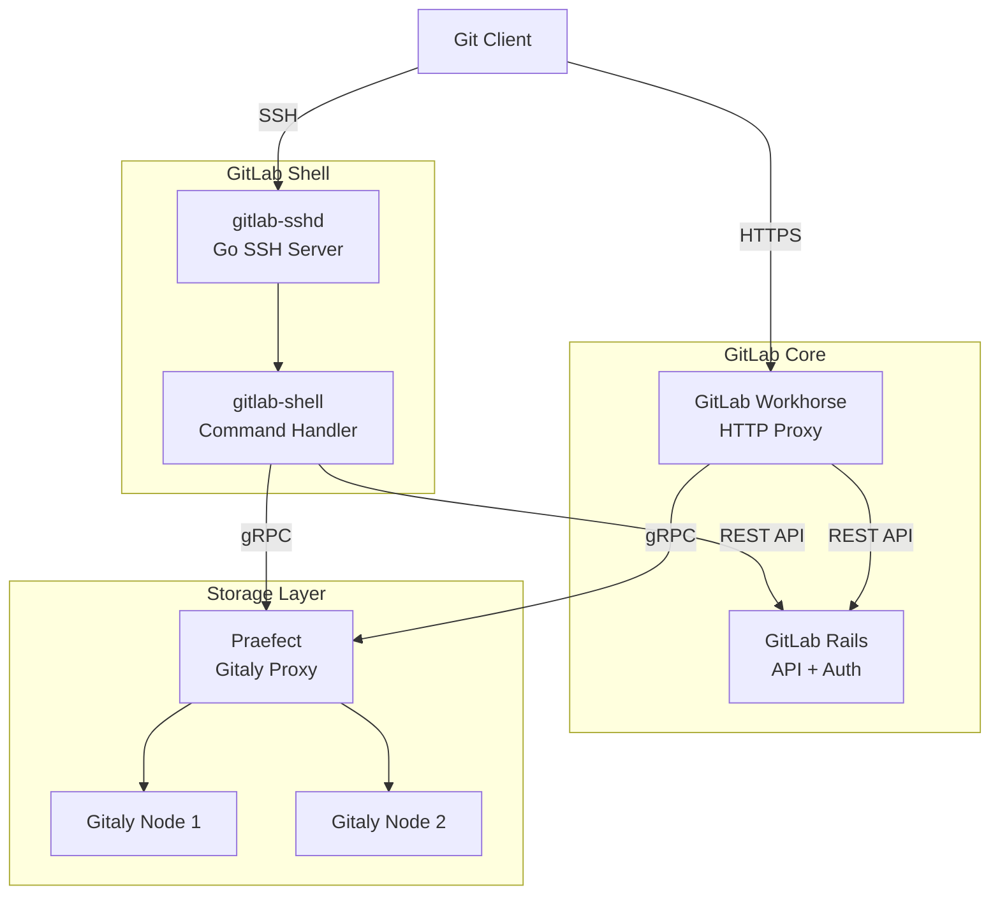

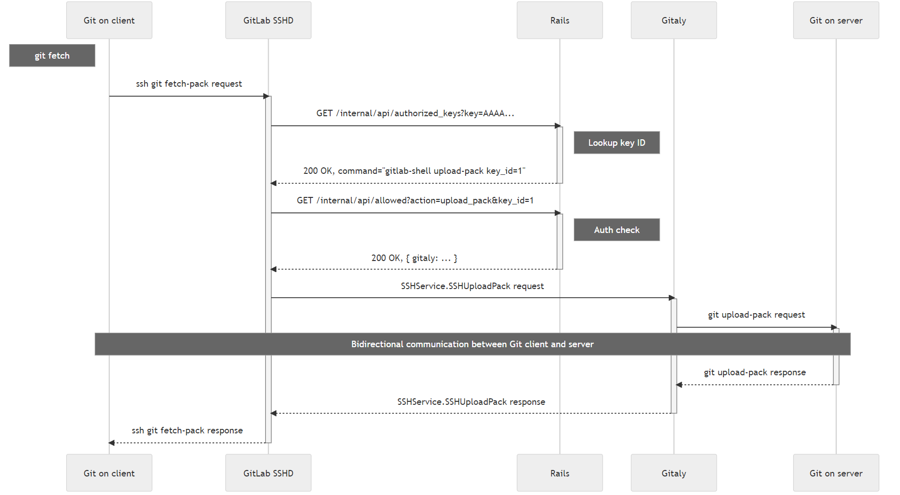

####  GitLab Shell vs Gogs 架构对比

| 维度 | GitLab Shell | Gogs |
|------|-------------|------|
| SSH 实现 | gitlab-sshd（Go SSH 服务器） | 内置 SSH / 外部 OpenSSH |
| Git 操作执行 | Gitaly（独立的 gRPC 服务） | 直接 exec git 命令 |
| 权限验证 | Rails API（HTTP 调用） | 直接查询数据库 |
| Hook 处理 | Gitaly 内部处理，回调 Rails API | gogs hook 子命令，直接查询数据库 |
| 可扩展性 | 高（Gitaly 集群 + Praefect） | 单机 |
| 复杂度 | 高（多组件协作） | 低（单二进制） |

##  0x08 总结

Git over SSH 的核心机制可以归纳为以下几点：

1. **传输通道**：SSH 提供加密的双向字节流通道，git 的 `upload-pack`/`receive-pack` 通过 stdin/stdout 进行 `pkt-line` 格式的数据交换
2. **认证与鉴权**：通过 SSH 公钥认证确认用户身份，`forced_command` 机制限制只能执行 git 相关命令，并在 forced command 内部完成仓库级别的权限校验
3. **Hook 机制**：Push 操作会触发 `pre-receive`/`update`/`post-receive` 钩子，实现分支保护、Webhook 通知等功能

Gogs 的实现精简而优雅：通过 `gogs serv` 统一了两种 SSH 模式的鉴权入口，通过 `ComposeHookEnvs` 在 SSH 和 HTTP 两种协议间共享相同的 Hook 逻辑，通过 `exec.Command` + stdin/stdout 桥接完成 git 后端的数据交换

关于 git 的使用/经验/原理或者更多细节，可以延伸阅读如下文章：
- [代码托管从业者 Git 指南](https://ipvb.gitee.io/git/2021/01/21/GitGuideForCodeHostingPractitioners/)

##  0x09 参考
-	[git 使用与原理剖析及其私服搭建](https://xie.infoq.cn/article/38e92927b2ca83f0d29224e6e)
- [GOGS：Gogs is a painless self-hosted Git service](https://github.com/gogs/gogs)
- [Gogs v0.14.2 源码](https://github.com/gogs/gogs/tree/v0.14.2)
- [几款开源 git server ssh 协议 forced command 参考格式](https://www.cnblogs.com/rongfengliang/p/15924984.html)
- [10.6 Git 内部原理 - 传输协议](https://git-scm.com/book/zh/v2/Git-%E5%86%85%E9%83%A8%E5%8E%9F%E7%90%86-%E4%BC%A0%E8%BE%93%E5%8D%8F%E8%AE%AE)
- [SSH access for GitLab](https://gitlab.com/gitlab-org/gitlab-shell)
- [聊聊 Git 的三种传输协议及实现](https://xie.infoq.cn/article/ae4a65148cc85dd155011bead)
- [构建恰当的 Git SSH Server](https://forcemz.net/git/2019/03/16/MakeAGitSSHServer/)
- [代码托管从业者 Git 指南](https://ipvb.gitee.io/git/2021/01/21/GitGuideForCodeHostingPractitioners/)
-	[传输协议](https://iissnan.com/progit/html/zh/ch9_6.html)
-	[一个 golang 模拟 git 服务端的实现](https://gitee.com/kesin/go-git-protocols/tree/master/http-smart)
-	[Writing an SSH server in Go](https://blog.gopheracademy.com/advent-2015/ssh-server-in-go/)
-	[自己开发 git 服务器，有哪些开源可以借用？](https://www.zhihu.com/question/283143882)
-	[GitLab Shell development guidelines](https://docs.gitlab.com/ee/development/gitlab_shell/)
- [git-upload-pack Documentation](https://git-scm.com/docs/git-upload-pack)
- [git-receive-pack Documentation](https://git-scm.com/docs/git-receive-pack)
