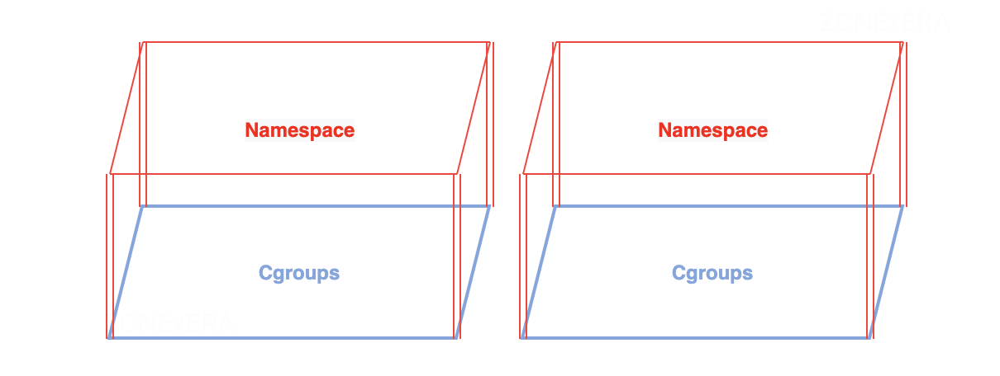
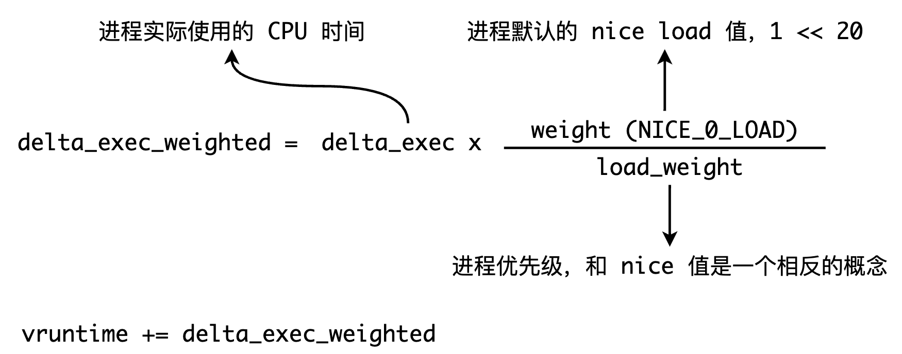
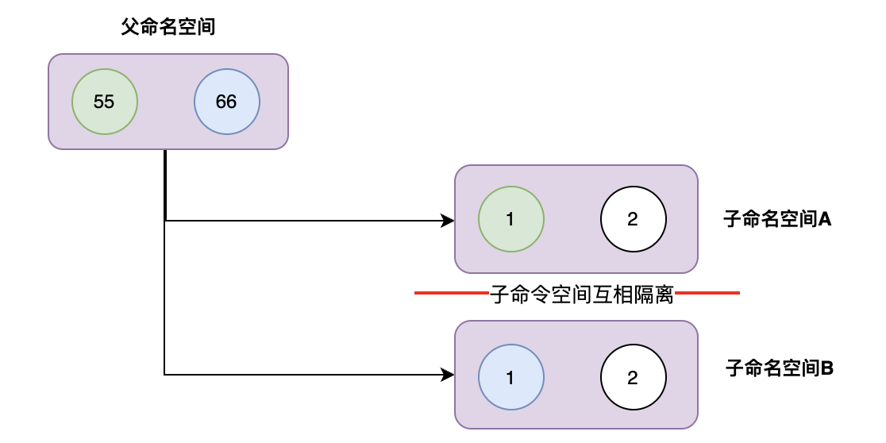
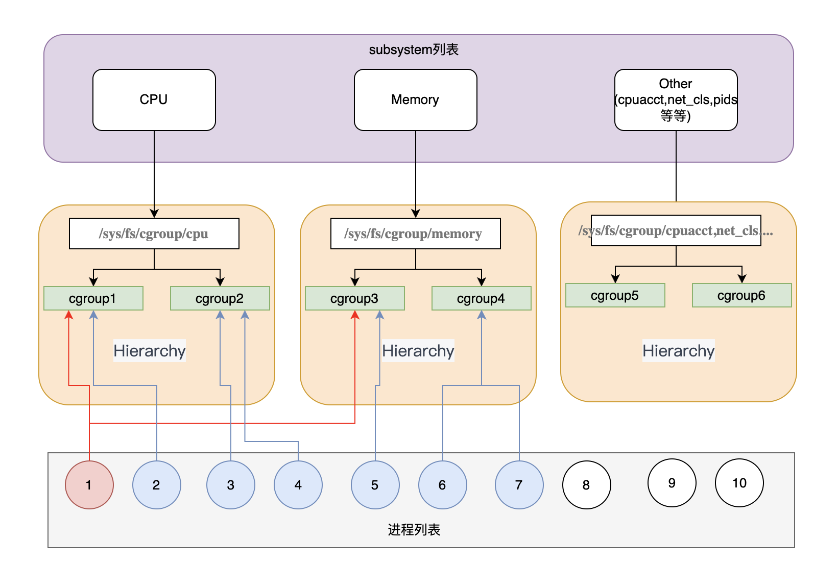
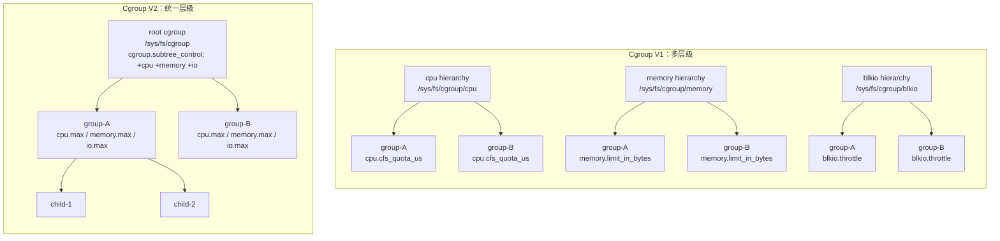
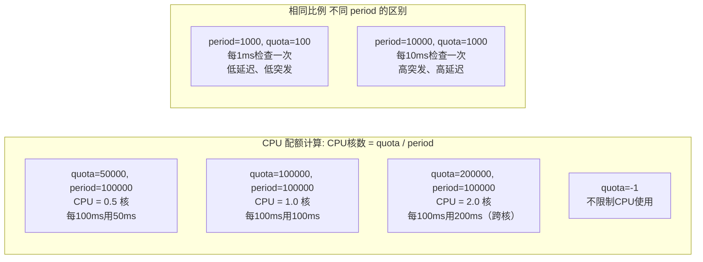
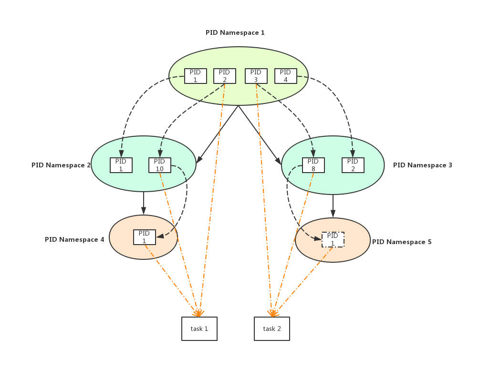
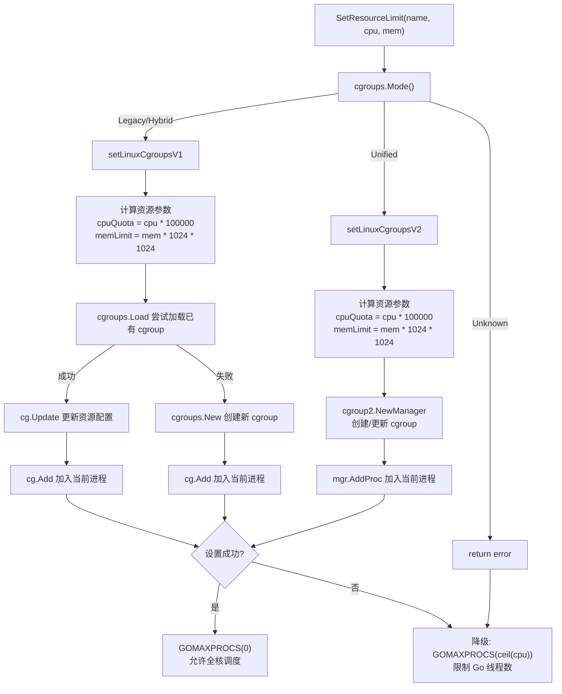

##  0x00    前言
Linux Namespace 和 Cgroup 都是 Linux 内核的功能，用于隔离和管理系统资源，但它们的目标和方法有所不同

```TEXT
cgroup = limits how much you can use;
namespaces = limits what you can see (and therefore use)
```

-   Linux Namespace 主要用于隔离系统资源，在一个 Namespace 中的进程看不到另一个 Namespace 中的资源。例如一个进程可能有自己的网络堆栈，与其他进程的网络堆栈完全隔离。Namespace 是实现容器技术的基础，如 Docker， Namespace 是将内核的全局资源做封装，使得每个 Namespace 都有一份独立的资源，因此不同的进程在各自的 Namespace 内对同一种资源的使用不会互相干扰
-   Cgroup（Control Group）则主要用于管理和限制系统资源的使用。它可以限制一个进程组使用的 CPU、内存等资源的数量。如可以设置一个 Cgroup，使得其中的进程最多只能使用 `50%` 的 CPU 时间，Cgroup 是内核提供的一种资源隔离的机制，可以实现对进程所使用的 cpu、内存物理资源、及网络带宽等进行限制。还可以通过分配的 CPU 时间片数量及磁盘 IO 宽带大小控制任务运行的优先级

Cgroups 可以理解为是房子的土地面积，限制了房子的大小 ，而 Namespace 是房子的墙，与邻居互相隔离



####    Linux CFS （Completely Fair Scheduler：完全公平调度器） 
针对普通进程，在一般的抢占式调度实现中，当该进程用完内核为其所分配的固定 CPU 时间片（进程使用的 CPU 配额时间）时，内核将会停止一个进程的运行（该进程让出CPU），转而运行其它的进程。CFS 算法中的时间片的称为virtual runtime（vruntime），使⽤ vruntime 来记录进程的虚拟执⾏时间，vruntime的计算公式如下（单位：`ns`）：



vruntime是通过进程的优先级（如 `nice` 值）与实际进程执⾏时间加权所得到的⼀个值，进程的 `nice` 值越⾼，表⽰该进程越友好，就更乐意把 cpu 让给别⼈，即进程优先级越低。当决定下⼀个调度进程时，调度器将选择最⼩虚拟运⾏时间（vruntime）的任务；当调整进程的 `nice` 值时，会直接影响进程的 vruntime 的计算，更小数值的 vruntime会以更高的优先级被调度

以具有相同优先级的 I/O 密集型任务和 CPU 密集型任务为例。I/O 密集型任务通常在运⾏很短的时间以后就开始等待 I/O 事件并让出 CPU。⽽ CPU 密集型任务只要能拿到 CPU，就可能⼀直运⾏。因此⼀段时间以后，I/O 密集型任务的 vruntime 将⼩于 CPU 密集型任务的 vruntime，从⽽将拥有更⾼的调度优先级，那么也就有了更低的响应延迟

##  0x01    Namespace

当前 Linux 内核总共支持以下几种 Namespace：

-   IPC：隔离 System V IPC 和 POSIX 消息队列
-   Network：隔离网络资源
-   Mount：隔离文件系统挂载点
-   PID：隔离进程 ID
-   UTS：隔离主机名和域名
-   User：隔离用户 ID 和组 ID

####    PID namespace
Linux PID 命名空间用于隔离进程 ID，在一个 PID 命名空间中，每个进程拥有独立的进程 ID，这样在不同的命名空间中可以有相同的进程 ID，而不会产生冲突。每个子 PID 命名空间中都有 PID 为 `1` 的 `init` 进程，对应父命名空间中的进程，父命名空间对子命名空间运行状态是不隔离的，但是每一个子命名空间是互相隔离的

在子命名空间 A 和 B 中都有一个进程 `ID=1` 的 `init` 进程，这两个进程实际上是父命名空间的 `55` 号和 `66` 号进程 ID, 虚拟化出来的空间而已



##  0x02  Cgroup
先介绍下Cgroup机制中相关名称的概念：

-   任务（task）： 在cgroup中，任务相当于是一个进程，可以属于不同的cgroup组，但是所属的cgroup不能同属一层级
-   控制组（Control Group）：资源控制是以控制组的方式实现的，进程可以加入到指定的控制组中，类似于Linux中user和group的关系。控制组为树状结构的上下父子关系，子节点控制组会继承父节点控制组的属性，如资源配额等
-   层级（hierarchy）： 一个大的控制组群树，归属于一个层级中，不同的控制组以层级区分开
-   子系统（subsystem）： 一个的资源控制器，比如cpu子系统可以控制进程的cpu使用率，子系统需要附加（attach）到某个层级，然后该层级的所有控制组，均受到该子系统的控制

####    核心组件
-   子系统（subsystem）：子系统是用于管理特定类型资源的模块，每个子系统负责管理一类资源，例如 CPU、内存、磁盘 I/O、网络带宽等
-   Cgroup Hierarchies（Cgroup 层级树）：Hierarchies 是用于组织和管理 Cgroup 的结构。一个 Hierarchies 由一个或多个 subsystem 组成。Hierarchies 形成树状结构，每个节点都是一个 Cgroup，同一层级中的 Cgroup 之间是平级的。Hierarchies 允许 Cgroup 在不同的 subsystem 中进行组合和嵌套，形成多层的资源管理结构。系统会默认为每个 subsystem 创建一个默认的 Hierarchy
-   Cgroups（控制组）：Cgroup 是最终的资源管理单元，它是一组进程的集合，被组织在一个特定的 Cgroup 层级中，并受到该层级中控制器的资源限制和管理

核心组件关系如下图：



关系说明如下：

-  默认系统会为所有的 subsystem 创建 Hierarchy 树，默认 cgroup 根路径在`/sys/fs/cgroup` 目录下，在`/sys/fs/cgroup` 下可以看到全部的 subsystem 对应的 Hierarchy 树
-  系统创建了新的 Hierarchy 后，默认所有进程都会加入到树中根节点的 cgroup 中，例如可以到`/sys/fs/cgroup/cpu/tasks` 文件中看到所有的进程列表
-  一个 subsystem 只能附加到一个 Hierarchy 树上
-   一个 Hierarchy 树可以对应多个 subsystem
-   一个进程可以作为多个 cgroup 的成员，但是这些 cgroup 必须在不同的 Hierarchy 树中
-   一个进程 fork 子进程时，子进程和父进程默认是在同一个 cgroup 中的（继承父进程的cgroup），也可以自行移动到其他 cgroup 中

从上图看，1号进程的CPU受到cgroup1控制，内存则受到cgroup3控制

####    cpu subsystem
用于管理 CPU 资源。它允许设置进程的 CPU 使用率和时间片配额，从而限制进程的 CPU 占用，cpu 子系统的一些常见控制文件如下：

-   `cpu.cfs_quota_us`：用于设置 cgroup 中进程的 CPU 配额（μs），表示在每个 `cpu.cfs_period_us` 微秒内，cgroup 中的进程可以使用的 CPU 时间量（-1表示 cgroup 中的进程无 CPU 使用限制）
-   `cpu.cfs_period_us`：用于设置 cgroup 中进程的 CPU 时间周期（μs），表示在一个周期内，cgroup 中的进程可以使用的 CPU 时间总量

####    memory subsystem
用于管理和限制进程组中的内存资源使用。memory 子系统允许为每个 cgroup 设置内存限制，并控制进程在 cgroup 中使用的内存量

-   `memory.limit_in_bytes`：用于设置 cgroup 中进程的内存限制。可以设置一个整数值，表示 cgroup 中所有进程可使用的内存上限，单位为字节。超过该限制的内存请求将被拒绝，进程可能会受到 OOM（Out of Memory）事件的影响
-   `memory.soft_limit_in_bytes`：用于设置 cgroup 中进程的软内存限制。软内存限制是一个较低的限制值，当系统内存不足时，它可以防止进程抢占过多的内存资源，但通常不会导致 OOM 事件
-   `memory.memsw.limit_in_bytes`：用于设置 cgroup 中进程的内存+交换空间（swap）的限制。可以设置一个整数值，表示 cgroup 中所有进程可使用的内存+swap 的上限
-   `memory.memsw.usage_in_bytes`：记录了 cgroup 中所有进程当前的内存+swap 使用量

####	cpuset subsystem
用于将进程绑定到指定的 CPU 核心和内存节点（NUMA node），实现 CPU 亲和性控制。cpuset 子系统不限制 CPU 使用率，只限制进程可以运行在哪些核心上，常与 cpu 子系统配合使用

-   `cpuset.cpus`：指定 cgroup 中进程可以使用的 CPU 核心列表，格式为 `0-3`（核心 0 到 3）或 `0,2,4`（核心 0、2、4）
-   `cpuset.mems`：指定 cgroup 中进程可以使用的内存节点（NUMA node），格式同上
-   `cpuset.cpu_exclusive`：设置为 `1` 时，表示该 cgroup 独占指定的 CPU 核心，其他 cgroup 不可使用
-   `cpuset.mem_exclusive`：设置为 `1` 时，表示该 cgroup 独占指定的内存节点

####	pids subsystem
用于限制 aa 中的进程数量，防止 fork 炸弹等攻击

-   `pids.max`：设置 cgroup 中允许的最大进程数，超过该限制后 `fork()` 调用将返回 `-EAGAIN`
-   `pids.current`：记录 cgroup 中当前的进程数量

####	blkio subsystem
用于控制和限制 cgroup 中进程对块设备（磁盘）的 I/O 访问

-   `blkio.throttle.read_bps_device`：限制对指定块设备的读取速率（字节/秒）
-   `blkio.throttle.write_bps_device`：限制对指定块设备的写入速率（字节/秒）
-   `blkio.throttle.read_iops_device`：限制对指定块设备的读取 IOPS
-   `blkio.throttle.write_iops_device`：限制对指定块设备的写入 IOPS

##  0x03    Cgroup V2 机制详解

Linux 内核从 `4.5` 版本开始正式支持 Cgroup V2（也称为 unified hierarchy），在 `5.x` 内核中趋于成熟，目前主流发行版（如 Ubuntu 22.04+、Fedora 31+、Debian 11+等）已默认启用 Cgroup V2

####    查看当前系统的 Cgroup 版本

```BASH
# 方法1：检查挂载类型
mount | grep cgroup

# 如果输出包含 "cgroup2" 则为 V2
# cgroup2 on /sys/fs/cgroup type cgroup2 (rw,nosuid,nodev,noexec,relatime)

# 方法2：检查文件系统类型
stat -fc %T /sys/fs/cgroup/
# cgroup2fs -> V2
# tmpfs -> V1

# 方法3：查看 cgroup.controllers 文件是否存在（V2 特有）
cat /sys/fs/cgroup/cgroup.controllers
# cpu io memory pids ...
```

####    统一层级模型（Unified Hierarchy）

Cgroup V2 最核心的变化是引入了**统一层级（Unified Hierarchy）**模型，V1 中每个子系统（cpu/memory/blkio 等）各自拥有独立的层级树，而 V2 中所有控制器共享同一棵层级树，挂载点统一为 `/sys/fs/cgroup`



统一层级的核心机制：

-   **`cgroup.controllers`**：只读文件，列出当前 cgroup 可以使用的控制器（从父节点继承）
-   **`cgroup.subtree_control`**：可写文件，通过 `echo "+cpu +memory -io" > cgroup.subtree_control` 来控制哪些控制器对子 cgroup 生效
-   **`cgroup.type`**：设置 cgroup 类型，可选 `domain`（默认，管理进程）或 `threaded`（管理线程）
-   **`cgroup.procs`**：将进程加入此 cgroup，写入 pid 即可

####    V2 控制器及核心接口文件

**1、cpu 控制器**

| 文件 | 说明 | 格式 |
|------|------|------------|
| `cpu.max` | CPU 带宽限制，替代 V1 的 `cfs_quota_us` + `cfs_period_us` | `"$QUOTA $PERIOD"`，如 `"50000 100000"` 表示 `0.5` 核，`"max 100000"` 表示不限制 |
| `cpu.weight` | CPU 权重（相对优先级），替代 V1 的 `cpu.shares` | 取值范围 `1-10000`，默认 `100` |
| `cpu.weight.nice` | 基于 nice 值设置权重 | `-20` 到 `19` |
| `cpu.stat` | CPU 使用统计 | 包含 `usage_usec`、`user_usec`、`system_usec`、`nr_periods`、`nr_throttled`、`throttled_usec` |
| `cpu.pressure` | CPU 压力信息（PSI） | `some avg10=0.00 avg60=0.00 avg300=0.00 total=0` |

**2、memory 控制器**

| 文件 | 说明 | 格式 |
|------|------|------------|
| `memory.max` | 硬限制，替代 V1 的 `memory.limit_in_bytes` | 字节数或 `"max"`（不限制） |
| `memory.high` | 高水位软限制（V2 新增），超过后内核会积极回收内存并对分配进行节流 | 字节数或 `"max"` |
| `memory.low` | 最低保护线（V2 新增），低于此值的内存尽量不被回收 | 字节数，默认 `0` |
| `memory.min` | 最低保证（V2 新增），绝对保护，低于此值的内存不会被回收 | 字节数，默认 `0` |
| `memory.swap.max` | Swap 使用上限，替代 V1 的 `memory.memsw.limit_in_bytes` | 字节数或 `"max"` |
| `memory.current` | 当前内存使用量 | 字节数（只读） |
| `memory.events` | 内存事件计数器，包含 `low`、`high`、`max`、`oom`、`oom_kill`、`oom_group_kill` | 只读 |
| `memory.pressure` | 内存压力信息（PSI） | 包含 `some` 和 `full` 两行 |
| `memory.oom.group` | 设置为 `1` 时，OOM 会杀掉整个 cgroup 而非单个进程 | `0` 或 `1` |

**3、io 控制器**

| 文件 | 说明 | 格式 / 取值 |
|------|------|------------|
| `io.max` | IO 带宽硬限制，替代 V1 的 `blkio.throttle.*` | `"$MAJ:$MIN rbps=$VAL wbps=$VAL riops=$VAL wiops=$VAL"` |
| `io.weight` | IO 权重，替代 V1 的 `blkio.weight` | `"default $VAL"` 或 `"$MAJ:$MIN $VAL"`，取值 `1-10000`，默认 `100` |
| `io.stat` | IO 使用统计 | 包含 rbytes、wbytes、rios、wios 等 |
| `io.pressure` | IO 压力信息（PSI） | 包含 `some` 和 `full` 两行 |

**4、pids 控制器**

| 文件 | 说明 | 格式 / 取值 |
|------|------|------------|
| `pids.max` | 最大进程数限制 | 数值或 `"max"`（不限制） |
| `pids.current` | 当前进程数 | 只读 |

####    V2 内存管理的四级水位模型
Cgroup V2 的内存控制器引入了更精细的四级水位模型，这是相比 V1 最大的改进之一：


-   `memory.min`：绝对保护，内核在任何情况下都不会回收低于此值的内存，即使系统内存压力很大
-   `memory.low`：软保护（best-effort），只有在没有不受保护的可回收内存时，才会回收低于此阈值的内存
-   `memory.high`：高水位线，超过后内核会积极尝试回收内存，并对内存分配进行节流（throttle），但不会触发 OOM
-   `memory.max`：硬限制，超过后触发 OOM Killer

####    V1 与 V2 关键差异对比

| 对比维度 | Cgroup V1 | Cgroup V2 |
|---------|-----------|-----------|
| **层级结构** | 多层级，每个子系统独立挂载一棵树 | 统一层级，所有控制器共享同一棵树 |
| **挂载点** | `/sys/fs/cgroup/cpu`、`/sys/fs/cgroup/memory` 等多个 | `/sys/fs/cgroup` 唯一 |
| **进程归属** | 进程可在非叶子节点（中间 cgroup）上 | 仅叶子节点可包含进程（no internal process rule） |
| **CPU 带宽** | `cpu.cfs_quota_us` + `cpu.cfs_period_us` 两个文件 | `cpu.max` 单个文件（`"quota period"` 格式） |
| **CPU 权重** | `cpu.shares`，范围 `2-262144`，默认 `1024` | `cpu.weight`，范围 `1-10000`，默认 `100` |
| **内存限制** | `memory.limit_in_bytes` | `memory.max` |
| **内存保护** | 无 | `memory.min`（绝对）+ `memory.low`（软） |
| **内存软限** | `memory.soft_limit_in_bytes`（效果差） | `memory.high`（积极回收 + 节流，效果好） |
| **Swap 限制** | `memory.memsw.limit_in_bytes`（内存+Swap 总和） | `memory.swap.max`（仅 Swap 部分） |
| **IO 控制** | blkio 子系统，仅支持直接 IO | io 控制器，支持 buffered IO（writeback） |
| **PSI 支持** | 无 | 内置 `cpu.pressure`、`memory.pressure`、`io.pressure` |
| **线程粒度** | 不支持 | 支持 `threaded` 类型的 cgroup |
| **OOM 控制** | `memory.oom_control`（禁用 OOM） | `memory.oom.group`（OOM 杀整组） |
| **事件通知** | `cgroup.event_control`（已废弃） | `inotify` / `poll()` 监听 `memory.events` 等 |

####    V2 配置示例

```BASH
# 1、创建 cgroup
mkdir /sys/fs/cgroup/mygroup

# 2、启用 cpu 和 memory 控制器（在父 cgroup 中操作）
echo "+cpu +memory" > /sys/fs/cgroup/cgroup.subtree_control

# 3、设置 CPU 限制为 1.5 核（150000us quota / 100000us period）
echo "150000 100000" > /sys/fs/cgroup/mygroup/cpu.max

# 4、设置内存硬限制为 256MB
echo $((256 * 1024 * 1024)) > /sys/fs/cgroup/mygroup/memory.max

# 5、设置内存高水位为 200MB（超过后节流）
echo $((200 * 1024 * 1024)) > /sys/fs/cgroup/mygroup/memory.high

# 6、设置内存保护下限为 64MB
echo $((64 * 1024 * 1024)) > /sys/fs/cgroup/mygroup/memory.low

# 7、将进程加入 cgroup
echo $PID > /sys/fs/cgroup/mygroup/cgroup.procs

# 8、查看当前状态
cat /sys/fs/cgroup/mygroup/cpu.stat
cat /sys/fs/cgroup/mygroup/memory.current
cat /sys/fs/cgroup/mygroup/memory.events
```

####    V2 的 no internal process 规则

Cgroup V2 引入了一个重要约束：**非根 cgroup 节点不能同时拥有进程和启用了控制器的子 cgroup**。换句话说，进程只能存在于叶子节点。这个规则的目的是避免 V1 中父子 cgroup 之间资源竞争导致的语义模糊问题

```TEXT
/sys/fs/cgroup/
├── mygroup/                  # 非叶子节点（开启了 subtree_control）
│   ├── cgroup.subtree_control   # "+cpu +memory"
│   ├── child-a/              # 叶子节点，可以放进程
│   │   └── cgroup.procs      # pid 1234
│   └── child-b/              # 叶子节点，可以放进程
│       └── cgroup.procs      # pid 5678
└── cgroup.procs              # 根节点例外，可以有进程
```

TODO

##  0x04    CGROUP 限制配置 && 实现
正如前文描述，在共享的机器上，进程相互隔离，互不影响，对其它进程是种保护。对于可能存在内存泄漏的进程，可以设置内存限制，通过系统 OOM 触发的 Kill 信号量来实现重启。本小节给出一个基于`/sys/fs/cgroup/memory`控制内存使用的case

1、使用 `mkdir /sys/fs/cgroup/memory/climits` 来创建属于自己的内存组 `climits`，此时系统已经在目录 `/sys/fs/cgroup/memory/climits` 下生成了内存相关的所有配置

```BASH
cgroup.procs #使用该组配置的进程列表
memory.limit_in_bytes #内存使用限制
memory.memsw.limit_in_bytes #内存和交换分区总计限制
memory.swappiness #交换分区使用比例
memory.usage_in_bytes #当前进程内存使用量
memory.stat #内存使用统计信息
memory.oom_control #OOM 控制参数
```

2、设置内存限制，为进程 pid `1234`设置内存限制为 `10MB`

```BASH
echo 10M > /sys/fs/cgroup/memory/climits/memory.limit_in_bytes  #limit_in_bytes 设置为 10MB
echo 0 > /sys/fs/cgroup/memory/climits/memory.swappiness  #禁用交换分区，实际生产中可以配置合适的比例
echo 1234 > /sys/fs/cgroup/memory/climits/cgroup.procs #当进程 1234 使用内存超过 10MB 的时候，默认进程 1234 会触发 OOM，被系统 Kill 掉
```

####    Cgroup的工作原理
1、配置动态即时生效：Linux 内核通过虚拟文件的方式对外暴露 Cgroup 的相关实时动态配置接口（参考上文），修改即时生效，会直接修改运行时的内核状态。Cgroup 文件基于 kernfs 虚拟文件系统实现，当用户态对 Cgroup 文件（如 `cpu.cfs_quota_us`、`cpu.shares` 等）执行 `write()` 系统调用时，VFS 层会触发 kernfs 注册的 `cgroup_file_write()` 回调函数，一方面将数据写入到虚拟文件中，另一方面则是修改内核运行时的一些数据结构（注意：`poll()` 是用户态用于监听 cgroup 事件文件变化的机制，如监听 `memory.events`，而非内核用于检测文件写入的机制）

2、限制进程使用 CPU 资源上限

还是以 `cpu.cfs_quota_us` 为例，该配置限制某个进程在 `cpu.cfs_period_us` 时间内能够使用的最大 CPU 配额，默认值 `-1`表示该进程没有使用 CPU 资源的限制，`cfs_period_us` 的默认值为 `100000us`，思考下面这个场景：

当 `cfs_period_us` 为 `100000`，而 `cfs_quota_us` 为 `50000` 时，表示当前进程可以在 `100` 毫秒（`100ms=100000us`）内使用 `50` 毫秒的 CPU，也就是 `0.5` 个 CPU；同样，当 `cfs_period_us` 为 `100000`，而 `cfs_quota_us` 为 `200000` 时，表示当前进程可以使用 `2` 个 CPU，那么既然需要通过 `cfs_quota_us` 和 `cfs_period_us` 的比例来决定进程能使用多少个 CPU 的话，那么 `100:1000` 和 `1000:10000` 有何区别？



还是从`cfs_period_us`的定义即**使用最大CPU的配额**来看：

1.  更大的`cfs_period_us`周期将会使得进程有更大的突发能力，但是无法保证延迟响应， 这里的突发能力指的是允许应用程序短暂地突破他们的配额限制
2.  更小的`cfs_period_us`周期将会以牺牲突发容量为代价来确保稳定的延迟响应，因为这样一来内核就必须要较小的时间内对进程进行调度，这自然会有更稳定的延迟响应

3、`cpu.cfs_period_us`的生效过程

当修改`cpu.cfs_period_us`时，内核会调用 `cpu_cfs_period_write_u64()` 函数来修改对应 task_group 的 CPU 带宽，该值的修改最终会导致 `cfs_rq.runtime_enabled` 和 `cfs_rq.runtime_remaining` 两个值发生变化，从而直接影响 CFS 的调度。当一个 CGroup 的 `runtime_remaining<=0` 时，CFS 直接对其进行限流（对应内核函数`check_enqueue_throttle`）

```cpp
static int tg_set_cfs_period(struct task_group *tg, long cfs_period_us)
{
	u64 quota, period, burst;

	if ((u64)cfs_period_us > U64_MAX / NSEC_PER_USEC)
		return -EINVAL;

	period = (u64)cfs_period_us * NSEC_PER_USEC;
	quota = tg->cfs_bandwidth.quota;
	burst = tg->cfs_bandwidth.burst;

	return tg_set_cfs_bandwidth(tg, period, quota, burst);
}
```

4、 设置进程在满负载情况下的优先级

Cgroup 提供了设置进程在满负载情况下的优先级接口（`cpu.shares`），`cpu.shares` 默认值为 `1024`，可认为进程的默认优先级就是 `1024`。当 Group A 的 `cpu.shares` 设置为 `2048`，Group B 的 `cpu.shares` 设置为 `1024` 时，在系统满负载的情况下 Group A 和 Group B 获得的 CPU 资源比例为 `2:1`，`cpu.shares` 是一个相对值，并不会和 `cfs_period_us` 一样存在突发能力，`2048:1024` 和 `2:1` 的结果是一致的。修改 `cpu.shares` 将会调用 `sched_group_set_shares()` 函数，最后会调用 `update_load_avg()` 去修改 task_group 的 load_avg，同样会直接影响 CFS 对进程的调度

##  0x05    v1的一些细节

1、查看 pid 进程对应的 cgroup 信息

子进程默认也会继承父进程的 cgroup 限制（分组）

```BASH
[root@VM-130-44-centos ~]# cat /proc/12965/cgroup
12:pids:/collector-XXX-f75df986656263e86157c4df672b81c4
11:perf_event:/collector-XXX-f75df986656263e86157c4df672b81c4
10:cpu,cpuacct:/collector-XXX-f75df986656263e86157c4df672b81c4
9:freezer:/collector-XXX-f75df986656263e86157c4df672b81c4
8:blkio:/collector-XXX-f75df986656263e86157c4df672b81c4
7:cpuset:/collector-XXX-f75df986656263e86157c4df672b81c4
6:misc:/
5:memory:/collector-bkmonitorbeat-f75df986656263e86157c4df672b81c4
4:net_cls,net_prio:/collector-XXX-f75df986656263e86157c4df672b81c4
3:hugetlb:/collector-XXX-f75df986656263e86157c4df672b81c4
2:devices:/collector-XXX-f75df986656263e86157c4df672b81c4
1:name=systemd:/collector-XXX-f75df986656263e86157c4df672b81c4
```

2、查看对应 cgroup 的 CPU 限制

```BASH
#cpu（注意挂载位置）
[root@VM-130-44-centos ~]# cat /sys/fs/cgroup/cpu/XXX-bkmonitorbeat-f75df986656263e86157c4df672b81c4/cpu.cfs_period_us
100000

#cpu
[root@VM-130-44-centos ~]# cat /sys/fs/cgroup/cpu/XXX-bkmonitorbeat-f75df986656263e86157c4df672b81c4/cpu.cfs_quota_us
1000000

#cpuset
[root@VM-130-44-centos ~]# cat /sys/fs/cgroup/cpuset/XXX-bkmonitorbeat-f75df986656263e86157c4df672b81c4/cpuset.cpus
0-15
```

3、查看对应 cgroup 的 memory 限制

```BASH
cat /sys/fs/cgroup/memory/system.slice/XXX-bkmonitorbeat-f75df986656263e86157c4df672b81c4/memory.limit_in_bytes
```

4、查看默认 cgroup 挂载分组

```BASH
[root@VM-130-44-centos ~]# mount -t cgroup
cgroup on /sys/fs/cgroup/systemd type cgroup (rw,nosuid,nodev,noexec,relatime,xattr,release_agent=/usr/lib/systemd/systemd-cgroups-agent,name=systemd)
cgroup on /sys/fs/cgroup/devices type cgroup (rw,nosuid,nodev,noexec,relatime,devices)
cgroup on /sys/fs/cgroup/hugetlb type cgroup (rw,nosuid,nodev,noexec,relatime,hugetlb)
cgroup on /sys/fs/cgroup/net_cls,net_prio type cgroup (rw,nosuid,nodev,noexec,relatime,net_cls,net_prio)
cgroup on /sys/fs/cgroup/memory type cgroup (rw,nosuid,nodev,noexec,relatime,memory)
cgroup on /sys/fs/cgroup/misc type cgroup (rw,nosuid,nodev,noexec,relatime,misc)
cgroup on /sys/fs/cgroup/cpuset type cgroup (rw,nosuid,nodev,noexec,relatime,cpuset)
cgroup on /sys/fs/cgroup/blkio type cgroup (rw,nosuid,nodev,noexec,relatime,blkio)
cgroup on /sys/fs/cgroup/freezer type cgroup (rw,nosuid,nodev,noexec,relatime,freezer)
cgroup on /sys/fs/cgroup/cpu,cpuacct type cgroup (rw,nosuid,nodev,noexec,relatime,cpu,cpuacct)
cgroup on /sys/fs/cgroup/perf_event type cgroup (rw,nosuid,nodev,noexec,relatime,perf_event)
cgroup on /sys/fs/cgroup/pids type cgroup (rw,nosuid,nodev,noexec,relatime,pids)
```

##  0x06    pid namespace：详解
Kernel为了实现资源隔离和虚拟化，引入了Namespace机制，即可以创建多个pid相互隔离的namespace：
-   每个namespace里都有自己的`1`号init进程，来负责启动时初始化和接收孤儿进程
-   不同pid namespace中的各进程`pid`可以相同
-   pid namespace可以层级嵌套创建，**下一级pid namespace中进程对其以上所有层的pid namespace都是可见的**，同一个task（内核里进程，线程统一都用`task_struct`表示）且在不同层级namespace中`pid`可以不同
-   Kernel中一个task的ID由两个元素可唯一确定：`[pid-namespace, pid]`

如下图所示

-   `PN1-PID2`、 `PN2-PID10`、`PN4-PID1`，它们都指向的是同一个task `1`
-   `PN1-PID3`、`PN2-PID8`、`PN5-PID1`，它们都指向的是同一个task `2`



##	0x07	一些细节问题

1、问题一：基于cgroup的CPU限制，是指定到某个CPU Core生效还是全局Core生效，如何配置

CPU 限制策略的具体效果取决于使用的控制器类型（cpu/cpuset控制器），结论如下：

-	如果仅用 `cpu` 控制器：不区分核心，按总时间限制
-	如果用 `cpuset` 控制器：限制核心范围，但不限制时间
-	通过两者组合使用可实现资源隔离+使用率限制，可实现需要精确控制 CPU 的场景

对于cpu 控制器（基于CFS 调度策略）而言，不会区分 CPU 核心，即通过 `cpu.cfs_quota_us` 和 `cpu.cfs_period_us` 设置的 CPU 时间配额（如限制进程使用 `50%` 的 CPU）是全局性的，不绑定到特定的CPU core；其次是跨核心共享配额，进程可以在任何可用的 CPU core上运行，但所有core的使用时间会累加并受配额限制。例如，如果限制为 `1` 个 CPU core的 `100%`，则进程可以跨多个核心运行，但总时间不超过 `1` core的 `100%`（如 `2` CPU core上各用 `50%`）

对于cpuset 控制器而言，其作用是​绑定到特定核心，即通过 `cpuset.cpus` 指定进程允许运行的 CPU core（如 `0-3`）。此时，进程只能在这些核心上运行，但不会自动限制 CPU 使用率（仍需配合 cpu 控制器限制时间）；其作用隔离性更强，适合需要核心绑定的场景（如减少缓存抖动或满足实时性要求）。对二者的组合使用可实现同时限制核心和时间，例如用 cpuset 绑定进程到核心 `0-1`，再用 cpu 控制器限制这些核心上的总使用时间，此时配额会在绑定的核心范围内生效

##  0x08    Golang + Cgroup 资源限制实战
本节基于 [bkmonitor-datalink](https://github.com/TencentBlueKing/bkmonitor-datalink/blob/master/pkg/libgse/beat/resource_limit_linux.go) 项目中的生产级实现，详细介绍如何在 Go 程序中使用 cgroup 实现 CPU 和内存资源限制

todo

####    核心依赖库

| lib | 用途 | 对应 Cgroup 版本 |
|----|------|-----------------|
| `github.com/containerd/cgroups` (v1 API) | Cgroup V1 管理，提供 `New`/`Load`/`Update`/`Add` 等接口 | V1 (Legacy/Hybrid) |
| `github.com/containerd/cgroups/v3/cgroup2` | Cgroup V2 管理，提供 `NewManager`/`AddProc` 等接口 | V2 (Unified) |
| `github.com/opencontainers/runtime-spec/specs-go` | OCI 运行时规范的资源定义结构体，V1 使用 `specs.LinuxResources` | V1 |

####    自动检测 Cgroup 版本

`containerd/cgroups` 库提供了 `cgroups.Mode()` 方法自动检测当前系统的 Cgroup 版本，返回值如下：

| 返回值 | 含义 | 检测方式 |
|-------|------|---------|
| `cgroups.Legacy` | Cgroup V1 | `/sys/fs/cgroup` 挂载类型为 `tmpfs` |
| `cgroups.Hybrid` | 混合模式（V1 + V2 共存） | 同时存在 V1 和 V2 挂载 |
| `cgroups.Unified` | Cgroup V2 | `/sys/fs/cgroup` 挂载类型为 `cgroup2fs` |

```go
import "github.com/containerd/cgroups"

func detectCgroupVersion() string {
    mode := cgroups.Mode()
    switch mode {
    case cgroups.Legacy:
        return "cgroup v1"
    case cgroups.Hybrid:
        return "cgroup hybrid (v1+v2)"
    case cgroups.Unified:
        return "cgroup v2"
    default:
        return "unknown"
    }
}
```

####    配置参数说明

在实际使用中，通常需要对以下两类资源进行限制：

**CPU 配置**

| 参数 | 类型 | 最小单位 | 说明 | 举例 |
|------|------|---------|------|------|
| cpu | `float64` | `0.01` 核（对应 `1000us` quota） | 表示允许使用的 CPU 核数，支持小数 | `0.5` = 半核，`2.0` = 两核 |
| period | `uint64` | `1000us`（`1ms`） | CFS 调度周期，默认 `100000us`（`100ms`） | 内部固定使用 `100000` |

CPU 配额计算公式：`quota = cpu * period`

| cpu 值 | period (us) | quota (us) | 含义 |
|--------|-------------|-----------|------|
| `0.5` | `100000` | `50000` | 在每 `100ms` 中最多使用 `50ms` CPU |
| `1.0` | `100000` | `100000` | 在每 `100ms` 中最多使用 `100ms` CPU（`1` 核） |
| `2.0` | `100000` | `200000` | 在每 `100ms` 中最多使用 `200ms` CPU（可跨核） |
| `0.1` | `100000` | `10000` | 在每 `100ms` 中最多使用 `10ms` CPU |
| `-1` 或 `0` | - | `-1` | 不限制 CPU 使用 |

**内存配置**

| 参数 | 类型 | 最小单位 | 说明 | 举例 |
|------|------|---------|------|------|
| mem | `int` | `1 MB` | 表示允许使用的最大内存，单位为 MB | `256` = 256MB，`1024` = 1GB |

内存计算公式：`limit_bytes = mem * 1024 * 1024`

| mem 值 | limit_bytes | 含义 |
|--------|------------|------|
| `64` | `67108864` | 限制最大使用 `64MB` 内存 |
| `256` | `268435456` | 限制最大使用 `256MB` 内存 |
| `1024` | `1073741824` | 限制最大使用 `1GB` 内存 |
| `0` 或负值 | - | 不限制内存使用 |

####    Cgroup V1 实现（containerd/cgroups v1 API）

V1 使用 OCI runtime-spec 的 `specs.LinuxResources` 结构体描述资源限制，通过 `cgroups.New()` 创建或 `cgroups.Load()` 加载已有的 cgroup，路径以 `/sys/fs/cgroup/{subsystem}/` 为根目录

```go
package cgroupctl

import (
    "os"

    "github.com/containerd/cgroups"
    specs "github.com/opencontainers/runtime-spec/specs-go"
)

// SetCgroupV1Limit 使用 cgroup v1 限制当前进程的 CPU 和内存
// name: cgroup 分组名称（最终路径为 /sys/fs/cgroup/{subsystem}/collector-{name}）
// cpu: CPU 核数（float64），0.5 表示半核，2.0 表示两核，<=0 表示不限制
// mem: 内存限制（MB），<=0 表示不限制

//pkg/libgse/beat/resource_limit_linux.go
func SetCgroupV1Limit(name string, cpu float64, mem int) error {
    resource := &specs.LinuxResources{}
    var unlimited int64 = -1

    // CPU 限制：quota = cpu * 100000 (period)
    // period 固定为 100000us (100ms)，quota 单位也是 us
    cpuQuota := int64(cpu * 100000)
    if cpuQuota > 0 {
        resource.CPU = &specs.LinuxCPU{Quota: &cpuQuota}
    }
    if cpuQuota < 0 {
        resource.CPU = &specs.LinuxCPU{Quota: &unlimited}
    }

    // 内存限制：mem * 1024 * 1024 转换为字节
    memLimit := int64(mem) * 1024 * 1024
    if memLimit > 0 {
        resource.Memory = &specs.LinuxMemory{Limit: &memLimit}
    }
    if memLimit < 0 {
        resource.Memory = &specs.LinuxMemory{Limit: &unlimited}
    }

    if resource.CPU == nil && resource.Memory == nil {
        return nil
    }

    staticPath := cgroups.StaticPath("/collector-" + name)

    // 优先加载已有 cgroup（幂等操作）
    cg, err := cgroups.Load(cgroups.V1, staticPath)
    if err == nil {
        // 更新配置（每次启动时限制参数可能不同）
        if err = cg.Update(resource); err != nil {
            return err
        }
        return cg.Add(cgroups.Process{Pid: os.Getpid()})
    }

    // 加载失败则创建新 cgroup
    cg, err = cgroups.New(cgroups.V1, staticPath, resource)
    if err != nil {
        return err
    }
    return cg.Add(cgroups.Process{Pid: os.Getpid()})
}
```

V1 实现关键点说明：

-   `cgroups.StaticPath("/collector-" + name)`：指定 cgroup 的相对路径，实际会在各子系统下创建目录（如 `/sys/fs/cgroup/cpu/collector-myapp`、`/sys/fs/cgroup/memory/collector-myapp`）
-   `cgroups.Load()` 优先尝试加载：支持进程重启后复用已有 cgroup 配置，避免重复创建
-   `cg.Update(resource)`：更新已有 cgroup 的资源限制，因为每次启动时限制参数可能不同
-   `cg.Add(cgroups.Process{Pid: os.Getpid()})`：将当前进程及其所有子 goroutine 加入 cgroup
-   `specs.LinuxCPU.Quota`：对应 `cpu.cfs_quota_us` 文件，`Period` 字段不设置则默认为 `100000us`

####    Cgroup V2 实现（containerd/cgroups v3/cgroup2 API）

V2 使用 `cgroup2.Resources` 结构体，不再依赖 OCI spec。通过 `cgroup2.NewManager()` 创建管理器，路径以 `/sys/fs/cgroup/` 为根目录（统一层级）

```go
package cgroupctl

import (
    "os"

    "github.com/containerd/cgroups/v3/cgroup2"
)

// SetCgroupV2Limit 使用 cgroup v2 限制当前进程的 CPU 和内存
// name: cgroup 分组名称（最终路径为 /sys/fs/cgroup/collector-{name}）
// cpu: CPU 核数（float64），<=0 表示不限制
// mem: 内存限制（MB），<=0 表示不限制
func SetCgroupV2Limit(name string, cpu float64, mem int) error {
    var cpuResource *cgroup2.CPU
    var memResource *cgroup2.Memory

    // CPU 限制：通过 cpu.max 文件设置 "quota period" 格式
    var cpuPeriod uint64 = 100000
    cpuQuota := int64(cpu * float64(cpuPeriod))
    if cpuQuota > 0 {
        // 生成 "quota period" 格式字符串，如 "50000 100000"
        cpuResource = &cgroup2.CPU{
            Max: cgroup2.NewCPUMax(&cpuQuota, &cpuPeriod),
        }
    }
    if cpuQuota < 0 {
        // "max 100000" 表示不限制
        cpuResource = &cgroup2.CPU{Max: "max"}
    }

    // 内存限制：通过 memory.max 文件设置
    memLimit := int64(mem) * 1024 * 1024
    if memLimit > 0 {
        memResource = &cgroup2.Memory{Max: &memLimit}
    }

    if cpuResource == nil && memResource == nil {
        return nil
    }

    rs := &cgroup2.Resources{
        CPU:    cpuResource,
        Memory: memResource,
    }

    // V2 统一层级路径
    group := "/collector-" + name

    // NewManager 会在 /sys/fs/cgroup 下创建目录并写入配置
    mgr, err := cgroup2.NewManager("/sys/fs/cgroup", group, rs)
    if err != nil {
        return err
    }
    // 将当前进程加入 cgroup
    return mgr.AddProc(uint64(os.Getpid()))
}
```

V2 实现关键点说明：

-   `cgroup2.NewCPUMax(&cpuQuota, &cpuPeriod)`：生成 `cpu.max` 文件格式的字符串，如 `"50000 100000"`（`0.5` 核的配置）
-   `cgroup2.CPU{Max: "max"}`：`"max"` 是特殊值，写入 `cpu.max` 文件后表示不限制 CPU
-   `cgroup2.Memory{Max: &memLimit}`：直接设置 `memory.max` 文件的字节数值
-   `cgroup2.NewManager("/sys/fs/cgroup", group, rs)`：第一个参数是 cgroup2 的挂载根目录，第二个参数是 cgroup 分组的相对路径（如 `/collector-myapp`），内部会创建 `/sys/fs/cgroup/collector-myapp` 目录
-   `mgr.AddProc(uint64(os.Getpid()))`：将进程 PID 写入 `cgroup.procs` 文件

####    V2 扩展：设置内存四级水位和 Swap 限制

```go
// SetCgroupV2MemoryWatermark 设置 V2 内存四级水位
// min/low/high/max 单位均为 MB，<=0 表示不设置该级别
func SetCgroupV2MemoryWatermark(name string, min, low, high, max int) error {
    mem := &cgroup2.Memory{}
    hasConfig := false

    if min > 0 {
        v := int64(min) * 1024 * 1024
        mem.Min = &v
        hasConfig = true
    }
    if low > 0 {
        v := int64(low) * 1024 * 1024
        mem.Low = &v
        hasConfig = true
    }
    if high > 0 {
        v := int64(high) * 1024 * 1024
        mem.High = &v
        hasConfig = true
    }
    if max > 0 {
        v := int64(max) * 1024 * 1024
        mem.Max = &v
        hasConfig = true
    }

    if !hasConfig {
        return nil
    }

    rs := &cgroup2.Resources{Memory: mem}
    group := "/collector-" + name

    mgr, err := cgroup2.NewManager("/sys/fs/cgroup", group, rs)
    if err != nil {
        return err
    }
    return mgr.AddProc(uint64(os.Getpid()))
}
```

####    生产级实现：自动适配 V1/V2

以下是基于 bkmonitor-datalink 项目的生产级实现模式，自动检测 cgroup 版本并选择对应策略。当 cgroup 设置失败时，通过 `runtime.GOMAXPROCS` 作为降级方案限制 CPU 使用

```go
package cgroupctl

import (
    "errors"
    "math"
    "os"
    "runtime"

    "github.com/containerd/cgroups"
    "github.com/containerd/cgroups/v3/cgroup2"
    specs "github.com/opencontainers/runtime-spec/specs-go"
)

// SetResourceLimit 设置进程 CPU 和内存资源限制（自动适配 V1/V2）
// name: cgroup 分组名称
// cpu: CPU 核数（float64），如 0.5 / 1.0 / 2.0
// mem: 内存限制（MB），如 256 / 512 / 1024
func SetResourceLimit(name string, cpu float64, mem int) {
    if err := setLinuxCgroups(name, cpu, mem); err != nil {
        // cgroup 设置失败的降级策略：
        // 通过 GOMAXPROCS 限制 Go 运行时使用的 OS 线程数
        // 向上取整确保至少有一个核可用（0.1 -> 1 core）
        runtime.GOMAXPROCS(int(math.Ceil(cpu)))
        return
    }
    // cgroup 设置成功，允许进程在所有核心上调度
    // GOMAXPROCS(0) 不修改当前值，返回当前设置
    runtime.GOMAXPROCS(0)
}

func setLinuxCgroups(name string, cpu float64, mem int) error {
    mode := cgroups.Mode()
    switch mode {
    case cgroups.Legacy, cgroups.Hybrid:
        return setLinuxCgroupsV1(name, cpu, mem)
    case cgroups.Unified:
        return setLinuxCgroupsV2(name, cpu, mem)
    default:
        return errors.New("unsupported cgroup mode")
    }
}

func setLinuxCgroupsV1(name string, cpu float64, mem int) error {
    resource := &specs.LinuxResources{}
    var unlimited int64 = -1

    cpuQuota := int64(cpu * 100000)
    if cpuQuota > 0 {
        resource.CPU = &specs.LinuxCPU{Quota: &cpuQuota}
    }
    if cpuQuota < 0 {
        resource.CPU = &specs.LinuxCPU{Quota: &unlimited}
    }

    memLimit := int64(mem) * 1024 * 1024
    if memLimit > 0 {
        resource.Memory = &specs.LinuxMemory{Limit: &memLimit}
    }
    if memLimit < 0 {
        resource.Memory = &specs.LinuxMemory{Limit: &unlimited}
    }

    if resource.CPU == nil && resource.Memory == nil {
        return nil
    }

    staticPath := cgroups.StaticPath("/collector-" + name)

    //重要！优先尝试加载依据存在的cgroup路径
    cg, err := cgroups.Load(cgroups.V1, staticPath)
    if err == nil {
        if err = cg.Update(resource); err != nil {
            return err
        }
        return cg.Add(cgroups.Process{Pid: os.Getpid()})
    }

    cg, err = cgroups.New(cgroups.V1, staticPath, resource)
    if err != nil {
        return err
    }
    return cg.Add(cgroups.Process{Pid: os.Getpid()})
}

func setLinuxCgroupsV2(name string, cpu float64, mem int) error {
    var cpuResource *cgroup2.CPU
    var memResource *cgroup2.Memory

    var cpuPeriod uint64 = 100000
    cpuQuota := int64(cpu * float64(cpuPeriod))
    if cpuQuota > 0 {
        cpuResource = &cgroup2.CPU{
            Max: cgroup2.NewCPUMax(&cpuQuota, &cpuPeriod),
        }
    }
    if cpuQuota < 0 {
        cpuResource = &cgroup2.CPU{Max: "max"}
    }

    memLimit := int64(mem) * 1024 * 1024
    if memLimit > 0 {
        memResource = &cgroup2.Memory{Max: &memLimit}
    }

    if cpuResource == nil && memResource == nil {
        return nil
    }

    rs := &cgroup2.Resources{
        CPU:    cpuResource,
        Memory: memResource,
    }

    group := "/collector-" + name
    mgr, err := cgroup2.NewManager("/sys/fs/cgroup", group, rs)
    if err != nil {
        return err
    }
    return mgr.AddProc(uint64(os.Getpid()))
}
```

整体流程如下：



####    查看 / 删除 cgroup 以及获取统计信息

```go
package cgroupctl

import (
    "fmt"

    "github.com/containerd/cgroups"
    "github.com/containerd/cgroups/v3/cgroup2"
)

// V1 查看 cgroup 统计信息
func GetCgroupV1Stats(name string) error {
    staticPath := cgroups.StaticPath("/collector-" + name)
    cg, err := cgroups.Load(cgroups.V1, staticPath)
    if err != nil {
        return err
    }

    stats, err := cg.Stat()
    if err != nil {
        return err
    }

    if stats.CPU != nil && stats.CPU.Usage != nil {
        fmt.Printf("CPU Usage Total: %d ns\n", stats.CPU.Usage.Total)
        fmt.Printf("CPU Usage User: %d ns\n", stats.CPU.Usage.User)
        fmt.Printf("CPU Usage Kernel: %d ns\n", stats.CPU.Usage.Kernel)
        fmt.Printf("CPU Throttled Periods: %d\n", stats.CPU.Throttling.ThrottledPeriods)
        fmt.Printf("CPU Throttled Time: %d ns\n", stats.CPU.Throttling.ThrottledTime)
    }

    if stats.Memory != nil && stats.Memory.Usage != nil {
        fmt.Printf("Memory Usage: %d bytes (%.2f MB)\n",
            stats.Memory.Usage.Usage,
            float64(stats.Memory.Usage.Usage)/(1024*1024))
        fmt.Printf("Memory Limit: %d bytes (%.2f MB)\n",
            stats.Memory.Usage.Limit,
            float64(stats.Memory.Usage.Limit)/(1024*1024))
    }
    return nil
}

// V2 查看 cgroup 统计信息
func GetCgroupV2Stats(name string) error {
    group := "/collector-" + name
    mgr, err := cgroup2.Load(group)
    if err != nil {
        return err
    }

    stats, err := mgr.Stat()
    if err != nil {
        return err
    }

    if stats.CPU != nil {
        fmt.Printf("CPU Usage: %d us\n", stats.CPU.UsageUsec)
        fmt.Printf("CPU User: %d us\n", stats.CPU.UserUsec)
        fmt.Printf("CPU System: %d us\n", stats.CPU.SystemUsec)
        fmt.Printf("CPU Throttled: %d periods, %d us\n",
            stats.CPU.NrThrottled, stats.CPU.ThrottledUsec)
    }

    if stats.Memory != nil {
        fmt.Printf("Memory Usage: %d bytes (%.2f MB)\n",
            stats.Memory.Usage,
            float64(stats.Memory.Usage)/(1024*1024))
        fmt.Printf("Memory Swap: %d bytes (%.2f MB)\n",
            stats.Memory.SwapUsage,
            float64(stats.Memory.SwapUsage)/(1024*1024))
    }
    return nil
}

// V1 删除 cgroup
func DeleteCgroupV1(name string) error {
    staticPath := cgroups.StaticPath("/collector-" + name)
    cg, err := cgroups.Load(cgroups.V1, staticPath)
    if err != nil {
        return err
    }
    return cg.Delete()
}

// V2 删除 cgroup
func DeleteCgroupV2(name string) error {
    group := "/collector-" + name
    mgr, err := cgroup2.Load(group)
    if err != nil {
        return err
    }
    return mgr.Delete()
}
```

####    测试代码

用于验证 cgroup 资源限制功能（Linux+root）：

```go
package cgroupctl_test

import (
    "fmt"
    "math"
    "os"
    "runtime"
    "testing"

    "github.com/containerd/cgroups"
    "github.com/containerd/cgroups/v3/cgroup2"
    specs "github.com/opencontainers/runtime-spec/specs-go"
)

// 辅助函数：检查是否为 root 用户
func requireRoot(t *testing.T) {
    t.Helper()
    if os.Getuid() != 0 {
        t.Skip("test requires root privileges")
    }
}

// 测试 cgroup 版本检测
func TestCgroupModeDetection(t *testing.T) {
    mode := cgroups.Mode()
    switch mode {
    case cgroups.Legacy:
        t.Log("cgroup mode: v1 (Legacy)")
    case cgroups.Hybrid:
        t.Log("cgroup mode: hybrid (v1+v2)")
    case cgroups.Unified:
        t.Log("cgroup mode: v2 (Unified)")
    default:
        t.Fatal("unknown cgroup mode")
    }
}

// 测试 V1 CPU 限制
func TestCgroupV1CPULimit(t *testing.T) {
    requireRoot(t)
    if cgroups.Mode() == cgroups.Unified {
        t.Skip("system is running cgroup v2, skipping v1 test")
    }

    cgroupName := "test-cpu-limit"
    cpuQuota := int64(50000) // 0.5 核

    resource := &specs.LinuxResources{
        CPU: &specs.LinuxCPU{Quota: &cpuQuota},
    }

    staticPath := cgroups.StaticPath("/" + cgroupName)
    cg, err := cgroups.New(cgroups.V1, staticPath, resource)
    if err != nil {
        t.Fatalf("failed to create cgroup: %v", err)
    }
    defer cg.Delete()

    // 将当前进程加入
    if err := cg.Add(cgroups.Process{Pid: os.Getpid()}); err != nil {
        t.Fatalf("failed to add process: %v", err)
    }

    // 验证统计信息
    stats, err := cg.Stat()
    if err != nil {
        t.Fatalf("failed to get stats: %v", err)
    }

    if stats.CPU == nil {
        t.Fatal("CPU stats should not be nil")
    }
    t.Logf("CPU throttled periods: %d", stats.CPU.Throttling.ThrottledPeriods)

    // 更新 CPU 限制到 1 核
    newQuota := int64(100000)
    err = cg.Update(&specs.LinuxResources{
        CPU: &specs.LinuxCPU{Quota: &newQuota},
    })
    if err != nil {
        t.Fatalf("failed to update cgroup: %v", err)
    }
    t.Log("V1 CPU limit test passed")
}

// 测试 V1 内存限制
func TestCgroupV1MemoryLimit(t *testing.T) {
    requireRoot(t)
    if cgroups.Mode() == cgroups.Unified {
        t.Skip("system is running cgroup v2, skipping v1 test")
    }

    cgroupName := "test-mem-limit"
    memLimit := int64(64 * 1024 * 1024) // 64MB

    resource := &specs.LinuxResources{
        Memory: &specs.LinuxMemory{Limit: &memLimit},
    }

    staticPath := cgroups.StaticPath("/" + cgroupName)
    cg, err := cgroups.New(cgroups.V1, staticPath, resource)
    if err != nil {
        t.Fatalf("failed to create cgroup: %v", err)
    }
    defer cg.Delete()

    if err := cg.Add(cgroups.Process{Pid: os.Getpid()}); err != nil {
        t.Fatalf("failed to add process: %v", err)
    }

    stats, err := cg.Stat()
    if err != nil {
        t.Fatalf("failed to get stats: %v", err)
    }

    if stats.Memory == nil || stats.Memory.Usage == nil {
        t.Fatal("memory stats should not be nil")
    }
    t.Logf("Memory usage: %d bytes, limit: %d bytes",
        stats.Memory.Usage.Usage, stats.Memory.Usage.Limit)
    t.Log("V1 memory limit test passed")
}

// 测试 V2 CPU + 内存限制
func TestCgroupV2ResourceLimit(t *testing.T) {
    requireRoot(t)
    if cgroups.Mode() != cgroups.Unified {
        t.Skip("system is not running cgroup v2, skipping v2 test")
    }

    cgroupName := "test-v2-limit"
    var cpuPeriod uint64 = 100000
    cpuQuota := int64(50000) // 0.5 核
    memLimit := int64(128 * 1024 * 1024) // 128MB

    rs := &cgroup2.Resources{
        CPU: &cgroup2.CPU{
            Max: cgroup2.NewCPUMax(&cpuQuota, &cpuPeriod),
        },
        Memory: &cgroup2.Memory{
            Max: &memLimit,
        },
    }

    group := "/" + cgroupName
    mgr, err := cgroup2.NewManager("/sys/fs/cgroup", group, rs)
    if err != nil {
        t.Fatalf("failed to create v2 cgroup: %v", err)
    }
    defer mgr.Delete()

    if err := mgr.AddProc(uint64(os.Getpid())); err != nil {
        t.Fatalf("failed to add process: %v", err)
    }

    stats, err := mgr.Stat()
    if err != nil {
        t.Fatalf("failed to get stats: %v", err)
    }

    if stats.CPU != nil {
        t.Logf("CPU usage: %d us", stats.CPU.UsageUsec)
    }
    if stats.Memory != nil {
        t.Logf("Memory usage: %d bytes (%.2f MB)",
            stats.Memory.Usage,
            float64(stats.Memory.Usage)/(1024*1024))
    }
    t.Log("V2 resource limit test passed")
}

// 测试 V2 内存四级水位
func TestCgroupV2MemoryWatermark(t *testing.T) {
    requireRoot(t)
    if cgroups.Mode() != cgroups.Unified {
        t.Skip("system is not running cgroup v2")
    }

    cgroupName := "test-v2-watermark"
    memMin := int64(16 * 1024 * 1024)   // 16MB - 绝对保护
    memLow := int64(32 * 1024 * 1024)   // 32MB - 软保护
    memHigh := int64(96 * 1024 * 1024)  // 96MB - 节流水位
    memMax := int64(128 * 1024 * 1024)  // 128MB - 硬限制

    rs := &cgroup2.Resources{
        Memory: &cgroup2.Memory{
            Min:  &memMin,
            Low:  &memLow,
            High: &memHigh,
            Max:  &memMax,
        },
    }

    group := "/" + cgroupName
    mgr, err := cgroup2.NewManager("/sys/fs/cgroup", group, rs)
    if err != nil {
        t.Fatalf("failed to create cgroup: %v", err)
    }
    defer mgr.Delete()

    if err := mgr.AddProc(uint64(os.Getpid())); err != nil {
        t.Fatalf("failed to add process: %v", err)
    }

    stats, err := mgr.Stat()
    if err != nil {
        t.Fatalf("failed to get stats: %v", err)
    }
    t.Logf("Memory usage: %d bytes", stats.Memory.Usage)
    t.Log("V2 memory watermark test passed")
}

// 测试降级策略（GOMAXPROCS fallback）
func TestGOMAXPROCSFallback(t *testing.T) {
    originalProcs := runtime.GOMAXPROCS(0)
    defer runtime.GOMAXPROCS(originalProcs)

    testCases := []struct {
        cpuLimit float64
        expected int
    }{
        {0.1, 1},  // ceil(0.1) = 1
        {0.5, 1},  // ceil(0.5) = 1
        {1.0, 1},  // ceil(1.0) = 1
        {1.5, 2},  // ceil(1.5) = 2
        {2.0, 2},  // ceil(2.0) = 2
        {3.7, 4},  // ceil(3.7) = 4
    }

    for _, tc := range testCases {
        t.Run(fmt.Sprintf("cpu=%.1f", tc.cpuLimit), func(t *testing.T) {
            result := int(math.Ceil(tc.cpuLimit))
            if result != tc.expected {
                t.Errorf("GOMAXPROCS for cpu=%.1f: got %d, want %d",
                    tc.cpuLimit, result, tc.expected)
            }
        })
    }
}
```

运行测试命令：

```BASH
# 需要 root 权限执行 cgroup 操作
sudo go test -v -run TestCgroup ./cgroupctl/...

# 如果只需要测试版本检测和降级策略（不需要 root）
go test -v -run "TestCgroupModeDetection|TestGOMAXPROCSFallback" ./cgroupctl/...
```

####    V1 和 V2 API 对照表

| 操作 | Cgroup V1 API | Cgroup V2 API |
|------|--------------|---------------|
| 检测版本 | `cgroups.Mode()` | `cgroups.Mode()` |
| 创建 cgroup | `cgroups.New(cgroups.V1, path, resource)` | `cgroup2.NewManager(mountpoint, group, resources)` |
| 加载已有 | `cgroups.Load(cgroups.V1, path)` | `cgroup2.Load(group)` |
| 添加进程 | `cg.Add(cgroups.Process{Pid: pid})` | `mgr.AddProc(uint64(pid))` |
| 更新配置 | `cg.Update(resource)` | `mgr.Update(resources)` |
| 获取统计 | `cg.Stat()` | `mgr.Stat()` |
| 删除 cgroup | `cg.Delete()` | `mgr.Delete()` |
| 列出进程 | `cg.Processes(subsystem, recursive)` | `mgr.Procs(recursive)` |
| CPU 配置结构 | `specs.LinuxCPU{Quota: &quota}` | `cgroup2.CPU{Max: cgroup2.NewCPUMax(&quota, &period)}` |
| 内存配置结构 | `specs.LinuxMemory{Limit: &limit}` | `cgroup2.Memory{Max: &limit}` |
| cgroup 路径 | 每个子系统独立目录 | 统一在 `/sys/fs/cgroup` 下 |

####    注意事项与最佳实践

1.  **权限要求**：创建和修改 cgroup 需要 root 权限（或具有 `CAP_SYS_ADMIN` 能力），在容器内通常需要特权模式
2.  **Go 运行时特性**：Go 程序的所有 goroutine 都运行在同一进程中，将进程加入 cgroup 后，所有 goroutine 都受到限制
3.  **降级策略**：当 cgroup 设置失败时（如无 root 权限），可通过 `runtime.GOMAXPROCS(int(math.Ceil(cpu)))` 作为降级方案，但这只限制了 Go 调度器使用的 OS 线程数，无法限制内存
4.  **幂等性**：V1 实现中优先 `Load()` 再 `Update()`，确保进程重启后能复用已有 cgroup 配置
5.  **清理**：程序退出时应调用 `Delete()` 清理 cgroup，否则会在 `/sys/fs/cgroup` 下残留空目录
6.  **cgroup v2 subtree_control**：在 V2 中创建子 cgroup 前，需要确保父 cgroup 的 `cgroup.subtree_control` 中启用了对应的控制器
7.  **容器内 cgroup**：在 Docker/K8s 容器中，进程已经在容器的 cgroup 下运行，通过以上方式创建的是嵌套 cgroup（子 cgroup），限制值不能超过容器本身的限制

##  0x09    参考
-   [Linux Namespace 和 Cgroup](https://segmentfault.com/a/1190000009732550)
-   [如何在 Go 中使用 CGroup 实现进程内存控制](https://cloud.tencent.com/developer/article/2005471)
-   [探索 Linux 命名空间和控制组：实现资源隔离与管理的双重利器](https://cloud.tencent.com/developer/article/2367949)
-   [Linux PID 一网打尽](https://cloud.tencent.com/developer/article/1682890)
-   [关于 Linux Cgroup 的一些个人理解](https://smartkeyerror.com/Linux-Cgroup)
-	[Linux Cgroup V2 初体验](https://www.lixueduan.com/posts/linux/08-cgroup-v2/)
-   [Kernel 官方文档：Control Group v2](https://www.kernel.org/doc/html/latest/admin-guide/cgroup-v2.html)
-   [containerd/cgroups Go 库](https://github.com/containerd/cgroups)
-   [蓝鲸监控 bkmonitor-datalink: resource_limit_linux.go](https://github.com/TencentBlueKing/bkmonitor-datalink/blob/master/pkg/libgse/beat/resource_limit_linux.go)
-   [OCI Runtime Spec: Linux Resources](https://github.com/opencontainers/runtime-spec/blob/main/config-linux.md#control-groups)