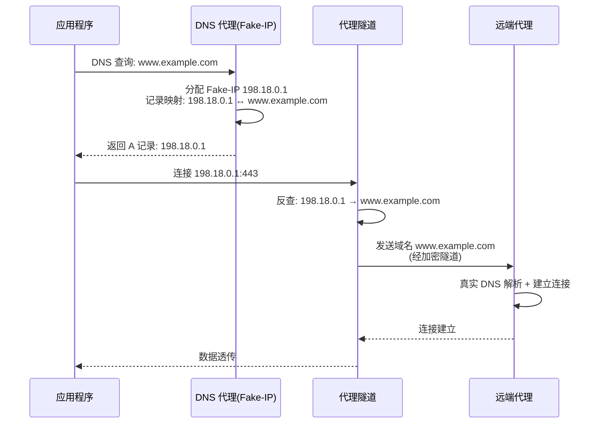
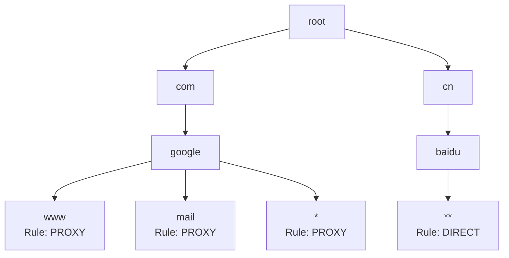
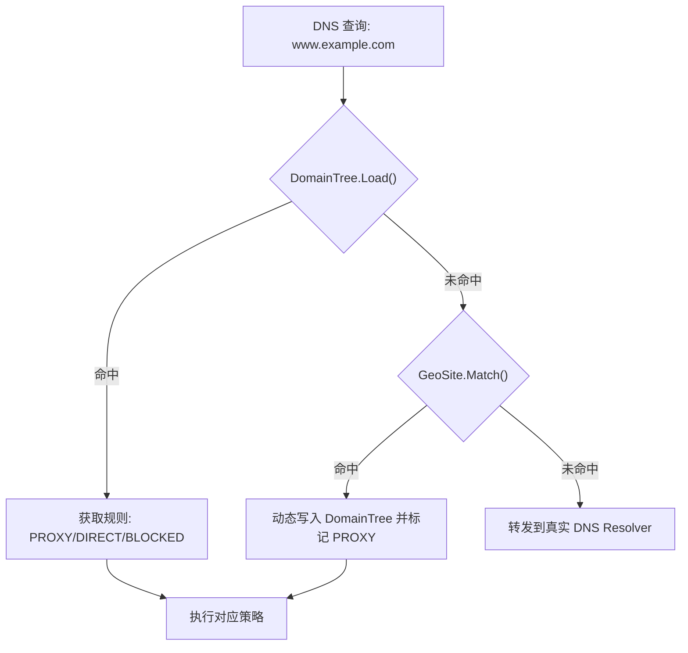
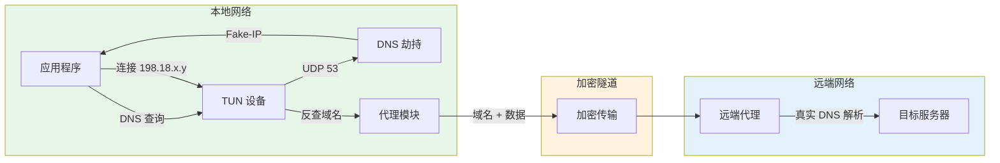
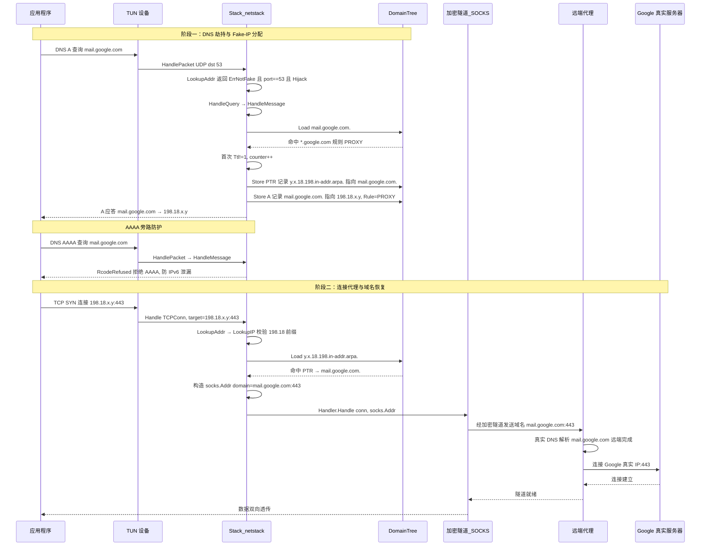

##  0x00    前言
本文是项目中的 DNS 相关开发工作记录，涵盖 DNS 基础知识、K8S 中的 DNS 配置、Go 语言 DNS 缓存实现、常用 DNS 库介绍、透明代理中的 DNS 机制，以及基于安全代理项目中的 DNS 防泄漏机制深度分析。主要内容包括：

1.  DNS 基础：解析流程、报文格式、加密 DNS 协议（DOH/DOT/DOQ）
2.  Kubernetes DNS：`ndots` 配置与 `search` 规则的行为分析
3.  Go DNS 缓存与常用 DNS 库（`miekg/dns`、CoreDNS）
4.  透明代理中的 DNS 机制：DNS 分流、Fake-IP 原理
5.  DNS Domain Tree 数据结构与防泄漏机制实现分析

##  0x01    基础
先回顾一下 DNS 解析的基础流程，如下图：


####    DNS 解析流程


####    常用的 public DNS（UDP）

-   `8.8.8.8` / `8.8.4.4`：Google Public DNS
-   `1.1.1.1` / `1.0.0.1`：Cloudflare DNS
-   `223.5.5.5` / `223.6.6.6`：阿里云（AliDNS）
-   `119.29.29.29`：DNSPod / 腾讯云
-   `114.114.114.114` / `114.114.115.115`：114 DNS
-   `183.60.83.19` / `183.60.82.98`：腾讯云（广东节点）
-   `9.9.9.9`：Quad9（注重安全与隐私）

####  DNS-over-HTTPS/TLS

传统 DNS 查询通过明文 UDP/TCP 传输，中间人可以轻松窃听和篡改。加密 DNS 协议应运而生：

- **DOH（DNS-over-HTTPS）**：将 DNS 查询封装在 HTTPS 请求中（端口 `443`），使用 HTTP GET（查询参数 `?dns=` + base64url 编码的 DNS 报文）或 HTTP POST（Content-Type 为 `application/dns-message`）传输。由于复用了 HTTPS 端口，防火墙难以区分 DOH 流量和普通 HTTPS 流量，抗审查能力强
- **DOT（DNS-over-TLS）**：在标准 TLS 连接上直接传输 DNS 报文（专用端口 `853`），TLS 握手完成后即可发送 DNS 查询。由于使用独立端口，防火墙可以通过端口识别并阻断 DOT 流量
- **DOQ（DNS-over-QUIC）**：基于 QUIC 协议（端口 `443`/`8853`），兼具 DOT 的安全性和 DOH 的抗审查能力，同时利用 QUIC 的 0-RTT 连接建立降低延迟

| 特性 | DOH | DOT | DOQ |
|------|-----|-----|-----|
| 传输层 | HTTPS (HTTP/2) | TLS 1.2/1.3 | QUIC |
| 默认端口 | 443 | 853 | 8853/443 |
| 防火墙可识别 | 难（与 HTTPS 流量混合） | 易（独立端口） | 中等 |
| 连接延迟 | 较高（TCP+TLS+HTTP） | 中等（TCP+TLS） | 低（0-RTT） |
| RFC | RFC 8484 | RFC 7858 | RFC 9250 |

参考：
- DOH：[DNS over HTTPS(DoH)](https://help.aliyun.com/document_detail/171664.html)
- DOT：[DNS over TLS(DoT)](https://help.aliyun.com/document_detail/171667.html)

####    DNS 报文格式


更多的细节，可参考[DNS报文格式](https://fasionchan.com/network/dns/packet-format/)

##  0x02    Kubernetes 的 DNS

了解了 DNS 的基础知识后，来看看 Kubernetes 集群中 DNS 的特殊行为。K8S 的 DNS 配置（特别是 `ndots` 和 `search` 规则）直接影响集群内服务间通信的效率

温馨提示：特别注意域名结尾是否有一个点号 `.`

1、当 `ndots` 小于 `options ndots` 时

`options ndots` 的值默认是 `1`，在 K8S 中为 `5`，参考下面的例子，在一个 namespace `demo-ns` 中有两个 `SVC`，分别为 `demo-svc1` 和 `demo-svc2`，其 `/etc/resolv.conf` 内容大致如下：

```bash
nameserver 10.32.0.10
search demo-ns.svc.cluster.local svc.cluster.local cluster.local
options ndots:5
```

当在 `demo-svc1` 中直接请求域名 `demo-svc2`，此时 `ndots` 为 `1`（小于配置中的 `5`），因此会触发配置中的 `search` 规则，即第一个解析的域名是 `demo-svc2.demo-ns.svc.cluster.local`，当解析不出来的时候继续下面的 `demo-svc2.svc.cluster.local`、`demo-svc2.cluster.local`，最后才是直接去解析 `demo-svc2.`；注意此规则适用于任何一个域名，如在 pod 中去访问一个外部域名如 `github.io` 时也会依次进行上述查询。

2、当 `ndots` 大于等于 `options ndots` 时

在 `demo-svc1` 中直接请求域名 `demo-svc2.demo-ns.svc.cluster.local`，此时的 `ndots` 为 `4`（小于 `5`），依然会触发上面的 `search` 规则。而请求域名 `demo-svc2.demo-ns.svc.cluster.local.`（末尾带 `.`）时，由于末尾的 `.` 标识这是一个 FQDN（Fully Qualified Domain Name），resolver 会**无条件**跳过 `search` 规则，直接解析该域名并返回结果。同理，`pod-1.demo-svc2.demo-ns.svc.cluster.local.` 也是 FQDN，直接查询并返回

需要注意的是，FQDN 跳过 `search` 规则的行为是由末尾的 `.` 决定的，**与 ndots 计数无关**。而对于不带末尾 `.` 的域名，resolver 的行为由 ndots 决定：当域名中的点数 `>=` `options ndots` 时，先尝试作为绝对域名查询，失败后再尝试 `search` 列表；当域名中的点数 `<` `options ndots` 时，先尝试 `search` 列表，全部失败后再尝试作为绝对域名查询

####    小结
-   同命名空间（namespace）内的服务直接通过 `service_name` 进行互相访问而不需要使用全域名（FQDN），此时 DNS 解析速度最快
-   跨命名空间（namespace）的服务，可以通过 `service_name.namespace_name` 进行互相访问，此时 DNS 解析第一次查询失败，第二次才会匹配到正确的域名
-   所有的服务之间通过全域名（FQDN）`service_name.namespace_name.svc.cluster_name.` 访问的时候 DNS 解析的速度最快
-   在 K8S 集群内访问大部分的常见外网域名（ndots 小于 `5`）都会触发 `search` 规则，因此在访问外部域名的时候可以使用 FQDN，即在域名的结尾配置一个点号 `.`

##  0x03    Golang 的 DNS Cache

在实际项目开发中，DNS 解析的性能至关重要。Go 标准库默认不提供 DNS 缓存，这在高并发场景下可能成为瓶颈。

通过 `net.Dial`/`net.DialContext` 创建连接时，或者使用 `Resolver` 解析 DNS 时，都是无缓存的；所以客户端并发场景下每创建一个连接，`Resolver` 都会去解析一次 DNS，如果遇到网络不好或 DNS 服务器问题，大概率会遇到类似错误 `dial tcp: lookup xxxx.com`，已有多个不错的 DNScache 库实现：

-   [A DNS Cache for Go](https://github.com/viki-org/dnscache/)
-   [Go package for caching DNS lookup results in memory.](https://github.com/mercari/go-dnscache)

这里分析下 dnscache 的实现，核心是建立了一个本地 map，缓存 dns 查询结果，同时异步开启逻辑轮询查询缓存域名的 DNS 解析结果；缺点是没有过期机制，导致内存会被放大：

```go
type Resolver struct {
  lock sync.RWMutex
  cache map[string][]net.IP // 域名对应多个地址
}

// 调用 net.LookupIP 查询，成功情况下缓存结果
func (r *Resolver) Lookup(address string) ([]net.IP, error) {
  ips, err := net.LookupIP(address)     //CALL net.LookupIP
  if err != nil {return nil, err}

  r.lock.Lock()
  r.cache[address] = ips
  r.lock.Unlock()
  return ips, nil
}


func New(refreshRate time.Duration) *Resolver {
  resolver := &Resolver {
    cache: make(map[string][]net.IP, 64),
  }
  if refreshRate > 0 {
    go resolver.autoRefresh(refreshRate)
  }
  return resolver
}

// 异步查询域名，并将正确的结果缓存
func (r *Resolver) Refresh() {
  i := 0
  r.lock.RLock()
  addresses := make([]string, len(r.cache))
  for key, _ := range r.cache {
    addresses[i] = key
    i++
  }
  r.lock.RUnlock()

  for _, address := range addresses {
    r.Lookup(address)
    time.Sleep(time.Second * 2)
  }
}
```

如果使用 `http.Transport`，可以在 `Dial` 中调用此包：

```go
transport := &http.Transport {
  MaxIdleConnsPerHost: 64,
  Dial: func(network string, address string) (net.Conn, error) {
    separator := strings.LastIndex(address, ":")
    ip, _ := dnscache.FetchString(address[:separator])
    return net.Dial("tcp", ip + address[separator:])
  },
}
```


##  0x04 常用的 DNS 库

Go 生态中有丰富的 DNS 相关库，下面介绍两个最常用的：

####  DNS 常用库 1：miekg/dns
用例可以参考：[Go DNS example programs](https://github.com/miekg/exdns)

####  DNS 常用库 2：CoreDNS

[CoreDNS](https://coredns.io/) 是一个用 Go 编写的灵活、可扩展的 DNS 服务器，也是 CNCF 毕业项目和 Kubernetes 的默认集群 DNS 服务。CoreDNS 底层基于 `miekg/dns` 库构建，但在此基础上引入了强大的**插件化架构**：

- **插件链（Plugin Chain）**：CoreDNS 的核心设计理念是将 DNS 处理逻辑拆分为多个独立插件，每个插件负责一个功能（如缓存、转发、日志、重写等），请求按配置顺序依次经过插件链处理
- **Corefile 配置**：通过 `Corefile` 配置文件定义 DNS 区域和对应的插件链，语法简洁直观

```text
.:53 {
    forward . 8.8.8.8 8.8.4.4        # 转发到上游 DNS
    cache 30                           # 缓存 30 秒
    log                                # 记录查询日志
    errors                             # 记录错误
}

cluster.local:53 {
    kubernetes cluster.local           # K8S 集群内部 DNS
    cache 30
}
```

- **常用插件**：`forward`（转发）、`cache`（缓存）、`kubernetes`（K8S 服务发现）、`hosts`（本地解析）、`rewrite`（查询重写）、`alternate`（备用上游）、`dnssec`（DNSSEC 签名验证）
- CoreDNS 相比传统的 kube-dns 架构更简洁（单进程 vs dnsmasq+kube-dns+sidecar 三进程），且插件机制使得定制 DNS 策略（分流、重定向等）更加灵活

##  0x05 DNS 代理实现：smartDNS
[smartDNS](https://github.com/pymumu/smartdns) 是本地的 DNS 代理服务器，接受本地客户端的 DNS 查询请求，然后从多个上游 DNS 服务器获取 DNS 查询结果，并将访问速度最快的结果返回给客户端，以此提高网络访问速度。与 DNSmasq 的 all-servers 机制不同，SmartDNS 返回的是访问速度最快的解析结果


主要工作流程如下：
1.  SmartDNS 接收本地网络设备的 DNS 查询请求
2.  然后将查询请求发送到多个上游 DNS 服务器，可支持 UDP 标准端口或非标准端口查询，以及 TCP 查询
3.  上游 DNS 服务器返回域名对应的服务器 IP 地址列表，SmartDNS 则会检测从本地网络访问速度最快的服务器 IP
4.  最后将访问速度最快的服务器 IP 返回给本地客户端

##  0x06 透明代理中的 DNS

前面介绍了独立的 DNS 代理工具，接下来进入本文的重点透明代理场景下的 DNS 处理。在透明代理中，DNS 不仅是域名解析工具，更是流量分类和隐私保护的关键环节

笔者在网关项目中也实现了类似的 DNSproxy，大致功能如下：

-   拦截所有经由网关的 DNS 请求（查询），由网关进行代理查询（或者丢弃）
-   支持 TUN-fake-DNS 查询及伪造 A 记录返回；不开启 fake 模式，则作为 DNS 透明代理，直接转发 DNS 请求到上游查询
-   支持 DNS 分流，指定 DNS 选用指定的 `nameserver`
-   支持 DNS 报文经过 `socks5` 代理服务端进行域名查询及返回
-   支持 `/etc/hosts` 本地解析（或是自定义 domain=>ip 的解析）

在实现中，DNSProxy 转发解析请求的时候会优化为并发查询：即会同时向所有配置的 DNS 上游服务器进行 DNS 查询，并选取最快的返回结果，以提高性能（参考 `dnsmasq` 实现）

通过在物理网卡上启动混杂模式，同时设置 `iptables -t nat -A PREROUTING -p udp --dport 53 -j REDIRECT --to-ports 53`，将所有 UDP 目的端口为 `53` 的流量重定向到本地端口 `53`（本地 `53` 启动的正式 DNSproxy）实现了 DNS 透明代理功能

####    DNS-FAKE-IP 的实现思路

Fake-IP 是透明代理（网关）中常用的 DNS 防泄漏技术。其核心思想是：**DNS 代理拦截本地的 DNS 查询请求后，不进行真实的 DNS 解析，而是从一个预留的私有 IP 地址池中分配一个虚假 IP 返回给客户端**。当客户端使用该 Fake-IP 发起连接时，代理通过反向查询恢复原始域名，再将域名（而非 IP）经加密隧道发送给远端代理完成真正的 DNS 解析和连接

Fake-IP 方案的关键组成：

1. **IP 地址池**：通常使用一段不会与真实网络冲突的保留地址，如 `198.18.0.0/15`（RFC 2544 基准测试地址段）或 `240.0.0.0/4`（保留地址段），地址池足够大可容纳大量映射
2. **双向映射表**：维护 `域名 -> Fake-IP` 和 `Fake-IP -> 域名` 两张映射表。DNS 查询时通过域名分配 Fake-IP，连接时通过 Fake-IP 反查域名
3. **DNS 拦截层**：拦截所有经过的 DNS 请求（通常劫持 UDP 53 端口），根据规则决定是分配 Fake-IP（需代理的域名）、直连转发（直连域名）还是返回空地址（屏蔽的域名）
4. **连接拦截与域名恢复**：当客户端使用 Fake-IP 发起 TCP/UDP 连接时，代理拦截该连接，通过 Fake-IP 反查域名，将原始域名发送到远端代理进行解析和连接



Fake-IP 方案的优势：
- **零 DNS 泄漏**：真实 DNS 解析完全在远端进行，本地网络上不会泄漏任何域名信息
- **低延迟**：省去了一次真实的 DNS 查询往返，Fake-IP 的分配是纯本地操作
- **CDN 友好**：由远端代理在目标网络中进行 DNS 解析，可以获取到地理位置更优的 CDN 节点 IP

Fake-IP 的局限性：
- 应用获取到的 IP 是虚假的，某些依赖真实 IP 的场景（如 IP 地理定位、证书 pinning）可能受影响
- 需要仔细管理 Fake-IP 地址池的生命周期，避免映射表无限膨胀

##  0x07 关于 DNS 的一些细节

本节补充几个在 DNS 开发中容易忽略但很重要的技术细节：

1、Optimistic DNS（DNS 乐观解析）<br>

由于现代网络的复杂性，大多数网站会将 DNS 的记录有效期（TTL）配置为很短的时间，如 `30s`。这样可以使得网络管理员修改 DNS 记录后迅速生效，不必再等待所有节点 TTL 超时，利于故障排除和维护。但这带来了一个问题，客户端会严格按照 TTL 去进行查询，那么每隔很短的时间就会进行再次查询，一次 DNS 查询的时间开销短至几毫秒，然而最长可以要数秒。频繁重复查询会造成不必要的延迟。Optimistic DNS 的优化方案是在建立新连接时，如果本地 DNS 缓存已经过期，那么也先继续使用旧的结果，同时进行 DNS 查询，如果连接建立失败，则用新的结果重试。绝大多数情况下，DNS 记录是不变的，这样的方案根本不会影响正常使用，当极小概率遇到 DNS 记录切换时，也只会耽误一两个请求，可以极大的提升效率

2、DNS leaking<br>

DNS 泄漏（DNS leaking）是指使用 VPN 连接时，计算机设备仍然使用 ISP 提供的 DNS 服务器，而不是 VPN 提供的 DNS 服务器。这意味着此网络活动可能会暴露给 ISP 或其他第三方，因为他们可以访问 DNS 查询历史记录。这可能会导致隐私受到威胁

3、DNSSEC && TC<br>

由于 DNSSEC 会导致返回的数据包变大，一旦超出 UDP 所允许的大小，那么数据包会被截断，DNS 服务器返回一个 `TC=1` 的标志位，用户接到 `TC` 的标识后，会改为用 TCP 方式传输

##  0x08  DNSproxy 的实现思路

一个生产级的 DNS 代理需要完善的可观测性设计，以下是笔者在项目中使用的指标体系：

####  指标与监控设计

- DNS 请求积压指标（gauge）：`sum by (server,zone)(sum_over_time(bkmonitor:pushgateway_xxx_dnsproxy:dns_server_dns_inflight_gauge[1m]))`
- DNS 解析延迟（histogram）：`histogram_quantile(0.99, sum by (gateway, le) (increase(bkmonitor:pushgateway_xxx_dnsproxy:ServeDNS_duration_his_bucket[1m])))`
- DNS 解析缓存 miss 率：`sum by (gateway) (increase(bkmonitor:pushgateway_xxx_dnsproxy:dns_query_cache_miss_counter[1m]))`
- DNS 解析缓存命中率：`sum by (gateway) (rate(bkmonitor:pushgateway_dnsproxy:dns_query_cache_hit_counter[1m]))`
- DNS 客户端解析失败错误增量：`sum by (gateway, zone) (increase(bkmonitor:pushgateway_xxx_dnsproxy:dns_query_error_counter[1m]))`

其中，某个时间点，DNS解析延迟的视图如下所示：


##  0x09  DNS 性能压测
列举下笔者在开发 DNS 代理中使用到的 DNS 客户端性能压测库，推荐使用 dnstrace：

- [dnspyre](https://github.com/Tantalor93/dnspyre)：CLI tool for a high QPS DNS benchmark
- [dnstrace](https://github.com/redsift/dnstrace)：Command-line DNS benchmark

##  0x0A DNS Domain Tree 与防泄漏机制深度分析

前面介绍了 Fake-IP 的通用原理，本节以某开源项目为例，深入分析其 DNS 域名匹配数据结构和防泄漏机制的实现。该项目是一个基于规则的透明代理系统，支持 TUN（Linux/macOS）和 WinDivert（Windows）模式。其 DNS 防泄漏设计由三个核心模块协同完成：

| 模块 | 路径 | 职责 |
|------|------|------|
| `suffixtree` | `suffixtree.go` | 域名匹配（反向标签字典树） |
| `netstack` | `pkg/netstack/resolver.go` + `netstack.go` | DNS 劫持、Fake-IP 分配、域名恢复 |
| `resolver` | `pkg/resolver/` | 加密 DNS 传输（UDP/TCP/DoT/DoH） |

####    DomainTree：反向标签字典树

项目使用了一种**反向标签字典树（Reversed-Label Trie）** 来存储和匹配域名。与常规的前缀树不同，这里的"后缀"是指域名的 TLD（顶级域名）端在树的根部，子域名向叶子方向展开

核心数据结构如下：

```go
type DomainEntry struct {
    Rule string          // "PROXY"、"DIRECT"、"BLOCKED"
    A    dns.A           // A 记录（TypeA，IPv4）
    AAAA dns.AAAA        // AAAA 记录（TypeAAAA，IPv6）
    PTR  dns.PTR         // PTR 记录（反向解析，Fake-IP -> 域名）
}

type DomainTree struct {
    node
    sep string           // 分隔符，固定为 "."
    sync.RWMutex         // 读写锁保证并发安全
}

type node struct {
    value  interface{}   // 叶子节点存储 *DomainEntry
    branch map[string]*node  // 子节点映射
}
```

**Store 算法（域名存储）**：将域名按 `.` 分割后，从**最右侧标签**（TLD）开始逐级插入。例如 `www.google.com` 的插入路径为 `root -> com -> google -> www`：

```go
func (t *DomainTree) Store(k string, v interface{}) {
    t.Lock()
    // 按 "." 分割域名，去除末尾的 "."
    t.store(strings.Split(strings.TrimSuffix(k, t.sep), t.sep), v)
    t.Unlock()
}

func (n *node) store(ks []string, v interface{}) {
    l := len(ks)
    switch l {
    case 0:
        return
    case 1:
        // 最后一个标签（最左侧，即子域名部分）
        k := ks[l-1]
        if k == "*" || k == "**" {
            // 通配符直接设置在当前节点
            n.value = v
        }
        b, ok := n.branch[k]
        if ok {
            b.value = v
            return
        }
        n.branch[k] = &node{
            value:  v,
            branch: map[string]*node{},
        }
    default:
        // 取最右侧标签（TLD 方向），递归处理剩余部分
        k := ks[l-1]
        b, ok := n.branch[k]
        if !ok {
            b = &node{value: nil, branch: map[string]*node{}}
            n.branch[k] = b
        }
        b.store(ks[:l-1], v)
    }
}
```

**Load 算法（域名查找）**：同样从 TLD 端开始遍历，支持三级回退匹配：**精确匹配 -> `*` 单级通配 -> `**` 贪婪通配**：

```go
func (n *node) load(ks []string) interface{} {
    l := len(ks)
    switch l {
    case 0:
        return nil
    case 1:
        // 最后一个标签，尝试精确匹配
        b, ok := n.branch[ks[l-1]]
        if ok {
            return b.value
        }
        // 回退：尝试 * 单级通配
        b, ok = n.branch["*"]
        if ok {
            return b.value
        }
        // 回退：尝试 ** 贪婪通配
        b, ok = n.branch["**"]
        if ok {
            return b.value
        }
        return nil
    default:
        // 尝试精确匹配当前标签
        b, ok := n.branch[ks[l-1]]
        if ok {
            s := b.load(ks[:l-1])
            if s != nil {
                return s
            }
        }
        // 回退：尝试 * 单级通配（消耗一级后继续匹配）
        b, ok = n.branch["*"]
        if ok {
            s := b.load(ks[:l-1])
            if s != nil {
                return s
            }
        }
        // 回退：** 贪婪通配（匹配所有剩余级别）
        b, ok = n.branch["**"]
        if ok {
            return b.value
        }
        return nil
    }
}
```

以域名 `mail.google.com` 的 Store 和 Load 为例，树结构如下：



通配符匹配语义：
- `*.google.com` 配置 `PROXY`：精确匹配 `google.com` 下的**任意一级**子域名（如 `mail.google.com`、`www.google.com`），但不匹配 `a.b.google.com`
- `**.baidu.cn` 配置 `DIRECT`：贪婪匹配 `baidu.cn` 下的**所有层级**子域名（如 `www.baidu.cn`、`tieba.baidu.cn`、`a.b.baidu.cn`）

这种反向插入设计使得同一 TLD 或二级域名下的规则共享前缀路径，空间效率高，且查找时间复杂度为 `O(L)`（L 为域名的标签数，通常 `2~5`）

####    DNS 劫持与 Fake-IP 分配

项目通过 TUN/WinDivert 设备捕获所有网络流量，`Stack.HandlePacket` 是 UDP 流量的入口。当检测到目标端口为 `53` 且 `Hijack=true` 时，进入 DNS 劫持逻辑：

```go
func (s *Stack) HandlePacket(conn *core.UDPConn, target *net.UDPAddr) {
    addr, err := s.LookupAddr(target)
    if err == ErrNotFake {
        if target.Port == 53 && s.Hijack {
            // 劫持 DNS 查询
            s.HandleQuery(conn)
            return
        }
        // 非 DNS 流量，正常代理
        // ...
    }
    // Fake-IP 流量，通过反查域名后代理
    // ...
}
```

`HandleQuery` 从 UDP 连接中读取 DNS 报文，解析后交给 `HandleMessage` 处理。`HandleMessage` 是 Fake-IP 的核心分配逻辑：

特别注意，在`PROXY`的分支中，存储了两类DNS记录：
1.  反向 PTR 记录：`198.18.x.y` -> 原始域名（客户端原始请求）
2.  A 记录：域名 -> Fake-IP，`Rule`类型设置为`PROXY`

```go
func (s *Stack) HandleMessage(m *dns.Msg) {
    // 步骤 1：在 DomainTree 中查找域名规则
    de, ok := s.tree.Load(m.Question[0].Name).(*suffixtree.DomainEntry)
    if !ok {
        // DomainTree 未命中，尝试 GeoSite 匹配
        if s.matcher.Match(m.Question[0].Name) {
            s.tree.Store(m.Question[0].Name, &suffixtree.DomainEntry{Rule: "PROXY"})
        } else {
            return  // 不匹配任何规则，交给真实 DNS resolver 处理（未命中域名规则，走默认DNS解析）
        }
    }

    switch m.Question[0].Qtype {
    case dns.TypeA:
        if de.A.Hdr.Ttl == 1 {
            // 已有缓存的 Fake-IP，直接返回
            m.Answer = append(m.Answer[:0], &de.A)
        } else {
            switch de.Rule {
            case "PROXY":
                s.counter++
                // 1. 创建反向 PTR 记录：198.18.x.y -> 原始域名
                entry := &suffixtree.DomainEntry{
                    PTR: dns.PTR{
                        Hdr: dns.RR_Header{
                            Name:   fmt.Sprintf("%d.%d.18.198.in-addr.arpa.",
                                uint8(s.counter), uint8(s.counter>>8)),
                            Rrtype: dns.TypePTR, Class: dns.ClassINET, Ttl: 1,
                        },
                        Ptr: m.Question[0].Name,    //客户端请求解析的原始域名，如mail.google.com
                    },
                }
                s.tree.Store(entry.PTR.Hdr.Name, entry)

                // 2. 创建 A 记录：域名 -> Fake-IP
                entry = &suffixtree.DomainEntry{
                    Rule: "PROXY",
                    A: dns.A{
                        Hdr: dns.RR_Header{
                            Name: m.Question[0].Name,   //客户端请求解析的原始域名，如mail.google.com
                            Rrtype: dns.TypeA, Class: dns.ClassINET, Ttl: 1,
                        },
                        A: net.IP([]byte{198, 18,
                            byte(s.counter >> 8), byte(s.counter)}),
                    },
                }
                s.tree.Store(entry.A.Hdr.Name, entry)

                // 3. 返回 Fake-IP 给客户端（注意返回的是A记录）
                m.Answer = append(m.Answer[:0], &entry.A)
            case "BLOCKED":
                // 返回 0.0.0.0，阻断域名解析
                entry := &suffixtree.DomainEntry{
					Rule: "BLOCKED",
					A: dns.A{
						Hdr: dns.RR_Header{
							Name:   m.Question[0].Name,
							Rrtype: dns.TypeA,
							Class:  dns.ClassINET,
							Ttl:    1,
						},
						A: net.IPv4zero,
					},
					AAAA: dns.AAAA{
						Hdr: dns.RR_Header{
							Name:   m.Question[0].Name,
							Rrtype: dns.TypeAAAA,
							Class:  dns.ClassINET,
							Ttl:    1,
						},
						AAAA: net.IPv6zero,
					},
				}
				s.tree.Store(entry.A.Hdr.Name, entry)

				m.MsgHdr.Rcode = dns.RcodeSuccess
				m.Answer = append(m.Answer[:0], &entry.A)
            }
        }
    case dns.TypeAAAA:
        if de.Rule == "PROXY" {
            // 对需要代理的域名，拒绝 AAAA 查询，防止 IPv6 泄漏
            m.MsgHdr.Rcode = dns.RcodeRefused
        }
    case dns.TypePTR:
        // 反向查询，返回缓存的 PTR 记录
        if de.PTR.Hdr.Ttl == 1 {
			m.MsgHdr.Rcode = dns.RcodeSuccess
			m.Answer = append(m.Answer[:0], &de.PTR)
		} else {
			m.MsgHdr.Rcode = dns.RcodeRefused
		}
    }
}
```

Fake-IP 地址使用 `198.18.0.0/15` 地址段（RFC 2544 基准测试保留地址），通过一个 `uint16` 计数器递增分配：`198.18.{counter>>8}.{counter&0xff}`，最多可映射 `65536` 个域名

####    连接阶段的域名恢复

当应用程序使用 Fake-IP（如 `198.18.0.1`）发起 TCP 连接时，`Stack.Handle` 会调用 `LookupAddr` -> `LookupIP` 进行反向查询：

```go
func (s *Stack) LookupIP(addr net.IP) (*socks.Addr, error) {
    if ipv4 := addr.To4(); ipv4 != nil {
        // 验证是否为 Fake-IP 段（198.18.x.x）
        if ipv4[0] != 198 || ipv4[1] != 18 {
            return nil, ErrNotFake
        }
        // 构造 in-addr.arpa 反向域名
        ss := fmt.Sprintf("%d.%d.18.198.in-addr.arpa.", ipv4[3], ipv4[2])
        // 从 DomainTree 中查找 PTR 记录
        if de, ok := s.tree.Load(ss).(*suffixtree.DomainEntry); ok {
            if de.PTR.Hdr.Ttl != 1 {
                return nil, ErrNotFound
            }
            // 恢复原始域名，构造 SOCKS 地址
            b := append(make([]byte, 0, socks.MaxAddrLen),
                socks.AddrTypeDomain, byte(len(de.PTR.Ptr)))
            return &socks.Addr{Addr: append(b, de.PTR.Ptr[:]...)}, nil
        }
        return nil, ErrNotFound
    }
    return nil, ErrNotFake
}
```

域名恢复后，代理将**原始域名**（而非 IP 地址）通过加密隧道发送给远端代理服务器，由远端在目标网络中进行真实的 DNS 解析

####    多层域名匹配策略

项目还采用了多层匹配策略，确保域名分类的全面覆盖：



| 层级 | 数据来源 | 匹配方式 | 用途 |
|------|----------|----------|------|
| DomainTree | 配置文件 `domain_rules.proxy/direct/blocked` | 反向标签字典树 + 通配符 | 静态域名规则 |
| GeoSite | `geosite.dat`（V2Ray 社区维护） | 域名分类匹配（如 `CN`、`GOOGLE`） | 地理/服务分类匹配 |
| IP CIDR Tree | 配置文件 `ip_cidr_rules` | 基数树（Radix Tree）IP 匹配 | IP 段级别路由 |

GeoSite 命中后会动态写入 DomainTree，后续相同域名查询直接在 DomainTree 中命中，避免重复匹配，这是一种**缓存友好**的设计

####    加密 DNS 传输

`pkg/resolver` 模块支持四种 DNS 传输协议，确保上游 DNS 查询本身不被监听或篡改：

```go
func NewResolver(s string) (Resolver, error) {
    u, _ := url.Parse(s)
    switch u.Scheme {
    case "udp":    // 标准 UDP DNS
        return &udp.Resolver{Addr: addr, Timeout: 3*time.Second}, nil
    case "tcp":    // TCP DNS
        return &tcp.Resolver{Addr: addr, Timeout: 3*time.Second}, nil
    case "tls":    // DNS-over-TLS (DoT)，端口 853
        return tls.NewResolver(addr, domain), nil
    case "https":  // DNS-over-HTTPS (DoH)，端口 443
        return http.NewResolver(s, addr, domain, "POST"), nil
    }
}
```

配置示例：

```text
# 使用 DoT
nameserver=tls://1.1.1.1:853

# 使用 DoH
nameserver=https://1.1.1.1:443/dns-query

# 多服务器容错
nameserver=tls://8.8.8.8:853
nameserver=https://1.0.0.1:443/dns-query
```

当 `HandleMessage` 无法在本地处理查询（即域名规则为 `DIRECT` 或未命中任何规则）时，`HandleQuery` 将 DNS 报文原样转发到配置的加密上游 Resolver 进行解析。

####    防泄漏机制总结

本项目通过以下七层防护实现了全面的 DNS 防泄漏设计：

1. **DNS 劫持**：通过 TUN 设备捕获所有 UDP 53 流量，任何应用的 DNS 查询都无法绕过代理
2. **Fake-IP 替代**：对需要代理的域名返回虚假 IP，本地网络上不出现真实的 DNS 解析请求
3. **反向域名恢复**：通过 PTR 记录从 Fake-IP 恢复原始域名，代理隧道传输的是域名而非 IP
4. **加密 DNS 传输**：对直连域名的 DNS 查询支持 DoT/DoH 加密传输，防止明文 DNS 被窃听
5. **域名屏蔽**：对标记为 `BLOCKED` 的域名返回 `0.0.0.0`/`::0`，彻底阻断访问
6. **IPv6 AAAA 拒绝**：对需要代理的域名拒绝 AAAA 查询（`RcodeRefused`），防止 IPv6 旁路泄漏
7. **多层规则匹配**：DomainTree 静态规则 + GeoSite 动态分类 + IP CIDR 路由，确保域名分类覆盖率



整个流程中，本地网络上**只有 Fake-IP 地址和加密隧道流量**，没有任何明文域名信息泄漏，ISP 或中间人无法获知用户的 DNS 查询内容

##  0x0B 扩展实例：mail.google.com 代理全链路实战

上一章节分析了 DomainTree 与 Fake-IP 分配逻辑，但对其中一个关键细节一笔带过：劫持 `PROXY` 域名时为什么要同时写入 **PTR + A 两条记录**？本章节就来回答这个问题，并且以 `mail.google.com` 为例给出一条完整的全链路数据流

####    DNS PTR 记录与反向解析基础

常见的 DNS 记录（`A`/`AAAA`/`CNAME`）都是**正向解析**：由域名查 IP。而 PTR（Pointer Record）记录提供的是**反向解析（rDNS）**：由 IP 反查域名，方向与 `A`/`AAAA` 恰好相反

PTR 记录并不是直接以 IP 为 key 存储，而是把 IP 改写为一个特殊的伪域名后，再按普通域名的方式查询：

- **IPv4**：使用 `in-addr.arpa` 域，将四段 IP **逆序**拼接。例如 `1.2.3.4` 的反查域名为 `4.3.2.1.in-addr.arpa.`
- **IPv6**：使用 `ip6.arpa` 域，将 `32` 个 nibble（半字节）逐个**逆序**展开。例如 `2001:db8::1` 展开为 `1.0.0.0.....8.b.d.0.1.0.0.2.ip6.arpa.`

逆序的原因：DNS 域名的层级是**从右向左**收敛（右侧是 TLD/根），而 IP 地址是**从左向右**收敛（左侧是网络号）。把 IP 逆序后，其网络号就落到了 `in-addr.arpa` 域名的右侧（靠近根），从而复用 DNS 既有的树状委派与查找体系

PTR 的常规用途包括：反向 DNS 查询（如`dig -x 1.2.3.4`）、邮件服务器的 PTR 校验（反垃圾邮件，校验发信 IP 是否有匹配的 PTR 记录）、服务器日志中把访问 IP 还原为主机名等

**PTR 在上网代理（Fake-IP）中的作用**：这是本文关注的重点。在 Fake-IP 透明代理方案中，客户端拿到的是一个虚假 IP（如 `198.18.x.y`），当它用这个 Fake-IP 发起连接时，代理必须能够**从 Fake-IP 反查回原始域名**，才能把域名（而非 IP）送入加密隧道完成真正的解析与连接。代理实现中没有另造一张反查表，而是**复用 DNS 的 PTR 语义**：把 `Fake-IP -> 原始域名` 这条映射编码成一条标准 PTR 记录，存进同一棵 DomainTree。因此 PTR 记录在这里扮演的角色是 **「Fake-IP 到域名」反查映射的天然载体**，是 Fake-IP 防泄漏闭环中不可或缺的一环

####    为什么劫持时要同时存储 PTR + A 两条记录？

回到上一节 `HandleMessage` 的 `PROXY` 分支的实现，在一次 DNS 劫持中连续向 DomainTree 写入了两条记录（`in-addr.arpa` 反向 PTR 记录与域名正向 A 记录）：

```go
case "PROXY":
    s.counter++

    // 记录 1：反向 PTR 记录，key = Fake-IP 对应的 in-addr.arpa 反查域名
    //         Ptr   = 客户端原始请求的域名（如 mail.google.com.）
    entry := &suffixtree.DomainEntry{
        PTR: dns.PTR{
            Hdr: dns.RR_Header{
                Name:   fmt.Sprintf("%d.%d.18.198.in-addr.arpa.", uint8(s.counter), uint8(s.counter>>8)),
                Rrtype: dns.TypePTR, Class: dns.ClassINET, Ttl: 1,
            },
            Ptr: m.Question[0].Name, // 原始域名
        },
    }
    s.tree.Store(entry.PTR.Hdr.Name, entry) // key 为反查域名

    // 记录 2：正向 A 记录，key = 原始域名，A = Fake-IP（198.18.x.y），Rule 标记为 PROXY
    entry = &suffixtree.DomainEntry{
        Rule: "PROXY",
        A: dns.A{
            Hdr: dns.RR_Header{
                Name:   m.Question[0].Name, // 原始域名
                Rrtype: dns.TypeA, Class: dns.ClassINET, Ttl: 1,
            },
            A: net.IP([]byte{198, 18, byte(s.counter >> 8), byte(s.counter)}),
        },
    }
    s.tree.Store(entry.A.Hdr.Name, entry) // key 为原始域名

    m.MsgHdr.Rcode = dns.RcodeSuccess
    m.Answer = append(m.Answer[:0], &entry.A) // 返回给客户端的是 A 记录（Fake-IP）
```

关键在于：**一次完整的代理访问被拆成了两个在时间与上下文上都相互独立的事件，两条记录分别服务于其中一个方向的查找**：

- **A 记录（域名 -> Fake-IP）：服务于 DNS 查询应答阶段。** `HandleMessage` 需要给客户端回一个可路由、可被 TUN 继续捕获的地址。这里不做真实解析，而是分配一个 Fake-IP（`198.18.x.y`）作为 A 记录应答。客户端拿到后，后续所有对该域名的连接都会打到这个 Fake-IP 上
- **PTR 记录（Fake-IP -> 域名）：服务于后续的 TCP/UDP 连接阶段。** 当客户端用 `198.18.x.y` 发起连接时，流量再次被 TUN 捕获，`Stack.Handle` -> `LookupIP` 必须把这个 Fake-IP 还原成 `mail.google.com`。此时手里只有 IP，没有域名，必须靠反向映射来恢复

**为什么不能只存一条？** 因为两个阶段需要的是**方向相反**的映射：DNS 应答阶段需要「域名 -> IP」正向映射，连接阶段需要「IP -> 域名」反向映射。而且这两件事发生在不同的时间点、不同的调用栈（`HandleMessage` vs `LookupIP`），彼此之间只能通过持久化在 DomainTree 中的记录传递信息。单独一条记录无法同时支撑两个方向的 `O(L)` 查找，因此必须正向、反向各存一条

**两条记录的 key 设计（互不冲突地共用一棵树）**：原项目巧妙地让这两条记录共用同一棵 DomainTree，但使用了不同命名空间的 key：

- A 记录以原始域名为 key，如 `mail.google.com.`，落在 `com -> google -> mail` 这条路径上
- PTR 记录以反查域名为 key，如 `y.x.18.198.in-addr.arpa.`，落在 `arpa -> in-addr -> 198 -> 18 -> x -> y` 这条路径上

两者前缀完全不同（天然隔离），查找时各走各的路径，复杂度均为 `O(L)`

**counter 与 Fake-IP / PTR 域名的编码一致性**：Fake-IP 的后两段与 PTR 反查域名的前两段由同一个 `uint16` 计数器 `s.counter` 派生，二者必须严格对应，否则连接阶段会反查失败：

- Fake-IP = `198.18.(counter>>8).(counter&0xff)`，即第三段取高字节、第四段取低字节
- PTR name = `(counter&0xff).(counter>>8).18.198.in-addr.arpa.`，即 `in-addr.arpa` 要求 IP 四段逆序，于是低字节在前、高字节在后、再接 `18.198`
- 二者是严格的逆序映射：对任一 Fake-IP `198.18.A.B`，其反查域名必为 `B.A.18.198.in-addr.arpa.`，这正是 `LookupIP` 中 `fmt.Sprintf("%d.%d.18.198.in-addr.arpa.", ipv4[3], ipv4[2])` 的由来（`ipv4[3]` 是 B、`ipv4[2]` 是 A）

此外，`PROXY` 域名的 `AAAA` 查询被直接返回 `RcodeRefused`：因为 Fake-IP 池只分配 IPv4（`198.18.0.0/15`），若放行 AAAA 让客户端拿到真实 IPv6 并直连，就会绕过代理造成 IPv6 旁路泄漏

####    mail.google.com 代理全链路数据流

下面以客户端访问 `mail.google.com`（且该域名命中 `*.google.com` 的 `PROXY` 规则）为例，串联 DNS 劫持与连接代理两个阶段的完整数据流。整个过程本地网络上只出现 Fake-IP 与加密隧道流量，真实 DNS 解析发生在远端



数据流中的几个要点回顾：

1. 两次经过 TUN：第一次是 DNS 查询（UDP 53，被劫持），第二次是业务连接（TCP 443，被 Fake-IP 触发反查）
2. 真实 DNS 解析只发生在 `Remote` 远端，本地从未对 `mail.google.com` 做过真实解析，`A`/`AAAA` 应答都不包含真实 IP
3. 隧道里传输的是**域名** `mail.google.com`，而非 Fake-IP。Fake-IP 仅是本地「DNS 应答」与「连接触发」之间的一次性桥梁，远端并不认识它
4. 若 `DIRECT` 或未命中规则，则 `HandleMessage` 不置 `Response`，`HandleQuery` 会把原始报文转发给上游加密 Resolver（DoT/DoH）走真实解析，不分配 Fake-IP

##  0x0C 参考
-   [Examples made with Go DNS](https://github.com/miekg/exdns)
-   [CoreDNS 篇 10 - 分流与重定向](https://tinychen.com/20221120-dns-13-coredns-10-dnsredir-and-alternate/)
-   [CoreDNS 篇 9-kubernetes 插件](https://tinychen.com/20221107-dns-12-coredns-09-kubernetes/)
-   [adguard-dns：概览](https://adguard-dns.io/kb/zh-CN/private-dns/overview/)
-   [抓包就明白 CoreDNS 域名解析](https://juejin.cn/post/7053824699268071432)
-   [Public DNS resolver that protects you from ad trackers](https://github.com/AdguardTeam/AdGuardDNS)
-   [回顾与展望 AdGuard DNS](https://adguard-dns.io/zh_cn/blog/reimagining-adguard-dns.html)
-   [DNS-over-QUIC](https://adguard-dns.io/zh_cn/blog/dns-over-quic-official-standard.html)
-   [盘点国内外优秀公共 DNS](https://zhuanlan.zhihu.com/p/53958870)
-   [Golang DNS 解析](https://zhuanlan.zhihu.com/p/54989059)
-   [kubernetes 集群中夺命的 5 秒 DNS 延迟](https://typonotes.com/posts/2023/08/05/k8s-dns-5s-resolv/)
-   [漫谈各种黑科技式 DNS 技术在代理环境中的应用](https://tachyondevel.medium.com/%E6%BC%AB%E8%B0%88%E5%90%84%E7%A7%8D%E9%BB%91%E7%A7%91%E6%8A%80%E5%BC%8F-dns-%E6%8A%80%E6%9C%AF%E5%9C%A8%E4%BB%A3%E7%90%86%E7%8E%AF%E5%A2%83%E4%B8%AD%E7%9A%84%E5%BA%94%E7%94%A8-62c50e58cbd0)