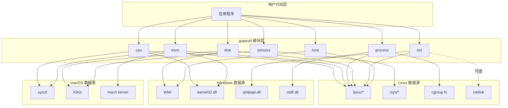
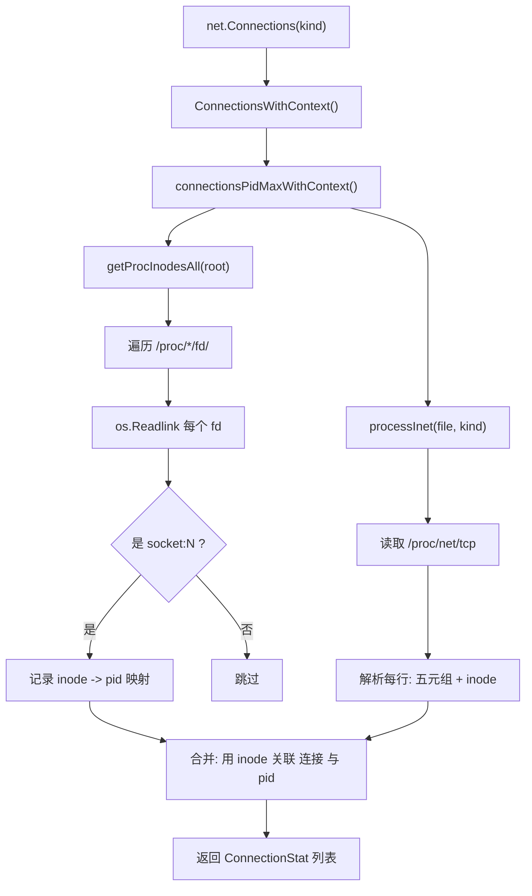
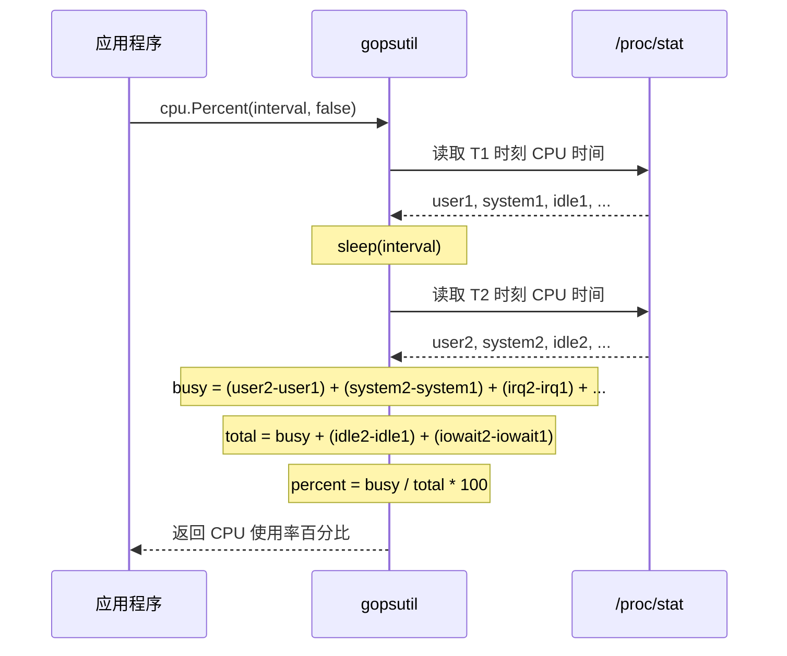
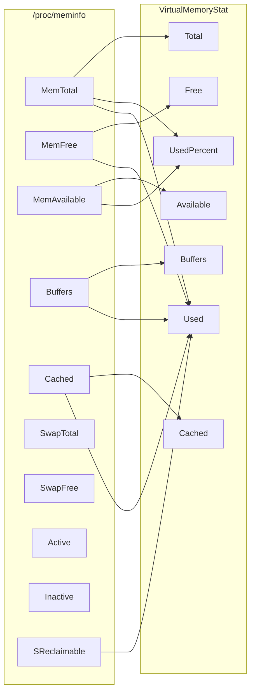
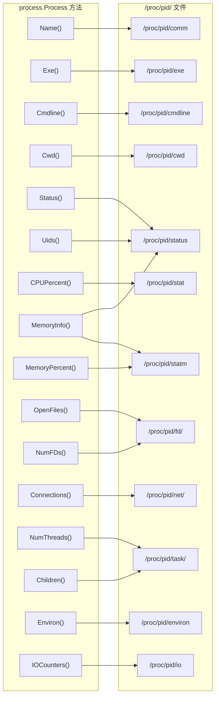
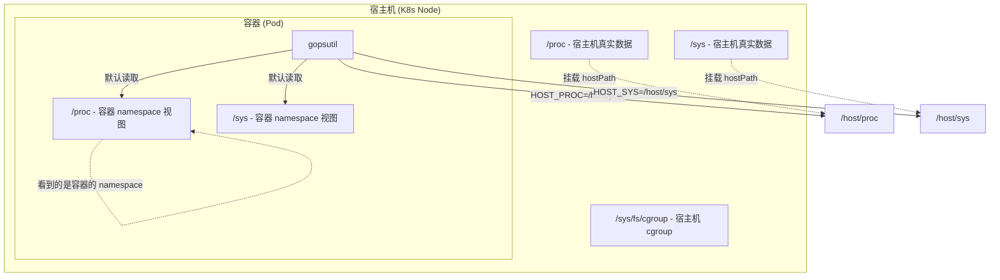
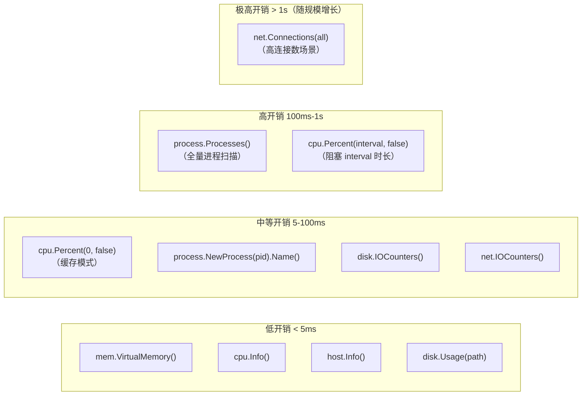
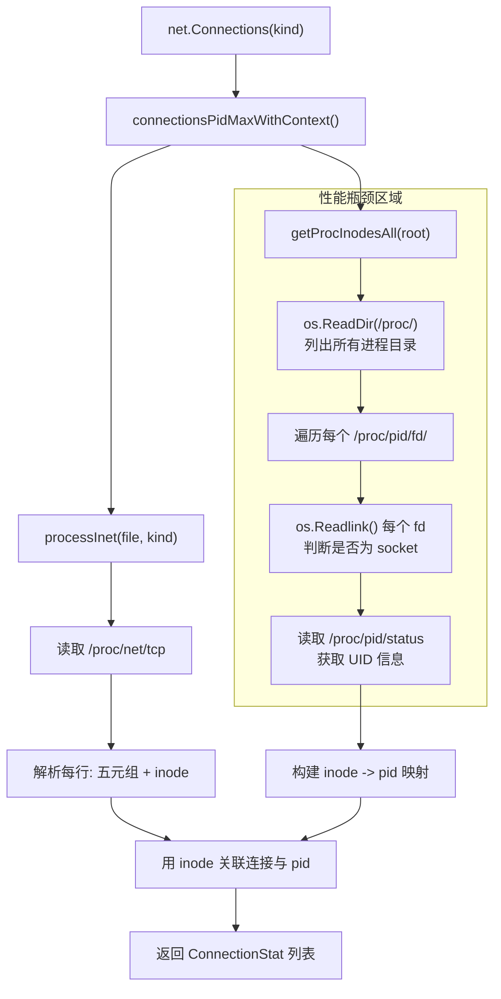
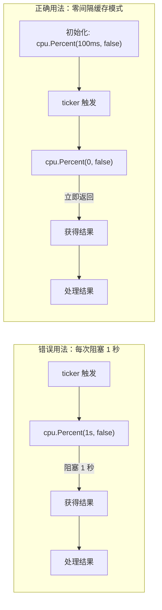
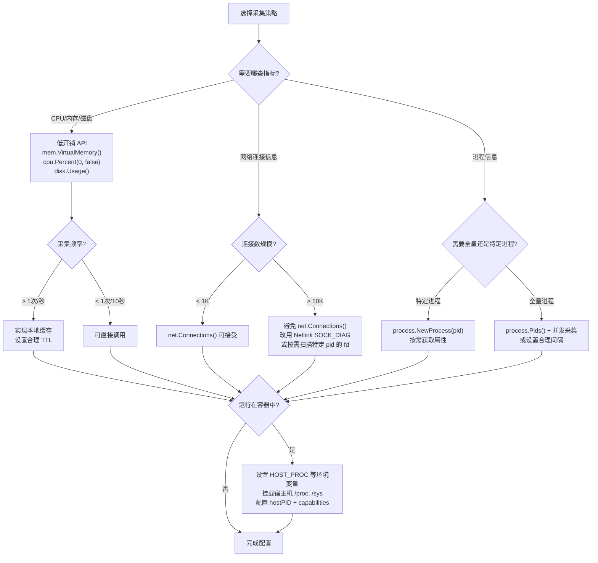

##	0x00	前言
[gopsutil](https://github.com/shirou/gopsutil) 是 psutil 的 Go 语言移植版本，屏蔽了各个系统之间的差异，具有非常好的可移植性。其所有功能均通过纯 Go 实现（无 cgo 依赖），通过将 C 结构体移植为 Go 结构体来完成跨平台支持

本文基于 [v4.24.7](https://github.com/shirou/gopsutil/releases/tag/v4.24.7) 分析。gopsutil v4 采用日历版本号（CalVer），格式为 `vMAJOR.YY.MM`

##  0x01    gopsutil 模块概览

gopsutil v4 提供了 `7` 个核心子包，覆盖了系统监控的主要维度：

| 模块 | 功能 | Linux 数据源 | Windows 数据源 | macOS 数据源 |
|---|---|---|---|---|
| `cpu` | CPU 信息与使用率 | `/proc/stat`, `/proc/cpuinfo` | WMI, `kernel32.dll` | sysctl |
| `mem` | 内存/Swap 信息 | `/proc/meminfo`, `/proc/vmstat` | `kernel32.dll` (GlobalMemoryStatusEx) | sysctl, mach kernel |
| `disk` | 磁盘分区与 I/O | `/proc/diskstats`, `/proc/self/mountinfo` | WMI, `kernel32.dll` | IOKit |
| `net` | 网络连接与流量 | `/proc/net/tcp`, `/proc/net/udp`, `/proc/net/dev` | `iphlpapi.dll` | sysctl |
| `process` | 进程信息管理 | `/proc/[pid]/*` | `kernel32.dll`, `ntdll.dll` | sysctl, libproc |
| `host` | 主机信息 | `/proc/uptime`, `/etc/os-release` | Registry, WMI | sysctl |
| `sensors` | 温度传感器 | `/sys/class/thermal/`, `/sys/class/hwmon/` | WMI | IOKit |

gopsutil 在不同操作系统上使用各自原生数据源，对上层用户暴露统一的 API 接口：



##  0x02    基础使用示例

安装方式：

```bash
go get github.com/shirou/gopsutil/v4
```

####    CPU 信息

```go
package main

import (
    "context"
    "fmt"
    "time"
    "github.com/shirou/gopsutil/v4/cpu"
)

func main() {
    // 获取 CPU 逻辑核心数
    counts, _ := cpu.Counts(true)
    fmt.Printf("Logical CPUs: %d\n", counts)

    // 获取 CPU 使用率（阻塞 1 秒采样）
    percent, _ := cpu.Percent(1*time.Second, false)
    fmt.Printf("CPU Usage: %.2f%%\n", percent[0])

    // 获取每个核心的详细时间统计
    times, _ := cpu.TimesWithContext(context.Background(), true)
    for _, t := range times {
        fmt.Printf("CPU %s: user=%.1f system=%.1f idle=%.1f\n",
            t.CPU, t.User, t.System, t.Idle)
    }
}
```

####    内存信息

```go
import "github.com/shirou/gopsutil/v4/mem"

func main() {
    v, _ := mem.VirtualMemory()
    fmt.Printf("Total: %v GB\n", v.Total/1024/1024/1024)
    fmt.Printf("Available: %v GB\n", v.Available/1024/1024/1024)
    fmt.Printf("UsedPercent: %.2f%%\n", v.UsedPercent)

    // Swap 信息
    s, _ := mem.SwapMemory()
    fmt.Printf("Swap Total: %v MB, Used: %.2f%%\n", s.Total/1024/1024, s.UsedPercent)
}
```

####    磁盘信息

```go
import "github.com/shirou/gopsutil/v4/disk"

func main() {
    // 分区列表
    partitions, _ := disk.Partitions(false)
    for _, p := range partitions {
        usage, _ := disk.Usage(p.Mountpoint)
        fmt.Printf("%s: Total=%vGB Used=%.2f%%\n",
            p.Mountpoint, usage.Total/1024/1024/1024, usage.UsedPercent)
    }

    // 磁盘 I/O 计数器
    ioCounters, _ := disk.IOCounters()
    for name, io := range ioCounters {
        fmt.Printf("%s: ReadBytes=%v WriteBytes=%v\n", name, io.ReadBytes, io.WriteBytes)
    }
}
```

####    网络信息

```go
import "github.com/shirou/gopsutil/v4/net"

func main() {
    // 网络接口 I/O 统计
    ioCounters, _ := net.IOCounters(true)
    for _, io := range ioCounters {
        fmt.Printf("%s: BytesSent=%v BytesRecv=%v\n", io.Name, io.BytesSent, io.BytesRecv)
    }

    // 获取所有 TCP 连接（注意：高连接数场景有严重性能问题，见 0x08 章节）
    conns, _ := net.Connections("tcp")
    fmt.Printf("TCP connections: %d\n", len(conns))
}
```

####    主机信息

```go
import "github.com/shirou/gopsutil/v4/host"

func main() {
    info, _ := host.Info()
    fmt.Printf("Hostname: %s\n", info.Hostname)
    fmt.Printf("OS: %s %s\n", info.Platform, info.PlatformVersion)
    fmt.Printf("Kernel: %s\n", info.KernelVersion)
    fmt.Printf("Uptime: %d seconds\n", info.Uptime)
    fmt.Printf("BootTime: %d\n", info.BootTime)
}
```

##	0x03	Linux 下的 proc 应用

###	网络状态文件

1、`/proc/net/tcp`

```BASH
sl  local_address rem_address   st tx_queue rx_queue tr tm->when retrnsmt   uid  timeout inode
0: 0100007F:EA74 00000000:0000 0A 00000000:00000000 00:00000000 00000000     0        0 2819093322 1 ffff888313887200 100 0 0 10 0
# ......
6: 0100007F:22B8 00000000:0000 0A 00000000:00000000 00:00000000 00000000     0        0 623457565 1 ffff88004f918740 750 0 0 2 -1
2: 00000000:8CA0 00000000:0000 0A 00000000:00000000 00:00000000 00000000     0        0 28740 1 ffff8881047d0980 100 0 0 10 0
19: XXXXXXXX:8CA0 2425570A:F464 01 00000080:00000000 01:00000008 00000000     0        0 3082231888 4 ffff88839b88d580 24 4 31 144 61
```

对应与 `netstat -anpt` 结果：

```BASH
[root@VM-X-X-X cmd]# netstat -napt|grep 36000
tcp        0      0 0.0.0.0:36000           0.0.0.0:*               LISTEN      4175/sshd: /usr/sbi
tcp        0     64 X.X.X.X:36000     X.X.X.X:62564       ESTABLISHED 3811453/sshd: panda
tcp6       0      0 :::36000                :::*                    LISTEN      4175/sshd: /usr/sbi
```

`/proc/net/tcp` 输出内容的核心字段：
-	`local_address`/`rem_address`：五元组信息，`00000000:8CA0` 对应 `0.0.0.0:36000`（`0x8CA0 = 36000`）
-	`st`：网络连接状态，`0A` 代表进程正监听端口，`01` 代表已经建立的 TCP 连接
-	`inode`：inode 号，如 `28740` 表示某进程监听 socket（状态 `0A`）的 inode 号，代表 Linux 系统中的一个文件系统对象（包括文件、目录、设备文件、socket、管道等）的元信息

```BASH
"01": "ESTABLISHED",
"02": "SYN_SENT",
"03": "SYN_RECV",
"04": "FIN_WAIT1",
"05": "FIN_WAIT2",
"06": "TIME_WAIT",
"07": "CLOSE",
"08": "CLOSE_WAIT",
"09": "LAST_ACK",
"0A": "LISTEN",
"0B": "CLOSING"
```

2、`/proc/net/udp`

```BASH
sl  local_address rem_address   st tx_queue rx_queue tr tm->when retrnsmt   uid  timeout inode ref pointer drops
4495: AF778609:0044 01708609:0043 01 00000000:00000000 00:00000000 00000000     0        0 10793 2 ffff88810d8b3440 0
4750: 0100007F:0143 00000000:0000 07 00000000:00000000 00:00000000 00000000     0        0 9959 2 ffff88810dbf0000 0
```

###	/proc/${pid}/fd
记录了进程打开了文件句柄 fd 的快照信息，其中 `0`、`1`、`2` 表示标准输入、输出、错误，网络连接 fd 是以 `socket:` 开头的文件描述符，其中 `[]` 号内的是 socket 对应 inode 号，这样可以和网络状态文件 `/proc/net/tcp` 下的 inode 号进行关联

```BASH
[root@VM-X-X-X beat]# ll -arth /proc/4175/fd
total 0
dr-xr-xr-x 9 root root  0 Nov 28 13:25 ..
dr-x------ 2 root root  5 Nov 28 13:25 .
lrwx------ 1 root root 64 Nov 28 13:25 4 -> 'socket:[28742]'
lrwx------ 1 root root 64 Nov 28 13:25 3 -> 'socket:[28740]'
lrwx------ 1 root root 64 Nov 28 13:25 2 -> 'socket:[28731]'
lrwx------ 1 root root 64 Nov 28 13:25 1 -> 'socket:[28731]'
lr-x------ 1 root root 64 Nov 28 13:25 0 -> /dev/null
```

从上文看，可以通过 `/proc/net/tcp` 建立起五元组与 inode 的映射关系，再从 `/proc/pid/fd` 建立起连接 inode 与进程的映射关系，这样通过 inode 号关联起系统内的进程与网络连接的信息，进而统计基于进程维度的流量采样数据，然后再基于 `/proc/${pid}/cmdline` 获取进程的启动参数等信息

```BASH
[root@VM-X-X-X tmp]# cat /proc/4175/cmdline
sshd: /usr/sbin/sshd -D [listener] 0 of 10-100 startups
```

##  0x04    应用实战

先引入一个问题，已知 srcip、srcport，如何查找到该信息对应（占用）的进程名字（pid）？思路大致如下：
1.	通过 srcip、srcport 获取进程 pid
2.	通过 pid 获取进程名（进程路径）

###	Linux 实现

在 Linux 下，gopsutil 通过读取 `/proc` 文件系统来关联网络连接与进程。核心函数是 `net/net_linux.go` 中的 `connectionsPidMaxWithContext()`，其调用链和原理如下：



核心逻辑分两步：

**第一步：构建 inode -> pid 映射表**

`getProcInodesAll()` 遍历 `/proc/` 下所有进程目录，对每个进程的 `/proc/pid/fd/` 下的每个文件描述符执行 `os.Readlink()`，判断是否为 `socket:[inode]` 格式，如果是则记录 `inode -> pid` 的映射关系

```go
// 伪代码：getProcInodesAll 的核心逻辑
func getProcInodesAll(root string) (map[string][]inodeMap, error) {
    // 遍历 /proc/ 下所有数字目录（即进程 pid）
    pids, _ := os.ReadDir(root)
    for _, pid := range pids {
        // 读取 /proc/<pid>/fd/ 下所有文件描述符
        fds, _ := os.ReadDir(filepath.Join(root, pid.Name(), "fd"))
        for _, fd := range fds {
            // readlink 获取 fd 指向的目标
            link, _ := os.Readlink(filepath.Join(root, pid.Name(), "fd", fd.Name()))
            // 判断是否为 socket:[inode] 格式
            if strings.HasPrefix(link, "socket:[") {
                inode := link[8 : len(link)-1]
                // 记录 inode -> pid 映射
                inodeMap[inode] = pid
            }
        }
    }
    return inodeMap, nil
}
```

**第二步：解析 `/proc/net/tcp` 获取连接五元组与 inode**

`processInet()` 读取 `/proc/net/tcp`（或 `/proc/net/udp` 等），解析每行获取本地地址、远端地址、状态和 inode 号，然后用 inode 号到第一步的映射表中查找对应的 pid

通过 gopsutil 的 `net.Connections()` 可以直接获取包含 pid 的完整连接信息：

```go
import "github.com/shirou/gopsutil/v4/net"

func findProcessByAddr(srcIP string, srcPort uint32) (int32, error) {
    conns, err := net.Connections("tcp")
    if err != nil {
        return 0, err
    }
    for _, conn := range conns {
        if conn.Laddr.IP == srcIP && conn.Laddr.Port == srcPort {
            return conn.Pid, nil
        }
    }
    return 0, fmt.Errorf("not found")
}
```

注意：`net.Connections("all")` 在高连接数场景下有严重的性能问题（详见 0x08 性能分析章节），生产环境中需要谨慎使用

###  Windows 实现
1、通过查 TCP 连接表暴力破解的方法来实现第一个目标，参考 [getTCPConnections](https://github.com/shirou/gopsutil/blob/master/net/net_windows.go#L402)，获取到的结果 `ConnectionStat` 中包含 `Pid`

```GO
type ConnectionStat struct {
	Fd     uint32  `json:"fd"`
	Family uint32  `json:"family"`
	Type   uint32  `json:"type"`
	Laddr  Addr    `json:"localaddr"`
	Raddr  Addr    `json:"remoteaddr"`
	Status string  `json:"status"`  //当前TCP连接的状态
	Uids   []int32 `json:"uids"`
	Pid    int32   `json:"pid"`
}


func getTCPConnections(family uint32) ([]ConnectionStat, error) {
	var (
		p    uintptr
		buf  []byte
		size uint32

		pmibTCPTable  pmibTCPTableOwnerPidAll
		pmibTCP6Table pmibTCP6TableOwnerPidAll
	)

	if family == 0 {
		return nil, fmt.Errorf("faimly must be required")
	}

	for {
		switch family {
		case kindTCP4.family:
			if len(buf) > 0 {
				pmibTCPTable = (*mibTCPTableOwnerPid)(unsafe.Pointer(&buf[0]))
				p = uintptr(unsafe.Pointer(pmibTCPTable))
			} else {
				p = uintptr(unsafe.Pointer(pmibTCPTable))
			}
		case kindTCP6.family:
			if len(buf) > 0 {
				pmibTCP6Table = (*mibTCP6TableOwnerPid)(unsafe.Pointer(&buf[0]))
				p = uintptr(unsafe.Pointer(pmibTCP6Table))
			} else {
				p = uintptr(unsafe.Pointer(pmibTCP6Table))
			}
		}

		err := getExtendedTcpTable(p,
			&size,
			true,
			family,
			tcpTableOwnerPidAll,
			0)
		if err == nil {
			break
		}
		if err != windows.ERROR_INSUFFICIENT_BUFFER {
			return nil, err
		}
		buf = make([]byte, size)
	}

	var (
		index, step int
		length      int
	)

	stats := make([]ConnectionStat, 0)
	switch family {
	case kindTCP4.family:
		index, step, length = getTableInfo(kindTCP4.filename, pmibTCPTable)
	case kindTCP6.family:
		index, step, length = getTableInfo(kindTCP6.filename, pmibTCP6Table)
	}

	if length == 0 {
		return nil, nil
	}

	for i := 0; i < length; i++ {
		switch family {
		case kindTCP4.family:
			mibs := (*mibTCPRowOwnerPid)(unsafe.Pointer(&buf[index]))
			ns := mibs.convertToConnectionStat()
			stats = append(stats, ns)
		case kindTCP6.family:
			mibs := (*mibTCP6RowOwnerPid)(unsafe.Pointer(&buf[index]))
			ns := mibs.convertToConnectionStat()
			stats = append(stats, ns)
		}

		index += step
	}
	return stats, nil
}
```

通过 `getExtendedTcpTable` 获取当前 TCP 连接表的信息，其中本质上调用了 Windows 的 `iphlpapi.dll` 提供的 `GetExtendedTcpTable` 方法：

```GO
var (
	modiphlpapi             = windows.NewLazySystemDLL("iphlpapi.dll")
	procGetExtendedTCPTable = modiphlpapi.NewProc("GetExtendedTcpTable")
	procGetExtendedUDPTable = modiphlpapi.NewProc("GetExtendedUdpTable")
	procGetIfEntry2         = modiphlpapi.NewProc("GetIfEntry2")
)

func getExtendedTcpTable(pTcpTable uintptr, pdwSize *uint32, bOrder bool, ulAf uint32, tableClass tcpTableClass, reserved uint32) (errcode error) {
	r1, _, _ := syscall.Syscall6(procGetExtendedTCPTable.Addr(), 6, pTcpTable, uintptr(unsafe.Pointer(pdwSize)), getUintptrFromBool(bOrder), uintptr(ulAf), uintptr(tableClass), uintptr(reserved))
	if r1 != 0 {
		errcode = syscall.Errno(r1)
	}
	return
}
```

2、获取当前的 TCP 连接表后，可以获得这些基础信息：五元组、进程 pid、当前 TCP 连接的状态，根据 srcip、srcport 扫表可以获取到对应的进程 pid，具体代码可以参考 [find_process.go](https://github.com/pandaychen/golang_in_action/blob/master/tun/find_process.go#L25)，由于是扫表查询，所以性能会差一点

```go
func (m *mibTCP6RowOwnerPid) convertToConnectionStat() ConnectionStat {
	ns := ConnectionStat{
		Family: kindTCP6.family,
		Type:   kindTCP6.sockType,
		Laddr: Addr{
			IP:   parseIPv6HexString(m.UcLocalAddr),
			Port: uint32(decodePort(m.DwLocalPort)),
		},
		Raddr: Addr{
			IP:   parseIPv6HexString(m.UcRemoteAddr),
			Port: uint32(decodePort(m.DwRemotePort)),
		},
		Pid:    int32(m.DwOwningPid),
		Status: tcpStatuses[mibTCPState(m.DwState)],
	}

	return ns
}
```

其中 TCP 状态的定义如下：

```go
// tcpStatuses https://msdn.microsoft.com/en-us/library/windows/desktop/bb485761(v=vs.85).aspx
var tcpStatuses = map[mibTCPState]string{
	1:  "CLOSED",
	2:  "LISTEN",
	3:  "SYN_SENT",
	4:  "SYN_RECEIVED",
	5:  "ESTABLISHED",
	6:  "FIN_WAIT_1",
	7:  "FIN_WAIT_2",
	8:  "CLOSE_WAIT",
	9:  "CLOSING",
	10: "LAST_ACK",
	11: "TIME_WAIT",
	12: "DELETE",
}
```

3、最后，根据 pid 获取对应的归属进程信息（进程绝对路径，包含进程名），参考 [ExeWithContext](https://github.com/shirou/gopsutil/blob/master/process/process_windows.go#L342) 方法

```GO
func (p *Process) ExeWithContext(ctx context.Context) (string, error) {
	c, err := windows.OpenProcess(processQueryInformation, false, uint32(p.Pid))
	if err != nil {
		return "", err
	}
	defer windows.CloseHandle(c)
	buf := make([]uint16, syscall.MAX_LONG_PATH)
	size := uint32(syscall.MAX_LONG_PATH)
	if err := procQueryFullProcessImageNameW.Find(); err == nil { // Vista+
		ret, _, err := procQueryFullProcessImageNameW.Call(
			uintptr(c),
			uintptr(0),
			uintptr(unsafe.Pointer(&buf[0])),
			uintptr(unsafe.Pointer(&size)))
		if ret == 0 {
			return "", err
		}
		return windows.UTF16ToString(buf[:]), nil
	}
	// XP fallback
	ret, _, err := procGetProcessImageFileNameW.Call(uintptr(c), uintptr(unsafe.Pointer(&buf[0])), uintptr(size))
	if ret == 0 {
		return "", err
	}
	return common.ConvertDOSPath(windows.UTF16ToString(buf[:])), nil
}
```

其中，`procQueryFullProcessImageNameW` 来自于 `kernel32.dll` 提供的方法：

```GO
Modkernel32 = windows.NewLazySystemDLL("kernel32.dll")
procQueryFullProcessImageNameW = Modkernel32.NewProc("QueryFullProcessImageNameW")
```

这里多提一下，上面大量使用了 `unsafe.Pointer`，使用指针进行计算：

```go
type Foo struct {
        a int
        b string
}

func main() {
        var f Foo
        q := (*int)(unsafe.Pointer(uintptr(unsafe.Pointer(&f))))
        *q = 10
        p := (*string)(unsafe.Pointer(uintptr(unsafe.Pointer(&f)) + unsafe.Offsetof(f.b)))
        *p = "hello"
        fmt.Println(f.b, f.a) // 输出 hello 10
}
```

todo

##	0x05	跨平台的兼容

###	CPU

####    Linux 下的实现

gopsutil 通过读取 `/proc/stat` 来获取 CPU 时间统计，`/proc/stat` 的第一行（`cpu` 行）包含了所有 CPU 核心的累计时间：

```BASH
cpu  42891 9 15842 4518413 1830 0 579 0 0 0
cpu0 10880 2 4218 1129020 618 0 323 0 0 0
cpu1 10498 2 3896 1130058 394 0 100 0 0 0
......
```

各列含义（单位为 `USER_HZ`，通常 `1/100` 秒）：user, nice, system, idle, iowait, irq, softirq, steal, guest, guest_nice

gopsutil 将这些值解析到 `TimesStat` 结构体中：

```go
type TimesStat struct {
    CPU       string  `json:"cpu"`
    User      float64 `json:"user"`       // 用户态时间
    System    float64 `json:"system"`     // 内核态时间
    Idle      float64 `json:"idle"`       // 空闲时间
    Nice      float64 `json:"nice"`       // 低优先级用户态时间
    Iowait    float64 `json:"iowait"`     // I/O 等待时间
    Irq       float64 `json:"irq"`        // 硬中断时间
    Softirq   float64 `json:"softirq"`    // 软中断时间
    Steal     float64 `json:"steal"`      // 虚拟化环境中被偷走的时间
    Guest     float64 `json:"guest"`      // 运行虚拟 CPU 的时间
    GuestNice float64 `json:"guestNice"`  // 低优先级虚拟 CPU 时间
}
```

gopsutil 在读取 `/proc/stat` 时使用 `ClocksPerSec`（通过 `sysconf(_SC_CLK_TCK)` 获取，默认 `100`）将 clock ticks 转换为秒

####    CPU 使用率计算原理

`cpu.Percent(interval, percpu)` 通过两次采样 `/proc/stat` 的差值计算 CPU 使用率：



核心计算函数 `calculateBusy()`：

```go
func calculateBusy(t1, t2 TimesStat) float64 {
    t1All, t1Busy := getAllBusy(t1)
    t2All, t2Busy := getAllBusy(t2)

    if t2Busy <= t1Busy {
        return 0
    }
    if t2All <= t1All {
        return 100
    }
    return math.Min(100, math.Max(0,
        (t2Busy-t1Busy)/(t2All-t1All)*100))
}

func getAllBusy(t TimesStat) (float64, float64) {
    busy := t.User + t.System + t.Nice + t.Irq + t.Softirq + t.Steal
    return busy + t.Idle + t.Iowait, busy
}
```

关键点：当 `interval > 0` 时，`cpu.Percent()` 会**阻塞**当前 goroutine 等待 interval 时长；当 `interval = 0` 时则使用上次缓存的采样值立即返回（见 0x08 性能分析）

###	内存

####    Linux 下的实现

gopsutil 通过读取 `/proc/meminfo` 获取内存信息，核心字段映射关系如下：



`VirtualMemoryStat` 核心结构体：

```go
type VirtualMemoryStat struct {
    Total       uint64  `json:"total"`        // 总物理内存
    Available   uint64  `json:"available"`    // 可用内存（不会触发 swap 的内存量）
    Used        uint64  `json:"used"`         // 已使用内存
    UsedPercent float64 `json:"usedPercent"`  // 内存使用率
    Free        uint64  `json:"free"`         // 空闲内存（未被使用）
    Buffers     uint64  `json:"buffers"`      // 内核缓冲区
    Cached      uint64  `json:"cached"`       // 页缓存
    // ...
}
```

####    Used 和 Available 的计算逻辑

内存计算中最关键的是 `Available` 和 `Used` 的含义：

- **Available**：内核提供的 `MemAvailable` 字段（Linux 3.14+），表示在不触发 swap 的前提下，应用程序可以使用的内存量。它不等于 `Free`，因为 `Buffers` 和 `Cached` 中有一部分是可以回收的
- **Used**：`Total - Free - Buffers - Cached - SReclaimable`（与 `free` 命令的计算方式一致）

gopsutil v4 的重要变更（v4.25.8）：默认改用 `MemAvailable` 来计算 `Used = Total - Available`，而不是之前的 `Total - Free - Buffers - Cached`

####    `/proc/meminfo` 读取的原子性

`/proc/meminfo` 是一个动态生成的虚拟文件，在繁忙系统上逐行读取可能导致不一致数据。gopsutil 使用 `os.ReadFile()` 一次性读取整个文件，在现代内核上通常能获得原子快照。但需注意：

- 在某些旧内核（如 `2.6.32`）上，按小 chunk（如 `1KB`）读取可能出现字节丢失和数据损坏
- `os.ReadFile()` 对 `/proc` 下的文件使用默认 buffer，通常可以一次 `read()` 系统调用完成读取

##  0x06    process 模块关键能力

`process` 模块提供了进程级别的全面信息采集能力。在 Linux 下，其各方法与 `/proc/[pid]/` 下的文件存在直接映射关系：



####    基础用法

```go
import "github.com/shirou/gopsutil/v4/process"

func inspectProcess(pid int32) {
    p, err := process.NewProcess(pid)
    if err != nil {
        log.Fatal(err)
    }

    name, _ := p.Name()
    exe, _ := p.Exe()
    cmdline, _ := p.Cmdline()
    cwd, _ := p.Cwd()

    fmt.Printf("PID: %d\n", pid)
    fmt.Printf("Name: %s\n", name)
    fmt.Printf("Exe: %s\n", exe)
    fmt.Printf("Cmdline: %s\n", cmdline)
    fmt.Printf("Cwd: %s\n", cwd)

    // 资源使用
    cpuPct, _ := p.CPUPercent()
    memPct, _ := p.MemoryPercent()
    memInfo, _ := p.MemoryInfo()
    fmt.Printf("CPU: %.2f%%, Mem: %.2f%%, RSS: %d MB\n",
        cpuPct, memPct, memInfo.RSS/1024/1024)

    // 网络连接
    conns, _ := p.Connections()
    fmt.Printf("Connections: %d\n", len(conns))

    // 打开文件数
    numFDs, _ := p.NumFDs()
    fmt.Printf("Open FDs: %d\n", numFDs)

    // 进程树
    children, _ := p.Children()
    fmt.Printf("Children: %d\n", len(children))
}
```

####    全量进程遍历

```go
func listAllProcesses() {
    processes, _ := process.Processes()
    for _, p := range processes {
        name, _ := p.Name()
        cpuPct, _ := p.CPUPercent()
        memPct, _ := p.MemoryPercent()
        fmt.Printf("PID=%d Name=%s CPU=%.1f%% Mem=%.1f%%\n",
            p.Pid, name, cpuPct, memPct)
    }
}
```

注意：`process.Processes()` 会遍历 `/proc/` 下所有进程目录，在进程数量较多时有明显的性能开销（见 0x08 性能分析章节）

####    v4 Ex Structs 平台扩展

gopsutil v4 引入了 Ex Structs 机制，在保持跨平台兼容的同时提供平台特定的扩展指标：

```go
// Linux 扩展内存信息
exLinux, _ := mem.NewExLinux()
fmt.Printf("Active: %d\n", exLinux.ActiveFile)
fmt.Printf("Inactive: %d\n", exLinux.InactiveFile)

// Windows 扩展内存信息
exWindows, _ := mem.NewExWindows()
fmt.Printf("CommitLimit: %d\n", exWindows.CommitLimit)
```

##  0x07    容器环境采集详解

在 Kubernetes 和 Docker 环境中使用 gopsutil 进行监控采集，比较容易踩坑。本节详细说明容器环境下的采集原理、配置方法和注意事项

###    核心问题：为什么容器内采集指标不准？

容器本质上是 Linux namespace + cgroup 的隔离机制，这导致容器内的 `/proc` 和 `/sys` 并非宿主机的真实数据：



具体表现：

| 指标 | 容器内直接读 `/proc` | 设置 `HOST_PROC` 后 |
|---|---|---|
| `cpu.Percent()` | 宿主机全量 CPU（`/proc/stat` 不隔离） | 宿主机全量 CPU |
| `mem.VirtualMemory()` | 宿主机全量内存（`/proc/meminfo` 不隔离） | 宿主机全量内存 |
| `disk.Partitions()` | 容器 mount namespace 的挂载点 | 宿主机挂载点 |
| `process.Processes()` | 仅容器内可见进程（PID namespace 隔离） | 宿主机全部进程 |
| `net.Connections()` | 仅容器 network namespace 的连接 | 宿主机全部连接（需 `hostPID`） |

由于`/proc/stat` 和 `/proc/meminfo` 在 Linux 中**不受 namespace 隔离**（它们反映的是宿主机全局数据），但 `/proc/[pid]/*` 和 `/proc/net/*` 受 PID namespace 和 Network namespace 隔离。如果需要获取容器自身的资源限制和使用量，应该读取 cgroup 文件而非 `/proc`

###    环境变量路径重定向

gopsutil 通过环境变量支持重定向 `/proc`、`/sys` 等路径，这是容器环境适配的核心机制：

| 环境变量 | 默认值 | 说明 |
|---|---|---|
| `HOST_PROC` | `/proc` | 重定向 proc 文件系统路径 |
| `HOST_SYS` | `/sys` | 重定向 sys 文件系统路径 |
| `HOST_ETC` | `/etc` | 重定向 etc 路径 |
| `HOST_VAR` | `/var` | 重定向 var 路径 |
| `HOST_RUN` | `/run` | 重定向 run 路径 |
| `HOST_DEV` | `/dev` | 重定向 dev 路径 |
| `HOST_ROOT` | `/` | 重定向根路径 |
| `HOST_PROC_MOUNTINFO` | - | 重定向 mountinfo 路径 |

gopsutil 内部通过 `common.HostProcWithContext()` 等函数获取实际路径：

```go
// 当设置 HOST_PROC=/host/proc 时
// common.HostProc("net", "tcp") 返回 "/host/proc/net/tcp"
// common.HostProc("1234", "fd") 返回 "/host/proc/1234/fd"
```

也可以在代码中通过 Context 设置：

```go
import "github.com/shirou/gopsutil/v4/common"

ctx := context.WithValue(context.Background(),
    common.EnvKey, common.EnvMap{
        common.HostProcEnvKey: "/host/proc",
        common.HostSysEnvKey:  "/host/sys",
    },
)
v, _ := mem.VirtualMemoryWithContext(ctx)
```

###    Kubernetes 部署实战

以下是一个完整的 K8s DaemonSet 部署示例，用于在每个 Node 上运行基于 gopsutil 的采集 Agent：

```yaml
apiVersion: apps/v1
kind: DaemonSet
metadata:
  name: node-monitor
  namespace: monitoring
spec:
  selector:
    matchLabels:
      app: node-monitor
  template:
    metadata:
      labels:
        app: node-monitor
    spec:
      hostPID: true        # 打通 PID namespace，使容器内可见宿主机所有进程
      hostNetwork: false    # 按需开启，开启后可见宿主机 network namespace
      containers:
      - name: monitor
        image: your-monitor:latest
        env:
        - name: HOST_PROC
          value: "/host/proc"
        - name: HOST_SYS
          value: "/host/sys"
        - name: HOST_ETC
          value: "/host/etc"
        - name: HOST_VAR
          value: "/host/var"
        - name: HOST_RUN
          value: "/host/run"
        securityContext:
          privileged: false
          capabilities:
            add:
            - SYS_PTRACE      # 读取其他进程的 /proc/pid/ 信息
            - DAC_READ_SEARCH  # 读取非 owner 的 /proc/pid/fd 等
        volumeMounts:
        - name: proc
          mountPath: /host/proc
          readOnly: true
        - name: sys
          mountPath: /host/sys
          readOnly: true
        - name: etc
          mountPath: /host/etc
          readOnly: true
        - name: var
          mountPath: /host/var
          readOnly: true
        - name: run
          mountPath: /host/run
          readOnly: true
      volumes:
      - name: proc
        hostPath:
          path: /proc
      - name: sys
        hostPath:
          path: /sys
      - name: etc
        hostPath:
          path: /etc
      - name: var
        hostPath:
          path: /var
      - name: run
        hostPath:
          path: /run
```

关键配置如下：
- `hostPID: true`：让容器能看到宿主机的 PID namespace，`process.Processes()` 才能扫描到宿主机上所有进程
- `SYS_PTRACE` capability：允许读取其他进程的 `/proc/[pid]/` 下的文件（如 `exe`、`cmdline`、`environ` 等）
- `DAC_READ_SEARCH` capability：绕过文件读权限检查，可以读取其他用户进程的 `/proc/[pid]/fd/` 目录
- 所有 hostPath 挂载建议设为 `readOnly: true`

###    `/proc/self` 陷阱

`disk.Partitions()` 在获取挂载信息时默认读取 `/proc/self/mountinfo`。在容器内，`/proc/self` 指向容器自身进程的 namespace，返回的是容器的 mount namespace 视角，而非宿主机的真实挂载信息

gopsutil 在设置了 `HOST_PROC` 后会使用 `${HOST_PROC}/1/mountinfo`（即宿主机 init 进程的 mountinfo），但要注意：
- 需要 `hostPID: true`，否则容器内的 PID 1 是容器自己的 init 进程，而非宿主机的
- 如果没有 `hostPID`，可通过 `HOST_PROC_MOUNTINFO` 环境变量显式指定 mountinfo 文件路径

###    cgroup v1 vs v2 兼容性

gopsutil 的 `docker` 子包提供了容器级别的资源采集接口：

```go
import "github.com/shirou/gopsutil/v4/docker"

// 获取容器 ID 列表
ids, _ := docker.GetDockerIDList()

// 获取指定容器的 CPU 统计（cgroup）
cpuStat, _ := docker.CgroupCPU(containerID, "/sys/fs/cgroup")

// 获取指定容器的内存统计（cgroup）
memStat, _ := docker.CgroupMem(containerID, "/sys/fs/cgroup")
```

但需要注意 cgroup v1 和 v2 的差异：

| 维度 | cgroup v1 | cgroup v2 |
|---|---|---|
| 内存使用量路径 | `/sys/fs/cgroup/memory/docker/<id>/memory.usage_in_bytes` | `/sys/fs/cgroup/<id>/memory.current` |
| 内存限制路径 | `/sys/fs/cgroup/memory/docker/<id>/memory.limit_in_bytes` | `/sys/fs/cgroup/<id>/memory.max` |
| CPU 统计路径 | `/sys/fs/cgroup/cpuacct/docker/<id>/cpuacct.stat` | `/sys/fs/cgroup/<id>/cpu.stat` |
| 目录结构 | 按子系统分目录（memory/cpuacct/...） | 统一层级结构 |
| 默认系统 | CentOS 7, Ubuntu 18.04 | Fedora 31+, Debian 11+, Ubuntu 21.10+ |

本文讨论的 gopsutil 对 cgroup v2 的支持仍不完善（参见 [issue #1416](https://github.com/shirou/gopsutil/issues/1416)），在默认使用 cgroup v2 的系统上可能出现采集失败。替代方案：
- 直接读取 cgroup 文件进行解析
- 使用 containerd/CRI API 获取容器资源信息
- 使用 [cadvisor](https://github.com/google/cadvisor) 作为容器监控的底层

##  0x08    性能影响分析

gopsutil 的各种采集函数在性能开销上差异巨大，在高频采集或大规模系统上，选择错误的 API 或使用方式可能导致显著的 CPU 和内存开销。本节对各种已知的性能热点进行详细分析

###    性能热点总览



| API | 典型耗时 | 是否阻塞 | 性能风险等级 | 主要瓶颈 |
|---|---|---|---|---|
| `mem.VirtualMemory()` | 1-5ms | 否 | 低 | 单次读 `/proc/meminfo` |
| `cpu.Info()` | 5-10ms | 否 | 低 | 单次读 `/proc/cpuinfo`，建议缓存 |
| `host.Info()` | 5-10ms | 否 | 低 | 单次读多个 `/proc` 文件 |
| `disk.Usage()` | 5-20ms | 否 | 低 | statfs 系统调用 |
| `cpu.Percent(0, false)` | <1ms | 否 | 低 | 使用缓存值，立即返回 |
| `cpu.Percent(1s, false)` | ~1s | **是** | 中 | 阻塞等待采样间隔 |
| `process.Processes()` | 100ms-1s+ | 否 | **高** | 遍历所有 `/proc/[pid]/` 目录 |
| `net.Connections("all")` | 1s-数十秒 | 否 | **极高** | 遍历所有进程 fd + 读 `/proc/net/tcp` |

###    net.Connections：网络连接快照的性能陷阱

这是 gopsutil 中**最严重**的性能问题，在高连接数（如 10K+）服务器上表现尤为突出

####    问题根因

`net.Connections("all")` 并不是简单读取 `/proc/net/tcp`。其实际调用链如下：



可以看到，真正的性能瓶颈在 `getProcInodesAll()`：

1. **遍历所有进程目录**：`os.ReadDir("/proc/")` 扫描 `/proc/` 下每个 PID 目录
2. **遍历每个进程的所有 fd**：对每个 `/proc/[pid]/fd/` 目录下的每个文件描述符执行 `os.Readlink()`
3. **读取 UID 信息**：对每个进程读取 `/proc/[pid]/status` 来获取连接的 UID

####    性能数据

实际测试数据（来源：[issue #784](https://github.com/shirou/gopsutil/issues/784)，[telegraf issue #6559](https://github.com/influxdata/telegraf/issues/6559)）：

- **120K 连接场景**：Telegraf 的 netstat 插件调用 `net.Connections("all")`，CPU 占用约 **70%**
- **直接读取 `/proc/net/tcp`** 仅需约 0.5 秒，但 `getProcInodesAll()` 遍历全部进程 fd 使总耗时远超此值
- **系统调用数量**：假设 1000 个进程，每个进程平均 100 个 fd，则需要 **100,000 次 `readlink` 系统调用** + 1000 次打开并读取 `/proc/[pid]/status`

####    优化方案

**方案一：跳过 UID 查询**（[PR #782](https://github.com/shirou/gopsutil/pull/782)）

设置 `WithoutUids` 选项可以跳过 `/proc/[pid]/status` 的读取，减少系统调用次数

**方案二：Netlink SOCK_DIAG 替代**（[PR #1660](https://github.com/shirou/gopsutil/pull/1660)）

使用 Netlink `SOCK_DIAG` API 替代 `/proc` 文件扫描。通过单次 netlink 系统调用即可获取全部网络连接信息，benchmark 显示性能提升约 **20 倍**：
- 大幅减少系统调用次数（从数十万次降为数次）
- 降低内存分配和 GC 压力

**方案三：按需查询**

如果只需要查找特定连接的归属进程（如已知 srcip:srcport），可以自行实现只读 `/proc/net/tcp` + 目标 pid 的 fd 目录，避免全量扫描：

```go
func findPidByAddr(targetIP string, targetPort uint32) (int32, error) {
    // 第一步：只读 /proc/net/tcp，找到目标连接的 inode
    targetInode, err := findInodeFromProcNet(targetIP, targetPort)
    if err != nil {
        return 0, err
    }

    // 第二步：遍历进程 fd 查找匹配的 inode
    entries, _ := os.ReadDir("/proc")
    for _, entry := range entries {
        pid, err := strconv.Atoi(entry.Name())
        if err != nil {
            continue
        }
        fdDir := fmt.Sprintf("/proc/%d/fd", pid)
        fds, err := os.ReadDir(fdDir)
        if err != nil {
            continue
        }
        for _, fd := range fds {
            link, err := os.Readlink(filepath.Join(fdDir, fd.Name()))
            if err != nil {
                continue
            }
            if link == fmt.Sprintf("socket:[%s]", targetInode) {
                return int32(pid), nil
            }
        }
    }
    return 0, fmt.Errorf("pid not found for inode %s", targetInode)
}
```

###    process.Processes：全量进程扫描的开销

####    问题根因

`process.Processes()` 在 benchmark 中比 fork 执行 `ps` 命令**慢 2 倍**，CPU 使用高 **5-7 倍**（[issue #842](https://github.com/shirou/gopsutil/issues/842)）：

| 指标 | `process.Processes()` | fork `ps` |
|---|---|---|
| 500 次迭代平均 CPU | `5563` | `802` |
| 500 次迭代耗时 | `13.7s` | `6.5s` |

原因在于 gopsutil 对每个进程的每个属性都会重新打开并读取 `/proc/[pid]/status` 文件（`fillFromStatusWithContext()` 被反复调用），而 `ps` 命令预先确定需要哪些信息，一次性从文件中读取

####    已合并的优化

- [PR #1514](https://github.com/shirou/gopsutil/pull/1514)：优化多核场景下 `/proc/stat` 读取（80 核机器），提升 **15.7%**
- [PR #1515](https://github.com/shirou/gopsutil/pull/1515)：用 `strings.Split` 替代逐行读取，提升 **32.61%**，减少 **38%** 内存分配
- [PR #1033](https://github.com/shirou/gopsutil/pull/1033)：避免返回指向大 buffer 的切片引用，防止 GC 无法回收底层大数组

####    使用建议

- 如果只需要监控特定进程，使用 `process.NewProcess(pid)` 而非 `process.Processes()` 全量扫描
- 如果需要全量进程列表，先用 `process.Pids()` 获取 pid 列表，再按需获取具体属性
- 考虑使用 worker pool 并发采集多个进程信息，减少串行等待

###    cpu.Percent：阻塞式采集

`cpu.Percent(interval, percpu)` 在 `interval > 0` 时会**阻塞当前 goroutine** 整个 interval 时长。在监控循环中误用 `cpu.Percent(1*time.Second, false)` 会导致每次采集固定阻塞 `1` 秒



最佳实践：

```go
func monitorCPU(ctx context.Context) {
    // 初始化阶段：建立缓存基线
    cpu.Percent(100*time.Millisecond, false)

    ticker := time.NewTicker(5 * time.Second)
    defer ticker.Stop()

    for {
        select {
        case <-ctx.Done():
            return
        case <-ticker.C:
            // 零间隔调用：使用上次缓存的 /proc/stat 值，立即返回
            percent, _ := cpu.Percent(0, false)
            fmt.Printf("CPU: %.2f%%\n", percent[0])
        }
    }
}
```

也可以使用 `PercentWithContext()` + `context.WithTimeout()` 控制最大等待时间，防止采集超时：

```go
ctx, cancel := context.WithTimeout(context.Background(), 500*time.Millisecond)
defer cancel()
percent, err := cpu.PercentWithContext(ctx, 100*time.Millisecond, false)
```

###    disk.Partitions：容器环境下的性能问题

- 容器内 `/proc/self/mountinfo` 可能包含大量 overlay/tmpfs/sysfs 等虚拟挂载点，`disk.Partitions()` 需要逐一解析
- `getFileSystems()` 使用 `os.ReadFile()` 一次性加载整个 `/proc/filesystems` 文件，大量挂载点时内存分配较高。benchmark 显示改用 `bufio.Scanner` 流式读取可提升约 20%
- `PartitionsWithContext()` 在特定场景下存在无限循环和内存泄漏风险（[issue #1911](https://github.com/shirou/gopsutil/issues/1911)）

###    process.NetIOCounters 的局限性

`process.NetIOCounters()` 在 Linux 下读取 `/proc/<pid>/net/dev`，但这个文件反映的是**进程所在 network namespace 的全局接口流量**，并非该进程自身产生的流量。所有同一 network namespace 内的进程调用此方法会返回相同数据（[issue #429](https://github.com/shirou/gopsutil/issues/429)）

要实现真正的进程级别网络流量统计，需要使用：
- **eBPF**：挂载到 socket 级别的 tracepoint，精确统计每个进程的收发字节
- **conntrack**：通过 netfilter 连接跟踪获取流量信息
- **/proc/[pid]/net/netstat** 和 **/proc/[pid]/net/snmp**：可获取到部分协议级别的统计信息，但粒度不够

###    性能优化最佳实践



##  0x09    参考
-   [Linux Performance](http://www.brendangregg.com/linuxperf.html)
-	[psutil for golang](https://github.com/shirou/gopsutil)
-   [gopsutil v4 文档](https://pkg.go.dev/github.com/shirou/gopsutil/v4)
-   [gopsutil 性能优化指南](https://mintlify.com/shirou/gopsutil/guides/advanced/performance)
-   [gopsutil v4 迁移指南](https://www.mintlify.com/shirou/gopsutil/guides/migration/v4)
-	[Go 每日一库之 gopsutil](https://darjun.github.io/2020/04/05/godailylib/gopsutil/)
-	[A journey into the Linux proc filesystem](https://fernandovillalba.substack.com/p/a-journey-into-the-linux-proc-filesystem)
- 	[HIDS 数据采集项总结](https://l0n9w4y.cc/posts/72019/)
-   [net.Connections causes high CPU usage with 120K connections - issue #784](https://github.com/shirou/gopsutil/issues/784)
-   [Use netlink API for better performance - issue #695](https://github.com/shirou/gopsutil/issues/695)
-   [net/linux: use NETLINK_SOCK_DIAG - PR #1660](https://github.com/shirou/gopsutil/pull/1660)
-   [Speed up ConnectionStat by omitting Uids - PR #782](https://github.com/shirou/gopsutil/pull/782)
-   [Processes() is extremely CPU intensive - issue #842](https://github.com/shirou/gopsutil/issues/842)
-   [process.NetIOCounters is pointless on Linux - issue #429](https://github.com/shirou/gopsutil/issues/429)
-   [cgroup2 support? - issue #1416](https://github.com/shirou/gopsutil/issues/1416)
-   [disk.Partitions container issue - PR #1133](https://github.com/shirou/gopsutil/pull/1133)
-   [Optimize performance of gopsutil - issue #1857](https://github.com/shirou/gopsutil/issues/1857)
