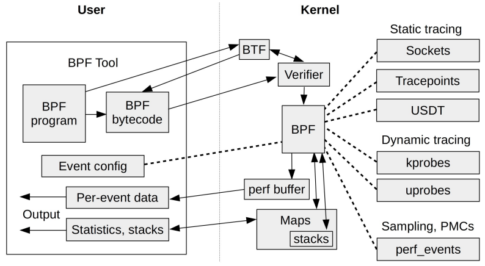
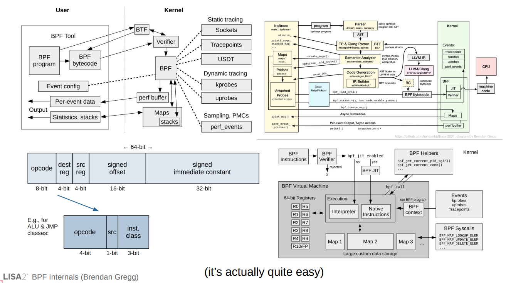
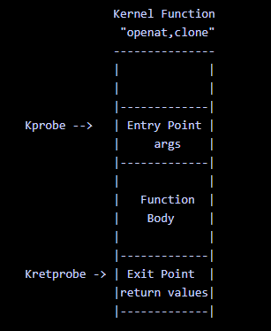
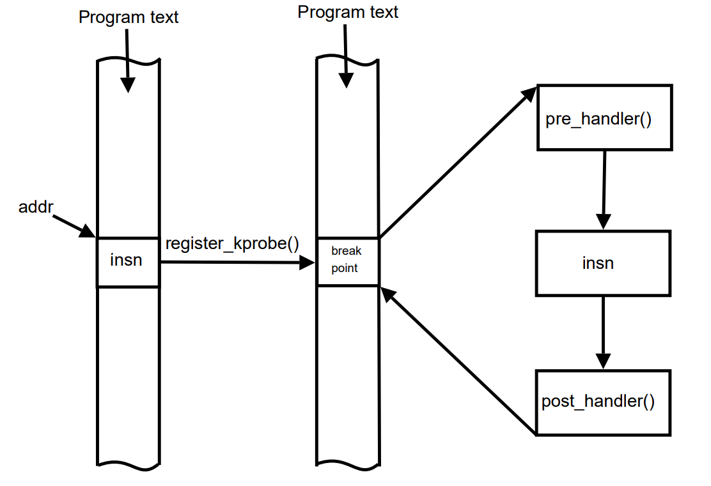
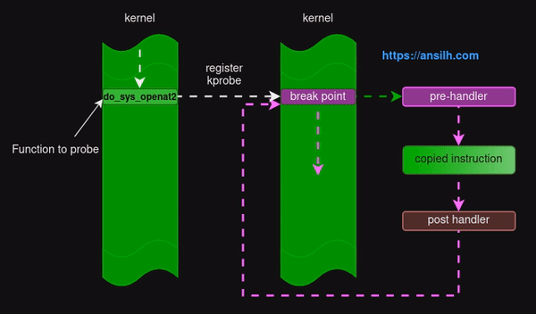
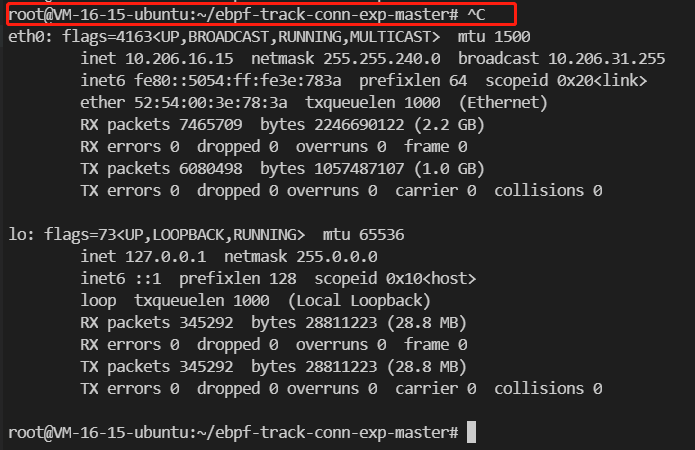
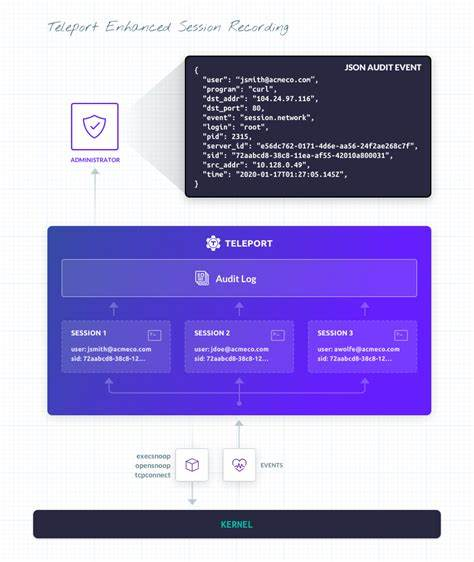

##  0x00    前言



本文专注于最右侧的技术

强烈推荐：
-   [bcc Reference Guide](https://github.com/iovisor/bcc/blob/master/docs/reference_guide.md)
-   [Linux 系统动态追踪技术介绍](https://blog.arstercz.com/introduction_to_linux_dynamic_tracing/)

Linux 动态追踪：



##  0x01  kprobe/uprobe/tracepoint 技术

####    kprobe vs kretprobe




-   kprobes 主要用来对内核进行轻量级的调试追踪，本质上是在指定的探测点（如函数的某行、函数的入口 / 出口地址、或者内核的指定地址处）插入一组处理程序。内核执行到这组处理程序的时候就可以获取到当前正在执行的上下文信息（如当前的函数名、函数处理的参数以及函数的返回值），也可以获取到寄存器甚至全局数据结构的信息
-   kretprobes 在 kprobes 的机制上实现，主要用于返回点（比如内核函数或者系统调用的返回值）的探测以及函数执行耗时的计算

关于 kprobes 的典型用例：
-   [kprobe](https://github.com/cilium/ebpf/blob/main/examples/kprobe/kprobe.c)

需要注意的，并不是所有的内核函数都可以选做 kprobe 的 hook 点，例如 `inline` 函数无法被 hook，`static` 函数也有可能被优化掉；在 Linux 可以通过 `cat /proc/kallsyms` 查看哪些函数可以选做 kprobe hook 点

内核态 kprobe 代码的范例如下：
```C
SEC("kprobe/vfs_write")
int kprobe_vfs_write(struct pt_regs *regs)
{
    struct file *file;
    file = (struct file *)PT_REGS_PARM1(regs);
    // DO YOUR LOGIC
}
```

其中入参 `struct pt_regs` 的结构体如下：

```C
struct pt_regs {
/*
 * C ABI says these regs are callee-preserved. They aren't saved on kernel entry
 * unless syscall needs a complete, fully filled "struct pt_regs".
 */
    unsigned long r15;
    unsigned long r14;
    unsigned long r13;
    unsigned long r12;
    unsigned long bp;
    unsigned long bx;
/* These regs are callee-clobbered. Always saved on kernel entry. */
    unsigned long r11;
    unsigned long r10;
    unsigned long r9;
    unsigned long r8;
    unsigned long ax;
    unsigned long cx;
    unsigned long dx;
    unsigned long si;
    unsigned long di;
/*
 * On syscall entry, this is syscall#. On CPU exception, this is error code.
 * On hw interrupt, it's IRQ number:
 */
    unsigned long orig_ax;
/* Return frame for iretq */
    unsigned long ip;
    unsigned long cs;
    unsigned long flags;
    unsigned long sp;
    unsigned long ss;
/* top of stack page */
};
```

`vfs_write` 内核函数的 [原型](https://elixir.bootlin.com/linux/v6.12.1/source/fs/read_write.c#L663)，如下

```C
ssize_t vfs_write(struct file *file, const char __user *buf, size_t count, loff_t *pos)
{
    // ....
	return ret;
}
```

在内核态代码 kprobe hook 中要获取参数，一般可通过诸如 `PT_REGS_PARM1` 宏，宏定义如下（截止目前版本，只允许通过此宏获取 `5` 个参数，超过数量的获取方式可参考 [此文](https://www.cnxct.com/using-ebpf-kprobe-to-file-notify/)）

```C
#define PT_REGS_PARM1(x) ((x)->di)
#define PT_REGS_PARM2(x) ((x)->si)
#define PT_REGS_PARM3(x) ((x)->dx)
#define PT_REGS_PARM4(x) ((x)->cx)
#define PT_REGS_PARM5(x) ((x)->r8)
```



####    tracepoint
tracepoint 一般也视为 static probes，其本质上就是一种管理探测点（probe）和处理程序的机制, 管理员或者开发者可以动态的开启 / 关闭追踪功能。perf、ftrace 等工具也依赖了 tracepoint 特性。一般现网开发而言，**hook 会尽可能选用 tracepoint，如果没有 tracepoint，其次考虑使用 kprobe**

Linux 内核提供了 `tracefs` 伪文件系统，作为 Tracepoint 与用户交互的界面，在 `/sys/kernel/debug/tracing/events` 下，可以看到系统支持的所有 Tracepoints：

```bash
[root@VM-centos XXX]# ls /sys/kernel/debug/tracing/events/
alarmtimer    cpuhp       fib6          hwmon        irq_vectors  mdio     net             power         rpm     sunrpc    udp        xdp
binder        devfreq     filelock      ib_mad       iscsi        migrate  nmi             printk        rseq    swiotlb   ufs        xhci-hcd
block         devlink     filemap       initcall     jbd2         module   nvme            qdisc         rtc     syscalls  vmscan
bpf_test_run  dma_fence   fs_dax        intel_iommu  kmem         mpx      oom             random        sched   task      vsyscall
bridge        enable      ftrace        iocost       kprobes      msr      page_isolation  ras           scsi    tcp       wbt
cgroup        exceptions  header_event  iommu        kyber        napi     pagemap         raw_syscalls  signal  thermal   workqueue
clk           ext4        header_page   irq          libata       nbd      page_pool       rcu           skb     timer     writeback
compaction    fib         huge_memory   irq_matrix   mce          neigh    percpu          resctrl       sock    tlb       x86_fpu
```

在 `/sys/kernel/debug/tracing/events/syscalls` 中，可查看所有有关系统调用的 tracepoint hook 点：

```BASH
[root@VM-centos XXX]# ls /sys/kernel/debug/tracing/events/syscalls
enable                       sys_enter_msync                   sys_exit_accept             sys_exit_munlockall
filter                       sys_enter_munlock                 sys_exit_accept4            sys_exit_munmap
sys_enter_accept             sys_enter_munlockall              sys_exit_access             sys_exit_name_to_handle_at
sys_enter_accept4            sys_enter_munmap                  sys_exit_acct               sys_exit_nanosleep
sys_enter_access             sys_enter_name_to_handle_at       sys_exit_add_key            sys_exit_newfstat
sys_enter_acct               sys_enter_nanosleep               sys_exit_adjtimex           sys_exit_newfstatat
sys_enter_add_key            sys_enter_newfstat                sys_exit_alarm              sys_exit_newlstat
# ....
```

用 eBPF 编写 Tracepoint hook 时，可以直接在 tracefs 中查看参数格式，以 `events/sched/sched_process_exec` 为例：

```BASH
$ cat /sys/kernel/debug/tracing/events/sched/sched_process_exec/format
name: sched_process_exec
ID: 316
format:
    field:unsigned short common_type; offset:0; size:2; signed:0;
    field:unsigned char common_flags; offset:2; size:1; signed:0;
    field:unsigned char common_preempt_count; offset:3; size:1; signed:0;
    field:int common_pid; offset:4; size:4; signed:1;

    field:__data_loc char[] filename; offset:8; size:4; signed:1;
    field:pid_t pid; offset:12; size:4; signed:1;
    field:pid_t old_pid; offset:16; size:4; signed:1;
```

####    raw tracepoint
Raw Tracepoint 是一种更底层的跟踪机制，与常规 Tracepoint 一样，它同样在内核源代码中通过 `DECLARE_TRACE` 等宏静态定义。两者的核心区别在于参数传递方式：

-   常规 Tracepoint：内核在触发时会将参数格式化为稳定的 ABI 结构（通过 `TP_STRUCT__entry` 定义），eBPF 程序通过该结构体的字段访问参数，跨内核版本兼容性好
-   Raw Tracepoint：eBPF 程序直接访问内核传给 tracepoint 的原始参数（通过 `struct bpf_raw_tracepoint_args`），跳过了格式化开销，性能更好，但参数布局依赖具体内核版本，可移植性较差

简单说，Raw Tracepoint 以牺牲稳定性换取更低的开销和更直接的内核数据访问能力

查看 `/sys/kernel/debug/tracing/events/raw_syscalls` 目录，可以获取系统中所有可用的 raw_tracepoint 的列表
```BASH
[root@VM-XXX-centos tmp]# ls /sys/kernel/debug/tracing/events/raw_syscalls/
enable  filter  sys_enter  sys_exit
```

####    uprobe
uprobe 是一种用户空间 hook，uprobe hook 允许在用户空间程序中动态插桩，插桩位置包括：函数入口、特定偏移处，以及函数返回处。当定义 uprobe 时，内核会在附加的指令上创建快速断点指令（如 x86 机器上为 `int3` 指令），当程序执行到该指令时，内核将触发事件，程序陷入到内核态，并以回调函数的方式调用 hook 函数，执行完探针函数再返回到用户态继续执行后序的指令。uprobe 基于文件，当一个二进制文件中的一个函数被跟踪时，所有使用到这个文件的进程都会被插桩，包括那些尚未启动的进程，这样就可以在全系统范围内跟踪系统调用

uprobe 适用于在用户态去解析一些内核态探针无法解析的流量，例如 http2 流量（报文 header 被编码，内核无法解码），https 流量（加密流量，内核无法解密），uprobe 的另外一个经典用例是 bash 审计（通过 hook `uretprobe//bin/bash:readline` 获取到通过 bash 执行的指令参数等）

Uprobe 在内核态 eBPF 运行时，也可能产生比较大的性能开销，这时候也可以考虑使用用户态 eBPF 运行时，如 bpftime。bpftime 是一个基于 LLVM JIT/AOT 的用户态 eBPF 运行时，它可以在用户态运行 eBPF 程序，和内核态的 eBPF 兼容，避免了内核态和用户态之间的上下文切换，从而提高了 eBPF 程序的执行效率。对于 uprobe 而言，bpftime 的性能开销比 kernel 小一个数量级

uprobe 的文档可以参考：
-   [Linux uprobe: User-Level Dynamic Tracing](https://www.brendangregg.com/blog/2015-06-28/linux-ftrace-uprobe.html)
-   [Demonstrations of uprobe](https://github.com/brendangregg/perf-tools/blob/master/examples/uprobe_example.txt)

####    小结
Tracepoint 也是 Linux 内核中的一个功能，并且也可以实现无感知切入内核活动中，与 Kprobe 不同的是，Tracepoint 能够支持的内核活动是内核开发时就预先定义好的，因此只能叫做 static probes，也正是因为开发阶段就定义好了，因此支持会比较稳定，并且性能也比 Kprobe 好。Linux 内核更新频繁，不同的版本中函数定义、名称可能会有所差别，使用 Tracepoint 则完全无需顾虑这一问题，而 Kprobe 则可能会因为这些变化失败

##  0x02  kprobe 基础实践
通常，基于 kprobe 的 hook，主要关注两个问题：

-   如何读取内核函数的参数
-   如何通过参数获取文件名和调用该函数的进程名

####    基础
1、如何获取 kprobe 的入参（获取内核函数的参数）？


2、如何获取 kretprobe 的返回值？

通过 `BPF_KRETPROBE` 宏可以直接获取内核函数的返回值，返回值作为宏的第二个参数传入。以 hook `do_unlinkat` 为例：

```c
SEC("kretprobe/do_unlinkat")
int BPF_KRETPROBE(do_unlinkat_exit, long ret)
{
    pid_t pid;
    pid = bpf_get_current_pid_tgid() >> 32;
    bpf_printk("do_unlinkat return value: %ld\n", ret);
    return 0;
}
```

如果不使用 `BPF_KRETPROBE` 宏（即使用原始的 `struct pt_regs *`），则需要通过 `PT_REGS_RC(regs)` 宏获取返回值：

```c
SEC("kretprobe/do_unlinkat")
int kretprobe_do_unlinkat(struct pt_regs *regs)
{
    long ret = PT_REGS_RC(regs);
    bpf_printk("do_unlinkat return value: %ld\n", ret);
    return 0;
}
```

3、如何获取进程上下文信息（pid/comm/uid 等）？

eBPF 提供了一组 BPF helper 函数用于获取当前执行上下文的进程信息：

```C
SEC("kprobe/do_unlinkat")
int BPF_KPROBE(do_unlinkat, int dfd, struct filename *name)
{
    u64 pid_tgid = bpf_get_current_pid_tgid();
    pid_t pid = pid_tgid >> 32;       // 进程 PID（即 tgid）
    pid_t tid = (u32)pid_tgid;        // 线程 TID

    u64 uid_gid = bpf_get_current_uid_gid();
    uid_t uid = (u32)uid_gid;         // 用户 UID
    gid_t gid = uid_gid >> 32;        // 用户 GID

    char comm[TASK_COMM_LEN];
    bpf_get_current_comm(&comm, sizeof(comm));  // 进程名称

    // 通过 bpf_get_current_task 获取 task_struct，可读取更多字段
    struct task_struct *task = (struct task_struct *)bpf_get_current_task();
    pid_t ppid = BPF_CORE_READ(task, real_parent, tgid);  // 父进程 PID

    bpf_printk("pid=%d tid=%d uid=%d ppid=%d comm=%s\n", pid, tid, uid, ppid, comm);
    return 0;
}
```

常用的进程上下文 helper 函数汇总：

| Helper 函数 | 返回值 | 说明 |
|---|---|---|
| `bpf_get_current_pid_tgid()` | `u64` | 高 32 位为 tgid（即用户态 PID），低 32 位为内核 tid |
| `bpf_get_current_uid_gid()` | `u64` | 高 32 位为 GID，低 32 位为 UID |
| `bpf_get_current_comm()` | `int` | 将当前进程名拷贝到指定 buffer |
| `bpf_get_current_task()` | `struct task_struct *` | 返回当前 `task_struct` 指针，可结合 `BPF_CORE_READ` 读取任意字段 |
| `bpf_get_current_cgroup_id()` | `u64` | 返回当前进程所在 cgroup v2 的 ID |

####  开发步骤
1、准备对应版本的 kernel 内核源码，** 在对系统调用植入探针的过程中，需要了解对应函数的参数和返回值定义 **

```BASH
uname -a #5.15.0-83-generic
# 确认目标设备的 linux 版本
# 下载 kernel 源码
git clone git@github.com:torvalds/linux.git   -b v5.15

# 搜索源码定义
grep -w do_unlinkat -r ./
```

2、kprobe ebpf 程序实例，这里以内核的 `do_unlinkat`（删除文件事件）进行自定义代码植入

首先，观察内核源码中 `do_unlinkat` 函数定义，如下所示。该函数接受 `2` 个参数：`dfd`（文件描述符）和 `name`（文件名结构体指针），返回值为 int，接下来编写 ebpf 程序时会用到这个定义

```C
int do_unlinkat(int dfd, struct filename *name);
```

3、编写 ebpf 探测函数 `kprobe.bpf.c` 程序（内核态代码），使用 kprobe（内核探针）在内核 `do_unlinkat` 函数的入口和退出位置添加钩子，实现对 Linux 内核中的 unlink 系统调用的入口参数和返回值的监测和捕获：

```C
#include "vmlinux.h"
#include <bpf/bpf_helpers.h>
#include <bpf/bpf_tracing.h>
#include <bpf/bpf_core_read.h>

// 定义许可证，以允许程序在内核中运行
char LICENSE[] SEC("license") = "Dual BSD/GPL";

// 定义一个名为 do_unlinkat 的 kprobe，当进入 do_unlinkat 函数时，它会被触发
SEC("kprobe/do_unlinkat")
int BPF_KPROBE(do_unlinkat, int dfd, struct filename *name) // 捕获函数的参数：dfd（文件描述符）和 name（文件名结构体指针）
{
    pid_t pid;
    const char *filename;

    // 获取当前进程的 PID（进程标识符）
    pid = bpf_get_current_pid_tgid()>> 32;
    // 读取文件名
    filename = BPF_CORE_READ(name, name);
    // 使用 bpf_printk 函数在内核日志中打印 PID 和文件名
    bpf_printk("KPROBE ENTRY pid = %d, filename = %s\n", pid, filename);
    return 0;
}

// 定义一个名为 do_unlinkat_exit 的 kretprobe，当从 do_unlinkat 函数退出时，它会被触发
SEC("kretprobe/do_unlinkat")
int BPF_KRETPROBE(do_unlinkat_exit, long ret) // 捕获函数的返回值（ret）
{
    pid_t pid;

    // 获取当前进程的 PID（进程标识符）
    pid = bpf_get_current_pid_tgid()>> 32;
    // 使用 bpf_printk 函数在内核日志中打印 PID 和返回值
    bpf_printk("KPROBE EXIT: pid = %d, ret = %ld\n", pid, ret);
    return 0;
}
```

内核态代码的要点：
-	`BPF_CORE_READ` 宏的作用
-	hook 内核函数的调用顺序

4、加载程序开发，编写一个 bpf 用户空间程序，用于加载上述 ebpf 钩子到内核空间：

```C
#include <stdio.h>
#include <unistd.h>
#include <signal.h>
#include <string.h>
#include <errno.h>
#include <sys/resource.h>
#include <bpf/libbpf.h>
#include "kprobe.skel.h"

static int libbpf_print_fn(enum libbpf_print_level level, const char *format, va_list args)
{
	return vfprintf(stderr, format, args);
}

static volatile sig_atomic_t stop;
static void sig_int(int signo)
{
	stop = 1;
}

int main(int argc, char **argv)
{
	struct kprobe_bpf *skel;
	int err;

	/* 设置 libbpf 错误和调试信息回调 */
	libbpf_set_print(libbpf_print_fn);

	/* 加载并验证 kprobe.bpf.c 应用程序 */
	skel = kprobe_bpf__open_and_load();
	if (!skel) {
		fprintf(stderr, "Failed to open BPF skeleton\n");
		return 1;
	}

	/* 附加 kprobe.bpf.c 程序到跟踪点 */
	err = kprobe_bpf__attach(skel);
	if (err) {
		fprintf(stderr, "Failed to attach BPF skeleton\n");
		goto cleanup;
	}

	/* Control-C 停止信号 */
	if (signal(SIGINT, sig_int) == SIG_ERR) {
		fprintf(stderr, "can't set signal handler: %s\n", strerror(errno));
		goto cleanup;
	}

	printf("Successfully started! Please run `sudo cat /sys/kernel/debug/tracing/trace_pipe`"
	       "to see output of the BPF programs.\n");

	while (!stop) {
		fprintf(stderr, ".");
		sleep(1);
	}

cleanup:
	/* 销毁挂载的 ebpf 程序 */
	kprobe_bpf__destroy(skel);
	return -err;
}
```

5、 使用 ring buffer 向用户态传递数据，上述代码中，仅仅使用 `bpf_printk` 即内核捕获到的数据打印到了内核 log（可以通过 `/sys/kernel/debug/tracing/trace_pipe` 查看）中，修改为 ringbuff 让用户态程序获取，将捕获到的数据通过 ring buffer 从内核空间传递到用户空间，当用户空间获取数据后，可以再进行后续的数据存储、处理和分析


步骤 1：定义一个 `kprobe.h` 头文件，方便内核空间和用户空间的程序使用同一个数据存储结构

```cpp
#ifndef __KPROBE_H
#define __KPROBE_H

#define MAX_FILENAME_LEN 256

struct event {
    int pid;
    char filename[MAX_FILENAME_LEN];
    bool exit_event;
    unsigned exit_code;
    unsigned long long ns;
};

#endif
```

步骤 2：修改内核态代码，定义 map，实现内核 ebpf 存储数据到 ring buffer

```cpp
#include "vmlinux.h"
#include <bpf/bpf_helpers.h>
#include <bpf/bpf_tracing.h>
#include <bpf/bpf_core_read.h>
#include "kprobe.h"

// 定义一个名为 rb 的 ring buffer 类型的 Map
struct {
    __uint(type, BPF_MAP_TYPE_RINGBUF);
    __uint(max_entries, 256 * 1024);    // 256 KB
} rb SEC(".maps");

//hook
SEC("kprobe/do_unlinkat")
int BPF_KPROBE(do_unlinkat, int dfd, struct filename *name)  // 该函数接受两个参数：dfd（文件描述符）和 name（文件名结构体指针）
{
    //...
    struct event *e;

    //...
    // 预订一个 ringbuf 样本空间
    e = bpf_ringbuf_reserve(&rb, sizeof(*e), 0);
    if (!e)
        return 0;
    // 设置数据
    e->pid = pid;

	// 在 ebpf 探针函数中保存数据到 ring buffer
    bpf_probe_read_str(&e->filename, sizeof(e->filename), (void *)filename);
	e->exit_event = false;
    e->ns = bpf_ktime_get_ns();
    // 提交到 ringbuf 用户空间进行后处理
    bpf_ringbuf_submit(e, 0);

    return 0;
}
```

步骤 3：用户空间读取 ring buffer，基本流程如下：

1.	定义 ring_buffer 结构体、`handle_event` 回调函数
2.	使用 `ring_buffer__new(bpf_map__fd(skel->maps.rb), handle_event, NULL, NULL)`（`skel->maps.rb` 的 `fd`）初始化用户空间缓冲区对象
3.	使用 `ring_buffer__poll` 获取内核 ebpf 程序传递的数据，收到的内核数据在 `handle_event` 回调函数中进行打印、存储、分析等后续处理

```cpp
#include <time.h>
#include "kprobe.h"

...

// ring buffer data process
static int handle_event(void *ctx, void *data, size_t data_sz)
{
	const struct event *e = data;
	struct tm *tm;
	char ts[32];
	time_t t;

	time(&t);
	tm = localtime(&t);
	strftime(ts, sizeof(ts), "%H:%M:%S", tm);

	if (e->exit_event) {
		printf("%-8s %-5s %-16s %-7d [%u]", ts, "EXIT", e->filename, e->pid, e->exit_code);
		if (e->ns)
			printf("(%llums)", e->ns / 1000000);
		printf("\n");
	} else {
		printf("%-8s %-5s %-16s %-7d %s\n", ts, "EXEC", e->filename, e->pid, e->filename);
	}

	return 0;
}

int main(int argc, char **argv)
{
	//...
	struct ring_buffer *rb = NULL;

	/* 设置环形缓冲区轮询 */
	rb = ring_buffer__new(bpf_map__fd(skel->maps.rb), handle_event, NULL, NULL);
	if (!rb) {
		err = -1;
		fprintf(stderr, "Failed to create ring buffer\n");
		goto cleanup;
	}

	/* 处理收到的内核数据 */
	printf("%-8s %-5s %-16s %-7s %s\n", "TIME", "EVENT", "FILENAME", "PID", "FILENAME/RET");
	while (!stop) {
		// 轮询内核数据
		err = ring_buffer__poll(rb, 100 /* timeout, ms */);
		if (err == -EINTR) {	/* Ctrl-C will cause -EINTR */
			err = 0;
			break;
		}
		if (err < 0) {
			printf("Error polling perf buffer: %d\n", err);
			break;
		}
	}
	// while (!stop) {
	// fprintf(stderr, ".");
	// sleep(1);
	// }
	//...
}
```

##  0x03  kretprobe 基础实践

kretprobe 最经典的使用模式是与 kprobe 配合，通过 hash map 关联函数入参和返回值。典型场景：kprobe 在函数入口记录参数到 map（以 `pid_tgid` 为 key），kretprobe 在函数返回时从 map 取出入参并关联返回值，最终输出完整事件

下面以 hook `tcp_v4_connect` 为例，捕获 TCP IPv4 连接的目标地址、端口及连接结果：

```C
#include "vmlinux.h"
#include <bpf/bpf_helpers.h>
#include <bpf/bpf_tracing.h>
#include <bpf/bpf_core_read.h>

#define AF_INET 2

struct event {
    u32 pid;
    u32 uid;
    u32 saddr;
    u32 daddr;
    u16 dport;
    int retval;
    char comm[16];
};

struct {
    __uint(type, BPF_MAP_TYPE_HASH);
    __uint(max_entries, 4096);
    __type(key, u64);
    __type(value, struct sock *);
} sock_map SEC(".maps");

struct {
    __uint(type, BPF_MAP_TYPE_RINGBUF);
    __uint(max_entries, 256 * 1024);
} rb SEC(".maps");

SEC("kprobe/tcp_v4_connect")
int BPF_KPROBE(tcp_v4_connect_entry, struct sock *sk)
{
    u64 pid_tgid = bpf_get_current_pid_tgid();
    bpf_map_update_elem(&sock_map, &pid_tgid, &sk, BPF_ANY);
    return 0;
}

SEC("kretprobe/tcp_v4_connect")
int BPF_KRETPROBE(tcp_v4_connect_exit, int ret)
{
    u64 pid_tgid = bpf_get_current_pid_tgid();
    struct sock **skpp;
    struct event *e;

    skpp = bpf_map_lookup_elem(&sock_map, &pid_tgid);
    if (!skpp)
        return 0;

    if (ret != 0) {
        bpf_map_delete_elem(&sock_map, &pid_tgid);
        return 0;
    }

    struct sock *sk = *skpp;
    u16 family = BPF_CORE_READ(sk, __sk_common.skc_family);
    if (family != AF_INET) {
        bpf_map_delete_elem(&sock_map, &pid_tgid);
        return 0;
    }

    e = bpf_ringbuf_reserve(&rb, sizeof(*e), 0);
    if (!e) {
        bpf_map_delete_elem(&sock_map, &pid_tgid);
        return 0;
    }

    e->pid = pid_tgid >> 32;
    e->uid = (u32)bpf_get_current_uid_gid();
    e->saddr = BPF_CORE_READ(sk, __sk_common.skc_rcv_saddr);
    e->daddr = BPF_CORE_READ(sk, __sk_common.skc_daddr);
    e->dport = __bpf_ntohs(BPF_CORE_READ(sk, __sk_common.skc_dport));
    e->retval = ret;
    bpf_get_current_comm(&e->comm, sizeof(e->comm));

    bpf_ringbuf_submit(e, 0);
    bpf_map_delete_elem(&sock_map, &pid_tgid);
    return 0;
}

char LICENSE[] SEC("license") = "Dual BSD/GPL";
```

要点说明：
-   kprobe 入口将 `struct sock *` 指针保存到 `BPF_MAP_TYPE_HASH` 中，以 `pid_tgid` 为 key
-   kretprobe 出口通过相同的 key 从 map 中取回 `sock` 指针，结合返回值 `ret` 输出完整事件
-   使用完毕后必须调用 `bpf_map_delete_elem` 清理 map 条目，避免内存泄漏
-   `__sk_common` 是 `struct sock` 中嵌套的通用连接信息结构体，包含源/目的地址和端口

##  0x04  tracepoint 基础实践

与 kprobe 通过 `PT_REGS_PARMx` 或 `BPF_KPROBE` 宏读取函数参数不同，tracepoint 的参数已经被内核格式化为稳定的结构体，可以直接按字段访问。下面以 hook `sys_enter_openat` 为例，捕获文件打开操作：

首先查看 tracepoint 的参数格式：

```BASH
$ cat /sys/kernel/debug/tracing/events/syscalls/sys_enter_openat/format
name: sys_enter_openat
ID: 614
format:
    field:unsigned short common_type; offset:0; size:2; signed:0;
    field:unsigned char common_flags; offset:2; size:1; signed:0;
    field:unsigned char common_preempt_count; offset:3; size:1; signed:0;
    field:int common_pid; offset:4; size:4; signed:1;

    field:int __syscall_nr; offset:8; size:4; signed:1;
    field:int dfd; offset:16; size:8; signed:0;
    field:const char * filename; offset:24; size:8; signed:0;
    field:int flags; offset:32; size:8; signed:0;
    field:umode_t mode; offset:40; size:8; signed:0;
```

内核态 eBPF 代码：

```c
#include "vmlinux.h"
#include <bpf/bpf_helpers.h>
#include <bpf/bpf_tracing.h>
#include <bpf/bpf_core_read.h>

#define TASK_COMM_LEN 16
#define MAX_FILENAME_LEN 256

struct event {
    u32 pid;
    u32 uid;
    int flags;
    char comm[TASK_COMM_LEN];
    char filename[MAX_FILENAME_LEN];
};

struct {
    __uint(type, BPF_MAP_TYPE_RINGBUF);
    __uint(max_entries, 256 * 1024);
} rb SEC(".maps");

SEC("tracepoint/syscalls/sys_enter_openat")
int tracepoint_openat(struct trace_event_raw_sys_enter *ctx)
{
    struct event *e;
    u64 pid_tgid = bpf_get_current_pid_tgid();
    u32 pid = pid_tgid >> 32;

    e = bpf_ringbuf_reserve(&rb, sizeof(*e), 0);
    if (!e)
        return 0;

    e->pid = pid;
    e->uid = (u32)bpf_get_current_uid_gid();
    /* tracepoint 参数通过 ctx->args[] 数组访问，顺序对应 format 中的非 common 字段 */
    e->flags = (int)ctx->args[2];
    bpf_get_current_comm(&e->comm, sizeof(e->comm));
    bpf_probe_read_user_str(&e->filename, sizeof(e->filename), (const char *)ctx->args[1]);

    bpf_ringbuf_submit(e, 0);
    return 0;
}

char LICENSE[] SEC("license") = "Dual BSD/GPL";
```

要点说明：
-   tracepoint 的上下文类型为 `struct trace_event_raw_sys_enter`（由 vmlinux.h 提供），通过 `ctx->args[]` 数组访问系统调用参数
-   `args[0]` 对应 `dfd`，`args[1]` 对应 `filename`（用户空间指针），`args[2]` 对应 `flags`，`args[3]` 对应 `mode`
-   读取用户空间字符串指针需使用 `bpf_probe_read_user_str`，而非 `BPF_CORE_READ`（后者用于内核空间指针）
-   与 kprobe 的区别：tracepoint 参数通过内核预定义的稳定接口访问，不依赖函数签名，跨内核版本兼容性更好，在笔者项目中优先使用tracepoint

##  0x05  raw tracepoint 基础实践

raw tracepoint 通过 `struct bpf_raw_tracepoint_args` 直接访问内核传递的原始参数，省去了常规 tracepoint 的参数格式化开销。下面以 `sched_process_exec` 为例，捕获进程执行事件：

首先确认 raw tracepoint 在内核中的定义，`sched_process_exec` 的触发点位于 `fs/exec.c` 中，原型为：

```C
// 内核源码中的 tracepoint 定义（参考）
// trace_sched_process_exec(struct task_struct *p, pid_t old_pid, struct linux_binprm *bprm)
```

内核态 eBPF 代码：

```C
#include "vmlinux.h"
#include <bpf/bpf_helpers.h>
#include <bpf/bpf_tracing.h>
#include <bpf/bpf_core_read.h>

#define TASK_COMM_LEN 16
#define MAX_FILENAME_LEN 256

struct event {
    u32 pid;
    u32 old_pid;
    u32 uid;
    char comm[TASK_COMM_LEN];
    char filename[MAX_FILENAME_LEN];
};

struct {
    __uint(type, BPF_MAP_TYPE_RINGBUF);
    __uint(max_entries, 256 * 1024);
} rb SEC(".maps");

/* raw tracepoint 直接访问内核原始参数
 * sched_process_exec 的参数：
 *   args[0] = struct task_struct *p
 *   args[1] = pid_t old_pid
 *   args[2] = struct linux_binprm *bprm
 */
SEC("raw_tracepoint/sched_process_exec")
int raw_tp_sched_process_exec(struct bpf_raw_tracepoint_args *ctx)
{
    struct event *e;
    struct task_struct *task = (struct task_struct *)ctx->args[0];
    pid_t old_pid = (pid_t)ctx->args[1];
    struct linux_binprm *bprm = (struct linux_binprm *)ctx->args[2];

    e = bpf_ringbuf_reserve(&rb, sizeof(*e), 0);
    if (!e)
        return 0;

    e->pid = BPF_CORE_READ(task, tgid);
    e->old_pid = old_pid;
    e->uid = (u32)bpf_get_current_uid_gid();
    BPF_CORE_READ_STR_INTO(&e->comm, task, comm);
    /* linux_binprm->filename 是内核空间指针，使用 bpf_probe_read_kernel_str 读取 */
    const char *filename = BPF_CORE_READ(bprm, filename);
    bpf_probe_read_kernel_str(&e->filename, sizeof(e->filename), filename);

    bpf_ringbuf_submit(e, 0);
    return 0;
}

char LICENSE[] SEC("license") = "Dual BSD/GPL";
```

要点说明：
-   SEC 名称格式为 `raw_tracepoint/<tracepoint_name>`，不含子系统路径（对比常规 tracepoint 的 `tracepoint/sched/sched_process_exec`）
-   参数通过 `ctx->args[N]` 以 `__u64` 类型访问，需手动转换为对应的内核结构体指针
-   raw tracepoint 的参数顺序和类型与内核 `DECLARE_TRACE` 宏定义一致，需查阅内核源码确认
-   由于直接操作内核数据结构，raw tracepoint 的参数布局可能随内核版本变化，建议配合 CO-RE 使用以提升可移植性
-   `BPF_CORE_READ_STR_INTO` 是 `BPF_CORE_READ` 的字符串版本，专用于读取内核结构体中的字符数组字段

##  0x06  uprobe 基础实践

####    如何获取一个二进制程序可用的 uprobe 钩子

uprobe 是基于 ELF 符号表工作的，因此需要目标二进制导出了符号信息。常用的查找方法：

```BASH
# 方法 1：使用 nm 查看动态符号表（常用于共享库）
nm -D /usr/lib/x86_64-linux-gnu/libssl.so | grep -i 'SSL_write\|SSL_read'
# 输出示例：
# 0000000000035b00 T SSL_read
# 0000000000036a00 T SSL_write

# 方法 2：使用 objdump 查看符号
objdump -T /usr/lib/x86_64-linux-gnu/libssl.so | grep SSL_write

# 方法 3：使用 readelf 查看符号表
readelf -s --wide /usr/lib/x86_64-linux-gnu/libssl.so | grep SSL_write

# 方法 4：使用 bpftrace 列出 uprobe 可用的 hook 点
bpftrace -l 'uprobe:/usr/lib/x86_64-linux-gnu/libssl.so:*' | grep SSL

# 对于 Go 二进制，由于 Go 默认静态编译，符号可能在 .gopclntab 段中
# 使用 objdump 或 nm 查看 Go 二进制的符号：
nm /path/to/go-binary | grep 'crypto/tls'
```

注意事项：
-   strip 过的二进制文件可能丢失符号信息，需要对应的 debug 符号包
-   对于动态链接库，uprobe 挂载路径应为库文件的实际路径（而非 symlink），可通过 `readlink -f` 确认
-   Go 二进制的函数名包含 `.`（如 `crypto/tls.(*Conn).Read`），挂载时需注意转义（TODO）

####    实践：使用 uprobe 捕获 OpenSSL 的 SSL_write 明文数据
先介绍一个 uprobe 最经典的应用场景，在 `SSL_write` 函数入口处捕获明文数据（此时数据尚未加密），实现 HTTPS 流量的明文捕获

`SSL_write` 函数原型为：

```C
// openssl/ssl.h
int SSL_write(SSL *ssl, const void *buf, int num);
// 参数：ssl 连接对象，buf 待写入的明文数据，num 数据长度
```

内核态 eBPF 代码如下：

```C
#include "vmlinux.h"
#include <bpf/bpf_helpers.h>
#include <bpf/bpf_tracing.h>

#define MAX_BUF_SIZE 4096
#define TASK_COMM_LEN 16

struct ssl_event {
    u32 pid;
    u32 uid;
    u32 len;
    u8 buf[MAX_BUF_SIZE];
    char comm[TASK_COMM_LEN];
};

struct {
    __uint(type, BPF_MAP_TYPE_PERCPU_ARRAY);
    __uint(max_entries, 1);
    __type(key, u32);
    __type(value, struct ssl_event);
} ssl_event_map SEC(".maps");

struct {
    __uint(type, BPF_MAP_TYPE_RINGBUF);
    __uint(max_entries, 256 * 1024);
} rb SEC(".maps");

/* uprobe hook: 在 SSL_write 入口处捕获明文数据
 * SSL_write(SSL *ssl, const void *buf, int num)
 * 参数：arg1=ssl, arg2=buf(明文), arg3=num(长度)
 */
SEC("uprobe//usr/lib/x86_64-linux-gnu/libssl.so.3:SSL_write")
int uprobe_ssl_write(struct pt_regs *ctx)
{
    u32 zero = 0;
    struct ssl_event *e;
    const void *buf = (const void *)PT_REGS_PARM2(ctx);
    int num = (int)PT_REGS_PARM3(ctx);

    e = bpf_map_lookup_elem(&ssl_event_map, &zero);
    if (!e)
        return 0;

    u64 pid_tgid = bpf_get_current_pid_tgid();
    e->pid = pid_tgid >> 32;
    e->uid = (u32)bpf_get_current_uid_gid();
    bpf_get_current_comm(&e->comm, sizeof(e->comm));

    e->len = num;
    if (num > MAX_BUF_SIZE)
        num = MAX_BUF_SIZE;

    bpf_probe_read_user(&e->buf, num & (MAX_BUF_SIZE - 1), buf);

    bpf_ringbuf_output(&rb, e, sizeof(*e), 0);
    return 0;
}

/* uretprobe hook: 在 SSL_read 返回时捕获解密后的明文数据
 * 需配合 uprobe 在入口记录 buf 指针，uretprobe 在返回时读取数据
 */
struct {
    __uint(type, BPF_MAP_TYPE_HASH);
    __uint(max_entries, 4096);
    __type(key, u64);
    __type(value, u64);
} ssl_read_args SEC(".maps");

SEC("uprobe//usr/lib/x86_64-linux-gnu/libssl.so.3:SSL_read")
int uprobe_ssl_read_entry(struct pt_regs *ctx)
{
    u64 pid_tgid = bpf_get_current_pid_tgid();
    u64 buf_addr = (u64)PT_REGS_PARM2(ctx);
    bpf_map_update_elem(&ssl_read_args, &pid_tgid, &buf_addr, BPF_ANY);
    return 0;
}

SEC("uretprobe//usr/lib/x86_64-linux-gnu/libssl.so.3:SSL_read")
int uretprobe_ssl_read_exit(struct pt_regs *ctx)
{
    u32 zero = 0;
    u64 pid_tgid = bpf_get_current_pid_tgid();
    int ret = (int)PT_REGS_RC(ctx);

    u64 *buf_addr = bpf_map_lookup_elem(&ssl_read_args, &pid_tgid);
    if (!buf_addr || ret <= 0) {
        bpf_map_delete_elem(&ssl_read_args, &pid_tgid);
        return 0;
    }

    struct ssl_event *e = bpf_map_lookup_elem(&ssl_event_map, &zero);
    if (!e) {
        bpf_map_delete_elem(&ssl_read_args, &pid_tgid);
        return 0;
    }

    e->pid = pid_tgid >> 32;
    e->uid = (u32)bpf_get_current_uid_gid();
    bpf_get_current_comm(&e->comm, sizeof(e->comm));
    e->len = ret;
    int read_len = ret;
    if (read_len > MAX_BUF_SIZE)
        read_len = MAX_BUF_SIZE;
    bpf_probe_read_user(&e->buf, read_len & (MAX_BUF_SIZE - 1), (void *)*buf_addr);

    bpf_ringbuf_output(&rb, e, sizeof(*e), 0);
    bpf_map_delete_elem(&ssl_read_args, &pid_tgid);
    return 0;
}

char LICENSE[] SEC("license") = "Dual BSD/GPL";
```

要点说明：
-   uprobe 的 SEC 名称格式为 `uprobe/<binary_path>:<symbol>`，binary 路径必须是实际路径
-   uprobe 获取函数参数使用 `PT_REGS_PARMx`（与 kprobe 相同），因为 uprobe 同样通过 `struct pt_regs` 传递上下文
-   读取用户空间内存需使用 `bpf_probe_read_user`（而非 `bpf_probe_read_kernel`）
-   `ssl_event` 结构体较大（超过 `512` 字节），不能在栈上分配，因此使用 `BPF_MAP_TYPE_PERCPU_ARRAY` 作为临时缓冲区
-   SSL_read 的 uretprobe 模式与 kretprobe 中 `tcp_v4_connect` 的模式相似：入口记录参数到 map，返回时取出并关联

##	0x07	内核态实践（经典示例）
本小节汇总下笔者在学习中遇到的若干经典内核态代码示例

####    实践 1：sigsnoop — 捕获进程发送信号的系统调用
主要介绍如何实现一个 eBPF 工具，捕获进程发送信号的系统调用集合，使用 hash map 保存状态。核心思路：在 `sys_enter_kill` 时记录信号参数到 hash map，在 `sys_exit_kill` 时取出并关联返回值，输出完整事件

查看 `kill` 系统调用的 tracepoint 参数格式：

```BASH
$ cat /sys/kernel/debug/tracing/events/syscalls/sys_enter_kill/format
name: sys_enter_kill
ID: 137
format:
    field:int __syscall_nr; offset:8; size:4; signed:1;
    field:pid_t pid; offset:16; size:8; signed:0;
    field:int sig; offset:24; size:8; signed:0;
```

内核态 eBPF 代码（`sigsnoop.bpf.c`）：

```C
#include "vmlinux.h"
#include <bpf/bpf_helpers.h>
#include <bpf/bpf_tracing.h>

#define TASK_COMM_LEN 16

struct event {
    u32 pid;         // 发送信号的进程
    u32 tpid;        // 目标进程
    int sig;         // 信号编号
    int ret;         // kill 返回值
    char comm[TASK_COMM_LEN];
};

struct sig_info {
    u32 tpid;
    int sig;
};

struct {
    __uint(type, BPF_MAP_TYPE_HASH);
    __uint(max_entries, 10240);
    __type(key, u64);
    __type(value, struct sig_info);
} sig_map SEC(".maps");

struct {
    __uint(type, BPF_MAP_TYPE_RINGBUF);
    __uint(max_entries, 256 * 1024);
} rb SEC(".maps");

/* 可选：过滤特定信号或特定进程 */
const volatile int target_sig = 0;
const volatile pid_t filtered_pid = 0;

SEC("tracepoint/syscalls/sys_enter_kill")
int tracepoint_sys_enter_kill(struct trace_event_raw_sys_enter *ctx)
{
    u64 pid_tgid = bpf_get_current_pid_tgid();
    pid_t tpid = (pid_t)ctx->args[0];
    int sig = (int)ctx->args[1];

    if (target_sig && sig != target_sig)
        return 0;
    if (filtered_pid && (pid_tgid >> 32) != filtered_pid)
        return 0;

    struct sig_info info = {
        .tpid = tpid,
        .sig = sig,
    };
    bpf_map_update_elem(&sig_map, &pid_tgid, &info, BPF_ANY);
    return 0;
}

SEC("tracepoint/syscalls/sys_exit_kill")
int tracepoint_sys_exit_kill(struct trace_event_raw_sys_exit *ctx)
{
    u64 pid_tgid = bpf_get_current_pid_tgid();
    struct sig_info *info;
    struct event *e;

    info = bpf_map_lookup_elem(&sig_map, &pid_tgid);
    if (!info)
        return 0;

    e = bpf_ringbuf_reserve(&rb, sizeof(*e), 0);
    if (!e) {
        bpf_map_delete_elem(&sig_map, &pid_tgid);
        return 0;
    }

    e->pid = pid_tgid >> 32;
    e->tpid = info->tpid;
    e->sig = info->sig;
    e->ret = ctx->ret;
    bpf_get_current_comm(&e->comm, sizeof(e->comm));

    bpf_ringbuf_submit(e, 0);
    bpf_map_delete_elem(&sig_map, &pid_tgid);
    return 0;
}

char LICENSE[] SEC("license") = "Dual BSD/GPL";
```

要点说明：
-   使用 `sys_enter_kill`/`sys_exit_kill` 成对 tracepoint 实现入参与返回值的关联
-   `BPF_MAP_TYPE_HASH` 以 `pid_tgid` 为 key 暂存入口参数，退出时取出并清理
-   `const volatile` 声明的全局变量可在用户态加载时通过 `bpf_object__find_map_by_name` 修改，实现运行时过滤
-   该模式（enter 记录 + exit 关联）是 eBPF tracing 的通用范式，适用于任何需要关联系统调用入参和返回值的场景

####	实践 2：bootstrap
[eBPF 入门开发实践教程十一：在 eBPF 中使用 libbpf 开发用户态程序并跟踪 exec() 和 exit() 系统调用](https://eunomia.dev/zh/tutorials/11-bootstrap/#ebpf-bootstrapbpfc)

####    实践 3：使用 uprobe 捕获 bash 的 readline 函数调用
使用 uprobe hook 技术捕获 `bash` 的 `readline` 函数调用，从而获取用户在 `bash` 中输入的命令行，代码如下。作用是在 `bash` 的 `readline` 函数返回时执行指定的 `BPF_KRETPROBE` 函数（`printret`）

```c
#include "vmlinux.h"
#include <bpf/bpf_helpers.h>
#include <bpf/bpf_tracing.h>

#define TASK_COMM_LEN 16
#define MAX_LINE_SIZE 80

/* Format of u[ret]probe section definition supporting auto-attach:
 * u[ret]probe/binary:function[+offset]
 *
 * binary can be an absolute/relative path or a filename; the latter is resolved to a
 * full binary path via bpf_program__attach_uprobe_opts.
 *
 * Specifying uprobe+ ensures we carry out strict matching; either "uprobe" must be
 * specified (and auto-attach is not possible) or the above format is specified for
 * auto-attach.
 */

// 要捕获的是 /bin/bash 二进制文件中的 readline 函数
SEC("uretprobe//bin/bash:readline")
int BPF_KRETPROBE(printret, const void *ret)    //printret 是探针函数的名称，const void *ret 是探针函数的参数，它代表被捕获的函数的返回值
{
 char str[MAX_LINE_SIZE];
 char comm[TASK_COMM_LEN];
 u32 pid;

 if (!ret)
  return 0;
  // 获取调用 readline 函数的进程的进程名称和进程 ID
 bpf_get_current_comm(&comm, sizeof(comm));

 pid = bpf_get_current_pid_tgid()>> 32;

 //bpf_probe_read_user_str 函数读取了用户输入的命令行字符串
 // 使用 bpf_probe_read_user_str 函数从用户空间读取 readline 函数的返回值，并将其存储在 str 数组中
 bpf_probe_read_user_str(str, sizeof(str), ret);

 // 打印出进程 ID、进程名称和输入的命令行字符串
 bpf_printk("PID %d (%s) read: %s", pid, comm, str);

 return 0;
};

char LICENSE[] SEC("license") = "GPL";
```

##	0x08	综合实践（续）

####    捕获 process 启动 / 退出事件
本小结主要通过探测内核的 `sys_enter_execve`、`sched_process_exit` 事件，捕获进程的拉起和退出事件，并通过 ring buffer 输出到用户空间程序中，依然分为如下 3 个步骤：

1、步骤一，定义结构

```c
struct trace_entry {
	short unsigned int type;
	unsigned char flags;
	unsigned char preempt_count;
	int pid;
};

/* sched_process_exec tracepoint context */
struct trace_event_raw_sched_process_exec {
	struct trace_entry ent;
	unsigned int __data_loc_filename;
	int pid;
	int old_pid;
	char __data[0];
};

#define TASK_COMM_LEN 16
#define EXEC_CMD_LEN 256
#define MAX_FILENAME_LEN 512

/* definition of a sample sent to user-space from BPF program */
struct event {
	int pid;
	int ppid;
	uid_t uid;
	int retval;
	bool is_exit;
	unsigned long long ns;
	char cmd[EXEC_CMD_LEN];
	char filename[MAX_FILENAME_LEN];
};
```


2、步骤二，实现内核态代码

```c

// 定义 ring buffer Map
struct {
    __uint(type, BPF_MAP_TYPE_RINGBUF);
    __uint(max_entries, 256 * 1024);    // 256 KB
} rb SEC(".maps");


// 捕获进程执行事件，使用 ring buffer 向用户态打印输出
SEC("tracepoint/syscalls/sys_enter_execve")
int snoop_process_start(struct trace_event_raw_sys_enter* ctx)
{
    u64 id;
    pid_t pid;
    struct event *e;
    struct task_struct *task;

    // 获取当前进程的用户 ID
    uid_t uid = (u32)bpf_get_current_uid_gid();
    // 获取当前进程 ID
    id = bpf_get_current_pid_tgid();
    pid = id >> 32;
    // 获取当前进程的 task_struct 结构体
    task = (struct task_struct*)bpf_get_current_task();
    // 读取进程名称
    char *cmd = (char *) BPF_CORE_READ(ctx, args[0]);

    // 预订一个 ringbuf 样本空间
    e = bpf_ringbuf_reserve(&rb, sizeof(*e), 0);
    if (!e)
        return 0;
    // 设置数据
    e->pid = pid;
    e->uid = uid;
    e->ppid = BPF_CORE_READ(task, real_parent, pid);
    bpf_probe_read_str(&e->cmd, EXEC_CMD_LEN, cmd);
    e->ns = bpf_ktime_get_ns();
    // 提交到 ringbuf 用户空间进行后处理
    bpf_ringbuf_submit(e, 0);

    // 使用 bpf_printk 函数在内核日志中打印 PID 和文件名
    // bpf_printk("TRACEPOINT EXEC pid = %d, uid = %d, cmd = %s\n", pid, uid, e->cmd);
    return 0;
}

// 监控进程退出事件，使用 ring buffer 向用户态打印输出
SEC("tp/sched/sched_process_exit")
int snoop_process_exit(struct trace_event_raw_sched_process_template* ctx)
{
    struct task_struct *task;
    struct event *e;
    pid_t pid, tid;
    u64 id, ts, *start_ts, start_time = 0;

    // 获取当前进程的用户 ID
    uid_t uid = (u32)bpf_get_current_uid_gid();
    // 获取当前进程 / 线程 ID
    id = bpf_get_current_pid_tgid();
    pid = id >> 32;
    tid = (u32)id;
    // 获取当前进程的 task_struct 结构体
    task = (struct task_struct *)bpf_get_current_task();
    start_time = BPF_CORE_READ(task, start_time);

    /* ignore thread exits */
    if (pid != tid)
        return 0;

    // 预订一个 ringbuf 样本空间
    e = bpf_ringbuf_reserve(&rb, sizeof(*e), 0);
    if (!e)
        return 0;
    // 设置数据
    e->ns = bpf_ktime_get_ns() - start_time;
    e->pid = pid;
    e->uid = uid;
    e->ppid = BPF_CORE_READ(task, real_parent, tgid);
    e->is_exit = true;
    e->retval = (BPF_CORE_READ(task, exit_code) >> 8) & 0xff;
    bpf_get_current_comm(&e->cmd, sizeof(e->cmd));
    // 提交到 ringbuf 用户空间进行后处理
    bpf_ringbuf_submit(e, 0);

    // 使用 bpf_printk 函数在内核日志中打印 PID 和文件名
    // bpf_printk("TRACEPOINT EXIT pid = %d, uid = %d, cmd = %s\n", pid, uid, e->cmd);
    return 0;
}
```


3、步骤三，实现用户态代码

```c

int libbpf_print_fn(enum libbpf_print_level level, const char *format, va_list args)
{
	/* Ignore debug-level libbpf logs */
	if (level> LIBBPF_INFO)
		return 0;
	return vfprintf(stderr, format, args);
}

// Control-C process
static volatile bool exiting = false;
static void sig_handler(int sig)
{
	exiting = true;
}

// ring buffer data process
static int handle_event(void *ctx, void *data, size_t data_sz)
{
	const struct event *e = (struct event *)data;
    struct tm *tm;
    char ts[32];
    time_t t;

    time(&t);
    tm = localtime(&t);
    strftime(ts, sizeof(ts), "%H:%M:%S", tm);

    if (e->is_exit) {
        printf("%s %-5s %d %d %s %d %llums\n", ts, "EXIT", e->pid, e->uid, e->cmd, e->retval, e->ns / 1000000);
    } else {
        printf("%s %-5s %d %d %d  %s\n", ts, "EXEC", e->pid, e->ppid, e->uid, e->cmd);
    }

    return 0;
}

int main(int argc, char **argv)
{
    struct exec_bpf *skel;
    int err;
    struct ring_buffer *rb = NULL;

    /* 设置 libbpf 错误和调试信息回调 */
    libbpf_set_print(libbpf_print_fn);

    /* Control-C 停止信号 */
	signal(SIGINT, sig_handler);
	signal(SIGTERM, sig_handler);

    /* 加载并验证 exec.bpf.c 应用程序 */
    skel = exec_bpf__open_and_load();
    if (!skel) {
        fprintf(stderr, "Failed to open BPF skeleton\n");
        return 1;
    }

    /* 附加 exec.bpf.c 程序到跟踪点 */
    err = exec_bpf__attach(skel);
    if (err) {
        fprintf(stderr, "Failed to attach BPF skeleton\n");
        exec_bpf__destroy(skel);
        return -err;
    }
    // printf("Successfully started! Please run `sudo cat /sys/kernel/debug/tracing/trace_pipe` to see output of the BPF programs.\n");

    /* 设置环形缓冲区轮询 */
    rb = ring_buffer__new(bpf_map__fd(skel->maps.rb), handle_event, NULL, NULL);
    if (!rb) {
        err = -1;
        fprintf(stderr, "Failed to create ring buffer\n");
        exec_bpf__destroy(skel);
        return -err;
    }

    /* 处理收到的内核数据 */
    printf("%-8s %-8s %-7s %-7s %-16s %-8s %-8s\n", "TIME", "TYPE", "PID", "UID", "CMD", "RET", "DURATION");
    while (!exiting) {
        // 轮询内核数据
        err = ring_buffer__poll(rb, 100 /* timeout, ms */);
        if (err == -EINTR) {    /* Ctrl-C will cause -EINTR */
            err = 0;
            break;
        }
        if (err < 0) {
            printf("Error polling perf buffer: %d\n", err);
            break;
        }
    }
}
```

##	0x09	How to Debug

####    bpf_printk + trace_pipe

最基础的调试手段，`bpf_printk` 将信息输出到内核 trace buffer，通过 `trace_pipe` 读取：

```BASH
# 在一个终端读取 trace_pipe
sudo cat /sys/kernel/debug/tracing/trace_pipe

# 或使用 bpftool 读取
sudo bpftool prog tracelog
```

在内核态代码中使用 `bpf_printk` 打印调试信息：

```C
bpf_printk("debug: pid=%d, value=%d\n", pid, value);
```

注意 `bpf_printk` 最多支持 `3` 个格式化参数（内核 5.13 之前），且性能开销较大，生产环境应移除

####    bpftool 命令

`bpftool` 是 eBPF 程序运维调试的核心工具：

```BASH
# 查看已加载的 BPF 程序
sudo bpftool prog list
sudo bpftool prog show id <prog_id>

# 导出 BPF 程序的指令（用于检查编译结果）
sudo bpftool prog dump xlated id <prog_id>
# JIT 编译后的机器码
sudo bpftool prog dump jited id <prog_id>

# 查看所有 BPF map
sudo bpftool map list
sudo bpftool map show id <map_id>

# 查看 map 内容（调试数据是否正确写入）
sudo bpftool map dump id <map_id>

# 查看 map 中特定 key 的值
sudo bpftool map lookup id <map_id> key <hex_key>

# 查看 BPF 程序的 attach 信息
sudo bpftool net list
sudo bpftool perf list
```

####    verifier 错误日志

eBPF 程序加载失败时，verifier 会输出详细的错误日志。使用 libbpf 时，设置 `libbpf_set_print` 回调函数即可看到 verifier 日志。常见的 verifier 错误及解决方法：

**1、无界循环（unbounded loop）**

```TEXT
back-edge from insn X to Y
```

verifier 要求所有循环必须有明确的上界。解决方法：使用 `#pragma unroll` 展开或 `bpf_loop`（5.17+）：

```C
// 方法 1：编译期展开
#pragma unroll
for (int i = 0; i < 10; i++) { ... }

// 方法 2：bpf_loop（内核 5.17+）
static long callback_fn(u32 index, void *ctx) { ... }
bpf_loop(10, callback_fn, &ctx, 0);
```

**2、栈空间超限（stack overflow）**

```TEXT
combined stack size of N calls exceeds 512 bytes
```

eBPF 栈空间限制为 512 字节。解决方法：将大结构体移至 `BPF_MAP_TYPE_PERCPU_ARRAY` map 中：

```C
struct {
    __uint(type, BPF_MAP_TYPE_PERCPU_ARRAY);
    __uint(max_entries, 1);
    __type(key, u32);
    __type(value, struct large_struct);
} heap SEC(".maps");

// 使用时
u32 zero = 0;
struct large_struct *s = bpf_map_lookup_elem(&heap, &zero);
if (!s) return 0;
```

**3、指针未判空（null pointer dereference）**

```TEXT
R1 invalid mem access 'map_value_or_null'
```

bpf map lookup 返回值可能为 NULL，必须检查：

```C
struct val *v = bpf_map_lookup_elem(&my_map, &key);
if (!v)    // 必须判空，否则 verifier 拒绝
    return 0;
```

**4、越界访问（out of bounds access）**

```TEXT
invalid access to map value, value_size=X off=Y size=Z
```

读取数据时长度超过 map value 或栈缓冲区大小。解决方法：在读取前做边界检查：

```C
if (data_len > sizeof(buf))
    data_len = sizeof(buf);
bpf_probe_read(&buf, data_len & (sizeof(buf) - 1), src);
```

####    其他调试技巧

-   使用 `bpf_trace_printk` 配合 `grep` 过滤特定进程的输出
-   使用 `bpftool prog profile` 分析 BPF 程序的性能指标（cpu cycles、instructions 等）
-   使用 `strace -e bpf` 跟踪用户态加载器的 bpf 系统调用，确认是否正确传参
-   使用 `dmesg` 查看内核日志中的 BPF 相关错误信息

##	0x0A	teleport 的 ebpf 应用
teleport 基于 [ebpf](https://github.com/gravitational/teleport/tree/master/bpf/enhancedrecording) 也实现对 ssh 命令审计的增强功能，预期可以实现下面几种特殊场景的捕获（原始基于键盘输入及屏显输出，有局限性）：

-	混淆命令（Obfuscation）：如经典用例 `echo Y3VybCBodHRwOi8vd3d3LmV4YW1wbGUuY29tCg== | base64 -d | sh`，最终运行的结果是 `curl example.com`，但是当下方法只能记录到 `echo xxx` 的部分
-	Shell 脚本审计（脚本内的命令）：如果用户通过上传并执行脚本的方式，也不能捕获脚本中运行的命令，只能捕获脚本的输出
-	终端控制（Terminal controls）：比如执行了 `stty -echo` 之后，从命令行输入的命令就不再回显了，如果运行了补全命令 `ifc<TAB>`，那么执行如下图



####	teleport 的方案



Teleport 实现了如下 `3` 个 BPF hooks:
-	`execsnoop` 捕获程序执行
-	`opensnoop` 捕获程序打开的文件
-	`tcpconnect` 捕获程序建立的 TCP 连接

此外，teleport 还实现了会话与 ebf hooks 的捕获结果做了关联，其原理是使用了 `cgroups`（`cgroupv2`）。Teleport 启动 SSH 会话时，它将首先重新启动自身并将其置于 `cgroup` 中，这不仅允许该进程，而且可以使用唯一 ID 跟踪 Teleport 启动的所有将来的进程。Teleport 运行的 BPF 程序已更新，还可以发出执行它们的程序的 cgroup ID，这样就可以将事件与特定的 SSH 会话和身份相关联，参考 [原文](https://goteleport.com/blog/enhanced-session-recording/)

##	0x0B	ebpf 开发要点（汇总）

####	再看 CO-RE
下面三个函数的用途和区别是什么？

-	`BPF_CORE_READ`
-	`bpf_probe_read`
-	`bpf_probe_read_str`

####	how to find hooks

在开发 eBPF 程序时，首先需要确定 hook 点。不同类型的 probe 查找方法不同：

**1、kprobe — 查找可 hook 的内核函数**

```BASH
# 查看所有可 kprobe 的内核函数（含地址）
cat /proc/kallsyms | grep ' T \| t '

# 检查某个具体函数是否存在
cat /proc/kallsyms | grep -w tcp_v4_connect

# 使用 bpftrace 列出所有 kprobe 可用的函数
bpftrace -l 'kprobe:*' | grep tcp
bpftrace -l 'kretprobe:*' | grep do_unlinkat

# 查看黑名单（不可 kprobe 的函数）
cat /sys/kernel/debug/kprobes/blacklist

# 对于系统调用，不同内核版本函数名可能不同：
# 内核 4.17 之前：sys_openat
# 内核 4.17 之后：__x64_sys_openat（x86_64）
# 查找实际的系统调用函数名
cat /proc/kallsyms | grep sys_openat
```

**2、tracepoint — 查找内核预定义的跟踪点**

```BASH
# 列出所有 tracepoint
ls /sys/kernel/debug/tracing/events/

# 列出某个子系统的 tracepoint
ls /sys/kernel/debug/tracing/events/sched/
ls /sys/kernel/debug/tracing/events/syscalls/

# 查看 tracepoint 的参数格式
cat /sys/kernel/debug/tracing/events/sched/sched_process_exec/format

# 使用 bpftrace 列出
bpftrace -l 'tracepoint:*' | grep sched
bpftrace -l 'tracepoint:syscalls:*' | grep open

# 使用 perf 列出
perf list tracepoint
```

**3、raw tracepoint — 查找可用的 raw tracepoint**

```BASH
# raw tracepoint 与常规 tracepoint 共享定义，但 SEC 名称不含子系统前缀
bpftrace -l 'rawtracepoint:*'

# 常用的 raw tracepoint
bpftrace -l 'rawtracepoint:*' | grep -E 'sched|sys_enter|sys_exit'

# 查看 raw_syscalls（所有系统调用的入口/出口）
ls /sys/kernel/debug/tracing/events/raw_syscalls/
```

**4、uprobe — 查找用户态程序的 hook 点**

```BASH
# 查看动态链接库的导出符号
nm -D /usr/lib/x86_64-linux-gnu/libssl.so | grep ' T '
objdump -T /lib/x86_64-linux-gnu/libc.so.6 | grep malloc
readelf -s --wide /usr/bin/bash | grep readline

# 使用 bpftrace 列出
bpftrace -l 'uprobe:/bin/bash:*' | head
bpftrace -l 'uprobe:/usr/lib/x86_64-linux-gnu/libssl.so:SSL*'

# 对于 Go 程序
nm /path/to/go-binary | grep 'main\.'
objdump -t /path/to/go-binary | grep 'net/http'

# 查找共享库的实际路径
ldconfig -p | grep libssl
readlink -f /usr/lib/x86_64-linux-gnu/libssl.so
```

**5、实用技巧汇总**

| 探针类型 | 主要查找方式 | 稳定性 | 性能 |
|---|---|---|---|
| kprobe | `/proc/kallsyms`、`bpftrace -l 'kprobe:*'` | 低（依赖内核版本） | 中 |
| tracepoint | `/sys/kernel/debug/tracing/events/` | 高（稳定 ABI） | 高 |
| raw tracepoint | `bpftrace -l 'rawtracepoint:*'` | 中 | 最高 |
| uprobe | `nm -D`/`objdump -T`/`readelf -s` | 依赖二进制版本 | 低（上下文切换） |

##  0x0C BPF-HELPERS
[bpf-helpers](https://www.man7.org/linux/man-pages/man7/bpf-helpers.7.html)

##  0x0D  CO-RE 代码实现分析
[BPF CO-RE 示例代码解析](https://www.cnblogs.com/charlieroro/p/14357802.html#%E5%86%85%E6%A0%B8%E7%A9%BA%E9%97%B4bpf%E4%BB%A3%E7%A0%81)


##  0x0E ebpf With Golang：若干细节梳理

####    golang 开发套路
有几种推荐的 golang+ebpf 内核态代码的运行构建方式：

-   方法 1：通过 llvm 编译 ebpf 的内核程序得到 BPF 格式 `.o` 后缀的文件，通过 `go:embed` 的方式将 `.o` 文件嵌入到 go 程序中，然后通过 [ebpfmanager 库](https://github.com/gojue/ebpfmanager) 加载和运行 ebpf 程序
-   方法 2：使用 [bpf2go](https://pkg.go.dev/github.com/cilium/ebpf/cmd/bpf2go) 的方式编译 eBPF 程序得到 golang 程序，用户态通过这些 Golang 程序就可以与 eBPF 程序交互


####    结构体转换：ebpfmanager
ebpfmanager比较[简洁](https://github.com/gojue/ebpfmanager/blob/master/examples/clone_vs_add_hook/main.go#L37)，内核态通过perf event buffer吐回到用户态的数据就仅仅是一个`[]byte`类型，开发者需要自行设计协议来解析字节流：

```GO
func myDataHandler(cpu int, data []byte, perfmap *manager.PerfMap, manager *manager.Manager){
    //....
}
```

例如，有如下的内核态数据结构相关代码以及用户态使用`ebpfmanager`库的解析代码
```c
struct {
	__uint(type, BPF_MAP_TYPE_RINGBUF);
	__uint(max_entries, 1 << 24);
} events SEC(".maps");

struct task_info {
	u32 pid;
	u8 comm[80];
};

SEC("kprobe/vfs_mkdir")
int kprobe_vfs_mkdir(void *ctx)
{
    struct task_info *task_data;
    task_data = bpf_ringbuf_reserve(&events, sizeof(*task_data), 0);
    if (!task_data) {
        bpf_printk("ringbuf_reserve failed\n");
        return 0;
    }
    task_data->pid = bpf_get_current_pid_tgid() >> 32;
    bpf_get_current_comm(&task_data->comm, sizeof(task_data->comm));
    bpf_printk("pid: %d, comm: %s\n", task_data->pid, task_data->comm);
    bpf_ringbuf_submit(task_data, 0);
    return 0;
};
```

用户态对`[]byte`的处理代码如下：

```GO
func myDataHandler(cpu int, data []byte, ringbufmap *manager.RingbufMap, manager *manager.Manager) {
	pid := binary.LittleEndian.Uint32(data[0:4])
	comm := string(data[4:])
	fmt.Printf("received: pid:%d,comm:%s\n", pid, comm)
}
```

####    结构体转换：从 C 到 Golang（bpf2go）
在 [cilium/ebpf-go](https://github.com/cilium/ebpf) 的底层使用的是反射来将 eBPF map 内的数据转为 go 结构体（所以如果手动定义结构体务必要保证 Go 结构体的成员是大写字母开头），**因此在定义的时候也必须保证 Go 结构体定义顺序、成员字节数与 eBPF 程序内结构体是完全一致的**。但是手动定义结构体存在一些问题，会导致结构体成员所反射出来的结果是错误的，可参考原作者的issue：[Maybe a bug translate C struct to Go struct](https://github.com/cilium/ebpf/issues/821)

```GO
// c 结构体
struct data_t {
    u32 pid;
    u64 latency;
    char comm[16];
};

// go 结构体，会导致有 bug
type Data struct {
	Pid     uint32
	Latency uint64
	Comm    [16]uint8
}
```

上面这两个结构体定义会让 Go 程序所得到的 Latency 成员是不正确的值，该问题归根到底的原因是编译器对 c 结构体的字节填充以及 cilium/ebpf-go 将 c 结构体反射为 Go 结构体并不是简单的 memcpy，cilium/ebpf-go使用的是 go-binary 库。为了彻底地避免这个问题，可以使用 cilium/ebpf-go 提供的 `-type` 参数，作用是根据 c 结构体自动地生成一个 Go 结构体，它会负责处理好必要的字节填充问题

```C
struct rtt_event {
	u16 sport;
	u16 dport;
	u32 saddr;
	u32 daddr;
	u32 srtt;
};

//注意！！该例子内的这行语句是必须的，否则不能生成所需的 Go 结构体
struct rtt_event *unused_event __attribute__((unused));
```

使用`bpf2go`工具最终会编译出大端（eb）/小端（el）的两种结构

参考：
-   [BPF CO-RE 的探索与落地](https://www.strickland.cloud/post/1)
-   [tcprtt_sockops](https://github.com/cilium/ebpf/blob/v0.9.3/examples/tcprtt_sockops/tcprtt_sockops.c#L43-L50)
-   [ringbuffer](https://github.com/cilium/ebpf/blob/main/examples/ringbuffer/ringbuffer.c)

##  0x0F   参考
- [eBPF—使用 kprobe 探测内核系统调用](https://blog.yanjingang.com/?p=8062)
- [About Scaffolding for BPF application development with libbpf and BPF CO-RE](https://github.com/libbpf/libbpf-bootstrap)
- [调试你的 BPF 程序](https://davidlovezoe.club/wordpress/archives/963)
- [实战 eBPF kprobe 函数插桩](https://www.cnxct.com/using-ebpf-kprobe-to-file-notify/)
- [eBPF apps with libbpf](https://github.com/feiskyer/ebpf-apps/tree/main/bpf-apps)
- [[译] BPF CO-RE 参考指南 (2021)](https://mozillazg.com/2024/07/bpf-core-reference-guide-zh.html)
- [ebpf user-space probes 原理探究](https://www.edony.ink/deep-in-ebpf-uprobe/)
- [如何使用 eBPF 进行追踪](https://kiosk007.top/post/%E5%A6%82%E4%BD%95%E4%BD%BF%E7%94%A8ebpf%E8%BF%9B%E8%A1%8C%E8%BF%BD%E8%B8%AA/)
- [gobpf 使用示例：如何找到一个系统调用对应的可用于 kprobe SEC 的内核函数](https://mozillazg.com/2021/05/ebpf-gobpf-how-to-find-system-call-kernel-function-for-kprobe-elf-section.html)
- [eBPF-tracing 使用 eBPF 编写监控类程序](https://p1nant0m.com/2022-07-25-ebpf-tracing/)
- [eBPF 入门开发实践教程六：捕获进程发送信号的系统调用集合，使用 hash map 保存状态](https://eunomia.dev/zh/tutorials/6-sigsnoop/#sigsnoop)
- [BPF CO-RE 示例代码解析](https://www.cnblogs.com/charlieroro/p/14357802.html#%E5%86%85%E6%A0%B8%E7%A9%BA%E9%97%B4bpf%E4%BB%A3%E7%A0%81)
- [eBPF 在 Golang 中的应用介绍](https://www.cnxct.com/an-applied-introduction-to-ebpf-with-go/)
- [ebpf/libbpf 程序使用 btf raw tracepoint 的常见问题](https://mozillazg.com/2022/06/ebpf-libbpf-btf-powered-enabled-raw-tracepoint-common-questions.html)
- [ebpf/libbpf 程序使用 raw tracepoint 的常见问题](https://mozillazg.com/2022/05/ebpf-libbpf-raw-tracepoint-common-questions.html)
- [Cilium eBPF 搭建与使用](https://barryx.cn/cilium_ebpf/)
- [eBPF 入门开发实践教程五：在 eBPF 中使用 uprobe 捕获 bash 的 readline 函数调用](https://eunomia.dev/zh/tutorials/5-uprobe-bashreadline/)
- [bpf_tail_call 特性介绍](https://blog.spoock.com/2024/01/11/bpf-tail-call-intro/)
- [Extracting kprobe parameters in eBPF](https://eyakubovich.github.io/2022-04-19-ebpf-kprobe-params/)