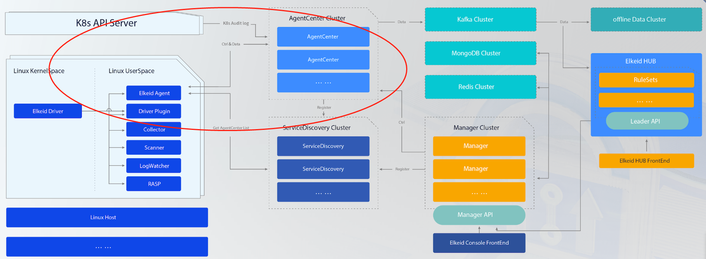
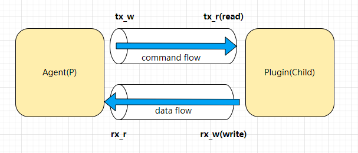
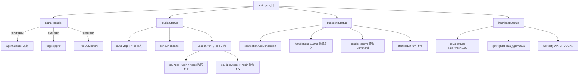
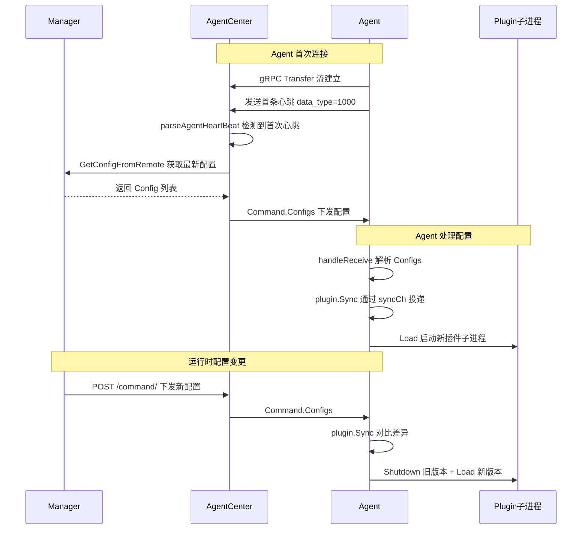
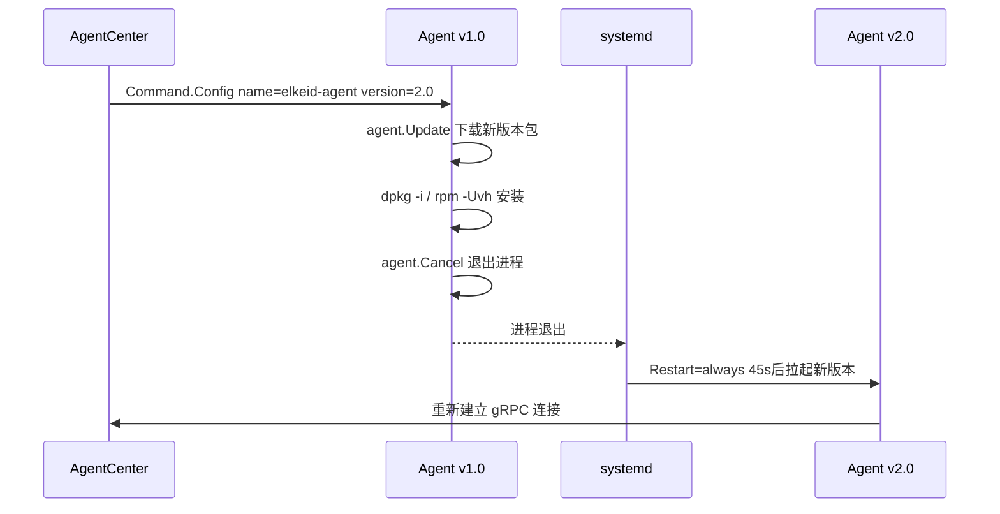
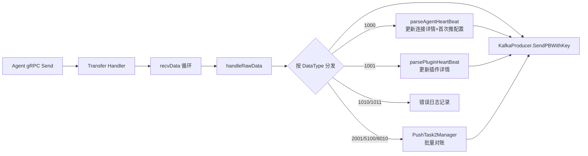
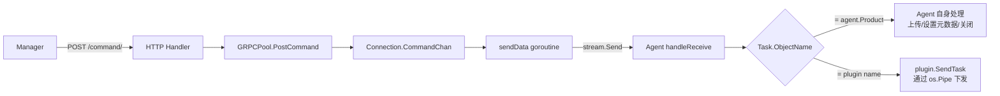
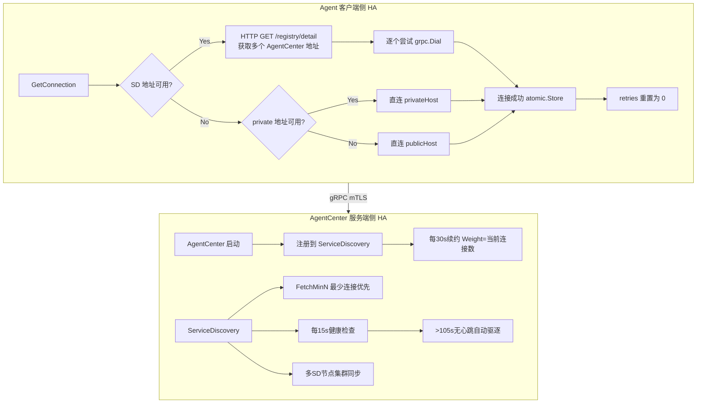
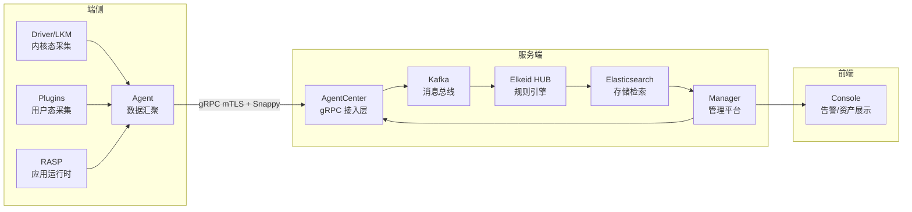

##  0x00    前言
Elkeid 后台主要模块如下：

-   AgentCenter 模块：负责与 Agent 进行通信，采集 Agent 数据并简单处理后汇总到消息队列集群，同时也负责对 Agent 进行管理包括 Agent 的升级，配置修改，任务下发等。同时 AgentCenter 也对外提供 HTTP 接口，Manager 模块通过这些 HTTP 接口实现对 AgentCenter 和 Agent 的管理和监控
-   ServiceDiscovery 模块：注册中心，后台中的各个服务模块都需要向 ServiceDiscovery 定时注册、同步服务信息，从而保证各个服务模块中的实例相互可见，便于直接通信。由于 ServiceDiscovery 模块维护了各个注册服务的状态信息，所以当服务使用方在请求服务发现时，ServiceDiscovery 模块会进行负载均衡。比如 Agent 请求获取 AgentCenter 模块实例列表，ServiceDiscovery 模块直接返回负载压力最小的 AgentCenter 实例
-   Manager 模块：负责对整个后台进行管理并提供相关的查询、管理接口。包括管理 AgentCenter 集群，监控 AgentCenter 状态，控制 AgentCenter 服务相关参数，并通过 AgentCenter 管理所有的 Agent，收集 Agent 运行状态，向 Agent 下发任务（走控制 control 信道），同时 manager 模块也负责管理实时和离线计算集群
-   Elkeid Console：Elkeid 前端部分，通过 Elkeid Console 可查看告警 / 资产数据
-   Elkeid HUB：Elkeid HIDS RuleEngine，对数据进行分析和检测，参考[bytedance/Elkeid-HUB](https://github.com/bytedance/Elkeid-HUB)

本文基于 [v1.9.1.9](https://github.com/bytedance/Elkeid/releases/tag/v1.9.1.9) 版本分析，本文主要关注如下模块的实现




##  0x01    Agent && Plugins
Elkeid Agent 的设计还是非常典型的，为笔者丰富了此类主机 Agent 开发视角。Elkeid Agent 提供端上组件的基本能力支撑，包括数据通信（RPC stream）、资源监控、组件版本控制、文件传输、机器基础信息采集等。Agent 本身作为一个插件底座以系统服务的方式运行，其他子插件的策略存放于服务器端的配置，Agent 接收到相应的控制指令及配置后对自身及插件进行开启、关闭、升级等操作

Agent 与 AgentServer 之间采用 bi-stream gRPC（TLS）进行 [通信](https://github.com/pandaychen/elkeid_fork/blob/main/server/agent_center/grpctrans/proto/grpc.proto#L102)，一些细节如下：

1.  Agent -> AgentServer 方向为数据通道（上报），子 plugin 获取的数据会通过此链路上报
2.  AgentServer -> Agent 方向为指令通道（控制流），作为通知 Agent 执行相关的指令等，见 [此](https://github.com/pandaychen/elkeid_fork/blob/main/server/agent_center/grpctrans/proto/grpc.proto#L31C9-L31C19)，使用 protobuf 的不同 message 类型来标识不同指令类型
3.  Agent 本身支持客户端侧服务发现，也支持跨 Region 级别的通信配置，实现一个 Agent 包在多个网络隔离的环境下进行安装，基于底层一个 TCP 连接，在上层实现了 `Transfer` 与 `FileOp` 两种数据传输服务，支撑了插件本身的数据上报与 Host 中的文件交互
4.  Plugins（安全能力插件）与 Agent 为 **父/子** 进程关系，以两个 `os.Pipe()` 作为跨进程通信方式，Plugins 实现了 Go/Rust 的两个插件库，负责插件端信息的编码与发送（参考下图）。Plugins 发送数据后，会被编码为 Protobuf 二进制数据，Agent 接收到后无需二次解编码，在其外层拼接好 `Header` 特征数据，直接传输给 Server，一般情况下 Server 也无需解码，直接传输至后续数据流中，使用时进行解码，一定程度上降低了数据传输中多次编解码造成的额外性能开销，这里的逻辑参考 `WriteEncodedRecord` 的 [实现](https://github.com/pandaychen/elkeid_fork/blob/main/agent/plugin/plugin_linux.go#L158)，这里的实现思路非常值得借鉴
5.  Agent 采用 Go 开发，在 Linux 下，通过 `systemd` 作为守护方式，通过 `cgroup` 限制资源使用



####    Plugin

todo：plugin 的抽象与实现接口

```go
func (p *Plugin) ReceiveData() (rec *proto.EncodedRecord, err error) {
        var l uint32
        err = binary.Read(p.reader, binary.LittleEndian, &l)
        if err != nil {
                return
        }
        _, err = p.reader.Discard(1)
        if err != nil {
                return
        }
        te := 1

        var dt, ts, e int

        dt, e, err = readVarint(p.reader)
        if err != nil {
                return
        }
        _, err = p.reader.Discard(1)
        if err != nil {
                return
        }
        te += e + 1

        ts, e, err = readVarint(p.reader)
        if err != nil {
                return
        }
        _, err = p.reader.Discard(1)
        if err != nil {
                return
        }
        te += e + 1

        if uint32(te) < l {
                _, e, err = readVarint(p.reader)
                if err != nil {
                        return
                }
                te += e
                ne := int(l) - te
                rec = buffer.GetEncodedRecord(ne)
                rec.DataType = int32(dt)
                rec.Timestamp = int64(ts)
                if cap(rec.Data) < ne {
                        rec.Data = make([]byte, ne)
                } else {
                        rec.Data = rec.Data[:ne]
                }
                _, err = io.ReadFull(p.reader, rec.Data)
                if err != nil {
                        return
                }
        }
        atomic.AddUint64(&p.txCnt, 1)
        atomic.AddUint64(&p.txBytes, uint64(l))
        return
}
```

##  0x02 Agent 核心代码
Agent 主要包含三个子模块：

-   heartbeat：处理自身 host 层面以及各个插件的核心运行指标上报，同时配合 systemd watchdog 实现进程保活
-   plugin：处理各个子插件的启动/停止/升级（所有的插件），负责与各个子插件的上行（数据采集）、下行（指令下发与控制）通信等
-   transport：负责与 AgentCenter（下文简称 AgentServer）通信，作为 bi-stream gRPC 的客户端，负责打通 plugin 模块与 AgentServer 的上下行传输通道

Agent 的整体架构如下图所示：



Agent 入口 `main.go` 核心逻辑如下，通过 `sync.WaitGroup` 协调三个子系统的生命周期：

```GO
func main() {
    // 初始化 logger（grpc + file 双写，采样限流）
    // ...

    // sysvinit 模式下使用 lockfile 防止重复启动
    if os.Getenv("service_type") == "sysvinit" {
        l, _ := lockfile.New(pidFile)
        if err := l.TryLock(); err != nil {
            return
        }
    }

    wg := &sync.WaitGroup{}
    wg.Add(3)
    go heartbeat.Startup(agent.Context, wg)     // 心跳上报
    go plugin.Startup(agent.Context, wg)         // 插件管理
    go func() {
        transport.Startup(agent.Context, wg)     // gRPC 传输
        agent.Cancel()  // transport 退出意味着连接不可恢复，触发整体退出
    }()

    // 信号处理 goroutine
    go func() {
        sigs := make(chan os.Signal, 1)
        signal.Notify(sigs, syscall.SIGTERM, syscall.SIGUSR1, syscall.SIGUSR2)
        for {
            switch <-sigs {
            case syscall.SIGTERM:
                <-time.After(time.Second * 5)  // 等待 5s 优雅退出
                agent.Cancel()
            case syscall.SIGUSR1:
                // 开关本机 pprof（127.0.0.1 随机端口）
            case syscall.SIGUSR2:
                debug.FreeOSMemory()  // 手动释放 OS 内存
            }
        }
    }()

    wg.Wait()
    os.RemoveAll(filepath.Join(agent.WorkingDirectory, "tmp"))
}
```

其中 `agent` 包定义了全局状态（`agent/agent/id.go`）：
- `agent.Context` / `agent.Cancel()`：全局 context，用于协调各子系统退出
- `agent.ID`：Agent 唯一标识
- `agent.Product`：产品名（默认 `elkeid-agent`），用于区分 Agent 自身和插件
- `agent.Version`：编译时注入的版本号
- `agent.WorkingDirectory`：工作目录（默认 `/etc/elkeid`）

此外，`runtime.GOMAXPROCS(8)` 在 `init()` 中手动设置，避免默认值导致 GC 时间大幅上升

####    heartbeat：心跳上报

heartbeat 子系统每 **1 分钟** 执行一次，上报两类心跳数据：

1. **Agent 心跳**（`data_type=1000`）：包含主机信息（内核版本、平台、架构）、Agent 资源消耗（CPU、RSS、磁盘、FD 数）、gRPC 流量统计（rx/tx 速率）、负载均值（load average）、主机硬件信息（序列号、DNS、网关）等
2. **插件心跳**（`data_type=1001`）：遍历所有运行中的插件，上报每个插件的资源消耗和数据吞吐量

核心代码位于 `agent/heartbeat/heartbeat.go`：

```GO
func Startup(ctx context.Context, wg *sync.WaitGroup) {
    defer wg.Done()
    getAgentStat(time.Now())  // 启动时立即上报一次
    ticker := time.NewTicker(time.Minute)
    defer ticker.Stop()
    for {
        select {
        case <-ctx.Done():
            return
        case t := <-ticker.C:
            host.RefreshHost()   // 刷新主机 IP/hostname 等动态信息
            getAgentStat(t)      // 上报 Agent 心跳
            getPlgStat(t)        // 上报所有插件心跳
        }
    }
}
```

`getAgentStat` 中的关键细节：通过 `resource.GetProcResouce(os.Getpid())` 获取自身进程资源指标，通过 `connection.DefaultStatsHandler.GetStats(now)` 获取 gRPC 层的网络收发速率，最后调用 `daemon.SdNotify(false, "WATCHDOG=1")` 通知 systemd watchdog 进程仍然存活，以配合 systemd 的进程保活机制

####    plugin：插件处理

1、插件的创建及加载

在`Startup`[方法](https://github.com/pandaychen/elkeid_fork/blob/main/agent/plugin/plugin.go#L172)中，通过接收来自 AgentServer 的 RPC 响应来执行插件的启停，插件的启停核心代码如下：

```GO
func Load(ctx context.Context, config proto.Config) (plg *Plugin, err error) {  
    //通过插件名称查找插件对象，并校验参数，校验失败则返回
    // m      = &sync.Map{} 
    loadedPlg, ok := m.Load(config.Name) 
    
    //...... 
    
    workingDirectory := path.Join(agent.WorkingDirectory, "plugin", config.Name)
    
    //构造插件的执行路径
    execPath := path.Join(workingDirectory, config.Name) 
    
    cmd := exec.Command(execPath)
    var rx_r, rx_w, tx_r, tx_w *os.File
    
    //创建插件进程->agent进程方向的管道，插件向rx_w写入数据，agent从rx_r中读取数据
    rx_r, rx_w, err = os.Pipe() 
    if err != nil {
        return
    }
    
    //创建agent进程->插件进程方向的管道，agent向tx_w写入数据，插件从tx_r中读取数据
    tx_r, tx_w, err = os.Pipe() 
    if err != nil {
        return
    }
    cmd.SysProcAttr = &syscall.SysProcAttr{Setpgid: true}
    
    // 通过 cmd.ExtraFiles 将管道传递给子进程，子进程中 fd 3 = tx_r（读取指令），fd 4 = rx_w（写入数据）
    // 注意：这不是设置 stdin/stdout，而是额外的文件描述符（fd 0/1/2 之后依次编号）
    cmd.ExtraFiles = append(cmd.ExtraFiles, tx_r, rx_w) 
    cmd.Dir = workingDirectory
    var errFile *os.File
    errFile, err = os.OpenFile(execPath+".stderr", os.O_CREATE|os.O_RDWR|os.O_TRUNC, 0o0600)
    if err != nil {
        return
    }
    defer errFile.Close()
    cmd.Stderr = errFile //设置stderr为文件
    if config.Detail != "" {
        cmd.Env = append(cmd.Env, "DETAIL="+config.Detail)
    }
    logger.Info("plugin's process will start")
    err = cmd.Start()
    tx_r.Close()    //agent进程使用tx_w和rx_r，用不到tx_r和rx_w，所以将这两者关闭
    rx_w.Close()
    //......
}
```

在通过`cmd.Start()`以 fork 方式启动了插件子进程之后，接下来就是构造子插件，并且使用`os.Pipe`提供的读写机制进行通信，核心代码如下，包含了 3 个独立的子 goroutine：

1.  异步等待插件 plugin 退出
2.  plugin->agent：采集数据上报
3.  agent->plugin：任务发送到 plugin

```GO
func Load(ctx context.Context, config proto.Config) (plg *Plugin, err error) {

    // 此处省略前面的创建过程
    plg = &Plugin{
        Config:        config,
        mu:            &sync.Mutex{},
        cmd:           cmd,
        rx:            rx_r,        //plugin的读端
        updateTime:    time.Now(),
        reader:        bufio.NewReaderSize(rx_r, 1024*128), //将管道的读端初始化为带缓冲区的io.Reader对象，提高读效率
        tx:            tx_w,        //plugin的写端
        done:          make(chan struct{}),     //用于完成通知调用方的channel，参考<异步等待插件退出>实现
        taskCh:        make(chan proto.Task),   //传递任务的channel，异步
        wg:            &sync.WaitGroup{},
        SugaredLogger: logger,
    }
    plg.wg.Add(3)
    
    //等待插件进程退出的协程
    //退出时关闭rx_r和tx_w管道，同时将完成通知投递到plg.done channel中
    go func() {
        defer plg.wg.Done()
        defer plg.Info("gorountine of waiting plugin's process will exit")
        err = cmd.Wait() //等待插件进程退出（以阻塞形式等待插件进程退出）
        rx_r.Close()    //退出时关闭rx_r和tx_w管道
        tx_w.Close()
        if err != nil {
            plg.Errorf("plugin has exited with error:%v,code:%d", err, cmd.ProcessState.ExitCode())
        } else {
            plg.Infof("plugin has exited with code %d", cmd.ProcessState.ExitCode())
        }
        close(plg.done) //通知完成（发送插件完成通知）
    }()
    
    //异步接收插件数据，并发送到上层
    go func() { 
        defer plg.wg.Done()
        defer plg.Info("gorountine of receiving plugin's data will exit")
        for {
            rec, err := plg.ReceiveData()  //解析Record结构
            if err != nil {
                if errors.Is(err, bufio.ErrBufferFull) {
                    plg.Warn("when receiving data, buffer is full, skip this record")
                    continue
                } else if !(errors.Is(err, io.EOF) || errors.Is(err, io.ErrClosedPipe) || errors.Is(err, os.ErrClosed)) {
                    plg.Error("when receiving data, an error occurred: ", err)
                } else {
                    break
                }
            }
            // 将 EncodedRecord 写入全局缓冲数组，transport 层的 handleSend 会定时批量读取并通过 gRPC 发送
            // buf = [2048]*proto.EncodedRecord{}
            buffer.WriteEncodedRecord(rec)
        }
    }()

    go func() { //异步向插件发送任务
        defer plg.wg.Done()
        defer plg.Info("gorountine of sending task to plugin will exit")
        for {
            select {
            case <-plg.done:
                return
            case task := <-plg.taskCh: //任务通道中有任务存在，取出任务
                s := task.Size()
                var dst = make([]byte, 4+s)
                _, err = task.MarshalToSizedBuffer(dst[4:])//将task任务序列化到dst缓冲区(从下标4开始)
                if err != nil {
                    plg.Errorf("when marshaling a task, an error occurred: %v, ignored this task: %+v", err, task)
                    continue
                }
                binary.LittleEndian.PutUint32(dst[:4], uint32(s))//task任务大小写入到dst的前4个字节中
                var n int
                n, err = plg.tx.Write(dst) //任务写入管道
                if err != nil {
                    if !errors.Is(err, os.ErrClosed) {
                        plg.Error("when sending task, an error occurred: ", err)
                    }
                    return
                }
                atomic.AddUint64(&plg.rxCnt, 1)
                atomic.AddUint64(&plg.rxBytes, uint64(n))
            }
        }
    }()
    m.Store(config.Name, plg) //将插件信息保存到sync.Map中
    return
}
```

附带一下`buffer.WriteEncodedRecord`的实现（并发安全），位于 `agent/buffer/buffer.go`：

```GO
var (
    mu     = &sync.Mutex{}
    buf    = [2048]*proto.EncodedRecord{}  // 固定容量 2048 的缓冲数组
    offset = 0
    hook   func(any) any
)

func WriteEncodedRecord(rec *proto.EncodedRecord) {
    if hook != nil {
        rec = hook(rec).(*proto.EncodedRecord)
    }
    mu.Lock()
    if offset < len(buf) {
        buf[offset] = rec
        offset++
    } else {
        // buffer 已满，直接归还对象池，丢弃该条记录
        PutEncodedRecord(rec)
    }
    mu.Unlock()
}

// transport 层 handleSend 批量读取并清空 buffer
func ReadEncodedRecords() (ret []*proto.EncodedRecord) {
    mu.Lock()
    ret = make([]*proto.EncodedRecord, offset)
    copy(ret, buf[:offset])
    offset = 0
    mu.Unlock()
    return
}
```

3、插件的模版实现（Golang）

elkeid 对所有插件与 Agent 的通信做了封装，代码比较直观，[参考](https://github.com/pandaychen/elkeid_fork/tree/main/plugins/lib/go)，核心就是`Client.SendRecord`和`Client.ReceiveTask`方法：


```GO
func New() (c *Client) {
    c = &Client{
        rx: os.Stdin,   // 保留字段，非主通信管道
        tx: os.Stdout,  // 保留字段，非主通信管道
        // 真正的通信管道通过 cmd.ExtraFiles 传递，在插件子进程中为 fd 3 和 fd 4
        // fd 3 = Agent->Plugin 方向（下行，接收指令/任务）
        // fd 4 = Plugin->Agent 方向（上行，发送采集数据）
        reader: bufio.NewReaderSize(os.NewFile(3, "pipe"), 1024*1024),  // 读取 Agent 下发的 Task
        writer: bufio.NewWriterSize(os.NewFile(4, "pipe"), 512*1024),   // 写入采集数据给 Agent
        rmu:    &sync.Mutex{},
        wmu:    &sync.Mutex{},
    }
    //创建ticker定时器，定时刷新一次缓存（调用 c.Flush() 函数）
    go func() {
        ticker := time.NewTicker(time.Millisecond * 200)
        defer ticker.Stop()
        for {
            <-ticker.C
            if err := c.Flush(); err != nil {
                break
            }
        }
    }()
    return
}

func (c *Client) Flush() (err error) {
	c.wmu.Lock()
	defer c.wmu.Unlock()
	if c.writer.Buffered() != 0 {
        // 发送数据
		err = c.writer.Flush()
	}
	return
}
```

接下来是`SendRecord`与`ReceiveTask`方法：

1.  `ReceiveTask`：从下行管道（fd 3，Agent->Plugin 方向）读取 Agent 下发的指令，反序列化为 `Task` 类型
2.  `SendRecord`：plugin 将采集的数据通过上行管道（fd 4，Plugin->Agent 方向）写出，即 `Client.writer`

```GO
func (c *Client) SendRecord(rec *Record) (err error) {
	c.wmu.Lock()
	defer c.wmu.Unlock()
	size := rec.Size()
	err = binary.Write(c.writer, binary.LittleEndian, uint32(size))
	if err != nil {
		return
	}
	var buf []byte
	buf, err = rec.Marshal()
	if err != nil {
		return
	}
	_, err = c.writer.Write(buf)
	return
}

func (c *Client) ReceiveTask() (t *Task, err error) {
	c.rmu.Lock()
	defer c.rmu.Unlock()
	var len uint32
	err = binary.Read(c.reader, binary.LittleEndian, &len)
	if err != nil {
		return
	}
	var buf []byte
	buf, err = c.reader.Peek(int(len))
	if err != nil {
		return
	}
	_, err = c.reader.Discard(int(len))
	if err != nil {
		return
	}
	t = &Task{}
	err = t.Unmarshal(buf)
	return
}
```

####    配置热更新机制

Elkeid Agent **不是**传统的本地配置文件 watch 模式的热更新，而是**服务端推送式配置同步**——所有的插件配置和版本信息都存储在服务端，通过 gRPC 双向流的 `Command` 消息下发到 Agent。

配置热更新的完整流程如下：



**1、插件配置同步**

当 Agent 的 `handleReceive` 收到不含 `Task` 的 `Command` 时，会解析其中的 `Configs` 并调用 `plugin.Sync`：

```GO
// agent/transport/transfer.go - handleReceive
cfgs := map[string]*proto.Config{}
for _, config := range cmd.Configs {
    cfgs[config.Name] = config
}
// 若包含 Agent 自身的新版本配置，则触发自升级（见下文）
if cfg, ok := cfgs[agent.Product]; ok && cfg.Version != agent.Version {
    err := agent.Update(*cfg)
    if err == nil {
        agent.Cancel()   // 升级成功，退出进程，由 systemd 拉起新版本
        return
    }
}
delete(cfgs, agent.Product)
// 同步插件配置
plugin.Sync(cfgs)
```

`plugin.Sync` 通过带缓冲的 channel（`syncCh`）异步投递配置到 `plugin.Startup` 的主循环中处理：

```GO
// agent/plugin/plugin.go - Startup 主循环中消费 syncCh
case cfgs := <-syncCh:
    // 加载新插件或升级已有插件
    for _, cfg := range cfgs {
        if cfg.Name != agent.Product {
            plg, err := Load(ctx, *cfg)
            if err == ErrDuplicatePlugin {
                continue  // 同名同版本且正在运行，无需操作
            }
        }
    }
    // 移除不在新配置中的插件
    for _, plg := range GetAll() {
        if _, ok := cfgs[plg.Config.Name]; !ok {
            plg.Shutdown()                          // 优雅关闭
            m.Delete(plg.Config.Name)               // 从注册表移除
            os.RemoveAll(plg.GetWorkingDirectory()) // 清理工作目录
        }
    }
```

`Load` 函数内部也处理了**版本变更**的场景：如果发现同名插件已存在但版本不同，会先 `Shutdown` 旧版本再启动新版本：

```GO
// agent/plugin/plugin_linux.go - Load
loadedPlg, ok := m.Load(config.Name)
if ok {
    loadedPlg := loadedPlg.(*Plugin)
    if loadedPlg.Config.Version == config.Version && loadedPlg.cmd.ProcessState == nil {
        err = ErrDuplicatePlugin  // 同版本且运行中，跳过
        return
    }
    if loadedPlg.Config.Version != config.Version && loadedPlg.cmd.ProcessState == nil {
        loadedPlg.Shutdown()  // 版本不同，先关闭旧版本
    }
}
```

**2、首次心跳自动推送配置**

在服务端 AgentCenter 中，当收到 Agent 的首条心跳（`data_type=1000`）时，会自动触发配置推送：

```GO
// server/agent_center/grpctrans/grpc_handler/rawdata_worker.go
func parseAgentHeartBeat(record *pb.Record, req *pb.RawData, conn *pool.Connection) map[string]interface{} {
    // ...解析心跳数据...
    if len(conn.GetAgentDetail()) == 0 {
        conn.SetAgentDetail(detail)
        // 首次心跳，推送最新配置
        GlobalGRPCPool.PostLatestConfig(req.AgentID)
    } else {
        conn.SetAgentDetail(detail)
    }
    return detail
}
```

`PostLatestConfig` 通过异步 channel 触发 `checkConfig` goroutine，后者从 Manager 获取最新配置再下发给 Agent：

```GO
// server/agent_center/grpctrans/pool/pool.go
func (g *GRPCPool) checkConfig() {
    for {
        agentID := <-g.confChan
        conn, _ := g.GetByID(agentID)
        // 从 Manager 获取该 Agent 应加载的组件配置
        config, _ := client.GetConfigFromRemote(agentID, conn.GetAgentDetail())
        cmd := &pb.Command{ Config: config }
        g.PostCommand(agentID, cmd)  // 通过 gRPC 流下发
    }
}
```

####    Agent 热重启（自升级）机制

Agent 自升级的触发条件是：服务端下发的 `Command.Configs` 中包含 `Name == agent.Product` 且 `Version != agent.Version` 的配置项。

升级流程：
1. `agent.Update(*cfg)` 下载新版本安装包
2. 根据包类型执行 `dpkg -i` 或 `rpm -Uvh`（或直接执行裸安装包）
3. 安装成功后调用 `agent.Cancel()` 退出当前进程
4. 由 systemd 的 `Restart=always` + `RestartSec=45` 自动拉起新版本进程



此外，`elkeidctl`（部署控制命令行工具）也支持手动触发重启：

```GO
// agent/deploy/control/cmd/restart.go
if viper.GetString("service_type") == "systemd" {
    cmd := exec.Command("systemctl", "restart", serviceName)
    cmd.Run()
} else if viper.GetString("service_type") == "sysvinit" {
    // sysvinit 模式：停止进程 -> 重新启动 -> 恢复 crontab 保活
    sysvinitStop()
    sysvinitStart()
}
```

####    systemd 启动配置

Elkeid Agent 在 Linux 下通过 systemd 作为守护进程管理，配置文件位于 `agent/deploy/elkeid-agent.service`：

```ini
[Unit]
Description=elkeid-agent
Wants=network-online.target
After=network-online.target network.target syslog.target

[Service]
Type=simple
ExecStart=/etc/elkeid/elkeid-agent
WorkingDirectory=/etc/elkeid
Restart=always
RestartSec=45
KillMode=control-group
MemoryMax=250M
MemoryLimit=250M
CPUQuota=10%
Delegate=yes
EnvironmentFile=-/etc/elkeid/specified_env

[Install]
WantedBy=multi-user.target
```

各配置项说明：

| 配置项 | 值 | 说明 |
|--------|-----|------|
| `Type=simple` | - | 主进程即服务进程，`ExecStart` 启动后即视为服务已启动 |
| `Restart=always` | - | 无论退出原因（正常/异常/信号），都自动重启，这是自升级机制的基础 |
| `RestartSec=45` | 45s | 重启间隔 45 秒，避免频繁重启导致系统负载过高 |
| `KillMode=control-group` | - | 停止服务时杀掉整个 cgroup 中的所有进程，确保插件子进程也被终止 |
| `MemoryMax=250M` | 250MB | cgroup v2 内存硬限制，超出将被 OOM Killer 终止 |
| `MemoryLimit=250M` | 250MB | cgroup v1 内存限制（兼容旧内核） |
| `CPUQuota=10%` | 10% | CPU 配额限制，防止 Agent 消耗过多 CPU 资源 |
| `Delegate=yes` | - | 允许 Agent 进程在自己的 cgroup 子树中进一步管理资源 |
| `EnvironmentFile=-` | 可选 | `-` 前缀表示文件不存在时不报错，用于注入自定义环境变量 |

**代码适配细节**：

1、`main.go` 中 sysvinit 兼容：当 `service_type=sysvinit` 时使用 lockfile 防止重复启动

```GO
if os.Getenv("service_type") == "sysvinit" {
    l, _ := lockfile.New(pidFile)   // pidFile = "/var/run/elkeid-agent.pid"
    if err := l.TryLock(); err != nil {
        return
    }
}
```

2、`heartbeat.go` 中 systemd watchdog 通知：每分钟心跳时调用 `SdNotify` 告知 systemd 进程存活

```GO
daemon.SdNotify(false, "WATCHDOG=1")
```

3、`GOMAXPROCS(8)` 手动设置：在 `init()` 中固定最大并行度，避免 Go runtime 默认按 CPU 核数设置导致 GC 性能波动

####    transport 模块

transport 模块是 Agent 的网络传输层，负责与 AgentCenter 之间的所有通信。它由两个子系统组成：

```GO
// agent/transport/transport.go
func Startup(ctx context.Context, wg *sync.WaitGroup) {
    defer wg.Done()
    subCtx, cancel := context.WithCancel(ctx)
    defer cancel()
    subWg := &sync.WaitGroup{}
    defer subWg.Wait()
    subWg.Add(2)
    go startFileExt(subCtx, subWg)  // 文件上传服务
    go func() {
        startTransfer(subCtx, subWg)  // 数据传输主服务
        cancel()  // Transfer 退出时取消 FileExt
    }()
}
```

- **Transfer**：基于 bi-stream gRPC 的核心数据/指令通道，上行发送采集数据，下行接收命令
- **FileExt**：基于独立 gRPC stream 的文件上传服务，用于将主机上的文件传输到服务端

**1、连接管理**

连接管理的核心位于 `agent/transport/connection/connection.go`，采用三级 fallback 机制建立 gRPC 连接：

```GO
func GetConnection(ctx context.Context) (*grpc.ClientConn, error) {
    // 1. 尝试复用已有连接
    c, ok := conn.Load().(*grpc.ClientConn)
    if ok {
        switch c.GetState() {
        case connectivity.Ready, connectivity.Idle:
            if atomic.AddInt32(&retries, 1) > 5 {
                c.Close()  // 超过 5 次复用尝试，强制重新连接
            } else {
                return c, nil
            }
        default:
            c.Close()
        }
    }

    region := Region.Load().(string)
    
    // 2. 优先通过 ServiceDiscovery 获取 AgentCenter 地址列表
    host, ok := serviceDiscoveryHost[region]
    if ok {
        addrs, err := resolveServiceDiscovery(host, 10)
        // 逐个尝试连接
        for _, addr := range addrs {
            c, err = grpc.DialContext(ctx, addr, dialOptions...)
            if err == nil {
                conn.Store(c)
                NetMode.Store("sd")
                return c, nil
            }
        }
    }

    // 3. 回退到内网直连
    host, ok = privateHost[region]
    if ok { /* grpc.DialContext ... NetMode="private" */ }

    // 4. 最后尝试公网直连
    host, ok = publicHost[region]
    if ok { /* grpc.DialContext ... NetMode="public" */ }

    return nil, err
}
```

ServiceDiscovery 解析逻辑：向 SD 服务发送 HTTP 请求获取负载最小的 AgentCenter 实例列表

```GO
func resolveServiceDiscovery(host string, count int) ([]string, error) {
    // GET http://{sd_host}/registry/detail?name=hids_svr_grpc&count=10
    serviceDiscoveryURL := url.URL{
        Scheme: "http", Host: host,
        Path: "registry/detail",
        RawQuery: "name=hids_svr_grpc&count=" + strconv.Itoa(count),
    }
    resp, _ := http.Get(serviceDiscoveryURL.String())
    // 解析返回的 IP:Port 列表
}
```

连接安全：采用 **mTLS 双向认证**，客户端和服务端互相验证证书

```GO
func setDialOptions(ca, privkey, cert []byte, svrName string) {
    dialOptions = append(dialOptions,
        grpc.WithTransportCredentials(credentials.NewTLS(&tls.Config{
            Certificates:       []tls.Certificate{keyPair},
            ClientAuth:         tls.RequireAndVerifyClientCert,
            RootCAs:            certPool,
            InsecureSkipVerify: true,
            VerifyPeerCertificate: func(rawCerts [][]byte, _ [][]*x509.Certificate) error {
                // 自定义证书验证：解析证书链并验证 DNSName
                certs := make([]*x509.Certificate, len(rawCerts))
                for i, asn1Data := range rawCerts {
                    certs[i], _ = x509.ParseCertificate(asn1Data)
                }
                opts := x509.VerifyOptions{Roots: certPool, DNSName: svrName}
                _, err := certs[0].Verify(opts)
                return err
            },
        })),
        grpc.WithStatsHandler(&DefaultStatsHandler),  // 网络流量统计
        grpc.WithBlock(),                              // 阻塞等待连接建立
        grpc.WithReturnConnectionError(),              // 返回底层连接错误
        grpc.FailOnNonTempDialError(true),             // 非临时错误立即失败
    )
}
```

Region 配置通过 build tag `product.go` 在编译时注入默认值，也支持环境变量 `specified_idc`、`specified_region` 覆盖，运行时还可通过服务端 Task（`data_type=1051`）动态修改。

**2、Transfer 主循环**

`startTransfer` 是 Agent 传输层的核心，实现了**获取连接 -> 建立流 -> 收发数据 -> 错误重连**的循环：

```GO
// agent/transport/transfer.go
func startTransfer(ctx context.Context, wg *sync.WaitGroup) {
    defer wg.Done()
    retries := 0
    for {
        conn, err := connection.GetConnection(ctx)
        if err != nil {
            if retries > 5 {
                return  // 连续 5 次失败，触发 transport 退出（自保护机制）
            }
            select {
            case <-ctx.Done(): return
            case <-time.After(time.Second * 5): retries++; continue
            }
        }
        retries = 0

        // 创建双向流，使用 Snappy 压缩
        client, err := proto.NewTransferClient(conn).Transfer(subCtx, grpc.UseCompressor("snappy"))
        if err == nil {
            go handleSend(subCtx, subWg, client)   // 数据上报协程
            go func() {
                handleReceive(subCtx, subWg, client)  // 指令接收协程
                cancel()  // 接收出错时取消发送
            }()
            subWg.Wait()
        }
        // 流断开后等待 5s 重试
        select {
        case <-ctx.Done(): return
        case <-time.After(time.Second * 5):
        }
    }
}
```

**3、handleSend：批量数据上报**

`handleSend` 每 100ms 批量读取 buffer 中的数据，组装为 `PackagedData` 一次性发送：

```GO
func handleSend(ctx context.Context, wg *sync.WaitGroup, client proto.Transfer_TransferClient) {
    defer wg.Done()
    defer client.CloseSend()
    ticker := time.NewTicker(time.Millisecond * 100)
    defer ticker.Stop()
    for {
        select {
        case <-ctx.Done(): return
        case <-ticker.C:
            recs := buffer.ReadEncodedRecords()  // 原子地读取并清空 buffer
            if len(recs) != 0 {
                err := client.Send(&proto.PackagedData{
                    Records:      recs,
                    AgentId:      agent.ID,
                    IntranetIpv4: host.PrivateIPv4.Load().([]string),
                    ExtranetIpv4: host.PublicIPv4.Load().([]string),
                    Hostname:     host.Name.Load().(string),
                    Version:      agent.Version,
                    Product:      agent.Product,
                })
                // 发送完成后归还 EncodedRecord 到对象池
                for _, rec := range recs {
                    buffer.PutEncodedRecord(rec)
                }
            }
        }
    }
}
```

**4、handleReceive：指令接收与分发**

`handleReceive` 接收服务端下发的 `Command`，根据内容分为两类处理：

- **含 Task**：根据 `Task.ObjectName` 判断是给 Agent 自身（文件上传/设置元数据/关闭 Agent）还是给插件的任务
- **含 Configs**：触发 Agent 自升级或插件配置同步

```GO
func handleReceive(ctx context.Context, wg *sync.WaitGroup, client proto.Transfer_TransferClient) {
    defer wg.Done()
    for {
        cmd, err := client.Recv()
        if err != nil { return }
        if cmd.Task != nil {
            if cmd.Task.ObjectName == agent.Product {
                switch cmd.Task.DataType {
                case 1050:  // 文件上传请求
                    UploadFile(req)
                case 1051:  // 设置 idc/region 元数据
                    exec.Command(agent.Control, "set", "--idc="+idc).CombinedOutput()
                case 1060:  // 关闭 Agent
                    agent.Cancel()
                    return
                }
            } else {
                // 转发任务给对应插件
                plg, ok := plugin.Get(cmd.Task.ObjectName)
                if ok { plg.SendTask(*cmd.Task) }
            }
            continue
        }
        // 处理 Configs：Agent 升级 + 插件同步（见前文"配置热更新"章节）
        // ...
    }
}
```

**5、FileExt：文件上传**

文件上传通过独立的 gRPC stream `FileExt.Upload` 实现，使用 Snappy 压缩，按秒分块读取文件并发送：

```GO
// agent/transport/file_ext.go
func handleUpload(ctx context.Context, wg *sync.WaitGroup, req UploadRequest) {
    file, _ := os.Open(req.Path)
    // 文件大小不能超过 BufSize * 600s
    client, _ := proto.NewFileExtClient(conn).Upload(subCtx, grpc.UseCompressor("snappy"))
    ticker := time.NewTicker(time.Second)  // 每秒发送一块
    for {
        select {
        case <-ticker.C:
            n, rerr := io.ReadFull(file, buf)
            client.Send(&proto.FileUploadRequest{Token: req.token, Data: buf[:n]})
            if rerr == io.EOF || rerr == io.ErrUnexpectedEOF {
                resp, _ := client.CloseAndRecv()  // 上传完成
                return
            }
        case <-ctx.Done(): return
        }
    }
}
```

文件上传采用**单任务队列**（`uploadCh` 容量为 `0`），同一时间只允许一个上传任务执行。

##  0x03    AgentCenter (AgentServer)

AgentCenter 是 Elkeid 后台的核心接入层模块（代码中的目录名为 `server/agent_center`），负责与所有 Agent 的通信管理。其入口 `main.go` 同时启动 gRPC 和 HTTP 两个服务：

```GO
// server/agent_center/main.go
func main() {
    go httptrans.Run()   // HTTP 管理 API（Gin 框架）
    go grpctrans.Run()   // gRPC 数据/指令传输

    // 注册到 ServiceDiscovery
    regGrpc := svr_registry.NewGRPCServerRegistry()
    regHttp := svr_registry.NewHttpServerRegistry()
    defer regGrpc.Stop()
    defer regHttp.Stop()

    <-common.Sig  // 阻塞等待退出信号
}
```

AgentCenter gRPC server 的启动配置包含 mTLS 双向认证、keepalive 参数和消息大小限制：

```GO
// server/agent_center/grpctrans/grpc_server.go
func runServer(enableCA bool, port int, crtFile, keyFile, caFile string) {
    kaep := keepalive.EnforcementPolicy{
        MinTime:             5 * time.Second,    // 客户端 ping 最小间隔
        PermitWithoutStream: true,               // 允许无 stream 时 ping
    }
    kasp := keepalive.ServerParameters{
        MaxConnectionIdle: 20 * time.Minute,     // 空闲连接最大存活时间
        Time:              10 * time.Minute,     // 空闲时服务端主动 ping 间隔
        Timeout:           5 * time.Second,      // ping ACK 超时时间
    }
    opts := []grpc.ServerOption{
        grpc.KeepaliveEnforcementPolicy(kaep),
        grpc.KeepaliveParams(kasp),
        grpc.MaxRecvMsgSize(10 * 1024 * 1024),  // 最大消息 10MB
        grpc.MaxSendMsgSize(10 * 1024 * 1024),
    }
    if enableCA {
        opts = append(opts, grpc.Creds(credential(crtFile, keyFile, caFile)))
    }
    server := grpc.NewServer(opts...)
    pb.RegisterTransferServer(server, &grpc_handler.TransferHandler{})
    pb.RegisterFileExtServer(server, fileHandler)
    reflection.Register(server)  // 支持 gRPC 反射，便于调试
    // ...
}
```

服务端同时注册了 Snappy、zstd、gzip 三种压缩算法（通过 blank import），与 Agent 侧的 Snappy 压缩对应

####    数据流

数据流方向：Agent -> AgentCenter -> Kafka。核心处理链路如下：



**1、Transfer Handler：连接建立与管理**

每个 Agent 连接对应一个 `Transfer` 流处理器，核心逻辑位于 `transfer_handler.go`：

```GO
// server/agent_center/grpctrans/grpc_handler/transfer_handler.go
func (h *TransferHandler) Transfer(stream pb.Transfer_TransferServer) error {
    // 连接数限流：信号量检查
    if !GlobalGRPCPool.LoadToken() {
        return errors.New("out of max connection limit")
    }
    defer GlobalGRPCPool.ReleaseToken()

    // 接收首包获取 AgentID
    data, _ := stream.Recv()
    agentID := data.AgentID
    addr := peer.FromContext(stream.Context()).Addr.String()

    // 创建连接对象并加入全局连接池
    ctx, cancelButton := context.WithCancel(context.Background())
    connection := pool.Connection{
        AgentID:     agentID,
        SourceAddr:  addr,
        CreateAt:    time.Now().Unix(),
        CommandChan: make(chan *pool.Command),  // 指令下发 channel
        Ctx:         ctx,
        CancelFuc:   cancelButton,
    }
    GlobalGRPCPool.Add(agentID, &connection)
    defer GlobalGRPCPool.Delete(agentID)

    handleRawData(data, &connection)  // 处理首包数据

    go recvData(stream, &connection)  // 启动数据接收协程
    go sendData(stream, &connection)  // 启动指令发送协程

    <-connection.Ctx.Done()  // 阻塞等待连接关闭
    return nil
}
```

**2、handleRawData：数据处理与 Kafka 生产**

`handleRawData`（`rawdata_worker.go`）遍历每条 Record，构造 `MQData` 后写入 Kafka：

```GO
func handleRawData(req *pb.RawData, conn *pool.Connection) {
    var SvrTime = time.Now().Unix()
    var extraInfo = GlobalGRPCPool.GetExtraInfoByID(req.AgentID)  // 获取 Tag 等额外信息

    for k, v := range req.GetData() {
        // 从对象池获取 MQData，避免频繁分配
        mqMsg := kafka.MQMsgPool.Get().(*pb.MQData)
        mqMsg.DataType = v.DataType
        mqMsg.AgentTime = v.Timestamp
        mqMsg.Body = v.Body          // body 不做反序列化，直接透传（零拷贝）
        mqMsg.AgentID = req.AgentID
        mqMsg.Hostname = req.Hostname
        mqMsg.SvrTime = SvrTime
        if extraInfo != nil {
            mqMsg.Tag = extraInfo.Tags
        }

        // 按 DataType 分别处理
        switch mqMsg.DataType {
        case 1000:  // Agent 心跳
            detail := parseAgentHeartBeat(v, req, conn)
            metricsAgentHeartBeat(req.AgentID, "agent", detail)  // Prometheus 指标
        case 1001:  // 插件心跳
            detail := parsePluginHeartBeat(v, req, conn)
        case 2001, 2003, 6000, 5100, 5101, 8010:  // 任务对账数据
            item, _ := parseRecord(v)
            GlobalGRPCPool.PushTask2Manager(item)  // 异步批量推送到 Manager
        case 1010, 1011:  // Agent/插件错误日志
            // 记录到本地日志
        }

        // 所有类型的数据都发送到 Kafka
        common.KafkaProducer.SendPBWithKey(req.AgentID, mqMsg)
    }
}
```

**3、GRPCPool：全局连接池**

`GRPCPool`（`pool/pool.go`）是 AgentCenter 管理所有 Agent 连接的核心数据结构：

```GO
type GRPCPool struct {
    connPool  *cache.Cache    // AgentID -> *Connection，使用 go-cache 实现
    tokenChan chan bool        // 信号量，控制最大并发连接数

    confChan  chan string      // 配置推送 channel
    taskChan  chan map[string]string  // 任务对账 channel
    taskList  []map[string]string    // 任务批量缓冲
    // ...
}

type Connection struct {
    AgentID     string
    SourceAddr  string
    CommandChan chan *Command  // 指令下发 channel
    Ctx         context.Context
    CancelFuc   context.CancelFunc
    agentDetail map[string]interface{}   // Agent 心跳详情
    pluginDetail map[string]map[string]interface{}  // 各插件详情
}
```

连接池默认参数（`pool/options.go`）：

| 参数 | 默认值 | 说明 |
|------|--------|------|
| `PoolLength` | 1024 | 最大并发连接数 |
| `CommSendTimeOut` | 2s | 命令发送超时 |
| `CommResultTimeOut` | 2s | 命令结果等待超时 |
| `TaskTimeWeight` | 10s | 任务批量推送时间阈值 |
| `TaskCountWeight` | 100 | 任务批量推送数量阈值 |

####    指令流

指令流方向：Manager -> AgentCenter HTTP API -> GRPCPool -> gRPC Stream -> Agent



**1、HTTP API 入口：PostCommand**

Manager 通过 AgentCenter 的 HTTP API 下发指令，核心接口为 `POST /command/`：

```GO
// server/agent_center/httptrans/http_handler/command.go
type CommandRequest struct {
    AgentID string        `json:"agent_id" binding:"required"`
    Command CommandDetail `json:"command" binding:"required"`
}

type CommandDetail struct {
    AgentCtrl int32      `json:"agent_ctrl,omitempty"`
    Task      *TaskMsg   `json:"task,omitempty"`      // 任务指令
    Config    []ConfigMsg `json:"config,omitempty"`    // 配置变更
}

func PostCommand(c *gin.Context) {
    var taskModel CommandRequest
    c.BindJSON(&taskModel)
    // 构造 protobuf Command
    mgCommand := &pb.Command{ AgentCtrl: taskModel.Command.AgentCtrl }
    // 填充 Config 和 Task 字段...
    // 通过 GRPCPool 发送到对应 Agent
    grpc_handler.GlobalGRPCPool.PostCommand(taskModel.AgentID, mgCommand)
}
```

**2、GRPCPool.PostCommand：异步命令投递**

`PostCommand` 将命令写入对应连接的 `CommandChan`，并同步等待发送结果：

```GO
func (g *GRPCPool) PostCommand(agentID string, command *pb.Command) error {
    conn, _ := g.GetByID(agentID)
    cmdToSend := &Command{
        Command: command,
        Ready:   make(chan bool, 1),  // 用于等待发送结果
    }
    // 写入 CommandChan，带超时
    select {
    case conn.CommandChan <- cmdToSend:
    case <-time.After(g.conf.CommSendTimeOut):
        return errors.New("the sendPool of the agent is full")
    }
    // 等待发送结果
    select {
    case <-cmdToSend.Ready:
        return cmdToSend.Error
    case <-time.After(g.conf.CommResultTimeOut):
        return errors.New("get results timed out")
    }
}
```

**3、sendData：gRPC 流发送**

`sendData` goroutine 从 `CommandChan` 读取命令并通过 gRPC stream 发送给 Agent：

```GO
func sendData(stream pb.Transfer_TransferServer, conn *pool.Connection) {
    defer conn.CancelFuc()
    for {
        select {
        case <-conn.Ctx.Done(): return
        case cmd := <-conn.CommandChan:
            if cmd == nil {  // nil 表示关闭连接
                return
            }
            err := stream.Send(cmd.Command)
            cmd.Error = err
            close(cmd.Ready)  // 通知 PostCommand 发送完成
            if err != nil { return }
        }
    }
}
```

AgentCenter HTTP 管理 API 完整路由表：

| 方法 | 路径 | 说明 |
|------|------|------|
| GET | `/ping` | 健康检查 |
| GET | `/metrics` | Prometheus 指标 |
| GET | `/conn/stat` | 连接统计 |
| GET | `/conn/list` | 连接列表 |
| GET | `/conn/count` | 连接数 |
| POST | `/conn/reset` | 重置连接 |
| POST | `/command/` | 下发命令到 Agent |
| GET | `/kube/cluster/list` | K8s 集群列表 |

##  0x04    Agent 与 AgentCenter 高可用机制

Elkeid 在 Agent 与 AgentCenter 之间实现了多层高可用保障，涵盖客户端侧的连接 fallback 和服务端侧的负载均衡



####    客户端侧高可用

Agent 连接管理的高可用策略：

**1、三级连接 fallback**

按优先级依次尝试三种连接方式（详见前文 transport 模块的 `GetConnection`）：
- ServiceDiscovery 模式（`NetMode="sd"`）：通过 HTTP 获取多个地址逐个尝试
- 内网直连模式（`NetMode="private"`）：使用编译时注入的内网地址
- 公网直连模式（`NetMode="public"`）：使用编译时注入的公网地址

**2、连接状态监测与重试**

- 单连接缓存：`atomic.Value` 存储复用的 `*grpc.ClientConn`
- 基于 gRPC `connectivity.State` 的状态检测：`Ready`/`Idle` 时可复用，`TransientFailure`/`Shutdown` 时强制重拨
- 重试计数器 `retries`：连续复用超过 5 次时强制关闭重连，防止连接假活
- Dial 超时 15 秒，Transfer 层重试间隔 5 秒
- **自保护机制**：连续 5 次连接获取失败后 transport 退出，`main.go` 中 transport 退出会触发 `agent.Cancel()`，配合 systemd `Restart=always` 实现整体重启

**3、跨 Region 支持**

- 通过 build tag `product.go` 注入编译时的默认 region/idc 和各 region 的 SD/private/public 地址
- 支持环境变量 `specified_idc`、`specified_region` 覆盖默认值
- 运行时通过服务端 Task（`data_type=1051`）动态修改 idc/region，调用 `elkeidctl set` 持久化到本地

####    服务端侧高可用

**1、ServiceDiscovery 注册与续约**

每个 AgentCenter 实例启动时向 SD 注册 gRPC 和 HTTP 两个服务，并每 30 秒续约一次：

```GO
// server/agent_center/svr_registry/svr_registry.go
func (s *ServerRegistry) renewRegistry() {
    t := time.NewTicker(30 * time.Second)
    for {
        select {
        case <-t.C:
            url := fmt.Sprintf("http://%s/registry/register", s.randomAddr())
            s.Weight = grpc_handler.GlobalGRPCPool.GetCount()  // 上报当前连接数作为权重
            option.JSON = s
            grequests.Post(url, option)
        case <-s.stopChan: return
        }
    }
}
```

AgentCenter 退出时主动调用 `/registry/evict` 注销自身

**2、SD 负载均衡算法**

ServiceDiscovery 维护所有注册实例的 `Registry` 信息，其中 `Weight` 字段等于该实例当前的 gRPC 连接数：

```GO
// server/service_discovery/endpoint/endpoint.go
type Registry struct {
    Name     string `json:"name"`
    Ip       string `json:"ip"`
    Port     int    `json:"port"`
    Status   int    `json:"status"`
    Weight   int    `json:"weight"`    // 当前连接数
    // ...
}
```

Agent 请求 `/registry/detail` 时，SD 使用 `FetchAlgorithm` 选择实例，内置三种算法：

```GO
// server/service_discovery/endpoint/utils.go
// FetchMinN：按 Weight 升序，返回权重最小（连接数最少）的 N 个实例
func FetchMinN(items ItemList, n int) []Item {
    sort.Sort(items)  // 按 Score(Weight) 升序
    return items[:min(n, len(items))]
}
// FetchMaxN：按 Weight 降序
// FetchRandomN：随机选取 N 个
```

默认使用 **`FetchMinN`**（最少连接优先），实现了基于实际负载的 Agent 分配均衡。

**3、SD 健康检查与自动驱逐**

SD 每 15 秒刷新所有注册实例的健康状态，基于最后一次续约时间划分 5 级状态：

| 时间差 | 状态 | 说明 |
|--------|------|------|
| <= 45s | Green | 健康 |
| 45-60s | Blue | 略有延迟 |
| 60-75s | Yellow | 告警 |
| 75-90s | Orange | 严重延迟 |
| 90-105s | Red | 即将驱逐 |
| > 105s | - | **自动驱逐** |

**4、SD 多实例集群同步**

SD 自身也支持多实例部署，注册和驱逐事件通过 HTTP POST `/registry/sync` 在节点间同步：
- 批量合并：累积 100 条事件或每 2 秒触发一次批量同步
- 同步方式：向所有其他 SD 节点并行发送
- 保证多个 SD 实例间的注册信息最终一致

**5、AgentCenter 连接池限流**

AgentCenter 使用信号量（`tokenChan`）限制最大并发 gRPC 连接数：

```GO
// 默认 PoolLength = 1024，可通过配置 server.grpc.connlimit 修改
func (g *GRPCPool) LoadToken() bool {
    select {
    case _, ok := <-g.tokenChan:
        return ok   // 获取令牌成功
    default:
        return false  // 已达上限，拒绝新连接
    }
}
```

同时 `connPool` 基于 `go-cache` 实现，`Add` 时检测 AgentID 冲突，防止同一 Agent 建立重复连接

##  0x05    gRPC 优化细节（重点）

Elkeid 在 Agent 和 AgentCenter 两侧都做了大量的 gRPC 性能优化

####    Snappy 压缩 + sync.Pool 对象复用

Agent 和 Server 两侧均注册了自定义 Snappy 压缩器（`encoding.RegisterCompressor`），并通过 `sync.Pool` 复用压缩/解压对象：

```GO
// agent/transport/compressor/snappy.go
type compressor struct {
    ws sync.Pool  // Snappy Writer 池
    rs sync.Pool  // Snappy Reader 池
}

func (c *compressor) Compress(w io.Writer) (io.WriteCloser, error) {
    wc := c.ws.Get().(*writer)
    wc.Reset(w)
    return wc, nil
}

func (c *compressor) Decompress(r io.Reader) (io.Reader, error) {
    rd := c.rs.Get().(*reader)
    rd.Reset(r)
    return rd, nil
}

// writer 的 Close 方法归还到 Pool
func (w *writer) Close() error {
    defer w.pool.Put(w)
    return w.Writer.Close()
}

func init() {
    c := &compressor{}
    c.ws.New = func() interface{} {
        return &writer{Writer: snappy.NewBufferedWriter(io.Discard), pool: &c.ws}
    }
    c.rs.New = func() interface{} {
        return &reader{Reader: snappy.NewReader(nil), pool: &c.rs}
    }
    encoding.RegisterCompressor(c)
}
```

所有 gRPC 流均使用 `grpc.UseCompressor("snappy")` 启用压缩。Server 额外支持 zstd 和 gzip（通过 blank import 注册）

####    EncodedRecord 分级对象池

Agent 使用 4 个 `sync.Pool`，按数据大小分级管理 `EncodedRecord` 对象，减少 GC 压力：

```GO
// agent/buffer/pool.go
var pools = [...]sync.Pool{
    {New: func() any { return &proto.EncodedRecord{Data: make([]byte, 0, 1024)} }},
    {New: func() any { return &proto.EncodedRecord{Data: make([]byte, 0, 2048)} }},
    {New: func() any { return &proto.EncodedRecord{Data: make([]byte, 0, 3072)} }},
    {New: func() any { return &proto.EncodedRecord{Data: make([]byte, 0, 4096)} }},
}

// 分级策略：按 size 除以 1024 向上取整选择 Pool
// 0 < size <= 1024 -> pool[0]
// 1024 < size <= 2048 -> pool[1]
// 2048 < size <= 3072 -> pool[2]
// 3072 < size <= 4096 -> pool[3]
func GetEncodedRecord(size int) *proto.EncodedRecord {
    index := (size - 1) >> 10
    if index >= len(pools) { index = len(pools) - 1 }
    return pools[index].Get().(*proto.EncodedRecord)
}

func PutEncodedRecord(rec *proto.EncodedRecord) {
    size := cap(rec.Data)
    index := (size - 1) >> 10
    if index >= len(pools) { return }  // 超过 4KB 的记录不归还，避免内存膨胀
    rec.Data = rec.Data[:0]
    pools[index].Put(rec)
}
```

####    零拷贝数据转发

Elkeid 的数据传输链路实现了**编码一次、解码一次**的零拷贝优化：

1. **Plugin 侧**：采集数据编码为 Protobuf 二进制，通过 `os.Pipe` 写入
2. **Agent 侧**：`ReceiveData()` 仅解析 varint header（data_type、timestamp），body 作为 opaque bytes 直接写入 `EncodedRecord.Data`，不做反序列化
3. **AgentCenter 侧**：`handleRawData` 将 `Record.Body` 直接赋值给 `MQData.Body`，不做解码
4. **Kafka 消费端**（HUB/ES）：才真正反序列化 body

整条链路中数据 body 不经过任何中间的编解码过程，大幅降低了 CPU 开销

####    批量聚合发送

多个层级都采用了批量聚合策略：

| 层级 | 机制 | 参数 |
|------|------|------|
| Plugin -> Agent | 插件 SDK 200ms ticker + `bufio.Writer` 缓冲区刷新 | 512KB 缓冲 |
| Agent buffer | `[2048]*EncodedRecord` 固定数组 + Mutex | 2048 条 |
| Agent -> Server | 100ms ticker 批量读取 buffer 一次 Send | 每 100ms |
| Server -> Kafka | `sync.Pool` 复用 `MQData` + `ProducerMessage` | 逐条发送 |
| Server -> Manager | `checkTask` 按时间/数量批量推送 | 10s 或 100 条 |

####    gRPC StatsHandler 无锁流量统计

Agent 通过自定义 `StatsHandler` 实现网络流量监控，使用 atomic 操作避免锁竞争：

```GO
// agent/transport/connection/stats_handler.go
type StatsHandler struct {
    rxBytes    uint64
    txBytes    uint64
    updateTime time.Time
}

func (h *StatsHandler) HandleRPC(ctx context.Context, s stats.RPCStats) {
    switch s := s.(type) {
    case *stats.InPayload:
        atomic.AddUint64(&h.rxBytes, uint64(s.WireLength))
    case *stats.OutPayload:
        atomic.AddUint64(&h.txBytes, uint64(s.WireLength))
    }
}

func (h *StatsHandler) GetStats(now time.Time) (s Stats) {
    instant := now.Sub(h.updateTime).Seconds()
    if instant != 0 {
        s.RxSpeed = float64(atomic.SwapUint64(&h.rxBytes, 0)) / instant
        s.TxSpeed = float64(atomic.SwapUint64(&h.txBytes, 0)) / instant
        h.updateTime = now
    }
    return
}
```

通过 `grpc.WithStatsHandler(&DefaultStatsHandler)` 注入到 dial options 中，心跳上报时调用 `GetStats` 获取速率

####    Kafka Producer 对象池

AgentCenter 的 Kafka 生产者也使用 `sync.Pool` 复用消息对象：

```GO
// server/agent_center/common/kafka/producer.go
var (
    MQMsgPool = &sync.Pool{
        New: func() interface{} { return &pb.MQData{} },
    }
    mqProducerMessagePool = &sync.Pool{
        New: func() interface{} { return &sarama.ProducerMessage{} },
    }
)
```

`handleRawData` 中每条 Record 从 `MQMsgPool` 获取 `MQData` 对象填充后发送，发送成功后归还 Pool，避免了高频场景下大量小对象的 GC 压力

####    服务端 Keepalive 参数

AgentCenter 配置了完整的 gRPC keepalive 策略：

| 参数 | 值 | 说明 |
|------|-----|------|
| `MinTime` | 5s | 客户端 ping 最小间隔，过快会断开连接 |
| `PermitWithoutStream` | true | 允许无活跃 stream 时保持 keepalive ping |
| `MaxConnectionIdle` | 20min | 空闲连接最大存活时间，超时主动关闭 |
| `Time` | 10min | 服务端主动 ping 客户端间隔 |
| `Timeout` | 5s | ping ACK 超时时间 |
| `MaxRecvMsgSize` | 10MB | 单条消息最大接收大小 |
| `MaxSendMsgSize` | 10MB | 单条消息最大发送大小 |

Agent 客户端侧**未设置** keepalive 参数，完全依赖服务端控制。这种设计简化了客户端配置，由服务端统一管理连接生命周期。

##  0x06    安全事件全生命周期

从端侧采集到最终告警的完整数据流经以下核心模块：



各阶段详细说明：

**1、端侧采集**
- **Driver/LKM**（内核模块）：通过 kprobe/tracepoint 等机制采集进程执行、文件操作、网络连接等内核事件
- **Plugins**（用户态插件）：包括 Collector（资产采集）、Baseline（安全基线）、Scanner（文件扫描）等
- **RASP**（运行时应用自保护）：监控应用层的敏感操作

**2、数据汇聚与传输**
- Agent 通过 `os.Pipe` 从各插件收集 `EncodedRecord`，写入 buffer
- transport 模块每 100ms 批量读取 buffer，通过 bi-stream gRPC（Snappy 压缩 + mTLS）发送到 AgentCenter

**3、服务端接入**
- AgentCenter 的 `Transfer Handler` 接收数据，`handleRawData` 按 `DataType` 分类处理
- 所有数据构造为 `MQData` 后写入 Kafka（以 AgentID 为 key）
- 心跳数据（1000/1001）同时更新连接元信息和 Prometheus 指标
- 任务类数据（2001/5100/8010 等）批量推送到 Manager 进行对账

**4、规则检测**
- **Elkeid HUB**（[bytedance/Elkeid-HUB](https://github.com/bytedance/Elkeid-HUB)）从 Kafka 消费原始事件
- 通过 SMITH_DSL 定义数据处理流（INPUT -> RULEENGINE -> OUTPUT）
- 规则匹配后生成告警事件，输出到 Kafka 告警 topic 或 Elasticsearch

**5、告警展示**
- Manager 从 ES/Kafka 读取告警数据，提供查询和管理 API
- Manager 同时管理 Agent 资产信息（MongoDB）、缓存（Redis）、全文检索（ES）
- Console 前端展示告警详情、资产清单、安全基线报告等

**6、指令闭环**
- 安全运营人员在 Console 上发起处置动作（如隔离文件、杀进程）
- Manager 通过 AgentCenter HTTP API（`POST /command/`）下发指令
- AgentCenter 经 gRPC 流将 `Command` 发送到目标 Agent
- Agent 将 `Task` 通过 `os.Pipe` 转发给对应插件执行

##  0x07    参考
-   [最后防线：三款开源 HIDS 功能对比评估](https://mp.weixin.qq.com/s?__biz=MzU4NjY0NTExNA==&mid=2247488176&idx=1&sn=879142f6acbdcb291b432f8d4f6a45aa&chksm=fdf979a5ca8ef0b3b979a8cfe9b27dc8885427eab347fb31c94c2e43c6eac72eae8066652fe7&scene=178&cur_album_id=1783332321308229634#rd)
-   [如何利用 Elkeid 发现生产网内恶意行为](https://www.anquanke.com/post/id/250881)
-   [手把手带你部署 Elkeid 开源项目](https://zhuanlan.zhihu.com/p/498091918)
-   [Driver 性能测试报告](https://github.com/bytedance/Elkeid/issues/145)
-   [万字详解 Linux 内核调度器极其妙用](https://mp.weixin.qq.com/s/gkZ0kve8wOrV5a8Q2YeYPQ?nwr_flag=1#wechat_redirect)