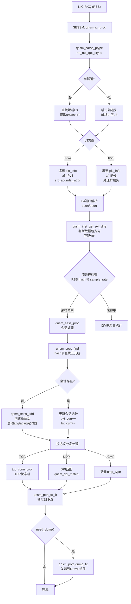
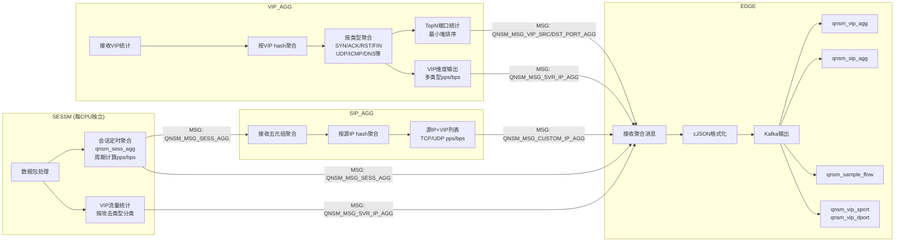
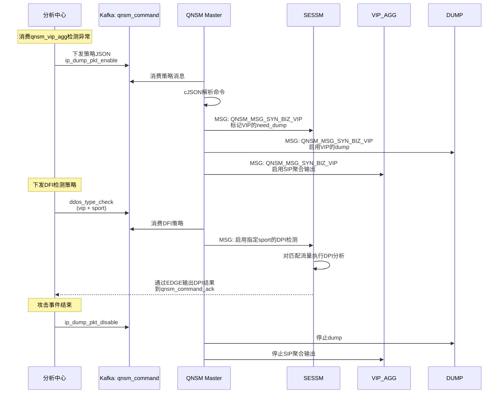
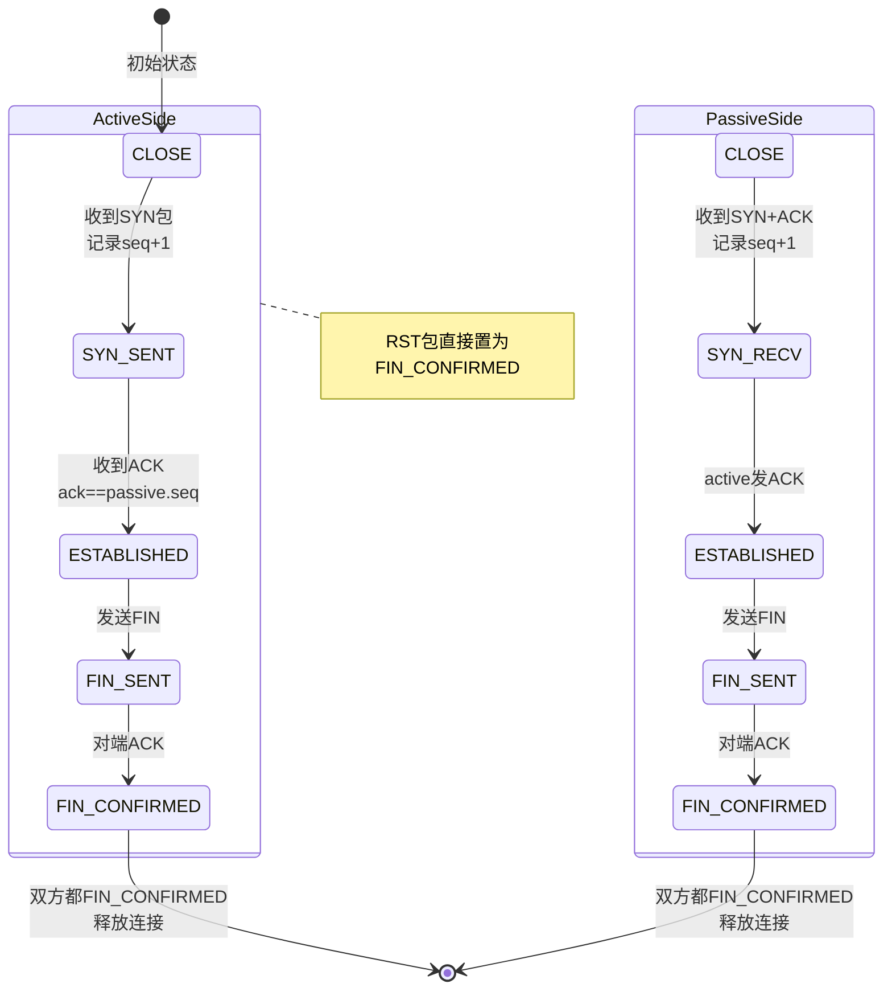
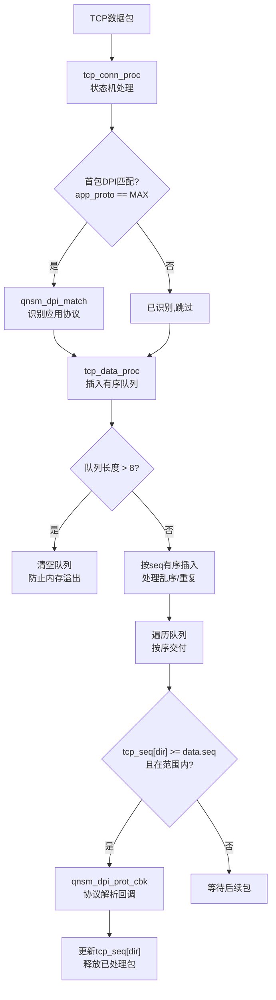

##  0x00    前言
[QNSM](https://github.com/iqiyi/qnsm)（IQIYI Network Security Monitor）是爱奇艺开源的一个旁路部署的全流量、实时、高性能网络安全监控引擎，基于 DPDK 开发，集成了 DDoS 检测和 IDPS 模块。本文基于 QNSM 源码进行深度剖析，涵盖核心架构、数据包处理流水线、协议解析、DFI/DPI 机制、TCP 连接跟踪、策略下发等核心模块

####    DDoS 检测
DDoS 检测功能包括：

-   全流量检测，可以部署在 IDC 环境，支持 SYN，ACK，RST，FIN，SYNACK，ICMP，UDP FLOOD 以及反射攻击（DNS/NTP/SSDP 反射等）
-   实时多维度聚合数据
-   流采样数据，提供攻击事件未检出后的 fall back 机制
-   随时停启的聚合数据输出
-   数据以 json 格式输出，便于数据分析
-   针对 UDP 反射攻击，提供 DFI/DPI 机制（MEMCACHE，TFTP，CHARGEN，CLDAP，QOTD 等）
-   事件过程中 dump 攻击数据包
-   支持 IPv4 和 IPv6

####    IDPS
IDPS 模块基于[Suricata](https://github.com/OISF/suricata)，并新增了如下特性：
-   支持 lib 化编译安装，基于 Suricata 4.1.0 版本
-   支持事件以 Kafka 方式输出，提升事件吞吐量，便于进一步数据分析

后文介绍 QNSM 是如何与 suricata 进行配合的

##  0x01    项目架构总览与核心模块拆解

QNSM 采用 DPDK 流水线（Pipeline）架构，将不同功能分解为独立的组件，每个组件运行在独立的 CPU core 上，通过无锁消息机制进行跨 CPU 通信。整体分为基础模块、流水线模块、控制面和 IDPS 管理服务四大部分

####    组件定义

所有组件通过宏定义注册，在`app.h`中统一管理：

```c
#define APP_MAP(XX)                         \
  XX(EN_QNSM_SESSM,     "SESSM")            \
  XX(EN_QNSM_SIP_AGG,   "SIP_IN_AGG")       \
  XX(EN_QNSM_VIP_AGG,   "VIP_AGG")          \
  XX(EN_QNSM_EDGE,      "EDGE")             \
  XX(EN_QNSM_MASTER,    "MASTER")           \
  XX(EN_QNSM_DETECT,    "DETECT")           \
  XX(EN_QNSM_DUMP,      "DUMP")             \
  XX(EN_QNSM_TEST,      "TEST")             \
  XX(EN_QNSM_DUMMY,     "DUMMY")
```

todo

####    基础模块

**1. PORT（端口抽象）**

QNSM 将网卡队列（RXQ）和软件队列（SWQ）统一抽象为`PORT`。在配置文件`qnsm_inspect.cfg`中，`RXQ`和`SWQ`前缀的配置实际上都是 PORT。核心 API 包括：

- `qnsm_port_rx`：从 PORT 收包
- `qnsm_port_tx_lb`：按 hash 负载均衡发包
- `qnsm_port_dup_tx_lb`：向 duplicate 端口发包（用于 IDPS 分流）
- `qnsm_port_dump_tx`：向 DUMP 组件发包

**2. MSG（跨 CPU 无锁消息）**

基于 DPDK 提供的无锁`rte_ring`库封装的消息机制，支持一对一和一对多消息通信。主要用途：
- 控制面和转发面间的控制消息传输
- DDoS 检测多维聚合数据输出

核心 API：

```c
int32_t qnsm_msg_publish(void);                    // 发布消息服务
int32_t qnsm_msg_subscribe(uint32_t target_lcore_id); // 订阅目标 lcore
int32_t qnsm_msg_reg(EN_QNSM_MSG_ID msg_id,        // 注册消息回调
    QNSM_MSG_PROC msg_proc, QNSM_MSG_ENCAP msg_encap);
int32_t qnsm_msg_send_multi(EN_QNSM_APP app_type,   // 一对多发送
    EN_QNSM_MSG_ID msg_id, void *data, uint16_t sync);
int32_t qnsm_msg_send_lb(EN_QNSM_APP app_type,      // 负载均衡发送
    EN_QNSM_MSG_ID msg_id, void *data, uint32_t seed, uint16_t sync);
```

**3. 配置文件**

QNSM 使用多个配置文件协同工作：
- `qnsm_inspect.cfg`：流水线配置，定义 EAL 参数、内存池、网卡、各组件的 CPU 绑定和端口关系
- `qnsm_sessm.xml`：DPI 协议启用/禁用配置
- `qnsm_edge.xml`：Kafka broker 配置、IDC 名称、日志配置、dump 目录
- `qnsm_vip.xml`：VIP 分组和静态 VIP 列表

**4. 表项管理（TBL）**

基于 DPDK hash 表实现的会话表管理，核心特性：
- 使用 CRC32 硬件加速的 hash 计算（`rte_hash_crc`）
- 每个 lcore 独立的 hash 表，避免竞争
- 通过 mempool 实现表项的快速分配和回收

**5. 调度框架**

QNSM 提供统一调度框架`qnsm_service_run`，核心循环如下：

```c
static void qnsm_service_run(QNSM_DATA *data, struct app_pipeline_params *pipeline_params)
{
    while (1) {
        // 1. 从所有 rx port 收包
        for (port_id = 0; port_id < port_handle->rx_port_cnt; port_id++) {
            nb_pkts = qnsm_port_rx(port_handle, port_id, mbuf);
            // 2. ACL 过滤
            if (load_acl) qnsm_acl_run(acl_hdl, mbuf, nb_pkts);
            // 3. 逐包处理
            for (index = 0; index < nb_pkts; index++) {
                if (pkt_proc) pkt_proc(data->app_handle, lcore, mbuf[index]);
                if (action) action(mbuf[index]);
            }
        }
        // 4. 自定义 run 回调
        if (run) run(data->app_handle);
        // 5. 消息分发 + 定时器
        qnsm_msg_dispatch(msg_hdl);
        rte_timer_manage();
        // 6. 批量 flush 发包
        QNSM_PORT_TX_FLUSH(port_handle);
    }
}
```

####    流水线模块

todo

**SESSM（会话管理/DDoS 检测核心）**

核心组件，运行`qnsm_rx_proc`包处理函数，负责：
- IPv4/IPv6数据包解析
- 五元组会话查找/创建
- 采样 FLOW 数据聚合
- TCP 连接跟踪
- 应用层 DFI/DPI 分类
- 向 VIP_AGG 和 SIP_AGG 发送聚合数据

**SIP_AGG（攻击源 IP 聚合）**

接收 SESSM 发送的五元组聚合数据，按攻击源 IP 维度聚合，关联 VIP 列表，输出 TCP/UDP 的 pps 和 bps 数据到 EDGE。

**VIP_AGG（VIP 数据聚合）**

核心数据聚合组件，功能包括：
- VIP 自学习（动态发现新 VIP）
- 按攻击类型（SYN/ACK/RST/FIN/SYNACK/UDP/ICMP/DNS 等）和方向（in/out）的 pps/bps 聚合
- TopN 源端口/目的端口统计（基于最小堆实现）
- 通过定时器周期性输出聚合数据

**DUMP（数据包抓取）**

接收 SESSM 标记了`need_dump`的数据包，使用 pcap 库保存为 pcap 文件。文件按分钟轮转，文件名格式为`{VIP}-core{N}-{YYYYMMDD}-{HHMM}.pcap`。

**EDGE（Kafka 数据输出）**

类似 broker 的角色，接收各组件通过 MSG 发送的聚合数据，格式化为 JSON 后发送到对应的 Kafka topic：
- `qnsm_vip_agg`：VIP 聚合数据
- `qnsm_sip_agg`：攻击源聚合
- `qnsm_sample_flow`：流采样数据
- `qnsm_vip_sport`/`qnsm_vip_dport`：端口统计
- 各协议 DPI topic（NTP/DNS/SSDP 等）

**DETECT（IDPS 检测）**

基于 Suricata lib 的 IDPS 检测组件，通过 DPDK 收包后构造 Suricata Packet 结构进行规则匹配，事件输出到`nsm_event` Kafka topic。

####    控制面

**Master**

Master 组件运行在独立 lcore 上，主要职责：
- 消费`qnsm_command` Kafka topic 接收分析中心下发的策略
- 解析 JSON 命令（cJSON 库）
- 通过 MSG 机制将策略下发到转发面各组件（SESSM/DUMP/VIP_AGG）
- VIP 配置同步和动态 VIP 管理

####    IDPS 管理服务

- **FM/FR（CRM）**：基于`rte_eal_alarm`实现的跨线程资源管理和回收机制
- **CS**：IDPS 统计数据收集

##  0x02    数据包解析路径与告警机制

####    数据包解析路径

从网卡收包到完成解析的完整流程如下：



####    数据聚合流程

QNSM 的多维度数据聚合流程如下：



其中 VIP 聚合的数据维度非常丰富，包含以下类型的 pps 和 bps 统计：

|类型 | 说明|
|---|---|
|TOTAL|总流量|
|TCP|TCP 总流量|
|SYN|SYN 包|
|ACK|ACK 包|
|FIN|FIN 包|
|RST|RST 包|
|SYNACK|SYN+ACK 包|
|PSHACK|PSH+ACK 包|
|OTHER_FLAG|其他 TCP 标志|
|UDP|UDP 总流量|
|DNS_QUERY/DNS_REPLY|DNS 查询/响应|
|NTP|NTP 流量|
|SSDP_REP|SSDP 响应|
|ICMP|ICMP 流量|

####    告警策略应用流程

QNSM 本身不做告警判定，而是输出聚合数据由外部分析中心进行检测，再通过策略消息反馈控制 QNSM 的行为：



支持的策略类型包括：
- `ip_dump_pkt_enable`/`ip_dump_pkt_disable`：启停攻击包抓取
- `ip_sport_statis_enable`/`ip_sport_statis_disable`：启停源端口统计
- `ddos_type_check`：DFI/DPI 检测（识别 UDP 反射攻击的应用层协议）

##  0x03    协议解析实现

QNSM 在`qnsm_decode.c`中实现了完整的协议栈解析，支持从链路层到传输层的递归解析。SESSM 组件优先使用 DPDK 的`rte_net_get_ptype`硬件辅助解析，当存在隧道时回退到软件解析。

####    Ethernet 解析

`qnsm_decode_ethernet`是解析入口，根据`eth_type`字段分发：

```c
int qnsm_decode_ethernet(QNSM_PACKET_INFO *pkt_info, uint8_t *pkt, uint16_t len)
{
    EthernetHdr *ethh = (EthernetHdr *)pkt;
    switch (ntohs(ethh->eth_type)) {
        case ETHERNET_TYPE_IP:      // 0x0800
            qnsm_decode_ipv4(pkt_info, pkt + ETHERNET_HEADER_LEN, len - ETHERNET_HEADER_LEN);
            break;
        case ETHERNET_TYPE_IPV6:    // 0x86dd
            qnsm_decode_ipv6(pkt_info, pkt + ETHERNET_HEADER_LEN, len - ETHERNET_HEADER_LEN);
            break;
        case ETHERNET_TYPE_8021Q:   // 0x8100 VLAN
            qnsm_decode_vlan(pkt_info, pkt + ETHERNET_HEADER_LEN, len - ETHERNET_HEADER_LEN);
            break;
        case ETHERNET_TYPE_8021QINQ: // 0x9100 QinQ
            qnsm_decode_qinq(pkt_info, pkt + ETHERNET_HEADER_LEN, len - ETHERNET_HEADER_LEN);
            break;
        case ETHERNET_TYPE_MPLS_UNICAST:   // 0x8847
        case ETHERNET_TYPE_MPLS_MULTICAST: // 0x8848
            qnsm_decode_mpls(pkt_info, pkt + ETHERNET_HEADER_LEN, len - ETHERNET_HEADER_LEN);
            break;
    }
    return QNSM_DECODE_OK;
}
```

####    IPv4 解析

`DecodeIPV4Packet`完成 IPv4 头的校验和信息提取，包括分片检测和上层协议分发：

```c
int qnsm_decode_ipv4(QNSM_PACKET_INFO *pkt_info, uint8_t *pkt, uint16_t len)
{
    IPV4Hdr *ip4h = (IPV4Hdr *)pkt;
    if (unlikely(DecodeIPV4Packet(pkt_info, pkt, len) < 0))
        return QNSM_DECODE_FAILED;

    pkt_info->proto = IPV4_GET_IPPROTO(ip4h);

    // 分片检测：offset > 0 或 MF 标志位为 1
    if (unlikely(IPV4_GET_IPOFFSET(ip4h) > 0 || IPV4_GET_MF(ip4h) == 1)) {
        pkt_info->is_frag = 1;
        return QNSM_DECODE_OK;  // 分片包不做 L4 解析
    }

    // 按协议分发到 L4 解码器
    switch (IPV4_GET_IPPROTO(ip4h)) {
        case IPPROTO_TCP:  qnsm_decode_tcp(...);  break;
        case IPPROTO_UDP:  qnsm_decode_udp(...);  break;
        case IPPROTO_ICMP: qnsm_decode_icmpv4(...); break;
        case IPPROTO_GRE:  qnsm_decode_gre(...);  break;
    }
    return QNSM_DECODE_OK;
}
```

####    IPv6 解析

IPv6 解析需要特别处理扩展头链，通过`qnsm_skip_ip6_ext`跳过扩展头到达上层协议：

```c
static uint16_t qnsm_skip_ip6_ext(uint16_t proto, const struct rte_mbuf *m,
    uint32_t *off, int *frag)
{
    *frag = 0;
    for (i = 0; i < MAX_EXT_HDRS; i++) {
        switch (proto) {
            case IPPROTO_HOPOPTS:
            case IPPROTO_ROUTING:
            case IPPROTO_DSTOPTS:
                // 按 (len+1)*8 跳过扩展头
                *off += (xh->len + 1) * 8;
                proto = xh->next_hdr;
                break;
            case IPPROTO_FRAGMENT:
                *off += 8;
                proto = xh->next_hdr;
                *frag = 1;        // 标记为分片
                return proto;     // Fragment 总是最后一个扩展头
            case IPPROTO_NONE:
                return 0;         // 无下一个头部
            default:
                return proto;     // 到达上层协议
        }
    }
    return 0;
}
```

####    TCP/UDP解析

TCP 和 UDP 的解析相对简单，主要完成头部校验和端口/payload 提取：

```c
// TCP 解析核心
static int DecodeTCPPacket(QNSM_PACKET_INFO *pkt_info, uint8_t *pkt, uint16_t len)
{
    TCPHdr *tcph = (TCPHdr *)pkt;
    uint8_t hlen = TCP_GET_HLEN(tcph);   // offset 字段 << 2
    if (unlikely(len < hlen)) return -1;
    pkt_info->payload = pkt + hlen;
    pkt_info->sport = TCP_GET_SRC_PORT(tcph);
    pkt_info->dport = TCP_GET_DST_PORT(tcph);
    return 0;
}

// UDP 解析核心
static int DecodeUDPPacket(QNSM_PACKET_INFO *pkt_info, uint8_t *pkt, uint16_t len)
{
    UDPHdr *udph = (UDPHdr *)pkt;
    if (unlikely(len < UDP_GET_LEN(udph))) return -1;
    pkt_info->sport = UDP_GET_SRC_PORT(udph);
    pkt_info->dport = UDP_GET_DST_PORT(udph);
    pkt_info->payload = pkt + UDP_HEADER_LEN;
    return 0;
}
```

####    GRE 隧道解析

GRE 隧道解析支持 Version 0 和 Version 1，解析完 GRE 头后递归调用内层协议解析：

```c
int qnsm_decode_gre(QNSM_PACKET_INFO *pkt_info, uint8_t *pkt, uint16_t len)
{
    GREHdr *greh = (GREHdr *)pkt;
    uint16_t header_len = GRE_HDR_LEN;  // 基础头 4 字节

    // 根据 flag 调整 header_len
    if (GRE_FLAG_ISSET_KY(greh))    header_len += GRE_KEY_LEN;
    if (GRE_FLAG_ISSET_SQ(greh))    header_len += GRE_SEQ_LEN;
    if (GRE_FLAG_ISSET_CHKSUM(greh)) header_len += GRE_CHKSUM_LEN + GRE_OFFSET_LEN;

    // 内层协议递归解析
    switch (GRE_GET_PROTO(greh)) {
        case ETHERNET_TYPE_IP:    qnsm_decode_ipv4(...);     break;
        case ETHERNET_TYPE_IPV6:  qnsm_decode_ipv6(...);     break;
        case ETHERNET_TYPE_8021Q: qnsm_decode_vlan(...);     break;
        case ETHERNET_TYPE_BRIDGE: qnsm_decode_ethernet(...); break;
    }
}
```

####    MPLS 解析

MPLS 解析遍历标签栈，通过 Bottom of Stack 标志位找到内层协议，然后根据特殊标签或首字节猜测内层协议类型：

```c
int qnsm_decode_mpls(QNSM_PACKET_INFO *pkt_info, uint8_t *pkt, uint16_t len)
{
    uint32_t shim;
    // 遍历标签栈直到 Bottom of Stack
    do {
        shim = *(uint32_t *)pkt;
        pkt += MPLS_HEADER_LEN;
        len -= MPLS_HEADER_LEN;
    } while (MPLS_BOTTOM(shim) == 0);

    // 根据标签值或首字节猜测内层协议
    int label = MPLS_LABEL(shim);
    if (label == MPLS_LABEL_IPV4) return qnsm_decode_ipv4(...);
    if (label == MPLS_LABEL_IPV6) return qnsm_decode_ipv6(...);

    switch (pkt[0] >> 4) {  // IP 版本号猜测
        case 4: qnsm_decode_ipv4(...); break;
        case 6: qnsm_decode_ipv6(...); break;
        case 0: qnsm_decode_ethernet(pkt + MPLS_PW_LEN, ...); break;
    }
}
```

##  0x04    UDP 反射攻击 DFI/DPI 机制

####    DFI/DPI框架设计

QNSM 在`libqnsm_service/qnsm_dpi.c`中实现了轻量级的 DFI/DPI 框架，用于识别 UDP 反射攻击的应用层协议。框架提供两种分类方法：

**端口分类（Service Classify）**：按 L4 协议 + 端口注册回调，数据结构为`service_classifer[l4_prot][port]`链表。

**内容分类（Content Classify）**：按 payload 前两字节注册回调，数据结构为`udp_content_classifer[byte0][byte1]`链表。

DFI 匹配核心函数`qnsm_dpi_match`的优先级为：先查 dport -> 再查 sport -> 最后查 content：

```c
inline int32_t qnsm_dpi_match(QNSM_PACKET_INFO *pkt_info,
    EN_QNSM_DPI_L4_PROT l4_prot, void *sess, void **app_arg)
{
    // 1. 按目的端口匹配
    port = pkt_info->dport;
    classifier_list = &dpi->classify.service_classifer[l4_prot][port];
    qnsm_list_for_each_entry_safe(dpi_class, next, classifier_list, class_node) {
        if (dpi_class->match_func) { dpi_class->match_func(pkt_info, sess, &arg); goto MATCH; }
    }

    // 2. 按源端口匹配（响应包场景）
    port = pkt_info->sport;
    classifier_list = &dpi->classify.service_classifer[l4_prot][port];
    // ...同上

    // 3. 按 payload 内容匹配
    data = (uint8_t *)pkt_info->payload;
    classifier_list = &dpi->classify.udp_content_classifer[data[0]][data[1]];
    qnsm_list_for_each_entry_safe(dpi_class, next, classifier_list, class_node) {
        if (0 == memcmp(data, dpi_class->match_content_key, dpi_class->match_content_key_len)) {
            dpi_class->match_func(pkt_info, sess, &arg);
            goto MATCH;
        }
    }
}
```

####    协议注册流程

每个协议模块在 SESSM 初始化时注册自己的分类和解析回调。以 NTP 为例：

```c
int32_t ntp_reg(void)
{
    if (0 == qnsm_dpi_proto_enable(EN_QNSM_DPI_NTP)) return 0;

    // 注册端口分类：UDP port 123 -> ntp_classify
    qnsm_dpi_service_classify_reg(EN_DPI_PROT_UDP, NTP_PORT, EN_QNSM_DPI_NTP, ntp_classify);

    // 注册 DPI 数据初始化函数
    qnsm_dpi_proto_init_reg(EN_QNSM_DPI_NTP, ntp_info_init);
    // 注册 DPI 解析函数（优先级 10）
    qnsm_dpi_prot_reg(EN_QNSM_DPI_NTP, ntp_parse, 10);
    // 注册资源释放函数
    qnsm_dpi_prot_final_reg(EN_QNSM_DPI_NTP, ntp_free);
    return 0;
}
```

####    各反射协议分析

**DNS（端口 53）**

DNS 协议解析是最复杂的，完整解析 DNS 头部、Question 段和 Resource Record：
- 通过 QR 标志位区分 query（QR=0）和 response（QR=1）
- 解析 QDCOUNT/ANCOUNT/NSCOUNT/ARCOUNT 确定各段数量
- DNS 反射攻击的典型特征是大量 response 包（放大比可达 50 倍以上）

**NTP（端口 123）**

NTP 反射识别通过解析版本字段实现：

```c
void ntp_classify(QNSM_PACKET_INFO *pkt_info, void *sess, void **arg)
{
    ntp_info->ntp_header = pkt_info->payload;
    // NTP 版本字段在第一字节的 bit3-5: (header[0] & 0x38) >> 3
    // NTP v2 的 monlist 请求会产生大量响应（放大比约 556 倍）
    if ((((ntp_info->ntp_header[0] & 0x38) >> 3) <= 4)) {
        pkt_info->dpi_app_prot = EN_QNSM_DPI_NTP;
    }
}
```

**SSDP（端口 1900）**

SSDP 协议通过匹配请求方法字符串识别：

```c
void ssdp_classify(QNSM_PACKET_INFO *pkt_info, void *sess, void **arg)
{
    pkt_info->dpi_app_prot = EN_QNSM_DPI_SSDP;
}

// 注册时同时注册端口分类和内容分类
int32_t ssdp_reg(void)
{
    // 端口分类
    qnsm_dpi_service_classify_reg(EN_DPI_PROT_UDP, SSDP_PORT, EN_QNSM_DPI_SSDP, ssdp_classify);
    // 内容分类：匹配"M-SEARCH"/"NOTIFY"/"HTTP"等 method 前缀
    for (i = 0; method_strings[i]; i++) {
        qnsm_dpi_content_classify_reg(EN_DPI_PROT_UDP, method_strings[i],
            strlen(method_strings[i]), EN_QNSM_DPI_SSDP, ssdp_classify);
    }
    qnsm_dpi_content_classify_reg(EN_DPI_PROT_UDP, "HTTP", 4, EN_QNSM_DPI_SSDP, ssdp_classify);
}
```

SSDP 解析时区分请求和响应：以"HTTP"开头为响应，匹配 M-SEARCH/NOTIFY 等为请求。

**Memcached（端口 11211）**

Memcached UDP 协议通过验证 8 字节 UDP 报头结构识别：

```c
static void memcached_udp_classify(QNSM_PACKET_INFO *pkt_info, void *sess, void **arg)
{
    // UDP memcached 有 8 字节报头：req_id(2) + seq(2) + total_num(2) + rsvd(2)
    MEMCACHED_UDP_HEADER *header = (MEMCACHED_UDP_HEADER *)(pkt_info->payload);
    uint16_t len = QNSM_DPI_NTOHS(uh->dgram_len) - sizeof(struct udp_hdr);
    // 校验：长度够且 total_num > 0
    if ((len < sizeof(MEMCACHED_UDP_HEADER))
        || (0 >= QNSM_DPI_NTOHS(header->total_num))) {
        return;  // 不是 UDP memcached 包
    }
    pkt_info->dpi_app_prot = EN_QNSM_DPI_MEMCACHED;
}
```

注意 memcached 的 TCP classify 函数体为空，注释说明 TCP 需要流重组才能匹配命令，但流重组功能当前关闭。

**CHARGEN（端口 19）**

CHARGEN 协议按 RFC 864 规范，响应包由可打印 ASCII 字符组成，通过字符范围检查识别：

```c
static void chargen_udp_classify(QNSM_PACKET_INFO *pkt_info, void *sess, void **arg)
{
    char *payload = pkt_info->payload;
    // RFC 864 推荐的 payload 是 72 个 ASCII 字符的移位行
    // 检查首字节在可打印范围 [0x20, 0x7d]
    if ((0 < len) && ((payload[0] < 0x20) || (0x7d < payload[0]))) {
        return;
    }
    pkt_info->dpi_app_prot = EN_QNSM_DPI_CHARGEN;
}
```

**其他反射协议**

|协议 | 端口 | 识别方式 | 放大倍数|
|---|---|---|---|
|CLDAP|389|ASN.1 BER 编码检查|56-70x|
|QOTD|17|端口匹配|140x|
|TFTP|69|opcode 字段检查|60x|
|SNMP|161|端口匹配|6x|

####    DPI 结果输出

当 DPI 匹配成功后，协议解析结果通过 MSG 发送到 EDGE 组件，EDGE 格式化为 JSON 后发送到对应的 Kafka topic。以 NTP 为例：

```c
// SESSM 侧发送
qnsm_dpi_send_info(pkt_info, EN_QNSM_DPI_NTP, arg);

// EDGE 侧接收并构造 JSON
void ntp_msg_proc(void *data, uint32_t data_len) {
    cJSON *root = cJSON_CreateObject();
    cJSON_AddStringToObject(root, "sip", tmp);
    cJSON_AddStringToObject(root, "dip", tmp);
    cJSON_AddNumberToObject(root, "sport", tuple->source);
    cJSON_AddNumberToObject(root, "dport", tuple->dest);
    cJSON_AddNumberToObject(root, "version", version);
    qnsm_kafka_send_msg(QNSM_KAFKA_NTP_TOPIC, root, ...);
}
```

##  0x05    TCP 连接跟踪与流重组

####    TCP 状态机

QNSM 在`tcp_session.c`中实现了 TCP 连接跟踪，维护 active（主动发起方）和 passive（被动接收方）两个 half_stream 的状态：

todo

```c
typedef struct half_stream {
    char state;
    u_int seq;
    u_int list_count;
    struct skbuff *list;
} HALF_STRAEM;

typedef struct tcp_stream {
    uint8_t af;
    QNSM_SESS_ADDR addr;
    HALF_STRAEM active;
    HALF_STRAEM passive;
    uint8_t established;
} TCP_STREAM;
```

TCP 状态定义：

```c
#define QNSM_TCP_STATE_MAP(XX) \
    XX(1, ESTABLISHED, ESTABLISHED)   \
    XX(2, SYN_SENT, SYN_SENT)         \
    XX(3, SYN_RECV, SYN_RECV)         \
    XX(4, FIN_WAIT1, FIN_WAIT1)       \
    XX(5, FIN_WAIT2, FIN_WAIT2)       \
    XX(6, TIME_WAIT, TIME_WAIT)       \
    XX(7, CLOSE, CLOSE)               \
    XX(8, CLOSE_WAIT, CLOSE_WAIT)     \
    XX(9, LAST_ACK, LAST_ACK)         \
    XX(10, LISTEN, LISTEN)            \
    XX(11, CLOSING, CLOSING)          \
    XX(12, FIN_SENT, FIN_SENT)        \
    XX(13, FIN_CONFIRMED, FIN_CONFIRMED)
```

####    TCP 连接跟踪状态机

核心函数`tcp_conn_proc`实现了完整的三次握手和四次挥手状态跟踪：



核心状态转换代码：

```c
int32_t tcp_conn_proc(QNSM_PACKET_INFO* pkt_info, void *sess, uint32_t *tcp_seq)
{
    tcp_conn = session->tcp_stream;
    if (NULL == tcp_conn) {
        // 新连接：只接受纯 SYN 包
        if ((this_tcphdr->tcp_flags & TH_SYN) &&
            !(this_tcphdr->tcp_flags & (TH_ACK | TH_RST | TH_FIN))) {
            // 从 mempool 分配 TCP_STREAM
            rte_mempool_get(cache->tcp_conn_cache, (void **)&tcp_conn);
            tcp_conn->active.state = QNSM_TCP_SYN_SENT;
            tcp_conn->active.seq = seq + 1;
        }
        goto EXIT;
    }

    // SYN+ACK 处理（passive 回复）
    if ((this_tcphdr->tcp_flags & TH_SYN)) {
        if (tcp_conn->active.state == QNSM_TCP_SYN_SENT &&
            tcp_conn->passive.state == QNSM_TCP_CLOSE &&
            (this_tcphdr->tcp_flags & TH_ACK)) {
            if (tcp_conn->active.seq == recv_ack) {
                tcp_conn->passive.state = QNSM_TCP_SYN_RECV;
                tcp_conn->passive.seq = seq + 1;
            }
        }
    }

    // RST 处理
    if ((this_tcphdr->tcp_flags & TH_RST)) {
        if (from_active) tcp_conn->active.state = QNSM_TCP_FIN_CONFIRMED;
        else tcp_conn->passive.state = QNSM_TCP_FIN_CONFIRMED;
    }

    // 三次握手完成
    if (from_active && (this_tcphdr->tcp_flags & TH_ACK)) {
        if (tcp_conn->active.state == QNSM_TCP_SYN_SENT &&
            tcp_conn->passive.state == QNSM_TCP_SYN_RECV) {
            if (recv_ack == tcp_conn->passive.seq) {
                tcp_conn->active.state = QNSM_TCP_ESTABLISHED;
                tcp_conn->passive.state = QNSM_TCP_ESTABLISHED;
            }
        }
    }

    // FIN 处理
    if (this_tcphdr->tcp_flags & TH_FIN) {
        if (from_active) tcp_conn->active.state = QNSM_TCP_FIN_SENT;
        else tcp_conn->passive.state = QNSM_TCP_FIN_SENT;
    }

    // 双方都 FIN_CONFIRMED 则释放连接
    if (tcp_conn->passive.state == QNSM_TCP_FIN_CONFIRMED &&
        tcp_conn->active.state == QNSM_TCP_FIN_CONFIRMED) {
        tcp_free_stream(&tcp_conn);
    }
}
```

####    TCP 流重组（条件编译 `__QNSM_STREAM_REASSEMBLE`）

QNSM 实现了 TCP 流重组功能，但通过宏`__QNSM_STREAM_REASSEMBLE`控制开关。在 DDoS 检测（`__DDOS`宏）模式下，如果同时未开启`__QNSM_STREAM_REASSEMBLE`，TCP 只做 flag 统计不做流重组。

流重组的数据结构：

```c
typedef struct {
    struct qnsm_list_head node;
    QNSM_PACKET_INFO *pkt_info;
    uint32_t seq;
    uint32_t ack;
    uint16_t len;
    uint16_t dir;
} TCP_DATA;

typedef struct {
    struct qnsm_list_head tcp_que;  // 有序队列
    uint32_t data_cnt;              // 缓存包数
    uint32_t tcp_seq[2];            // 双方期望的下一个 seq
} QNSM_TCP_DATA_QUE;
```

流重组流程（当`__QNSM_STREAM_REASSEMBLE`开启时）：



`tcp_data_proc`实现了按 seq 有序插入的逻辑，处理乱序、重复和重传包：

```c
int32_t tcp_data_proc(QNSM_PACKET_INFO* pkt_info, QNSM_TCP_DATA_QUE *que,
    uint32_t dir, uint32_t payload_len)
{
    if (payload_len <= 0) return -1;
    if (que->data_cnt > 8) {
        // 队列过长，清空防止内存溢出
        qnsm_list_for_each_entry_safe(tmp, n, &que->tcp_que, node) {
            rte_pktmbuf_free(...);
            tcp_free_data(tmp);
        }
        que->data_cnt = 0;
        return -1;
    }

    // 从 mempool 分配 TCP_DATA 节点
    rte_mempool_get(cache->pkt_info_cache, (void **)&cur_tcp_data);
    cur_tcp_data->seq = seq; cur_tcp_data->ack = ack;
    cur_tcp_data->len = payload_len; cur_tcp_data->dir = dir;

    // 按 seq 有序插入（逆向遍历找到插入位置）
    qnsm_list_for_each_prev_entry(tmp, &que->tcp_que, node) {
        diff = packet_sequence_diff(sort2, sort1);
        if (0 < diff) {
            QNSM_LIST_ADD_AFTER(&cur_tcp_data->node, &tmp->node);
            break;
        }
    }
}
```

重要说明：在当前默认的 DDoS 检测编译配置下，TCP 流重组宏`__QNSM_STREAM_REASSEMBLE`是关闭的。TCP DDoS 检测主要基于 flag 分类而非流重组：

```c
// DDoS 模式下 TCP 处理（无流重组）
struct tcp_hdr *this_tcphdr = rte_pktmbuf_mtod_offset(...);
sess->tcp_flags[pkt_info->direction] |= this_tcphdr->tcp_flags;
// 后续在 VIP_AGG 中通过 en_tcp_type[tcp_flag] 表进行攻击类型分类
```

##  0x06    DUMP 攻击包与流采样

####    DUMP 实现

DUMP 组件通过`qnsm_dump.c`实现，核心流程：

**1. 策略下发**：Master 收到`ip_dump_pkt_enable`命令后，通过 MSG 通知 DUMP 组件启用目标 VIP 的 dump。

**2. 包标记**：SESSM 在处理数据包时，如果 VIP 启用了 dump，在`pkt_info->need_dump`中标记。

**3. 包转发**：SESSM 通过`qnsm_port_dump_tx`将标记的包发送到 DUMP 组件的 SWQ。

**4. pcap 写入**：DUMP 组件收到包后调用`qnsm_dump_pkt`，使用 libpcap 写入 pcap 文件：

```c
static void qnsm_dump_pkt(QNSM_PACKET_INFO *pkt_info)
{
    // 查找 VIP 是否启用 dump
    vip_dump = ops->f_find_ip(&pkt_info->src_addr);
    if (!vip_dump || !vip_dump->dump_enable) {
        vip_dump = ops->f_find_ip(&pkt_info->dst_addr);
        if (!vip_dump || !vip_dump->dump_enable) return;
    }

    // 按分钟轮转文件
    time_now = time(NULL);
    time_min = time_now / 60;
    if ((time_min != vip_dump->dump_time) && vip_dump->dump_fd) {
        pcap_dump_close(vip_dump->dump_fd);
        vip_dump->dump_fd = NULL;
    }

    // 创建新文件 格式：{dump_dir}/{VIP}-core{N}-{YYYYMMDD}-{HHMM}.pcap
    if (NULL == vip_dump->dump_fd) {
        snprintf(filename, ...);
        vip_dump->dump_fd = pcap_dump_open(app_data->dump_handle, filename);
    }

    // 写入 pcap
    hdr.len = hdr.caplen = pkt_info->pkt_len;
    gettimeofday(&hdr.ts, NULL);
    pcap_dump((u_char *)vip_dump->dump_fd, &hdr, rte_pktmbuf_mtod(mbuf, u_char*));
}
```

**5. 性能优化**：当没有 VIP 启用 dump 时，DUMP 组件调用`usleep`释放 CPU。

####    流采样实现

QNSM 支持两种采样方式，通过配置文件控制：

```c
void qnsm_sess_sample_init(QNSM_SESS_DATA *data)
{
    QNSM_SESSM_CFG *sess_cfg = qnsm_get_sessm_conf();
    if (sess_cfg->sample_enable) {
        switch(sess_cfg->sample_method) {
            case EN_QNSM_PACKET_SAMPLE:
                data->pkt_sample_rate = sess_cfg->sample_rate;
                break;
            case EN_QNSM_FLOW_SAMPLE:
                data->flow_sample_rate = sess_cfg->sample_rate;
                break;
        }
    }
}
```

**流采样（Flow Sample）**：利用 RSS hash 值确定采样命中，确保同一流的所有包要么全采样要么全不采样：

```c
// SESSM 收包路径中
if ((1 < app_data->flow_sample_rate) &&
    (0 == (uint32_t)(((uint64_t)mbuf->hash.rss * app_data->flow_sample_rate) >> 32))) {
    session_enable = 1;  // 此流命中采样
}
```

采样的五元组聚合数据通过 EDGE 输出到`qnsm_sample_flow` Kafka topic，格式包含 dc、sampling_interval、timestamp、五元组、direction、tcp_flags、packets、bytes。

##  0x07    DDoS 检测策略下发与无锁高性能设计

####    策略生效流程

1. Master 组件初始化 Kafka consumer，订阅`qnsm_command` topic
2. Master 的自定义调度函数周期性调用`qnsm_kafka_msg_dispatch`消费消息
3. 解析 JSON 命令（使用 cJSON 库），根据`op`字段分发处理
4. 通过`qnsm_msg_send_multi`将策略下发到对应的转发面组件

策略消息格式示例：

```json
{
    "op": "ip_dump_pkt_enable",
    "content": [
        {"idc": "dc_xxx", "proto": "udp", "vip": "A.B.C.D", "vport": "any"}
    ]
}
```

```json
{
    "id": "1",
    "op": "ddos_type_check",
    "content": {
        "vip": "A.B.C.D",
        "idc": "dc_xxx",
        "sport": 20
    }
}
```

####    无锁高性能设计

QNSM 的高性能设计涉及多个层面：

**1. 基于`rte_ring`的无锁跨 CPU 消息**

所有组件间通信都通过 DPDK 的`rte_ring`实现，这是一个无锁的 FIFO 队列，基于 CAS 操作保证线程安全，避免了互斥锁带来的性能损耗。

**2. RSS 对称 hash + 流亲和**

配置对称 RSS 确保双向流量分到同一 CPU core：

```ini
[LINK0]
rss_qs = 0 1 2 3 4 5 6 7
rss_proto_ipv4 = TCP UDP
symmetrical_rss = yes
```

**3. 每组件独占 CPU core**

每个组件运行在独立的 lcore 上，不允许在同一 CPU 上部署多个组件。组件间无共享数据结构，彻底消除数据竞争。

**4. 批量收包 + prefetch 优化**

```c
// 批量收取 burst=32 个包
nb_pkts = qnsm_port_rx(port_handle, port_id, mbuf);
// prefetch 优化
for (index = 0; index < PREFETCH_OFFSET && index < nb_pkts; index++) {
    rte_prefetch0(mbuf[index] + 1);  // prefetch pkt_info
    rte_prefetch0(rte_pktmbuf_mtod(mbuf[index], void *)); // prefetch payload
}
```

**5. 基于 DPDK hash 表的 O(1) 会话查找**

会话表使用 CRC32 硬件指令加速 hash 计算：

```c
static inline uint32_t ipv4_hash_crc(const void *data, uint32_t data_len, uint32_t init_val)
{
    const union ipv4_5tuple_host *k = data;
    init_val = rte_hash_crc_4byte(k->proto, init_val);
    init_val = rte_hash_crc_4byte(k->ip_src, init_val);
    init_val = rte_hash_crc_4byte(k->ip_dst, init_val);
    init_val = rte_hash_crc_4byte(*(const uint32_t *)&k->port_src, init_val);
    return init_val;
}
```

**6. per-lcore mempool 替代 rte_malloc**

TCP 连接使用 per-lcore 的 mempool 替代全局的`rte_malloc`/`rte_free`，避免 spinlock 争用：

```c
// tcp_session.c 中的注释
// because rte_malloc/free used spinlock,
// cause thread syn when sess num increases,
// finally cause pkt loss
lcore_cache.tcp_conn_cache = rte_mempool_create(name,
    TCP_CONN_PER_LCORE_MAX, sizeof(TCP_STREAM), ...);
```

**7. 定时器聚合输出**

会话统计通过 DPDK `rte_timer`周期性聚合输出（`QNSM_SESS_STATIS_AGG_INTERVAL_SEC`），而非每包即时发送，减少消息开销。

**8. TopN 端口统计使用最小堆**

VIP_AGG 中使用最小堆维护 Top20 端口统计，避免全排序的 O(NlogN) 开销：

```c
// 定义在 qnsm_ip_agg.c
#define QNSM_PORT_TOPN (20)
QNSM_HEAP topn_port_statis[EN_QNSM_PORT_TYPE_MAX];
```

##  0x08    DDoS 检测、IDPS、流量监控、DLP

####    DDoS 检测

DDoS 检测是 QNSM 的核心功能，工作流程：

1. **全流量解析**：SESSM 解析所有流经的数据包（支持 10Gbps 线速）
2. **VIP 维度聚合**：VIP_AGG 按攻击类型聚合，输出到`qnsm_vip_agg`
3. **攻击类型分类**：通过`qnsm_pkt_type_parse`函数，基于协议和 TCP flag 分类：

```c
inline int qnsm_pkt_type_parse(QNSM_PACKET_INFO* pkt_info, ...)
{
    switch (pkt_info->proto) {
        case TCP_PROTOCOL:
            tcp_flag = l4_head.raw[13];
            detect_type = en_tcp_type[tcp_flag]; // 预计算的 flag->type 映射表
            break;
        case UDP_PROTOCOL:
            detect_type = e_udp;
            if (53 == pkt_info->dport) detect_type = e_dns_query;
            break;
        case ICMP_PROTOCOL: detect_type = e_icmp; break;
        case ESP_PROTOCOL:  detect_type = e_esp;  break;
    }
}
```

4. **外部检测**：分析中心消费 Kafka 数据，基于阈值/基线/机器学习等方法检测攻击
5. **策略反馈**：检测到攻击后下发 dump/DFI 等策略到 QNSM
6. **攻击源聚合**：SIP_AGG 提供攻击源 IP 粒度的数据用于溯源

####    IDPS

IDPS 模块基于 Suricata 4.1.0 版本的 lib 化集成，通过 DETECT 组件运行。核心集成方式：

```c
// qnsm_idps_core.c
void *QnsmTmThreadsInit(const char* mode, ...)
{
    // 1. 创建 Suricata 线程变量
    tv = QnsmTmThreadCreatePacketHandler(tname, ...);

    // 2. 注册 DPDK 收包模块
    tm_module = TmModuleReceiveQnsmRegister();
    TmSlotSetFuncAppend(tv, tm_module, rcv_mod_initdata);

    // 3. 注册 DPDK 解码模块
    tm_module = TmModuleDecodeQnsmRegister();
    TmSlotSetFuncAppend(tv, tm_module, NULL);

    // 4. 注册 FlowWorker（Suricata 核心流处理）
    tm_module = TmModuleGetByName("FlowWorker");
    TmSlotSetFuncAppend(tv, tm_module, NULL);

    // 5. 注册 RespondReject 模块
    tm_module = TmModuleGetByName("RespondReject");
    TmSlotSetFuncAppend(tv, tm_module, NULL);
}
```

收包流程：QNSM 通过`QnsmTMReceiveLoop`从 PORT 收包，构造 Suricata 的 Packet 结构，然后通过 Suricata 的 slot pipeline 处理链进行规则匹配。事件通过 Kafka 输出到`nsm_event` topic。

IDPS 可以单独部署也可以与 DDoS 检测混合部署。在混合部署模式下，SESSM 通过`qnsm_port_dup_tx_lb`将包复制一份发送到 DETECT 组件。

####    流量监控

流量监控通过两个维度实现：

1. **实时 VIP 聚合**（`qnsm_vip_agg` topic）：提供每个 VIP 的多类型 pps/bps 实时数据
2. **五元组流采样**（`qnsm_sample_flow` topic）：按采样率提供五元组级别的流数据

流采样数据格式：

```json
{
    "dc": "dc_aaa",
    "sampling_interval": 4000,
    "timestamp": 1557718926,
    "ip_protocol": 6,
    "ip_version": 4,
    "src_ip": "A.B.C.D",
    "src_port": 52058,
    "dst_ip": "E.F.G.H",
    "dst_port": 80,
    "direction": 1,
    "tcp_flags": 16,
    "packets": 2,
    "out_bytes": 2868
}
```

####    DLP

QNSM 项目源码中未实现 DLP（Data Loss Prevention）功能。DLP 通常需要对应用层 payload 进行深度内容检查（关键词匹配、正则规则、文件类型检测等），这与 QNSM 当前以 DDoS 检测和 IDPS 为核心的定位有所不同。但 QNSM 的 DPI 框架具备扩展为 DLP 检测的基础能力，特别是 HTTP 协议解析（`src/protos/http.c`）已实现了较完整的 HTTP header 和 body 解析。

##  0x09    补充模块

####    ACL 机制

QNSM 基于 DPDK ACL 库实现五元组 ACL 过滤，在收包后、业务处理前执行：

```c
// 调度循环中
if (load_acl) {
    qnsm_acl_run(acl_hdl, mbuf, nb_pkts);
}
```

ACL 表支持 IPv4 和 IPv6 两种规则集，字段包括 proto、src_ip、dst_ip、src_port、dst_port。Master 可以动态下发 ACL 规则实现 IP 黑名单等功能。

####    VIP 自学习

VIP_AGG 组件支持动态 VIP 发现机制。当 VIP_AGG 匹配到未知 IP 时，会通知 Master 组件：

1. Master 将新 VIP 通过 Kafka 发送到`qnsm_dyn_vip` topic
2. 分析中心确认后，Master 将 VIP 同步到所有 SESSM 和 VIP_AGG 实例
3. 支持 Redis 查询确认 VIP 归属 IDC（编译时通过`__LEARN_SERVICE_VIP`宏开启）

VIP_AGG 中 VIP 表的实现：
- IPv4 使用 DPDK LPM（Longest Prefix Match）表，支持 CIDR 匹配
- IPv6 使用 DPDK hash 表
- 每个 VIP 维护独立的聚合定时器和老化定时器

####    Kafka 批量发送

EDGE 组件通过`qnsm_kafka_batch_tx_init`初始化批量发送，减少 Kafka API 调用频率：

```c
qnsm_kafka_batch_tx_init(QNSM_KAFKA_VIP_AGG_TOPIC, "dip_traffic", 8);
qnsm_kafka_batch_tx_init(QNSM_KAFKA_SIP_IN_AGG_TOPIC, "sip_in", 8);
```

####    配置热加载

Master 通过 MSG 机制实现运行时策略更新，无需重启 QNSM 进程：
- VIP 增删：`QNSM_MSG_SYN_BIZ_VIP`消息
- DPI 策略：`QNSM_MSG_DPI_POLICY`消息
- dump 开关：通过 VIP 消息携带 cmd 字段

####    会话 key 生成策略

QNSM 的五元组会话 key 生成采用 IP 地址排序保证双向包映射到同一会话：

```c
inline int32_t qnsm_sess_generate_key(QNSM_PACKET_INFO *pkt_info, QNSM_SESS_ADDR *key)
{
    // 按 IP 大小排序，确保双向流量映射到同一 key
    if (pkt_info->v4_src_ip < pkt_info->v4_dst_ip) {
        key->v4_5tuple.ip_src = pkt_info->v4_src_ip;
        key->v4_5tuple.ip_dst = pkt_info->v4_dst_ip;
    } else {
        key->v4_5tuple.ip_src = pkt_info->v4_dst_ip;
        key->v4_5tuple.ip_dst = pkt_info->v4_src_ip;
        same_dir = 0;  // 标记方向翻转
    }
    // 返回 same_dir 用于后续判断数据包方向（TO_SERVER/TO_CLIENT）
    return same_dir;
}
```

####    seq rollover 处理

TCP 流重组中处理序列号回绕：

```c
int32_t packet_sequence_diff(uint32_t a, uint32_t b)
{
    if (a > 0xc0000000 && b < 0x40000000)
        return (a + 0xffffffffLL - b);  // a 在高位，b 回绕到低位
    if (b > 0xc0000000 && a < 0x40000000)
        return (a - b - 0xffffffffLL);  // b 在高位，a 回绕到低位
    return b - a;
}
```

##  0x0A    参考
-   [DPDK 文档：哈希库](https://dpdk-docs.readthedocs.io/en/latest/prog_guide/hash_lib.html?spm=a2c6h.12873639.article-detail.7.6fd92ea3ZAbHlH)
-   [qnsm](https://github.com/iqiyi/qnsm)
-   [qnsm guide](https://github.com/iqiyi/qnsm/blob/master/doc/guide.md)
-   [爱奇艺网络流量分析引擎 QNSM 及其应用](https://www.infoq.cn/article/EeLZSUYzo7rbjaxk6Tau)
-   [爱奇艺开源的高性能网络安全监控引擎](https://cloud.tencent.com/developer/article/2153196)
-   [QNSM 消息接口格式](https://github.com/iqiyi/qnsm/blob/master/doc/msg.md)
-   [QNSM 配置教程](https://github.com/iqiyi/qnsm/blob/master/doc/configure-tutorial.md)
