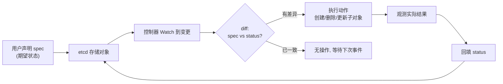
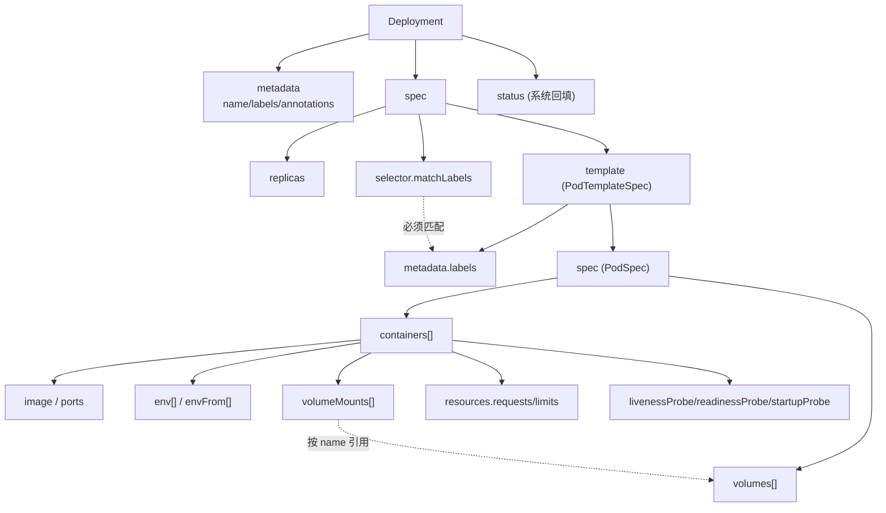
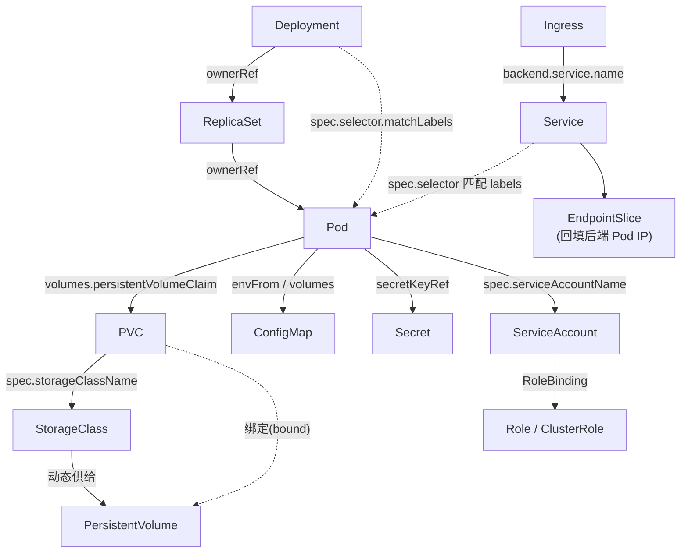
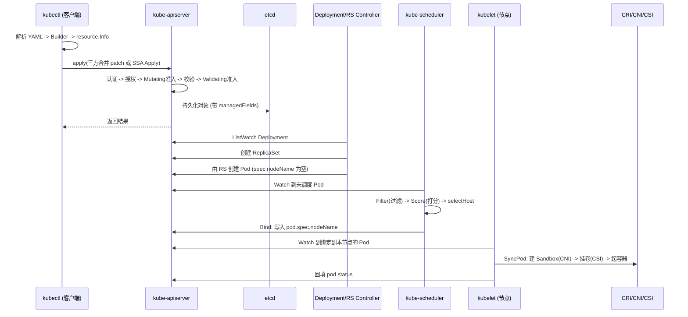
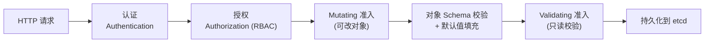
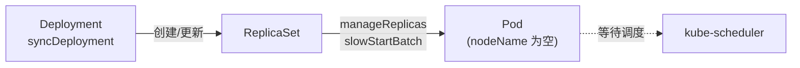
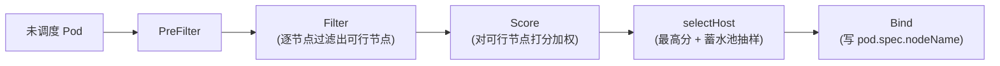
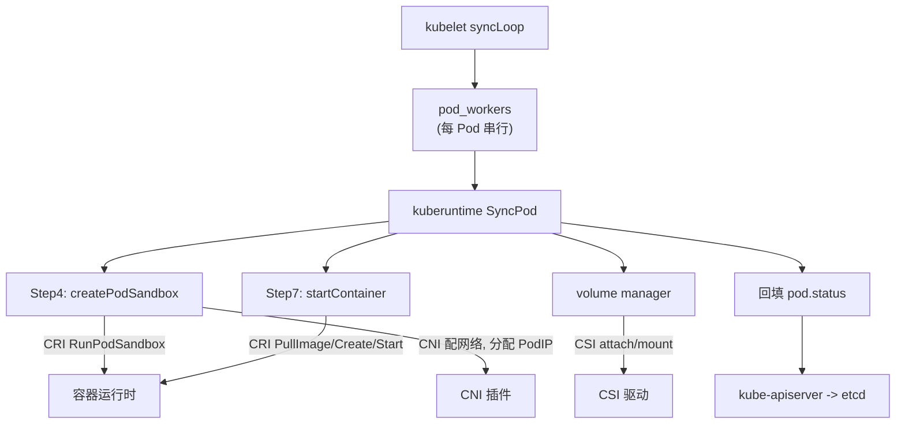
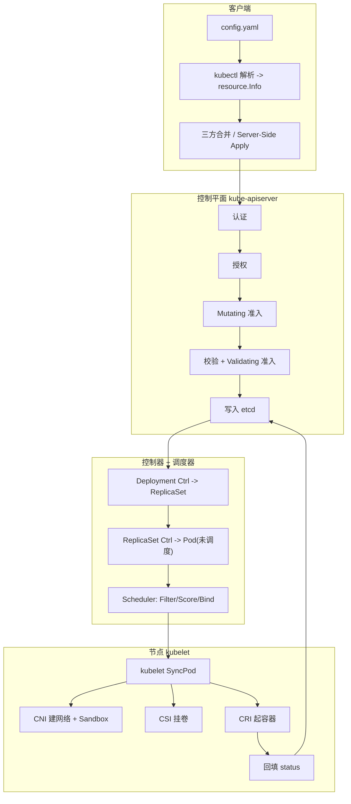

##  0x00    前言
Kubernetes 的一切操作，最终都收敛为一句话：把一份 YAML（声明的期望状态）提交给集群，让控制平面不断把实际状态"收敛"到期望状态。理解 YAML 的组织格式、字段语义、资源关系网，以及它在控制平面内部的完整生效链路，是从"会copy YAML"进阶到"懂 Kubernetes"的分水岭

本文由浅入深介绍如下内容：

1.  **YAML 的组织格式与核心 Key-Value 解剖**：五大顶层字段、`metadata/spec/status` 的设计哲学、常见嵌套结构等
2.  **方法论与生产最佳实践**：资源分类、关系网、QoS 与配额、高可用与安全、校验工具链、生产级完整模板
3.  **基于代码维度的生效原理**：`kubectl apply -f config.yaml` 从终端到容器启动的完整生命周期源码剖析
4.  **`kubectl apply`的全链路总览**

本文代码基于Kubernetes `v1.21.1`


相关文章阅读：

- [Kubernetes 之旅：跟踪 pod 创建的过程](https://pandaychen.github.io/2022/12/30/A-K8S-WORKFLOW/)
- [编写一个 Kubernetes CRD]()
- [Kubernetes 应用改造（七）：存储那些事](https://pandaychen.github.io/2020/12/30/A-KUBERNETES-STORAGE-SUMMARY/)

---

#   第一部分：YAML 的组织格式与核心 Key-Value 解析

##  0x01    核心骨架：五大顶层字段
几乎所有 Kubernetes 对象（无论原生资源还是 CRD 实例）都遵循同一套"五大核心顶层字段"骨架：

```yaml
apiVersion: apps/v1          # 1. 该对象属于哪个 API 群组/版本
kind: Deployment             # 2. 该对象是什么类型
metadata:                    # 3. 对象的元数据（身份、标签、归属）
  name: nginx
  namespace: default
spec:                        # 4. 期望状态（Desired State），由用户声明
  replicas: 3
  # ...
status:                      # 5. 实际状态（Observed State），由系统回填
  availableReplicas: 3
  # ...
```

这五个字段的职责边界非常清晰，可以用"谁来写、何时写、写什么"来区分：

| 字段 | 职责 | 由谁维护 | 底层对应 Go 类型 |
| :---- | :---- | :---- | :---- |
| `apiVersion` | 声明 `group/version`，决定走哪条 REST 路径、用哪个 Scheme 解码 | 用户 | `TypeMeta.APIVersion` |
| `kind` | 声明资源种类，与 `apiVersion` 共同构成 GVK | 用户 | `TypeMeta.Kind` |
| `metadata` | 身份与归属元数据（名字、命名空间、标签、注解、属主） | 用户 + 系统 | `ObjectMeta` |
| `spec` | 期望状态，用户声明"我要什么" | 用户（声明式） | 各资源的 `XxxSpec` |
| `status` | 实际状态，系统回填"现在是什么" | 控制器（只读于用户） | 各资源的 `XxxStatus` |

`apiVersion + kind` 合称 **GVK（GroupVersionKind）**，是 Kubernetes 类型系统的坐标。其 Go 定义位于 `staging/src/k8s.io/apimachinery/pkg/apis/meta/v1/types.go`：

```go
// TypeMeta describes an individual object in an API response or request
type TypeMeta struct {
	Kind string `json:"kind,omitempty" ...`
	APIVersion string `json:"apiVersion,omitempty" ...`
}
```

> 为什么 `apiVersion` 带群组（如 `apps/v1`、`networking.k8s.io/v1`）而核心资源（Pod、Service、ConfigMap）是 `v1`？因为核心资源属于"core / legacy group"，其 group 为空字符串，REST 路径是 `/api/v1/...`；带群组的资源路径是 `/apis/<group>/<version>/...`。GVK 到 REST 路径（GVR, GroupVersionResource）的映射由 `RESTMapper` 完成

##  0x02    metadata 解读：身份与关系的载体
`metadata` 对应 `ObjectMeta`（同样定义在 `apimachinery/pkg/apis/meta/v1/types.go`），它是对象的"身份证 + 关系网接口"。核心字段：

###  2.1   name 与 namespace：唯一定位
-   `name`：在"同一 namespace + 同一资源类型"下唯一。它是对象 key 的一部分（etcd 中 key 形如 `/registry/<resource>/<namespace>/<name>`）
-   `namespace`：命名空间，提供多租户隔离的逻辑边界。集群级资源（如 `Node`、`PersistentVolume`、`ClusterRole`）没有 namespace
-   `uid`：系统分配的全局唯一 ID。注意 `name` 可复用（删了重建），但 `uid` 不会。属主引用正是靠 `uid` 精确锁定对象
-   `generateName`：与 `name` 互斥的一种"前缀生成名"机制；但 `kubectl apply` 不允许使用 `generateName`（见第三部分 `applyOneObject` 的校验逻辑）
-   `resourceVersion`：乐观并发控制（Optimistic Concurrency）的版本号，本质是 etcd 的 revision。更新时若携带的 `resourceVersion` 与服务端不一致，会返回 409 Conflict
-   `generation` 与 `status.observedGeneration`：`generation` 在 `spec` 变更时自增；控制器把自己处理到的 `generation` 回填进 `status.observedGeneration`，用于判断"控制器是否已看到最新的 spec"

###  2.2   labels：选择器的基石
`labels` 是 `map[string]string`，是 Kubernetes "松耦合关联"的核心机制。它不是给人看的备注，而是给**选择器（Selector）**用的索引：

-   Service 通过 `spec.selector` 匹配 Pod 的 labels，决定流量转发给哪些 Pod
-   Deployment/ReplicaSet 通过 `spec.selector.matchLabels` 管理哪些 Pod 归自己
-   `nodeSelector`、亲和性、拓扑分布约束都基于 label

> 坑点：Deployment 的 `spec.selector.matchLabels` 一旦创建**不可变**（immutable），且必须是 `spec.template.metadata.labels` 的子集，否则会报 `selector does not match template labels`

###  2.3   annotations：非标识性元数据
`annotations` 同为 `map[string]string`，但与 labels 本质不同：annotations **不能用于选择**，它承载的是"工具链/控制器消费的结构化信息"，典型用途：

-   `kubectl.kubernetes.io/last-applied-configuration`：`kubectl apply` 客户端三方合并的"原始配置"快照（见后文）
-   Ingress controller、cert-manager、Prometheus 等通过 annotation 下发配置
-   值可以很大、可以是 JSON，而 label 的 value 有长度（63 字符）与字符集限制

###  2.4   ownerReferences：资源关系的"硬连接"
`ownerReferences` 是理解 Kubernetes 级联关系的关键。它声明"我这个对象的属主是谁"：

```yaml
metadata:
  name: nginx-66b6c48dd5-abcde         # 一个 Pod
  ownerReferences:
  - apiVersion: apps/v1
    kind: ReplicaSet
    name: nginx-66b6c48dd5
    uid: 1a2b3c4d-...                   # 靠 uid 精确锁定属主
    controller: true                    # 标记这是"管理型"属主
    blockOwnerDeletion: true            # 删除属主时需先处理该依赖
```

它的底层意义如下：

1.  **级联删除（Garbage Collection）**：删除 Deployment 时，GC 控制器顺着 `ownerReferences` 找到它的 ReplicaSet、再找到 Pod，依次回收。`controller: true` 标记真正的管理者（一个对象只能有一个 controller owner）
2.  **控制器的归属判定（Adoption / Orphaning）**：控制器通过 `ownerReferences` 判断某个子对象是不是"自己的"。第三部分会看到 `DeploymentController.getReplicaSetsForDeployment` 和 `claimReplicaSets` 如何依据 selector + ownerRef 认领或释放 ReplicaSet

##  0x03    spec 与 status：声明式的灵魂
Kubernetes 最核心的设计哲学是 **声明式（Declarative）**：用户只声明"期望状态"（`spec`），不关心"怎么做"；系统负责持续地把"实际状态"（`status`）收敛到期望

-   `spec`（Specification）：**期望态**。用户写入，是"输入"
-   `status`：**实际态**。控制器回填，是"输出"。用户即便在 YAML 里写了 `status`，`apply` 时也基本会被忽略（status 子资源有独立的更新路径 `/status`）

这种"期望 vs 实际"的分离，使得整个系统可以用统一的 **调谐循环（Reconciliation Loop）** 来驱动：



这就是著名的 **Control Loop / Level-Triggered（水平触发）** 模型：控制器不关心"发生了哪个事件"，只关心"当前期望与实际的差距"，因此天然具备幂等性和自愈能力。后文（part3）的 `syncDeployment` 会介绍循环的具体代码实现逻辑

##  0x04    常见嵌套结构：Pod 模板与书写规范
工作负载类资源（Deployment / StatefulSet / DaemonSet / Job）的 `spec` 里都嵌套了一个 **Pod 模板**（`spec.template`），其结构与一个独立 Pod 的 `metadata + spec` 完全一致。这是最常出错的部分：

```yaml
spec:
  replicas: 3
  selector:
    matchLabels:
      app: nginx          # (A) 必须与 (B) 匹配
  template:               # Pod 模板（PodTemplateSpec）
    metadata:
      labels:
        app: nginx        # (B) Pod 自身的 label, 供 (A) 选择
    spec:                 # Pod 的 spec
      containers:
      - name: nginx
        image: nginx:1.21.6
        imagePullPolicy: IfNotPresent
        ports:
        - containerPort: 80
        env:
        - name: GREETING
          value: "hello"
        - name: POD_IP               # Downward API: 注入字段值
          valueFrom:
            fieldRef:
              fieldPath: status.podIP
        - name: DB_PASSWORD          # 从 Secret 注入
          valueFrom:
            secretKeyRef:
              name: db-secret
              key: password
        volumeMounts:
        - name: config-vol
          mountPath: /etc/app
          readOnly: true
      volumes:
      - name: config-vol
        configMap:
          name: app-config
```

常见坑点清单：

1.  **selector 与 template labels 不匹配**：如上文 (A)/(B)，Deployment 创建直接失败
2.  **缩进错误（YAML 致命伤）**：`env`、`volumeMounts` 是 container 级字段（在 `containers[]` 下），`volumes` 是 Pod 级字段（在 `template.spec` 下）
3.  **list 与 map 混淆**：`containers`、`env`、`ports`、`volumes` 都是 **列表（list）**，每项以 `-` 开头；而 `matchLabels`、`labels` 是 **map**
4.  **镜像 tag 用 latest**：会导致 `imagePullPolicy` 默认变为 `Always`，且版本不可追溯。生产环境务必用确定 tag 或 digest
5.  **env 的 value 必须是字符串**：`value: 123` 会在部分场景被解析为数字而报错，建议 `value: "123"`
6.  **数值与引号**：端口、副本数是整数，不要加引号；而形如 `"true"`、`"3.14"` 这种本应是字符串的要显式加引号，避免 YAML 把 `yes/no/on/off` 解析成bool

对象层级关系总览（以 Deployment 为例）：



---

#   第二部分：方法论与最佳实践

##  0x05    分类归纳法：如何驯服成百上千种资源
如何理解海量原生资源 + 海量 CRD？正确姿势是按 **职责维度** 归为五类，每类抓住"核心资源 + 关系锚点"即可：

-   **工作负载（Workloads）**：定义"跑什么、跑几个、怎么升级"
    -   `Pod`（最小调度单元）、`ReplicaSet`（维持副本数）、`Deployment`（声明式滚动升级，管理 RS）、`StatefulSet`（有状态、稳定网络标识与存储）、`DaemonSet`（每节点一个）、`Job` / `CronJob`（批处理 / 定时）
-   **网络（Networking）**：定义"怎么被访问、流量怎么路由"
    -   `Service`（稳定虚拟 IP + 负载均衡，类型 ClusterIP/NodePort/LoadBalancer）、`Endpoints` / `EndpointSlice`（后端 Pod 列表）、`Ingress`（七层路由）、`NetworkPolicy`（网络隔离策略）
-   **存储（Storage）**：定义"数据放哪、怎么供给"
    -   `PersistentVolume`（PV，实际存储资源，集群级）、`PersistentVolumeClaim`（PVC，用户的存储申领）、`StorageClass`（动态供给模板）、`Volume`（Pod 内的卷引用）
-   **配置与安全（Config & Security）**：定义"配置注入、凭据、权限"
    -   `ConfigMap`（非敏感配置）、`Secret`（敏感数据）、`ServiceAccount`（Pod 身份）、`Role` / `ClusterRole` / `RoleBinding` / `ClusterRoleBinding`（RBAC 授权）、`ResourceQuota` / `LimitRange`（资源治理）
-   **集群级（Cluster-scoped）**：定义"集群骨架"
    -   `Node`、`Namespace`、`PersistentVolume`、`CustomResourceDefinition`（CRD，扩展 API）

> 学习 CRD 的方法与原生资源完全一致：任何 CRD 实例也是 `apiVersion/kind/metadata/spec/status` 骨架，其 `spec/status` 的字段由 CRD 的 OpenAPI v3 schema 定义，可用 `kubectl explain <crd>` 查询

##  0x06    核心关系网：资源如何交织成网
Kubernetes 的资源通过几类"关联字段"编织成一张网，如下图所示：



上图中，存在三根最关键的"线"：

1.  **`selector.matchLabels`（软关联）**：Deployment/Service 通过 label selector 松耦合地"选中"Pod。这是"标签 -> 选择器"的间接关联，Pod 并不知道自己被谁选中
2.  **`ownerReferences`（硬关联）**：子对象通过 uid 指向属主，支撑级联删除与归属判定。这是"自下而上"的强引用
3.  **`storageClassName` / `claimRef`（供需关联）**：PVC 声明需求（容量、`storageClassName`），StorageClass 动态供给 PV，PV 与 PVC 双向绑定（PVC 的 `volumeName` 指向 PV，PV 的 `claimRef` 指回 PVC）

##  0x07    生产实践一：资源配额、限制与 QoS

###  7.1   requests 与 limits 的科学设定
-   `resources.requests`：**调度依据**。调度器只看 requests 来判断节点是否"装得下"（见后文 `noderesources` 插件介绍）。requests 是对资源的"预订"
-   `resources.limits`：**运行时上限**。由 kubelet/cgroup 强制执行。CPU 超限会被限流（throttle），内存超限会被 OOMKill

设定原则：

-   requests 设为"稳态实际用量"（可观测 P50~P90），limits 设为"可容忍峰值"
-   CPU 可"超售"（compressible，超限只限流不杀），内存不可超售（incompressible，超限即杀），因此**内存的 requests 与 limits 建议设置得更接近**
-   避免 limits 远大于 requests：会造成节点超售严重、争抢时被优先驱逐

###  7.2   QoS 三等级：源码级判定
Pod 的 QoS Class 不是用户直接声明的，而是 kubelet 依据 requests/limits **推导**出来的，直接决定了节点资源紧张时的**驱逐顺序**。判定逻辑在 `pkg/apis/core/v1/helper/qos/qos.go` 的 `GetPodQOS`：

```go
// pkg/apis/core/v1/helper/qos/qos.go
func GetPodQOS(pod *v1.Pod) v1.PodQOSClass {
	// ... 遍历所有容器, 累加 requests / limits
	// 规则 1: 所有容器都没设任何 requests/limits -> BestEffort
	if len(requests) == 0 && len(limits) == 0 {
		return v1.PodQOSBestEffort
	}
	// 规则 2: 每个容器的 cpu 和 memory 都设了 limits, 且 requests == limits -> Guaranteed
	if isGuaranteed && len(requests) == len(limits) {
		return v1.PodQOSGuaranteed
	}
	// 规则 3: 其余情况 -> Burstable
	return v1.PodQOSBurstable
}
```

| QoS 等级 | 条件 | 驱逐优先级（紧张时先杀谁） |
| :---- | :---- | :---- |
| `Guaranteed` | 每个容器 cpu/memory 的 requests == limits（且都已设置） | 最后被杀（最高保障） |
| `Burstable` | 至少一个容器设了 requests/limits，但不满足 Guaranteed | 居中 |
| `BestEffort` | 完全没设 requests/limits | 最先被杀 |

> 生产环境建议如下：核心服务用 Guaranteed（requests == limits），可弹性的用 Burstable，离线/可牺牲任务可用 BestEffort

###  7.3   ResourceQuota 与 LimitRange：命名空间级治理

-   **`ResourceQuota`**：对**整个 namespace** 的资源总量设限（CPU/内存总 requests、总 limits、对象数量如 Pod 数、PVC 数）。一旦开启，**该 namespace 下的 Pod 必须显式声明 requests/limits**，否则创建被拒
-   **`LimitRange`**：对**单个对象**（Pod/Container/PVC）设定默认值与最小/最大值。它能为"没写 resources 的容器"自动注入默认 requests/limits（通过 Mutating Admission 实现），并校验是否越界

二者配合解决了：LimitRange 保证"每个容器都有合理的默认值"，ResourceQuota 保证"整个命名空间不超售"

##  0x08    生产实践二：高可用与安全相关

###  8.1   反亲和性与拓扑分布约束
为避免**同一服务的多个副本挤在同一节点/机架/可用区**，有两种机制：

```yaml
spec:
  template:
    spec:
      # 方式一: 反亲和性(硬性 required 或软性 preferred)
      affinity:
        podAntiAffinity:
          requiredDuringSchedulingIgnoredDuringExecution:   # 硬性: 不满足则不调度
          - labelSelector:
              matchLabels:
                app: nginx
            topologyKey: kubernetes.io/hostname            # 同一节点不放两个
      # 方式二: 拓扑分布约束(更现代, 可精确控制"倾斜度")
      topologySpreadConstraints:
      - maxSkew: 1                                          # 各拓扑域副本数差 <= 1
        topologyKey: topology.kubernetes.io/zone           # 按可用区打散
        whenUnsatisfiable: DoNotSchedule                   # 或 ScheduleAnyway
        labelSelector:
          matchLabels:
            app: nginx
```

-   `podAntiAffinity`：表达"不要和谁待在一起"，`required` 为硬约束，`preferred` 为软偏好
-   `topologySpreadConstraints`（v1.19 GA）：更精细，通过 `maxSkew` 控制各拓扑域（node/zone/region）之间副本数的最大倾斜度，是生产多可用区打散的首选

###  8.2   securityContext：最小权限
```yaml
spec:
  template:
    spec:
      securityContext:                 # Pod 级
        runAsNonRoot: true             # 禁止以 root 运行
        runAsUser: 10001
        fsGroup: 10001                 # 卷的属组
      containers:
      - name: app
        securityContext:               # 容器级(优先级更高)
          allowPrivilegeEscalation: false   # 禁止提权
          readOnlyRootFilesystem: true      # 根文件系统只读
          capabilities:
            drop: ["ALL"]                    # 丢弃所有 Linux capabilities
```

安全基线：非 root 运行、根文件系统只读、禁止提权、丢弃不必要的 capabilities。这些也是 `kube-linter`、Pod Security Standards（Restricted 级别）重点检查的项

###  8.3   探针（Probes）配置策略
三种探针各司其职，**勿混用**：

-   `startupProbe`（启动探针）：保护"慢启动"应用。成功前，另外两个探针不生效。适合 JVM 等冷启动慢的应用，避免启动期被 liveness 误杀
-   `readinessProbe`（就绪探针）：决定 Pod 是否**接入 Service 流量**。失败只摘流量，不重启
-   `livenessProbe`（存活探针）：决定是否**重启容器**。失败会触发 kubelet 重启

```yaml
        startupProbe:
          httpGet: { path: /healthz, port: 8080 }
          failureThreshold: 30
          periodSeconds: 10          # 最多容忍 30*10=300s 启动
        readinessProbe:
          httpGet: { path: /ready, port: 8080 }
          initialDelaySeconds: 5
          periodSeconds: 10
        livenessProbe:
          httpGet: { path: /healthz, port: 8080 }
          initialDelaySeconds: 15
          periodSeconds: 20
```

> 注意点：liveness 探针**不要**检查下游依赖（数据库、外部 API），否则下游抖动会引发大面积无意义重启（级联故障）。建议liveness 只应检查"进程本身是否还活着"

##  0x09    自动化工具链说明

###  9.1   边学边查：kubectl explain 与 dry-run

```bash
# 查字段文档(直接读 API Server 的 OpenAPI schema, 最权威)
kubectl explain deployment.spec.template.spec.containers.resources
kubectl explain pod.spec --recursive        # 递归展开所有字段

# 客户端校验(不连 API Server, 只做本地结构/schema 校验)
kubectl apply -f config.yaml --dry-run=client -o yaml

# 服务端校验(经过 API Server 的解码/默认值/准入, 但不落库)
kubectl apply -f config.yaml --dry-run=server
```

通常，`--dry-run=client` 只在本地校验，不经过准入控制；`--dry-run=server` 会真正走到 API Server 的默认值填充与（dry-run 感知的）准入 webhook，能发现更多问题，但不持久化到 etcd

##  0x0A    实战：生产级完整 YAML 模板

下面是一份包含 `Deployment`（探针 + 资源限制 + SecurityContext）、`Service`、`ConfigMap`、`HPA` 的配置文件，可直接作为生产模板基线参考：

```yaml
# ============== 1. ConfigMap: 应用非敏感配置 ==============
apiVersion: v1
kind: ConfigMap
metadata:
  name: web-config
  namespace: prod
data:
  APP_MODE: "production"            # 普通键值
  app.conf: |                        # 多行文件内容
    log_level = info
    max_conn  = 1000
---
# ============== 2. Deployment: 核心工作负载 ==============
apiVersion: apps/v1
kind: Deployment
metadata:
  name: web
  namespace: prod
  labels:
    app: web
spec:
  replicas: 3                        # 3 副本保证高可用
  revisionHistoryLimit: 5            # 保留 5 个历史版本便于回滚
  strategy:
    type: RollingUpdate             # 滚动升级, 不中断服务
    rollingUpdate:
      maxUnavailable: 0             # 升级过程中不允许少于期望副本
      maxSurge: 1                   # 最多多起 1 个新 Pod
  selector:
    matchLabels:
      app: web                      # (A) 必须匹配下方 template.labels
  template:
    metadata:
      labels:
        app: web                    # (B) Pod 标签, 供 (A) 与 Service 选择
    spec:
      securityContext:              # Pod 级安全上下文
        runAsNonRoot: true          # 禁止 root 运行
        runAsUser: 10001
        fsGroup: 10001
      # 多副本按可用区打散, 保证高可用
      topologySpreadConstraints:
      - maxSkew: 1
        topologyKey: topology.kubernetes.io/zone
        whenUnsatisfiable: DoNotSchedule
        labelSelector:
          matchLabels:
            app: web
      containers:
      - name: web
        image: registry.example.com/web:1.4.2   # 确定版本, 不用 latest
        imagePullPolicy: IfNotPresent
        ports:
        - containerPort: 8080
        envFrom:
        - configMapRef:
            name: web-config        # 批量注入 ConfigMap 为环境变量
        resources:                  # Guaranteed QoS: requests == limits
          requests:
            cpu: "500m"
            memory: "512Mi"
          limits:
            cpu: "500m"
            memory: "512Mi"
        securityContext:            # 容器级安全上下文
          allowPrivilegeEscalation: false
          readOnlyRootFilesystem: true
          capabilities:
            drop: ["ALL"]
        startupProbe:               # 慢启动保护
          httpGet: { path: /healthz, port: 8080 }
          failureThreshold: 30
          periodSeconds: 10
        readinessProbe:             # 就绪才接流量
          httpGet: { path: /ready, port: 8080 }
          periodSeconds: 10
        livenessProbe:              # 存活检测(只查进程本身)
          httpGet: { path: /healthz, port: 8080 }
          initialDelaySeconds: 15
          periodSeconds: 20
        volumeMounts:
        - name: tmp                 # 根文件系统只读, 需为可写目录挂 emptyDir
          mountPath: /tmp
      volumes:
      - name: tmp
        emptyDir: {}
---
# ============== 3. Service: 稳定访问入口 ==============
apiVersion: v1
kind: Service
metadata:
  name: web
  namespace: prod
spec:
  type: ClusterIP
  selector:
    app: web                        # 通过 label 选中上面的 Pod
  ports:
  - port: 80                        # Service 暴露端口
    targetPort: 8080               # 转发到容器端口
---
# ============== 4. HPA: 水平自动扩缩容 ==============
apiVersion: autoscaling/v2beta2     # v1.21 中 v2 的稳定形态为 v2beta2
kind: HorizontalPodAutoscaler
metadata:
  name: web
  namespace: prod
spec:
  scaleTargetRef:
    apiVersion: apps/v1
    kind: Deployment
    name: web                       # 作用于上面的 Deployment
  minReplicas: 3
  maxReplicas: 20
  metrics:
  - type: Resource
    resource:
      name: cpu
      target:
        type: Utilization
        averageUtilization: 70      # CPU 平均利用率超 70% 则扩容
```

> 版本说明：在 v1.21 中，HPA 的 `autoscaling/v2` 尚未 GA，稳定可用的多指标版本为 `autoscaling/v2beta2`（`autoscaling/v2` 在 v1.23 才 GA）。若只用单一 CPU 指标，也可用 `autoscaling/v1`

---

#   第三部分：kubectl的原理（v1.21.1）

当在终端敲下 `kubectl apply -f config.yaml`，到容器真正在节点上跑起来，经历了一条贯穿客户端、API Server、控制器、调度器、Kubelet 的完整链路。本章节以 v1.21.1 源码为据，剖析 `kubectl apply` 从客户端合并、控制平面准入、控制器调谐、调度器打分，到 kubelet 经 CRI/CNI/CSI 起容器的全链路。整体链路时序如下：



##  0x0B    环节一：客户端解析与 apply 合并
入口在 `staging/src/k8s.io/kubectl/pkg/cmd/apply/apply.go`。`kubectl apply` 先用 resource Builder 把 `-f` 的 YAML 解析为一组 `resource.Info`（每个对象一个），然后 `Run()` 遍历调用 `applyOneObject()`：

```go
// staging/src/k8s.io/kubectl/pkg/cmd/apply/apply.go
func (o *ApplyOptions) Run() error {
	// ... GetObjects(): Builder 解析 YAML -> []*resource.Info
	infos, err := o.GetObjects()
	// ...
	for _, info := range infos {
		if err := o.applyOneObject(info); err != nil { // 逐对象 apply
			errs = append(errs, err)
		}
	}
	// ...
}
```

`applyOneObject` 里有一个关键分叉：**Server-Side Apply（SSA）** 还是传统 **客户端三方合并（Client-Side Three-Way Merge）**

###  11.1  传统客户端三方合并（Client-Side Apply）
这是 v1.21 默认行为（未加 `--server-side`）。它需要三份配置做 diff：

-   **original**：对象 annotation `kubectl.kubernetes.io/last-applied-configuration` 里保存的"上次 apply 的配置"
-   **modified**：本次 YAML 的内容
-   **current**：API Server 上该对象的当前状态

逻辑在 `applyOneObject` 的客户端分支：若对象不存在则直接 `Create`（并写入 last-applied annotation）；若存在则交给 `patcher.Patch`：

```go
// staging/src/k8s.io/kubectl/pkg/cmd/apply/apply.go (客户端分支摘录)
modified, err := util.GetModifiedConfiguration(info.Object, true, unstructured.UnstructuredJSONScheme)
if err := info.Get(); err != nil {
	if errors.IsNotFound(err) {
		// 对象不存在 -> 写 last-applied 注解 -> Create, 跳过三方合并
		util.CreateApplyAnnotation(info.Object, ...)
		helper.Create(info.Namespace, true, info.Object)
	}
	// ...
}
// 对象已存在 -> 三方合并 patch
patcher, _ := newPatcher(o, info, helper)
patchBytes, patchedObject, err := patcher.Patch(info.Object, modified, info.Source, info.Namespace, info.Name, o.ErrOut)
```

三方合并的核心计算在 `patcher.go` 的 `patchSimple`：根据对象类型选择 patch 策略，对注册在 Scheme 里的原生类型用 **Strategic Merge Patch**（能理解 list 的合并语义，如按 `name` 合并容器），否则回退到 **JSON Merge Patch**：

```go
// staging/src/k8s.io/kubectl/pkg/cmd/apply/patcher.go
func (p *Patcher) patchSimple(obj runtime.Object, modified []byte, ...) (...) {
	current, _ := runtime.Encode(unstructured.UnstructuredJSONScheme, obj) // 当前态
	original, _ := util.GetOriginalConfiguration(obj)                      // last-applied 注解

	versionedObject, err := scheme.Scheme.New(p.Mapping.GroupVersionKind)
	switch {
	case runtime.IsNotRegisteredError(err):
		// 非内置类型(如 CRD, 无 strategic 元数据): JSON Merge Patch 三方合并
		patch, err = jsonmergepatch.CreateThreeWayJSONMergePatch(original, modified, current, preconditions...)
	case err == nil:
		// 内置类型: Strategic Merge Patch(优先用 OpenAPI schema, 否则用编译进二进制的结构体 tag)
		patchType = types.StrategicMergePatchType
		// ... CreateThreeWayMergePatch(original, modified, current, lookupPatchMeta, p.Overwrite)
	}
	// 最终 PATCH 到 API Server
	patchedObj, err := p.Helper.Patch(namespace, name, patchType, patch, nil)
	return patch, patchedObj, err
}
```

`Patch` 外层还有**冲突重试 + force 兜底**：遇到 409 Conflict 会重新 Get 当前态再算 patch（最多 `maxPatchRetry` 次），若仍失败且带 `--force`，则 `deleteAndCreate` 删了重建：

```go
// patcher.go
func (p *Patcher) Patch(current runtime.Object, modified []byte, ...) (...) {
	patchBytes, patchObject, err := p.patchSimple(...)
	for i := 1; i <= p.Retries && errors.IsConflict(err); i++ {
		current, _ = p.Helper.Get(namespace, name)  // 冲突则刷新当前态重试
		patchBytes, patchObject, err = p.patchSimple(...)
	}
	if err != nil && (errors.IsConflict(err) || errors.IsInvalid(err)) && p.Force {
		patchBytes, patchObject, err = p.deleteAndCreate(current, modified, namespace, name)
	}
	return patchBytes, patchObject, err
}
```

###  11.2  Server-Side Apply（SSA）与 ManagedFields
加上 `--server-side` 后，客户端不再本地算 diff，而是把**整个对象**用 `Content-Type: application/apply-patch+yaml`（`types.ApplyPatchType`）直接 PATCH 给 API Server，由服务端负责合并与冲突检测：

```go
// staging/src/k8s.io/kubectl/pkg/cmd/apply/apply.go
if o.ServerSideApply {
	data, _ := runtime.Encode(unstructured.UnstructuredJSONScheme, info.Object)
	options := metav1.PatchOptions{ Force: &o.ForceConflicts }
	obj, err := helper.Patch(info.Namespace, info.Name, types.ApplyPatchType, data, &options)
	if errors.IsConflict(err) {
		// 字段被其他 manager 占用 -> 提示用 --force-conflicts
	}
}
```

SSA 的核心是 **`managedFields`**：对象的 `metadata.managedFields` 记录了"每个字段分别由哪个 field manager（如 `kubectl`、某控制器）管理"。服务端据此判断本次 apply 是否与他人管理的字段冲突。相关实现：

-   服务端合并与所有权追踪：`staging/src/k8s.io/apiserver/pkg/endpoints/handlers/patch.go`（处理 `ApplyPatchType`）
-   ManagedFields 的解析/提取工具：`staging/src/k8s.io/apimachinery/pkg/util/managedfields/`（如 `extract.go`），底层结构化合并由 `sigs.k8s.io/structured-merge-diff` 完成

> 客户端合并 vs SSA 对比：客户端合并依赖 last-applied 注解，多个客户端/控制器同时改同一对象时容易"互相覆盖"；SSA 把字段所有权下沉到服务端，用 managedFields 精确追踪、冲突显式化，是官方推荐的演进方向（v1.22 GA）

##  0x0C    环节二：控制平面处理流（认证 -> 授权 -> 准入 -> 持久化）
当请求到达 kube-apiserver 后，经过一条标准的处理链。核心顺序：**认证（Authentication）-> 授权（Authorization）-> 准入控制（Admission）-> 校验（Validation）-> 写入 etcd**



###  12.1  认证与授权
-   **认证**：识别"你是谁"。支持客户端证书、Bearer Token、ServiceAccount Token、OIDC 等多种 authenticator，任一通过即可
-   **授权**：判断"你能否做这个操作"。生产集群主要用 **RBAC**，依据 `(user, verb, resource, namespace)` 对照 Role/ClusterRole 的规则

###  12.2  准入控制：Mutating 与 Validating
准入控制是 YAML 生效前"最后一道关卡"，也是 LimitRange 注入默认值、各类策略治理（Gatekeeper/Kyverno）落地的地方。它分两阶段，顺序是**先 Mutating（可修改对象）后 Validating（只读校验）**。准入链的执行逻辑在 `staging/src/k8s.io/apiserver/pkg/admission/chain.go`：

```go
// staging/src/k8s.io/apiserver/pkg/admission/chain.go
// 第一阶段: 遍历所有 Mutating 插件, 可修改对象
func (admissionHandler chainAdmissionHandler) Admit(ctx context.Context, a Attributes, o ObjectInterfaces) error {
	for _, handler := range admissionHandler {
		if !handler.Handles(a.GetOperation()) { continue }
		if mutator, ok := handler.(MutationInterface); ok {
			if err := mutator.Admit(ctx, a, o); err != nil {
				return err      // 任一失败立即返回
			}
		}
	}
	return nil
}

// 第二阶段: 遍历所有 Validating 插件, 只读校验
func (admissionHandler chainAdmissionHandler) Validate(ctx context.Context, a Attributes, o ObjectInterfaces) error {
	for _, handler := range admissionHandler {
		if !handler.Handles(a.GetOperation()) { continue }
		if validator, ok := handler.(ValidationInterface); ok {
			if err := validator.Validate(ctx, a, o); err != nil {
				return err
			}
		}
	}
	return nil
}
```

准入插件分两类：

-   **内置（编译进 apiserver）**：如 `plugin/pkg/admission/limitranger`（LimitRange 默认值注入）、`plugin/pkg/admission/resourcequota`（配额校验）、`plugin/pkg/admission/antiaffinity` 等，源码都在 `plugin/pkg/admission/` 下
-   **动态（Webhook）**：`MutatingAdmissionWebhook` 与 `ValidatingAdmissionWebhook` 两个特殊的内置插件，会回调用户注册的外部 HTTP 服务（这正是 Gatekeeper、Kyverno、cert-manager 的接入点）

> 一个 Mutating Webhook 的典型例子：给所有 Pod 自动注入 sidecar（如 Istio 的 Envoy），或给没写 resources 的容器补默认值

###  12.3  持久化到 etcd
通过所有准入与校验后，对象被序列化（通常是 protobuf）写入 etcd。存储层抽象在 `staging/src/k8s.io/apiserver/pkg/storage/`，etcd3 的具体实现在 `storage/etcd3/`（如 `store.go` 的 `Create`/`GuaranteedUpdate`）。etcd 的 key 形如 `/registry/<resource>/<namespace>/<name>`，`resourceVersion` 即 etcd 的 revision，是 Watch 与乐观锁的基础

对象一旦写入，API Server 会向所有 Watch 该资源的客户端（各控制器、scheduler、kubelet）推送变更事件。这就是整个"事件驱动"体系的源头

##  0x0D    环节三：控制器与调度器

###  13.1  控制循环：ListWatch 与 Informer
所有控制器都遵循同一套模式：通过 **Informer** 对资源做 **ListWatch**（先 List 全量建本地 cache，再 Watch 增量更新），事件触发时把对象 key 放入 **workqueue**，worker 取出 key 调用 `syncHandler` 做调谐

以 Deployment 控制器为例（`pkg/controller/deployment/deployment_controller.go`）：

```go
// pkg/controller/deployment/deployment_controller.go
func (dc *DeploymentController) Run(workers int, stopCh <-chan struct{}) {
	// ... 等待 informer cache 同步完成
	for i := 0; i < workers; i++ {
		go wait.Until(dc.worker, time.Second, stopCh)  // 启动 worker 协程
	}
	<-stopCh
}

func (dc *DeploymentController) worker() {
	for dc.processNextWorkItem() {}
}

func (dc *DeploymentController) processNextWorkItem() bool {
	key, quit := dc.queue.Get()        // 从 workqueue 取一个 key
	if quit { return false }
	defer dc.queue.Done(key)
	err := dc.syncHandler(key.(string)) // syncHandler = syncDeployment
	dc.handleErr(err, key)              // 失败则按退避重新入队
	return true
}
```

###  13.2  Deployment -> ReplicaSet -> Pod 的调谐
`syncHandler` 实际指向 `syncDeployment`。它是一个典型的"水平触发"调谐函数：拿到期望（`d.Spec`）与实际（现有 RS、Pod），计算差异并驱动：

```go
// pkg/controller/deployment/deployment_controller.go
func (dc *DeploymentController) syncDeployment(key string) error {
	namespace, name, _ := cache.SplitMetaNamespaceKey(key)
	deployment, err := dc.dLister.Deployments(namespace).Get(name)  // 从本地 cache 读
	// ...
	d := deployment.DeepCopy()

	// 1) 认领/释放 RS: 依据 selector + ownerReferences 找到归自己管的 ReplicaSet
	rsList, err := dc.getReplicaSetsForDeployment(d)
	// 2) 按 RS 分组收集 Pod
	podMap, err := dc.getPodMapForDeployment(d, rsList)
	// ...
	// 3) 根据策略分发: 扩缩容 / 回滚 / 滚动 / 重建
	if d.Spec.Paused { return dc.sync(d, rsList) }
	if getRollbackTo(d) != nil { return dc.rollback(d, rsList) }
	scalingEvent, _ := dc.isScalingEvent(d, rsList)
	if scalingEvent { return dc.sync(d, rsList) }
	switch d.Spec.Strategy.Type {
	case apps.RecreateDeploymentStrategyType:
		return dc.rolloutRecreate(d, rsList, podMap)
	case apps.RollingUpdateDeploymentStrategyType:
		return dc.rolloutRolling(d, rsList)   // 滚动升级: 新建 RS, 逐步调整新旧 RS 副本
	}
}
```

Deployment 控制器只负责"管 ReplicaSet"；真正"创建 Pod"的是 ReplicaSet 控制器（`pkg/controller/replicaset/replica_set.go`）。它的 `syncReplicaSet` 计算当前 Pod 数与期望 `replicas` 的差，调用 `manageReplicas` 补齐或删除：

```go
// pkg/controller/replicaset/replica_set.go
func (rsc *ReplicaSetController) manageReplicas(filteredPods []*v1.Pod, rs *apps.ReplicaSet) error {
	diff := len(filteredPods) - int(*(rs.Spec.Replicas))
	if diff < 0 {
		// 实际 < 期望: 批量创建 Pod(带 ownerReference 指向该 RS)
		// slowStartBatch: 以 1,2,4,8... 指数批量创建, 避免雪崩
	} else if diff > 0 {
		// 实际 > 期望: 删除多余 Pod
	}
	// ...
}
```

此时创建出来的 Pod，其 `spec.nodeName` 为空——它还没有被调度到任何节点



###  13.3  调度器：Filter 过滤 + Score 打分
调度器 Watch 到 `spec.nodeName` 为空的 Pod，为其选节点。v1.21 版本的调度器已全面基于 **Scheduling Framework**（扩展点插件化）。核心调度算法在 `pkg/scheduler/core/generic_scheduler.go` 的 `Schedule`：

```go
// pkg/scheduler/core/generic_scheduler.go
func (g *genericScheduler) Schedule(ctx, fwk, state, pod) (result ScheduleResult, err error) {
	// 1) 快照当前节点信息
	if err := g.snapshot(); err != nil { return result, err }
	// 2) 过滤(Predicates): 找出所有"能放得下"的节点
	feasibleNodes, diagnosis, err := g.findNodesThatFitPod(ctx, fwk, state, pod)
	if len(feasibleNodes) == 0 {
		return result, &framework.FitError{Pod: pod, ...}   // 无可用节点 -> Pending
	}
	if len(feasibleNodes) == 1 {
		return ScheduleResult{SuggestedHost: feasibleNodes[0].Name, ...}, nil
	}
	// 3) 打分(Priorities): 对可行节点评分
	priorityList, err := g.prioritizeNodes(ctx, fwk, state, pod, feasibleNodes)
	// 4) 选出最高分节点(同分用蓄水池抽样随机)
	host, err := g.selectHost(priorityList)
	return ScheduleResult{SuggestedHost: host, ...}, err
}
```

调度框架定义了一系列**扩展点**（`pkg/scheduler/framework/interface.go`），插件按阶段挂载：`PreFilter -> Filter -> PostFilter -> PreScore -> Score -> Reserve -> Permit -> PreBind -> Bind -> PostBind`。常见插件在 `pkg/scheduler/framework/plugins/` 下：

-   **Filter 阶段**（过滤）：`noderesources`（节点资源是否够放下 Pod 的 requests）、`nodeaffinity`（节点亲和）、`nodeports`（端口冲突）、`nodeunschedulable`（节点是否可调度）、`interpodaffinity`（Pod 间亲和/反亲和）、`podtopologyspread`（拓扑分布约束的硬约束）、`nodevolumelimits`（节点可挂卷上限）等
-   **Score 阶段**（打分）：`noderesources`（如 LeastAllocated：越空闲越高分）、`imagelocality`（镜像本地性）、`interpodaffinity`、`podtopologyspread`（软约束倾斜度）等，每个插件打 `0~100` 分后按权重加权

`selectHost` 用蓄水池抽样在最高分节点中随机挑一个，避免热点：

```go
// pkg/scheduler/core/generic_scheduler.go
func (g *genericScheduler) selectHost(nodeScoreList framework.NodeScoreList) (string, error) {
	maxScore := nodeScoreList[0].Score
	selected := nodeScoreList[0].Name
	cntOfMaxScore := 1
	for _, ns := range nodeScoreList[1:] {
		if ns.Score > maxScore {
			maxScore = ns.Score; selected = ns.Name; cntOfMaxScore = 1
		} else if ns.Score == maxScore {
			cntOfMaxScore++
			if rand.Intn(cntOfMaxScore) == 0 { selected = ns.Name } // 蓄水池抽样
		}
	}
	return selected, nil
}
```

选定节点后，调度器执行 **Bind**：向 API Server 发一个 Binding，把 `pod.spec.nodeName` 写为目标节点名。至此 Pod 完成调度



##  0x0E    环节四：节点端 Kubelet 与 CRI/CNI/CSI
Pod 的 `spec.nodeName` 被写入后，目标节点上的 kubelet 通过 ListWatch 发现"有一个绑定到我（本Node）的 Pod"，开始在本节点把它拉起来

kubelet 主循环在 `pkg/kubelet/kubelet.go`（`syncLoop` / `syncLoopIteration`），每个 Pod 由 `pkg/kubelet/pod_workers.go` 的 pod worker 串行处理，最终调用容器运行时管理器的 `SyncPod`。真正与 CRI 交互的在 `pkg/kubelet/kuberuntime/kuberuntime_manager.go` 的 `SyncPod`，它用如下几步把 Pod 拉起创建：

```go
// pkg/kubelet/kuberuntime/kuberuntime_manager.go
func (m *kubeGenericRuntimeManager) SyncPod(pod *v1.Pod, podStatus *kubecontainer.PodStatus, ...) (result kubecontainer.PodSyncResult) {
	// Step 1: 计算 sandbox 和容器的变化(哪些要建/要杀)
	podContainerChanges := m.computePodActions(pod, podStatus)
	// Step 2: 若 sandbox 变了, 杀掉整个 Pod
	// Step 3: 杀掉不该保留的容器
	// Step 4: 必要时创建 Pod sandbox(这一步内部会调用 CNI 配置网络)
	if podContainerChanges.CreateSandbox {
		podSandboxID, msg, err = m.createPodSandbox(pod, podContainerChanges.Attempt)
		// 注释明确: createPodSandbox 可能返回来自 CNI / CSI / CRI 的错误
	}
	// Step 5: 启动 ephemeral containers
	// Step 6: 启动 init 容器
	// Step 7: 启动业务容器(startContainer: 拉镜像 -> 创建 -> 启动)
	// ...
}
```

接口分工（都发生在 SyncPod 过程中）如下：

-   **CRI（Container Runtime Interface）**：kubelet 通过 gRPC 调用容器运行时（containerd / CRI-O / dockershim）。接口定义在 `staging/src/k8s.io/cri-api/`。`createPodSandbox` -> `RunPodSandbox`、`startContainer` -> `CreateContainer` + `StartContainer`、拉镜像 -> `PullImage`，都是 CRI 调用
-   **CNI（Container Network Interface）**：在创建 sandbox（即 Pod 的 "pause" 容器 / 网络命名空间）时配置网络：分配 Pod IP、建 veth、配路由。v1.21 中若用 dockershim，CNI 调用在 `pkg/kubelet/dockershim/network/cni/`；若用 containerd/CRI-O，则由运行时自身调用 CNI 插件。创建 sandbox 后，`SyncPod` 通过 `determinePodSandboxIPs` 拿到分配好的 Pod IP
-   **CSI（Container Storage Interface）**：若 Pod 引用了 PVC，卷的 attach/mount 由 CSI 完成。相关实现在 `pkg/volume/csi/`（如 `csi_attacher.go`、`csi_mounter.go`）。注意卷的 attach 可能由外部的 `external-attacher` + `AttachDetachController` 先完成，节点上的 mount 由 kubelet 的 volume manager 驱动 CSI node 插件完成

容器启动后，kubelet 持续探测（probes）并把 Pod 的实际状态回填到 `pod.status`（阶段、容器状态、PodIP 等），API Server 更新 etcd。至此，一份 YAML 声明的"期望"终于变成了节点上运行的"实际"，闭环完成



---

#   第四部分：全链路总览

##  0x0F    一图总览：从 YAML 到容器
总结下，一条 `kubectl apply` 的完整生命周期：



##  0x10    总结
一句话总结 Kubernetes 的本质：**用户声明期望（spec），系统通过无数个调谐循环，持续地把实际状态（status）收敛到期望**。理解了这一点，再看任何资源、任何 CRD，都是同一套心智模型

##  0x11    参考
-   [源码解析：K8s 创建 pod 时，背后发生了什么](https://arthurchiao.art/blog/what-happens-when-k8s-creates-pods-1-zh/)
-   [What happens when I type kubectl run?](https://github.com/jamiehannaford/what-happens-when-k8s)
-   [Kubernetes 官方文档：Server-Side Apply](https://kubernetes.io/docs/reference/using-api/server-side-apply/)
-   [Kubernetes 官方文档：Scheduling Framework](https://kubernetes.io/docs/concepts/scheduling-eviction/scheduling-framework/)


