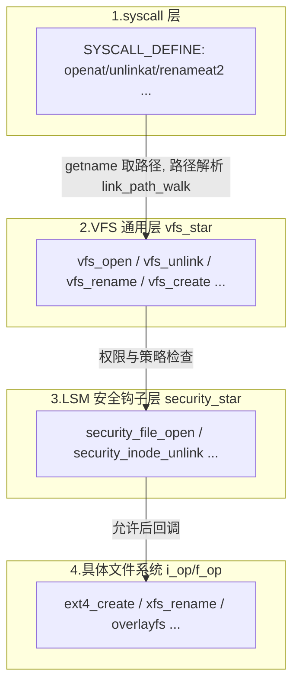
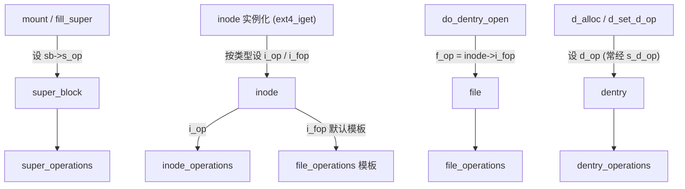

##  0x00    前言
本文从eBPF 内核态开发的视角，梳理 Linux VFS（虚拟文件系统）中值得挂载（hook）的监控点：文件的打开、创建、删除、重命名、目录/链接操作、属性与扩展属性修改、读写截断、挂载卸载等，并补齐 `inode`/`dentry` 相关操作与 `security_*` LSM 钩子

本文代码基于：

-	内核[v5.4.241](https://elixir.bootlin.com/linux/v5.4.241/source/)
-	内核[v6.6.47](https://elixir.bootlin.com/linux/v6.6.47/source/)
-	内核 stable 稳定树 `gregkh/linux` 的 [v6.6.47/include/linux/fs.h](https://github.com/gregkh/linux/blob/v6.6.47/include/linux/fs.h) 与 [v5.4.241/include/linux/fs.h](https://github.com/gregkh/linux/blob/v5.4.241/include/linux/fs.h)

阅读导引：两套内核在 VFS 层的**调用链骨架基本一致**，但对 eBPF 开发者影响最大的是**函数签名的参数漂移**，集中在三处：

1.	`mnt_idmap`（挂载点 idmapping）在 6.x 版本被引入为多数 `vfs_*`/`security_inode_*` 的**首个参数**（前身是内核 5.12 版本引入的 `struct user_namespace *`，内核6.3 改为 `struct mnt_idmap *`）。这会导致 kprobe hook读取参数时**寄存器下标整体后移一位**
2.	`vfs_rename` 在内核 5.12+ 把一长串参数**收敛为 `struct renamedata *`** 单个结构体指针
3.	`open` 路径在内核 5.6+ 引入 `openat2`/`do_sys_openat2`，内核6.6 的 `open/openat` 也统一走该路径

```c
//https://elixir.bootlin.com/linux/v6.6.47/source/fs/mnt_idmapping.c#L12
struct mnt_idmap {
	struct user_namespace *owner;
	refcount_t count;
};

//https://elixir.bootlin.com/linux/v5.4.241/source/include/linux/user_namespace.h#L55
struct user_namespace {
	struct uid_gid_map	uid_map;
	struct uid_gid_map	gid_map;
	struct uid_gid_map	projid_map;
	atomic_t		count;
	struct user_namespace	*parent;
	int			level;
	kuid_t			owner;
	kgid_t			group;
	struct ns_common	ns;
	unsigned long		flags;

#ifdef CONFIG_KEYS
	/* List of joinable keyrings in this namespace.  Modification access of
	 * these pointers is controlled by keyring_sem.  Once
	 * user_keyring_register is set, it won't be changed, so it can be
	 * accessed directly with READ_ONCE().
	 */
	struct list_head	keyring_name_list;
	struct key		*user_keyring_register;
	struct rw_semaphore	keyring_sem;
#endif

	/* Register of per-UID persistent keyrings for this namespace */
#ifdef CONFIG_PERSISTENT_KEYRINGS
	struct key		*persistent_keyring_register;
#endif
	struct work_struct	work;
#ifdef CONFIG_SYSCTL
	struct ctl_table_set	set;
	struct ctl_table_header *sysctls;
#endif
	struct ucounts		*ucounts;
	int ucount_max[UCOUNT_COUNTS];
} __randomize_layout;
```

> 说明：下文代码片段均**只保留核心/关键路径**（省略错误处理、加锁细节等），完整实现请对照 bootlin 源码链接。凡涉及具体行号或细节以内核源码为准

##	0x01	背景：VFS 分层与 eBPF 挂载点选型

###	VFS 调用分层

一次文件系统调用大致穿过四层，理解分层是选对 hook 点的前提：



各层的审计取舍：

-	**syscall 层**：能直接拿到用户态参数（路径字符串、flags），但参数是 `__user` 指针、易受 TOCTOU 影响，且不同架构/系统调用入口（`__x64_sys_*`、`__arm64_sys_*`、syscall wrapper）差异大。
-	**VFS 通用层（`vfs_*`）**：路径已解析为 `struct dentry`/`struct path`，语义稳定、覆盖所有文件系统，是审计的**首选层**；缺点是拿不到原始用户态路径字符串，需要靠 dentry 回溯。
-	**LSM 层（`security_*`）**：语义最稳定、且**可拦截（返回非 0 即拒绝）**，配合 `BPF_PROG_TYPE_LSM` 是现代审计/防护的最佳落点；缺点是需要内核开启 `CONFIG_BPF_LSM`（5.7+）。
-	**具体文件系统层（`i_op->create` 等）**：实现分散、随文件系统而变，通常不作为通用审计点。

###	eBPF 挂载点类型对比

| 类型 | 典型附着点 | 参数稳定性 | 可否拦截 | 备注 |
| --- | --- | --- | --- | --- |
| `kprobe/kretprobe` | 任意内核函数（如 `vfs_unlink`） | 依赖函数签名，跨版本易漂移 | 否 | 覆盖面最广，最通用 |
| `fentry/fexit`（BTF trampoline） | 有 BTF 的内核函数 | 同上，但读参更简洁（直接类型化） | 否 | 需 5.5+ 与 BTF，开销更低 |
| `tracepoint` | `syscalls:sys_enter_openat` 等 | ABI 稳定 | 否 | 稳定但只在 syscall 边界，拿的是原始参数 |
| `raw_tracepoint`/`btf raw_tp` | 内核静态 tracepoint | 稳定 | 否 | 比 tracepoint 开销更低 |
| `LSM-BPF` | `bpf_lsm_inode_unlink` 等 | 语义最稳定 | **是** | 需 `CONFIG_BPF_LSM`，5.7+ |

一句话选型建议：**审计优先挂 `vfs_*`/`security_*` 层，而非易变的 syscall 参数结构；需要“阻断”能力时用 LSM-BPF。**

###	路径/文件名提取

在 VFS 层拿到的是 `dentry`/`path`，eBPF 中常用三种方式还原路径：

-	`bpf_d_path(&file->f_path, buf, sz)`：最方便，但**仅允许在内核 allowlist 内的 hook 使用**（如 `security_*`、部分 `vfs_*`），且需 5.10+
-	**手写 dentry 回溯**：沿 `dentry->d_name` 与 `dentry->d_parent` 向上循环拼接，配合 `bpf_probe_read_kernel_str` 读取 `d_name.name`，适用范围最广
-	`bpf_probe_read_user_str`：在 syscall 层直接读用户态路径字符串（注意 TOCTOU）

```c
// 手写回溯（示意）：从 dentry 逐级向上取 d_name，拼出路径
#pragma unroll
for (int i = 0; i < MAX_DEPTH; i++) {
    struct qstr d_name = BPF_CORE_READ(dentry, d_name);
    bpf_probe_read_kernel_str(&comp, sizeof(comp), d_name.name);
    struct dentry *parent = BPF_CORE_READ(dentry, d_parent);
    if (parent == dentry)          // 到达挂载点根
        break;
    dentry = parent;
}
```

###	核心 hook 参数约定：如何区分父目录与子节点？

大量命名空间类 VFS 函数（`vfs_create`/`vfs_unlink`/`vfs_mkdir`/`vfs_rmdir`/`vfs_rename`/`vfs_mknod` 等）都采用固定搭配 `(struct inode *dir, struct dentry *dentry)`。一个较常见的困惑就是：**哪个参数是「父目录」，哪个是「被操作的子节点」**。而判据其实很简单，**类型即角色**：

-	`struct inode *dir`：**父目录的 inode**，表示操作发生在哪个目录下。它是 inode 类型，本身**不携带名字**信息（inode 结构没有名字，名字在 dentry 结构中定义）
-	`struct dentry *dentry`：**被操作的子节点（目标）的目录项**。它携带叶子名 `d_name`，并通过 `d_parent` 指回父目录 dentry

也就是说：参数里凡是 `struct inode *`（通常命名 `dir`/`old_dir`/`new_dir`）一律是**父目录**；凡是 `struct dentry *`（`dentry`/`old_dentry`/`new_dentry`）一律是**要创建/删除/改名的子项**

它们之间存在可用于 eBPF 中**交叉校验**的固定关系：

```c
dentry->d_parent            // 父目录的 dentry
dentry->d_parent->d_inode   // 恒等于入参 dir（同一个父目录 inode）
dentry->d_name              // 子节点名（叶子组件）
dentry->d_inode             // 子节点自身 inode：
                            //   创建前为 NULL（负 dentry, negative dentry）
                            //   unlink/rmdir/rename 等目标已存在时非 NULL
```

关于**负目录项（negative dentry）**：`create`/`mkdir`/`mknod`/`symlink` 场景下传入的 `dentry` 是**负 dentry（`d_inode == NULL`）**，因为此时对象尚未创建。此时子节点只有名字（`d_name`）可用，**inode 号需要等创建完成后**（用 `kretprobe`/`fexit`，或改挂 `security_inode_*` 之后再在返回点补齐）才能拿到；而 `unlink`/`rmdir`/`rename` 的目标已存在，`dentry->d_inode` 直接有效

这里以 `vfs_unlink` 为例（6.x 带 idmap，`dir`=arg1、`dentry`=arg2）提取并交叉校验：

```c
SEC("kprobe/vfs_unlink")                    // 6.x：(idmap, dir, dentry, ...)
int BPF_KPROBE(kp_vfs_unlink, struct mnt_idmap *idmap,
               struct inode *dir, struct dentry *dentry)
{
    u64 parent_ino = BPF_CORE_READ(dir, i_ino);            // 父目录 inode 号
    struct qstr dn = BPF_CORE_READ(dentry, d_name);        // 子节点叶子名
    char name[64];
    bpf_probe_read_kernel_str(name, sizeof(name), dn.name);
    u64 child_ino = BPF_CORE_READ(dentry, d_inode, i_ino); // 子节点 inode（unlink 时有效）

    // 交叉校验：dentry 的父目录 inode 应等于入参 dir
    struct inode *pino = BPF_CORE_READ(dentry, d_parent, d_inode);
    if (pino != dir) { /* 极少见：并发 rename 导致关系已变，谨慎采信 */ }
    return 0;
}
```

**两个易错点**（务必注意）：

1.	`vfs_link(old_dentry, [idmap,] dir, new_dentry, ...)` 里三个路径类参数含义各不相同：
	-	`old_dentry`：**已存在的源文件**目录项，它的父目录**不是** `dir`
	-	`dir`：**新硬链接所在的父目录 inode**
	-	`new_dentry`：新硬链接的子节点（是 `dir` 的孩子，创建前为负 dentry）
	即`=dir` 的孩子是 `new_dentry` 而非 `old_dentry`，不能想当然地用 `d_parent == dir` 去套 `old_dentry`
2.	`vfs_rename` 有**两组** `(dir, dentry)`：`(old_dir, old_dentry)` 为源，`(new_dir, new_dentry)` 为目的；跨目录移动时 `old_dir != new_dir`

各核心函数中父目录 / 子节点对应关系汇总：

| 函数 | 父目录（`struct inode *`） | 子节点/目标（`struct dentry *`） | 备注 |
| --- | --- | --- | --- |
| `vfs_create` | `dir` | `dentry`（负 dentry） | `want_excl` 对应 `O_EXCL` |
| `vfs_mkdir` | `dir` | `dentry`（负 dentry） | 目录 |
| `vfs_mknod` | `dir` | `dentry`（负 dentry） | `dev` 为设备号 |
| `vfs_symlink` | `dir` | `dentry`（负 dentry） | `oldname` 是链接目标串 |
| `vfs_unlink` | `dir` | `dentry`（`d_inode` 有效） | 目标已存在 |
| `vfs_rmdir` | `dir` | `dentry`（`d_inode` 有效） | 目标已存在 |
| `vfs_link` | `dir`（新链接父目录） | `new_dentry`（负 dentry） | `old_dentry` 是已存在源，父目录非 `dir` |
| `vfs_rename` | `old_dir` / `new_dir` | `old_dentry` / `new_dentry` | 两组，跨目录时两者不同 |

> 小结：**`inode *dir` = 父目录、`dentry` = 子节点/目标**；需要父目录 inode 号读 `dir->i_ino`，需要子节点名读 `dentry->d_name`，需要子节点 inode 读 `dentry->d_inode`（负 dentry 场景要放到返回点取）。下文各节的参数说明表在此基础上逐个标注

##	0x02	文件打开 `open`

###	对应系统调用及参数

| 系统调用 | 原型 | 参数含义 |
| --- | --- | --- |
| `open` | `open(const char *filename, int flags, umode_t mode)` | `filename` 路径；`flags` 打开标志（`O_RDONLY/O_WRONLY/O_CREAT/O_TRUNC/O_EXCL...`）；`mode` 新建时权限 |
| `openat` | `openat(int dfd, const char *filename, int flags, umode_t mode)` | `dfd` 相对目录 fd（`AT_FDCWD` 表示 cwd） |
| `openat2` | `openat2(int dfd, const char *filename, struct open_how *how, size_t size)` | `how` 结构化打开参数（`flags/mode/resolve`），5.6+ |

###	内核核心调用链

`openat -> do_sys_open -> do_sys_openat2 -> do_filp_open -> path_openat -> vfs_open -> do_dentry_open`

```cpp
// v6.6：open/openat 统一走 openat2 路径
static long do_sys_openat2(int dfd, const char __user *filename,
			   struct open_how *how)
{
	struct open_flags op;
	int fd = build_open_flags(how, &op);
	struct filename *tmp = getname(filename);
	fd = get_unused_fd_flags(how->flags);
	struct file *f = do_filp_open(dfd, tmp, &op);   // 核心：解析+打开
	fd_install(fd, f);
	return fd;
}

// 打开的最终点：所有路径都会到 do_dentry_open
static int do_dentry_open(struct file *f, struct inode *inode,
			  int (*open)(struct inode *, struct file *))
{
	f->f_inode = inode;
	error = security_file_open(f);           // <== LSM 审计/拦截点
	...
	if (!open)
		open = f->f_op->open;
	error = open ? open(inode, f) : 0;       // 具体文件系统 .open
	...
}
```

###	核心 hook 参数说明

open 路径的目标文件在进入 hook 时**已解析完成**，因此没有独立的 `dir` 参数，父目录需要从目标 dentry 的 `d_parent` 得到：

| hook 函数 | 参数 | 类型 | 含义 / 父目录 vs 子节点 |
| --- | --- | --- | --- |
| `security_file_open` | `f` | `struct file *` | 被打开的**目标文件**对象；子节点 dentry = `f->f_path.dentry`，父目录 = `f->f_path.dentry->d_parent`，目标 inode = `f->f_inode` |
| `do_filp_open`（返回值） | `ret` | `struct file *` | 返回已打开的 `file`（`kretprobe`/`fexit` 取），失败为 `ERR_PTR` |
| `do_dentry_open` | `f` / `inode` | `struct file *` / `struct inode *` | `f` 目标文件；`inode` 即**目标文件 inode**（非父目录）；`open` 为具体文件系统 `.open` 回调 |

可提取字段为`f->f_flags`（`O_*` 打开标志）、`f->f_path`（`bpf_d_path` 取完整路径）、`f->f_inode->i_ino`、`BPF_CORE_READ(f, f_path.dentry, d_parent, d_inode, i_ino)`（父目录 inode 号）

###	版本差异（v5.4 vs v6.6）

-	v5.4：`do_sys_open()` 直接构造 `open_flags` 后调 `do_filp_open()`（无 `openat2`）。
-	v6.6：`open/openat` → `do_sys_open()` → `do_sys_openat2()`；另有独立 `openat2` 系统调用。
-	公共骨架 `do_filp_open -> path_openat -> vfs_open -> do_dentry_open` 两版一致；6.x 里 `path_openat` 内部把 `do_last()` 拆成了 `open_last_lookups()` + `do_open()`。

###	eBPF 挂载点建议

-	推荐 `security_file_open(struct file *f)`：可用 `bpf_d_path(&f->f_path, ...)` 取完整路径，且能拦截。
-	通用可挂 `do_filp_open`（返回 `struct file*`）或 `vfs_open(const struct path *path, struct file *file)`。
-	可提取：`f->f_flags`（打开标志）、`f->f_path`（路径）、`f->f_inode->i_ino`、进程上下文（`bpf_get_current_pid_tgid`、`comm`）。

##	0x03	文件创建 `create`/`mknod`

PS：现在Linux系统编程中，`creat` 在功能上已经被 `open` 完全替代。在底层，`creat` 实际上只是 `open` 的一个语法糖。调用 `creat(pathname, mode)` 完全等价于：

```c
open(pathname, O_CREAT | O_WRONLY | O_TRUNC, mode);
```

###	对应系统调用及参数

| 系统调用 | 原型 | 参数含义 |
| --- | --- | --- |
| `creat` | `creat(const char *pathname, umode_t mode)` | 等价 `open(pathname, O_CREAT\|O_WRONLY\|O_TRUNC, mode)` |
| `open`(`O_CREAT`) | 见 0x02 | 带 `O_CREAT` 时若文件不存在则创建 |
| `mknod`/`mknodat` | `mknodat(int dfd, const char *filename, umode_t mode, dev_t dev)` | 创建普通文件/设备/FIFO/socket 节点；`dev` 设备号 |

###	内核核心调用链

普通文件创建走 open 路径的“最后一步”：`path_openat -> do_last/open_last_lookups -> lookup_open -> vfs_create`；`mknod` 走 `do_mknodat -> vfs_mknod`。

```cpp
// v5.4
int vfs_create(struct inode *dir, struct dentry *dentry, umode_t mode,
	       bool want_excl)
{
	int error = may_create(dir, dentry);
	...
	error = security_inode_create(dir, dentry, mode);   // <== LSM 点
	if (error)
		return error;
	error = dir->i_op->create(dir, dentry, mode, want_excl);  // ext4_create ...
	...
}

// v6.6：首参新增 struct mnt_idmap *idmap
int vfs_create(struct mnt_idmap *idmap, struct inode *dir,
	       struct dentry *dentry, umode_t mode, bool want_excl)
{
	...
	error = security_inode_create(dir, dentry, mode);
	...
	error = dir->i_op->create(idmap, dir, dentry, mode, want_excl);
	...
}
```

###	核心 hook 参数说明

| 参数 | 类型 | 含义 / 父目录 vs 子节点 |
| --- | --- | --- |
| `idmap`（仅 6.x） | `struct mnt_idmap *` | 挂载点 idmapping，用于 uid/gid 映射；kprobe 中占 arg0 |
| `dir` | `struct inode *` | **父目录 inode**（在哪个目录下创建）；父目录 inode 号 = `dir->i_ino` |
| `dentry` | `struct dentry *` | **待创建的子节点**（负 dentry，`d_inode == NULL`）；子节点名 = `dentry->d_name`，inode 号需在返回点（`kretprobe`/`fexit`）读 `dentry->d_inode->i_ino` |
| `mode` | `umode_t` | 文件类型与权限位（`S_IFREG` 等 + rwx） |
| `want_excl` | `bool` | 是否 `O_EXCL`（已存在则失败） |

`security_inode_create(dir, dentry, mode)` 两版参数一致（无 `idmap`），`dir`/`dentry` 含义同上。`vfs_mknod` 多一个 `dev_t dev`（设备号）

###	版本差异

-	`vfs_create`/`vfs_mknod` 在 6.x 首参新增 `struct mnt_idmap *`（5.12~6.2 曾是 `struct user_namespace *`）。
-	`security_inode_create(dir, dentry, mode)` 两版参数一致，故**审计更推荐挂 `security_inode_create`**，规避参数漂移。

###	eBPF 挂载点建议

-	推荐 `security_inode_create`：参数稳定，可从 `dentry->d_name` 取新建文件名，从 `dir->i_ino` 取父目录 inode。
-	`vfs_create`：注意 6.x 需按“idmap 在前”的顺序读参。

##	0x04	删除 `unlink`

###	对应系统调用及参数

| 系统调用 | 原型 | 参数含义 |
| --- | --- | --- |
| `unlink` | `unlink(const char *pathname)` | 删除文件/减少硬链接计数 |
| `unlinkat` | `unlinkat(int dfd, const char *pathname, int flag)` | `flag` 含 `AT_REMOVEDIR`（此时等价 `rmdir`） |

###	内核核心调用链

`unlinkat -> do_unlinkat -> vfs_unlink`（`AT_REMOVEDIR` 分流到 `do_rmdir`）：

```cpp
// v5.4
int vfs_unlink(struct inode *dir, struct dentry *dentry,
	       struct inode **delegated_inode)
{
	struct inode *target = dentry->d_inode;
	error = may_delete(dir, dentry, 0);
	...
	error = security_inode_unlink(dir, dentry);   // <== LSM 点
	if (!error) {
		error = try_break_deleg(target, delegated_inode);
		if (error)
			goto out;
		error = dir->i_op->unlink(dir, dentry);   // ext4_unlink ...
	}
	...
}

// v6.6：首参新增 idmap
int vfs_unlink(struct mnt_idmap *idmap, struct inode *dir,
	       struct dentry *dentry, struct inode **delegated_inode)
{ ... error = security_inode_unlink(dir, dentry); ... }
```

###	核心 hook 参数说明

| 参数 | 类型 | 含义 / 父目录 vs 子节点 |
| --- | --- | --- |
| `idmap`（仅 6.x） | `struct mnt_idmap *` | idmapping；6.x 中占 arg0，导致 `dir`/`dentry` 从 arg0/arg1 后移到 arg1/arg2 |
| `dir` | `struct inode *` | **父目录 inode**（从哪个目录删）；`dir->i_ino` |
| `dentry` | `struct dentry *` | **被删的子节点**（目标已存在，`d_inode` 有效）；名 = `dentry->d_name`，目标 inode = `dentry->d_inode`，删除前链接数 = `dentry->d_inode->i_nlink` |
| `delegated_inode` | `struct inode **` | NFS 委托回收用，审计一般忽略 |

`security_inode_unlink(dir, dentry)` 两版一致；判定“真正删除文件”可看 `i_nlink == 1`（删除后归零）

###	版本差异

-	`vfs_unlink` 6.x 新增首参 `mnt_idmap`，**kprobe 中 `dir`/`dentry` 分别从 arg0/arg1 后移到 arg1/arg2**——这是最容易踩坑的地方。
-	`security_inode_unlink(dir, dentry)` 两版一致。

###	eBPF 挂载点建议

-	推荐 `security_inode_unlink`（参数稳定）或 `vfs_unlink`（注意版本下标）。
-	可提取：被删 `dentry`（回溯路径）、`dentry->d_inode->i_ino`、`i_nlink`（删除前链接数）。

##	0x05	重命名 `rename`

###	对应系统调用及参数

| 系统调用 | 原型 | 参数含义 |
| --- | --- | --- |
| `rename` | `rename(const char *oldname, const char *newname)` | 移动/改名 |
| `renameat` | `renameat(int olddfd, const char *oldname, int newdfd, const char *newname)` | 支持相对目录 fd |
| `renameat2` | `renameat2(..., unsigned int flags)` | `flags`：`RENAME_NOREPLACE`（目标存在则失败）、`RENAME_EXCHANGE`（原子交换）、`RENAME_WHITEOUT`（overlayfs） |

###	内核核心调用链

`renameat2 -> do_renameat2 -> vfs_rename`：

```cpp
// v5.4：一长串参数
int vfs_rename(struct inode *old_dir, struct dentry *old_dentry,
	       struct inode *new_dir, struct dentry *new_dentry,
	       struct inode **delegated_inode, unsigned int flags)
{
	error = security_inode_rename(old_dir, old_dentry,
				      new_dir, new_dentry, flags);   // <== LSM 点
	...
	error = old_dir->i_op->rename(old_dir, old_dentry,
				      new_dir, new_dentry, flags);
	...
}

// v6.6：收敛为 struct renamedata *
struct renamedata {
	struct mnt_idmap *old_mnt_idmap;
	struct inode *old_dir;
	struct dentry *old_dentry;
	struct mnt_idmap *new_mnt_idmap;
	struct inode *new_dir;
	struct dentry *new_dentry;
	struct inode **delegated_inode;
	unsigned int flags;
};
int vfs_rename(struct renamedata *rd)
{
	error = security_inode_rename(rd->old_dir, rd->old_dentry,
				      rd->new_dir, rd->new_dentry, rd->flags);
	...
}
```

###	核心 hook 参数说明

rename 有**两组** `(dir, dentry)`，分别描述源与目的；跨目录移动时 `old_dir != new_dir`：

| 参数 | 类型 | 含义 / 父目录 vs 子节点 |
| --- | --- | --- |
| `old_dir` | `struct inode *` | **源父目录 inode** |
| `old_dentry` | `struct dentry *` | **源子节点**（已存在，`d_inode` 有效）；原名 = `old_dentry->d_name` |
| `new_dir` | `struct inode *` | **目的父目录 inode** |
| `new_dentry` | `struct dentry *` | **目的子节点**（若 `RENAME_NOREPLACE` 则为负 dentry；否则 `d_inode` 为被覆盖目标）；新名 = `new_dentry->d_name` |
| `flags` | `unsigned int` | `RENAME_NOREPLACE` / `RENAME_EXCHANGE` / `RENAME_WHITEOUT` |

- 5.4 上述为 6 个独立参数；6.6 收敛进 `struct renamedata *rd`，需 `BPF_CORE_READ(rd, old_dir)` / `rd->old_dentry` 等按结构体成员取
- `security_inode_rename(old_dir, old_dentry, new_dir, new_dentry, flags)` 两版一致，**建议直接挂它**避免 `renamedata` 差异

###	版本差异

-	**这是跨版本差异最大的函数**：5.4 是 6 个独立参数；5.12+/6.6 收敛为单个 `struct renamedata *`。eBPF 中 6.x 需先读 `renamedata` 指针，再按结构体偏移取 `old_dentry`/`new_dentry`。
-	`security_inode_rename(old_dir, old_dentry, new_dir, new_dentry, flags)` 两版参数一致，**强烈推荐用它规避 `renamedata` 差异**。

###	eBPF 挂载点建议

-	首选 `security_inode_rename`（参数稳定、可拦截）。
-	可提取：`old_dentry`/`new_dentry`（回溯源/目的路径）、`flags`（识别 `RENAME_EXCHANGE` 等）。

##	0x06	目录 `mkdir`/`rmdir`

###	对应系统调用及参数

| 系统调用 | 原型 | 参数含义 |
| --- | --- | --- |
| `mkdir` | `mkdir(const char *pathname, umode_t mode)` | 创建目录，`mode` 受 umask 影响 |
| `mkdirat` | `mkdirat(int dfd, const char *pathname, umode_t mode)` | 相对目录 fd 版 |
| `rmdir` | `rmdir(const char *pathname)` | 删除空目录 |

###	内核核心调用链

`mkdirat -> do_mkdirat -> vfs_mkdir`；`rmdir -> do_rmdir -> vfs_rmdir`：

```cpp
// v5.4
int vfs_mkdir(struct inode *dir, struct dentry *dentry, umode_t mode)
{
	error = may_create(dir, dentry);
	error = security_inode_mkdir(dir, dentry, mode);   // <== LSM 点
	error = dir->i_op->mkdir(dir, dentry, mode);
	...
}

// v6.6：首参新增 idmap（6.6 中 vfs_mkdir 仍返回 int）
int vfs_mkdir(struct mnt_idmap *idmap, struct inode *dir,
	      struct dentry *dentry, umode_t mode) { ... }
```

###	核心 hook 参数说明

| 参数 | 类型 | 含义 / 父目录 vs 子节点 |
| --- | --- | --- |
| `idmap`（仅 6.x） | `struct mnt_idmap *` | idmapping，占 arg0 |
| `dir` | `struct inode *` | **父目录 inode**（在哪个目录下建/删子目录）；`dir->i_ino` |
| `dentry` | `struct dentry *` | **子目录节点**：`vfs_mkdir` 时为负 dentry；`vfs_rmdir` 时目标已存在（`d_inode` 有效）；名 = `dentry->d_name` |
| `mode`（仅 mkdir） | `umode_t` | 目录权限位（受 umask 影响） |

`security_inode_mkdir(dir, dentry, mode)` / `security_inode_rmdir(dir, dentry)` 两版一致

###	版本差异

-	`vfs_mkdir`/`vfs_rmdir` 6.x 首参新增 `mnt_idmap`。
-	`security_inode_mkdir(dir, dentry, mode)`、`security_inode_rmdir(dir, dentry)` 两版一致。

###	eBPF 挂载点建议

-	推荐 `security_inode_mkdir`/`security_inode_rmdir`；可从 `dentry` 取目录名、`dir->i_ino` 取父目录。

##	0x07	链接 `link`/`symlink`

###	对应系统调用及参数

| 系统调用 | 原型 | 参数含义 |
| --- | --- | --- |
| `link`/`linkat` | `linkat(int olddfd, const char *oldname, int newdfd, const char *newname, int flags)` | 创建**硬链接**；`flags` 含 `AT_SYMLINK_FOLLOW`、`AT_EMPTY_PATH` |
| `symlink`/`symlinkat` | `symlinkat(const char *oldname, int newdfd, const char *newname)` | 创建**软链接**，`oldname` 为链接目标（可不存在） |

###	内核核心调用链

`linkat -> do_linkat -> vfs_link`；`symlinkat -> do_symlinkat -> vfs_symlink`：

```cpp
// v5.4
int vfs_link(struct dentry *old_dentry, struct inode *dir,
	     struct dentry *new_dentry, struct inode **delegated_inode)
{
	error = security_inode_link(old_dentry, dir, new_dentry);  // <== LSM 点
	error = dir->i_op->link(old_dentry, dir, new_dentry);
	...
}

// v6.6：在 old_dentry 之后插入 idmap
int vfs_link(struct dentry *old_dentry, struct mnt_idmap *idmap,
	     struct inode *dir, struct dentry *new_dentry,
	     struct inode **delegated_inode) { ... }

// v5.4
int vfs_symlink(struct inode *dir, struct dentry *dentry, const char *oldname)
{
	error = security_inode_symlink(dir, dentry, oldname);   // <== LSM 点
	error = dir->i_op->symlink(dir, dentry, oldname);
	...
}
// v6.6：首参新增 idmap
int vfs_symlink(struct mnt_idmap *idmap, struct inode *dir,
		struct dentry *dentry, const char *oldname) { ... }
```

###	核心 hook 参数说明

`vfs_link`（硬链接）——**注意 `old_dentry` 不是 `dir` 的孩子**：

| 参数 | 类型 | 含义 / 父目录 vs 子节点 |
| --- | --- | --- |
| `old_dentry` | `struct dentry *` | **已存在的源文件**目录项（被指向的原文件），其父目录**不是** `dir`；源 inode = `old_dentry->d_inode` |
| `idmap`（仅 6.x） | `struct mnt_idmap *` | idmapping；**插在 `old_dentry` 之后**（非首参） |
| `dir` | `struct inode *` | **新硬链接所在的父目录 inode** |
| `new_dentry` | `struct dentry *` | **新硬链接子节点**（`dir` 的孩子，负 dentry）；链接名 = `new_dentry->d_name` |
| `delegated_inode` | `struct inode **` | NFS 委托，审计可忽略 |

`vfs_symlink`（软链接）：

| 参数 | 类型 | 含义 / 父目录 vs 子节点 |
| --- | --- | --- |
| `idmap`（仅 6.x） | `struct mnt_idmap *` | idmapping，占 arg0 |
| `dir` | `struct inode *` | **父目录 inode**（软链接建在哪个目录下） |
| `dentry` | `struct dentry *` | **软链接子节点**（负 dentry）；链接名 = `dentry->d_name` |
| `oldname` | `const char *` | 链接指向的目标**字符串**（可指向不存在的路径，用 `bpf_probe_read_kernel_str` 读） |

`security_inode_link(old_dentry, dir, new_dentry)` / `security_inode_symlink(dir, dentry, oldname)` 两版一致

###	版本差异

-	`vfs_symlink` 6.x 首参新增 `idmap`；`vfs_link` 6.x 在 `old_dentry` **之后**插入 `idmap`（注意不是首参）。
-	`security_inode_link`/`security_inode_symlink` 两版参数一致。

###	eBPF 挂载点建议

-	推荐 `security_inode_link`/`security_inode_symlink`
-	硬链接审计尤为重要（常被用于绕过基于路径的策略）：可提取 `old_dentry`（源）、`new_dentry`（新链接名）

##	0x08	属性修改 `chmod`/`chown`/`setattr`/`utimes`

###	对应系统调用及参数

| 系统调用 | 原型 | 参数含义 |
| --- | --- | --- |
| `chmod`/`fchmodat` | `fchmodat(int dfd, const char *filename, umode_t mode)` | 改权限位 |
| `chown`/`fchownat` | `fchownat(int dfd, const char *filename, uid_t user, gid_t group, int flag)` | 改属主/属组；`flag` 含 `AT_SYMLINK_NOFOLLOW` |
| `utimensat` | `utimensat(int dfd, const char *filename, const struct timespec times[2], int flags)` | 改 atime/mtime |
| `truncate` 属性侧 | 见 0x0A | 改 size 也是一次 `setattr` |

`chmod` 与 `chown` 最终都汇聚到 `notify_change() -> inode->i_op->setattr()`，这是**属性变更的统一收敛点**。

`chmod/fchmodat -> do_fchmodat -> chmod_common`：

```cpp
int do_fchmodat(int dfd, const char __user *filename, umode_t mode)
{
	struct path path;
	int error = user_path_at(dfd, filename, LOOKUP_FOLLOW, &path);
	if (!error) {
		error = chmod_common(&path, mode);
		path_put(&path);
	}
	return error;
}

static int chmod_common(const struct path *path, umode_t mode)
{
	struct inode *inode = path->dentry->d_inode;
	struct iattr newattrs;
	newattrs.ia_mode = (mode & S_IALLUGO) | (inode->i_mode & ~S_IALLUGO);
	newattrs.ia_valid = ATTR_MODE | ATTR_CTIME;
	error = security_path_chmod(path, mode);              // <== LSM 点
	if (!error)
		error = notify_change(path->dentry, &newattrs, ...);  // 统一收敛
	...
}
```

`chown` 侧核心（`do_fchownat -> chown_common`）：

```cpp
static int chown_common(const struct path *path, uid_t user, gid_t group)
{
	struct inode *inode = path->dentry->d_inode;
	struct iattr newattrs;
	...
	newattrs.ia_valid = ATTR_CTIME;
	if (user != (uid_t)-1) { newattrs.ia_valid |= ATTR_UID; newattrs.ia_uid = uid; }
	if (group != (gid_t)-1) { newattrs.ia_valid |= ATTR_GID; newattrs.ia_gid = gid; }
	error = security_path_chown(path, uid, gid);          // <== LSM 点
	if (!error)
		error = notify_change(path->dentry, &newattrs, &delegated_inode);
	...
}
```

统一收敛点 `notify_change`：

```cpp
// v5.4
int notify_change(struct dentry *dentry, struct iattr *attr,
		  struct inode **delegated_inode)
{
	error = security_inode_setattr(dentry, attr);   // <== LSM 点
	...
	if (inode->i_op->setattr)
		error = inode->i_op->setattr(dentry, attr);
	...
}

// v6.6：首参新增 idmap；setattr 回调也带 idmap
int notify_change(struct mnt_idmap *idmap, struct dentry *dentry,
		  struct iattr *attr, struct inode **delegated_inode) { ... }
```

###	核心 hook 参数说明

属性变更类 hook **只作用在目标本身，没有 `dir` 父目录参数**（目标由 `dentry`/`path` 直接给出，父目录如需可从 `dentry->d_parent` 得到）：

| 参数 | 类型 | 含义 / 父目录 vs 子节点 |
| --- | --- | --- |
| `idmap`（仅 6.x） | `struct mnt_idmap *` | idmapping，占 arg0 |
| `dentry` | `struct dentry *` | **被修改属性的目标节点**（子节点本身）；目标 inode = `dentry->d_inode`，父目录 = `dentry->d_parent->d_inode` |
| `attr` | `struct iattr *` | **变更集**：`attr->ia_valid` 位掩码指明改了哪些字段，再取对应值 |
| `delegated_inode` | `struct inode **` | NFS 委托，可忽略 |

`struct iattr` 关键字段（据 `ia_valid` 判断）：`ATTR_MODE`→`ia_mode`（chmod）、`ATTR_UID`→`ia_uid`、`ATTR_GID`→`ia_gid`（chown）、`ATTR_SIZE`→`ia_size`（truncate）、`ATTR_MTIME`/`ATTR_ATIME`（utimes）。`security_inode_setattr` 6.x 也带 `idmap`，其后 `(dentry, attr)` 同上

###	版本差异

-	`notify_change` 及 `i_op->setattr` 回调在 6.x 首参新增 `mnt_idmap`。
-	`security_inode_setattr` 在 6.x 也新增 `idmap` 首参（`security_path_chmod`/`security_path_chown` 参数保持稳定）。

###	eBPF 挂载点建议

-	推荐 `notify_change`/`security_inode_setattr`：**一处覆盖 chmod/chown/utimes/truncate 全部属性变更**。
-	关键提取 `struct iattr`：`ia_valid` 位掩码判断改了什么（`ATTR_MODE`/`ATTR_UID`/`ATTR_GID`/`ATTR_SIZE`/`ATTR_MTIME`），再取 `ia_mode`/`ia_uid`/`ia_gid`/`ia_size`。

##	0x09	扩展属性 `xattr`

###	对应系统调用及参数

| 系统调用 | 原型 | 参数含义 |
| --- | --- | --- |
| `setxattr`/`lsetxattr`/`fsetxattr` | `setxattr(const char *path, const char *name, const void *value, size_t size, int flags)` | 设置扩展属性；`name` 形如 `user.*`/`security.*`/`trusted.*`；`flags`：`XATTR_CREATE`/`XATTR_REPLACE` |
| `getxattr` 系列 | `getxattr(path, name, value, size)` | 读取扩展属性（审计可选） |
| `removexattr` 系列 | `removexattr(path, name)` | 删除扩展属性 |

> 审计重点：`security.capability`（file capabilities）、`security.selinux`、`system.posix_acl_access`（ACL）等属于安全敏感的 xattr。

###	内核核心调用链

`setxattr -> path_setxattr -> setxattr/do_setxattr -> vfs_setxattr`：

```cpp
// v5.4
int vfs_setxattr(struct dentry *dentry, const char *name, const void *value,
		 size_t size, int flags)
{
	error = security_inode_setxattr(dentry, name, value, size, flags);  // <== LSM 点
	if (!error)
		error = __vfs_setxattr_noperm(dentry, name, value, size, flags);
	...
}

// v6.6：首参新增 idmap
int vfs_setxattr(struct mnt_idmap *idmap, struct dentry *dentry,
		 const char *name, const void *value, size_t size, int flags)
{
	error = security_inode_setxattr(idmap, dentry, name, value, size, flags);
	...
}
```

###	核心 hook 参数说明

同属性类，**目标由 `dentry` 直接给出，无 `dir` 父目录参数**：

| 参数 | 类型 | 含义 / 父目录 vs 子节点 |
| --- | --- | --- |
| `idmap`（仅 6.x） | `struct mnt_idmap *` | idmapping，占 arg0 |
| `dentry` | `struct dentry *` | **被设置扩展属性的目标节点**；目标 inode = `dentry->d_inode` |
| `name` | `const char *` | 属性名（`user.*`/`security.*`/`trusted.*`/`system.*`，用 `bpf_probe_read_kernel_str` 读） |
| `value` / `size` | `const void *` / `size_t` | 属性值缓冲与长度 |
| `flags` | `int` | `XATTR_CREATE`（不存在才建）/ `XATTR_REPLACE`（存在才改） |

`vfs_removexattr(idmap, dentry, name)` 少了 `value/size/flags`；审计重点关注 `security.capability`、`security.selinux` 等敏感属性名

###	版本差异

-	`vfs_setxattr`/`vfs_removexattr` 6.x 首参新增 `idmap`。
-	`security_inode_setxattr` 在 6.x 也新增 `idmap` 首参（5.4 无）。
-	6.x 对 xattr 路径做了重构：`setxattr` 系统调用侧多了 `do_setxattr()` 中间层，核心仍落到 `vfs_setxattr`。

###	eBPF 挂载点建议

-	推荐 `vfs_setxattr`/`vfs_removexattr` 或 `security_inode_setxattr`。
-	可提取：`name`（属性名字符串，用 `bpf_probe_read_kernel_str`）、`value`/`size`、目标 `dentry`。

##	0x0A	读写与截断 `read`/`write`/`truncate`

###	对应系统调用及参数

| 系统调用 | 原型 | 参数含义 |
| --- | --- | --- |
| `read` | `read(unsigned int fd, char *buf, size_t count)` | 读 `count` 字节到 `buf` |
| `write` | `write(unsigned int fd, const char *buf, size_t count)` | 写 `count` 字节 |
| `pread64`/`pwrite64` | `pread64(fd, buf, count, loff_t pos)` | 带偏移读写，不改文件位置 |
| `truncate`/`ftruncate` | `truncate(const char *path, off_t length)` | 把文件截断/扩展到 `length` 字节 |

###	内核核心调用链

`read -> ksys_read -> vfs_read`；`write -> ksys_write -> vfs_write`；`truncate -> do_sys_truncate -> do_truncate -> notify_change`：

```cpp
ssize_t vfs_read(struct file *file, char __user *buf, size_t count, loff_t *pos)
{
	if (!(file->f_mode & FMODE_READ)) return -EBADF;
	ret = rw_verify_area(READ, file, pos, count);
	...
	if (file->f_op->read)          ret = file->f_op->read(file, buf, count, pos);
	else if (file->f_op->read_iter) ret = new_sync_read(file, buf, count, pos);
	...
}

// v5.4
int do_truncate(struct dentry *dentry, loff_t length, unsigned int time_attrs,
		struct file *filp)
{
	struct iattr newattrs;
	newattrs.ia_size = length;
	newattrs.ia_valid = ATTR_SIZE | time_attrs;
	...
	ret = notify_change(dentry, &newattrs, NULL);   // 截断本质是 setattr(ATTR_SIZE)
}
// v6.6：do_truncate 首参新增 idmap
int do_truncate(struct mnt_idmap *idmap, struct dentry *dentry, loff_t length,
		unsigned int time_attrs, struct file *filp) { ... }
```

###	版本差异

-	`vfs_read`/`vfs_write` 两版签名稳定（不带 idmap），是少数“跨版本友好”的点。
-	`do_truncate` 6.x 首参新增 `idmap`；但截断最终仍收敛到 `notify_change(... ATTR_SIZE ...)`。

###	eBPF 挂载点建议

-	**读写路径频率极高**，全量 hook `vfs_read`/`vfs_write` 会带来显著开销与事件洪泛。审计场景建议：
	-	只对**敏感文件/目录**（按 inode 或路径前缀过滤）上报；
	-	或采样、或聚合计数后周期上报；
	-	或用 LSM `security_file_permission`（在打开后首次读写权限校验时触发，语义更“动作级”）。
-	截断推荐 `do_truncate` 或统一的 `notify_change`（`ATTR_SIZE`）。

##	0x0B	挂载 `mount`/`umount`

###	对应系统调用及参数

| 系统调用 | 原型 | 参数含义 |
| --- | --- | --- |
| `mount` | `mount(const char *dev_name, const char *dir_name, const char *type, unsigned long flags, void *data)` | `flags`：`MS_RDONLY/MS_BIND/MS_REMOUNT/MS_MOVE...`；`data` 文件系统私有选项 |
| `umount2` | `umount2(const char *target, int flags)` | `flags`：`MNT_FORCE/MNT_DETACH/MNT_EXPIRE` |
| 新挂载 API | `fsopen/fsconfig/fsmount/move_mount` | 5.2+ 引入的 fd 化挂载流程 |

###	内核核心调用链

```cpp
// v5.4：do_mount 内部直接分派
long do_mount(const char *dev_name, const char __user *dir_name,
	      const char *type_page, unsigned long flags, void *data_page)
{
	struct path path = ...;                    // 解析挂载点
	retval = security_sb_mount(dev_name, &path, type_page, flags, data_page); // LSM
	if (flags & MS_REMOUNT) retval = do_remount(...);
	else if (flags & MS_BIND) retval = do_loopback(...);
	else if (flags & MS_MOVE) retval = do_move_mount_old(...);
	else retval = do_new_mount(...);
	...
}

// v6.6：拆出 path_mount（挂载点已解析为 struct path）
int path_mount(const char *dev_name, struct path *path, const char *type_page,
	       unsigned long flags, void *data_page)
{
	ret = security_sb_mount(dev_name, path, type_page, flags, data_page);  // LSM
	...
	if (flags & MS_REMOUNT) return do_remount(...);
	if (flags & MS_BIND)    return do_loopback(...);
	if (flags & MS_MOVE)    return do_move_mount_old(...);
	return do_new_mount(...);
}
```

卸载：v5.4 走 `ksys_umount(name, flags)`；v6.6 走 `SYSCALL_DEFINE2(umount, ...) -> path_umount(&path, flags)`（`path_umount` 为 5.9+ 重构产物）

###	版本差异

-	5.9 前后挂载路径重构：v5.4 分派逻辑在 `do_mount`；v6.6 挂载点解析后交给 `path_mount`，卸载有独立 `path_umount`
-	新旧两套挂载 API 并存；`move_mount` 有独立 `security_move_mount`

###	eBPF 挂载点建议

-	推荐 `security_sb_mount`（两版参数稳定、可拦截）；`path_mount`（6.x）/`do_mount`（5.4）作为通用点需分版本
-	可提取：`dev_name`（设备/源）、`path`（挂载点，`bpf_d_path`）、`flags`（`MS_*`）

##	0x0C	VFS 四大操作表（operation）详解

VFS 通过四张操作表（函数指针集合）把通用逻辑与具体文件系统解耦。所以需要理解每个成员被哪个系统调用触发、触发的action，是判断该在哪一层 hook、以及跨版本参数的调整的基础

####	四张表的位置&&赋值时机



按照对象归属/赋值时机/生命周期粒度梳理如下：

| 操作表 | 挂在哪个对象 | 何时赋值 | 语义粒度 |
| --- | --- | --- | --- |
| `super_operations` | `super_block->s_op` | mount 的 `fill_super` | 整卷 + inode 生命周期 |
| `inode_operations` | `inode->i_op` | inode 实例化时按类型选择 | 命名空间/元数据（改名、权限、属性） |
| `file_operations` | `inode->i_fop`（模板）→ `file->f_op`（`open` 时拷贝） | inode 实例化设模板，`do_dentry_open` 拷贝到 `file` | 已打开文件的数据面（读写、ioctl、mmap） |
| `dentry_operations` | `dentry->d_op` | `d_alloc`/`d_set_d_op`（常经 `sb->s_d_op`） | 路径缓存项行为（校验、比较、回收） |

注意，`file->f_op` 是在打开时从 `inode->i_fop` **拷贝**一份，因此审计打开动作既可读 `inode->i_fop` 也可以读 `file->f_op`；而目录读、普通文件读写用的是不同的 `file_operations` 实例（如 ext4 的 `ext4_dir_operations` 与 `ext4_file_operations`）

下面分别对这几类operation进行说明

####	`super_operations`（超级块 + inode 生命周期）

```c
// v6.6.47 include/linux/fs.h
struct super_operations {
	struct inode *(*alloc_inode)(struct super_block *sb);
	void (*destroy_inode)(struct inode *);
	void (*free_inode)(struct inode *);
	void (*dirty_inode)(struct inode *, int flags);
	int  (*write_inode)(struct inode *, struct writeback_control *wbc);
	int  (*drop_inode)(struct inode *);
	void (*evict_inode)(struct inode *);
	void (*put_super)(struct super_block *);
	int  (*sync_fs)(struct super_block *sb, int wait);
	int  (*freeze_super)(struct super_block *, enum freeze_holder who);
	int  (*freeze_fs)(struct super_block *);
	int  (*thaw_super)(struct super_block *, enum freeze_holder who);
	int  (*unfreeze_fs)(struct super_block *);
	int  (*statfs)(struct dentry *, struct kstatfs *);
	int  (*remount_fs)(struct super_block *, int *, char *);
	void (*umount_begin)(struct super_block *);
	int  (*show_options)(struct seq_file *, struct dentry *);
	int  (*show_devname)(struct seq_file *, struct dentry *);
	int  (*show_path)(struct seq_file *, struct dentry *);
	int  (*show_stats)(struct seq_file *, struct dentry *);
	ssize_t (*quota_read)(struct super_block *, int, char *, size_t, loff_t);
	ssize_t (*quota_write)(struct super_block *, int, const char *, size_t, loff_t);
	struct dquot __rcu **(*get_dquots)(struct inode *);
	long (*nr_cached_objects)(struct super_block *, struct shrink_control *);
	long (*free_cached_objects)(struct super_block *, struct shrink_control *);
	void (*shutdown)(struct super_block *sb);
};
```

相关成员函数的说明如下：

| 成员 | 触发的系统调用 / 场景 | 作用 |
| --- | --- | --- |
| `alloc_inode` | 任何需要新 inode 时（`open O_CREAT`/`lookup`/`mkdir`等） | 分配文件系统私有 inode（内嵌 `struct inode`） |
| `destroy_inode` | inode 引用归零回收 | 释放 `alloc_inode` 的内存（常挂 RCU） |
| `free_inode` | `destroy_inode` 的 RCU 回调阶段 | 真正 `kmem_cache_free`（5.2+ 拆分出来） |
| `dirty_inode` | 元数据变脏（`write`/`chmod`/时间戳） | 标记 inode 需回写、记日志 |
| `write_inode` | `sync`/`fsync`/回写线程 | 把 inode 元数据写回介质 |
| `drop_inode` | 最后一次 `iput` | 决定是否立即丢弃（`generic_delete_inode` 即不缓存） |
| `evict_inode` | inode 被驱逐 / 链接数归零删除 | 释放磁盘块、清 page cache |
| `put_super` | `umount` | 释放超级块私有资源 |
| `sync_fs` | `sync`/`syncfs` | 下刷本卷脏数据 |
| `freeze_super`/`freeze_fs` | `FIFREEZE`(ioctl)、`fsfreeze` | VFS 层冻结入口 / 文件系统级冻结（停写、flush journal） |
| `thaw_super`/`unfreeze_fs` | `FITHAW` | 解冻 |
| `statfs` | `statfs`/`fstatfs`/`statvfs` | 返回容量、inode 用量 |
| `remount_fs` | `mount -o remount`（旧 API） | 就地修改挂载选项 |
| `umount_begin` | 强制 `umount`（`MNT_FORCE`） | 打断正在进行的请求（NFS 常用） |
| `show_options` | 读 `/proc/mounts`、`/proc/self/mountinfo` | 显示挂载选项 |
| `show_devname`/`show_path`/`show_stats` | 同上 | 自定义设备名/路径/统计显示 |
| `quota_read`/`quota_write`/`get_dquots` | `quotactl` 及配额记账 | 配额数据 IO / 取 inode 配额 |
| `nr_cached_objects`/`free_cached_objects` | 内存回收 shrinker | 汇报/释放可回收对象（如 dcache 私有） |
| `shutdown` | 文件系统出错关停（`X_IOC_SHUTDOWN`/介质丢失） | 使卷失效、后续操作返回 EIO（6.6 内核新增） |

####	`inode_operations`（命名空间与元数据）
`struct inode_operations`（`inode->i_op`）是**具体文件系统实现命名空间语义的回调表**，前面各 `vfs_*` 在完成通用校验与 LSM 后，最终都调用它：

```cpp
// v6.6.47 include/linux/fs.h
struct inode_operations {
	struct dentry *(*lookup)(struct inode *, struct dentry *, unsigned int);
	const char *(*get_link)(struct dentry *, struct inode *, struct delayed_call *);
	int (*permission)(struct mnt_idmap *, struct inode *, int);
	struct posix_acl *(*get_inode_acl)(struct inode *, int, bool);
	int (*readlink)(struct dentry *, char __user *, int);
	int (*create)(struct mnt_idmap *, struct inode *, struct dentry *, umode_t, bool);
	int (*link)(struct dentry *, struct inode *, struct dentry *);
	int (*unlink)(struct inode *, struct dentry *);
	int (*symlink)(struct mnt_idmap *, struct inode *, struct dentry *, const char *);
	int (*mkdir)(struct mnt_idmap *, struct inode *, struct dentry *, umode_t);
	int (*rmdir)(struct inode *, struct dentry *);
	int (*mknod)(struct mnt_idmap *, struct inode *, struct dentry *, umode_t, dev_t);
	int (*rename)(struct mnt_idmap *, struct inode *, struct dentry *,
		      struct inode *, struct dentry *, unsigned int);
	int (*setattr)(struct mnt_idmap *, struct dentry *, struct iattr *);
	int (*getattr)(struct mnt_idmap *, const struct path *, struct kstat *, u32, unsigned int);
	ssize_t (*listxattr)(struct dentry *, char *, size_t);
	int (*fiemap)(struct inode *, struct fiemap_extent_info *, u64 start, u64 len);
	int (*update_time)(struct inode *, int);
	int (*atomic_open)(struct inode *, struct dentry *, struct file *,
			   unsigned open_flag, umode_t create_mode);
	int (*tmpfile)(struct mnt_idmap *, struct inode *, struct file *, umode_t);
	struct posix_acl *(*get_acl)(struct mnt_idmap *, struct dentry *, int);
	int (*set_acl)(struct mnt_idmap *, struct dentry *, struct posix_acl *, int);
	int (*fileattr_set)(struct mnt_idmap *, struct dentry *, struct fileattr *fa);
	int (*fileattr_get)(struct dentry *, struct fileattr *fa);
	struct offset_ctx *(*get_offset_ctx)(struct inode *inode);
};
```

| 成员 | 触发的系统调用 / 场景 | 作用 |
| --- | --- | --- |
| `lookup` | 任何按名查找（`open`/`stat`/`execve` 的路径解析） | 在父目录 inode 中按名找子项，返回（可负）dentry |
| `get_link` | 路径穿越软链接、`readlink` | 返回符号链接的目标字符串 |
| `permission` | 路径每一分量、`open`、`access` | 权限检查（`MAY_READ/WRITE/EXEC`） |
| `get_inode_acl` | 权限检查读 ACL（RCU 路径） | 取 POSIX ACL（inode 版，6.2 拆出） |
| `readlink` | `readlink`/`readlinkat` | 读符号链接内容 |
| `create` | `open(O_CREAT)`/`creat` | 创建普通文件 |
| `link` | `link`/`linkat` | 创建硬链接 |
| `unlink` | `unlink`/`unlinkat` | 删除名字（减链接数） |
| `symlink` | `symlink`/`symlinkat` | 创建软链接 |
| `mkdir` | `mkdir`/`mkdirat` | 创建目录 |
| `rmdir` | `rmdir` | 删除空目录 |
| `mknod` | `mknod`/`mknodat` | 创建设备/FIFO/socket 节点 |
| `rename` | `rename`/`renameat2` | 改名 / 移动 |
| `setattr` | `chmod`/`chown`/`truncate`/`utimensat` | 改元数据（经 `notify_change`） |
| `getattr` | `stat`/`statx`/`fstatat` | 取元数据 |
| `listxattr` | `listxattr`/`llistxattr` | 列出扩展属性名 |
| `fiemap` | `FS_IOC_FIEMAP`(ioctl) | 返回文件 extent 物理映射 |
| `update_time` | 访问/修改导致时间戳更新 | 更新 a/m/c time（含 lazytime） |
| `atomic_open` | `open` 路径的原子 lookup+create | 一次下探完成打开/创建，降开销 |
| `tmpfile` | `open(O_TMPFILE)` | 创建无名临时文件 |
| `get_acl` | 取/设 ACL（非 RCU）、`getfacl` | 取 POSIX ACL（dentry 版） |
| `set_acl` | `setfacl`→`setxattr(system.posix_acl_access)` | 设置 ACL |
| `fileattr_set` | `chattr`：`FS_IOC_SETFLAGS`/`FS_IOC_FSSETXATTR` | 设置 inode 标志/项目属性（5.13 起统一） |
| `fileattr_get` | `lsattr`：`FS_IOC_GETFLAGS`/`FS_IOC_FSGETXATTR` | 读取上述标志 |
| `get_offset_ctx` | 目录项稳定偏移管理（tmpfs 等，6.6） | 提供可靠的 `getdents` 偏移 |

版本差异（v5.4.241）：`permission/create/symlink/mkdir/mknod/rename/setattr/getattr` **均无 `mnt_idmap`**；ACL 只有 `get_acl(struct inode *, int)`（无 `get_inode_acl`）、`set_acl(struct inode *, ...)`；`update_time(struct inode *, struct timespec64 *, int)`（比 6.6 多 `timespec64*` 参数）；`tmpfile(struct inode *, struct dentry *, umode_t)`；**没有** `fileattr_get/set`（彼时经 `unlocked_ioctl` 的 `FS_IOC_*FLAGS` 分支处理）与 `get_offset_ctx`

从eBPF审计视角来看：

-	`i_op` 的具体实现**随文件系统而异**（`ext4_dir_inode_operations`、`xfs_dir_inode_operations`、overlayfs 等），直接 hook 某个 `ext4_create` 会**漏掉其他文件系统**；因此通用审计应挂上层 `vfs_*`/`security_inode_*`，而非 `i_op` 回调
-	仅在需要**针对特定文件系统**做深度分析（如 overlayfs 的 copy-up 行为）时，才 hook 具体 `i_op` 实现
-	版本差异：6.x 中 `create/mkdir/symlink/rename/setattr/getattr/permission` 等回调普遍新增 `mnt_idmap`（首部参数）；`lookup/unlink/rmdir/link` 不带 idmap

####	`file_operations`（已打开文件的数据文件）

```cpp
// v6.6.47 include/linux/fs.h
struct file_operations {
	struct module *owner;
	loff_t (*llseek)(struct file *, loff_t, int);
	ssize_t (*read)(struct file *, char __user *, size_t, loff_t *);
	ssize_t (*write)(struct file *, const char __user *, size_t, loff_t *);
	ssize_t (*read_iter)(struct kiocb *, struct iov_iter *);
	ssize_t (*write_iter)(struct kiocb *, struct iov_iter *);
	int (*iopoll)(struct kiocb *, struct io_comp_batch *, unsigned int flags);
	int (*iterate_shared)(struct file *, struct dir_context *);
	__poll_t (*poll)(struct file *, struct poll_table_struct *);
	long (*unlocked_ioctl)(struct file *, unsigned int, unsigned long);
	long (*compat_ioctl)(struct file *, unsigned int, unsigned long);
	int (*mmap)(struct file *, struct vm_area_struct *);
	unsigned long mmap_supported_flags;
	int (*open)(struct inode *, struct file *);
	int (*flush)(struct file *, fl_owner_t id);
	int (*release)(struct inode *, struct file *);
	int (*fsync)(struct file *, loff_t, loff_t, int datasync);
	int (*fasync)(int, struct file *, int);
	int (*lock)(struct file *, int, struct file_lock *);
	unsigned long (*get_unmapped_area)(struct file *, unsigned long, unsigned long, unsigned long, unsigned long);
	int (*check_flags)(int);
	int (*flock)(struct file *, int, struct file_lock *);
	ssize_t (*splice_write)(struct pipe_inode_info *, struct file *, loff_t *, size_t, unsigned int);
	ssize_t (*splice_read)(struct file *, loff_t *, struct pipe_inode_info *, size_t, unsigned int);
	void (*splice_eof)(struct file *file);
	int (*setlease)(struct file *, int, struct file_lock **, void **);
	long (*fallocate)(struct file *, int mode, loff_t offset, loff_t len);
	void (*show_fdinfo)(struct seq_file *m, struct file *f);
	ssize_t (*copy_file_range)(struct file *, loff_t, struct file *, loff_t, size_t, unsigned int);
	loff_t (*remap_file_range)(struct file *, loff_t, struct file *, loff_t, loff_t, unsigned int);
	int (*fadvise)(struct file *, loff_t, loff_t, int);
	int (*uring_cmd)(struct io_uring_cmd *, unsigned int issue_flags);
	int (*uring_cmd_iopoll)(struct io_uring_cmd *, struct io_comp_batch *, unsigned int);
};
```

| 成员 | 触发的系统调用 / 场景 | 作用 |
| --- | --- | --- |
| `owner` | 模块加载/卸载 | 持模块引用，防使用中被卸载 |
| `llseek` | `lseek`/`llseek` | 移动文件读写位置 |
| `read` / `write` | `read`/`write`（无 iter 版时） | 简单同步读写 |
| `read_iter` / `write_iter` | `read`/`readv`/`pread`/`aio`、`write` 系列 | 向量化/异步读写（现代主路径） |
| `iopoll` | io_uring / 直接 IO 忙轮询 | 轮询完成队列 |
| `iterate_shared` | `getdents64`/`readdir` | 读目录项（共享锁） |
| `poll` | `poll`/`select`/`epoll` | 就绪状态查询 |
| `unlocked_ioctl` / `compat_ioctl` | `ioctl`（及 32 位兼容） | 设备/文件系统控制命令 |
| `mmap` / `mmap_supported_flags` | `mmap` | 建立文件内存映射 / 支持的 `MAP_*`（如 `MAP_SYNC`） |
| `open` | `open`/`openat` | 打开时初始化（拿 `file`） |
| `flush` | 每次 `close` | 关闭前刷写（如 NFS 回写） |
| `release` | 最后一个 fd `close` | 释放 `file` 私有资源 |
| `fsync` | `fsync`/`fdatasync` | 数据落盘 |
| `fasync` | `fcntl(F_SETFL, O_ASYNC)` | 开关异步 IO 信号 |
| `lock` | `fcntl(F_SETLK/F_SETLKW)` | POSIX 记录锁 |
| `get_unmapped_area` | `mmap` | 选择映射虚拟地址 |
| `check_flags` | `fcntl(F_SETFL)` | 校验可改的 flag |
| `flock` | `flock(2)` | BSD 建议性文件锁 |
| `splice_read` / `splice_write` | `splice`/`sendfile`/`tee` | 零拷贝管道读写 |
| `splice_eof` | splice 写入收尾 | 通知“源已结束” |
| `setlease` | `fcntl(F_SETLEASE)` | 文件租约（lease） |
| `fallocate` | `fallocate` | 预分配 / 打洞（`FALLOC_FL_*`） |
| `show_fdinfo` | 读 `/proc/<pid>/fdinfo/<fd>` | 显示 fd 私有信息（如 eventfd 计数） |
| `copy_file_range` | `copy_file_range` | 服务端/文件系统内拷贝 |
| `remap_file_range` | `FICLONE`/`FICLONERANGE`/`FIDEDUPERANGE`(ioctl) | 反射链接（reflink）/去重 |
| `fadvise` | `posix_fadvise` | 访问模式提示（预读/丢弃缓存） |
| `uring_cmd` / `uring_cmd_iopoll` | io_uring 透传命令 | 文件/设备的 uring 命令通道 |

版本差异（v5.4.241）：额外有 `iterate`（**独占锁**目录读，与 `iterate_shared` 并存）与 `sendpage`（旧 `sendfile` 后端）；`iopoll(struct kiocb *, bool spin)` 签名不同；末尾是 `bool may_pollfree`；`setlease` 第二参为 `long`；**没有** `splice_eof`/`uring_cmd`/`uring_cmd_iopoll`。`iterate` 与 `sendpage` 均在 6.5 被移除，故 6.6 仅剩 `iterate_shared`、无 `sendpage`

####	`dentry_operations`（路径缓存项）

`struct dentry`（目录项）是 VFS 的路径缓存节点，`struct dentry_operations`（`dentry->d_op`）定义其行为：

```cpp
// v5.4.241 与 v6.6.47 完全一致  include/linux/dcache.h
struct dentry_operations {
	int (*d_revalidate)(struct dentry *, unsigned int);
	int (*d_weak_revalidate)(struct dentry *, unsigned int);
	int (*d_hash)(const struct dentry *, struct qstr *);
	int (*d_compare)(const struct dentry *, unsigned int, const char *, const struct qstr *);
	int (*d_delete)(const struct dentry *);
	int (*d_init)(struct dentry *);
	void (*d_release)(struct dentry *);
	void (*d_prune)(struct dentry *);
	void (*d_iput)(struct dentry *, struct inode *);
	char *(*d_dname)(struct dentry *, char *, int);
	struct vfsmount *(*d_automount)(struct path *);
	int (*d_manage)(const struct path *, bool);
	struct dentry *(*d_real)(struct dentry *, const struct inode *);
};
```

| 成员 | 触发的系统调用 / 场景 | 作用 |
| --- | --- | --- |
| `d_revalidate` | 路径查找命中缓存 dentry 时（`open`/`stat`等） | 校验缓存是否仍有效（网络 fs、procfs 常返回失效） |
| `d_weak_revalidate` | 非查找路径复用 dentry（如以 `.` 起步） | 弱校验 |
| `d_hash` | 查找时计算名字哈希（大小写不敏感/加密名） | 自定义哈希 |
| `d_compare` | 名字比较 | 自定义比较（casefold、fscrypt） |
| `d_delete` | 引用归零 `dput` 时 | 返回非 0 则不缓存、立即删（procfs/pipefs 用） |
| `d_init` | dentry 分配 | 初始化 fs 私有（`d_fsdata`） |
| `d_release` | dentry 销毁 | 释放 `d_fsdata` |
| `d_prune` | 从缓存剪除前 | 剪枝回调 |
| `d_iput` | dentry 与 inode 解绑 | 自定义 `iput` |
| `d_dname` | 生成路径显示（伪文件系统的 `d_path`） | 动态名，如 `pipe:[inode]`、`anon_inode:...` |
| `d_automount` | 触碰 automount 点（路径穿越） | 返回 `vfsmount` 触发按需挂载（autofs） |
| `d_manage` | 挂载穿越管理 | 过渡控制（阻塞等待 automount） |
| `d_real` | overlayfs 取真实 dentry（读写/ioctl/mmap） | 联合/叠加挂载的核心：返回下层真实 dentry（如OverlayFS） |

对eBPF审计场景而言，最有价值的是**从 dentry 还原绝对路径**：

-	`dentry->d_name`（`struct qstr`：`{ hash_len; const unsigned char *name; }`）取当前组件名
-	`dentry->d_parent` 指向父目录 dentry，循环向上直到 `d_parent == d_self`（挂载点根），再借 `vfsmount`/`mnt->mnt_mountpoint` 跨挂载点拼接
-	内核态有 `d_path()`/`·	()`；eBPF 侧优先 `bpf_d_path`（allowlist 限制），否则需要手动实现基于dentry树以及mount树的回溯（见 0x01 章节的思路）
-	dentry 可能因 rename 而 `d_parent`/`d_name` 变化，采集时要在**事件发生的同步上下文**读取，避免异步读到已变更的缓存

todo

```cpp
// 内核 d_path 思路（简化）：从 dentry 向上回溯拼路径
char *d_path(const struct path *path, char *buf, int buflen)
{
	// prepend_path -> 循环: prepend d_name; dentry = d_parent;
	// 跨挂载点时切换到父 mount 的 mountpoint
	......
}
```


这里小结一下，`i_op`/`f_op`/`d_op` 的具体实现**随文件系统而异**（`ext4_*`、`xfs_*`、overlayfs、procfs等文件系统），直接 hook 某个 `ext4_create` 会**漏掉其他文件系统**；因此通用审计应挂上层 `vfs_*`/`security_inode_*`，仅在针对特定文件系统深入分析场景时（如 overlayfs 的 copy-up）时才 hook 具体回调

##	0x0D	文件系统实例：ext4 / overlayfs / procfs

本章节基于三个典型的文件系统实例，了解下相关的VFS operation定义差异：

-	**块设备日志文件系统（ext4）**
-	**联合叠加文件系统（overlayfs，容器 rootfs 基石）**
-	**内存伪文件系统（procfs）**

####	ext4文件系统：按 inode 类型分派多张 `i_op`

-	[fs/ext4/namei.c](https://github.com/gregkh/linux/blob/v6.6.47/fs/ext4/namei.c)
-	[fs/ext4/file.c](https://github.com/gregkh/linux/blob/v6.6.47/fs/ext4/file.c)

ext4 文件系统根据 inode 类型（目录/普通文件/符号链接/特殊文件）挂不同的 `inode_operations`，`file_operations` 也区分目录与普通文件：

```cpp
// fs/ext4/namei.c
const struct inode_operations ext4_dir_inode_operations = {
	.create = ext4_create,   .lookup = ext4_lookup,   .link = ext4_link,
	.unlink = ext4_unlink,   .symlink = ext4_symlink, .mkdir = ext4_mkdir,
	.rmdir  = ext4_rmdir,    .mknod  = ext4_mknod,    .tmpfile = ext4_tmpfile,
	.rename = ext4_rename2,  .setattr = ext4_setattr, .getattr = ext4_getattr,
	.listxattr = ext4_listxattr, .get_inode_acl = ext4_get_acl, .set_acl = ext4_set_acl,
	.fiemap = ext4_fiemap,   .fileattr_get = ext4_fileattr_get,
	.fileattr_set = ext4_fileattr_set,
};
const struct inode_operations ext4_special_inode_operations = {   // 设备/FIFO/socket 节点
	.setattr = ext4_setattr, .getattr = ext4_getattr, .listxattr = ext4_listxattr,
	.get_inode_acl = ext4_get_acl, .set_acl = ext4_set_acl,
};

// fs/ext4/file.c
const struct file_operations ext4_file_operations = {
	.llseek = ext4_llseek, .read_iter = ext4_file_read_iter, .write_iter = ext4_file_write_iter,
	.iopoll = iocb_bio_iopoll, .unlocked_ioctl = ext4_ioctl, .mmap = ext4_file_mmap,
	.mmap_supported_flags = MAP_SYNC, .open = ext4_file_open, .release = ext4_release_file,
	.fsync = ext4_sync_file, .get_unmapped_area = thp_get_unmapped_area,
	.splice_read = ext4_file_splice_read, .splice_write = iter_file_splice_write,
	.fallocate = ext4_fallocate,
};

const struct inode_operations ext4_file_inode_operations = {
	.setattr = ext4_setattr, .getattr = ext4_file_getattr, .listxattr = ext4_listxattr,
	.get_inode_acl = ext4_get_acl, .set_acl = ext4_set_acl, .fiemap = ext4_fiemap,
	.fileattr_get = ext4_fileattr_get, .fileattr_set = ext4_fileattr_set,
};
```

关键点：

-	**目录读**用另一张表 `ext4_dir_operations`（`fs/ext4/dir.c`，`.iterate_shared = ext4_readdir`、`.read = generic_read_dir`）；即 `getdents` 与文件 `read` 走完全不同的 `file_operations` 实例
-	`ext4_special_inode_operations` 只保留元数据/ACL 回调——因为设备节点等**没有自己的命名空间语义**（不能在其内部再 `create`/`lookup`）
-	`super_operations` 见 [fs/ext4/super.c](https://github.com/gregkh/linux/blob/v6.6.47/fs/ext4/super.c) 的 `ext4_sops`：实现 `alloc_inode/destroy_inode/write_inode/evict_inode/put_super/sync_fs/freeze_fs/statfs/show_options/nr_cached_objects` 等；6.x 挂载/重挂载已迁移到 **`fs_context` 新 API**（`ext4_reconfigure`），因此 `ext4_sops` 不再设置 `remount_fs`
-	`dentry_operations`：普通 ext4 目录项**不设 `d_op`**；仅在开启 **casefold（大小写不敏感）/fscrypt（文件名加密）** 时挂 `generic_ci_dentry_ops`（提供 `d_hash`/`d_compare`/`d_revalidate`）

####	overlayfs文件系统：`d_real` 转发与写时 copy-up

-	[fs/overlayfs/super.c](https://github.com/gregkh/linux/blob/v6.6.47/fs/overlayfs/super.c)
-	[file.c](https://github.com/gregkh/linux/blob/v6.6.47/fs/overlayfs/file.c)
-	[dir.c](https://github.com/gregkh/linux/blob/v6.6.47/fs/overlayfs/dir.c)

overlayfs 的设计思路是把上层可写目录 + 若干只读下层叠加成一个视图，对其 `file_operations` 而言，几乎所有成员都是拿到真实文件后转发，核心是 `d_real`函数

```cpp
// fs/overlayfs/super.c
static const struct dentry_operations ovl_dentry_operations = {
	.d_real            = ovl_d_real,              // 返回上/下层真实 dentry
	.d_revalidate      = ovl_dentry_revalidate,
	.d_weak_revalidate = ovl_dentry_weak_revalidate,
};
static const struct super_operations ovl_super_operations = {
	.alloc_inode = ovl_alloc_inode, .free_inode = ovl_free_inode,
	.destroy_inode = ovl_destroy_inode, .drop_inode = generic_delete_inode,
	.put_super = ovl_put_super, .sync_fs = ovl_sync_fs,
	.statfs = ovl_statfs, .show_options = ovl_show_options,
};

// fs/overlayfs/file.c
const struct file_operations ovl_file_operations = {
	.open = ovl_open, .release = ovl_release, .llseek = ovl_llseek,
	.read_iter = ovl_read_iter, .write_iter = ovl_write_iter, .fsync = ovl_fsync,
	.mmap = ovl_mmap, .fallocate = ovl_fallocate, .fadvise = ovl_fadvise,
	.flush = ovl_flush, .splice_read = ovl_splice_read, .splice_write = ovl_splice_write,
	.copy_file_range = ovl_copy_file_range, .remap_file_range = ovl_remap_file_range,
};

// fs/overlayfs/dir.c
const struct inode_operations ovl_dir_inode_operations = {
	.lookup = ovl_lookup, .mkdir = ovl_mkdir, .symlink = ovl_symlink,
	.unlink = ovl_unlink, .rmdir = ovl_rmdir, .rename = ovl_rename, .link = ovl_link,
	.setattr = ovl_setattr, .create = ovl_create, .mknod = ovl_mknod,
	.permission = ovl_permission, .getattr = ovl_getattr, .listxattr = ovl_listxattr,
	.get_inode_acl = ovl_get_inode_acl, .get_acl = ovl_get_acl, .set_acl = ovl_set_acl,
	.update_time = ovl_update_time, .fileattr_get = ovl_fileattr_get,
	.fileattr_set = ovl_fileattr_set,
};
```

关键点：

-	`d_real`：VFS 通用辅助 `d_real(dentry, inode)` 在 dentry 带 `DCACHE_OP_REAL` 标志时调用 `d_op->d_real`，overlayfs 借此返回真正承载数据的**上层或下层** dentry。读写/mmap/ioctl 因此能落到底层真实文件系统上
-	**copy-up**：`ovl_open`→`ovl_maybe_copy_up`，**首次以写打开时把下层文件复制到上层，之后所有写都作用于上层副本（下层只读不变）**。`ovl_write_iter`/`ovl_copy_file_range` 等通过 `ovl_real_fdget` 取真实 `struct file` 再转发
-	审计含义：在 overlayfs 上做审计若只 hook 底层 ext4 的 `ext4_file_write_iter`，会看到「上层副本」的真实路径而非容器内路径；需要结合 overlay 层的 `d_path` 或 mount namespace 还原容器视角路径

####	procfs文件系统：`proc_ops` 分离

-	[include/linux/proc_fs.h](https://github.com/gregkh/linux/blob/v6.6.47/include/linux/proc_fs.h)
-	[fs/proc/inode.c](https://github.com/gregkh/linux/blob/v6.6.47/fs/proc/inode.c)
-	[fs/proc/generic.c](https://github.com/gregkh/linux/blob/v6.6.47/fs/proc/generic.c)

procfs 是内存伪文件系统，其动态条目（`/proc/sys` 之外）通过 `struct proc_dir_entry` 描述，VFS 用一层 `proc_reg_*` 包装把调用转发给 `pde->proc_ops`：

```cpp
// include/linux/proc_fs.h —— 5.6+ 从 file_operations 独立出来
struct proc_ops {
	unsigned int proc_flags;
	int    (*proc_open)(struct inode *, struct file *);
	ssize_t (*proc_read)(struct file *, char __user *, size_t, loff_t *);
	ssize_t (*proc_read_iter)(struct kiocb *, struct iov_iter *);
	ssize_t (*proc_write)(struct file *, const char __user *, size_t, loff_t *);
	loff_t (*proc_lseek)(struct file *, loff_t, int);
	int    (*proc_release)(struct inode *, struct file *);
	__poll_t (*proc_poll)(struct file *, struct poll_table_struct *);
	long   (*proc_ioctl)(struct file *, unsigned int, unsigned long);
	long   (*proc_compat_ioctl)(struct file *, unsigned int, unsigned long);
	int    (*proc_mmap)(struct file *, struct vm_area_struct *);
	unsigned long (*proc_get_unmapped_area)(struct file *, unsigned long, unsigned long,
						unsigned long, unsigned long);
};

// fs/proc/inode.c —— VFS 侧真正挂到 inode->i_fop 的包装表（转发到 pde->proc_ops）
// proc_reg_open/proc_reg_read_iter/proc_reg_write/proc_reg_llseek/proc_reg_release ...
const struct super_operations proc_sops = {
	.alloc_inode = proc_alloc_inode, .free_inode = proc_free_inode,
	.drop_inode = generic_delete_inode, .evict_inode = proc_evict_inode,
	.statfs = simple_statfs, .show_options = proc_show_options,
};

// fs/proc/generic.c
static const struct inode_operations proc_dir_inode_operations = {
	.lookup = proc_lookup, .getattr = proc_getattr, .setattr = proc_notify_change,
};
static const struct file_operations proc_dir_operations = {
	.llseek = generic_file_llseek, .read = generic_read_dir,
	.iterate_shared = proc_readdir,
};
static const struct dentry_operations proc_misc_dentry_ops = {
	.d_revalidate = proc_misc_d_revalidate,
	.d_delete     = proc_misc_d_delete,     // 条目已失效则不缓存 dentry
};
```

关键点：

-	**`proc_ops` vs `file_operations`**：这是本文涉及两个内核版本，最显著的差异之一。**5.6 版本之前（v5.4.241）procfs 动态条目直接用 `struct file_operations`**（`proc_create()` 形参是 `const struct file_operations *`，`proc_dir_entry->proc_fops`）；**5.6 起（v6.6.47）拆出精简的 `struct proc_ops`**（`proc_create()` 形参变为 `const struct proc_ops *`），减小体积并去掉伪文件系统用不到的成员
-	`/proc/<pid>` 下的 `pid_dentry_operations`（[fs/proc/base.c](https://github.com/gregkh/linux/blob/v6.6.47/fs/proc/base.c)）同样用 `d_revalidate`(`pid_revalidate`)+`d_delete`，进程退出后目录项即失效

##	0x0E	security 系列 LSM 钩子汇总

前面各节反复出现的 `security_*` 是 **LSM（Linux Security Module）框架**暴露的策略挂钩点。相较 kprobe，它们对 eBPF 审计有三大优势：**参数语义稳定、位于动作发生前、返回非 0 即可拦截（阻断能力）**。

###	与文件审计相关的钩子分组

-	文件级 `security_file_*`
	-	`security_file_open(struct file *file)`：打开（含权限最终确认）。
	-	`security_file_permission(struct file *file, int mask)`：读写等访问前校验（`MAY_READ/MAY_WRITE`）。
	-	`security_mmap_file(struct file *file, unsigned long prot, unsigned long flags)`：映射可执行文件常用于审计。
-	inode 级 `security_inode_*`
	-	创建/删除/改名：`security_inode_create`、`security_inode_unlink`、`security_inode_rename`、`security_inode_mkdir`、`security_inode_rmdir`、`security_inode_mknod`。
	-	链接：`security_inode_link`、`security_inode_symlink`。
	-	属性：`security_inode_setattr`、`security_inode_getattr`、`security_inode_permission`。
	-	扩展属性：`security_inode_setxattr`、`security_inode_getxattr`、`security_inode_removexattr`、`security_inode_listxattr`。
-	路径级 `security_path_*`（依赖 `CONFIG_SECURITY_PATH`，如 AppArmor/TOMOYO）
	-	`security_path_chmod`、`security_path_chown`、`security_path_mknod`、`security_path_unlink`、`security_path_rename`、`security_path_link/symlink`、`security_path_truncate`。
-	超级块/挂载 `security_sb_*`
	-	`security_sb_mount`、`security_sb_umount`、`security_sb_remount`、`security_move_mount`。

###	LSM-BPF 用法

内核 5.7+ 开启 `CONFIG_BPF_LSM` 后，可用 `BPF_PROG_TYPE_LSM` 程序附着到 `bpf_lsm_<hook>`，libbpf 中用 `SEC("lsm/<hook>")`：

```c
SEC("lsm/inode_unlink")
int BPF_PROG(audit_unlink, struct inode *dir, struct dentry *dentry, int ret)
{
    // ret 为前序 LSM 的返回值；若已被拒绝则透传
    if (ret != 0)
        return ret;
    // ... 采集/判定 ...
    return 0;      // 返回 -EPERM 即可阻断该次 unlink
}
```

要点：

-	LSM-BPF hook 的**参数与内核 `security_*` 钩子签名一一对应**，且随 CO-RE/BTF 稳定，跨版本迁移成本低。
-	返回值直接决定放行/拒绝，是实现**主动防护（而非仅审计）**的关键。
-	依赖：`CONFIG_BPF_LSM=y`、启动参数 `lsm=...,bpf`（或内核默认已含 bpf）、5.7+。

##	0x0F	跨版本差异小结

面向 eBPF 开发者，两套内核在本文涉及函数上的关键差异汇总如下（重点是**参数下标漂移**）：

-	`mnt_idmap` 引入：6.x 中 `vfs_create/vfs_mknod/vfs_mkdir/vfs_rmdir/vfs_symlink/vfs_setxattr/vfs_removexattr/notify_change/do_truncate` 等**首参新增 `struct mnt_idmap *`**；`vfs_link` 则在 `old_dentry` 之后插入。演进：5.12 引入 `struct user_namespace *` → 6.3 改为 `struct mnt_idmap *`。kprobe 读参时对应寄存器下标整体后移一位。
-	`vfs_rename`：5.4 为 6 个独立参数；5.12+/6.6 收敛为 `struct vfs_rename` 的 `struct renamedata *`。**建议改挂 `security_inode_rename`** 以规避。
-	`open` 路径：5.6+ 引入 `openat2`/`do_sys_openat2`，6.6 的 open/openat 也走此路径；6.x `path_openat` 内部把 `do_last` 拆为 `open_last_lookups` + `do_open`。
-	`mount`：5.9 重构出 `path_mount`/`path_umount`；v5.4 分派逻辑仍在 `do_mount`。
-	`vfs_read`/`vfs_write`：两版签名稳定，跨版本友好。
-	**总结**：审计代码**优先挂 `security_*`（尤其 LSM-BPF）**，其签名对参数漂移最鲁棒；若必须挂 `vfs_*`，务必用 BTF/CO-RE 并区分内核版本处理参数下标。

##  0x10  参考
-	[Linux v5.4.241 source (bootlin)](https://elixir.bootlin.com/linux/v5.4.241/source/)
-	[Linux v6.6.47 source (bootlin)](https://elixir.bootlin.com/linux/v6.6.47/source/)
-	[fs/namei.c（open/unlink/rename/mkdir/link 等）](https://elixir.bootlin.com/linux/v6.6.47/source/fs/namei.c)
-	[fs/open.c（open/truncate/chmod/chown）](https://elixir.bootlin.com/linux/v6.6.47/source/fs/open.c)
-	[fs/xattr.c（setxattr/removexattr）](https://elixir.bootlin.com/linux/v6.6.47/source/fs/xattr.c)
-	[fs/namespace.c（mount/umount/path_mount）](https://elixir.bootlin.com/linux/v6.6.47/source/fs/namespace.c)
-	[include/linux/lsm_hook_defs.h（LSM 钩子定义）](https://elixir.bootlin.com/linux/v6.6.47/source/include/linux/lsm_hook_defs.h)
-	[BPF LSM 文档](https://docs.kernel.org/bpf/prog_lsm.html)
-	[idmapped mounts 文档](https://docs.kernel.org/filesystems/idmappings.html)
-	[cilium/ebpf](https://github.com/cilium/ebpf)
-	`super/inode/file_operations` 定义：[v6.6.47/include/linux/fs.h](https://github.com/gregkh/linux/blob/v6.6.47/include/linux/fs.h)、[v5.4.241/include/linux/fs.h](https://github.com/gregkh/linux/blob/v5.4.241/include/linux/fs.h)
-	`dentry_operations` 定义：[v6.6.47/include/linux/dcache.h](https://github.com/gregkh/linux/blob/v6.6.47/include/linux/dcache.h)、[v5.4.241/include/linux/dcache.h](https://github.com/gregkh/linux/blob/v5.4.241/include/linux/dcache.h)
-	ext4文件系统：[fs/ext4/namei.c](https://github.com/gregkh/linux/blob/v6.6.47/fs/ext4/namei.c)、[fs/ext4/file.c](https://github.com/gregkh/linux/blob/v6.6.47/fs/ext4/file.c)、[fs/ext4/super.c](https://github.com/gregkh/linux/blob/v6.6.47/fs/ext4/super.c)
-	overlayfs文件系统：[fs/overlayfs/super.c](https://github.com/gregkh/linux/blob/v6.6.47/fs/overlayfs/super.c)、[file.c](https://github.com/gregkh/linux/blob/v6.6.47/fs/overlayfs/file.c)、[dir.c](https://github.com/gregkh/linux/blob/v6.6.47/fs/overlayfs/dir.c)
-	procfs文件系统：[include/linux/proc_fs.h](https://github.com/gregkh/linux/blob/v6.6.47/include/linux/proc_fs.h)、[fs/proc/inode.c](https://github.com/gregkh/linux/blob/v6.6.47/fs/proc/inode.c)、[fs/proc/generic.c](https://github.com/gregkh/linux/blob/v6.6.47/fs/proc/generic.c)、[fs/proc/base.c](https://github.com/gregkh/linux/blob/v6.6.47/fs/proc/base.c)
