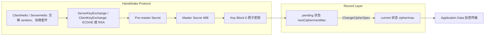
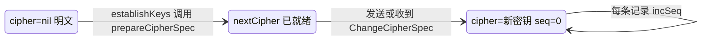
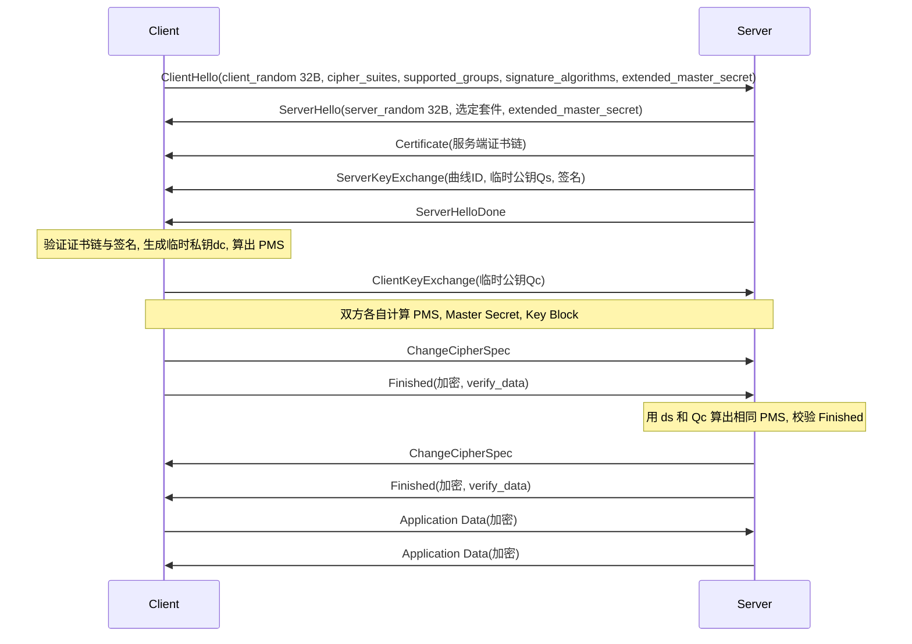
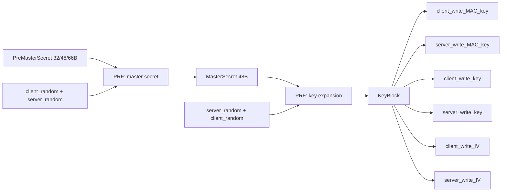
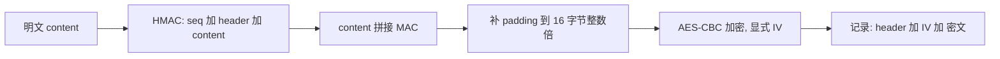
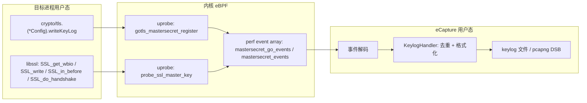

##  0x00    前言
本文系统梳理 TLS 1.2（[RFC 5246](https://www.rfc-editor.org/rfc/rfc5246)）的核心机制：

-	记录层、握手与密钥协商
-	Pre-master Secret 到 Master Secret 再到 6 把会话子密钥的派生
-	AES-CBC 与 AES-GCM 两类记录保护方式
-	工程观测（Wireshark 解密的原理）
-	基于 eBPF 的 eCapture 项目密钥捕获实现介绍

相关约定如下：

-   源码基于 Go **go1.27.1**（`$GOROOT/src/crypto/tls`、`crypto/internal/fips140/tls12`、`crypto/cipher`）版本
-   eCapture 源码基于：[gojue/ecapture](https://github.com/gojue/ecapture) master 分支 commit `afcc9345`
-   相关协议概览可先看前文 [再看认证流程：TLS（HTTPS）、OpenSSH 协议的那些细节](https://pandaychen.github.io/2023/01/20/A-REVIEW-OF-HANDSHAKE/)

本文的主线可以用这句话来概括：**握手的唯一目的，就是让通信双方在不安全的信道上安全地得到同一份 Master Secret，并由它"切分"出双向的对称密钥，交给记录层使用**



todo


####	基础知识

todo

##  0x01    TLS 1.2 架构与记录层（Record Layer）

####    在协议栈中的位置
TLS 位于传输层（TCP）之上、应用层（HTTP、gRPC、SMTP 等）之下。对应用来说它是一个"可靠且加密的字节流"，在 Go 里体现为 `*tls.Conn` 实现了 `net.Conn` 接口，上层代码几乎无感知

TLS 内部是两层结构：

| 层次 | 子协议 | ContentType | 作用 |
|---|---|---|---|
| 上层 | Handshake | 22 | 协商版本、套件、认证身份、交换密钥材料 |
| 上层 | ChangeCipherSpec | 20 | 通知对端"后续记录使用新协商的密钥" |
| 上层 | Alert | 21 | 告警与关闭通知（如 `bad_record_mac`、`close_notify`） |
| 上层 | Application Data | 23 | 承载应用数据 |
| 下层 | Record Protocol | - | 分片、（压缩）、MAC/加密、封装成记录 |

上层四个子协议的消息全部交给记录层封装，记录层并不关心内容语义，只按 ContentType 区分

####    记录格式
每条 TLS 记录由 5 字节头部和负载组成（RFC 5246 6.2）：

```text
struct {
    ContentType    type;          // 1 字节：20/21/22/23
    ProtocolVersion version;      // 2 字节：TLS 1.2 = 0x0303
    uint16         length;        // 2 字节：负载长度，明文最大 2^14
    opaque         fragment[length];
} TLSPlaintext / TLSCiphertext;
```

Go 中的相关常量位于 `common.go`：

```go
// 文件：$GOROOT/src/crypto/tls/common.go L67, L70 (go1.27.1)
maxPlaintext               = 16384        // maximum plaintext payload length
// 单条记录的明文上限 2^14 = 16384 字节，超过就必须分片
recordHeaderLen            = 5            // record header length
// 记录头固定 5 字节：type(1) + version(2) + length(2)
```

####    记录层的三项核心职责

1.  **分片**：上层一次写入任意长度的数据，记录层把它切成不超过 $2^{14}$ 字节的片段
2.  **压缩**：TLS 1.2 规范允许协商压缩，但由于 CRIME 攻击，现代实现一律使用 `null` 压缩，Go 根本不实现压缩
3.  **记录保护（MAC + 加密）与加密状态转换**：这是记录层最核心的部分。RFC 5246 定义了四个"连接状态"：读、写方向各有 current（当前生效）与 pending（握手中准备好、尚未启用）两份。收发 ChangeCipherSpec 时，pending 状态被拷贝为 current，并将序列号清零

Go 用 `halfConn` 表示"一个方向"的记录层状态，`Conn` 中 `in`、`out` 两个字段分别对应读和写：

```go
// 文件：$GOROOT/src/crypto/tls/conn.go L167-184 (go1.27.1)
// A halfConn represents one direction of the record layer
// connection, either sending or receiving.
type halfConn struct {
	sync.Mutex
	// 每个方向一把锁，读写可以并发

	err     error  // first permanent error
	// 一旦出现不可恢复错误 (如 MAC 校验失败), 记录在此，之后的读写直接返回它
	version uint16 // protocol version
	// 协商出来的协议版本，决定是否使用显式 IV 等行为
	cipher  any    // cipher algorithm
	// current 状态的加密器：cipher.Stream(RC4) / cbcMode(AES-CBC) / aead(AES-GCM), nil 表示明文
	mac     hash.Hash
	// current 状态的 MAC(HMAC-SHA1 等), AEAD 套件下为 nil
	seq     [8]byte // 64-bit sequence number
	// 64 位隐式序列号，大端序，不出现在线路上，参与 MAC/AEAD 的附加数据计算

	scratchBuf [13]byte // to avoid allocs; interface method args escape
	// 13 字节 = seq(8) + type(1) + version(2) + length(2), 用于拼 MAC 输入或 AEAD 的 AAD

	nextCipher any       // next encryption state
	// pending 状态的加密器，由 prepareCipherSpec 写入
	nextMac    hash.Hash // next MAC algorithm
	// pending 状态的 MAC

	level         QUICEncryptionLevel // current QUIC encryption level
	trafficSecret []byte              // current TLS 1.3 traffic secret
	// 以上两个字段只用于 QUIC 与 TLS 1.3, TLS 1.2 不涉及
}
```

pending 到 current 的切换由两个方法完成：

```go
// 文件：$GOROOT/src/crypto/tls/conn.go L205-225 (go1.27.1)
// prepareCipherSpec sets the encryption and MAC states
// that a subsequent changeCipherSpec will use.
func (hc *halfConn) prepareCipherSpec(version uint16, cipher any, mac hash.Hash) {
	hc.version = version
	hc.nextCipher = cipher
	// 握手算出密钥后先放进 pending 槽位，此时还不生效
	hc.nextMac = mac
}

// changeCipherSpec changes the encryption and MAC states
// to the ones previously passed to prepareCipherSpec.
func (hc *halfConn) changeCipherSpec() error {
	if hc.nextCipher == nil || hc.version == VersionTLS13 {
		// 没有准备好的 pending 状态就收到/发送 CCS, 属于协议错误
		return alertInternalError
	}
	hc.cipher = hc.nextCipher
	// pending 提升为 current
	hc.mac = hc.nextMac
	hc.nextCipher = nil
	hc.nextMac = nil
	// 清空 pending 槽位
	clear(hc.seq[:])
	// 关键：序列号从 0 重新开始，Finished 消息是新状态下的第 0 条记录
	return nil
}
```

写方向在发送 ChangeCipherSpec 记录**之后**立即切换（CCS 本身仍用旧状态发送）：

```go
// 文件：$GOROOT/src/crypto/tls/conn.go L979-1048 节选 (go1.27.1)
func (c *Conn) writeRecordLocked(typ recordType, data []byte) (int, error) {
	// ... 省略 QUIC 分支与缓冲区池 ...
	var n int
	for len(data) > 0 {
		// 分片循环：每次最多取 maxPayload 字节
		m := len(data)
		if maxPayload := c.maxPayloadSizeForWrite(typ); m > maxPayload {
			m = maxPayload
			// maxPayloadSizeForWrite 不超过 maxPlaintext(16384), 还会根据动态记录大小调整
		}

		_, outBuf = sliceForAppend(outBuf[:0], recordHeaderLen)
		// 先预留 5 字节记录头
		outBuf[0] = byte(typ)
		// ContentType
		vers := c.vers
		if vers == 0 {
			// Some TLS servers fail if the record version is
			// greater than TLS 1.0 for the initial ClientHello.
			vers = VersionTLS10
		} else if vers == VersionTLS13 {
			// TLS 1.3 froze the record layer version to 1.2.
			// See RFC 8446, Section 5.1.
			vers = VersionTLS12
		}
		outBuf[1] = byte(vers >> 8)
		outBuf[2] = byte(vers)
		// 记录头中的版本号
		outBuf[3] = byte(m >> 8)
		outBuf[4] = byte(m)
		// 注意：此时 length 填的是"明文长度", 后面 MAC 计算正是需要这个值

		var err error
		outBuf, err = c.out.encrypt(outBuf, data[:m], c.config.rand())
		// 交给写方向 halfConn 做 MAC/加密, 并在内部把 length 改成密文长度
		if err != nil {
			return n, err
		}
		if _, err := c.write(outBuf); err != nil {
			return n, err
		}
		n += m
		data = data[m:]
	}

	if typ == recordTypeChangeCipherSpec && c.vers != VersionTLS13 {
		// 刚刚发出的是 CCS: 写方向立即启用新密钥
		if err := c.out.changeCipherSpec(); err != nil {
			return n, c.sendAlertLocked(err.(alert))
		}
	}

	return n, nil
}
```

读方向同理：`readRecordOrCCS` 收到 ChangeCipherSpec 记录后调用 `c.in.changeCipherSpec()`。读写两个方向独立切换，这也是为什么握手中会出现"一方已切到加密、另一方尚未切换"的中间状态

```go
//https://github.com/golang/go/blob/release-branch.go1.27/src/crypto/tls/conn.go#L609C1-L791C1
func (c *Conn) readRecordOrCCS(expectChangeCipherSpec bool) error {
	if c.in.err != nil {
		return c.in.err
	}
	handshakeComplete := c.isHandshakeComplete.Load()

	// This function modifies c.rawInput, which owns the c.input memory.
	if c.input.Len() != 0 {
		return c.in.setErrorLocked(errors.New("tls: internal error: attempted to read record with pending application data"))
	}
	c.input.Reset(nil)

	if c.quic != nil {
		return c.in.setErrorLocked(errors.New("tls: internal error: attempted to read record with QUIC transport"))
	}

	// Read header, payload.
	if err := c.readFromUntil(c.conn, recordHeaderLen); err != nil {
		// RFC 8446, Section 6.1 suggests that EOF without an alertCloseNotify
		// is an error, but popular web sites seem to do this, so we accept it
		// if and only if at the record boundary.
		if err == io.ErrUnexpectedEOF && c.rawInput.Len() == 0 {
			err = io.EOF
		}
		if e, ok := err.(net.Error); !ok || !e.Temporary() {
			c.in.setErrorLocked(err)
		}
		return err
	}
	hdr := c.rawInput.Bytes()[:recordHeaderLen]
	typ := recordType(hdr[0])

	// No valid TLS record has a type of 0x80, however SSLv2 handshakes
	// start with a uint16 length where the MSB is set and the first record
	// is always < 256 bytes long. Therefore typ == 0x80 strongly suggests
	// an SSLv2 client.
	if !handshakeComplete && typ == 0x80 {
		c.sendAlert(alertProtocolVersion)
		return c.in.setErrorLocked(c.newRecordHeaderError(nil, "unsupported SSLv2 handshake received"))
	}

	vers := uint16(hdr[1])<<8 | uint16(hdr[2])
	expectedVers := c.vers
	if expectedVers == VersionTLS13 {
		// All TLS 1.3 records are expected to have 0x0303 (1.2) after
		// the initial hello (RFC 8446 Section 5.1).
		expectedVers = VersionTLS12
	}
	n := int(hdr[3])<<8 | int(hdr[4])
	if c.haveVers && vers != expectedVers {
		c.sendAlert(alertProtocolVersion)
		msg := fmt.Sprintf("received record with version %x when expecting version %x", vers, expectedVers)
		return c.in.setErrorLocked(c.newRecordHeaderError(nil, msg))
	}
	if !c.haveVers {
		// First message, be extra suspicious: this might not be a TLS
		// client. Bail out before reading a full 'body', if possible.
		// The current max version is 3.3 so if the version is >= 16.0,
		// it's probably not real.
		if (typ != recordTypeAlert && typ != recordTypeHandshake) || vers >= 0x1000 {
			return c.in.setErrorLocked(c.newRecordHeaderError(c.conn, "first record does not look like a TLS handshake"))
		}
	}
	if c.vers == VersionTLS13 && n > maxCiphertextTLS13 || n > maxCiphertext {
		c.sendAlert(alertRecordOverflow)
		msg := fmt.Sprintf("oversized record received with length %d", n)
		return c.in.setErrorLocked(c.newRecordHeaderError(nil, msg))
	}
	if err := c.readFromUntil(c.conn, recordHeaderLen+n); err != nil {
		if e, ok := err.(net.Error); !ok || !e.Temporary() {
			c.in.setErrorLocked(err)
		}
		return err
	}

	// Process message.
	record := c.rawInput.Next(recordHeaderLen + n)
	data, typ, err := c.in.decrypt(record)
	if err != nil {
		return c.in.setErrorLocked(c.sendAlert(err.(alert)))
	}
	if len(data) > maxPlaintext {
		return c.in.setErrorLocked(c.sendAlert(alertRecordOverflow))
	}

	// Application Data messages are always protected.
	if c.in.cipher == nil && typ == recordTypeApplicationData {
		return c.in.setErrorLocked(c.sendAlert(alertUnexpectedMessage))
	}

	if (typ == recordTypeApplicationData || (typ == recordTypeHandshake && !handshakeComplete)) && len(data) > 0 {
		// This is a state-advancing message: reset the retry count.
		c.retryCount = 0
	}

	// Handshake messages MUST NOT be interleaved with other record types in TLS 1.3.
	if c.vers == VersionTLS13 && typ != recordTypeHandshake && c.hand.Len() > 0 {
		return c.in.setErrorLocked(c.sendAlert(alertUnexpectedMessage))
	}

	switch typ {
	default:
		return c.in.setErrorLocked(c.sendAlert(alertUnexpectedMessage))

	case recordTypeAlert:
		if c.quic != nil {
			return c.in.setErrorLocked(c.sendAlert(alertUnexpectedMessage))
		}
		if len(data) != 2 {
			return c.in.setErrorLocked(c.sendAlert(alertUnexpectedMessage))
		}
		if alert(data[1]) == alertCloseNotify {
			return c.in.setErrorLocked(io.EOF)
		}
		if c.vers == VersionTLS13 {
			// TLS 1.3 removed warning-level alerts except for alertUserCanceled
			// (RFC 8446, § 6.1). Since at least one major implementation
			// (https://bugs.openjdk.org/browse/JDK-8323517) misuses this alert,
			// many TLS stacks now ignore it outright when seen in a TLS 1.3
			// handshake (e.g. BoringSSL, NSS, Rustls).
			if alert(data[1]) == alertUserCanceled {
				// Like TLS 1.2 alertLevelWarning alerts, we drop the record and retry.
				return c.retryReadRecord(expectChangeCipherSpec)
			}
			return c.in.setErrorLocked(&net.OpError{Op: "remote error", Err: alert(data[1])})
		}
		switch data[0] {
		case alertLevelWarning:
			// Drop the record on the floor and retry.
			return c.retryReadRecord(expectChangeCipherSpec)
		case alertLevelError:
			return c.in.setErrorLocked(&net.OpError{Op: "remote error", Err: alert(data[1])})
		default:
			return c.in.setErrorLocked(c.sendAlert(alertUnexpectedMessage))
		}

	case recordTypeChangeCipherSpec:
		if len(data) != 1 || data[0] != 1 {
			return c.in.setErrorLocked(c.sendAlert(alertDecodeError))
		}
		// Handshake messages are not allowed to fragment across the CCS.
		if c.hand.Len() > 0 {
			return c.in.setErrorLocked(c.sendAlert(alertUnexpectedMessage))
		}
		// In TLS 1.3, change_cipher_spec records are ignored until the
		// Finished. See RFC 8446, Appendix D.4. Note that according to Section
		// 5, a server can send a ChangeCipherSpec before its ServerHello, when
		// c.vers is still unset. That's not useful though and suspicious if the
		// server then selects a lower protocol version, so don't allow that.
		if c.vers == VersionTLS13 {
			return c.retryReadRecord(expectChangeCipherSpec)
		}
		if !expectChangeCipherSpec {
			return c.in.setErrorLocked(c.sendAlert(alertUnexpectedMessage))
		}
		if err := c.in.changeCipherSpec(); err != nil {
			return c.in.setErrorLocked(c.sendAlert(err.(alert)))
		}

	case recordTypeApplicationData:
		if !handshakeComplete || expectChangeCipherSpec {
			return c.in.setErrorLocked(c.sendAlert(alertUnexpectedMessage))
		}
		// Some OpenSSL servers send empty records in order to randomize the
		// CBC IV. Ignore a limited number of empty records.
		if len(data) == 0 {
			return c.retryReadRecord(expectChangeCipherSpec)
		}
		// Note that data is owned by c.rawInput, following the Next call above,
		// to avoid copying the plaintext. This is safe because c.rawInput is
		// not read from or written to until c.input is drained.
		c.input.Reset(data)

	case recordTypeHandshake:
		if len(data) == 0 || expectChangeCipherSpec {
			return c.in.setErrorLocked(c.sendAlert(alertUnexpectedMessage))
		}
		c.hand.Write(data)
	}

	return nil
}
```



##  0x02    握手、密钥协商与 Pre-master Secret

####    完整握手流程（ECDHE_RSA 为例）



各消息的要点：

-   **ClientHello / ServerHello**：交换各自 32 字节随机数 `client_random`、`server_random`（后续所有派生都依赖它们），协商版本与密码套件。Go 客户端默认在 ClientHello 中携带 `extended_master_secret` 扩展（`handshake_client.go` L75 `extendedMasterSecret: true`），详见第 0x04 节
-   **Certificate**：服务端证书链，客户端据此验证身份
-   **ServerKeyExchange**：仅在 (EC)DHE 套件中出现，携带服务端临时公钥与对 `client_random || server_random || params` 的签名；RSA 密钥交换没有这条消息
-   **ClientKeyExchange**：RSA 模式下是"用服务端公钥加密的 PMS"，ECDHE 模式下是客户端临时公钥
-   **ChangeCipherSpec**：触发上一节所述的状态切换
-   **Finished**：第一条受新密钥保护的消息，内容为 `verify_data = PRF(master_secret, finished_label, Hash(handshake_messages))[0..11]`，用来确认双方看到的握手消息完全一致，任何篡改（例如降级攻击删掉某个强套件）都会导致校验失败

Go 客户端的整体编排（`handshake_client.go` L534 `clientHandshakeState.handshake`）在完整握手分支中依次调用 `doFullHandshake`（处理证书、密钥交换并算出 master secret）、`establishKeys`（派生子密钥并 `prepareCipherSpec`）、`sendFinished`（先发 CCS 再发 Finished）、`readFinished`

`Finished` 的计算对应如下代码：

```go
// 文件：$GOROOT/src/crypto/tls/prf.go L212-223 (go1.27.1)
// clientSum returns the contents of the verify_data member of a client's
// Finished message.
func (h finishedHash) clientSum(masterSecret []byte) []byte {
	return h.prf(masterSecret, clientFinishedLabel, h.Sum(), finishedVerifyLength)
	// PRF(master_secret, "client finished", SHA256(所有握手消息), 12)
}

// serverSum returns the contents of the verify_data member of a server's
// Finished message.
func (h finishedHash) serverSum(masterSecret []byte) []byte {
	return h.prf(masterSecret, serverFinishedLabel, h.Sum(), finishedVerifyLength)
	// label 换成 "server finished", 服务端的 transcript 还包含客户端的 Finished
}
```

####    Pre-master Secret 的两种来源
Go 使用 `keyAgreement` 接口统一抽象 TLS 1.0 到 1.2 的密钥交换，服务端调用前两个方法，客户端调用后两个：

```go
// 文件：$GOROOT/src/crypto/tls/key_agreement.go L20-37 (go1.27.1)
// A keyAgreement implements the client and server side of a TLS 1.0–1.2 key
// agreement protocol by generating and processing key exchange messages.
type keyAgreement interface {
	// On the server side, the first two methods are called in order.

	// In the case that the key agreement protocol doesn't use a
	// ServerKeyExchange message, generateServerKeyExchange can return nil,
	// nil.
	generateServerKeyExchange(*Config, *Certificate, *clientHelloMsg, *serverHelloMsg) (*serverKeyExchangeMsg, error)
	// 服务端：生成 ServerKeyExchange(RSA 模式返回 nil, 不发送该消息)
	processClientKeyExchange(*Config, *Certificate, *clientKeyExchangeMsg, uint16) ([]byte, error)
	// 服务端：解析 ClientKeyExchange, 返回 PMS

	// On the client side, the next two methods are called in order.

	// This method may not be called if the server doesn't send a
	// ServerKeyExchange message.
	processServerKeyExchange(*Config, *clientHelloMsg, *serverHelloMsg, *x509.Certificate, *serverKeyExchangeMsg) error
	// 客户端：校验 ServerKeyExchange 签名并提前算好 PMS
	generateClientKeyExchange(*Config, *clientHelloMsg, *x509.Certificate) ([]byte, *clientKeyExchangeMsg, error)
	// 客户端：返回 PMS 与要发送的 ClientKeyExchange
}
```

#####   传统 RSA 密钥交换
传统 RSA 密钥交换的流程为**客户端生成 48 字节 PMS，前 2 字节是 ClientHello 中的版本号（防版本回滚），后 46 字节随机；用服务端证书中的 RSA 公钥按 PKCS#1 v1.5 加密后放进 ClientKeyExchange；服务端用私钥解密得到同一 PMS**

$$ PMS = client\_version_{(2B)} \parallel random_{(46B)}, \quad C = RSA\_Enc_{pk_S}(PMS) $$

```go
// 文件：$GOROOT/src/crypto/tls/key_agreement.go L82-105 (go1.27.1)
func (ka rsaKeyAgreement) generateClientKeyExchange(config *Config, clientHello *clientHelloMsg, cert *x509.Certificate) ([]byte, *clientKeyExchangeMsg, error) {
	preMasterSecret := make([]byte, 48)
	// PMS 固定 48 字节
	preMasterSecret[0] = byte(clientHello.vers >> 8)
	preMasterSecret[1] = byte(clientHello.vers)
	// 前 2 字节写入 ClientHello 中通告的最高版本 (不是协商后的版本), 用于检测降级
	_, err := io.ReadFull(config.rand(), preMasterSecret[2:])
	// 后 46 字节来自 CSPRNG
	if err != nil {
		return nil, nil, err
	}

	rsaKey, ok := cert.PublicKey.(*rsa.PublicKey)
	// 取服务端证书里的 RSA 公钥
	if !ok {
		return nil, nil, errors.New("tls: server certificate contains incorrect key type for selected ciphersuite")
	}
	encrypted, err := rsa.EncryptPKCS1v15(config.rand(), rsaKey, preMasterSecret)
	// PKCS#1 v1.5 加密
	if err != nil {
		return nil, nil, err
	}
	ckx := new(clientKeyExchangeMsg)
	ckx.ciphertext = make([]byte, len(encrypted)+2)
	ckx.ciphertext[0] = byte(len(encrypted) >> 8)
	ckx.ciphertext[1] = byte(len(encrypted))
	// 2 字节长度前缀 + 密文
	copy(ckx.ciphertext[2:], encrypted)
	return preMasterSecret, ckx, nil
}
```

服务端解密（L50-76）的关键是**常数时间、不泄露失败原因**，以防 Bleichenbacher 类填充预言攻击（及其变种 ROBOT）：

```go
// 文件：$GOROOT/src/crypto/tls/key_agreement.go L60-75 (go1.27.1)
	priv, ok := cert.PrivateKey.(crypto.Decrypter)
	// 私钥只需实现 crypto.Decrypter, 因此也可以托管在 HSM/KMS 中
	if !ok {
		return nil, errors.New("tls: certificate private key does not implement crypto.Decrypter")
	}
	// Perform constant time RSA PKCS #1 v1.5 decryption
	preMasterSecret, err := priv.Decrypt(config.rand(), ciphertext, &rsa.PKCS1v15DecryptOptions{SessionKeyLen: 48})
	// SessionKeyLen=48: 若填充非法，不报错，而是返回 48 字节随机数，
	// 让握手在 Finished 阶段才失败，攻击者无法区分"填充错误"与"密钥错误"
	if err != nil {
		return nil, err
	}
	// We don't check the version number in the premaster secret. For one,
	// by checking it, we would leak information about the validity of the
	// encrypted pre-master secret. ...
	return preMasterSecret, nil
```

RSA 密钥交换的根本缺陷是**没有前向安全**：PMS 只受服务端长期私钥保护，一旦私钥泄露，攻击者可以解密此前录下的所有流量。这也是本文第 0x06 章节**Wireshark 用 RSA 私钥解密**这种老办法能成立的原因。在 go1.27 中，所有 `TLS_RSA_WITH_*` 套件都在 `disabledCipherSuites` 中（`cipher_suites.go` L339 起），只有在 `Config.CipherSuites` 中显式列出才会启用；用于恢复旧行为的 `tlsrsakex` GODEBUG 也已在 Go 1.27 移除（`internal/godebugs/table.go`）

#####   现代方式：ECDHE 密钥交换
**数学基础**：设椭圆曲线 $E(\mathbb{F}_p)$ 上基点为 $G$、阶为 $n$。椭圆曲线离散对数问题（ECDLP）是指：已知 $Q = dG$ 求 $d$ 在计算上不可行

1.  服务端随机选取临时私钥 $d_S \in [1, n-1]$，计算 $Q_S = d_S G$，在 ServerKeyExchange 中发送 $Q_S$
2.  客户端随机选取 $d_C$，计算 $Q_C = d_C G$，在 ClientKeyExchange 中发送 $Q_C$
3.  双方计算共享点：

$$ d_C \cdot Q_S = d_C \cdot (d_S G) = d_S \cdot (d_C G) = d_S \cdot Q_C $$

4.  PMS 取共享点的 x 坐标（RFC 8422 5.10；对 X25519 则是 RFC 7748 定义的 32 字节函数输出）

窃听者只能看到 $Q_S$、$Q_C$，要算出共享点必须求解 ECDH 问题

**身份认证从哪里来**：ECDHE 本身是匿名的，中间人可以分别和双方做 DH。TLS 通过让服务端用**证书私钥**对 `client_random || server_random || ServerECDHEParams` 签名来防止这一点：签名证明了这组临时参数确实由证书持有者产生，且绑定了本次握手的两个随机数，无法被重放到别的连接

**前向安全（PFS）的实现原理**：长期私钥只用来**签名**，不参与 PMS 的计算；$d_S$、$d_C$ 是每次握手临时生成、握手后即丢弃的（在 Go 中它们只存在于握手期间的 `ecdheKeyAgreement` 对象里，握手结束后随对象被回收）。因此即便未来证书私钥泄露，攻击者也只能伪造新的握手，无法从录下的历史流量中恢复 $d_C d_S G$。需要注意的例外：如果开启了 Session Ticket，ticket 加密密钥一旦泄露，用该 ticket 恢复的会话的 master secret 也会暴露，所以生产环境需要定期轮换 ticket 密钥

####    Go 标准库 ECDHE 实现剖析
`ecdheKeyAgreement` 结构体：

```go
// 文件：$GOROOT/src/crypto/tls/key_agreement.go L138-156 (go1.27.1)
// ecdheKeyAgreement implements a TLS key agreement where the server
// generates an ephemeral EC public/private key pair and signs it. The
// pre-master secret is then calculated using ECDH. The signature may
// be ECDSA, Ed25519 or RSA.
type ecdheKeyAgreement struct {
	version uint16
	// 协商出的 TLS 版本，TLS 1.2 的签名格式与 1.0/1.1 不同
	isRSA   bool
	// true 表示 ECDHE_RSA 套件 (证书为 RSA), false 表示 ECDHE_ECDSA

	// ckx and preMasterSecret are generated in processServerKeyExchange
	// and returned in generateClientKeyExchange.
	ckx             *clientKeyExchangeMsg
	// 客户端侧：预先构造好的 ClientKeyExchange(内含 Qc)
	preMasterSecret []byte
	// 客户端侧：预先算好的 PMS

	// curveID, signatureAlgorithm, and key are set by processServerKeyExchange
	// and generateServerKeyExchange.
	curveID            CurveID
	// 选定的曲线：X25519 / P-256 / P-384 / P-521
	signatureAlgorithm SignatureScheme
	// 对 ECDHE 参数签名所用的算法，如 rsa_pss_rsae_sha256
	key                *ecdh.PrivateKey
	// 本端临时私钥 d(服务端为 ds, 客户端为 dc), 来自 crypto/ecdh
}
```

**服务端：生成 ServerKeyExchange**

```go
// 文件：$GOROOT/src/crypto/tls/key_agreement.go L158-252 (go1.27.1)
func (ka *ecdheKeyAgreement) generateServerKeyExchange(config *Config, cert *Certificate, clientHello *clientHelloMsg, hello *serverHelloMsg) (*serverKeyExchangeMsg, error) {
	for _, c := range clientHello.supportedCurves {
		// 按客户端 supported_groups 扩展的顺序遍历
		if config.supportsCurve(ka.version, c) {
			// 取第一条本端也支持的曲线 (TLS 1.2 下不会选 ML-KEM 混合组)
			ka.curveID = c
			break
		}
	}

	if ka.curveID == 0 {
		// 没有交集，握手失败
		return nil, errors.New("tls: no supported elliptic curves offered")
	}
	if _, ok := curveForCurveID(ka.curveID); !ok {
		return nil, errors.New("tls: internal error: supportsCurve accepted unimplemented curve")
	}

	key, err := generateECDHEKey(config.rand(), ka.curveID)
	// 生成临时密钥对：ds 随机，Qs = ds*G
	if err != nil {
		return nil, err
	}
	ka.key = key
	// 保存 ds, 等收到 ClientKeyExchange 时用

	// See RFC 4492, Section 5.4.
	ecdhePublic := key.PublicKey().Bytes()
	// Qs 的线路编码：NIST 曲线为未压缩点 0x04||X||Y, X25519 为 32 字节
	serverECDHEParams := make([]byte, 1+2+1+len(ecdhePublic))
	serverECDHEParams[0] = 3 // named curve
	// ECCurveType = named_curve(3), 只支持具名曲线
	serverECDHEParams[1] = byte(ka.curveID >> 8)
	serverECDHEParams[2] = byte(ka.curveID)
	// 2 字节 NamedCurve, 如 X25519=0x001d, secp256r1=0x0017
	serverECDHEParams[3] = byte(len(ecdhePublic))
	// 1 字节公钥长度
	copy(serverECDHEParams[4:], ecdhePublic)
	// 公钥本体

	priv, ok := cert.PrivateKey.(crypto.Signer)
	// 证书私钥必须能签名，这是 ECDHE 中长期私钥的唯一用途
	if !ok {
		return nil, fmt.Errorf("tls: certificate private key of type %T does not implement crypto.Signer", cert.PrivateKey)
	}

	var sig []byte
	if ka.version >= VersionTLS12 {
		ka.signatureAlgorithm, err = selectSignatureScheme(ka.version, cert, clientHello.supportedSignatureAlgorithms)
		// TLS 1.2: 根据客户端 signature_algorithms 扩展与证书类型选择签名算法
		if err != nil {
			return nil, err
		}
		sigType, sigHash, err := typeAndHashFromSignatureScheme(ka.signatureAlgorithm)
		// 拆出签名类型 (PKCS1v15/PSS/ECDSA/Ed25519) 与哈希
		if err != nil {
			return nil, err
		}
		if sigHash == crypto.SHA1 {
			tlssha1.Value() // ensure godebug is initialized
			tlssha1.IncNonDefault()
			// 统计 SHA-1 签名的使用 (默认已不推荐)
		}
		signed := slices.Concat(clientHello.random, hello.random, serverECDHEParams)
		// 被签名内容 = client_random || server_random || ServerECDHEParams
		// 两个随机数把签名绑定到本次连接，防止参数被重放
		if (sigType == signaturePKCS1v15 || sigType == signatureRSAPSS) != ka.isRSA {
			// 证书类型必须与套件匹配：ECDHE_RSA 用 RSA 证书，ECDHE_ECDSA 用 EC 证书
			return nil, errors.New("tls: certificate cannot be used with the selected cipher suite")
		}
		signOpts := crypto.SignerOpts(sigHash)
		if sigType == signatureRSAPSS {
			signOpts = &rsa.PSSOptions{SaltLength: rsa.PSSSaltLengthEqualsHash, Hash: sigHash}
			// RSA-PSS 的盐长等于哈希长度
		}
		sig, err = crypto.SignMessage(priv, config.rand(), signed, signOpts)
		// 对消息签名 (内部会先做哈希，Ed25519 则直接签原文)
		if err != nil {
			return nil, errors.New("tls: failed to sign ECDHE parameters: " + err.Error())
		}
	} else {
		// TLS 1.0/1.1: 固定使用 MD5+SHA1 或 SHA1, 不在本文讨论范围
		sigType, sigHash, err := legacyTypeAndHashFromPublicKey(priv.Public())
		if err != nil {
			return nil, err
		}
		signed := hashForServerKeyExchange(sigType, clientHello.random, hello.random, serverECDHEParams)
		if (sigType == signaturePKCS1v15) != ka.isRSA {
			return nil, errors.New("tls: certificate cannot be used with the selected cipher suite")
		}
		sig, err = priv.Sign(config.rand(), signed, sigHash)
		if err != nil {
			return nil, errors.New("tls: failed to sign ECDHE parameters: " + err.Error())
		}
	}

	skx := new(serverKeyExchangeMsg)
	sigAndHashLen := 0
	if ka.version >= VersionTLS12 {
		sigAndHashLen = 2
		// TLS 1.2 在签名前多 2 字节 SignatureScheme
	}
	skx.key = make([]byte, len(serverECDHEParams)+sigAndHashLen+2+len(sig))
	copy(skx.key, serverECDHEParams)
	// 消息体 = params || [scheme(2)] || sig_len(2) || sig
	k := skx.key[len(serverECDHEParams):]
	if ka.version >= VersionTLS12 {
		k[0] = byte(ka.signatureAlgorithm >> 8)
		k[1] = byte(ka.signatureAlgorithm)
		k = k[2:]
	}
	k[0] = byte(len(sig) >> 8)
	k[1] = byte(len(sig))
	copy(k[2:], sig)

	return skx, nil
}
```

**客户端：校验 ServerKeyExchange 并计算 PMS**

```go
// 文件：$GOROOT/src/crypto/tls/key_agreement.go L271-373 (go1.27.1)
func (ka *ecdheKeyAgreement) processServerKeyExchange(config *Config, clientHello *clientHelloMsg, serverHello *serverHelloMsg, cert *x509.Certificate, skx *serverKeyExchangeMsg) error {
	if len(skx.key) < 4 {
		return errServerKeyExchange
	}
	if skx.key[0] != 3 { // named curve
		// 拒绝显式曲线参数 (explicit_prime 等), 只接受具名曲线
		return errors.New("tls: server selected unsupported curve")
	}
	ka.curveID = CurveID(skx.key[1])<<8 | CurveID(skx.key[2])
	// 解析服务端选的曲线

	publicLen := int(skx.key[3])
	if publicLen+4 > len(skx.key) {
		return errServerKeyExchange
	}
	serverECDHEParams := skx.key[:4+publicLen]
	// 保留原始 params 字节，稍后验签要用完全相同的字节
	publicKey := serverECDHEParams[4:]
	// Qs

	sig := skx.key[4+publicLen:]
	if len(sig) < 2 {
		return errServerKeyExchange
	}
	if ka.version >= VersionTLS12 {
		ka.signatureAlgorithm = SignatureScheme(sig[0])<<8 | SignatureScheme(sig[1])
		// 读出签名算法
		sig = sig[2:]
		if len(sig) < 2 {
			return errServerKeyExchange
		}
		switch ka.signatureAlgorithm {
		case MLDSA44, MLDSA65, MLDSA87:
			// 后量子签名 ML-DSA 只允许在 TLS 1.3 中使用
			return errors.New("tls: server selected ML-DSA with TLS version < 1.3")
		}
	}
	sigLen := int(sig[0])<<8 | int(sig[1])
	if sigLen+2 != len(sig) {
		return errServerKeyExchange
	}
	sig = sig[2:]

	if !slices.Contains(clientHello.supportedCurves, ka.curveID) {
		// 服务端选的曲线必须是客户端自己提供过的，防止被引导到弱曲线
		return errors.New("tls: server selected unoffered curve")
	}

	if _, ok := curveForCurveID(ka.curveID); !ok {
		return errors.New("tls: server selected unsupported curve")
	}

	key, err := generateECDHEKey(config.rand(), ka.curveID)
	// 客户端生成临时密钥对：dc, Qc = dc*G
	if err != nil {
		return err
	}
	ka.key = key

	peerKey, err := key.Curve().NewPublicKey(publicKey)
	// 解析 Qs, crypto/ecdh 会校验点是否在曲线上 (防无效曲线攻击)
	if err != nil {
		return errServerKeyExchange
	}
	ka.preMasterSecret, err = key.ECDH(peerKey)
	// 核心：PMS = x(dc * Qs); X25519 下若结果为全 0(低阶点) 会返回错误
	if err != nil {
		return errServerKeyExchange
	}

	ourPublicKey := key.PublicKey().Bytes()
	ka.ckx = new(clientKeyExchangeMsg)
	ka.ckx.ciphertext = make([]byte, 1+len(ourPublicKey))
	ka.ckx.ciphertext[0] = byte(len(ourPublicKey))
	// ClientKeyExchange = len(1) || Qc
	copy(ka.ckx.ciphertext[1:], ourPublicKey)

	var sigType uint8
	var sigHash crypto.Hash
	if ka.version >= VersionTLS12 {
		if !isSupportedSignatureAlgorithm(ka.signatureAlgorithm, clientHello.supportedSignatureAlgorithms) {
			// 服务端用的签名算法必须在客户端通告列表中
			return errors.New("tls: certificate used with invalid signature algorithm")
		}
		sigType, sigHash, err = typeAndHashFromSignatureScheme(ka.signatureAlgorithm)
		if err != nil {
			return err
		}
		if sigHash == crypto.SHA1 {
			tlssha1.Value() // ensure godebug is initialized
			tlssha1.IncNonDefault()
		}
		if (sigType == signaturePKCS1v15 || sigType == signatureRSAPSS) != ka.isRSA {
			return errServerKeyExchange
		}
		signed := slices.Concat(clientHello.random, serverHello.random, serverECDHEParams)
		// 重建被签名内容，与服务端完全一致
		if err := verifyHandshakeSignature(sigType, cert.PublicKey, sigHash, signed, sig); err != nil {
			// 用证书公钥验签：失败说明 Qs 被篡改或对端不持有证书私钥
			return errors.New("tls: invalid signature by the server certificate: " + err.Error())
		}
	} else {
		// TLS 1.0/1.1 分支，略
		sigType, sigHash, err = legacyTypeAndHashFromPublicKey(cert.PublicKey)
		if err != nil {
			return err
		}
		if (sigType == signaturePKCS1v15) != ka.isRSA {
			return errServerKeyExchange
		}
		signed := hashForServerKeyExchange(sigType, clientHello.random, serverHello.random, serverECDHEParams)
		if err := verifyLegacyHandshakeSignature(sigType, cert.PublicKey, sigHash, signed, sig); err != nil {
			return errors.New("tls: invalid signature by the server certificate: " + err.Error())
		}
	}

	return nil
}
```

这里补充一个容易被忽略的细节，Go 客户端在**验签之前**就已经算出了 PMS。这并不危险，因为验签失败会直接返回错误终止握手，PMS 不会被使用

**客户端：发送 ClientKeyExchange**（只是返回前面准备好的结果）：

```go
// 文件：$GOROOT/src/crypto/tls/key_agreement.go L375-381 (go1.27.1)
func (ka *ecdheKeyAgreement) generateClientKeyExchange(config *Config, clientHello *clientHelloMsg, cert *x509.Certificate) ([]byte, *clientKeyExchangeMsg, error) {
	if ka.ckx == nil {
		// 服务端没发 ServerKeyExchange 就发了 ServerHelloDone, 属于协议错误
		return nil, nil, errors.New("tls: missing ServerKeyExchange message")
	}

	return ka.preMasterSecret, ka.ckx, nil
}
```

**服务端：处理 ClientKeyExchange**

```go
// 文件：$GOROOT/src/crypto/tls/key_agreement.go L254-269 (go1.27.1)
func (ka *ecdheKeyAgreement) processClientKeyExchange(config *Config, cert *Certificate, ckx *clientKeyExchangeMsg, version uint16) ([]byte, error) {
	if len(ckx.ciphertext) == 0 || int(ckx.ciphertext[0]) != len(ckx.ciphertext)-1 {
		// 格式校验：第 1 字节必须等于剩余长度
		return nil, errClientKeyExchange
	}

	peerKey, err := ka.key.Curve().NewPublicKey(ckx.ciphertext[1:])
	// 解析 Qc 并校验其合法性
	if err != nil {
		return nil, errClientKeyExchange
	}
	preMasterSecret, err := ka.key.ECDH(peerKey)
	// PMS = x(ds * Qc), 与客户端算出的 x(dc * Qs) 相同
	if err != nil {
		return nil, errClientKeyExchange
	}

	return preMasterSecret, nil
}
```

**临时密钥生成与曲线映射**

```go
// 文件：$GOROOT/src/crypto/tls/key_agreement.go L383-407 (go1.27.1)
// generateECDHEKey returns a PrivateKey that implements Diffie-Hellman
// according to RFC 8446, Section 4.2.8.2.
func generateECDHEKey(rand io.Reader, curveID CurveID) (*ecdh.PrivateKey, error) {
	curve, ok := curveForCurveID(curveID)
	if !ok {
		return nil, errors.New("tls: internal error: unsupported curve")
	}

	return curve.GenerateKey(rand)
	// crypto/ecdh 生成私钥标量 d 并计算公钥 dG
}

func curveForCurveID(id CurveID) (ecdh.Curve, bool) {
	switch id {
	case X25519:
		return ecdh.X25519(), true
		// Curve25519 Montgomery 曲线，常数时间实现，Go 的首选
	case CurveP256:
		return ecdh.P256(), true
	case CurveP384:
		return ecdh.P384(), true
	case CurveP521:
		return ecdh.P521(), true
	default:
		return nil, false
	}
}
```

PMS 的长度随曲线而变：X25519 与 P-256 为 32 字节，P-384 为 48 字节，P-521 为 66 字节；RSA 模式固定 48 字节。PMS 长度不统一，正是下一步要用 PRF 把它"规整"为固定 48 字节 Master Secret 的原因之一

##  0x03    从 Pre-master Secret 到 Master Secret 与 6 把子密钥

####    PRF 与 P_hash 的数学定义
TLS 1.2 用一个基于 HMAC 的伪随机函数（PRF）把"秘密 + 标签 + 种子"扩展成任意长度的输出（参考 RFC 5246 第 5 节）：

$$ PRF(secret, label, seed) = P\_hash(secret, label \parallel seed) $$

其中 `P_hash` 是一个迭代扩展器：

$$ A(0) = seed', \quad A(i) = HMAC\_hash(secret, A(i-1)) $$

$$ P\_hash(secret, seed') = HMAC(secret, A(1) \parallel seed') \parallel HMAC(secret, A(2) \parallel seed') \parallel HMAC(secret, A(3) \parallel seed') \parallel \cdots $$

几点理解：

-   $A(i)$ 是一条"链"，每一环都由上一环经 HMAC 得到，攻击者无法在不知道 secret 的情况下预测它
-   每轮输出 $HMAC(secret, A(i) \parallel seed')$ 一个哈希长度（SHA-256 为 32 字节，SHA-384 为 48 字节），不断迭代直到够长，最后截断到所需长度。所需迭代次数为 $\lceil keyLen / hashLen \rceil$
-   TLS 1.2 中 `hash` 由密码套件决定：默认 SHA-256，名字以 `_SHA384` 结尾的套件用 SHA-384。注意 `TLS_ECDHE_RSA_WITH_AES_128_CBC_SHA` 中的 `SHA` 指的是记录层 MAC 用 HMAC-SHA1，PRF 依然是 SHA-256
-   TLS 1.0/1.1 的 PRF 不同：把 secret 对半分，分别做 `P_MD5` 与 `P_SHA1` 再异或（见 `prf.go` 中的 `prf10`）

####    Go 实现：prf12 与 tls12.PRF
`prf12` 只是一个闭包包装，真正的实现被放进了 FIPS 140-3 模块 `crypto/internal/fips140/tls12`：

```go
// 文件：$GOROOT/src/crypto/tls/prf.go L72-77 (go1.27.1)
// prf12 implements the TLS 1.2 pseudo-random function, as defined in RFC 5246, Section 5.
func prf12(hashFunc func() hash.Hash) prfFunc {
	// 传入哈希构造函数 (sha256.New 或 sha512.New384), 返回一个 prfFunc
	return func(secret []byte, label string, seed []byte, keyLen int) []byte {
		return tls12.PRF(hashFunc, secret, label, seed, keyLen)
		// 委托给 FIPS 模块中的泛型实现
	}
}
```

哈希的选择逻辑：

```go
// 文件：$GOROOT/src/crypto/tls/prf.go L90-102 (go1.27.1)
func prfAndHashForVersion(version uint16, suite *cipherSuite) (prfFunc, crypto.Hash) {
	switch version {
	case VersionTLS10, VersionTLS11:
		return prf10, crypto.Hash(0)
		// 旧版本：MD5 与 SHA1 组合的 PRF
	case VersionTLS12:
		if suite.flags&suiteSHA384 != 0 {
			return prf12(sha512.New384), crypto.SHA384
			// *_SHA384 套件 (如 TLS_ECDHE_RSA_WITH_AES_256_GCM_SHA384) 用 SHA-384
		}
		return prf12(sha256.New), crypto.SHA256
		// 其余 TLS 1.2 套件一律 SHA-256
	default:
		panic("unknown version")
	}
}
```

`P_hash` 的具体迭代：

```go
// 文件：$GOROOT/src/crypto/internal/fips140/tls12/tls12.go L15-45 (go1.27.1)
// PRF implements the TLS 1.2 pseudo-random function, as defined in RFC 5246,
// Section 5 and allowed by SP 800-135, Revision 1, Section 4.2.2.
func PRF[H hash.Hash](hash func() H, secret []byte, label string, seed []byte, keyLen int) []byte {
	labelAndSeed := make([]byte, len(label)+len(seed))
	copy(labelAndSeed, label)
	copy(labelAndSeed[len(label):], seed)
	// seed' = label || seed, 例如 "master secret" || client_random || server_random

	result := make([]byte, keyLen)
	// 预先分配目标长度，pHash 负责把它填满
	pHash(hash, result, secret, labelAndSeed)
	return result
}

// pHash implements the P_hash function, as defined in RFC 5246, Section 5.
func pHash[H hash.Hash](hash func() H, result, secret, seed []byte) {
	h := hmac.New(hash, secret)
	// 以 secret 为 HMAC 密钥，整个过程复用同一个 HMAC 实例
	h.Write(seed)
	a := h.Sum(nil)
	// A(1) = HMAC(secret, A(0)), 其中 A(0) = seed'

	for len(result) > 0 {
		// 只要输出还没填满就继续迭代
		h.Reset()
		h.Write(a)
		h.Write(seed)
		b := h.Sum(nil)
		// 本轮输出块 = HMAC(secret, A(i) || seed')
		n := copy(result, b)
		result = result[n:]
		// 拷贝到结果中，最后一轮会自动截断

		h.Reset()
		h.Write(a)
		a = h.Sum(nil)
		// A(i+1) = HMAC(secret, A(i)), 推进链条
	}
}
```

####    Master Secret 的计算

Master Secret 的计算，依赖于 PMS 为输入参数

$$ master\_secret = PRF(PMS, \text{"master secret"}, client\_random \parallel server\_random)[0..47] $$

```go
// 文件：$GOROOT/src/crypto/tls/prf.go L79-89 (go1.27.1)
const (
	masterSecretLength   = 48 // Length of a master secret in TLS 1.1.
	// 无论 PMS 多长 (32/48/66 字节), master secret 固定 48 字节
	finishedVerifyLength = 12 // Length of verify_data in a Finished message.
	// Finished 中 verify_data 固定 12 字节
)

const masterSecretLabel = "master secret"
const extendedMasterSecretLabel = "extended master secret"
const keyExpansionLabel = "key expansion"
const clientFinishedLabel = "client finished"
const serverFinishedLabel = "server finished"
// 5 个 ASCII 标签：同一个 secret 配不同 label 得到互不相关的输出 (域分离)
```

```go
// 文件：$GOROOT/src/crypto/tls/prf.go L109-116 (go1.27.1)
// masterFromPreMasterSecret generates the master secret from the pre-master
// secret. See RFC 5246, Section 8.1.
func masterFromPreMasterSecret(version uint16, suite *cipherSuite, preMasterSecret, clientRandom, serverRandom []byte) []byte {
	seed := make([]byte, 0, len(clientRandom)+len(serverRandom))
	seed = append(seed, clientRandom...)
	seed = append(seed, serverRandom...)
	// seed = client_random || server_random (客户端随机数在前)

	return prfForVersion(version, suite)(preMasterSecret, masterSecretLabel, seed, masterSecretLength)
	// 以 PMS 为 secret, 输出 48 字节; SHA-256 下需要 2 轮迭代 (64 字节截断为 48)
}
```

为什么还要两个随机数参与？即使 PMS 相同（例如攻击者重放了一个旧的 RSA ClientKeyExchange），只要服务端每次产生新的 `server_random`，master secret 就完全不同，重放的握手无法通过 Finished 校验

####    Key Block 的生成与"分块切割"
$$ key\_block = PRF(master\_secret, \text{"key expansion"}, server\_random \parallel client\_random) $$

**注意随机数的顺序和计算 master secret 时是相反的**：这里 `server_random` 在前。这是 RFC 5246 6.3 的规定，也是手写 TLS 解密工具时最容易犯错的地方

Key Block 按固定顺序切成 6 段：

```text
key_block = client_write_MAC_key[mac_key_length]
          || server_write_MAC_key[mac_key_length]
          || client_write_key[enc_key_length]
          || server_write_key[enc_key_length]
          || client_write_IV[fixed_iv_length]
          || server_write_IV[fixed_iv_length]
```

其中，上述 6 个部分的功能如下表

| 密钥名称 | 通信方向 | 功能描述 | 安全目标 |
| :--- | :--- | :--- | :--- |
| `client_write_MAC_key` | Client → Server | 客户端计算 MAC | 完整性（Integrity） |
| `server_write_MAC_key` | Server → Client | 服务端计算 MAC | 完整性（Integrity） |
| `client_write_key` | Client → Server | 客户端加解密 Payload | 机密性（Confidentiality） |
| `server_write_key` | Server → Client | 服务端加解密 Payload | 机密性（Confidentiality） |
| `client_write_IV` | Client → Server | 客户端混淆/构造 Nonce | 语义安全 / 防重放 |
| `server_write_IV` | Server → Client | 服务端混淆/构造 Nonce | 语义安全 / 防重放 |


```go
// 文件：$GOROOT/src/crypto/tls/prf.go L131-153 (go1.27.1)
// keysFromMasterSecret generates the connection keys from the master
// secret, given the lengths of the MAC key, cipher key and IV, as defined in
// RFC 2246, Section 6.3.
func keysFromMasterSecret(version uint16, suite *cipherSuite, masterSecret, clientRandom, serverRandom []byte, macLen, keyLen, ivLen int) (clientMAC, serverMAC, clientKey, serverKey, clientIV, serverIV []byte) {
	seed := make([]byte, 0, len(serverRandom)+len(clientRandom))
	seed = append(seed, serverRandom...)
	seed = append(seed, clientRandom...)
	// seed = server_random || client_random, 与 master secret 的顺序相反

	n := 2*macLen + 2*keyLen + 2*ivLen
	// 总长度 = 两个方向 x (MAC 密钥 + 加密密钥 + IV)
	keyMaterial := prfForVersion(version, suite)(masterSecret, keyExpansionLabel, seed, n)
	// 一次性生成整块密钥材料
	clientMAC = keyMaterial[:macLen]
	keyMaterial = keyMaterial[macLen:]
	// 第 1 分块：客户端写 MAC 密钥
	serverMAC = keyMaterial[:macLen]
	keyMaterial = keyMaterial[macLen:]
	// 第 2 分块：服务端写 MAC 密钥
	clientKey = keyMaterial[:keyLen]
	keyMaterial = keyMaterial[keyLen:]
	// 第 3 分块：客户端写加密密钥
	serverKey = keyMaterial[:keyLen]
	keyMaterial = keyMaterial[keyLen:]
	// 第 4 分块：服务端写加密密钥
	clientIV = keyMaterial[:ivLen]
	keyMaterial = keyMaterial[ivLen:]
	// 第 5 分块：客户端写 IV
	serverIV = keyMaterial[:ivLen]
	// 第 6 分块：服务端写 IV
	return
}
```

切分长度来自 `cipherSuite` 表中的三个字段：

```go
// 文件：$GOROOT/src/crypto/tls/cipher_suites.go L138-150 (go1.27.1)
type cipherSuite struct {
	id uint16
	// the lengths, in bytes, of the key material needed for each component.
	keyLen int
	// 对称加密密钥长度
	macLen int
	// MAC 密钥长度，AEAD 套件为 0
	ivLen  int
	// IV 长度：CBC 为块大小 16, GCM 为 4 字节隐式 nonce(salt)
	ka     func(version uint16) keyAgreement
	// 密钥交换算法构造器：rsaKA / ecdheRSAKA / ecdheECDSAKA
	// flags is a bitmask of the suite* values, above.
	flags  int
	cipher func(key, iv []byte, isRead bool) any
	// 非 AEAD 套件的加密器构造函数，如 cipherAES
	mac    func(key []byte) hash.Hash
	// 非 AEAD 套件的 MAC 构造函数，如 macSHA1
	aead   func(key, fixedNonce []byte) aead
	// AEAD 套件的构造函数，如 aeadAESGCM
}
```

以几个典型套件为例（取自 `cipher_suites.go` L155-160）：

| 套件 | keyLen | macLen | ivLen | key block 总长 | PRF 哈希 | 迭代轮数 |
|---|---|---|---|---|---|---|
| TLS_ECDHE_RSA_WITH_AES_128_CBC_SHA | 16 | 20 | 16 | 104 | SHA-256 | 4 |
| TLS_ECDHE_RSA_WITH_AES_128_GCM_SHA256 | 16 | 0 | 4 | 40 | SHA-256 | 2 |
| TLS_ECDHE_RSA_WITH_AES_256_GCM_SHA384 | 32 | 0 | 4 | 72 | SHA-384 | 2 |

总长计算公式为 $2 \times (macLen + keyLen + ivLen)$，例如 CBC 套件为 $2 \times (20 + 16 + 16) = 104$，SHA-256 每轮 32 字节，需要 $\lceil 104/32 \rceil = 4$ 轮



####    6 把子密钥的职责与归属
关键原则是**按方向划分**：`client_write_*` 由客户端用于发送、服务端用于接收；`server_write_*` 反之。两个方向使用完全独立的密钥，这样即使某个方向出现 nonce 复用等问题，也不会波及另一个方向，而且攻击者无法把一个方向的记录"反射"回去冒充另一方

| 子密钥 | 客户端用途 | 服务端用途 | 职责 |
|---|---|---|---|
| client_write_MAC_key | 计算发送记录的 HMAC | 校验收到记录的 HMAC | 完整性与数据源认证（仅非 AEAD） |
| server_write_MAC_key | 校验 | 计算 | 同上，反方向 |
| client_write_key | AES 加密 | AES 解密 | 机密性 |
| server_write_key | AES 解密 | AES 加密 | 同上，反方向 |
| client_write_IV | CBC 初始 IV / GCM salt | 同左 | 见下文 |
| server_write_IV | 同上 | 同上 | 同上，反方向 |

关于 IV 有两个值得展开的细节：

1.  **CBC 套件中 key block 里的 IV 在 TLS 1.1+ 中实际不起作用**。RFC 5246 6.3 写明 IV 只为隐式 nonce 技术（即 AEAD）生成；TLS 1.1 起 CBC 每条记录都携带随机的显式 IV（为修复 BEAST）。Go 仍按 `ivLen=16` 派生并用它构造 `cipher.NewCBCEncrypter`，但每条记录加解密前都会调用 `SetIV` 覆盖（见第 0x05 节 `encrypt` 与 `decrypt`），所以派生出的 IV 不会真正参与运算。由于 IV 位于 key block 的末尾，多派生这 32 字节也不会改变前面 4 把密钥的取值，与其他实现可以互通
2.  **GCM 套件的 IV 只有 4 字节**，它是 12 字节 GCM nonce 的固定前缀（RFC 5288 中称 salt），另外 8 字节随每条记录显式传输

Go 客户端把这 6 把密钥装配进读写两个方向（服务端 `handshake_server.go` 的 L824 的逻辑完全对称，只是读写方向互换）：

```go
// 文件：$GOROOT/src/crypto/tls/handshake_client.go L852-872 (go1.27.1)
func (hs *clientHandshakeState) establishKeys() error {
	c := hs.c

	clientMAC, serverMAC, clientKey, serverKey, clientIV, serverIV :=
		keysFromMasterSecret(c.vers, hs.suite, hs.masterSecret, hs.hello.random, hs.serverHello.random, hs.suite.macLen, hs.suite.keyLen, hs.suite.ivLen)
	// 切出 6 把子密钥
	var clientCipher, serverCipher any
	var clientHash, serverHash hash.Hash
	if hs.suite.cipher != nil {
		// 非 AEAD 套件 (CBC): 分别构造加密器和 MAC
		clientCipher = hs.suite.cipher(clientKey, clientIV, false /* not for reading */)
		// 客户端写方向：CBC 加密器
		clientHash = hs.suite.mac(clientMAC)
		serverCipher = hs.suite.cipher(serverKey, serverIV, true /* for reading */)
		// 客户端读方向 (即服务端写): CBC 解密器
		serverHash = hs.suite.mac(serverMAC)
	} else {
		// AEAD 套件 (GCM): 加密与认证合一，不需要 MAC 密钥
		clientCipher = hs.suite.aead(clientKey, clientIV)
		serverCipher = hs.suite.aead(serverKey, serverIV)
	}

	c.in.prepareCipherSpec(c.vers, serverCipher, serverHash)
	// 读方向使用 server_write_* 系列
	c.out.prepareCipherSpec(c.vers, clientCipher, clientHash)
	// 写方向使用 client_write_* 系列
	return nil
	// 此时只是放入 pending 槽，等 ChangeCipherSpec 才生效
}
```

##  0x04    一个 case 解读：Extended Master Secret（RFC 7627）与三次握手攻击

####    问题：master secret 没有绑定"握手上下文"
标准 master secret 只依赖 `(PMS, client_random, server_random)`。2014 年 Bhargavan 等人提出的 [Triple Handshake 攻击](https://mitls.org/pages/attacks/3SHAKE) 正是利用了这一点：

1.  **第一次握手（同步 master secret）**：客户端 C 连接恶意服务器 A（A 持有合法证书）；A 同时连接真实服务器 S，并把 C 的 `client_random`、S 的 `server_random` 原样转发。在 RSA 密钥交换下，A 解密 C 发来的 PMS 后再用 S 的公钥加密转发；于是 C 与 A、A 与 S 两条连接的 PMS 和两个随机数完全相同，**master secret 也就完全相同**。由于两边看到的证书不同，这一步的 Finished 不同（DHE 场景下，A 可以构造非素数的 DH 群参数迫使双方得到相同的 PMS，效果一样）
2.  **第二次握手（会话恢复）**：C 恢复与 A 的会话。简化握手的 Finished 只覆盖 Hello 消息，而 A 可以让两条连接的 Hello 一致，于是两条连接的 Finished（以及 RFC 5746 安全重协商用到的 `verify_data`）也变得**完全相同**
3.  **第三次握手（重协商）**：S 要求客户端证书认证并发起重协商，A 把这次握手原样在 C 与 S 之间转发。由于安全重协商扩展所绑定的 `verify_data` 在两条连接上相同，RFC 5746 的保护失效。最终 C 用自己的证书向 S 完成认证，而 A 此前在这条连接上注入的数据会被 S 视为"已认证客户端"发送的

根本原因：不同的握手（证书不同）却能得到相同的 master secret

####    修复：用 session_hash 代替两个随机数
RFC 7627 引入 `extended_master_secret` 扩展。双方都在 Hello 中声明支持后，master secret 改为：

$$ master\_secret = PRF(PMS, \text{"extended master secret"}, session\_hash)[0..47] $$

$$ session\_hash = Hash(ClientHello \parallel \cdots \parallel ClientKeyExchange) $$

`session_hash` 覆盖了从 ClientHello 到 ClientKeyExchange 的全部握手消息，包括双方证书和 ServerKeyExchange，所以证书不同就必然得到不同的 master secret，第一步的"同步"无从谈起

Go 的实现：

```go
// 文件：$GOROOT/src/crypto/tls/prf.go L119-129 (go1.27.1)
// extMasterFromPreMasterSecret generates the extended master secret from the
// pre-master secret. See RFC 7627.
func extMasterFromPreMasterSecret(version uint16, suite *cipherSuite, preMasterSecret, transcript []byte) []byte {
	prf, hash := prfAndHashForVersion(version, suite)
	// transcript 即 session_hash, 由调用方传入
	if version == VersionTLS12 {
		// Use the FIPS 140-3 module only for TLS 1.2 with EMS, which is the
		// only TLS 1.0-1.2 approved mode per IG D.Q.
		return tls12.MasterSecret(hash.New, preMasterSecret, transcript)
		// TLS 1.2 + EMS 是 FIPS 140-3 唯一认可的 TLS 1.2 KDF 用法，因此走 FIPS 模块
	}
	return prf(preMasterSecret, extendedMasterSecretLabel, transcript, masterSecretLength)
	// TLS 1.0/1.1 + EMS: 使用旧 PRF
}
```

```go
// 文件：$GOROOT/src/crypto/internal/fips140/tls12/tls12.go L50-70 (go1.27.1)
// MasterSecret implements the TLS 1.2 extended master secret derivation, as
// defined in RFC 7627 and allowed by SP 800-135, Revision 1, Section 4.2.2.
func MasterSecret[H hash.Hash](hash func() H, preMasterSecret, transcript []byte) []byte {
	// "The TLS 1.2 KDF is an approved KDF when the following conditions are
	// satisfied: [...] (3) P_HASH uses either SHA-256, SHA-384 or SHA-512."
	h := hash()
	switch any(h).(type) {
	case *sha256.Digest:
		if h.Size() != 32 {
			// SHA-224 也是 sha256.Digest 类型，但不在认可列表中
			fips140.RecordNonApproved()
		}
	case *sha512.Digest:
		if h.Size() != 46 && h.Size() != 64 {
			// 注意：SHA-384 的实际输出为 48 字节，这里写的是 46, 疑似源码笔误;
			// 影响仅限于 FIPS 服务指示器把 SHA-384 套件记为 non-approved, 不改变计算结果
			fips140.RecordNonApproved()
		}
	default:
		fips140.RecordNonApproved()
		// 其他哈希一律标记为非认可
	}

	return PRF(hash, preMasterSecret, extendedMasterSecretLabel, transcript, masterSecretLength)
	// 本质仍是 PRF, 只是 label 与 seed 不同
}
```

客户端何时计算 session_hash？在**写完 ClientKeyExchange 之后**、CertificateVerify 之前，这正好符合 RFC 7627 "截止到 ClientKeyExchange（含）" 的定义：

```go
// 文件：$GOROOT/src/crypto/tls/handshake_client.go L759-789 (go1.27.1)
	preMasterSecret, ckx, err := keyAgreement.generateClientKeyExchange(c.config, hs.hello, c.peerCertificates[0])
	// 拿到 PMS 和要发送的 ClientKeyExchange
	if err != nil {
		c.sendAlert(alertInternalError)
		return err
	}
	if ckx != nil {
		if _, err := hs.c.writeHandshakeRecord(ckx, &hs.finishedHash); err != nil {
			// 发送 ClientKeyExchange, 同时写入 transcript(finishedHash)
			return err
		}
	}

	if hs.serverHello.extendedMasterSecret {
		// 服务端在 ServerHello 中回应了 EMS 扩展
		c.extMasterSecret = true
		hs.masterSecret = extMasterFromPreMasterSecret(c.vers, hs.suite, preMasterSecret,
			hs.finishedHash.Sum())
		// session_hash = 当前 transcript 的哈希，恰好截止到 ClientKeyExchange
	} else {
		if fips140tls.Required() {
			if fips140ems.Value() != "0" {
				// FIPS 模式下强制要求 EMS, 除非设置 GODEBUG=fips140ems=0
				c.sendAlert(alertHandshakeFailure)
				return errors.New("tls: FIPS 140-3 requires the use of Extended Master Secret")
			}
			fips140ems.IncNonDefault()
		}
		hs.masterSecret = masterFromPreMasterSecret(c.vers, hs.suite, preMasterSecret,
			hs.hello.random, hs.serverHello.random)
		// 对端不支持 EMS: 回退到标准 master secret
	}
	if err := c.config.writeKeyLog(keyLogLabelTLS12, hs.hello.random, hs.masterSecret); err != nil {
		// 无论是否 EMS, 都把最终的 master secret 写入 keylog(第 0x06 节会用到)
		c.sendAlert(alertInternalError)
		return errors.New("tls: failed to write to key log: " + err.Error())
	}
```

服务端逻辑对称（`handshake_server.go` L731-754）。另外 Go 还落实了 RFC 7627 的其他要求：

-   会话恢复时，原会话与新握手的 EMS 状态必须一致，否则中止（`handshake_client.go` L946-950，注释 `RFC 7627, Section 5.3`；服务端见 `handshake_server.go` L530-534）
-   未协商 EMS 的 TLS 1.2 连接不提供 `ExportKeyingMaterial`（RFC 5705 导出密钥），调用时返回 `noEKMBecauseNoEMS` 错误（`conn.go` L1645-1646），因为此时导出的密钥无法与连接唯一绑定
-   Go 本身不支持作为服务端重协商，客户端默认 `Renegotiation: RenegotiateNever`，这进一步消除了三次握手攻击的第三步

##  0x05    对称加密：AES-CBC 与 AES-GCM 深度剖析
继续，在这里获取到 6 把子密钥，记录层就可以保护数据了。TLS 1.2 有三类记录保护方式：

-	流密码（RC4，已废弃）
-	分组密码 CBC 模式（MAC-then-Encrypt）
-	AEAD（GCM、ChaCha20-Poly1305），较新

Go 在 `halfConn.encrypt` / `decrypt` 中用 type switch 区分 `cipher.Stream`、`cbcMode`、`aead` 三种情况。下文分别讨论

####    传统 MAC-then-Encrypt：AES-CBC + HMAC

#####   记录封装流程
RFC 5246 6.2.3.2 定义的 CBC 记录（TLS 1.1+）结构如下：

```text
struct {
    opaque IV[SecurityParameters.record_iv_length];   // 显式 IV, 16 字节，明文传输
    block-ciphered struct {
        opaque content[TLSCompressed.length];          // 明文
        opaque MAC[SecurityParameters.mac_length];     // HMAC 结果
        uint8 padding[GenericBlockCipher.padding_length];
        uint8 padding_length;
    };
} GenericBlockCipher;
```

MAC 的计算范围（基于 RFC 5246 6.2.3.1）：

$$ MAC = HMAC(MAC\_write\_key, seq\_num_{(8B)} \parallel type_{(1B)} \parallel version_{(2B)} \parallel length_{(2B)} \parallel content) $$



#####   为什么需要填充与去填充
CBC 是分组模式，AES 每次只能处理 16 字节，所以 `content || MAC || padding || padding_length` 的总长必须是 16 的整数倍。TLS 的填充规则是：**填充部分的每个字节（包括最后的 padding_length 字节）都等于 padding_length**。设 $L = len(content) + len(MAC)$，Go 选取最小填充：

$$ paddingLen_{total} = 16 - (L \bmod 16) \in [1, 16], \quad \text{每个填充字节的值} = paddingLen_{total} - 1 $$

例如 $L = 57$（37 字节明文 + 20 字节 SHA1 MAC），需要补 7 字节，每字节都是 `0x06`

接收方解密后读最后一个字节得到填充长度，校验所有填充字节、去掉填充，再分离出 MAC 进行校验。**这个"先解密、再检查填充、再校验 MAC"的顺序正是 MAC-then-Encrypt 的根本弱点**：解密后的填充检查发生在完整性校验之前，如果实现让攻击者能区分"填充错误"和"MAC 错误"（通过不同的告警或响应时间），就构成了填充预言（Padding Oracle），可以逐字节解密密文。POODLE（SSL 3.0）与 Lucky13（利用 HMAC 计算时间差）都属于这一类

#####   隐式序列号如何防止重放
`seq_num` 是 64 位计数器，每个方向独立维护，ChangeCipherSpec 后归零，每处理一条记录加 1。**它从不在线路上传输**，只作为 MAC 输入的一部分：

-   **重放**：攻击者把第 $i$ 条记录再发一次，接收方此时期望的是 $seq = j > i$，用 $j$ 重新计算的 MAC 与记录中用 $i$ 计算的 MAC 不一致，触发 `bad_record_mac`
-   **重排、删除**：同理，任何顺序变化都会使后续记录的 seq 对不上
-   **截断**：由 `close_notify` 告警来防护，与 seq 无关

TCP 本身已保证按序可靠交付，所以合法连接中 seq 永远是对齐的；任何错位都只可能来自主动攻击

Go 的序列号递增实现：

```go
// 文件：$GOROOT/src/crypto/tls/conn.go L238-251 (go1.27.1)
// incSeq increments the sequence number.
func (hc *halfConn) incSeq() {
	for i := 7; i >= 0; i-- {
		// 8 字节大端整数，从最低字节开始 +1
		hc.seq[i]++
		if hc.seq[i] != 0 {
			// 没有进位，结束
			return
		}
		// 当前字节溢出为 0, 继续向高位进位
	}

	// Not allowed to let sequence number wrap.
	// Instead, must renegotiate before it does.
	// Not likely enough to bother.
	panic("TLS: sequence number wraparound")
	// 2^64 条记录后回绕会导致 nonce/MAC 输入重复，规范禁止，实际不可能达到
}
```

#####   Go 的 CBC 与 HMAC 构造

```go
// 文件：$GOROOT/src/crypto/tls/cipher_suites.go L413-436 (go1.27.1)
func cipherAES(key, iv []byte, isRead bool) any {
	block, _ := aes.NewCipher(key)
	// key 为 16 字节对应 AES-128, 32 字节对应 AES-256
	if isRead {
		return cipher.NewCBCDecrypter(block, iv)
		// 读方向：CBC 解密器
	}
	return cipher.NewCBCEncrypter(block, iv)
	// 写方向：CBC 加密器; 两者都实现了 SetIV, 满足 cbcMode 接口
}

// macSHA1 returns a SHA-1 based constant time MAC.
func macSHA1(key []byte) hash.Hash {
	h := sha1.New
	// The BoringCrypto SHA1 does not have a constant-time
	// checksum function, so don't try to use it.
	if !boring.Enabled {
		h = newConstantTimeHash(h)
		// 包一层：Sum 调用 ConstantTimeSum, 使 HMAC 输出耗时与数据长度无关，缓解 Lucky13
	}
	return hmac.New(h, key)
}

// macSHA256 returns a SHA-256 based MAC. This is only supported in TLS 1.2 and
// is currently only used in disabled-by-default cipher suites.
func macSHA256(key []byte) hash.Hash {
	return hmac.New(sha256.New, key)
	// 只用于默认禁用的 *_CBC_SHA256 套件
}
```

MAC 计算函数（TLS 1.0 到 1.2 通用）：

```go
// 文件：$GOROOT/src/crypto/tls/cipher_suites.go L605-616 (go1.27.1)
// tls10MAC implements the TLS 1.0 MAC function. RFC 2246, Section 6.2.3.
func tls10MAC(h hash.Hash, out, seq, header, data, extra []byte) []byte {
	h.Reset()
	h.Write(seq)
	// 8 字节隐式序列号
	h.Write(header)
	// 5 字节记录头：type || version || length(明文长度)
	h.Write(data)
	// 明文内容
	res := h.Sum(out)
	// 得到 MAC
	if extra != nil {
		h.Write(extra)
		// 计算完 MAC 后再喂入一段额外数据 (解密时为填充部分),
		// 让总的哈希工作量与填充长度无关，缓解 Lucky13 时间侧信道; 不影响 res
	}
	return res
}
```

#####   Go 加密路径：encrypt

```go
// 文件：$GOROOT/src/crypto/tls/conn.go L477-562 (go1.27.1)
// encrypt encrypts payload, adding the appropriate nonce and/or MAC, and
// appends it to record, which must already contain the record header.
func (hc *halfConn) encrypt(record, payload []byte, rand io.Reader) ([]byte, error) {
	if hc.cipher == nil {
		// 尚未 ChangeCipherSpec: 明文直接追加 (ClientHello 等握手消息走这里)
		return append(record, payload...), nil
	}

	var explicitNonce []byte
	if explicitNonceLen := hc.explicitNonceLen(); explicitNonceLen > 0 {
		// CBC(TLS 1.1+) 为 16 字节显式 IV; TLS 1.2 AES-GCM 为 8 字节显式 nonce
		record, explicitNonce = sliceForAppend(record, explicitNonceLen)
		// 在记录头后面预留显式 nonce 的空间
		if _, isCBC := hc.cipher.(cbcMode); !isCBC && explicitNonceLen < 16 {
			// The AES-GCM construction in TLS has an explicit nonce so that the
			// nonce can be random. However, the nonce is only 8 bytes which is
			// too small for a secure, random nonce. Therefore we use the
			// sequence number as the nonce. The 3DES-CBC construction also has
			// an 8 bytes nonce but its nonces must be unpredictable (see RFC
			// 5246, Appendix F.3), forcing us to use randomness. That's not
			// 3DES' biggest problem anyway because the birthday bound on block
			// collision is reached first due to its similarly small block size
			// (see the Sweet32 attack).
			copy(explicitNonce, hc.seq[:])
			// GCM: 显式 nonce 直接取序列号，天然唯一，避免 64 位随机数的生日碰撞
		} else {
			if _, err := io.ReadFull(rand, explicitNonce); err != nil {
				// CBC: IV 必须不可预测 (BEAST 的教训), 所以用 CSPRNG
				return nil, err
			}
		}
	}

	var dst []byte
	switch c := hc.cipher.(type) {
	case cipher.Stream:
		// RC4 流密码分支，已默认禁用，略
		mac := tls10MAC(hc.mac, hc.scratchBuf[:0], hc.seq[:], record[:recordHeaderLen], payload, nil)
		record, dst = sliceForAppend(record, len(payload)+len(mac))
		c.XORKeyStream(dst[:len(payload)], payload)
		c.XORKeyStream(dst[len(payload):], mac)
	case aead:
		nonce := explicitNonce
		if len(nonce) == 0 {
			nonce = hc.seq[:]
			// ChaCha20-Poly1305 没有显式 nonce, 直接用 seq(内部再与 IV 异或)
		}

		if hc.version == VersionTLS13 {
			// TLS 1.3 分支，略
			record = append(record, payload...)

			// Encrypt the actual ContentType and replace the plaintext one.
			record = append(record, record[0])
			record[0] = byte(recordTypeApplicationData)

			n := len(payload) + 1 + c.Overhead()
			record[3] = byte(n >> 8)
			record[4] = byte(n)

			record = c.Seal(record[:recordHeaderLen],
				nonce, record[recordHeaderLen:], record[:recordHeaderLen])
		} else {
			additionalData := append(hc.scratchBuf[:0], hc.seq[:]...)
			additionalData = append(additionalData, record[:recordHeaderLen]...)
			// TLS 1.2 AAD = seq(8) || type(1) || version(2) || length(2), 共 13 字节
			// 此时 record 头部中的 length 仍是明文长度，与 RFC 5246 6.2.3.3 一致
			record = c.Seal(record, nonce, payload, additionalData)
			// 一步完成加密与认证，输出 ciphertext || tag(16 字节) 追加到 record 后
		}
	case cbcMode:
		mac := tls10MAC(hc.mac, hc.scratchBuf[:0], hc.seq[:], record[:recordHeaderLen], payload, nil)
		// 第 1 步 MAC: 对 seq || header || 明文 计算 HMAC
		blockSize := c.BlockSize()
		plaintextLen := len(payload) + len(mac)
		paddingLen := blockSize - plaintextLen%blockSize
		// 第 2 步算填充：总填充字节数在 1..16 之间
		record, dst = sliceForAppend(record, plaintextLen+paddingLen)
		copy(dst, payload)
		copy(dst[len(payload):], mac)
		// 拼成 content || MAC
		for i := plaintextLen; i < len(dst); i++ {
			dst[i] = byte(paddingLen - 1)
			// 每个填充字节 (含最后的长度字节) 的值都是 paddingLen-1
		}
		if len(explicitNonce) > 0 {
			c.SetIV(explicitNonce)
			// 用本条记录的随机显式 IV 覆盖 CBC 状态 (key block 中派生的 IV 因此被覆盖)
		}
		c.CryptBlocks(dst, dst)
		// 第 3 步 Encrypt: 原地 CBC 加密
	default:
		panic("unknown cipher type")
	}

	// Update length to include nonce, MAC and any block padding needed.
	n := len(record) - recordHeaderLen
	record[3] = byte(n >> 8)
	record[4] = byte(n)
	// 把记录头中的 length 改写为线路上的实际长度 (显式 nonce + 密文 + MAC/tag + 填充)
	hc.incSeq()
	// 每发一条记录序列号 +1

	return record, nil
}
```

#####   Go 解密路径：decrypt 与常数时间去填充
先看常数时间的填充提取，它的目标是**无论填充是否合法，执行路径和耗时都一样**：

```go
// 文件：$GOROOT/src/crypto/tls/conn.go L277-325 (go1.27.1)
// extractPadding returns, in constant time, the length of the padding to remove
// from the end of payload. It also returns a byte which is equal to 255 if the
// padding was valid and 0 otherwise. See RFC 2246, Section 6.2.3.2.
func extractPadding(payload []byte) (toRemove int, good byte) {
	if len(payload) < 1 {
		return 0, 0
	}

	paddingLen := payload[len(payload)-1]
	// 最后一个字节就是 padding_length(不含它自己)
	t := uint(len(payload)-1) - uint(paddingLen)
	// if len(payload) >= (paddingLen - 1) then the MSB of t is zero
	good = byte(int32(^t) >> 31)
	// 无分支地判断"填充长度不超过 payload": 合法时 good=0xFF, 否则 0x00

	// The maximum possible padding length plus the actual length field
	toCheck := 256
	// The length of the padded data is public, so we can use an if here
	if toCheck > len(payload) {
		toCheck = len(payload)
	}
	// 固定检查最后 256 字节 (padding_length 最大 255 + 1), 而不是只检查 paddingLen 个，
	// 使循环次数与秘密值 paddingLen 无关

	for i := 0; i < toCheck; i++ {
		t := uint(paddingLen) - uint(i)
		// if i <= paddingLen then the MSB of t is zero
		mask := byte(int32(^t) >> 31)
		// i 落在填充区内时 mask=0xFF, 否则 0x00
		b := payload[len(payload)-1-i]
		good &^= mask&paddingLen ^ mask&b
		// 填充区内若有字节 b != paddingLen, 就把 good 中对应位清零; 填充区外 mask=0 不影响
	}

	// We AND together the bits of good and replicate the result across
	// all the bits.
	good &= good << 4
	good &= good << 2
	good &= good << 1
	good = uint8(int8(good) >> 7)
	// 把 good 的 8 位"按位与"汇聚到最高位，再算术右移复制到全部位：结果只能是 0xFF 或 0x00

	// Zero the padding length on error. This ensures any unchecked bytes
	// are included in the MAC. Otherwise, an attacker that could
	// distinguish MAC failures from padding failures could mount an attack
	// similar to POODLE in SSL 3.0: ...
	paddingLen &= good
	// 填充非法时把 paddingLen 当 0 处理，后续照常计算 MAC(必然失败), 不提前返回

	toRemove = int(paddingLen) + 1
	// 需要去掉的总字节数 = 填充字节 + 长度字节本身
	return
}
```

`decrypt` 中 CBC 与 AEAD 相关部分：

```go
// 文件：$GOROOT/src/crypto/tls/conn.go L337-461 节选 (go1.27.1)
func (hc *halfConn) decrypt(record []byte) ([]byte, recordType, error) {
	var plaintext []byte
	typ := recordType(record[0])
	payload := record[recordHeaderLen:]
	// payload = 记录头之后的全部字节

	// ... 省略 TLS 1.3 CCS 处理 ...

	paddingGood := byte(255)
	paddingLen := 0

	explicitNonceLen := hc.explicitNonceLen()

	if hc.cipher != nil {
		switch c := hc.cipher.(type) {
		case cipher.Stream:
			c.XORKeyStream(payload, payload)
		case aead:
			if len(payload) < explicitNonceLen {
				return nil, 0, alertBadRecordMAC
			}
			nonce := payload[:explicitNonceLen]
			// GCM: 从记录头部取出 8 字节显式 nonce
			if len(nonce) == 0 {
				nonce = hc.seq[:]
			}
			payload = payload[explicitNonceLen:]
			// 剩下的是 ciphertext || tag

			var additionalData []byte
			if hc.version == VersionTLS13 {
				additionalData = record[:recordHeaderLen]
			} else {
				additionalData = append(hc.scratchBuf[:0], hc.seq[:]...)
				// AAD 中的 seq 用的是本端维护的期望值，而不是线路上的显式 nonce
				additionalData = append(additionalData, record[:3]...)
				// type || version
				n := len(payload) - c.Overhead()
				additionalData = append(additionalData, byte(n>>8), byte(n))
				// length = 密文长度 - 16 字节 tag = 明文长度
			}

			var err error
			plaintext, err = c.Open(payload[:0], nonce, payload, additionalData)
			// 先校验 tag 再解密，任何篡改/重放/错序都在这里失败，不会产生任何明文
			if err != nil {
				return nil, 0, alertBadRecordMAC
			}
		case cbcMode:
			blockSize := c.BlockSize()
			minPayload := explicitNonceLen + roundUp(hc.mac.Size()+1, blockSize)
			// 最短合法长度：IV + 至少能容纳 MAC 与 1 字节长度的整数个块
			if len(payload)%blockSize != 0 || len(payload) < minPayload {
				// 长度是公开信息，可以直接判断
				return nil, 0, alertBadRecordMAC
			}

			if explicitNonceLen > 0 {
				c.SetIV(payload[:explicitNonceLen])
				// 用记录携带的显式 IV 设置 CBC 状态
				payload = payload[explicitNonceLen:]
			}
			c.CryptBlocks(payload, payload)
			// 原地 CBC 解密，得到 content || MAC || padding

			// In a limited attempt to protect against CBC padding oracles like
			// Lucky13, the data past paddingLen (which is secret) is passed to
			// the MAC function as extra data, ...
			paddingLen, paddingGood = extractPadding(payload)
			// 常数时间地取出填充长度及其合法性，此时并不立即报错
		default:
			panic("unknown cipher type")
		}

		// ... 省略 TLS 1.3 内层 ContentType 处理 ...
	} else {
		plaintext = payload
	}

	if hc.mac != nil {
		// 仅非 AEAD 套件进入：MAC-then-Encrypt 的 MAC 校验阶段
		macSize := hc.mac.Size()
		if len(payload) < macSize {
			return nil, 0, alertBadRecordMAC
		}

		n := len(payload) - macSize - paddingLen
		n = subtle.ConstantTimeSelect(int(uint32(n)>>31), 0, n) // if n < 0 { n = 0 }
		// 明文长度 n, 用常数时间选择代替 if 分支
		record[3] = byte(n >> 8)
		record[4] = byte(n)
		// 把记录头 length 改写为明文长度，以复现发送方计算 MAC 时的头部
		remoteMAC := payload[n : n+macSize]
		localMAC := tls10MAC(hc.mac, hc.scratchBuf[:0], hc.seq[:], record[:recordHeaderLen], payload[:n], payload[n+macSize:])
		// 用期望的 seq 重新计算 MAC; 填充部分作为 extra 喂入以均衡耗时

		// This is equivalent to checking the MACs and paddingGood
		// separately, but in constant-time to prevent distinguishing
		// padding failures from MAC failures. ...
		macAndPaddingGood := subtle.ConstantTimeCompare(localMAC, remoteMAC) & int(paddingGood)
		// MAC 比较与填充结果合并为一个判断，两类错误对外表现完全相同
		if macAndPaddingGood != 1 {
			return nil, 0, alertBadRecordMAC
			// 统一返回 bad_record_mac
		}

		plaintext = payload[:n]
	}

	hc.incSeq()
	// 只有校验成功才推进序列号
	return plaintext, typ, nil
}
```

####    现代 AEAD 机制：AES-GCM

#####   AEAD 如何把加密和认证合二为一
AEAD（Authenticated Encryption with Associated Data）的接口只有两个操作：

$$ (C, T) = Seal(K, N, P, A), \qquad P \text{ 或 } \bot = Open(K, N, C \parallel T, A) $$

其中 $N$ 是 nonce，$A$ 是"关联数据"（只认证、不加密）。在 TLS 1.2 中 $A$ 就是前面提到的 13 字节 `seq || type || version || length`，因此**序列号防重放的职责从 MAC 转移到了 AAD**，效果完全相同

AES-GCM 由两部分组成（NIST SP 800-38D）：

1.  **CTR 模式加密**：令 $J_0 = N_{(96bit)} \parallel 0^{31} \parallel 1$，第 $i$ 个明文块 $C_i = P_i \oplus E_K(inc_{32}^i(J_0))$。CTR 把分组密码变成流密码，**不需要填充**，从根本上消除了填充预言攻击
2.  **GHASH 认证**：令哈希子密钥 $H = E_K(0^{128})$，在有限域 $GF(2^{128})$ 上把 AAD 与密文各块作为多项式系数求值：

$$ GHASH_H(A, C) = X_{m+n+1}, \quad X_i = (X_{i-1} \oplus B_i) \cdot H $$

$$ T = E_K(J_0) \oplus GHASH_H(A, C) $$

其中 $B_i$ 依次为 AAD 块、密文块、以及长度块 $len(A) \parallel len(C)$。认证覆盖的是**密文**（Encrypt-then-MAC 的思路），接收方在解密前就能判断数据是否被篡改

TLS 1.2 的 GCM nonce 构造（RFC 5288）：

```text
GCM nonce (12 字节) = salt (4 字节，即 key block 中的 client/server_write_IV)
                    || nonce_explicit (8 字节，每条记录随密文传输)
记录格式：header(5) || nonce_explicit(8) || ciphertext || tag(16)
```

GCM 的命门是 **(key, nonce) 绝不能重复**：一旦重复，两条记录的 CTR 密钥流相同，攻击者可以得到明文异或值，更严重的是可以解出 $H$ 并任意伪造 tag。RFC 5288 没有规定 8 字节显式部分如何生成，Go 的选择是直接用序列号（见上文 `encrypt` 中的注释），以确定性的方式保证唯一

#####   Go 的 GCM 构造

```go
// 文件：$GOROOT/src/crypto/tls/cipher_suites.go L447-472 (go1.27.1)
const (
	aeadNonceLength   = 12
	// GCM 标准 nonce 长度 96 bit
	noncePrefixLength = 4
	// 固定前缀 (salt) 长度，即 key block 中 GCM 套件的 ivLen
)

// prefixNonceAEAD wraps an AEAD and prefixes a fixed portion of the nonce to
// each call.
type prefixNonceAEAD struct {
	// nonce contains the fixed part of the nonce in the first four bytes.
	nonce [aeadNonceLength]byte
	// 前 4 字节存放 salt, 后 8 字节每次调用时填入显式 nonce
	aead  cipher.AEAD
}

func (f *prefixNonceAEAD) NonceSize() int        { return aeadNonceLength - noncePrefixLength }
// 对外宣称 nonce 是 8 字节 (只需要调用方提供显式部分)
func (f *prefixNonceAEAD) Overhead() int         { return f.aead.Overhead() }
// tag 长度 16
func (f *prefixNonceAEAD) explicitNonceLen() int { return f.NonceSize() }
// 显式 nonce 8 字节，会写入每条记录

func (f *prefixNonceAEAD) Seal(out, nonce, plaintext, additionalData []byte) []byte {
	copy(f.nonce[4:], nonce)
	// 拼出完整 12 字节 nonce = salt || explicit
	return f.aead.Seal(out, f.nonce[:], plaintext, additionalData)
}

func (f *prefixNonceAEAD) Open(out, nonce, ciphertext, additionalData []byte) ([]byte, error) {
	copy(f.nonce[4:], nonce)
	return f.aead.Open(out, f.nonce[:], ciphertext, additionalData)
}
```

```go
// 文件：$GOROOT/src/crypto/tls/cipher_suites.go L509-531 (go1.27.1)
func aeadAESGCM(key, noncePrefix []byte) aead {
	if len(noncePrefix) != noncePrefixLength {
		panic("tls: internal error: wrong nonce length")
	}
	aes, err := aes.NewCipher(key)
	// AES-128 或 AES-256 分组密码
	if err != nil {
		panic(err)
	}
	var aead cipher.AEAD
	if boring.Enabled {
		aead, err = boring.NewGCMTLS(aes)
	} else {
		boring.Unreachable()
		aead, err = gcm.NewGCMForTLS12(aes.(*fipsaes.Block))
		// FIPS 模块中的 TLS 1.2 专用 GCM: 开启 FIPS 140-3 模式时会强制检查
		// nonce 前缀不变、计数器严格递增 (从 0 开始), 否则 panic
	}
	if err != nil {
		panic(err)
	}

	ret := &prefixNonceAEAD{aead: aead}
	copy(ret.nonce[:], noncePrefix)
	// 写入 4 字节 salt
	return ret
}
```

`gcm.NewGCMForTLS12` 返回的 `GCMWithCounterNonce`（`crypto/internal/fips140/aes/gcm/gcm_nonces.go` L67-140）在 `fips140.Enabled` 时会校验 nonce 后 8 字节必须严格递增，这与 Go 用 seq 作为显式 nonce 的做法正好配合

#####   为什么现代 TLS 普遍推荐 AEAD
1.  **没有填充，没有 MAC-then-Encrypt 的结构缺陷**：BEAST、Lucky13、POODLE 类攻击在 GCM 下不存在
2.  **先认证后解密**：`Open` 在 tag 校验通过前不输出任何明文，接收方不会处理被篡改的数据
3.  **单一原语、更少的组合错误**：CBC + HMAC 需要实现者正确组合两个原语并做到常数时间（看看 `extractPadding` 与 `tls10MAC` 的复杂度就知道有多难），AEAD 把这些都封装在库内部
4.  **性能**：AES-NI 与 PCLMULQDQ（ARM 上为 AES 与 PMULL 指令）硬件加速下，AES-GCM 可以达到每字节不到 1 个时钟周期，而且 CTR 与 GHASH 都可以并行，CBC 加密却只能串行
5.  **与 TLS 1.3 一致**：TLS 1.3 只保留了 AEAD 套件

这也反映在 Go 的默认配置中：`*_CBC_SHA256` 与 RC4、3DES、RSA 密钥交换套件都在 `disabledCipherSuites` 中；`cipherSuitesPreferenceOrder`（`cipher_suites.go` L284 起）中 ECDHE + AEAD 套件排在最前

####    示例：用 crypto/cipher 复现 TLS 1.2 记录加解密
下面代码，不依赖 `crypto/tls` 内部实现，用公开 API 分别复现 AES-128-CBC + HMAC-SHA1 与 AES-128-GCM 的记录保护，并演示 seq 错位（模拟重放）与篡改都会被检测到：

```go
//go version 1.27.1
package main

import (
	"bytes"
	"crypto/aes"
	"crypto/cipher"
	"crypto/hmac"
	"crypto/rand"
	"crypto/sha1"
	"crypto/subtle"
	"encoding/binary"
	"encoding/hex"
	"errors"
	"fmt"
)

// tls12CBCSeal 模拟 TLS 1.2 AES-CBC + HMAC-SHA1 的 MAC-then-Encrypt 记录封装
func tls12CBCSeal(encKey, macKey []byte, seq uint64, typ byte, payload []byte) ([]byte, error) {
	// 1. 构造 MAC 输入：seq_num(8) || type(1) || version(2) || length(2) || plaintext
	var hdr [13]byte
	binary.BigEndian.PutUint64(hdr[:8], seq)                   // 隐式序列号，不上线路，双方各自维护
	hdr[8] = typ                                               // ContentType, 如 23 = application_data
	hdr[9], hdr[10] = 0x03, 0x03                               // ProtocolVersion = TLS 1.2
	binary.BigEndian.PutUint16(hdr[11:], uint16(len(payload))) // 明文长度
	mac := hmac.New(sha1.New, macKey)                          // HMAC-SHA1, 输出 20 字节
	mac.Write(hdr[:])                                          // 先喂 13 字节伪头部
	mac.Write(payload)                                         // 再喂明文
	tag := mac.Sum(nil)                                        // 得到 MAC

	// 2. 拼接 plaintext || MAC, 再按块大小补齐 padding
	block, err := aes.NewCipher(encKey) // 16 字节密钥 -> AES-128
	if err != nil {
		return nil, err
	}
	bs := block.BlockSize()                               // AES 块大小固定 16
	plain := append(append([]byte{}, payload...), tag...) // content || MAC
	padLen := bs - len(plain)%bs                          // 需要补的总字节数，范围 1..16
	for i := 0; i < padLen; i++ {
		plain = append(plain, byte(padLen-1)) // 每个填充字节的值都是 padLen-1
	}

	// 3. 每条记录随机生成显式 IV(TLS 1.1+), 放在密文前面
	iv := make([]byte, bs)
	if _, err := rand.Read(iv); err != nil { // IV 必须不可预测
		return nil, err
	}
	out := make([]byte, len(plain))
	cipher.NewCBCEncrypter(block, iv).CryptBlocks(out, plain) // CBC 加密
	return append(iv, out...), nil                            // 线路格式：IV || 密文
}

// tls12CBCOpen 是上面的逆过程：解密 -> 去填充 -> 校验 MAC
func tls12CBCOpen(encKey, macKey []byte, seq uint64, typ byte, record []byte) ([]byte, error) {
	block, err := aes.NewCipher(encKey)
	if err != nil {
		return nil, err
	}
	bs := block.BlockSize()
	if len(record) < bs+bs || len(record)%bs != 0 { // 至少 IV + 1 个块，且按块对齐
		return nil, errors.New("bad record length")
	}
	iv, ct := record[:bs], record[bs:] // 拆出显式 IV 与密文
	plain := make([]byte, len(ct))
	cipher.NewCBCDecrypter(block, iv).CryptBlocks(plain, ct) // CBC 解密

	padLen := int(plain[len(plain)-1]) + 1 // 最后一个字节 + 1 = 总填充长度
	if padLen+sha1.Size > len(plain) {
		return nil, errors.New("bad_record_mac") // 统一报 bad_record_mac, 不区分填充错还是 MAC 错
	}
	good := 1
	for _, b := range plain[len(plain)-padLen:] {
		good &= subtle.ConstantTimeByteEq(b, byte(padLen-1)) // 校验每个填充字节
	}
	body := plain[:len(plain)-padLen]                                      // 去填充
	payload, tag := body[:len(body)-sha1.Size], body[len(body)-sha1.Size:] // 分离明文与 MAC

	var hdr [13]byte
	binary.BigEndian.PutUint64(hdr[:8], seq) // 用接收方"期望"的序列号
	hdr[8], hdr[9], hdr[10] = typ, 0x03, 0x03
	binary.BigEndian.PutUint16(hdr[11:], uint16(len(payload)))
	mac := hmac.New(sha1.New, macKey)
	mac.Write(hdr[:])
	mac.Write(payload)
	good &= subtle.ConstantTimeCompare(mac.Sum(nil), tag) // 常数时间比较 MAC
	if good != 1 {                                        // 填充与 MAC 结果合并判断
		return nil, errors.New("bad_record_mac")
	}
	return payload, nil
}

// tls12GCMSeal 模拟 TLS 1.2 AES-GCM 记录封装 (RFC 5288)
func tls12GCMSeal(encKey, salt []byte, seq uint64, typ byte, payload []byte) ([]byte, error) {
	block, err := aes.NewCipher(encKey)
	if err != nil {
		return nil, err
	}
	aead, err := cipher.NewGCM(block) // 标准 12 字节 nonce, 16 字节 tag
	if err != nil {
		return nil, err
	}
	explicit := make([]byte, 8)
	binary.BigEndian.PutUint64(explicit, seq)               // 与 Go 实现一致：显式 nonce 直接用序列号
	nonce := append(append([]byte{}, salt...), explicit...) // 4 字节 salt(来自 key block 的 IV) + 8 字节显式部分

	var aad [13]byte // AAD = seq_num || type || version || length(明文长度)
	binary.BigEndian.PutUint64(aad[:8], seq)
	aad[8], aad[9], aad[10] = typ, 0x03, 0x03
	binary.BigEndian.PutUint16(aad[11:], uint16(len(payload)))

	ct := aead.Seal(nil, nonce, payload, aad[:]) // 返回 ciphertext || tag
	return append(explicit, ct...), nil          // 线路格式：explicit_nonce || ciphertext || tag
}

// tls12GCMOpen 是 GCM 记录的解封装：先认证，通过后才输出明文
func tls12GCMOpen(encKey, salt []byte, seq uint64, typ byte, record []byte) ([]byte, error) {
	block, err := aes.NewCipher(encKey)
	if err != nil {
		return nil, err
	}
	aead, err := cipher.NewGCM(block)
	if err != nil {
		return nil, err
	}
	if len(record) < 8+aead.Overhead() { // 至少要有显式 nonce 和 tag
		return nil, errors.New("bad_record_mac")
	}
	explicit, ct := record[:8], record[8:]                  // 拆出显式 nonce
	nonce := append(append([]byte{}, salt...), explicit...) // 还原完整 nonce
	var aad [13]byte
	binary.BigEndian.PutUint64(aad[:8], seq) // AAD 中用期望的 seq
	aad[8], aad[9], aad[10] = typ, 0x03, 0x03
	binary.BigEndian.PutUint16(aad[11:], uint16(len(ct)-aead.Overhead())) // 明文长度 = 密文长度 - tag
	return aead.Open(nil, nonce, ct, aad[:])                              // tag 不符直接返回错误
}

func main() {
	encKey := make([]byte, 16) // client_write_key, AES-128
	macKey := make([]byte, 20) // client_write_MAC_key, HMAC-SHA1
	salt := make([]byte, 4)    // client_write_IV, GCM 的 4 字节 salt
	rand.Read(encKey)
	rand.Read(macKey)
	rand.Read(salt)
	msg := []byte("GET / HTTP/1.1\r\nHost: example.com\r\n\r\n") // 37 字节明文

	rec, _ := tls12CBCSeal(encKey, macKey, 0, 23, msg)
	fmt.Println("CBC record len:", len(rec), hex.EncodeToString(rec[:16]))
	pt, err := tls12CBCOpen(encKey, macKey, 0, 23, rec)
	fmt.Println("CBC open:", bytes.Equal(pt, msg), err)
	_, err = tls12CBCOpen(encKey, macKey, 1, 23, rec) // 接收方期望 seq=1, 模拟重放
	fmt.Println("CBC replay with seq=1:", err)

	grec, _ := tls12GCMSeal(encKey, salt, 0, 23, msg)
	fmt.Println("GCM record len:", len(grec))
	pt, err = tls12GCMOpen(encKey, salt, 0, 23, grec)
	fmt.Println("GCM open:", bytes.Equal(pt, msg), err)
	grec[len(grec)-1] ^= 1 // 翻转 tag 最后一位，模拟篡改
	_, err = tls12GCMOpen(encKey, salt, 0, 23, grec)
	fmt.Println("GCM tamper:", err)
}
```

运行输出（IV 为随机值）：

```text
CBC record len: 80 0c9d5fa75e29a0dd427ce545cf27c0b6
CBC open: true <nil>
CBC replay with seq=1: bad_record_mac
GCM record len: 61
GCM open: true <nil>
GCM tamper: cipher: message authentication failed
```

长度验证：CBC 记录 = 16（IV）+ 64（37 字节明文 + 20 字节 MAC = 57，补 7 字节到 64）= 80；GCM 记录 = 8（显式 nonce）+ 37（密文，与明文等长）+ 16（tag）= 61。可以直观看到 GCM 每条记录的开销（24 字节）比 CBC（16 字节 IV + 20 字节 MAC + 1 到 16 字节填充）更小

##  0x06    工程观测与调试实践：Wireshark 与 eBPF

####    解密 TLS 1.2 流量需要什么
回顾第 0x03 节：只要拿到 **master secret**，再配合抓包中明文可见的 `client_random`、`server_random` 和选定的密码套件，就能独立重算整个 key block，从而解密双向所有记录。因此：

-   **RSA 私钥法（老办法）**：在 Wireshark 中配置服务端 RSA 私钥，从 ClientKeyExchange 中解出 PMS。只对 RSA 密钥交换有效，对 ECDHE 完全无效（私钥只用于签名）。由于 go1.27 默认已禁用 RSA 密钥交换，这条路基本走不通了
-   **Keylog 法（通用办法）**：让通信的某一端把 master secret 导出到文件，Wireshark 读取后解密。对 ECDHE、EMS 都有效

####    NSS Keylog 格式
该格式源自 Mozilla NSS，IETF TLS 工作组已将其纳入标准化流程（[draft-ietf-tls-keylogfile](https://datatracker.ietf.org/doc/draft-ietf-tls-keylogfile/)）。TLS 1.2 只需要一种标签：

```text
CLIENT_RANDOM <client_random 32 字节，64 个十六进制字符> <master_secret 48 字节，96 个十六进制字符>
```

-   `client_random` 是索引：Wireshark 用它在抓包中找到对应的 ClientHello，从而定位连接
-   第三列直接是**最终的 master secret**。即使连接协商了 EMS，keylog 里写的也是按 RFC 7627 算出的 master secret，Wireshark 无需知道 session_hash，因此 **EMS 不影响 keylog 解密**
-   TLS 1.3 使用 `CLIENT_HANDSHAKE_TRAFFIC_SECRET`、`SERVER_TRAFFIC_SECRET_0` 等多个标签，因为 TLS 1.3 没有单一 master secret 能派生出所有密钥

Go 中对应的常量和写入函数：

```go
// 文件：$GOROOT/src/crypto/tls/common.go L1604-1627 (go1.27.1)
const (
	keyLogLabelTLS12           = "CLIENT_RANDOM"
	// TLS 1.2 唯一使用的标签
	keyLogLabelClientHandshake = "CLIENT_HANDSHAKE_TRAFFIC_SECRET"
	keyLogLabelServerHandshake = "SERVER_HANDSHAKE_TRAFFIC_SECRET"
	keyLogLabelClientTraffic   = "CLIENT_TRAFFIC_SECRET_0"
	keyLogLabelServerTraffic   = "SERVER_TRAFFIC_SECRET_0"
	// 以上四个用于 TLS 1.3
)

//https://github.com/golang/go/blob/release-branch.go1.27/src/crypto/tls/common.go#L1612
func (c *Config) writeKeyLog(label string, clientRandom, secret []byte) error {
	if c.KeyLogWriter == nil {
		// 未配置 KeyLogWriter 时直接返回; 但注意函数本身仍然被调用了 (eCapture 正是利用这一点)
		return nil
	}

	logLine := fmt.Appendf(nil, "%s %x %x\n", label, clientRandom, secret)
	// 格式化为 "LABEL hex(client_random) hex(secret)\n"

	writerMutex.Lock()
	// 全局互斥锁，保证多连接并发写同一个文件时行不交错
	_, err := c.KeyLogWriter.Write(logLine)
	writerMutex.Unlock()

	if err != nil {
		return fmt.Errorf("tls: KeyLogWriter: %w", err)
	}
	return nil
}
```

它在握手中的调用点就是第 0x04 章节所示的 `handshake_client.go` L785（客户端）与 `handshake_server.go` L751（服务端），紧跟在 master secret 计算之后

```go
//https://github.com/golang/go/blob/release-branch.go1.27/src/crypto/tls/handshake_client.go#L785
// Does the handshake, either a full one or resumes old session. Requires hs.c,
// hs.hello, hs.serverHello, and, optionally, hs.session to be set.
func (hs *clientHandshakeState) doFullHandshake() error {
	......


	//PMS 生成
	preMasterSecret, ckx, err := keyAgreement.generateClientKeyExchange(c.config, hs.hello, c.peerCertificates[0])
	if err != nil {
		c.sendAlert(alertInternalError)
		return err
	}
	if ckx != nil {
		if _, err := hs.c.writeHandshakeRecord(ckx, &hs.finishedHash); err != nil {
			return err
		}
	}

	//MS 生成
	if hs.serverHello.extendedMasterSecret {
		c.extMasterSecret = true
		hs.masterSecret = extMasterFromPreMasterSecret(c.vers, hs.suite, preMasterSecret,
			hs.finishedHash.Sum())
	} else {
		if fips140tls.Required() {
			if fips140ems.Value() != "0" {
				c.sendAlert(alertHandshakeFailure)
				return errors.New("tls: FIPS 140-3 requires the use of Extended Master Secret")
			}
			fips140ems.IncNonDefault()
		}
		hs.masterSecret = masterFromPreMasterSecret(c.vers, hs.suite, preMasterSecret,
			hs.hello.random, hs.serverHello.random)
	}

	//记录 MS
	if err := c.config.writeKeyLog(keyLogLabelTLS12, hs.hello.random, hs.masterSecret); err != nil {
		c.sendAlert(alertInternalError)
		return errors.New("tls: failed to write to key log: " + err.Error())
	}

	......
}

//https://github.com/golang/go/blob/release-branch.go1.27/src/crypto/tls/handshake_server.go#L751
//同上
```

####    实战一：Go 程序导出 keylog 并用 Wireshark 解密
浏览器和 curl（基于 OpenSSL/NSS/BoringSSL）通过环境变量 `SSLKEYLOGFILE` 开启 keylog；Go 标准库**不读取**该环境变量，需要在代码中显式设置 `tls.Config.KeyLogWriter`：

```go
package main

import (
	"crypto/tls"
	"fmt"
	"io"
	"net/http"
	"os"
)

func main() {
	// 以追加模式打开 keylog 文件，权限 0600, 因为它等同于会话密钥
	f, err := os.OpenFile("/tmp/tls12_keylog.txt", os.O_CREATE|os.O_WRONLY|os.O_APPEND, 0600)
	if err != nil {
		panic(err)
	}
	defer f.Close()

	tr := &http.Transport{
		TLSClientConfig: &tls.Config{
			MinVersion:   tls.VersionTLS12, // 最低 TLS 1.2
			MaxVersion:   tls.VersionTLS12, // 最高也是 TLS 1.2, 强制走本文讨论的协议版本
			KeyLogWriter: f,                // 握手算出 master secret 后，writeKeyLog 写入一行 NSS Keylog
		},
		ForceAttemptHTTP2: false, // 走 HTTP/1.1, 便于在 Wireshark 中直接看明文请求
	}
	client := &http.Client{Transport: tr}

	resp, err := client.Get(os.Args[1]) // 例如 https://www.example.com
	if err != nil {
		panic(err)
	}
	defer resp.Body.Close()
	io.Copy(io.Discard, resp.Body) // 读完响应体，产生完整的应用数据流量

	st := resp.TLS // 握手结果
	fmt.Printf("version=%x suite=%s\n", st.Version, tls.CipherSuiteName(st.CipherSuite))
}
```

本地运行结果如下：

```text
$ go run . https://www.example.com
version=303 suite=TLS_ECDHE_ECDSA_WITH_AES_128_GCM_SHA256
$ cat /tmp/tls12_keylog.txt
CLIENT_RANDOM bb0291227f9ce388e08db3341131158e543c9a96709f18ff67329fc686cce5d6 f4463009e98efe3e49ee4a6f9e31dd11b9dfabb4ee94f3a056c093da1cdf0639921aa4a0ca3f1d962d920ec6fbd9dc29
```

Wireshark 侧的步骤：

1.  抓包必须**从 TCP 握手之前开始**，否则拿不到 ClientHello/ServerHello 中的随机数和套件
2.  配置路径为：`Preferences` -> `Protocols` -> `TLS` -> `(Pre)-Master-Secret log filename`，填入 keylog 文件路径
3.  解密成功后，原本的 `Application Data` 会显示为 `HTTP`，底部多出 `Decrypted TLS` 标签页

使用`tcpdump`等命令行等价做法如下：

```bash
# 抓包(另开终端运行上面的 Go 程序)
tcpdump -i any -w /tmp/tls12.pcap 'tcp port 443'

# 用 tshark 直接解密并输出 HTTP 请求
tshark -r /tmp/tls12.pcap -o tls.keylog_file:/tmp/tls12_keylog.txt -Y http -T fields -e http.request.uri

# 把密钥嵌入 pcapng(Decryption Secrets Block), 分享给别人时无需再附 keylog 文件
editcap --inject-secrets tls,/tmp/tls12_keylog.txt /tmp/tls12.pcap /tmp/tls12-with-keys.pcapng
```

这种方式的局限也很明显，需要**修改并重新编译**目标程序（或对 OpenSSL 程序设置环境变量并重启进程），在生产环境中往往不可行。这正是 eBPF 方案要解决的问题

####    实战二：eCapture 基于 eBPF 无侵入捕获 master secret（简介）
[eCapture](https://github.com/gojue/ecapture) 利用 eBPF uprobe 在用户态函数入口挂载探针，直接从目标进程内存读取 `client_random` 与 master secret，**不需要修改目标程序、不需要重启、不需要 CA 证书**。它支持 OpenSSL/BoringSSL、GnuTLS、NSS、Go `crypto/tls` 等多个 TLS 库，本文重点分析 Go 与 OpenSSL 两条路径的实现思路



#####   （方案一）Go 路径：挂载 writeKeyLog
**挂载点选择**：从上文可知，Go 在每次 TLS 1.2 握手算出 master secret 后都会**无条件调用** `writeKeyLog`，`KeyLogWriter == nil` 的判断发生在函数内部。uprobe 挂在函数入口，此时三个参数已经就绪，因此不管业务代码有没有配置 KeyLogWriter，都能拿到密钥。同时，这个选择非常巧妙：函数签名稳定、调用频率低（每次握手一次）、参数里直接就是 NSS Keylog 所需的三元组

核心代码如下

```go
// ecapture/internal/probe/gotls/gotls_probe.go L47-50 (commit afcc9345)
const (
	GoTlsReadFunc         = "crypto/tls.(*Conn).Read"
	// text 模式：抓取解密后的明文 (读方向)
	GoTlsWriteFunc        = "crypto/tls.(*Conn).writeRecordLocked"
	// text 模式：抓取加密前的明文 (写方向)
	GoTlsMasterSecretFunc = "crypto/tls.(*Config).writeKeyLog"
	// keylog/pcap 模式：抓取 master secret
)
```

项目对**Go ABI 适配**方式为**Go 1.17 起在 amd64/arm64 上采用基于寄存器的调用约定（ABIInternal），此前的 Go 版本参数全部通过栈传递。eCapture 从目标 ELF 中读取 Go 版本来决定用哪套探针**

```go
// 文件：ecapture/internal/probe/gotls/config.go L158-166 (commit afcc9345)
	ver, err := proc.ExtraceGoVersion(c.ElfPath)
	// 从目标二进制的 buildinfo 中解析 Go 版本
	if err != nil {
		return err
	}

	// supported at 1.17 via https://github.com/golang/go/issues/40724
	if ver.After(1, 17) {
		c.IsRegisterABI = true
		// Go 1.17+ 使用寄存器 ABI
	}
```

```go
// 文件：ecapture/internal/probe/gotls/gotls_probe.go L257-271 (commit afcc9345)
	if p.config.IsRegisterABI {
		// ... write/read 探针略 ...
		masterSecretSection = "uprobe/gotls_mastersecret_register"
		masterSecretFunc = "gotls_mastersecret_register"
		// 寄存器 ABI: 从寄存器中取参数
	} else {
		// ...
		masterSecretSection = "uprobe/gotls_mastersecret_stack"
		masterSecretFunc = "gotls_mastersecret_stack"
		// 栈 ABI: 从栈上取参数
	}
```

eBPF 侧按参数序号读取寄存器或栈（`kern/go_argument.h`）。amd64 上 Go 寄存器 ABI 的整型参数依次使用 `RAX, RBX, RCX, RDI, RSI, R8, R9, R10, R11`：

```c
// 文件：ecapture/kern/go_argument.h 节选 (commit afcc9345)
#if defined(__x86_64__)
#define GO_PARAM1(x) ((x)->ax)   // 第 1 个整型参数 -> RAX
#define GO_PARAM2(x) ((x)->bx)   // 第 2 个 -> RBX
#define GO_PARAM3(x) ((x)->cx)   // 第 3 个 -> RCX
#define GO_PARAM4(x) ((x)->di)   // 第 4 个 -> RDI
#define GO_PARAM5(x) ((x)->si)   // 第 5 个 -> RSI
#define GO_PARAM6(x) ((x)->r8)   // 第 6 个 -> R8
#define GO_PARAM7(x) ((x)->r9)   // 第 7 个 -> R9
#define GO_PARAM8(x) ((x)->r10)  // 第 8 个 -> R10
#define GO_PARAM9(x) ((x)->r11)  // 第 9 个 -> R11
#define GO_SP(x) ((x)->sp)       // 栈指针
#elif defined(__aarch64__)
#define GO_PARAM1(x) PT_REGS_PARM1(x)  // arm64 上 Go 寄存器 ABI 使用 X0 起的寄存器
// ...
#endif

static __always_inline void* go_get_argument_by_stack(struct pt_regs *ctx, int index) {
    void* ptr = 0;
    bpf_probe_read(&ptr, sizeof(ptr), (void *)(PT_REGS_SP(ctx) + (index * 8)));
    // 栈 ABI: 函数入口时 SP 指向返回地址，第 index 个参数位于 SP + index*8
    return ptr;
}

static __always_inline void* go_get_argument(struct pt_regs *ctx, bool is_register_abi, int index) {
    if (is_register_abi) {
        return go_get_argument_by_reg(ctx, index);
        // 寄存器 ABI: 按序号 switch 到 GO_PARAMn
    }
    return go_get_argument_by_stack(ctx, index);
}
```

**参数序号推导**：`func (c *Config) writeKeyLog(label string, clientRandom, secret []byte) error` 在 Go ABI 中会被"展平"为一串机器字：

| 序号 | 来源 | 含义 |
|---|---|---|
| 1 | 接收者 `c` | `*Config` 指针 |
| 2、3 | `label string` | 字符串数据指针、长度 |
| 4、5、6 | `clientRandom []byte` | 切片数据指针、长度、容量 |
| 7、8、9 | `secret []byte` | 切片数据指针、长度、容量 |

对应 eBPF 程序：

```c
// 文件：ecapture/kern/gotls_kern.c L415-501 (commit afcc9345)
/*
 * crypto/tls/common.go
 * func (c *Config) writeKeyLog(label string, clientRandom, secret []byte) error
 */
static __always_inline int gotls_mastersecret(struct pt_regs *ctx, bool is_register_abi) {
    if (!passes_filter(ctx)) {
        // 按 pid/uid/cgroup 过滤，不是目标进程直接返回
        return 0;
    }
    void *lab_ptr, *cr_ptr, *secret_ptr;
    void *lab_len_ptr, *cr_len_ptr, *secret_len_ptr;
    s32 lab_len, cr_len, secret_len;

    lab_ptr = (void *)go_get_argument(ctx, is_register_abi, 2);
    // 参数 2: label 字符串的数据指针，如 "CLIENT_RANDOM"
    lab_len_ptr = (void *)go_get_argument(ctx, is_register_abi, 3);
    // 参数 3: label 长度
    cr_ptr = (void *)go_get_argument(ctx, is_register_abi, 4);
    // 参数 4: clientRandom 切片的数据指针
    cr_len_ptr = (void *)go_get_argument(ctx, is_register_abi, 5);
    // 参数 5: clientRandom 长度 (32); 参数 6 是 cap, 跳过
    secret_ptr = (void *)go_get_argument(ctx, is_register_abi, 7);
    // 参数 7: secret 切片的数据指针，TLS 1.2 下就是 master secret
    secret_len_ptr = (void *)go_get_argument(ctx, is_register_abi, 8);
    // 参数 8: secret 长度 (48); 参数 9 是 cap, 跳过

    bpf_probe_read_kernel(&lab_len, sizeof(lab_len), (void *)&lab_len_ptr);
    bpf_probe_read_kernel(&cr_len, sizeof(lab_len), (void *)&cr_len_ptr);
    bpf_probe_read_kernel(&secret_len, sizeof(lab_len), (void *)&secret_len_ptr);
    // 长度本身就在寄存器值里，这里只是把 void* 转为 s32(读的是栈上局部变量)

    if (lab_len <= 0 || cr_len <= 0 || secret_len <= 0) {
        return 0;
    }

    struct mastersecret_gotls_t mastersecret_gotls = {};
    mastersecret_gotls.labellen = lab_len;
    mastersecret_gotls.client_random_len = cr_len;
    mastersecret_gotls.secret_len = secret_len;
    int ret = bpf_probe_read_user_str(&mastersecret_gotls.label, sizeof(mastersecret_gotls.label), (void *)lab_ptr);
    // 从目标进程用户态内存读 label, 缓冲区 32 字节 (最长标签 CLIENT_HANDSHAKE_TRAFFIC_SECRET 为 31 字节)
    if (ret < 0) {
        return 0;
    }

    ret = bpf_probe_read_user(
        &mastersecret_gotls.client_random, sizeof(mastersecret_gotls.client_random), (void *)cr_ptr);
    // 读 client_random(按 64 字节缓冲区读取，实际有效 32 字节由 client_random_len 标记)
    if (ret < 0) {
        return 0;
    }

    ret = bpf_probe_read_user(&mastersecret_gotls.secret_, sizeof(mastersecret_gotls.secret_), (void *)secret_ptr);
    // 读 master secret(TLS 1.2 为 48 字节)
    if (ret < 0) {
        return 0;
    }

    bpf_perf_event_output(
        ctx, &mastersecret_go_events, BPF_F_CURRENT_CPU, &mastersecret_gotls, sizeof(struct mastersecret_gotls_t));
    // 通过 perf event array 送往用户态
    return 0;
}

SEC("uprobe/gotls_mastersecret_register")
int gotls_mastersecret_register(struct pt_regs *ctx) { return gotls_mastersecret(ctx, true); }

SEC("uprobe/gotls_mastersecret_stack")
int gotls_mastersecret_stack(struct pt_regs *ctx) { return gotls_mastersecret(ctx, false); }
```

用户态收到事件后，`KeylogHandler.handleGoTLS`（`internal/probe/base/handlers/keylog_handler.go` L297 起）按 `label + client_random` 去重，并输出与 Go 自身 `writeKeyLog` **完全相同格式**的 `LABEL hex hex` 行。由于 Go 传进来的 label 本身就是 `CLIENT_RANDOM`（TLS 1.2）或 TLS 1.3 的各个标签，这一条探针同时覆盖了两个协议版本

几个 Go 特有的工程细节：

-   **符号查找与 strip**：eCapture 先查 ELF 符号表；对使用 `-ldflags "-s -w"` 剥离了符号的二进制，会退回解析 `.gopclntab`（Go 运行时自身需要它做栈回溯，因此无法被剥离）来定位函数地址（`config.go` L455 起）
-   **为什么不用 uretprobe**：读方向需要拿到 `(*Conn).Read` 的返回值，但 Go 的 goroutine 栈会动态扩容迁移，uretprobe 修改返回地址的做法与之冲突，可能导致程序崩溃。eCapture 改为反汇编函数体找出所有 `RET` 指令的偏移，在这些偏移上挂普通 uprobe（`config_symbol.go` 的 `FindRetOffsets`）。keylog 模式只用入口探针，不受此影响
-   **内联风险**：方案依赖 `writeKeyLog` 作为独立函数存在。当前它包含 `fmt.Appendf` 与互斥锁操作，不会被编译器内联；若未来 Go 版本调整实现导致内联，探针就会失效，这是基于符号挂载的固有脆弱性

#####   （方案二）OpenSSL 路径：挂载握手相关函数并按偏移读结构体
OpenSSL 没有"每次握手必定调用、参数就是密钥"的函数，eCapture 的做法是在**握手完成后被调用的低频导出函数**上挂 uprobe，拿到 `SSL *` 指针后按结构体偏移读取字段。挂载点的选择理由写在源码注释中：

```go
// 文件：ecapture/internal/probe/openssl/libs.go L11-48 (commit afcc9345)
const (
	// 备选 HOOK 的函数  SSL_is_init_finished \ SSL_get_wbio \ SSL_write
	MasterKeyHookFuncOpenSSL = "SSL_write"
	// ...
	// 2024: 改为 SSL_do_handshake，配合 uprobe+uretprobe 模式
	MasterKeyHookFuncBoringSSL = "SSL_do_handshake"
	MasterKeyHookFuncSSLBefore = "SSL_in_before"
	MasterKeyHookFuncSSLState  = "SSL_state"
)

var (
	/*
	* 为了读取到 TLS 握手完成后的 client_random 等密钥，必需要选择一个合适的 HOOK 函数。
	* SSL_write\SSL_read 时，TLS 握手是建立完成的，但调用过于频繁，会带来性能问题 ...
	* 综合来看，合适的 HOOK 函数需要满足以下几个条件：
	* 1. 函数是在 TLS 握手完成后调用
	* 2. 函数名在动态链接库的符号表中是导出状态
	* 3. 函数是低频调用
	*
	* 在 openssl 类库中，以客户端角色调用 `SSL_connect` 或者以服务端角色 `SSL_accept`，
	* 最终都会进入 `ssl/statem/statem.c` 的 `state_machine` 函数进行 TLS 握手。...
	* `state_machine`函数内符合要求的就只有`SSL_get_wbio`了。
	* 当使用 openssl 的方式为`异步`调用时，还需要增加`SSL_in_before`函数。
	 */
	masterKeyHookFuncs = []string{
		"SSL_get_wbio", // openssl
		MasterKeyHookFuncOpenSSL,
		MasterKeyHookFuncSSLBefore,
		"SSL_do_handshake",
	}
	// 同一个 eBPF 程序 probe_ssl_master_key 被挂到这一组函数上
)
```

eBPF 程序中 TLS 1.2 部分（第 1 个参数即 `SSL *s`）：

```c
// 文件：ecapture/kern/openssl_masterkey.h L25-104 节选 (commit afcc9345)
SEC("uprobe/SSL_write_key")
int probe_ssl_master_key(struct pt_regs *ctx) {
    // ... pid 过滤 ...
    struct mastersecret_t *mastersecret = make_event();
    // 从 per-CPU map 取一块事件缓冲区 (结构体较大，超出 eBPF 512 字节栈限制)
    void *ssl_st_ptr = openssl_untag_user_pointer((const void *)PT_REGS_PARM1(ctx));
    // 第 1 个参数：SSL *s(在 arm64 上去掉指针 tag)
    if (!mastersecret) {
        return 0;
    }
    u64 *ssl_version_ptr = (u64 *)(ssl_st_ptr + SSL_ST_VERSION);
    // &s->version, 偏移由版本相关头文件中的宏给出
    u64 *ssl_s3_st_ptr = (u64 *)(ssl_st_ptr + SSL_ST_S3);
    // &s->s3

    int version;
    u64 address;
    int ret = openssl_probe_read_user(&version, sizeof(version), (void *)ssl_version_ptr);
    // 读协议版本：TLS 1.2 = 0x0303
    if (ret) {
        return 0;
    }
    mastersecret->version = version;

    ret = openssl_probe_read_user(&address, sizeof(address), ssl_s3_st_ptr);
    // OpenSSL 1.1.1 中 s3 是指针，先解引用
    if (ret) {
        return 0;
    }

    u64 *s3_st_client_random_ptr = (u64 *)(address + SSL3_STATE_ST_CLIENT_RANDOM);
    ret = openssl_probe_read_user(
        &mastersecret->client_random, sizeof(mastersecret->client_random), (void *)s3_st_client_random_ptr);
    // 读 s->s3->client_random[32]
    if (ret) {
        return 0;
    }

    u64 *ssl_session_st_ptr;
    u64 ssl_session_st_addr;

    ssl_session_st_ptr = (u64 *)(ssl_st_ptr + SSL_ST_SESSION);
    ret = openssl_probe_read_user(&ssl_session_st_addr, sizeof(ssl_session_st_addr), ssl_session_st_ptr);
    // 读 s->session 指针 (SSL_SESSION *)
    if (ret) {
        return 0;
    }

    ///////////////////////// get TLS 1.2 master secret ////////////////////
    if (mastersecret->version != TLS1_3_VERSION) {
        void *ms_ptr = (void *)(ssl_session_st_addr + SSL_SESSION_ST_MASTER_KEY);
        ret = openssl_probe_read_user(&mastersecret->master_key, sizeof(mastersecret->master_key), ms_ptr);
        // 读 s->session->master_key[48], 即 TLS 1.2 master secret
        if (ret) {
            return 0;
        }

        bpf_perf_event_output(
            ctx, &mastersecret_events, BPF_F_CURRENT_CPU, mastersecret, sizeof(struct mastersecret_t));
        // 送往用户态
        return 0;
    }
    // ... 以下为 TLS 1.3 的 handshake_secret / traffic_secret 读取，略 ...
}
```

与 Go 路径相比，OpenSSL 路径最大的难点是**结构体偏移随版本变化**：

-   eCapture 为每个 OpenSSL/BoringSSL 版本区间生成一个独立的 eBPF 源文件，例如 `kern/openssl_1_1_1j_kern.c` 中 `SSL_ST_S3 0xa8`、`SSL_SESSION_ST_MASTER_KEY 0x50`、`SSL3_STATE_ST_CLIENT_RANDOM 0xb8`
-   这些偏移由 `utils/openssl_1_1_1_offset.c` 等程序对着对应版本的 OpenSSL 头文件用 `offsetof` 自动生成
-   OpenSSL 3.0 起 `s3` 从指针变成了内嵌结构体，于是改用 `SSL_ST_S3_CLIENT_RANDOM`（`kern/openssl_3_0_0_kern.c` 中为 `0x160`）直接相对 `ssl_st` 寻址，并配套使用 `openssl_masterkey_3.0.h`
-   由于挂载点可能在握手完成前被调用（例如 `SSL_write` 内部先调用握手），读到的 master key 可能全为 0。用户态 `KeylogHandler.handleTLS12`（L251 起）会跳过全 0 的结果，并以 `client_random` 去重，只保留第一次有效捕获，最终输出 `CLIENT_RANDOM <client_random> <master_key>`

#####   eCapture 的常用命令
常用指令如下（需要 root 权限配合 `CAP_BPF` + `CAP_PERFMON` 等能力）

```bash
# Go 程序: 只导出 keylog
ecapture gotls -m keylog -k /tmp/ecap_gotls_key.log --elfpath=/path/to/go_binary --pid=3423

# Go 程序: 抓包并把密钥写入 pcapng(TC classifier 抓取网卡流量 + DSB 嵌入密钥)
ecapture gotls -m pcap --pcapfile=gotls.pcapng -i eth0 --elfpath=/path/to/go_binary tcp port 443

# OpenSSL 程序: 只导出 keylog(--libssl 可省略, 会自动查找)
ecapture tls -m keylog -k /tmp/ecap_openssl_key.log --libssl=/lib/x86_64-linux-gnu/libssl.so.3

# OpenSSL 程序: 直接输出解密后的明文
ecapture tls --libssl=/lib/x86_64-linux-gnu/libssl.so.1.1
```

**`-m pcap` 模式下，eCapture 在网卡上挂 TC classifier 程序抓取原始数据包，并将捕获到的密钥以 Decryption Secrets Block 写入 pcapng（`internal/output/pcapng`）**。生成的文件直接用 Wireshark 打开即可看到解密后的内容，不需要再单独配置 keylog

#####   注意事项
1.  **内核版本**：本项目 README 声明 x86_64 需要内核 4.18+，aarch64 架构需要 5.5+。`--pid`、`--uid` 过滤依赖 eBPF 全局变量（`.rodata`），需要 5.2+ 内核；低于 5.2 时 `less52 == 1`，`passes_filter` 直接放行（`kern/ecapture.h`），即**过滤失效、会捕获本机所有匹配进程的密钥**，这一点在多租户机器上尤其需要注意
2.  **静态链接与容器**：Go 二进制默认静态编译 `crypto/tls`，需要通过 `--elfpath` 指定可执行文件本身；容器内进程要用宿主机视角的路径（如 `/proc/<pid>/root/...`）；静态链接 OpenSSL 的 C/C++ 程序同理需要把 `--libssl` 指向可执行文件
3.  **性能**：keylog 模式每次握手只触发一次 uprobe，开销很小；text 模式需要挂载读写函数并复制数据，高 QPS 服务上要评估开销
4.  **安全与合规**：master secret 等同于会话的全部明文。**能加载 eBPF 程序的人就能读取本机所有 TLS 会话密钥**，需要注意密钥及时销毁等问题

##  0x07    总结
本文基于 go 实现，深入分析了 TLS1.2 协议的握手以及密钥交换实现细节。小结下，TLS 1.2 的安全性可以拆成这样一条因果链：

1.  **ECDHE + 证书签名**：在不安全信道上协商出只有双方知道的 PMS，签名防中间人，临时密钥提供前向安全
2.  **PRF 两次扩展**：`PMS -> master secret -> key block`，用 label 做域分离、用双方随机数（或 EMS 下的 session_hash）把密钥绑定到本次连接
3.  **6 把子密钥按方向隔离**：客户端写、服务端写各一套 MAC 密钥、加密密钥和 IV
4.  **记录层保护**：CBC 依赖 MAC-then-Encrypt 并要求极其小心的常数时间实现；GCM 用 AEAD 机制一步完成加密与认证；两者都用隐式序列号防重放、重排
5.  **Finished**：用 master secret 对整个握手 transcript 做 PRF，确认双方看到的握手完全一致

####	TLS 观测的实现
在工程观测上，关键因素都是获取 master secret，区别在于：
-	基于 Go 的 `KeyLogWriter`、浏览器的 `SSLKEYLOGFILE` 是"主动交（导）出"
-	eCapture 的 uprobe 是"从进程内存中取出"

二者最终都落到同一个 NSS Keylog 格式上，交给 Wireshark 重算 key block 完成解密

##  0x08    参考
-   [RFC 5246: The Transport Layer Security (TLS) Protocol Version 1.2](https://www.rfc-editor.org/rfc/rfc5246)
-   [RFC 5288: AES Galois Counter Mode (GCM) Cipher Suites for TLS](https://www.rfc-editor.org/rfc/rfc5288)
-   [RFC 7627: TLS Session Hash and Extended Master Secret Extension](https://www.rfc-editor.org/rfc/rfc7627)
-   [RFC 8422: Elliptic Curve Cryptography (ECC) Cipher Suites for TLS Versions 1.2 and Earlier](https://www.rfc-editor.org/rfc/rfc8422)
-   [RFC 7748: Elliptic Curves for Security（X25519）](https://www.rfc-editor.org/rfc/rfc7748)
-   [RFC 5746: TLS Renegotiation Indication Extension](https://www.rfc-editor.org/rfc/rfc5746)
-   [NIST SP 800-38D: GCM and GMAC](https://csrc.nist.gov/pubs/sp/800/38/d/final)
-   [Triple Handshakes and Cookie Cutters（3SHAKE）](https://mitls.org/pages/attacks/3SHAKE)
-   [draft-ietf-tls-keylogfile: The SSLKEYLOGFILE Format for TLS](https://datatracker.ietf.org/doc/draft-ietf-tls-keylogfile/)
-   [Wireshark Wiki: TLS](https://wiki.wireshark.org/TLS)
-   Go 源码实现（go1.27.1）：`src/crypto/tls`、`src/crypto/internal/fips140/tls12`、`src/crypto/internal/fips140/aes/gcm`
-   [gojue/ecapture](https://github.com/gojue/ecapture)（commit `afcc9345`）
-   [Go internal ABI specification](https://go.dev/s/regabi)
